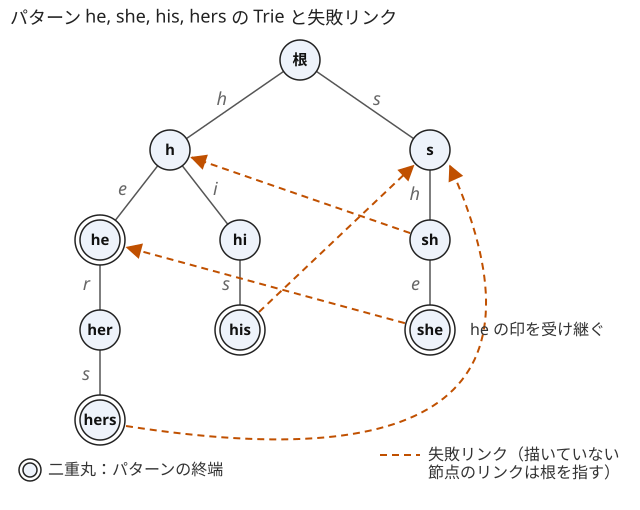
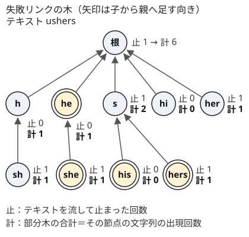

!!! abstract "要点"
    - **何ができるか**：パターンの Trie に失敗リンク（Trie にある最長の真の接尾辞へのリンク）を BFS 順に張り、全文字の遷移を埋めたオートマトンにする。テキストを 1 回流すだけで、多数のパターンの出現をまとめて数えられる。
    - **いつ使うか**：
        - 多数のパターンそれぞれの、テキスト中の出現回数
        - どのパターンも含まない（すべて含む）文字列の数
        - 禁止語を含まないように最少の文字を書き換える
        - パターンの長さの総和が 10&#94;5〜10&#94;6 で、パターンの個数も多い
    - **計算量**：パターンの長さの総和を $M$、文字の種類数を $\sigma$、テキストの長さを $N$ とする。構築 $O(\sigma M)$、テキストの走査 $O(N)$（1 文字ごとに $O(1)$。ならしではない）、全パターンの出現回数の集計は合わせて $O(N + M)$
    - **前提**：[Trie](../string/trie.md)、[KMP 法と文字列の周期](../string/kmp.md)、[幅優先探索（BFS）と無重み最短路](../graph/bfs.md)

<!-- textlint-disable -->
別名：AC オートマトン・失敗リンク・複数パターン照合・禁止語・Aho-Corasick algorithm
<!-- textlint-enable -->

Aho-Corasick 法は、[KMP 法](../string/kmp.md)の[照合オートマトン](../guide/glossary.md#matching-automaton)を複数のパターンに広げたものである。パターンを [Trie](../string/trie.md) にまとめ、各節点に「失敗したらどこへ戻るか」を表す失敗リンクを張ると、テキストを先頭から 1 回読むだけで、各位置で終わるパターンがすべて分かる。状態の遷移を表に埋めておけば、DP や行列累乗の状態としてもそのまま使える。

## Trie と失敗リンク（KMP の π を Trie に一般化したもの） {#failure-links}

パターンが $K$ 個あり、長さの総和が $M$ のとき、テキスト $S$（長さ $N$）の中の出現を 1 パターンずつ [KMP 法](../string/kmp.md)で探すと $O(K N + M)$ かかる。$K$ も $N$ も $10^5$ 規模なら $10^{10}$ 回になり間に合わない。Aho-Corasick 法は、全パターンの照合を 1 本の走査にまとめて $O(N)$ にする。

まずパターン $P_1, \dots, P_K$ を Trie に入れる。節点 $v$ は根から $v$ までの文字列 $\mathrm{str}(v)$ を表し、これはどれかのパターンの接頭辞である。節点の数は $M + 1$ 以下になる。

テキストを読みながら保つ状態は、KMP 法の「一致している長さ」に当たるものである。

> $S[0, i)$ を読んだ後の状態は、$S[0, i)$ の接尾辞のうち Trie にある最長のものを表す節点である。

この状態から 1 文字 $c$ を読んだとき、子 $c$ があればそこへ進む。子がなければ、一致を短くしてやり直す。そのとき戻る先が失敗リンクである。

> 節点 $v$ の失敗リンク $\mathrm{link}(v)$ は、$\mathrm{str}(v)$ の真の接尾辞（$\mathrm{str}(v)$ 自身を除く接尾辞）のうち Trie にある最長のものを表す節点である。根の失敗リンクは根とする。

1 パターンなら Trie は 1 本の道になり、$\mathrm{link}$ は KMP 法の $\pi$ と同じもの（長さ $j$ の節点の失敗リンクは長さ $\pi[j - 1]$ の節点）になる。違いは、戻る先が別の枝にもありうることだけである。次の図は、パターン he, she, his, hers の Trie と、根以外を指す失敗リンクである。



たとえば $\mathrm{str}(v) = \texttt{she}$ の真の接尾辞は he・e・空で、Trie にある最長のものは he なので、$\mathrm{link}(v)$ は he の節点である。$\texttt{hers}$ の真の接尾辞 ers・rs・s・空のうち Trie にあるのは s と空で、最長の s が失敗リンクになる。

失敗リンクをたどると、Trie にある接尾辞を長い順にすべて訪れる。$\mathrm{str}(v)$ の接尾辞で Trie にあるものは、$v, \mathrm{link}(v), \mathrm{link}(\mathrm{link}(v)), \dots$, 根 のどれかに必ず現れる。$\mathrm{link}(v)$ より長い真の接尾辞は Trie にないので、Trie にある真の接尾辞はすべて $\mathrm{str}(\mathrm{link}(v))$ の接尾辞である。あとは $\mathrm{link}(v)$ について同じ議論をくり返せばよい（KMP 法の [border の連鎖](../string/kmp.md#border-chain)と同じ理由）。この性質が、後の節の出現の判定と集計の土台になる。

次の動く図の前半では、節点を BFS 順に取り出し、その行（[次の節](#build)で述べる遷移表の行で、各文字を読んだ後の状態の並び）を失敗リンク先の行から写しながら子の失敗リンク（破線の矢印）を張る。後半ではテキスト ushers を 1 文字ずつ読み、着いた状態（濃い丸）から失敗リンクの連鎖（薄く塗った丸）をたどって、連鎖の上にある終端（二重丸）を出現として拾う。

<div class="kp-viz" data-viz="aho-corasick" data-config='{"patterns": ["he", "she", "his", "hers"], "text": "ushers"}'></div>

テキスト ushers を流すと、状態は 根 → s → sh → she → her → hers と動く（最初の u は Trie にないので根のまま）。4 文字目で状態 she に着いたとき、失敗リンクをたどると she・he・根 なので、そこで終わる出現は she と he の 2 つである。6 文字目では hers・s・根 をたどり、hers の出現が分かる。

## BFS 順に失敗リンクを張る理由と、全文字の遷移表の埋め方 {#build}

失敗リンクと遷移は、[KMP 法の照合オートマトン](../string/kmp.md#automaton)と同じく、短い方から順に決まる。遷移表 $\mathrm{nxt}[v][c]$ を「状態 $v$ で文字 $c$ を読んだ後の状態」、すなわち $\mathrm{str}(v) + c$ の接尾辞のうち Trie にある最長のものとする。根以外の節点 $v$ と各文字 $c$ について、次のように決める。

- $v$ に子 $u$（文字 $c$）があるとき：$\mathrm{nxt}[v][c] = u$。子の失敗リンクは $\mathrm{link}(u) = \mathrm{nxt}[\mathrm{link}(v)][c]$
- 子がないとき：$\mathrm{nxt}[v][c] = \mathrm{nxt}[\mathrm{link}(v)][c]$

根では、子があればその子へ、なければ根へ遷移し、根の子の失敗リンクは根にする。

**なぜ正しいか**。$\mathrm{str}(v) + c$ の真の接尾辞は、$\mathrm{str}(v)$ の真の接尾辞 $x$ に $c$ を付けた $x + c$ の形をしている。$x + c$ が Trie にあるなら $x$ も Trie にある（接頭辞は Trie にある）ので、$x$ は $\mathrm{str}(\mathrm{link}(v))$ の接尾辞である（前の節の性質）。よって「$\mathrm{str}(v) + c$ の真の接尾辞で Trie にある最長のもの」は「$\mathrm{str}(\mathrm{link}(v)) + c$ の接尾辞で Trie にある最長のもの」に等しい。後者が $\mathrm{nxt}[\mathrm{link}(v)][c]$ である。子 $u$ があるときの $\mathrm{link}(u)$ も、子がないときの遷移も、この同じ値になる。

**なぜ BFS 順か**。上の式は、$v$ を処理するときに $\mathrm{link}(v)$ の行が埋まっていることを前提にしている。$\mathrm{str}(\mathrm{link}(v))$ は $\mathrm{str}(v)$ より短いので、$\mathrm{link}(v)$ は $v$ より浅い。根から深さの順に処理する [BFS](../graph/bfs.md) なら、浅い節点はすべて先に処理済みである。DFS の順では、失敗リンクの先が別の枝のまだ処理していない節点になることがあり、その行が空のままになる（図の his の失敗リンク s は、h の枝を先に深く潜ると未処理である）。

```cpp
--8<-- "aho-corasick/count.cpp:core"
```

`build` は、各節点を取り出したときに失敗リンク先の行を写して自分の行を埋め、同時に子の失敗リンクを決める。行は $\sigma$ 個の欄からなり、節点は $M + 1$ 個以下なので、時間も領域も $O(\sigma M)$ である。表を埋めた後は、テキストの 1 文字ごとに表を 1 回引くだけなので、走査は 1 文字 $O(1)$ になる。

表を埋めずに、子がなければ失敗リンクをたどる書き方もある。テキストを 1 回流すだけなら、KMP 法と同じ議論（状態の深さは 1 文字で高々 1 増え、たどるたびに減る）で走査はならし $O(N)$ になる。ただし 1 文字あたりは最悪 $O(M)$ かかるので、DP で全状態から遷移を引く場合や、状態を戻しながら読む場合には使えない。迷ったら表を埋める。

$\sigma = 26$、$M = 10^6$ のとき、表は 32 bit 整数が $2.6 \times 10^7$ 個で約 100 MB になる。表は `long long` でなく `int` で持つ。`vector` に節点を 1 つずつ足すと、再確保のときに一時的に約 2 倍のメモリを使うので、節点の数の上限 $M + 1$ が分かっていれば先に `reserve` しておく。それでも足りないときは、子を `map` で持って失敗リンクをたどる書き方も考える。

## 出現回数の集計：訪問回数を失敗リンクの木で葉から根へ足す（出現のたびにたどると遅い） {#count-occurrences}

パターンごとの出現回数を求めるとき、テキストの各位置で失敗リンクを根までたどってパターンを数えると遅い。$S = \texttt{aa} \cdots \texttt{a}$ とパターン $\texttt{a}, \texttt{aa}, \dots, \texttt{a}^k$ では、状態の深さが $k$ になり、各位置で $k$ 回たどる。長さの総和 $M$ は約 $k^2 / 2$ なので、$k \approx \sqrt{2M}$ で、$N = M = 5 \times 10^5$ なら約 $5 \times 10^8$ 回になる。終端の節点だけを結んだリンク（出力リンク）を使っても、出現の総数そのものがこれだけあるので速くならない。

そこで、走査では状態に止まった回数だけを数え、後でまとめて足す。

1. テキストを流し、各文字を読んだ後の状態 $v$ について $\mathrm{cnt}[v]$ を 1 増やす
2. 根以外の節点を BFS の逆順に見て、$\mathrm{cnt}[\mathrm{link}(v)] \mathrel{+}= \mathrm{cnt}[v]$ とする
3. パターン $P_j$ の出現回数は、$P_j$ の終端の節点の $\mathrm{cnt}$ である

失敗リンク $v \to \mathrm{link}(v)$ を子から親への辺とみると、根を根とする木になる（失敗リンクの木）。手順 2 は、この木で各節点に部分木の $\mathrm{cnt}$ の和を集める操作である。$\mathrm{link}(v)$ は $v$ より浅いので、BFS の逆順に足せば、子の和が親より先に確定する。

**なぜ重複も漏れもなく数えられるか**。$P_j$ が位置 $i$ で終わる（$S[i - \lvert P_j \rvert + 1, i + 1) = P_j$）ことは、$P_j$ が $S[0, i + 1)$ の接尾辞であることと同じである。$P_j$ は Trie にあるので、状態 $v_i$（$S[0, i + 1)$ の接尾辞で Trie にある最長のもの）の接尾辞にもなり、[失敗リンクの節](#failure-links)の性質から $v_i$ の失敗リンクの連鎖に $P_j$ の節点が現れる。連鎖は失敗リンクの木で $v_i$ から根への道なので、「$P_j$ が位置 $i$ で終わる」ことは「$v_i$ が $P_j$ の節点の部分木に入る」ことと同じである。各位置 $i$ は $\mathrm{cnt}[v_i]$ に 1 回だけ数えられているので、部分木の和は $P_j$ の出現回数にちょうど等しい。

次の図は、パターン he, she, his, hers にテキスト ushers を流したときの集計である。



止まった回数は s・sh・she・her・hers が 1 ずつで、he には 1 度も止まっていない。それでも he の部分木に she があるので、he の出現回数は 1 になる。

```cpp
--8<-- "aho-corasick/count.cpp:count"
```

計算量は、走査が $O(N)$、足し込みが $O(M)$ で、構築を合わせて $O(\sigma M + N)$ である。同じパターンが 2 回入力されても同じ節点を指すので、パターンごとに終端の節点の番号を覚えておけばよい。

## 終端の印を失敗リンク先から受け継ぐ {#inherit-terminal}

「いまの位置で、どれかのパターンが終わるか」だけを知りたいときは、各節点に印 $\mathrm{term}[v]$ ＝「$\mathrm{str}(v)$ の接尾辞に、どれかのパターンがある」を持たせる。失敗リンクの連鎖が接尾辞を尽くすので、

$$
\mathrm{term}[v] = (\mathrm{str}(v) \text{ がパターン}) \lor \mathrm{term}[\mathrm{link}(v)]
$$

で求まる。$\mathrm{link}(v)$ は $v$ より先に BFS で取り出されるので、`build` の中で取り出したときに受け継げばよい（[構築のコード](#build)の `term` の行）。

Trie を作った直後の「ちょうどこの節点で終わる」印だけで判定すると、パターンの途中に別の短いパターンが埋まっている場合を見落とす。パターンが bc と abcd のとき、テキスト abcx を読むと状態は a → ab → abc → 根 と動く。節点 abc はどのパターンの終端でもないが、接尾辞 bc がパターンなので、3 文字目で bc が現れている。受け継いだ印なら $\mathrm{term}[\texttt{abc}] = \mathrm{term}[\texttt{bc}]$ が真になり、見落とさない。

印の代わりに、接尾辞に現れるパターンの個数・重みの和・パターンの集合を表す bit も同じ形で受け継げる。

- 個数：$\mathrm{num}[v] = \mathrm{num}_0[v] + \mathrm{num}[\mathrm{link}(v)]$。$\mathrm{num}_0[v]$ はちょうど $v$ で終わるパターンの数である。テキスト全体での出現の総数は、走査で止まった各状態の $\mathrm{num}$ の和になる
- 集合：$\mathrm{mask}[v] = \mathrm{mask}_0[v] \text{ OR } \mathrm{mask}[\mathrm{link}(v)]$。$\mathrm{mask}_0[v]$ はちょうど $v$ で終わるパターンの bit である。「すべて含む」を数える DP で、読んだ文字で新しく含んだパターンを知るのに使う

## 照合オートマトンとして使う（DP・行列累乗） {#as-automaton}

遷移表を埋めると、状態は次の 1 文字だけで次の状態が決まる。これを [DP の状態](../guide/glossary.md#state)にすると、「長さ $L$ の文字列で、どのパターンも含まないものの数」が数えられる。

- 状態：$\mathrm{dp}[v]$ ＝ ここまでの文字列のうち、どのパターンも含まず、いまの状態が $v$ であるものの数
- 初期値：$\mathrm{dp}[\text{根}] = 1$
- 遷移：各 $v$ と各文字 $c$ について $u = \mathrm{nxt}[v][c]$ とし、$\mathrm{term}[u]$ が偽なら $\mathrm{dp}[u]$ に配る。真なら、その文字でどれかのパターンが現れたので捨てる
- 答え：$L$ 文字の後の $\mathrm{dp}$ の総和

```cpp
--8<-- "aho-corasick/avoid-dp.cpp:dp"
```

この状態で足りるのは、今後どのパターンが現れるかが、テキストの末尾のうち Trie にある最長の接尾辞だけで決まるからである。それより前の文字は、どのパターンの出現にも関わりえない。計算量は $O(L \sigma M)$ である。

捨てる判定には、受け継いだ印を使う（[前の節](#inherit-terminal)）。Trie の終端の節点だけを捨てると、パターンを途中に含む状態から先へ進んでしまい、多く数える。

応用の型は次のとおりである。DP の組み立て方の詳細は[照合オートマトン上の DP](../string/string-automaton-dp.md)にまとめる。

- **$L$ が巨大**（$10^9$ など）：遷移を（状態数）×（状態数）の行列にして $L$ 乗する。計算量は状態数の 3 乗 × $\log L$ なので、状態数が 100 程度までの問題で使える（[DP の遷移を行列にする](../math/matrix-power.md#dp-transition)）。サイン：パターンが短く少なく、長さだけが巨大
- **すべて含む**：状態に「これまでに含んだパターンの集合」の bit を足し、$(v, \mathrm{mask})$ で DP する。読んだ文字で着いた節点の受け継いだ $\mathrm{mask}$ を OR する。サイン：パターンが 8 個程度までで、すべてを含む文字列を数える
- **最適化**：数える代わりに最大・最小を取れば、「パターンの出現ごとに得点がある文字列の最大得点」なども同じ表で解ける（各状態の得点は受け継いだ重みの和）

## 禁止語の貪欲：一致したら書き換えて状態を根に戻す {#forbidden-greedy}

この節は、[区間の串刺し](../basics/interval-scheduling.md#stabbing)（すべての区間を最少の点で突く貪欲）を前提にする。

問題の形は、「テキスト $S$ の文字を最少の個数だけ、どのパターンにも現れない文字（$\texttt{*}$ など）に書き換えて、どのパターンも部分文字列として含まないようにする」である。パターンの各出現を、$S$ の区間 $[l, r]$（閉区間）とみると、これは「どの区間にも書き換えた位置が 1 つ以上入る」ように位置を選ぶ問題、すなわち区間の串刺しになる。

区間の串刺しは、右端が最も小さい区間の右端を選び、そこを含む区間を除いてくり返すのが最適である。Aho-Corasick 法で $S$ を先頭から流すと、受け継いだ印が初めて真になる位置が「右端が最も小さい出現の右端」である。そこで次のようにする。

1. 状態を根にして $S$ を先頭から読む
2. 読んだ後の状態 $v$ で $\mathrm{term}[v]$ が真なら、その文字を書き換えて答えに 1 を足し、状態を根に戻す

```cpp
--8<-- "aho-corasick/taboo-greedy.cpp:greedy"
```

**状態を根に戻してよい理由**。書き換えた位置を含む出現はすべて突かれたので、残る出現は書き換えた位置より後で始まるものだけである。書き換えた文字はどのパターンにも現れないので、それをまたぐ接尾辞は Trie にない。よって次の位置からは、空の文字列から照合をやり直すのと同じになる。根に戻さずに走査を続けると、書き換えた文字をまたいだ一致を数えてしまい、答えが多くなる。

計算量は構築を合わせて $O(\sigma M + N)$ である。

## 落とし穴 {#pitfalls}

**出現のたびに失敗リンクを根までたどる**。パターンごとの出現回数を、各位置で連鎖をたどって数えると、[集計の節](#count-occurrences)の $\texttt{aa} \cdots \texttt{a}$ の例で $O(N \sqrt{M})$ になり TLE する。止まった回数を数えて、失敗リンクの木で後から足す。

**終端の印を受け継がない**。Trie の「ちょうどこの節点で終わる」印だけで判定すると、パターン bc と abcd に対するテキスト abcx のように、長いパターンの途中に埋まった短いパターンを見落とす。DP では含んだ文字列を数えてしまい、禁止語の貪欲では書き換えが足りなくなる。`build` の中で $\mathrm{term}[\mathrm{link}(v)]$ を OR する。

**DFS の順で失敗リンクを張る**。失敗リンクの先が別の枝のまだ処理していない節点だと、その行の遷移が空（`-1`）のまま写される。キューを使った BFS の順で処理する。

**根の欠けた遷移を `-1` のままにする**。根で子のない文字は根へ遷移させる。ここが `-1` のままだと、表を引いた先が配列の外になる。

**失敗リンクをたどる書き方のまま DP にする**。ならし $O(1)$ が言えるのは、テキストを先頭から 1 回流すときだけである。DP で全状態から全文字の遷移を引くと、1 回あたり最悪 $O(M)$ になる。DP・行列・状態を戻す探索では、遷移表を埋める。

**同じパターンが複数回入力される**。終端の節点に「パターンの番号」を 1 つだけ持たせると、後から入れた番号で上書きされ、先のパターンの答えが出ない。パターンごとに終端の節点の番号を配列に覚え、答えは節点から引く。

## 例題 {#examples}

### ABC362 G. Count Substring Query {#abc362_g}

<div class="kp-problems" data-role="example" markdown>

- [ABC362 G. Count Substring Query](https://atcoder.jp/contests/abc362/tasks/abc362_g)（diff 1625）：文字列 S と多数の T_i について、S の中での各 T_i の出現回数を答える。

</div>

$T_i$ をすべてパターンとして Trie に入れ、$S$ を 1 回流す。各 $T_i$ を KMP 法で別々に探すと、クエリの数 × $\lvert S \rvert$ かかって間に合わない。各位置で失敗リンクを根までたどる数え方も、$T_i$ が $\texttt{a}, \texttt{aa}, \texttt{aaa}, \dots$ のような入力で遅くなる。止まった回数を失敗リンクの木で足し上げれば、全クエリに $O(\sigma \sum \lvert T_i \rvert + \lvert S \rvert)$ で答えられる。

??? note "解法の詳細"
    1. 各 $T_i$ を Trie に入れ、終端の節点の番号 $\mathrm{node}_i$ を覚える。同じ文字列のクエリは同じ節点を指す
    2. BFS の順に失敗リンクと遷移表を作る
    3. $S$ を流し、各文字を読んだ後の状態の $\mathrm{cnt}$ を 1 増やす
    4. BFS の逆順に $\mathrm{cnt}[\mathrm{link}(v)] \mathrel{+}= \mathrm{cnt}[v]$ とし、$\mathrm{cnt}[\mathrm{node}_i]$ を答える

    [集計の節](#count-occurrences)のコード片がそのまま答えになる。出現回数は $\lvert S \rvert$ 以下なので `int` でも収まるが、和を取る配列は `long long` にしておくと安全である。[Suffix Array](../string/suffix-array.md#pattern-count) を作り、$T_i$ を接頭辞に持つ接尾辞の範囲を二分探索で求める解き方もある。

## 練習問題 {#practice}

<div class="kp-problems" data-role="practice" markdown>

- [ABC419 F. All Included](https://atcoder.jp/contests/abc419/tasks/abc419_f)（diff 1726）：N ≤ 8 個の短い文字列をすべて部分文字列として含む、長さ L の文字列の数を求める。
- [ABC458 F. Critical Misread](https://atcoder.jp/contests/abc458/tasks/abc458_f)（diff 1744）：長さ N（≤ 10^9）の文字列で、K 個の文字列をどれも含まないものの数を求める。

</div>

??? note "方針"
    - **ABC419 F**：与えられた文字列の Trie の節点（接頭辞）と、これまでに含んだ文字列の集合の bit の組を状態にする。1 文字ずつ DP で配り、着いた節点の受け継いだ集合を OR し、最後に集合がすべての bit を含む状態の和を取る（[照合オートマトンとして使う](#as-automaton)）
    - **ABC458 F**：禁止文字列から作った状態のうち、受け継いだ印が立つものを除いて遷移行列を作り、$N$ 乗する。禁止文字列は 10 個以下・各 10 文字以下なので状態は 101 個以下で、行列累乗が間に合う。根から始めた行の和が答えである

## 力試し {#challenge}

<div class="kp-problems" data-role="challenge" markdown>

- [ABC268 Ex. Taboo](https://atcoder.jp/contests/abc268/tasks/abc268_h)（diff 2560）：S の文字を最少個数だけ * に変えて、どの T_i も部分文字列として含まないようにする。

</div>

??? note "方針"
    - **ABC268 Ex**：$T_i$ の出現を区間とみると区間の串刺しになる。$S$ を流し、受け継いだ印が立った位置の文字を $\texttt{*}$ にして状態を根に戻す貪欲が最適である（[禁止語の貪欲](#forbidden-greedy)）

## 確認問題 {#quiz}

??? question "確認問題：パターン abab と bab の Trie で、節点 abab の失敗リンクはどの節点か"
    節点 bab である。$\texttt{abab}$ の真の接尾辞は bab・ab・b・空で、Trie にあるのは bab（パターン）・ab（abab の接頭辞）・b（bab の接頭辞）・空である。最長の bab が失敗リンクになる。別の枝を指すので、KMP 法の $\pi$（abab だけなら ab）とは違う。

??? question "確認問題：パターン a・ab・b にテキスト abab を流す。各節点に止まった回数と、失敗リンクの木での部分木の和を求め、各パターンの出現回数を答えよ"
    状態は a → ab → a → ab と動くので、止まった回数は a が 2、ab が 2、b と根が 0 である。失敗リンクは $\mathrm{link}(\texttt{ab}) = \texttt{b}$ で、a と b は根を指す。部分木の和は a が 2、ab が 2、b が 2（ab の 2 を受け取る）になり、出現回数は a・ab・b とも 2 である。b には 1 度も止まらないが、ab の接尾辞として 2 回現れている。

??? question "確認問題：テキストを流すだけなら失敗リンクをたどる書き方でよいのに、DP では遷移表が要るのはなぜか"
    たどる書き方の $O(1)$ はならしで、根拠は「状態の深さが 1 文字で高々 1 しか増えない」ことである。テキストを先頭から 1 回流す間は、たどった回数の合計が深さの増えた合計以下に収まる。DP では各段で全状態から全文字の遷移を引くので、深い状態から何度もたどることになり、この議論が使えない。1 回あたり最悪 $O(M)$ になる。

## 使い分け {#comparison}

| 状況 | 使う手法 |
| --- | --- |
| パターンが 1 つ | [KMP 法](../string/kmp.md)・[Z-algorithm](../string/z-algorithm.md) |
| 多数のパターンの出現回数（オフライン） | Aho-Corasick 法、または [Suffix Array](../string/suffix-array.md#pattern-count) の二分探索 |
| パターンの長さの種類が少ない | [ローリングハッシュ](../string/rolling-hash.md)で長さごとに走査 |
| 含まない・すべて含む文字列を数える | Aho-Corasick 法の状態で DP（[照合オートマトン上の DP](../string/string-automaton-dp.md)） |
| テキスト側の全部分文字列を扱う | [Suffix Automaton](../string/suffix-automaton.md#suffix-automaton) |

出現回数だけなら、Suffix Array の二分探索は $O(\sum \lvert T_i \rvert \log N)$ で、ACL の `suffix_array` があれば実装が短い。オートマトンとして DP に使うなら、Aho-Corasick 法が要る。ローリングハッシュは長さの種類ごとにテキストを走査するので、長さの総和 $M$ に対して種類は $O(\sqrt{M})$ 個あり、$O(N \sqrt{M})$ かかる。

## 参考 {#references}

- [noshi91「Aho-Corasick 法」（アルゴリズム事典）](https://noshi91.github.io/algorithm-encyclopedia/aho-corasick)：構築と照合の計算量の言い方、遷移の持ち方による違い
- [プロひろ「ABC362 G問題（Count Substring Query）を解く」](https://programming-hiroba.com/abc362-g/)：例題 abc362_g の問いと、SA の二分探索による別解
- [kmjp「AtCoder ABC #362 : G - Count Substring Query」](https://kmjp.hatenablog.jp/entry/2024/07/14/0900)：例題 abc362_g の問い（SA と LCP による解き方）
- [KCPC ブログ「【ABC419】Aho-Corasick⁉️⁉️⁉️知りません...」](https://kcpc.hatenablog.com/entry/ABC419)：練習 abc419_f の状態（接頭辞と含んだ集合の bit）
- [anoconne「AtCoder Beginner Contest反省会 ~入緑編~」（note）](https://note.com/anoconne/n/n26b5912e1e9c)：力試し abc268_h（Ex - Taboo の節）の、一致したら書き換えて根に戻す貪欲と、印を失敗リンク先から受け継ぐ実装
