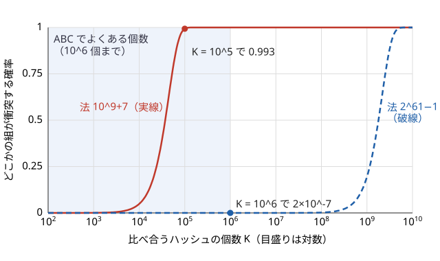

!!! abstract "要点"
    - **何ができるか**：比べるハッシュの組の数から衝突確率を見積もり、事前に固定されたテストでも落ちない mod と基数を選ぶ。mod $10^9$ 程度の 1 つでは全部の組の比較に耐えないので、mod $2^{61} - 1$ と実行時に乱択した基数（値のハッシュなら乱択した素数の mod）を使う。
    - **いつ使うか**：
        - ハッシュ値を set や map に大量に入れて重複を数える。
        - 1000 桁程度の巨大な数の積や和が一致するかを判定する。
        - 比べ合うハッシュが $10^5$ 個以上（組が $5 \times 10^9$ 以上）。
    - **計算量**：見積もりは「組の数 $K^2 / 2$ × 1 組の衝突確率」。mod $2^{61} - 1$ の積と剰余は除算なしの $O(1)$、素数の乱択は素数判定を期待約 42 回。
    - **前提**：[ローリングハッシュ](../string/rolling-hash.md)。

<!-- textlint-disable -->
別名：ハッシュの衝突確率・誕生日のパラドックス・mod 2^61-1・ハッシュの mod の選び方・anti-hash・ハッシュが落とされる・unordered_map の衝突・カスタムハッシュ・hash collision
<!-- textlint-enable -->

ハッシュの安全な設計は、「どれだけの組を比べるか」から必要な値の範囲を決め、「誰が何を先に決めるか」から何を乱択するかを決めることである。ハッシュの解き方が正しくても、法や基数の選び方だけで WA になる。このページは、その見積もりと、固定のテストで狙われる選び方の避け方をまとめる。多項式ハッシュの作り方と部分文字列の取り出しは[ローリングハッシュ](../string/rolling-hash.md)にある。

## 衝突確率の見積もり：比較の回数ではなく組の数（誕生日のパラドックス） {#birthday-bound}

ハッシュを $K$ 個作って set や map に入れ、等しいものがあるかを調べるとする。set は全部の組を 1 組ずつ比べるわけではないが、「どの 2 つも等しくない」と言うためには、$K$ 個のどの 2 つも衝突していない必要がある。だから効くのは比較の回数ではなく、比べ合う組の数 $\binom{K}{2} \approx K^2 / 2$ である。

ハッシュ値が $p$ 通りの値に一様にばらつくとみなすと、1 組が衝突する確率は $1 / p$ である。衝突する組の個数の期待値と、どこかの組が衝突する確率は、およそ次の式で表せる。

$$
E[\text{衝突する組の数}] = \frac{K(K-1)}{2p}, \qquad P(\text{どこかで衝突}) \approx 1 - \exp\left(-\frac{K(K-1)}{2p}\right)
$$

$K$ が $\sqrt{p}$ 程度で確率は 1/2 に届く。23 人いれば同じ誕生日の 2 人がいる確率が 1/2 を超えるという、誕生日のパラドックスと同じ構造である。



上のグラフは、法が約 $10^9$ のときと $2^{61} - 1$ のときの曲線を対数の横軸で比べたものである。法が約 $10^9$ だと、ABC でよくある個数（$10^5$ 個）で衝突はほぼ確実になる。$2^{61} - 1$ なら $10^6$ 個でも確率は $10^{-7}$ 程度である。

| 比べ合うハッシュの個数 $K$ | 法 $10^9 + 7$（期待値） | 法 $2^{61} - 1$（期待値） |
| --- | --- | --- |
| $10^4$ | 0.05 | $2 \times 10^{-11}$ |
| $10^5$ | 5 | $2 \times 10^{-9}$ |
| $2 \times 10^5$ | 20 | $9 \times 10^{-9}$ |
| $10^6$ | 500 | $2 \times 10^{-7}$ |

比べ合う組が暗に多くなる場面はほかにもある。長さを二分探索して「長さ $m$ の部分文字列に重複があるか」を set で調べると、1 回の判定で約 $N^2 / 2$ 組を比べ、それを $\log N$ 回くり返す。巨大な数の積 $A_i A_j$ が列のどれかと一致するかを map で調べると、$N^2$ 個の積と $N$ 個の値で $N^3$ 組を比べている（[例題 ABC339 F](#abc339_f)）。

一方、2 つの区間の一致を $Q$ 回だけ判定するなら、比べる組は $Q$ 組である。$Q = 2 \times 10^5$ なら、法が約 $10^9$ でも誤る確率は $2 \times 10^{-4}$ ほどで済む。見積もるときは「何と何を比べているか」を数える。

### 1 組あたり 1/p とみなす根拠と限界

多項式ハッシュで基数 $B$ を乱択したとき、長さ $L$ の異なる 2 つの文字列が衝突する確率は $(L - 1) / p$ 以下と保証できる（[ローリングハッシュ](../string/rolling-hash.md#collision-bound)）。$1 / p$ はこれより $L - 1$ 倍小さい見積もりである。

- **根拠**：差の多項式は 0 でない $L - 1$ 次以下の多項式で、衝突するのは $B$ がその根のときだけである。根の個数は $L - 1$ 以下だが、ふつうの文字列の組ではずっと少なく、多くの組を平均すれば 1 組あたり約 $1 / p$ になるとみなせる。
- **限界**：根の多い組は作れる。たとえば $d$ が $p - 1$ の約数のとき、$S = \texttt{b}\texttt{a}^d$ と $T = \texttt{a}^d\texttt{b}$ の差は $B^d - 1$ になり、根が $d$ 個ある。$p = 2^{61} - 1$ では $p - 1 = 2 \cdot 3^2 \cdot 5^2 \cdot 7 \cdot 11 \cdot 13 \cdot 31 \cdot 41 \cdot 61 \cdot 151 \cdot 331 \cdot 1321$ で、$d = 450450$ が約数なので、長さ約 $4.5 \times 10^5$ でこの組は確率 $(L - 1) / p$ に届く。
- **安全側の見積もり**：保証が欲しいなら、組の数に $(L - 1) / p$ を掛ける。$N = 2 \times 10^5$ の部分文字列のハッシュ $2 \times 10^5$ 個の全部の組でも $2 \times 10^{10} \times 2 \times 10^5 / (2.3 \times 10^{18}) \approx 1.7 \times 10^{-3}$ 以下である。$p$ が $10^9$ 程度だと、この上界は 1 を大きく超えて何も言えない。

## mod 2^64 が破られる理由（Thue-Morse 列。奇数のどの基数でも長さ 1024 で衝突する） {#mod-2-64}

`unsigned long long` のあふれに任せる mod $2^{64}$ のハッシュは、剰余の計算が要らず速い。しかし、奇数の基数なら長さ 1024 の組（Thue-Morse 列）で、偶数の基数なら末尾の 64 文字が同じ組で必ず衝突する。Thue-Morse 列の組の後ろに同じ 64 文字を付けた長さ 1088 の組は、どの基数でも衝突する。基数を乱択しても防げない。

Thue-Morse 列を、$t_0 = \texttt{a}$、$t_{k+1} = t_k + \overline{t_k}$ で作る。$\overline{t}$ は $t$ の $\texttt{a}$ と $\texttt{b}$ を入れ替えた列である（$t_1 = \texttt{ab}$、$t_2 = \texttt{abba}$、$t_3 = \texttt{abbabaab}$）。$t_k$ と $\overline{t_k}$ はどちらも長さ $2^k$ で、文字が全部違う。

```cpp
--8<-- "hash-safety/thue-morse.cpp:core"
```

2 つのハッシュの差 $D_k = H(t_k) - H(\overline{t_k})$ を追う。連結のハッシュは $H(XY) = H(X) \cdot B^{\lvert Y \rvert} + H(Y)$ なので、次が成り立つ。

$$
D_{k+1} = \left(H(t_k) B^{2^k} + H(\overline{t_k})\right) - \left(H(\overline{t_k}) B^{2^k} + H(t_k)\right) = D_k \left(B^{2^k} - 1\right)
$$

$D_0 = \pm 1$ なので、$D_k = \pm \prod_{i=0}^{k-1} \left(B^{2^i} - 1\right)$ である。$B$ が奇数のとき、各因数は 2 で何回割れるかを数える。

- $i = 0$：$B - 1$ は偶数なので、2 で 1 回以上割れる。
- $i \ge 1$：$B^{2^i} - 1 = (B - 1)(B + 1)(B^2 + 1)(B^4 + 1) \cdots (B^{2^{i-1}} + 1)$ と分解できる。$(B - 1)(B + 1)$ は連続する偶数の積なので 8 で割れ、残りの $i - 1$ 個の因数はどれも偶数である。合わせて $2^{i+2}$ で割れる。

指数を足すと $1 + \sum_{i=1}^{k-1} (i + 2)$ で、$k = 10$ のときちょうど $1 + 45 + 18 = 64$ になる。だから長さ $2^{10} = 1024$ の $t_{10}$ と $\overline{t_{10}}$ は、奇数のどの基数でも mod $2^{64}$ で衝突する。基数が偶数なら $B^{64} \equiv 0$ なので、末尾の 64 文字が同じ文字列はすべて衝突する（もっと短い組でも足りる）。

手元で確かめると、乱択した奇数の基数 1000 個のうち、長さ 512 では 227 個、長さ 1024 では 1000 個すべてで衝突した。同じ組を mod $2^{61} - 1$・乱択した基数で比べると、衝突は 0 個だった（`snippets/hash-safety/thue-morse.cpp`）。

!!! warning "mod 2^64 を混ぜた二重ハッシュも同じ"
    mod $2^{64}$ と mod $10^9 + 7$ の 2 つを組にしても、Thue-Morse 列の組では $2^{64}$ の側が必ず一致する。残るのは mod $10^9 + 7$ の 1 つだけで、安全さは 1 つのときと変わらない。

## 推奨する設計：mod 2^61−1・乱択した基数・除算を使わない剰余 {#recommended-design}

文字列の多項式ハッシュは、次の 3 つをそろえれば、ABC で使う範囲の比較にほぼ耐える。実装は[ローリングハッシュの推奨する設計](../string/rolling-hash.md#recommended-design)にあるので、ここでは理由を書く。

- **法は素数 $p = 2^{61} - 1$ を 1 つ**。素数なので、[なぜ衝突しにくいか](../string/rolling-hash.md#collision-bound)の「0 でない多項式の根は次数以下」が使える。$p \approx 2.3 \times 10^{18}$ と大きいので、[組の数による見積もり](#birthday-bound)で $10^6$ 個のハッシュの全部の組でも衝突の期待値は $2 \times 10^{-7}$ である。
- **基数は実行時に $[2, p - 2]$ から一様に乱択する**。上の保証は「文字列が先に決まり、基数を後から選ぶ」ときのものである。基数を固定すると、その基数で衝突する組をテストに入れられる（[狙われる条件](#atcoder-tests)）。$B = 0$ では末尾の 1 文字だけ、$B = 1$ では文字の値の和だけ、$B = p - 1$ では交互に符号を付けた和だけを見ることになるので外す。
- **積は `unsigned __int128` で取り、除算を使わずに剰余を取る**。$2^{61} \equiv 1 \pmod{p}$ なので、積 $t = 2^{61} a + b$（$b < 2^{61}$）は $a + b$ と合同である。$a + b < 2p$ なので、$p$ 以上なら 1 回引けば済み、シフトと足し算だけで剰余が取れる。

10^9 程度の素数 2 つを組にする[二重ハッシュ](#double-hashing)でも確率はほぼ同じだが、計算が 2 倍になる。

!!! info "乱数の作り方"
    `mt19937_64 rng(chrono::steady_clock::now().time_since_epoch().count());` のように実行ごとに変わる種で初期化し、`uniform_int_distribution<unsigned long long>(2, p - 2)(rng)` で選ぶ（[乱数](../cpp/cpp-math-functions.md#random)）。`mt19937_64 rng;` と種を書かないと、毎回同じ列（既定の種 5489）になり、基数を固定したのと同じになる。

## 多項式ハッシュは基数を、値のハッシュは mod（素数）を乱択する {#what-to-randomize}

乱択するのは、ハッシュ関数の中で「テストを作る人が先に知ることのできない部分」である。どの部分の乱択で確率が保証されるかは、ハッシュの形で決まる。

| ハッシュの形 | 乱択するもの | 衝突の確率の根拠 |
| --- | --- | --- |
| 多項式ハッシュ（文字列） | 基数 $B$（法は $2^{61} - 1$ に固定してよい） | 差の多項式の根は $L - 1$ 個以下 |
| 値そのものの mod（巨大な整数） | 法の素数 $p$ | 差の整数を割り切る大きな素数は少ない |
| 集合・多重集合のハッシュ | 値ごとの乱数 | 乱数が独立なので、差が 0 になる確率は集合なら $2^{-64}$、多重集合でもごく小さい（[詳しく](../string/hashing-for-sets.md)） |

巨大な整数 $X$ をそのまま $X \bmod p$ にするハッシュには基数がない。法 $p$ を固定すると、たとえば $A_k = A_i A_j + p$ とすれば $A_i A_j \equiv A_k$ なのに $A_i A_j \ne A_k$ になる。$p = 2^{61} - 1$ でも $2^{64}$ でも、法が知られていれば同じ作り方で衝突させられる。

そこで法の素数を実行時に乱択する。0 でない差 $\lvert A_i A_j - A_k \rvert$ は、2 つの 1000 桁の数の積の程度なので $10^{2000}$ 以下で、$2^{6644}$ 未満である。$2^{60}$ 以上の素数で割り切れるのは多くても $\lfloor 6644 / 60 \rfloor = 110$ 個である。$[2^{60}, 2^{61})$ の素数は約 $2.7 \times 10^{16}$ 個あるので、そこから一様に選んだ $p$ が差を割り切る確率は $110 / (2.7 \times 10^{16}) \approx 4 \times 10^{-15}$ 以下になる。

```cpp
--8<-- "hash-safety/random-prime.cpp:core"
```

素数は、範囲の整数を乱択して素数判定（$2^{64}$ 未満で決定的な [Miller-Rabin](../math/miller-rabin.md)）をくり返して見つける。素数定理から約 42 個に 1 個が素数なので、判定の回数の期待値は約 42 回である。素数を 2 つ独立に選び、両方の余りの組で比べれば、1 組の誤りの確率は約 $(4 \times 10^{-15})^2$ に下がる。

集合のハッシュの乱数の割り当て方は[集合・多重集合のハッシュ](../string/hashing-for-sets.md)、根付き木のハッシュは[木の同型判定](../tree/tree-isomorphism.md)で扱う。

## AtCoder で狙われる条件（事前に固定されたテストと、誰でも使う固定の選択） {#atcoder-tests}

AtCoder にはコンテスト中のハックがなく、テストは事前に作られて固定されている。テストを作る人は参加者の提出を見ずに作るので、狙えるのは「多くの人が同じものを選ぶ」部分だけである。

- **狙われる**：mod $2^{64}$（どの基数でも衝突する組が作れる）。よく使われる素数（$10^9 + 7$・$998244353$・$2^{61} - 1$）と固定の基数の組。値のハッシュの固定の法（基数がないので法だけで決まる）。
- **狙えない**：実行時に乱択した基数・法。テストを作る時点では値が決まっていないので、その値で衝突する組を入れようがない。

確かめられた例がある。[ABC339 F](#abc339_f) では、値を mod $2^{61} - 1$ や mod $2^{64}$ で比べた提出が WA になり、約 $1.4 \times 10^9$ の素数 2 つに変えて通ったという参加記がある。[典型90 047](#typical90_au) の作問者の解説は、$p = 2^{64}$ ではどの基数でも衝突させられると注意している。[ABC141 E](#practice) には、1 本のハッシュで WA になり、法だけを変えた 2 本でも消えず、基数も変えて消えたという記録がある。

固定の選択がたまたま通っても、それは「そのテストに対策が入っていなかった」だけである。乱択していれば、どのテストでも同じ確率の保証が成り立つ。一方、乱択した設計でも、[組の数](#birthday-bound)に対して法が小さければ誤る。乱択は狙い撃ちを防ぐもので、確率の見積もりの代わりにはならない。

## 二重ハッシュとの比較 {#double-hashing}

二重ハッシュは、$10^9$ 程度の素数 2 つ（$p_1$・$p_2$）でそれぞれハッシュを計算し、組で比べる方法である。基数を両方とも乱択すれば、1 組が衝突する確率は約 $1 / (p_1 p_2) \approx 10^{-18}$ で、mod $2^{61} - 1$ の 1 つとほぼ同じになる。

| 観点 | mod $2^{61} - 1$ の 1 つ | $10^9$ 程度の素数 2 つ |
| --- | --- | --- |
| 1 組の衝突（一様とみなす） | 約 $4 \times 10^{-19}$ | 約 $10^{-18}$ |
| 1 文字あたりの計算 | 128 ビットの積 1 回とシフト | 64 ビットの積と剰余が 2 回 |
| 保持するもの | 値 1 つ | 値 2 つ（組で比べる） |
| 128 ビットの整数がない言語 | 積を分けて計算する手間がある | 64 ビットだけで書ける |

速さは環境で変わる。keymoon 氏の C# での計測（[ABC141 E](#practice)）では、mod $2^{61} - 1$ の 1 つが約 8.9 秒、32 ビットの法 2 つが約 18.7 秒（全テストの合計）だった。C++ でも、法を 1 つにまとめる方が書きやすく、比べる値も 1 つで済む。

二重ハッシュにしても、乱択をしない理由にはならない。基数を固定すると、法をいくつ組み合わせても攻撃できることが知られている（maspy 氏のまとめ）。[mod 2^64 を混ぜた組](#mod-2-64)は、$2^{64}$ の側が役に立たない。

## unordered_map への攻撃と、乱数を混ぜたカスタムハッシュ {#unordered-map}

`unordered_map` もハッシュで値を振り分けるので、衝突を狙った入力で遅くなる。こちらは答えを誤るのではなく、1 回の操作が $O(N)$ になって TLE する。

GCC の標準ライブラリ（libstdc++）では、整数の既定のハッシュ `hash<long long>` は値そのものを返す。要素は「ハッシュ値をバケットの数で割った余り」の番号のバケットに入り、バケットの数は要素数に応じて決まった素数の列から選ばれる。だから、最後に使われるバケットの数 $P$ を調べ、$P$ の倍数ばかりを入れると、すべてが 1 つのバケットに集まる。

```cpp
--8<-- "hash-safety/unordered-attack.cpp:attack"
```

手元の g++-15（`-O2`）で確かめると、$10^5$ 個入れたときのバケットの数は 172933 だった。その倍数を $10^5$ 個入れると、いちばん混んだバケットに $10^5$ 個すべてが入り、約 3.2 秒かかった。$2 \times 10^5$ 個（バケットの数 351061 の倍数）では約 17.5 秒かかった。連番を入れたときはどちらも 10 ミリ秒以下である。

対策は 2 つある。

- **使わない**：AtCoder では、まず `map`・ソート・[座標圧縮](../basics/coordinate-compression.md)で書けないかを考える。`map` の $O(\log N)$ は入力に左右されない。
- **乱数を混ぜたハッシュを渡す**：実行ごとに変わる値を足してから、ビットをよく混ぜる関数（splitmix64）に通す。値と置き場所の関係が実行ごとに変わるので、事前に作った入力では狙えない。

```cpp
--8<-- "hash-safety/unordered-attack.cpp:core"
```

`unordered_map<long long, int, SafeHash>` のように 3 つ目の型引数に渡す。pair をキーにする書き方は [unordered_map の節](../cpp/cpp-container-idioms.md#unordered-map)にある。AtCoder の固定のテストに、こうした攻撃の入力がどれだけ入っているかは問題によるが、入っていれば既定のハッシュでは避けようがない。

## 落とし穴 {#pitfalls}

**種を固定した乱数で基数を選ぶ**。`mt19937_64 rng;`・`mt19937_64 rng(42);`・`srand(0)` は毎回同じ列を出すので、基数を定数で書いたのと同じになる。種は時刻（`chrono::steady_clock`）か `random_device` から取る。

**mod 2^64 を「速いから」と使う**。[Thue-Morse 列](#mod-2-64)の組で、奇数の基数なら長さ 1024 で、どの基数でも長さ 1088 で衝突する。基数を乱択しても、別の法と組にしても防げない。

**組の数で見積もらない**。比較の回数が少なく見えても、set や map に入れて重複を探すと全部の組を比べている。法が約 $10^9$ なら $10^5$ 個で衝突はほぼ確実になる（[見積もり](#birthday-bound)）。

**値のハッシュで基数だけ乱択する**。巨大な整数を $X \bmod p$ で比べるハッシュは、法が知られていれば $p$ を足した値で衝突する。乱択するのは法の素数である（[何を乱択するか](#what-to-randomize)）。

**法の素数を固定の表から選ぶ**。「よく使う素数 5 つから 1 つ」では、5 つすべてに対策した入力を作られる。範囲から一様に選び、素数判定で確かめる。

**基数を共有しない**。前向きと後ろ向きのハッシュや、2 つの文字列のハッシュを比べるときに別々に乱択すると、一致する組も一致しない。基数はプログラムの開始時に 1 回だけ決める。

**衝突したら別の固定値に変える**。WA が出て法や基数を別の定数に変えると、そのテストは通っても、ほかのテストで同じことが起きうる。固定値を乱択に置き換える。

## 例題 {#examples}

### ABC339 F. Product Equality {#abc339_f}

<div class="kp-problems" data-role="example" markdown>

- [ABC339 F. Product Equality](https://atcoder.jp/contests/abc339/tasks/abc339_f)（diff 1716）：最大 1000 桁の整数の列で、A_i×A_j = A_k となる組 (i, j, k) の数を求める。

</div>

値をそのまま比べると、1000 桁の数の積を $N^2$ 回計算することになり間に合わない。そこで各 $A_i$ を素数 $p$ で割った余りにして、余りの積で比べる。この問題は[何を乱択するか](#what-to-randomize)の典型で、基数がないので乱択するのは法の素数である。

比べている組は $N^2$ 個の積と $N$ 個の値で $N^3 \le 10^9$ 組ある。$[2^{60}, 2^{61})$ から乱択した素数 1 つなら、1 回のテストで誤る確率は $10^9 \times 4 \times 10^{-15} = 4 \times 10^{-6}$ 以下である。独立な素数を 2 つ使えば、テストの数が多くても無視できる。

??? note "解法の詳細"
    1. $[2^{60}, 2^{61})$ から素数 $p$・$q$ を独立に乱択する。
    2. 各 $A_i$ について、10 進の文字列を上の桁から読んで $(A_i \bmod p, A_i \bmod q)$ を求める（$O(\text{桁数})$）。積は `unsigned __int128` で取る。
    3. 余りの組ごとの個数を `map` に数える。
    4. すべての $(i, j)$ について、余りの積の組を map で引き、個数を答えに足す。

    計算量は桁数の合計を $D$ として $O(D + N^2 \log N)$ である。$N \le 1000$ なら積の組は $10^6$ 個で十分に間に合う。

    ```cpp
    --8<-- "hash-safety/random-prime.cpp:usage"
    ```

    固定の法を避けるだけなら、珍しい素数を選んでも通ることがある。参加記には、mod $2^{61} - 1$ と mod $2^{64}$ で WA になり、約 $1.4 \times 10^9$ の素数 2 つで通った記録がある。ただし、それは対策に当たらなかっただけで、確率の保証はない。

### 典型90 047. Monochromatic Diagonal（★7） {#typical90_au}

<div class="kp-problems" data-role="example" markdown>

- [典型90 047. Monochromatic Diagonal（★7）](https://atcoder.jp/contests/typical90/tasks/typical90_au)（diff —）：R・G・B からなる 2 つの列で各マスの色が決まるマス目について、すべてのマスが同じ色である斜めの線の数を求める。

</div>

色を 0・1・2 に置き換えると、「斜めの線がすべてある色か」は、$T$ の文字を色ごとに置き換えた列と $S$ の、ずらした区間どうしが一致するかに言い換えられる。この一致を[ローリングハッシュ](../string/rolling-hash.md)で $O(1)$ ずつ判定すれば、全体で $O(N)$ になる。

ハッシュの設計で気をつける点は 2 つある。作問者の解説は、$p = 2^{64}$ にするとどの基数でも衝突させられると注意している。また $N \le 10^6$ なので、判定は 3 色 × 約 $2N$ 本で約 $6 \times 10^6$ 回、長さは最大 $10^6$ ある。

??? note "解法の詳細"
    1. 色ごとに、$S$ と比べる列 $T'$ を作る。たとえば赤なら $T$ の G と B を入れ替えた列にすると、斜めの線が赤であることは $S$ の区間と $T'$ の区間の一致になる（ほかの色も同じように置き換えられる）。
    2. $S$ と 3 つの $T'$ の接頭辞のハッシュを、同じ乱択した基数・mod $2^{61} - 1$ で前計算する。
    3. ずらし幅 $k$（$-N < k < N$）ごとに、重なる区間のハッシュを 3 色それぞれ比べ、どれかが一致すれば数える。

    確率の見積もり：比較は約 $6 \times 10^6$ 回で、組を作って比べ合うわけではない。安全側の上界 $(L - 1) / p$ を使っても $6 \times 10^6 \times 10^6 / (2.3 \times 10^{18}) \approx 2.6 \times 10^{-6}$ 以下である。法が約 $10^9$ の 1 つだと、この上界は 1 を超えて保証にならず、一様とみなした見積もりでも 1 回のテストで約 $6 \times 10^{-3}$ になる。テストが数十個あれば無視できない。

    [Z-algorithm](../string/z-algorithm.md) を使えば、確率に頼らず $O(N)$ で判定できる。

## 練習問題 {#practice}

<div class="kp-problems" data-role="practice" markdown>

- [ABC141 E. Who Says a Pun?](https://atcoder.jp/contests/abc141/tasks/abc141_e)（diff 1459）：重ならずに 2 回以上現れる部分文字列の最大の長さを求める（N ≤ 5000）。

</div>

??? note "方針"
    答えの長さを二分探索し、長さ $m$ の部分文字列のハッシュに、重ならない位置どうしの重複があるかを調べる（[ローリングハッシュの節](../string/rolling-hash.md#hash-lcp-binary-search)）。1 回の判定でハッシュ約 $5000$ 個の全部の組（約 $1.25 \times 10^7$ 組）を比べ、二分探索で約 13 回くり返すので、組は合わせて約 $1.6 \times 10^8$ 組ある。法が約 $10^9$ の 1 つでは、一様とみなしても誤る確率が約 0.16 になる。mod $2^{61} - 1$ と乱択した基数で解き直すとよい。

    ハッシュが一致した候補だけ実際に文字列を比べて確かめれば、衝突しても答えは誤らない。ただし、衝突が多いと確かめる時間がかかる。

## 確認問題 {#quiz}

??? question "確認問題：何個まで入れてよいか"
    法 $10^9 + 7$ の 1 つ（基数は乱択）で、長さ $m$ の部分文字列のハッシュを $K$ 個 set に入れて重複を調べる。衝突する組の期待値を 0.01 以下にしたい。$K$ はおよそいくつまでか。

    ??? success "答え"
        期待値は $K^2 / (2p)$ なので、$K^2 \le 0.02 \times 10^9 = 2 \times 10^7$、すなわち $K \le$ 約 4500 である。$10^5$ 個では期待値が約 5 になる。

??? question "確認問題：基数を乱択した mod 2^64"
    mod $2^{64}$（`unsigned long long` のあふれ）で、基数を実行時に乱択した奇数にした。これで、固定のテストに対して安全といえるか。

    ??? success "答え"
        安全ではない。Thue-Morse 列 $t_{10}$ と、その a・b を入れ替えた列は、奇数のどの基数でもハッシュの差が $2^{64}$ で割り切れる。基数を後から選んでも、この組がテストにあれば必ず衝突する。

??? question "確認問題：巨大な整数の和"
    1000 桁の整数の列で、$A_i + A_j = A_k$ となる組を数える。ハッシュで比べるとき、何を乱択すればよいか。法 $2^{61} - 1$ に固定すると、どんな入力で誤るか。

    ??? success "答え"
        法の素数を乱択する。$X \bmod p$ のハッシュには基数がないので、乱択できるのは法だけである。法を $2^{61} - 1$ に固定すると、$A_k = A_i + A_j + (2^{61} - 1)$ とした入力で、和と $A_k$ の余りが一致して誤る。

??? question "確認問題：unordered_map の遅さ"
    `unordered_map<long long, int>` に $2 \times 10^5$ 個の値を入れるだけの処理が TLE した。考えられる原因と、答えを変えずに直す方法を 2 つ挙げよ。

    ??? success "答え"
        既定のハッシュは値そのものなので、バケットの数の倍数ばかりの入力で 1 つのバケットに集まり、1 回の操作が $O(N)$ になった可能性がある。直し方は、`map` やソート・座標圧縮に置き換えるか、実行ごとに変わる値を混ぜた自作のハッシュ（splitmix64 など）を 3 つ目の型引数に渡すことである。

## 使い分け {#comparison}

- 文字列の一致を確率に頼らず判定できるなら、[Z-algorithm](../string/z-algorithm.md)・[KMP 法](../string/kmp.md)・[Manacher](../string/palindrome.md#manacher)・[Suffix Array](../string/suffix-array.md)を優先する。ハッシュが本命になるのは、更新がある、任意の 2 区間を大量に比べる、集合を比べる場面である（[ハッシュで代用できる場面](../string/rolling-hash.md#when-to-use)）。
- 巨大な整数の比較で桁数が小さければ、多倍長整数（Python の int など）で直接計算できることもある。$N^2$ 回の 1000 桁の積は重いので、ハッシュの方が速い。
- 乱択一般の失敗確率の考え方（くり返しで確率を下げる、union bound）は[乱択アルゴリズム](../misc/randomized.md)にまとめる。

## 参考 {#references}

- [keymoon「安全で爆速なRollingHashの話」](https://qiita.com/keymoon/items/11fac5627672a6d6a9f6)：mod $2^{61} - 1$ の利点と除算を使わない剰余、基数を乱択する理由、2 のべき乗の法は基数を乱択しても衝突させられること、ABC141 E での速さの比較
- [maspy「Rolling Hashについて（survey + 研究）」](https://maspypy.com/rolling-hash%E3%81%AB%E3%81%A4%E3%81%84%E3%81%A6%EF%BC%88survey-%E7%A0%94%E7%A9%B6%EF%BC%89)：素数の法で基数を乱択したときの衝突確率の上界、mod $2^{64}$ が確率 1 で衝突させられること、基数を固定すると複数のハッシュの併用でも攻撃されること
- [noshi91「ABC339-F Product Equality の確率を保証する」](https://noshi91.hatenablog.com/entry/2024/02/06/222907)：法の素数を乱択したときに、差を割り切る素数の個数で誤りの確率を抑える議論と、組の数に union bound を使う理由
- [merom686「ABC339」](https://merom686.hatenablog.com/entry/2024/02/04/021920)：ABC339 F で、固定の mod $2^{61} - 1$・mod $2^{64}$ が WA になり、別の素数 2 つで通った記録
- [プロひろ「ABC339 F問題（Product Equality）を解く」](https://programming-hiroba.com/abc339-f/)：ABC339 F の制約と、余りの積を map で数える解き方
- [E869120「競プロ典型 90 問」047 の解説](https://github.com/E869120/kyopro_educational_90/blob/main/editorial/047-02.jpg)：色の言い換えとローリングハッシュ、$p = 2^{64}$ ではどの基数でも衝突させられるという注意（[1 枚目](https://github.com/E869120/kyopro_educational_90/blob/main/editorial/047-01.jpg)と問題文も参照）
- [perogram「ローリングハッシュの衝突回避と定数倍高速化」](https://perogram.hateblo.jp/entry/2019/09/16/103911)：ABC141 E で 1 本のハッシュが WA になり、法だけを変えても消えず、基数も変えて消えた記録と、一致した候補を直接比べる回避策
- [けんちょん「AtCoder ABC 141 E - Who Says a Pun? (1D, 水色, 500 点)」](https://drken1215.hatenablog.com/entry/2019/09/16/014600)：ABC141 E の問いと、長さの二分探索とハッシュによる解き方
