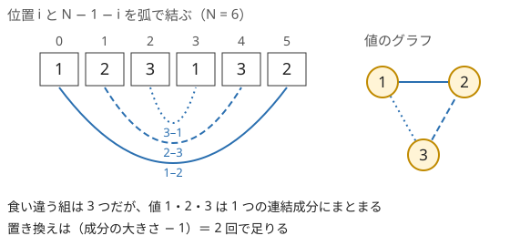

!!! abstract "要点"
    - **何ができるか**：回文の問題を、対称な位置の組を見る・中心から伸ばす・両端から作るの 3 つの見方で小さな状態に落とす。各中心の最長回文の長さは Manacher を使えば $O(N)$ で求まる。その後は任意の区間が回文かを $O(1)$ で判定できる。
    - **いつ使うか**：
        - 回文にするための最小の操作回数（書き換え・一斉置換）
        - 回文になる部分文字列の個数
        - グラフのウォークの文字列が回文になる最短の長さ
        - 長さ K の回文を部分文字列に含まないように埋める方法の数
        - $N \le 10^6$ で、すべての中心（区間）について回文かを問う
    - **計算量**：中心から伸ばすと $O(N^2)$、Manacher は前処理 $O(N)$ で区間の判定が 1 回 $O(1)$。グラフ上の回文は頂点の組を状態にするので状態数 $N^2$
    - **前提**：[文字列の基本操作と辞書順](../string/string-basics.md)

<!-- textlint-disable -->
別名：回文・palindrome・回文判定・Manacher's algorithm・回文半径・中心から伸ばす・両端から作る・マナカー
<!-- textlint-enable -->

回文は、反転しても変わらない文字列（列）である。回文の問題の多くは「外側の 1 組をはがしても回文のまま」という性質を使い、対称な位置の組・中心・両端の組のどれかを単位にして状態を小さくする。このページでは文字列を 0-indexed で書き、長さ $N$ の $S$ で位置 $i$ と対になる位置を $N - 1 - i$ とする。

## 対称な位置の組を見る（Union-Find でまとめる・組ごとの寄与を数える） {#symmetric-pairs}

$S$ が回文であることは、$\lfloor N / 2 \rfloor$ 個の組 $(i, N - 1 - i)$ のすべてで文字が等しいことと同じである（$N$ が奇数なら真ん中の 1 文字は自分自身と対になり、条件がない）。回文にする操作の問題は、まず組ごとの条件に分けて考える。

**1 文字ずつ書き換える**なら、組は互いに独立である。食い違う組ごとに片方を書き換えれば 1 回で済み、少なくとも 1 回は要るので、最小回数は食い違う組の数になる。

**値を一斉に置き換える**操作（値 $x$ をすべて $y$ にする）では、組は独立でなくなる。1 回の操作がすべての位置に効くからである。組 $(a, b)$ は「値 $a$ と値 $b$ を最後に同じ値にする」という条件なので、値を頂点にして $a$ と $b$ を辺で結ぶ。連結成分の値はすべて同じ値にそろえる必要がある。大きさ $k$ の成分は $k - 1$ 回の置き換えでそろう（$k - 1$ 回より少ないと、どれかの値が残る）。答えは $\sum (k - 1)$、すなわち [Union-Find](../ds/union-find.md) で併合に成功した回数である。



食い違う組を数えるだけでは、この例で 3 回と答えてしまう。値 1・2 をそろえた後に値 2・3 をそろえれば、組 3–1 は自動的にそろうからである。

**すべての区間について足し合わせる**ときは、組ごとの寄与に分ける（[寄与](../thinking/contribution.md)）。位置 $i < j$ が区間 $[l, r]$（閉区間）の中で対になるのは $l + r = i + j$ のときで、$l$ は $\max(0, i + j - (N - 1))$ から $i$ までを動く。よって組 $(i, j)$ が対になる区間は次の個数ある。

$$
\min(i + 1,\ N - j)
$$

「すべての区間について、回文にするための書き換え回数の和」なら、値の異なる組についてこの個数を足せばよい。組は $O(N^2)$ 個あるので、全組の和から値の等しい組の和を引くなど、値ごとにまとめて数える。

??? question "確認問題：区間の中で対になる回数"
    $N = 5$ のとき、位置 $1$ と $3$ が対になる区間（閉区間）を列挙し、$\min(i + 1, N - j)$ と一致することを確かめよ。

    ??? success "答え"
        $l + r = 4$ で $l \le 1$、$r \ge 3$ を満たす区間は $[0, 4]$ と $[1, 3]$ の 2 つである。式は $\min(2, 5 - 3) = 2$ で一致する。

## 中心から伸ばす O(N^2)（奇数長と偶数長の中心） {#expand-center}

回文 $S[l, r]$（閉区間）は、中心が同じで 1 つ内側の $S[l + 1, r - 1]$ も回文である。逆に、内側が回文で $S[l] = S[r]$ なら外側も回文になる。だから中心を決めて外へ 1 組ずつ伸ばせば、その中心を持つ回文を短い順にすべて見つけられ、最初に食い違った所で止めてよい。

中心は文字の上（奇数長）と文字の間（偶数長）の合わせて $2N - 1$ 個ある。両方を 1 つのループで扱うには、閉区間 $[l, r]$ の両端の和 $c = l + r$ で中心を表すと楽である。$c$ が偶数なら $l = r = c / 2$ の 1 文字から、奇数なら $l = \lfloor c / 2 \rfloor$、$r = l + 1$ の 2 文字から伸ばし始める。

1 つの中心で伸ばす回数は $O(N)$ なので、全体で $O(N^2)$ である。回文の部分文字列は最大 $N(N + 1) / 2$ 個あるが、1 回伸ばすごとに 1 個見つかるので、区間ごとに判定し直す $O(N^3)$ より速い。

不一致を $k$ 組まで許す変形も同じ形で書ける。外へ伸ばしても内側の不一致は減らないので、$k$ 組を超えた時点で止めてよい。次のコードは、不一致が $k$ 組以下の部分文字列を数える（$k = 0$ なら回文の部分文字列の個数）。

```cpp
--8<-- "palindrome/expand-center.cpp:core"
```

$N$ が $10^4$ 程度なら $O(N^2)$ で間に合う。$N$ が $10^5$ を超えると間に合わないので、各中心の最長の回文を [Manacher](#manacher) で求めるか、[ローリングハッシュ](../string/rolling-hash.md)と二分探索で伸ばせる長さを求める。

## 直前 K−1 文字を状態にした DP（長さ K の回文を作らない） {#avoid-k-palindrome}

「長さ $K$ の回文を部分文字列に含まない文字列を数える」問題では、左から 1 文字ずつ決め、末尾の $K - 1$ 文字を DP の状態にする。新しく 1 文字を足したときに新しく生まれる長さ $K$ の部分文字列は、末尾の $K$ 文字の 1 つだけだからである。それが回文かは、足す前の末尾 $K - 1$ 文字と足す文字から分かる。状態の持ち方とコードは [末尾の数文字を状態にする](../dp/dp-state-design.md#last-characters) にある。文字が 2 種類なら状態は $2^{K-1}$ 通りで、全体は $O(N K 2^K)$ になる。

「長さ $K$ **以上**の回文を含まない」と問われたときも、すべての長さを調べる必要はない。長さ $L \ge K + 2$ の回文から両端の 1 組をはがすと、長さ $L - 2$ の回文が残るからである。これを繰り返すと長さ $K$ か $K + 1$ の回文に行き着くので、「長さ $K$ と $K + 1$ の回文を含まない」と同じ条件になり、末尾 $K$ 文字の状態で判定できる。

??? question "確認問題：K − 1 文字で足りる理由"
    長さ $K$ の回文を含まないように左から文字を決めるとき、末尾の $K - 1$ 文字だけを覚えれば、それより前の文字を忘れてよいのはなぜか。

    ??? success "答え"
        これから足す文字が関わる長さ $K$ の部分文字列は、その文字を末尾に持つものだけで、それは直前の $K - 1$ 文字と足す文字でできている。それより前の文字は、すでに判定を済ませた部分文字列にしか含まれず、この先の判定に使われない。

## グラフ上の回文：頂点の組を状態にして両端から BFS（出会う位置の偶奇） {#palindrome-path}

辺に文字が書かれたグラフで、通った辺の文字列が回文になるウォークを求めるときは、ウォークの両端を同時に扱う。状態を頂点の組 $(u, v)$ にし、「$u$ から $v$ への回文のウォークの最短の長さ」を $\mathrm{dist}[u][v]$ とする。

- **始まり**：長さ 0 の回文（空）として、すべての $(x, x)$ が距離 0。長さ 1 の回文として、辺 $x \to y$ ごとに $(x, y)$ が距離 1
- **遷移**：$(u, v)$ のウォークの外側に、同じ文字の辺を 1 本ずつ足す。有向グラフなら、$u$ に入る辺 $a \to u$ と $v$ から出る辺 $v \to b$ の文字が同じとき、$(a, b)$ へ距離 $+2$。外側に同じ文字を足しても回文のままだからである
- **計算順序**：遷移はすべて $+2$ なので、距離 0 の状態をすべてキューに入れてから距離 1 の状態を入れれば、ふつうの [BFS](../graph/bfs.md) で距離の小さい順に確定する

状態は $N^2$ 個で、$(u, v)$ からの遷移は（$u$ に入る辺の数）×（$v$ から出る辺の数）通りある。$N \le 100$ で隣接行列なら全体で $O(N^4)$ 程度、辺が少なければ $O(M^2)$ 程度である。

始点と終点が決まっているときは、逆に $(1, N)$ から内側へ向かって BFS してもよい。両端から同じ文字の辺を 1 本ずつ進めた 2 つの駒が出会えば回文のウォークになる。このとき出会い方は 2 通りある。

- **同じ頂点で出会う**：真ん中が頂点で、長さは偶数。$(u, u)$ に距離 $d$ で着いたら長さ $2d$
- **辺の両端で出会う**：真ん中が 1 本の辺で、長さは奇数。$(u, v)$ に距離 $d$ で着き、$u$ と $v$ を結ぶ辺があれば長さ $2d + 1$

答えは、この 2 種類の候補の最小である。奇数長を忘れると、真ん中に 1 本の辺があるウォークを見落とす。BFS の距離は「両側で進めた回数」で、ウォークの長さはその 2 倍（+1）になる点にも気をつける。2 つの位置の組を状態にする考え方は [状態を頂点にするページの両端から伸ばす節](../graph/extended-dijkstra.md#two-ends) にもある。

??? question "確認問題：出会い方と長さの偶奇"
    内側へ向かう BFS で、$(u, v)$ に距離 3 で着き、$u$ と $v$ が文字 `x` の辺で結ばれていた。このウォークの長さはいくつか。また $(w, w)$ に距離 3 で着いたときはどうか。

    ??? success "答え"
        前者は両側で 3 本ずつ進み、真ん中に 1 本の辺を挟むので $2 \cdot 3 + 1 = 7$。真ん中の辺の文字は何でもよい（奇数長の回文の中心の 1 文字になる）。後者は真ん中が頂点なので $2 \cdot 3 = 6$ である。

## 外側から組み立てる（回文の式・約数） {#build-outside-in}

この節は [約数の列挙](../math/divisor-enum.md) と [メモ化再帰](../dp/memoized-recursion.md) を前提にする。回文を作る構築の問題では、外側の 1 組を決め、残りを「より小さい同じ問題」にする再帰が効く。回文は外側の 1 組と内側の回文に分かれるからである。

たとえば「$N$ を、数字と `*` だけからなり、文字列として回文になる式で表す」問題を考える。式の外側の 1 組は、先頭の数 $x$ と末尾の数 $\operatorname{rev}(x)$（$x$ の桁を反転した数）である。式全体の値は $x \cdot \operatorname{rev}(x) \cdot M$（$M$ は内側の式の値）なので、次の再帰で作れる。

- $N$ 自身が回文の数なら、それだけで式になる。再帰で残りが 1 になったら、内側の式を空にして `x*rev(x)` だけにしてよい
- そうでなければ、$x \cdot \operatorname{rev}(x)$ が $N$ を割り切る $x$ を試し、$N / (x \cdot \operatorname{rev}(x))$ を回文の式で表せれば、その外側を `x*` と `*rev(x)` で挟む

試す $x$ も、再帰で現れる値もすべて $N$ の約数なので、約数ごとに結果をメモすれば、状態は約数の個数で抑えられる。数に 0 を含めないといった問題ごとの条件は、この再帰の中で確かめる。

同じ「外側から決める」考え方は、区間 $[l, r)$ の両端を組にした [区間 DP](../dp/interval-dp.md#ends)（回文にするための最小の挿入回数など）や、[グラフ上の回文](#palindrome-path) の BFS にも共通している。

## Manacher：各中心の最長回文半径を O(N) で（Z と同じく内側をコピーする） {#manacher}

この節は [Z-algorithm の O(N) の理由](../string/z-algorithm.md#linear-time) を前提にする。Manacher は、区切りを挟んだ $T$ の $2N + 1$ 個の位置（両端の空の回文の中心 2 個を含む）のそれぞれについて、そこを中心とする最長の回文の長さを $O(N)$ で求める。

**区切りを挟む**。偶数長と奇数長を同じに扱うため、$S$ の文字の間と両端に区切り `#` を入れた $T$（長さ $2N + 1$、$T[2i + 1] = S[i]$）を作る。$T$ の位置 $c$ は、$S$ の半開区間 $[l, r)$ で $l + r = c$ となる区間の中心にあたる（$c$ が奇数なら文字の上、偶数なら文字の間）。$T$ の回文は両端を `#` まで伸ばせる。そのため $T$ の位置 $c$ を中心とする最長の回文から両端の `#` を除くと、$S$ のその中心での最長の回文になる。その長さを $\mathrm{len}[c]$ とすると、次が成り立つ。

$$
S[l, r) \text{ が回文} \iff \mathrm{len}[l + r] \ge r - l
$$

$\mathrm{len}$ を 1 回求めれば、任意の区間が回文かを $O(1)$ で判定できる。回文の部分文字列の個数は $\sum_c \lfloor (\mathrm{len}[c] + 1) / 2 \rfloor$、最長の回文の接尾辞は $\mathrm{len}[l + N] \ge N - l$ を満たす最小の $l$ で分かる。

**鏡の位置の値を写す**。$T$ の位置 $j$ の半径を $d[j]$（$T[j - d + 1, j + d)$ が回文になる最大の $d$。$\mathrm{len}[j] = d[j] - 1$）とする。すでに見つけた回文のうち右端が最も右にあるものを、中心 $c$・右端 $r = c + d[c]$（半開）で覚えておく。$c < j < r$ なら、$j$ は $c$ を中心とする回文の内側にあり、鏡の位置 $j' = 2c - j$ の周りは $j$ の周りを反転したものと同じである。よって $d[j] \ge \min(d[j'], r - j)$ が分かる。

- **$d[j'] < r - j$**：鏡の位置の回文が大きな回文の内側に収まる。食い違う文字の組も内側にあるので、$d[j] = d[j']$ で確定し、比べなくてよい
- **$d[j'] \ge r - j$**：$r$ より外は大きな回文の外なので、鏡の側と同じとは限らない。$r - j$ から先を 1 文字ずつ比べる
- **$j \ge r$**：使える情報がないので、半径 1 から比べる

![S = abacabad を区切った T で、最も右まで届く回文は中心 7・右端 15。位置 j = 9 は鏡の位置 5 の len = 1 を比べずに写す。位置 j = 11 は鏡の位置 3 の回文が左端に届くので、r の外の T[15] と T[7] を比べ、一致しないので len = 3 になる](../img/palindrome/manacher-mirror.svg)

比べて一致するたびに、回文の右端 $j + d[j]$ は $r$ を越えて伸びる。そのとき $r$ を更新する。$r$ は減らず $2N + 1$ を超えないので、一致した比較は全体で $O(N)$ 回、食い違う比較は各位置で 1 回である。[Z-algorithm](../string/z-algorithm.md) と同じく、右端が戻らないことが線形の理由である。

```cpp
--8<-- "palindrome/manacher.cpp:core"
```

??? question "確認問題：r − j で頭打ちにする理由"
    $j < r$ のとき、`min(d[2 * c - j], r - j)` から比べ始めている。`min` を取らずに `d[2 * c - j]` から始めると何が起きるか。

    ??? success "答え"
        鏡の位置の回文が大きな回文の左端からはみ出しているとき、$r$ より外の文字まで一致すると決めつけることになり、半径が大きすぎる値になりうる。$r$ より外は鏡の側と同じとは限らない。図の $T$ の位置 11 でも、鏡の側の外にある $T[7] = \texttt{c}$ と、$r$ の外の $T[15] = \texttt{d}$ は異なる。

## 落とし穴 {#pitfalls}

**偶数長の回文を忘れる**。中心を文字の上だけにすると、`abba` のような偶数長の回文を数え落とす。中心は $2N - 1$ 個あり、$c = l + r$ で表すと 1 つのループで両方を回せる。Manacher なら区切りを挟んだ $T$ の位置がそのまま中心になる。

**区間ごとに判定し直して $O(N^3)$ にする**。すべての区間を列挙して 1 つずつ回文かを調べると、判定に $O(N)$ かかり全体で $O(N^3)$ になる。内側が回文なら外側は 1 組の比較で分かるので、中心から伸ばすか、区間 DP で閉区間 $[l, r]$ について $\mathrm{pal}[l][r] = (S[l] = S[r]) \land \mathrm{pal}[l + 1][r - 1]$ を長さの短い順に埋める。

**一斉置換で食い違う組を数える**。値を一斉に置き換える操作では、食い違う組の数は答えより大きくなりうる。値のグラフの連結成分ごとに（大きさ − 1）を足す。

**Manacher の長さの換算**。区切りを挟んだ $T$ の半径 $d$ と、$S$ での長さ $\mathrm{len} = d - 1$ を取り違えやすい。$S$ の区間 $[l, r)$ の中心は $T$ の位置 $l + r$ である。たとえば `abc` の `b`（$[1, 2)$）の中心は位置 3 になる。このような小さな例で確かめておく。区切りの文字は $S$ に出ない文字にする。

**グラフの回文で奇数長を見落とす**。内側へ向かう BFS では、同じ頂点で出会う場合（偶数長）だけでなく、辺の両端で出会う場合（奇数長）も答えの候補にする。外側へ向かう BFS では、距離 1 の始まり（辺 1 本）を入れ忘れない。

**有向グラフで遷移の向きを取り違える**。$(u, v)$ を「$u$ から $v$ へのウォーク」とするなら、外側に足すのは $u$ に入る辺と $v$ から出る辺である。両方を出る辺にすると、逆向きの辺をたどったウォークを数えてしまう。

## 例題 {#examples}

### ABC468 D. Pre-Palindrome {#abc468_d}

<div class="kp-problems" data-role="example" markdown>

- [ABC468 D. Pre-Palindrome](https://atcoder.jp/contests/abc468/tasks/abc468_d)（diff 683）：1 文字以下の書き換えで回文になる部分文字列の数を求める。

</div>

1 文字の書き換えで直せるのは、対称な位置の不一致が 1 組以下の部分文字列である。不一致の組 1 つは、片方を書き換えれば 1 回で直る。中心から伸ばして、不一致を 1 組まで許して数える。

??? note "解法の詳細"
    - 中心は $2N - 1$ 個。中心ごとに外へ 1 組ずつ伸ばし、文字が食い違ったら不一致の数を 1 増やす。不一致が 2 組になったら、その中心ではそれ以上伸ばさない（外へ伸ばしても不一致は減らない）。
    - 伸ばすたびに、その時点の部分文字列を 1 個数える。[中心から伸ばす](#expand-center)の節のコードで $k = 1$ としたものである。
    - 文字列の長さは $10^4$ 以下なので、$O(N^2)$ で間に合う。

### ABC398 F. ABCBA {#abc398_f}

<div class="kp-problems" data-role="example" markdown>

- [ABC398 F. ABCBA](https://atcoder.jp/contests/abc398/tasks/abc398_f)（diff 1033）：S の後ろに文字を足して作れる最短の回文を求める。

</div>

$S$ を接頭辞に持つ回文は、$S$ のある接尾辞 $S[l, N)$ が回文の中心部分になる。その前の $S[0, l)$ を反転して後ろに足した形である。$l$ が小さいほど足す文字が少ないので、最長の回文の接尾辞を求めればよい。$\lvert S \rvert \le 5 \times 10^5$ なので、すべての $l$ を素朴に調べる $O(N^2)$ は間に合わない。

??? note "解法の詳細"
    - Manacher で $\mathrm{len}$ を求め、$\mathrm{len}[l + N] \ge N - l$ を満たす最小の $l$ を探す（[Manacher](#manacher)）。$l = N - 1$ では 1 文字なので必ず満たす。
    - 答えは $S$ の後ろに $S[0, l)$ を反転したものを足した文字列である。全体で $O(N)$。
    - [反転と連結した Z 配列](../string/z-algorithm.md#reverse)や、前向きと後ろ向きの[ハッシュ](../string/rolling-hash.md#concat-and-reverse)でも同じ $l$ が求まる。

### ABC394 E. Palindromic Shortest Path {#abc394_e}

<div class="kp-problems" data-role="example" markdown>

- [ABC394 E. Palindromic Shortest Path](https://atcoder.jp/contests/abc394/tasks/abc394_e)（diff 1403）：文字付きの有向グラフで、各頂点対について、たどった文字列が回文になる最短のウォークの長さを求める。

</div>

すべての頂点の組について答えるので、頂点の組 $(u, v)$ を状態にして、短い回文の外側に同じ文字の辺を足していく BFS をする（[グラフ上の回文](#palindrome-path)）。長さ 0 と長さ 1 の回文を始まりにし、遷移はすべて $+2$ である。

??? note "解法の詳細"
    - 始まり：$\mathrm{dist}[x][x] = 0$ をすべて先にキューへ入れ、次に辺 $x \to y$（$x \ne y$）ごとに $\mathrm{dist}[x][y] = 1$ を入れる。それ以外は未到達とする。
    - 遷移：$(u, v)$ を取り出したら、辺 $a \to u$ と辺 $v \to b$ で文字が同じ組を全部試し、$(a, b)$ が未到達なら $\mathrm{dist}[u][v] + 2$ にしてキューに入れる。
    - $N \le 100$ なので、状態 $N^2$ 個 × 遷移 $N^2$ 通りで約 $10^8$ 回の単純な処理に収まる。最後まで未到達の組は $-1$ を出す。

## 練習問題 {#practice}

<div class="kp-problems" data-role="practice" markdown>

- [ABC206 D. KAIBUNsyo](https://atcoder.jp/contests/abc206/tasks/abc206_d)（diff 879）：値を一斉に置き換える操作で数列を回文にする最小の回数を求める。
- [ABC359 D. Avoid K Palindrome](https://atcoder.jp/contests/abc359/tasks/abc359_d)（diff 1381）：? を埋めて、長さ K の回文を部分文字列に含まない文字列を作る方法の数を求める。
- [ABC290 E. Make it Palindrome](https://atcoder.jp/contests/abc290/tasks/abc290_e)（diff 1485）：すべての連続部分列について、回文にするための最小の書き換え回数を足した値を求める。

</div>

??? note "練習の方針"
    - **ABC206 D**：対称な位置の値どうしを Union-Find で併合し、併合に成功した回数を答える（[対称な位置の組を見る](#symmetric-pairs)）
    - **ABC359 D**：末尾 $K - 1$ 文字を bit の状態にした DP。文字を足すたびに末尾 $K$ 文字が回文なら捨てる（[直前 K−1 文字を状態にした DP](#avoid-k-palindrome)）
    - **ABC290 E**：組 $(i, j)$ が対になる区間は $\min(i + 1, N - j)$ 個（0-indexed）。全組の和から値の等しい組の和を引く。値ごとに位置を並べ、両端から小さい方の寄与をまとめて足すと、値の等しい組の和は合計 $O(N)$ で求まる

## 力試し {#challenge}

<div class="kp-problems" data-role="challenge" markdown>

- [ABC363 F. Palindromic Expression](https://atcoder.jp/contests/abc363/tasks/abc363_f)（diff 1913）：N を、数字と * からなる回文になっている式で表す。
- [ABC197 F. Construct a Palindrome](https://atcoder.jp/contests/abc197/tasks/abc197_f)（diff 1945）：1 から N へのウォークで、辺の文字を並べた文字列が回文になる最短の長さを求める。

</div>

??? note "力試しの方針"
    - **ABC363 F**：外側の組 $x$ と $\operatorname{rev}(x)$ を剥がし、$N / (x \cdot \operatorname{rev}(x))$ を再帰で回文の式にする。現れる値はすべて $N$ の約数なのでメモ化する（[外側から組み立てる](#build-outside-in)）。数に 0 を含めない条件と、積の途中のオーバーフローに注意する
    - **ABC197 F**：無向グラフで頂点の組 $(u, v)$ を状態にし、両端から同じ文字の辺で BFS する。同じ頂点で出会えば偶数長、辺の両端で出会えば奇数長の候補になる（[グラフ上の回文](#palindrome-path)）

## 確認問題 {#quiz}

??? question "確認問題：len から最長の回文を読む"
    $S = \texttt{abaaababa}$（$N = 9$）の Manacher の結果は、$c = 1, 2, \dots, 17$ について $\mathrm{len}[c] = 1, 0, 3, 0, 1, 2, 7, 2, 1, 0, 3, 0, 5, 0, 3, 0, 1$ である。最も長い回文の部分文字列を半開区間で答えよ。また $S[4, 9)$ は回文か。

    ??? success "答え"
        最大は $\mathrm{len}[7] = 7$ である。$l + r = 7$、$r - l = 7$ を解くと $l = 0$、$r = 7$ で、$S[0, 7) = \texttt{abaaaba}$ が最長の回文になる。$S[4, 9)$ は $\mathrm{len}[4 + 9] = \mathrm{len}[13] = 5 \ge 9 - 4$ なので回文である（`ababa`）。

??? question "確認問題：中心から伸ばして止めてよい理由"
    中心から伸ばして回文を数えるとき、最初に食い違った所でその中心を打ち切ってよいのはなぜか。

    ??? success "答え"
        中心が同じで外側にある部分文字列は、食い違った 1 組を内側に含む。回文なら内側の 1 組もすべて等しいはずなので、外側の部分文字列はどれも回文にならない。

## 使い分け {#comparison}

| やりたいこと | 道具 | 計算量 |
| --- | --- | --- |
| 回文の部分文字列を数える（$N \le 10^4$ 程度） | 中心から伸ばす | $O(N^2)$ |
| 各中心の最長回文・任意の区間の判定（更新なし） | Manacher | 前処理 $O(N)$、判定 $O(1)$ |
| 1 文字の更新があり、区間が回文かを問う | [セグメント木に載せたハッシュ](../string/rolling-hash.md#hash-segment-tree) | 更新・判定 $O(\log N)$ |
| 最長の回文の接尾辞（接頭辞）だけ | Manacher・[反転と連結した Z](../string/z-algorithm.md#reverse)・ハッシュ | $O(N)$ |
| 異なる回文の種類・各回文の出現回数 | [回文木](../string/suffix-automaton.md#palindromic-tree) | $O(N)$ |

- ハッシュは前向きと後ろ向きの 2 本で判定する（[逆向きのハッシュ](../string/rolling-hash.md#concat-and-reverse)）。衝突の確率があるが、更新がある場合や、不一致を数か所まで許して二分探索で伸ばす場合に強い
- ABC では Manacher がなくても Z やハッシュで解ける問題が多い。任意の区間の判定を決定的に（衝突なしで）済ませたいなら Manacher を選ぶ。最長の回文の接頭辞・接尾辞だけなら Z でもよい

## 参考 {#references}

- [snuke「文字列の頭良い感じの線形アルゴリズムたち2」](https://snuke.hatenablog.com/entry/2014/12/02/235837)：Manacher の鏡のコピーと区切り文字、O(N) の理由
- [ikatakos「AtCoder Beginner Contest 468 D,E,F,G問題メモ」](https://ikatakos.com/pot/programming_algorithm/contest_history/atcoder/2026/0725_abc468)：例題 ABC468 D の方針（中心から伸ばす）と文字列の長さの上限（解説の部分だけを参照）
- [comet725「ABC468 D」](https://qiita.com/comet725/items/72f8f924a4bfdb9e13cd)：例題 ABC468 D の奇数長と偶数長の中心をまとめる書き方
- [ikatakos「ユニークビジョンプログラミングコンテスト2025 春（AtCoder Beginner Contest 398）F,G問題メモ」](https://ikatakos.com/pot/programming_algorithm/contest_history/atcoder/2025/0322_abc398)：例題 ABC398 F の方針（最長の回文の接尾辞を Manacher・ハッシュで求める）（解説の部分だけを参照）
- [ikatakos「AtCoder Beginner Contest 394 メモ」](https://ikatakos.com/pot/programming_algorithm/contest_history/atcoder/2025/0222_abc394)：例題 ABC394 E の状態と始まり（長さ 0 と 1 の回文）（解説の部分だけを参照）
- [drken「AtCoder ABC 206 D - KAIBUNsyo (2Q, 緑色, 400 点)」](https://drken1215.hatenablog.com/entry/2021/06/26/165800)：練習 ABC206 D の方針と、食い違う組を数えるだけでは誤りになる理由
- [merom686「ABC359」](https://merom686.hatenablog.com/entry/2024/06/23/014345)：練習 ABC359 D の方針（直前 K−1 文字の状態）
- [ikatakos「AtCoder Beginner Contest 290 メモ」](https://ikatakos.com/pot/programming_algorithm/contest_history/atcoder/2023/0219_abc290)：練習 ABC290 E の組ごとの寄与と、値の等しい組の数え方（解説の部分だけを参照）
- [merom686「ABC363」](https://merom686.hatenablog.com/entry/2024/07/21/020359)：力試し ABC363 F の方針（中の回文の数と外側の反転の組がどれも N の約数で 0 を含まないこと、積の途中のあふれ）
- [kmjp「AtCoder ABC #197 : F - Construct a Palindrome」](https://kmjp.hatenablog.jp/entry/2021/03/27/0900)：力試し ABC197 F の状態と始まり（同じ頂点と辺 1 本）
