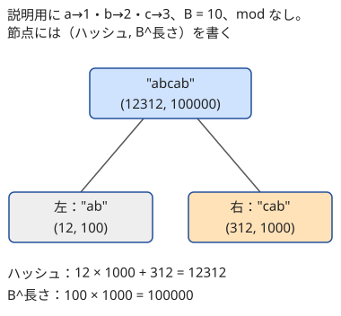

!!! abstract "要点"
    - **何ができるか**：文字列を $B$ 進数の値（mod $p$）とみなし、接頭辞のハッシュから任意の部分文字列のハッシュを $O(1)$ で取り出して、部分文字列どうしの一致を確率的に判定する。二分探索と組めば LCP や辞書順の比較もでき、セグメント木に載せれば 1 文字の更新にも対応する。
    - **いつ使うか**：
        - 部分文字列どうしが等しいかを大量に判定する。
        - 重ならずに 2 回現れる部分文字列の最大の長さ。
        - 1 文字の更新と、区間が回文か（一致するか）のクエリ。
        - $N \le 10^5$〜$10^6$ で、任意の 2 区間の一致判定が $Q \le 2 \times 10^5$ 回。
    - **計算量**：前計算 $O(N)$、部分文字列のハッシュと一致判定は 1 回 $O(1)$。2 か所の LCP は二分探索で $O(\log N)$。セグメント木に載せると 1 文字の更新と区間のハッシュが $O(\log N)$。どれも「一致」の判定は誤る確率が 0 でない（mod $2^{61} - 1$ で 1 回あたり約 $L / 2^{61}$ 以下。$L$ は長さ）。
    - **前提**：[mod の計算の基本](../math/mod-arithmetic.md)、[累積和](../basics/prefix-sum.md)、[文字列の基本操作と辞書順](../string/string-basics.md)

<!-- textlint-disable -->
別名：ロリハ・多項式ハッシュ・Rabin-Karp・文字列のハッシュ・部分文字列のハッシュ・ハッシュのセグ木・rolling hash
<!-- textlint-enable -->

ローリングハッシュは、文字列を 1 つの整数（ハッシュ）に縮めて比べる方法である。2 つの部分文字列を素朴に比べると長さに比例する時間がかかり、長さ $10^5$ の比較を $2 \times 10^5$ 回行えば $2 \times 10^{10}$ 回の文字の比較になって間に合わない。接頭辞のハッシュを[累積和](../basics/prefix-sum.md)と同じ形で前計算しておけば、どの部分文字列のハッシュも $O(1)$ で取り出せ、比較が整数 1 つの比較で済む。代わりに、違う文字列が同じハッシュになる（[衝突](../guide/glossary.md#hash-collision)する）確率がわずかに残る。

## 多項式ハッシュと部分文字列の取り出し {#polynomial-hash}

文字列 $S$（長さ $N$、0-indexed）の各文字を 1 以上の整数 $c(S[i])$ に対応させる（文字コードをそのまま使えばよい）。素数 $p$ と基数 $B$（$2 \le B \le p - 2$）を決め、$S$ のハッシュを次の多項式の値で定める。

$$
H(S) = \left( c(S[0]) B^{N-1} + c(S[1]) B^{N-2} + \dots + c(S[N-1]) B^{0} \right) \bmod p
$$

$S$ を $B$ 進数の $N$ 桁の数とみなし、mod $p$ を取ったものである。接頭辞のハッシュ $h[i] = H(S[0, i))$ は、1 文字足すたびに全体を 1 桁ずらして末尾に足せば求まる。

$$
h[0] = 0, \qquad h[i + 1] = \left( h[i] \cdot B + c(S[i]) \right) \bmod p
$$

部分文字列 $S[l, r)$ のハッシュは、$h[r]$ から先頭 $l$ 文字の分を引けば得られる。$h[r]$ の中で $S[0, l)$ の分は $r - l$ 桁ぶん左にずれているので、$h[l]$ に $B^{r-l}$ を掛けてから引く。

$$
H(S[l, r)) = \left( h[r] - h[l] \cdot B^{r - l} \right) \bmod p
$$

次の図は、説明のために a→1・b→2・c→3、$B = 10$ とし、mod を取らずに計算した例である。ハッシュが 10 進数の数字の並びになるので、引き算の意味が見える。

![S = abcab の接頭辞のハッシュは h = 0, 1, 12, 123, 1231, 12312。S\[2, 5) = cab のハッシュは h[5] − h[2]·10^3 = 12312 − 12000 = 312 になる](../img/rolling-hash/prefix-hash.svg)

処理の流れは次のとおりである。$h$ と $B$ の冪の表 $\mathrm{pw}[i] = B^i \bmod p$ を $O(N)$ で作れば、あとは 1 回 $O(1)$ で部分文字列のハッシュが出る。添字は[半開区間](../guide/glossary.md#half-open-interval)で、$h$ の添字は文字と文字の間の位置を指す（累積和の $S_0 = 0$ と同じ）。

```cpp
--8<-- "rolling-hash/substring-hash.cpp:core"
```

完全なプログラム：[`substring-hash.cpp`](https://github.com/yuukougun/kyopro-atlas/blob/main/snippets/rolling-hash/substring-hash.cpp)（GitHub）
{ .kp-code-src }

2 つの部分文字列の一致は「長さが等しく、ハッシュが等しい」で判定する。ハッシュが違えば文字列は必ず違う。ハッシュが等しくても文字列が違う（衝突する）ことはありうるが、その確率は次の節で見るとおり十分に小さくできる。

??? question "確認問題：なぜ B^(r−l) を掛けるのか"
    $H(S[l, r)) = h[r] - h[l]$ と、累積和と同じように引くだけでは何がいけないか。

    ??? success "答え"
        $h[r]$ は、$h[l]$ を作った後にさらに $r - l$ 回「$B$ を掛けて文字を足す」を繰り返した値である。そのため $h[r]$ の中の先頭 $l$ 文字の分は $h[l] \cdot B^{r-l}$ になっていて、$h[l]$ のままではない。図の例では $h[5] = 12312$ の中の "ab" の分は 12 ではなく 12000 である。和の累積和は足す順で値が変わらないが、多項式ハッシュは先に足した文字ほど大きな桁に上がっていく点が違う。

## なぜ衝突しにくいか（0 でない多項式の根は次数以下） {#collision-bound}

長さ $L$ の異なる 2 つの文字列 $S$・$T$ のハッシュの差は、$B$ についての多項式とみなせる。

$$
H(S) - H(T) \equiv \sum_{i=0}^{L-1} \left( c(S[i]) - c(T[i]) \right) B^{L-1-i} \pmod{p}
$$

$S \ne T$ なら係数のどれかは 0 でない（文字の値が $p$ より小さいので、mod $p$ でも 0 にならない）。だからこれは 0 でない $L - 1$ 次以下の多項式である。$p$ が素数なら、mod $p$ の世界でも「0 でない $d$ 次の多項式の根は $d$ 個以下」が成り立つ。衝突するのは $B$ がこの根に当たったときだけなので、$B$ を $p$ 程度の個数の候補から一様に乱択すれば、衝突する確率は約 $(L - 1) / p$ 以下である。

- この評価は「テストの文字列が先に決まっていて、$B$ を後から乱択する」ときのものである。$B$ を固定すると、その $B$ が根になるような文字列の組を事前に作られうる（[推奨する設計](#recommended-design)）
- 比較を何回もするときは、1 回ごとの確率を足し合わせたものが全体の上界になる。たとえば $p = 2^{61} - 1 \approx 2.3 \times 10^{18}$、$L = 2 \times 10^5$ で比較を $10^7$ 回するとしよう。どれかが衝突する確率は $10^7 \times 2 \times 10^5 / (2.3 \times 10^{18}) \approx 8.7 \times 10^{-7}$ 以下である
- ハッシュを $K$ 個作って「どれか 2 つが等しいか」を調べる（set に入れて重複を数えるなど）と、比べ合う組は約 $K^2 / 2$ 組ある。比較の回数ではなく組の数が効くので、$p$ が $10^9$ 程度では足りない（詳しくは[ハッシュの安全な設計](../string/hash-safety.md#birthday-bound)）
- $(L - 1) / p$ は、どんな 2 つの文字列でも保証できる上界である。多くの組を比べるときの見積もりでは、1 組あたり約 $1 / p$ とみなすことが多い（根拠と限界は[ハッシュの安全な設計](../string/hash-safety.md#birthday-bound)）

長さの違う 2 つの文字列を比べるときも、短い方の先頭に 0 を補って同じ長さとみなせば、同じ議論が通る。ただし、そのためには文字の値を 1 以上にしておく必要がある（[実装の落とし穴](#pitfalls)）。

## 推奨する設計：mod 2^61−1 と実行時に乱択した基数（理由は hash-safety） {#recommended-design}

迷ったら次の設計にする。理由の詳しい計算は[ハッシュの安全な設計](../string/hash-safety.md#recommended-design)に任せ、ここでは結論と、実装で気をつける点だけを書く。

- **法は $p = 2^{61} - 1$（素数）を 1 つ**。$p$ が約 $2.3 \times 10^{18}$ と大きい。1 組あたり約 $1 / p$ とみなせば、ハッシュを $10^6$ 個作って全部の組（約 $5 \times 10^{11}$ 組）を比べても、衝突する組の数の期待値は約 $2 \times 10^{-7}$ である。$10^9$ 程度の素数 2 つを組にする二重ハッシュでもよいが、計算が 2 倍になる
- **基数 $B$ は実行時に乱択する**。`mt19937_64` を時刻などで初期化し、$[2, p - 2]$ から一様に選ぶ。AtCoder のテストは事前に固定されているので、狙われるのは誰でも使いそうな固定の（mod, 基数）の組である。実行のたびに変わる $B$ は事前に狙えない
- **積は `unsigned __int128` で取り、割り算を使わずに剰余を取る**。$2^{61} \equiv 1 \pmod{p}$ なので、積 $t$（122 ビット未満）の上位と下位を $t = 2^{61} a + b$ と分ければ $t \equiv a + b$ である。$a + b < 2p$ なので、$p$ 以上なら $p$ を 1 回引けば済む（[`__int128`](../cpp/cpp-integer-overflow.md#int128)）
- **mod $2^{64}$（`unsigned long long` のあふれに任せる）は使わない**。どんな基数を選んでも、長さ 1024 程度の 2 つの文字列で衝突させられることが知られている（作り方は[ハッシュの安全な設計](../string/hash-safety.md#mod-2-64)）

基数をすべてのハッシュで共有することも大事である。前向きと後ろ向きのハッシュのように 2 つを比べるなら、両方が同じ $B$ で作られていなければ一致しない。[多項式ハッシュの節](#polynomial-hash)のコードのように、$B$ をプログラムの開始時に 1 回だけ決める大域の定数にするとよい。

??? question "確認問題：mod $10^9 + 7$ で足りるか"
    長さ $m$ の部分文字列のハッシュを $10^5$ 個作って set に入れ、重複があるかを調べる。法を $10^9 + 7$ の 1 つにして、基数は乱択した。これで安全か。

    ??? success "答え"
        安全ではない。比べ合う組は約 $(10^5)^2 / 2 = 5 \times 10^9$ 組あり、1 組あたり約 $10^{-9}$ で衝突するとみなすと、衝突する組の数の期待値は約 5 になる。文字列が全部違っても、重複があると判定してしまう見込みが高い。$p = 2^{61} - 1$ なら期待値は約 $2 \times 10^{-9}$ である。

## 連結のハッシュと逆向きのハッシュ（回文判定） {#concat-and-reverse}

多項式ハッシュは、2 つの文字列をつないだもののハッシュも、それぞれのハッシュと長さから $O(1)$ で作れる。$X$ の後ろに $Y$ をつなぐと、$X$ の分は $\lvert Y \rvert$ 桁ぶん左にずれるからである。

$$
H(XY) = \left( H(X) \cdot B^{\lvert Y \rvert} + H(Y) \right) \bmod p
$$

これを使うと、離れた 2 つの部分 $S[a, b)$ と $S[c, d)$ をつないだ文字列が、別の部分文字列と等しいかも $O(1)$ で判定できる。部分文字列の取り出しの式も、この連結の式を $h[r] = H(S[0, l) \, S[l, r))$ について解いたものである。

**回文判定**。$S$ を反転した文字列 $T$（$T[i] = S[N - 1 - i]$）のハッシュも前計算しておく。$S[l, r)$ を反転すると $T[N - r, N - l)$ になるので、次が成り立つ。

$$
S[l, r) \text{ が回文} \iff H(S[l, r)) = H(T[N - r, N - l))
$$

前計算は前向きと後ろ向きで $O(N)$、判定は 1 回 $O(1)$ である。

```cpp
--8<-- "rolling-hash/substring-hash.cpp:usage"
```

完全なプログラム：[`substring-hash.cpp`](https://github.com/yuukougun/kyopro-atlas/blob/main/snippets/rolling-hash/substring-hash.cpp)（GitHub）
{ .kp-code-src }

- 前向きと後ろ向きは同じ $B$ で作る（$B$ を大域の定数にしておけば自然にそうなる）
- 添字の対応 $[l, r) \to [N - r, N - l)$ は、長さ 1 の区間 $[i, i + 1) \to [N - 1 - i, N - i)$ で確かめると間違えにくい
- 回文判定だけが目的で更新がないなら、決定的な [Manacher](../string/palindrome.md#manacher) でも同じことが $O(N)$ の前処理でできる

## ハッシュ＋二分探索：LCP・辞書順の比較・最長の繰り返し {#hash-lcp-binary-search}

ハッシュで分かるのは「等しいか」だけだが、[二分探索](../basics/binary-search.md)と組むと「どこまで等しいか」も分かる。鍵になるのは、一致の長さについての単調性である。$S[i, i + m)$ と $S[j, j + m)$ が等しければ、それより短い $S[i, i + m')$ と $S[j, j + m')$（$m' < m$）も等しい。

- **LCP（最長共通接頭辞）**：位置 $i$ と $j$ から始まる接尾辞が先頭から何文字一致するかは、「長さ $m$ で一致するか」を判定にして $m$ を二分探索すれば $O(\log N)$ で求まる
- **辞書順の比較**：[LCP](../guide/glossary.md#lcp) を $m$ とすると、一方が $m$ 文字で尽きていれば短い方が小さく、そうでなければ $m$ 文字目（0-indexed）の大小で決まる（[辞書順の定義](../string/string-basics.md#lexicographic-order)）。これを比較関数にすれば接尾辞のソートも $O(N \log^2 N)$ でできるが、それなら [Suffix Array](../string/suffix-array.md) の方が速く確実である
- **最長の繰り返し**：「長さ $m$ の部分文字列で、2 か所に現れるものがあるか」も $m$ について単調なので、[答えで二分探索](../basics/binary-search-answer.md)できる。判定は長さ $m$ の部分文字列のハッシュを全部作り、同じ値があるかを調べる

最長の繰り返しの判定に「重ならない」などの条件が付くときは、判定の中で条件を確かめる。次のコードは「重ならずに 2 回現れる部分文字列の最大の長さ」を求める。各ハッシュについて最初に現れた位置だけを覚え、今の位置と比べて $m$ 以上離れていれば、重ならない 2 か所が見つかったことになる。最初の位置が最も左にあるので、ほかの位置を覚える必要はない。

```cpp
--8<-- "rolling-hash/longest-repeat.cpp:core"
```

完全なプログラム：[`longest-repeat.cpp`](https://github.com/yuukougun/kyopro-atlas/blob/main/snippets/rolling-hash/longest-repeat.cpp)（GitHub）
{ .kp-code-src }

判定は長さ $m$ の窓が $N - m + 1$ 個で、`map` を使って $O(N \log N)$、二分探索で $O(\log N)$ 回呼ぶので全体で $O(N \log^2 N)$ になる。この判定は比べ合うハッシュの組が多い（約 $N^2 / 2$ 組）ので、法の大きさが特に効く。

??? question "確認問題：回文の長さの二分探索"
    「最長の回文の部分文字列の長さ」を、長さ $m$ の回文があるかで二分探索したい。そのままでは何がいけないか。どう直せばよいか。

    ??? success "答え"
        長さ $m$ の回文があっても、長さ $m - 1$ の回文があるとは限らない（"aba" はあるが長さ 2 の回文はない、など）。一方、回文の両端を 1 文字ずつ削った長さ $m - 2$ の部分も回文なので、偶奇をそろえれば単調になる。奇数の長さと偶数の長さを別々に二分探索し、大きい方を答える。

## セグ木に載せるハッシュ：（ハッシュ, B^長さ）の組で更新ありの一致・回文判定 {#hash-segment-tree}

この節は[セグメント木](../ds/segment-tree.md)と[セグ木に載せるモノイドの設計](../ds/segment-tree-monoids.md#non-commutative)を前提にする。接頭辞のハッシュの表は、1 文字を書き換えると後ろの $h$ がすべて変わるので、更新のたびに $O(N)$ かかる。更新と一致判定が交互に来るなら、ハッシュをセグメント木に載せる。

連結の式 $H(XY) = H(X) \cdot B^{\lvert Y \rvert} + H(Y)$ を見ると、2 つの区間のハッシュをつなぐには右の区間の長さ（正確には $B^{\text{長さ}}$）が要る。そこでセグメント木の各要素を（ハッシュ $h$, $q = B^{\text{長さ}}$）の組にし、演算を次で定める。

$$
(h_1, q_1) \cdot (h_2, q_2) = (h_1 q_2 + h_2, \; q_1 q_2) \bmod p
$$



- **[結合法則](../guide/glossary.md#associativity)**：3 つの区間を左からつないでも右からつないでも、ハッシュは $h_1 q_2 q_3 + h_2 q_3 + h_3$、長さの冪は $q_1 q_2 q_3$ になり一致する。文字列の連結が結合的であることの言い換えである。ただし左右を入れ替えると値が変わる（可換ではない）ので、`op(a, b)` の $a$ は必ず左の区間にする
- **[単位元](../guide/glossary.md#identity-element)**：空の文字列 $(0, 1)$。長さ 0 なので $B^0 = 1$ である
- **葉**：文字 $x$ 1 つは $(c(x), B)$

回文判定には、前向きのセグメント木と、添字を $N - 1 - i$ に置いた後ろ向きのセグメント木の 2 本を持つ。1 文字の更新は両方の対応する位置を書き換え、$S[l, r)$ が回文かは、前向きの $[l, r)$ と後ろ向きの $[N - r, N - l)$ のハッシュを比べる。どちらも $O(\log N)$ である。

```cpp
--8<-- "rolling-hash/hash-segtree.cpp:core"
```

完全なプログラム：[`hash-segtree.cpp`](https://github.com/yuukougun/kyopro-atlas/blob/main/snippets/rolling-hash/hash-segtree.cpp)（GitHub）
{ .kp-code-src }

!!! info "ACL では"
    `segtree<S, op, e> seg(v);`（`v` は `vector<S>`）。`seg.set(p, x)` で一点を書き換え、`seg.prod(l, r)` で $[l, r)$ を左から順に `op` でまとめた値を返す。構築は $O(N)$、`set`・`prod` は $O(\log N)$。要件は `op` の結合法則と `e()` が単位元であることで、`l == r` の `prod` は `e()` を返す。

```cpp
--8<-- "rolling-hash/hash-segtree.cpp:usage"
```

完全なプログラム：[`hash-segtree.cpp`](https://github.com/yuukougun/kyopro-atlas/blob/main/snippets/rolling-hash/hash-segtree.cpp)（GitHub）
{ .kp-code-src }

更新が「1 点の書き換え」だけなら、[BIT](../ds/fenwick-tree.md) で $c(S[i]) \cdot B^{N-1-i}$ の和を持つ方法もある。この場合、区間の和は位置によって $B$ の冪の分だけずれているので、比べる 2 つの区間の和に $B$ の冪を掛けて桁をそろえてから比べる。セグメント木の方が長さを組に持つだけで済み、ずれの計算を考えなくてよい。

## ハッシュで代用できる場面とできない場面（Z・Manacher・SA・畳み込みとの使い分け） {#when-to-use}

ハッシュは「部分文字列が等しいか」を $O(1)$ で答える万能の道具だが、確率的で、一致以外のことは分からない。決定的な方法で済むならそちらを先に考え、ハッシュが本命になるのは更新があるとき、任意の 2 か所を大量に比べるとき、ほかの判定と組み合わせるときである。

| 目的 | ハッシュでは | 決定的な方法 |
| --- | --- | --- |
| パターン 1 つの全出現 | できる $O(N + M)$ | [Z-algorithm](../string/z-algorithm.md)・[KMP 法](../string/kmp.md) $O(N + M)$ |
| 任意の 2 か所の LCP | 二分探索で 1 回 $O(\log N)$ | [Suffix Array と LCP 配列の区間最小](../string/suffix-array.md#lcp-rmq)で 1 回 $O(1)$ |
| 区間が回文か | 1 回 $O(1)$ | [Manacher](../string/palindrome.md#manacher)（前処理 $O(N)$、1 回 $O(1)$） |
| 1 文字の更新があっての一致・回文 | セグメント木で 1 回 $O(\log N)$ | 簡単な方法はなく、ハッシュが本命 |
| 異なる部分文字列の数 | 長さごとに数えて $O(N^2)$ で不向き | [Suffix Array と LCP 配列](../string/suffix-array.md#distinct-substrings) |
| 多数のパターンの出現 | 長さの種類ごとに走査（総長 $M$ なら $O(N \sqrt{M})$） | [Aho-Corasick 法](../string/aho-corasick.md#count-occurrences) |
| ワイルドカード・ハミング距離 | できない（一致しか分からない） | [畳み込み](../math/convolution-ntt.md#string-matching) |

- 集合や多重集合として等しいか（並べ替えて一致するか）は、多項式ハッシュではなく値ごとの乱数の和・XOR で判定する（[集合のハッシュ](../string/hashing-for-sets.md)）
- 1 つでも誤ると困る場面や、比べ合う組が $10^{12}$ を大きく超える場面では、衝突の確率が無視できなくなる。決定的な方法を選ぶ

## 落とし穴 {#pitfalls}

**文字を 0 に対応させる**。'a' を 0、'b' を 1 に対応させると、先頭に 'a' が何個付いてもハッシュが変わらない。"b"・"ab"・"aab" はどれも 1 になり、長さを確かめずに比べると一致と判定してしまう。文字コード（'a' は 97）をそのまま使うか、1 以上に対応させる。数列をハッシュにするときも同じで、0 を含む値は $+1$ してから使う。値は $p$ 未満でなければならない。

**引き算で負になる**。$h[r] - h[l] \cdot B^{r-l}$ は mod を取った値どうしの引き算なので、負になりうる。符号なし整数なら巨大な値に化ける。$p$ を足してから引き、最後に $p$ 以上なら $p$ を引く。

**積がオーバーフローする**。$p = 2^{61} - 1$ では、$p$ 未満の 2 つの値の積が $2^{122}$ 近くになり、`unsigned long long` に収まらない。`unsigned __int128` で積を取る。$10^9$ 程度の法なら `long long` に収まるが、`int` どうしの積は `int` で計算されてあふれる（[int どうしの積](../cpp/cpp-integer-overflow.md#int-product)）。

**長さの違う部分を比べる**。二分探索や連結で区間の端を計算し間違えると、長さの違う部分文字列のハッシュを比べてしまう。文字を 1 以上にしていれば長さが違うと一致しにくいが、長さが等しいことも判定に入れると確実である。

**基数が 2 つのハッシュで違う**。ハッシュの構造体のコンストラクタの中で基数を乱択すると、$S$ 用と反転した $T$ 用で別の基数になり、回文がいつまでも一致しない。基数はプログラム全体で 1 回だけ決める。

**固定の基数や mod $2^{64}$ を使う**。手元では通っても、固定された組を狙ったテストで落ちることがある。基数は実行時に乱択し、法は $2^{61} - 1$ にする（[推奨する設計](#recommended-design)）。

## 例題 {#examples}

### ABC141 E. Who Says a Pun? {#abc141_e}

<div class="kp-problems" data-role="example" markdown>

- [ABC141 E. Who Says a Pun?](https://atcoder.jp/contests/abc141/tasks/abc141_e)（diff 1459）：重ならずに 2 回以上現れる部分文字列の最大の長さを求める（N ≤ 5000）。

</div>

答えの長さ $m$ で二分探索する。長さ $m$ で重ならない 2 か所があれば、同じ 2 か所から始まる長さ $m - 1$ の部分も重ならずに一致するので、判定は単調である。判定は、長さ $m$ の部分文字列のハッシュを左から作り、各ハッシュが最初に現れた位置との差が $m$ 以上かを調べればよい。

??? note "解法の詳細"
    - 接頭辞のハッシュと $B$ の冪を $O(N)$ で前計算する（法 $2^{61} - 1$、基数は乱択）。
    - 判定 $\mathrm{check}(m)$：$i = 0, 1, \dots, N - m$ の順に $H(S[i, i + m))$ を作り、`map` に「ハッシュ → 最初に現れた位置」を入れる。すでにあれば、その位置 $j$ について $i - j \ge m$ なら可。
    - 番兵：ok $= 0$（長さ 0 は必ず可）、ng $= \lfloor N / 2 \rfloor + 1$（それより長いと重ならずに 2 回は入らない）。
    - 全体で $O(N \log^2 N)$。コードは[ハッシュ＋二分探索](#hash-lcp-binary-search)の節のものと同じ形である。
    - $N \le 5000$ なので、$\mathrm{dp}[i][j]$ ＝「位置 $i$ と $j$ から何文字一致するか」の $O(N^2)$ の DP でも解ける。比べ合うハッシュの組が多い判定なので、固定の基数で衝突した記録がある問題でもある。

### ABC331 F. Palindrome Query {#abc331_f}

<div class="kp-problems" data-role="example" markdown>

- [ABC331 F. Palindrome Query](https://atcoder.jp/contests/abc331/tasks/abc331_f)（diff 1666）：1 文字の更新と、区間が回文かの質問に答える。

</div>

更新があるので、接頭辞のハッシュの表は使えない。前向きと後ろ向きのハッシュを（ハッシュ, $B^{\text{長さ}}$）の組にしてセグメント木に載せ、区間の回文判定を 2 本の区間のハッシュの比較にする（[セグ木に載せるハッシュ](#hash-segment-tree)）。

??? note "解法の詳細"
    - 入力の位置はどれも 1-indexed なので、更新の $x$ は $x - 1$ に、質問の閉区間 $[L, R]$ は 0-indexed の半開区間 $[L - 1, R)$ に直す。
    - 前向きのセグメント木の位置 $i$ と、後ろ向きのセグメント木の位置 $N - 1 - i$ に、葉 $(c(S[i]), B)$ を置く。
    - 更新：0-indexed の位置 $i = x - 1$ の文字を $c$ にするときは、前向きの $i$ と後ろ向きの $N - 1 - i$ を `set` で書き換える。
    - 質問：前向きの $[l, r)$ と後ろ向きの $[N - r, N - l)$ の `prod` のハッシュが等しければ回文。
    - 1 回 $O(\log N)$。演算は可換でないので、`op` の引数の左右を取り違えない。

## 練習問題 {#practice}

<div class="kp-problems" data-role="practice" markdown>

- [ABC398 F. ABCBA](https://atcoder.jp/contests/abc398/tasks/abc398_f)（diff 1033）：S の後ろに文字を足して作れる最短の回文を求める。
- [ABC430 E. Shift String](https://atcoder.jp/contests/abc430/tasks/abc430_e)（diff 1109）：A を何回回転すると B に一致するかを求める。
- [ABC284 F. ABCBAC](https://atcoder.jp/contests/abc284/tasks/abc284_f)（diff 1575）：T が「S の先頭 i 文字＋S の反転＋S の残り」の形になる S と i を求める。

</div>

??? note "練習の方針"
    - **ABC398 F**：後ろに足す文字を最も少なくするには、$S$ の接尾辞で回文になる最長のものを残せばよい。$S[i, N)$ が回文かは、前向きと後ろ向きのハッシュで $O(1)$ で判定できる。回文になる最小の $i$ を探す。答えは、$S$ の後ろに $S[0, i)$ の反転を足した文字列である（Manacher・Z-algorithm でも解ける）
    - **ABC430 E**：$A$ を $k$ 回回転したものは $A + A$ の $[k, k + N)$ である。$A + A$ のハッシュを前計算し、$k = 0, 1, \dots, N - 1$ の順に $B$ のハッシュと比べて最初に一致する $k$ を探す。基数 2 と有名な法（998244353・$10^9 + 7$）の組で衝突するテストがあったという記録があるので、法は大きくし、基数は乱択する（Z-algorithm・KMP 法でも解ける）
    - **ABC284 F**：区切り $i$ を決めると、$S[0, i) = T[0, i)$、$S[i, N) = T[N + i, 2N)$、$S$ の反転 $= T[i, N + i)$ と決まる。$T[i, N + i)$ を反転したもの（反転した $T$ の区間）と、$T[0, i)$ と $T[N + i, 2N)$ をつないだもののハッシュを、連結の式で作って比べる。$i$ ごとに $O(1)$ で全体 $O(N)$（Z-algorithm でも解ける）

## 力試し {#challenge}

<div class="kp-problems" data-role="challenge" markdown>

- [典型90 047. Monochromatic Diagonal（★7）](https://atcoder.jp/contests/typical90/tasks/typical90_au)（diff なし）：R・G・B からなる 2 つの列で各マスの色が決まるマス目について、すべてのマスが同じ色である斜めの線の数を求める。
- [ABC150 F. Xor Shift](https://atcoder.jp/contests/abc150/tasks/abc150_f)（diff 2281）：b が、a の巡回シフトの各要素を x で XOR したものになる (k, x) をすべて求める。
- [ABC135 F. Strings of Eternity](https://atcoder.jp/contests/abc135/tasks/abc135_f)（diff 2388）：t を繰り返した文字列が、s を繰り返した文字列に含まれる最大の回数を求める。

</div>

??? note "力試しの方針"
    - **典型90 047**：マスの色は 2 つの列 $S$・$T$ の文字の組で決まる。斜めの線がすべて赤になる条件を書き出すと、$T$ の G と B を入れ替えた列 $T'$ について「すべての $i$ で $S_i = T'_{i+k}$」という、ずらした文字列の一致になる。緑・青についても同じ置き換えをし、$k$ ごとにハッシュで $O(1)$ で判定する（Z-algorithm でも解ける）。mod $2^{64}$ では衝突させるテストを作れると作問者の解説が注意している
    - **ABC150 F**：隣り合う要素の XOR の列 $a'$・$b'$ を作ると、全体に同じ $x$ を XOR しても $a'$ は変わらない。$a'$ を 2 周つないだ列の中で $b'$ と一致する開始位置 $k$ を探し、$x = a_k \oplus b_0$ とする。要素は文字ではなく $2^{30}$ 未満の整数で、0 も現れるので、$+1$ してからハッシュにする（KMP 法・Z-algorithm でも解ける）
    - **ABC135 F**：$s$ を $t$ より十分長くなるまで繰り返し、$t$ が現れる位置をハッシュで求める。位置 $i$ に現れるなら次は $(i + \lvert t \rvert) \bmod \lvert s \rvert$ から続けられるので、この遷移をグラフにする。閉路があれば無限に続けられ、なければ最長の道の長さが答えである（KMP 法・Z-algorithm でも求められる）

## 参考 {#references}

- [keymoon「安全で爆速なRollingHashの話」](https://qiita.com/keymoon/items/11fac5627672a6d6a9f6)：mod $2^{61} - 1$ の剰余の取り方、基数を実行時に乱択する理由、文字に 0 を割り当てない理由
- [drken「AtCoder ABC 141 E - Who Says a Pun? (1D, 水色, 500 点)」](https://drken1215.hatenablog.com/entry/2019/09/16/014600)：例題の長さの二分探索と、最初の出現位置で重なりを判定する方法
- [ikatakos「AtCoder Beginner Contest 141 D～F問題メモ」](https://ikatakos.com/pot/programming_algorithm/contest_history/atcoder/2019/0915_abc141)：例題で固定の mod・基数が衝突した記録（解説の部分だけを参照）
- [merom686「ABC331」](https://merom686.hatenablog.com/entry/2023/12/03/001625)：例題で、セグメント木に長さを持たせて前向きと後ろ向きのハッシュを載せる方針
- [syamashi「[ABC331] F - Palindrome Query」](https://note.com/syamashi/n/n8e580d4ce59d)：例題を BIT で解く方法と、固定の基数で落ちた記録
- [ikatakos「ユニークビジョンプログラミングコンテスト2025 春（AtCoder Beginner Contest 398）F,G問題メモ」](https://ikatakos.com/pot/programming_algorithm/contest_history/atcoder/2025/0322_abc398)：練習の方針（最長の回文の接尾辞。解説の部分だけを参照）
- [ikatakos「AtCoder Beginner Contest 430 E,F,G問題メモ」](https://ikatakos.com/pot/programming_algorithm/contest_history/atcoder/2025/1101_abc430)：練習の方針（A+A の中で B を探す）と、固定の基数で衝突するテストがあった記録（解説の部分だけを参照）
- [ikatakos「AtCoder Beginner Contest 284 E,F,G問題メモ」](https://ikatakos.com/pot/programming_algorithm/contest_history/atcoder/2023/0107_abc284)：練習の方針（区切り位置ごとの一致の判定。解説の部分だけを参照）
- [E869120「競プロ典型 90 問 047 の解説（画像）」](https://github.com/E869120/kyopro_educational_90/blob/main/editorial/047-02.jpg)：力試しの言い換えと、mod $2^{64}$ への注意
- [drken「AtCoder ABC 150 F - Xor Shift (3D, 黄色, 600 点)」](https://drken1215.hatenablog.com/entry/2020/01/12/115800)：力試しの方針（隣接 XOR の列への変換と、ローリングハッシュでも解けること）
- [ikatakos「AtCoder Beginner Contest 135 D,F問題メモ」](https://ikatakos.com/pot/programming_algorithm/contest_history/atcoder/2019/0727_abc135)：力試しの方針（一致位置の遷移と閉路の判定。解説の部分だけを参照）
- [AtCoder Library「Segtree」（document_ja）](https://github.com/atcoder/ac-library/blob/master/document_ja/segtree.md)：`segtree` の宣言・計算量・要件
