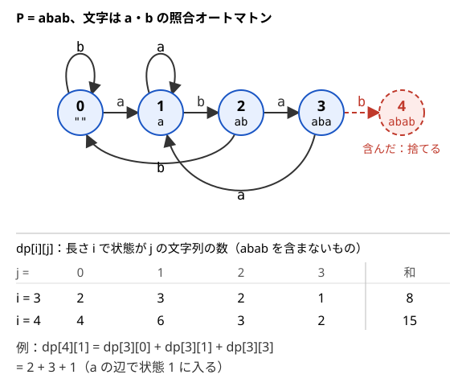

!!! abstract "要点"
    - **何ができるか**：KMP 法や Aho-Corasick 法の状態（いまの接尾辞のうちパターンの接頭辞になっている最長のもの）を DP の状態にして、パターンを含まない・すべて含む長さ $N$ の文字列を数える。$N$ が巨大なら遷移を行列にして累乗する。
    - **いつ使うか**：
        - 長さ $N$ の文字列のうち、どのパターンも部分文字列に含まないものの数。
        - 与えられた文字列をすべて含む長さ $L$ の文字列の数。
        - $N \le 10^9$〜$10^{18}$ で、パターンの長さの総和が小さい。
        - パターンの個数 $\le 8$ 程度で、すべてを含むかを問う。
        - 長さ $i$ までの文字列の数を、末尾とパターンの先頭が何文字一致しているかで分けて持つ。
    - **計算量**：文字の種類数を $\sigma$、状態数を $S$ とする。1 パターン（長さ $M$）なら $S = M + 1$ で $O(N \sigma M)$。複数パターンなら $S$ は Trie の頂点数（長さの総和 + 1 以下）で $O(N \sigma S)$。$K$ 個すべてを含むなら $O(N \sigma S \cdot 2^K)$。$N$ が巨大なら $O(S^3 \log N)$（オートマトンの前計算 $O(\sigma S)$ は別）
    - **前提**：[KMP 法と文字列の周期](../string/kmp.md)、[行列累乗](../math/matrix-power.md)

<!-- textlint-disable -->
別名：オートマトン DP・KMP DP・Aho-Corasick 上の DP・照合状態の DP・禁止文字列・禁止部分文字列・automaton DP
<!-- textlint-enable -->

[照合オートマトン](../guide/glossary.md#matching-automaton)上の DP は、文字列を 1 文字ずつ決めていくときに、パターンとの照合の途中経過だけを[状態](../guide/glossary.md#state)に持つ数え上げである。末尾の文字そのものを覚えると状態は $\sigma^{M-1}$ 通りに増えるが、照合の途中経過は $M + 1$ 通り（複数パターンでも長さの総和 + 1 通り以下）で足りる。遷移は毎回同じなので、$N$ が $10^{18}$ でも行列累乗に載る。

このページでは、作る文字列の長さを $N$、文字の種類数を $\sigma$、パターンの長さを $M$（複数なら $K$ 個）、オートマトンの状態数を $S$ と書く。文字列の添字は 0-indexed である。

## 照合の状態とマルコフ性 {#matching-state}

数えたいのは「長さ $N$ の文字列で、パターン $P$ を部分文字列として含まないもの」の数である。$N$ 文字すべてを覚えると $\sigma^N$ 通りになるので、この先の判定に効く要約だけを状態にしたい（[DP の状態の設計](../dp/dp-state-design.md)）。

ここで持つ要約は、次の値 $j$ である。

$$
j = \text{いまの文字列の接尾辞のうち、} P \text{ の接頭辞にもなっている最長のものの長さ}
$$

$0 \le j \le M$ で、$j = M$ になった瞬間が、ちょうど $P$ の現れた瞬間である。これを照合の状態という。[KMP 法の照合](../string/kmp.md#matching)で本文を読みながら動かす $j$ と同じものである。

この状態で足りるのは、次の 2 つが成り立つからである。

1. **次の状態は「いまの状態と次の文字」だけで決まる**。文字列 $T$ の状態が $j$ のとき、$T$ に文字 $c$ を足した $Tc$ の状態は、$T$ の中身によらず $P[0, j)$ と $c$ だけから決まる
2. **パターンが現れたかは状態で分かる**。$P$ が $Tc$ の末尾に現れるのは、$Tc$ の状態が $M$ のときだけである

1 つ目の性質を、確率の言葉にならってマルコフ性と呼ぶことがある。2 つの文字列の状態が同じなら、どんな続きを付けても状態の動きと「現れたか」の判定がそろう。そのため、状態ごとに文字列の数を合計して持てば、個々の文字列を区別しなくてよい。

??? note "1 つ目の性質の証明"
    $Tc$ の接尾辞で $P$ の接頭辞でもあるもののうち、長さ $k + 1 \ge 1$ のものを $Uc$ とする（$\lvert U \rvert = k$）。$U$ は $T$ の接尾辞で、$P$ の接頭辞でもある。状態 $j$ の定義から $k \le j$ なので、$U$ は $P[0, j)$（これも $T$ の接尾辞）の接尾辞になる。

    したがって $Tc$ の状態は、「$P[0, j)\,c$ の接尾辞のうち $P$ の接頭辞になっている最長のもの」の長さに等しい。これは $P[0, j)$ と $c$ だけで決まり、$T$ のそれより前の部分は関係しない。

パターンが短いなら、照合の状態の代わりに末尾の数文字をそのまま持ってもよい。末尾の $M - 1$ 文字が分かれば照合の状態も分かるので、末尾の文字は照合の状態より細かい要約である。$\sigma^{M-1}$ が小さいとき（$\sigma = 4$、$M = 4$ で 64 通りなど）は、こちらの方が書きやすい（[末尾の数文字を状態にする](../dp/dp-state-design.md#last-characters)）。

**応用の型**：

- **「少なくとも 1 回含む」を数える**：全体 $\sigma^N$ から含まないものを引く。または状態 $M$ を「もう含んだ」という吸収状態にし、どの文字でも $M$ にとどまる遷移を足す
- **一部の文字が決まっている**：`?` 以外の位置では、その文字の遷移だけを使う。状態の意味は変わらない
- **数の上限とも比べる**：「$X$ 以下の整数で、10 進表記が $P$ を含まないもの」は、[桁 DP](../dp/digit-dp.md#tight-flag) の上限との一致フラグと照合の状態の組を状態にする

## KMP オートマトンの遷移表を前計算して DP する {#kmp-automaton}

照合の状態の遷移を、状態 $j$（$0 \le j \le M$）と文字 $c$ のすべての組について表 $\mathrm{nxt}[j][c]$ にしておく。この表が KMP オートマトンである。作り方は [KMP 法の照合オートマトンの節](../string/kmp.md#automaton)にあり、失敗関数 $\pi$ を使って $O(\sigma M)$ で埋まる。

表があれば DP は次のとおりである。

- **状態**：$\mathrm{dp}[i][j]$ ＝ 長さ $i$ の文字列で、$P$ をまだ含まず、照合の状態が $j$ のものの数（$0 \le j < M$）
- **遷移**：各 $j < M$ と文字 $c$ について、$k = \mathrm{nxt}[j][c]$ が $M$ でなければ $\mathrm{dp}[i + 1][k] \mathrel{+}= \mathrm{dp}[i][j]$。$k = M$ への遷移は「$P$ を含んだ」なので捨てる
- **計算順序**：$i$ の小さい順。$\mathrm{dp}[i + 1]$ は $\mathrm{dp}[i]$ だけから決まるので、配列は 2 本で足りる
- **初期値と答え**：空の文字列の状態は 0 なので $\mathrm{dp}[0][0] = 1$。答えは $\sum_{j < M} \mathrm{dp}[N][j]$

$P = \texttt{abab}$、文字は $\texttt{a}$・$\texttt{b}$ の 2 種類で動かすと次の図になる。状態 3（末尾が $\texttt{aba}$）に $\texttt{a}$ が来ると、末尾は $\texttt{abaa}$ になり、$P$ の接頭辞として残るのは $\texttt{a}$ だけなので状態 1 に戻る。状態 2（$\texttt{ab}$）に $\texttt{b}$ が来ると、$\texttt{abb}$ の接尾辞はどれも $P$ の接頭辞でないので状態 0 に戻る。



長さ 4 の答えは 15 で、$2^4 = 16$ 通りから $\texttt{abab}$ 自身の 1 通りを除いた数に合う。長さ 5 なら 28 になる（$\texttt{abab}$ を含む 4 通りを除く）。

状態は $M$ 個、遷移は 1 状態あたり $\sigma$ 通りなので、全体で $O(N \sigma M)$ である。1 文字ごとに失敗関数をたどって次の状態を求めても答えは同じだが、表を引けば 1 遷移が常に $O(1)$ になり、DP の内側のループが単純になる。コードは [KMP 法の照合オートマトンの節](../string/kmp.md#automaton)にある。

**応用の型**：

- **出現回数の合計を数える**：「すべての文字列にわたる $P$ の出現回数の和」は、$\mathrm{dp}$ と並べて「出現回数の和」の表を持ち、状態 $M$ へ入るたびに文字列の数ぶんを足す。重なった出現も数えるので、状態 $M$ からも $\mathrm{nxt}[M][c]$ で遷移を続ける
- **最小の書き換え回数**：与えられた文字列を最少の書き換えで「$P$ を含まない」ようにするなら、数の和の代わりに書き換え回数の最小値を持つ。各位置で元の文字ならコスト 0、別の文字ならコスト 1 で遷移する

## 複数パターンは Aho-Corasick 法（終端の印を受け継ぐ） {#multiple-patterns}

パターンが $K$ 個あるときは、パターンを [Trie](../string/trie.md) にまとめ、Trie の頂点を状態にする。頂点 $v$ は根からの文字列 $\mathrm{str}(v)$（どれかのパターンの接頭辞）を表し、状態の意味は 1 パターンのときと同じく「いまの接尾辞のうち、どれかのパターンの接頭辞になっている最長のもの」である。状態数 $S$ は Trie の頂点数で、パターンの長さの総和 + 1 以下になる。

遷移の表は [Aho-Corasick 法](../string/aho-corasick.md#build)で埋める。失敗リンク $\mathrm{fail}[v]$ は「$\mathrm{str}(v)$ の真の接尾辞で、Trie にある最長のもの」の頂点で、KMP 法の $\pi$ にあたる。Aho-Corasick 法のページの $\mathrm{link}(v)$ と同じもので、そのページでは頂点を節点と呼ぶ。頂点を BFS 順（根に近い順）に処理し、Trie にない辺 $\mathrm{nxt}[v][c]$ は $\mathrm{nxt}[\mathrm{fail}[v]][c]$ を写す。$\mathrm{fail}[v]$ は $v$ より浅く、表がすでに埋まっている。

1 パターンとの違いは、「パターンを含んだ」を表す状態が終端の頂点だけでないことである。そこで、各頂点に「$\mathrm{str}(v)$ の接尾辞になっているパターンの集合」を bit で表した $\mathrm{out}[v]$ を持たせ、BFS の中で $\mathrm{out}[v] \leftarrow \mathrm{out}[v] \cup \mathrm{out}[\mathrm{fail}[v]]$ と受け継ぐ。$\mathrm{out}$ は Aho-Corasick 法のページの $\mathrm{mask}$ と同じもので、受け継ぐ理由と見落とす例は[終端の印を失敗リンク先から受け継ぐ節](../string/aho-corasick.md#inherit-terminal)にある。

```cpp
--8<-- "string-automaton-dp/aho-dp.cpp:build"
```

完全なプログラム：[`aho-dp.cpp`](https://github.com/yuukougun/kyopro-atlas/blob/main/snippets/string-automaton-dp/aho-dp.cpp)（GitHub）
{ .kp-code-src }

あとは KMP オートマトンと同じ DP を、$\mathrm{out}[u] \ne \emptyset$ の状態 $u$ に入らないように回せばよい。状態 $S$ 個・遷移 $\sigma$ 通りで $O(N \sigma S)$ である。

```cpp
--8<-- "string-automaton-dp/aho-dp.cpp:avoid"
```

完全なプログラム：[`aho-dp.cpp`](https://github.com/yuukougun/kyopro-atlas/blob/main/snippets/string-automaton-dp/aho-dp.cpp)（GitHub）。`mint` は ACL の `modint998244353`（[modint](../math/modint.md)）。
{ .kp-code-src }

あるパターンが別のパターンを部分文字列に含むときも、この形のままで正しい。$\texttt{abcd}$ を含む文字列は必ず $\texttt{bc}$ も含むので、$\texttt{abcd}$ は条件に何も足さない。頂点 $\texttt{abc}$ で止まるので、頂点 $\texttt{abcd}$ には届かない。

## すべて含む：含んだパターンの集合を bit で持つ {#contain-all}

「$K$ 個のパターンをすべて含む」ものを数えるときは、Aho-Corasick 法の頂点に、それまでに含んだパターンの集合を [bit で表した整数](../dp/bit-dp.md#subsets-as-integers)を組にして状態にする。

- **状態**：$\mathrm{dp}[i][\mathit{mask}][v]$ ＝ 長さ $i$ の文字列で、含んだパターンの集合が $\mathit{mask}$、Aho-Corasick 法の状態が $v$ のものの数
- **遷移**：文字 $c$ で $u = \mathrm{nxt}[v][c]$ に移り、集合は $\mathit{mask} \cup \mathrm{out}[u]$ になる。捨てる遷移はない
- **初期値と答え**：$\mathrm{dp}[0][\emptyset][\text{根}] = 1$。答えは $\sum_v \mathrm{dp}[N][\text{全体}][v]$

パターンが文字列の中で現れるのは、その末尾の位置で状態 $u$ に入ったときであり、そのパターンは $\mathrm{out}[u]$ に入っている。$\mathrm{out}$ が接尾辞のパターンをすべて集めているので、1 文字で 2 つ以上のパターンが同時に現れても取りこぼさない。

```cpp
--8<-- "string-automaton-dp/aho-dp.cpp:all"
```

完全なプログラム：[`aho-dp.cpp`](https://github.com/yuukougun/kyopro-atlas/blob/main/snippets/string-automaton-dp/aho-dp.cpp)（GitHub）。`mint` は ACL の `modint998244353`（[modint](../math/modint.md)）。
{ .kp-code-src }

状態数は $2^K S$、遷移は $\sigma$ 通りで、全体で $O(N \sigma S \cdot 2^K)$ になる。$K = 8$、$S = 81$、$\sigma = 26$ なら 1 文字あたり約 $5.4 \times 10^5$ で、$N$ が数百までなら間に合う。メモリは $\mathrm{dp}$ を 2 段だけ持てば $O(S \cdot 2^K)$ で済む。

同じパターンが 2 回与えられたときは、$\mathrm{out}$ を代入でなく和集合で作っておけば、両方の bit が同時に立つので答えは変わらない。

**応用の型**：

- **ちょうど $k$ 種類を含む**：答えを $\mathit{mask}$ の立っている bit の数で分けて足す
- **含んだパターンに重みがある**：「含んだパターンの重みの和の最大」などは、集合の代わりに値を持てることがある。同じパターンを 2 回数えてよいなら集合は要らず、$\mathrm{out}[u]$ の重みの和を遷移ごとに足す

## N が巨大なとき：遷移行列の累乗・ダブリング {#matrix-power}

この節は[行列累乗](../math/matrix-power.md)を前提にする。照合の状態の遷移は $i$ によらず毎回同じなので、1 文字分の遷移を $S \times S$ の行列 $A$ で書ける。

状態 $v$ から 1 文字で $u$ に移る文字の数を $A[u][v]$ とする（$u$ か $v$ が禁止された状態なら 0）。式で書けば次のとおりである（$\#$ は集合の要素の数）。

$$
A[u][v] = \#\{\, c \mid \mathrm{nxt}[v][c] = u \,\}\quad(\text{$u$, $v$ がどちらも禁止された状態でないとき。それ以外は } 0)
$$

長さ $i$ の分布を列ベクトル $x_i$（$x_i[v]$ ＝ 状態が $v$ の文字列の数）とすると $x_{i+1} = A x_i$ なので、$x_N = A^N x_0$（$x_0$ は根だけが 1）になる。答えは $x_N$ の成分の和である。同じ遷移先に 2 つ以上の文字が向かうと、その成分は 2 以上になる。

```cpp
--8<-- "string-automaton-dp/matrix.cpp:matrix"
```

完全なプログラム：[`matrix.cpp`](https://github.com/yuukougun/kyopro-atlas/blob/main/snippets/string-automaton-dp/matrix.cpp)（GitHub）。`mint` は ACL の `modint998244353`（[modint](../math/modint.md)）。
{ .kp-code-src }

行列の積 1 回は $O(S^3)$ で、[繰り返し二乗法](../math/matrix-power.md#fast-power)で $O(\log N)$ 回掛けるので、全体で $O(S^3 \log N)$ である。$S = 101$、$N = 10^9$ なら $101^3 \times 30 \approx 3 \times 10^7$ 回の掛け算で済む。ベクトルに掛けるのは行列どうしの積より軽いので、$A^N$ を作ってから掛けるより、bit が 1 の段でベクトルに掛ける方が少し速い。

状態に集合 $\mathit{mask}$ を足した「すべて含む」を行列にすると、大きさが $2^K S$ になり、$K = 8$、$S = 81$ で 2 万を超えて $S^3$ が重すぎる。この場合は、[パターンの集合についての包除](#why-not-inclusion-exclusion)でパターンの部分集合ごとに $S \times S$ の行列を累乗する方法がある。計算量は $O(2^K S^3 \log N)$ で、$K = 8$、$S = 81$、$N = 10^9$ なら約 $4 \times 10^9$ と重いので、$S$ と $K$ が小さいときに限る。行列にしても重いときの別の合成の仕方は、[ダブリングで遷移を合成する節](../math/matrix-power.md#doubling-transition)にある。

**応用の型**：

- **最小の費用で長さ $N$ を作る**：遷移に費用があり、総費用の最小を問われたら、和と積の代わりに min と + で行列を掛ける（[半環の行列](../math/matrix-power.md#semiring)）
- **長さが $N$ 以下の文字列の合計**：状態に「答えの累計」を 1 つ足して、毎歩そこへ現在の和を流し込めば、同じ累乗で求まる

## 包除はどこで破綻するか（位置の重なりとパターンの集合） {#why-not-inclusion-exclusion}

「$P$ を含む文字列の数」を、出現位置で数えようとすると重なりで行き詰まる。$P$ が位置 $s$ から現れる文字列は $\sigma^{N-M}$ 個で、これを $s = 0, \dots, N - M$ で足した $(N - M + 1)\sigma^{N-M}$ は、2 回以上現れる文字列を重複して数えている。

$P = \texttt{aa}$、$N = 3$、$\sigma = 2$ で確かめる。素朴な式は $2 \times 2 = 4$ である。一方、$\texttt{aa}$ を含む長さ 3 の文字列は $\texttt{aaa}$・$\texttt{aab}$・$\texttt{baa}$ の 3 つで、$\texttt{aaa}$ を 2 回数えている。

[包除原理](../comb/inclusion-exclusion.md#general)で直すなら、出現位置の集合 $I$ ごとに「$I$ のすべての位置に $P$ が現れる文字列の数」を符号付きで足すことになる。この値は、$I$ の 2 つの位置の差 $d < M$ が $P$ の[周期](../guide/glossary.md#period)でなければ 0（重ねると文字が食い違う）、すべて矛盾しなければ $\sigma^{N - (\text{覆われた文字数})}$ である。値が $P$ の周期の構造と $I$ の形の両方に依存し、$I$ は $2^{N-M+1}$ 通りあるので、そのままでは計算できない。パターンが複数なら、異なるパターンどうしの重なりも加わる。

照合の状態はこの重なりを自動で処理している。状態 $j$ は「いま有効な最長の部分一致」だけを持ち、失敗したときに戻る先（$\pi$ や失敗リンク）が、どの位置の部分一致がまだ生きているかを表している。重なりの扱いは、オートマトンを作る段階で済んでいる。

一方、**パターンの集合についての包除**は正しく使える。$K$ 個すべてを含む文字列の数は、パターンの部分集合 $T$ ごとに「$T$ のどれも含まない文字列の数」$f(T)$ を求めて、次のように足せばよい。

$$
\#(\text{すべて含む}) = \sum_{T \subseteq \{1, \dots, K\}} (-1)^{\lvert T \rvert} f(T)
$$

各 $f(T)$ は、$T$ だけで作った Aho-Corasick 法の上で[前の節までの DP](#multiple-patterns)を回せば求まる。重なりが問題になるのは「位置」についての包除で、「パターン」についての包除は $f(T)$ の中で重なりをオートマトンに任せているので壊れない。計算量は $O(2^K \cdot N \sigma S)$ で集合を状態に持つ方法と同じ程度だが、メモリが $O(S)$ で済み、$N$ が巨大でも各 $T$ で $S \times S$ の行列を累乗できる。

## 落とし穴 {#pitfalls}

**終端の印を失敗リンク先から受け継がない**。Trie の終端の頂点だけを禁止にすると、パターンを含んだ文字列まで数えてしまう（例は [Aho-Corasick 法の落とし穴](../string/aho-corasick.md#pitfalls)）。BFS の中で $\mathrm{out}[v]$ に $\mathrm{out}[\mathrm{fail}[v]]$ を足す。

**遷移の表を埋めずに失敗リンクをたどる**。DP の内側で「Trie に辺がなければ失敗リンクをたどる」と書くと、1 遷移が最悪で $O(\text{深さ})$ になり、KMP 法のならし計算量の議論も使えない（DP では同じ状態から何度も遷移するので、ならしが効かない）。build の段階で全文字の遷移を埋めておく。

**根の欠けた遷移を埋め忘れる**。根から出る辺のうち Trie にない文字は、根自身に戻す（$\mathrm{nxt}[\text{根}][c] = \text{根}$）。これを $-1$ のまま残すと、BFS で写したほかの頂点の表まで $-1$ になる。

**状態数を見積もらずに行列にする**。行列累乗は $S^3 \log N$ なので、$S = 100$ なら速いが、$S = 1000$ では $10^9 \times 60$ で間に合わない。集合 $\mathit{mask}$ を状態に足すと、$S$ は $2^K$ 倍に増える。

**パターンが空や文字の範囲外**。空のパターンはどの文字列にも含まれるので、「含まない」数は 0 になる。根に印が立つのに DP は根の印を見ないので、入力で空が来るなら先に場合分けする。`ch - 'a'` が $\sigma$ 以上になる文字（大文字や数字）が入力に混ざると、表の外を読む。文字の種類と添字の対応を最初に確かめる。

**「含む」の数を引き算で出して mod で負になる**。$\sigma^N - (\text{含まない数})$ を `long long` の余りで計算すると負になりうる。modint を使うか、法を足してから余りを取る。

## 例題 {#examples}

### ABC419 F. All Included {#abc419_f}

<div class="kp-problems" data-role="example" markdown>

- [ABC419 F. All Included](https://atcoder.jp/contests/abc419/tasks/abc419_f)（diff 1726）：N ≤ 8 個の短い文字列をすべて部分文字列として含む、長さ L の文字列の数を求める。

</div>

パターンが 8 個以下で短いので、Aho-Corasick 法の状態（Trie の頂点数はパターンの長さの総和 + 1 以下で、100 に届かない程度）と、含んだパターンの集合 $2^8$ 通りの組を状態にする（[すべて含む](#contain-all)）。問題文では、パターンの個数を $N$、作る文字列の長さを $L$ と書いている。

??? note "解法の詳細"
    - **構築**：$N$ 個のパターンを Trie に入れ、$i$ 番目の終端に bit $i$ を立てる。BFS 順に失敗リンクを張り、$\mathrm{out}[v]$ に $\mathrm{out}[\mathrm{fail}[v]]$ を足し、26 文字すべての遷移を埋める。
    - **DP**：$\mathrm{dp}[\mathit{mask}][v]$ を長さ 0 から $L$ まで $L$ 回更新する。文字 $c$ で $u = \mathrm{nxt}[v][c]$ に移り、集合を $\mathit{mask} \mid \mathrm{out}[u]$ にする。
    - **答え**：$\mathit{mask}$ がすべての bit の立った値の $\mathrm{dp}$ を、$v$ について足す。
    - **計算量**：$O(L \cdot 2^N \cdot S \cdot 26)$。
    - あるパターンが別のパターンに含まれる場合も、$\mathrm{out}$ の受け継ぎで両方の bit が立つので、場合分けは要らない。素朴に「終端の頂点だけで bit を立てる」と、この場合を取りこぼす。

### ABC458 F. Critical Misread {#abc458_f}

<div class="kp-problems" data-role="example" markdown>

- [ABC458 F. Critical Misread](https://atcoder.jp/contests/abc458/tasks/abc458_f)（diff 1744）：長さ N（≤ 10^9）の文字列で、K 個の文字列をどれも含まないものの数を求める。

</div>

$N$ が $10^9$ なので 1 文字ずつの DP は間に合わない。禁止された文字列は長さの総和が 100 以下なので、Aho-Corasick 法の状態は 101 個以下に収まる。禁止された状態を除いた遷移を行列にして $N$ 乗する（[遷移行列の累乗](#matrix-power)）。

??? note "解法の詳細"
    - **構築**：$K$ 個（10 個以下、各 10 文字以下）の文字列で Aho-Corasick 法の Trie を作り、終端の印を失敗リンク先から受け継ぐ。印のある頂点が禁止された状態である。
    - **行列**：禁止されていない $v$ と文字 $c$ について、$u = \mathrm{nxt}[v][c]$ が禁止されていなければ $A[u][v]$ に 1 を足す。
    - **累乗**：根だけが 1 のベクトルに $A^N$ を掛け、成分の和を 998244353 で割った余りが答えである。
    - **計算量**：$O(S^3 \log N)$ で、$S \le 101$ なら約 $3 \times 10^7$ 回の掛け算である。行列の積は `long long` で受けて、1 回の積ごとに余りを取るか modint を使う。

## 練習問題 {#practice}

<div class="kp-problems" data-role="practice" markdown>

- [ABC122 D. We Like AGC](https://atcoder.jp/contests/abc122/tasks/abc122_d)（diff 1533）：AGC を部分文字列に含まず、隣り合う 2 文字を 1 回入れ替えても AGC が現れない、長さ N の文字列の数を求める。
- [ABC305 G. Banned Substrings](https://atcoder.jp/contests/abc305/tasks/abc305_g)（diff 1989）：a と b からなる長さ N（≤ 10^18）の文字列で、禁止された部分文字列を含まないものの数を求める。

</div>

??? note "練習の方針"
    - **ABC122 D**：入れ替えで AGC が現れる並びを長さ 4 以下の禁止された並びとして書き出すと、末尾 3 文字の状態で足りる（照合の状態の簡易版）。例題としての解説は [DP の状態の設計の ABC122 D](../dp/dp-state-design.md#abc122_d) にある。禁止された並びのうち 1 文字を任意とするものを、具体的な文字を入れて展開すれば、Aho-Corasick 法の状態でも解ける。
    - **ABC305 G**：禁止された文字列は短いので、末尾の数文字か Aho-Corasick 法の状態を状態にし、遷移行列を累乗する。末尾の文字を使う解き方は [行列累乗の ABC305 G](../math/matrix-power.md#abc305_g) にある。

## 確認問題 {#quiz}

??? question "確認問題：KMP オートマトンの遷移"
    $P = \texttt{abab}$ の KMP オートマトンで、状態 3 に文字 $\texttt{a}$ が来ると、次の状態はいくつか。

    ??? success "答え"
        1 である。末尾は $\texttt{abaa}$ になり、その接尾辞 $\texttt{a}$・$\texttt{aa}$・$\texttt{baa}$・$\texttt{abaa}$ のうち $P$ の接頭辞になっているのは $\texttt{a}$ だけである。表の作り方で言えば、$P[3] = \texttt{b} \ne \texttt{a}$ なので $\mathrm{nxt}[\pi[2]][\texttt{a}] = \mathrm{nxt}[1][\texttt{a}] = 1$ を写す。

??? question "確認問題：禁止する頂点"
    パターン $\texttt{bc}$・$\texttt{abcd}$ の Trie の頂点は $\texttt{a}$・$\texttt{ab}$・$\texttt{abc}$・$\texttt{abcd}$・$\texttt{b}$・$\texttt{bc}$ と根である。どれも含まない文字列を数える DP で、入ってはいけない頂点はどれか。

    ??? success "答え"
        $\texttt{bc}$・$\texttt{abc}$・$\texttt{abcd}$ の 3 つである。$\texttt{abc}$ は終端ではないが、失敗リンクが $\texttt{bc}$ を指すので $\mathrm{out}$ を受け継ぐ。$\texttt{abcd}$ は $\texttt{abc}$ を通らないと届かないので、実際には DP で到達しない。

??? question "確認問題：末尾の文字で足りる理由"
    ABC122 D（AGC を含まず、隣り合う 2 文字の入れ替えでも AGC が現れない）で、照合オートマトンを作らずに末尾 3 文字を状態にすれば足りるのはなぜか。

    ??? success "答え"
        禁止された並びがどれも長さ 4 以下に収まるからである。1 文字足したときに新しく生まれる長さ 4 以下の部分文字列はすべて末尾の 4 文字の中にあり、足す前の末尾 3 文字と足す文字で判定できる。状態は $4^3 = 64$ 通りで、照合の状態を作るより書きやすい。

??? question "確認問題：bit を立てる頂点"
    すべて含むものを数える DP で、集合の更新を「$u$ が Trie の終端なら、その終端のパターンの bit だけを立てる」と書いた。パターンが $\texttt{ab}$・$\texttt{b}$ のとき、長さ 2 の答えはどう狂うか。

    ??? success "答え"
        $\texttt{ab}$ を読んで頂点 $\texttt{ab}$ に入ったとき、$\texttt{ab}$ の bit だけが立ち、同時に現れた $\texttt{b}$ の bit が立たない。正しい答えは 1（$\texttt{ab}$）だが、0 になる。$\mathrm{out}[\texttt{ab}]$ に $\mathrm{out}[\mathrm{fail}[\texttt{ab}]] = \mathrm{out}[\texttt{b}]$ を受け継げば直る。

??? question "確認問題：位置の包除が壊れる例"
    $P = \texttt{aba}$、$\sigma = 2$、$N = 5$ で、「位置 0 と位置 2 の両方に $P$ が現れる文字列」と「位置 0 と位置 1 の両方に $P$ が現れる文字列」はそれぞれ何個か。

    ??? success "答え"
        前者は $\texttt{ababa}$ の 1 個である（差 2 は $P$ の周期なので重ねられ、5 文字すべてが決まる）。後者は 0 個である（差 1 は周期でなく、位置 1 の文字が $\texttt{b}$ と $\texttt{a}$ の両方を求められる）。位置の組ごとに値が周期の構造で変わるので、出現位置の包除は単純な式にならない。

## 使い分け {#comparison}

「文字列を 1 文字ずつ決めて数える DP」で、何を状態に持つかは条件の形で決まる。

| 条件の形 | 状態に持つもの | ページ |
| --- | --- | --- |
| 短い並びを部分文字列に含まない | 末尾の数文字 | [DP の状態の設計](../dp/dp-state-design.md#last-characters) |
| 長い・多数の並びを部分文字列に含まない・すべて含む | 照合の状態（＋含んだ集合） | このページ |
| 決まった文字列を部分列として含む・その個数 | 何文字目まで拾ったか | [部分列 DP](../dp/subsequence-dp.md) |
| $X$ 以下の数に限る | 上限との一致フラグ | [桁 DP](../dp/digit-dp.md) |

部分文字列（連続）と部分列（連続でなくてよい）を取り違えないことが大事である。部分列の照合は貪欲に拾えばよく、失敗しても戻らないので、状態は「何文字目まで拾ったか」で足りる。部分文字列は失敗すると戻り先を決める必要があり、そのために KMP 法や Aho-Corasick 法の表を使う。2 つの文字列の最長共通部分列は、照合する相手の文字列も 1 文字ずつ動くので、[最長共通部分列](../dp/lcs.md)の DP になる。

## 参考 {#references}

- [SayA「AtCoder ABC458 F - Critical Misread」](https://gdst.dev/posts/abc458_f/)：例題 abc458_f の制約（禁止文字列の個数・長さ・総和）と、Aho-Corasick 法の状態の遷移行列を累乗する方針・禁止された状態の判定
- [KCPC ブログ「【ABC419】Aho-Corasick⁉️⁉️⁉️知りません...」](https://kcpc.hatenablog.com/entry/ABC419)：例題 abc419_f の状態（パターンの接頭辞と含んだ集合の bit）と、状態数が 80 程度に収まること
- [drken「AtCoder ABC 122 D - We Like AGC (1Q, 水色, 400 点)」](https://drken1215.hatenablog.com/entry/2019/04/23/120400)：練習 abc122_d の禁止される並びの書き出しと、末尾 3 文字を状態にする DP
- [merom686「ABC305」](https://merom686.hatenablog.com/entry/2023/06/11/005610)：練習 abc305_g の末尾 5 文字を状態にした遷移行列の累乗
