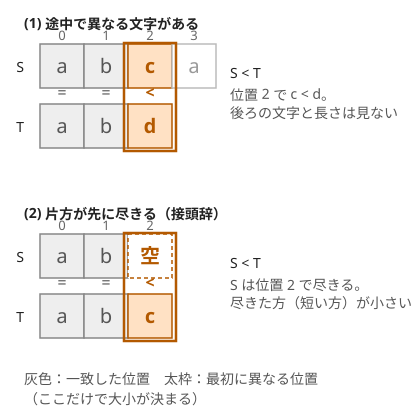
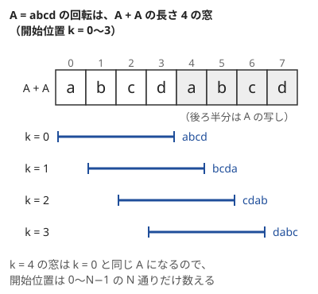

!!! abstract "要点"
    - **何ができるか**：辞書順の最小・回転・文字の一斉置換を問う文字列の問題を、定義に沿った全探索と比較で解く。辞書順は最初に異なる位置の文字で決まり、片方が尽きたら短い方が小さい。
    - **いつ使うか**：
        - 条件を満たす文字列のうち辞書順で最小（最大）のものを出力する。
        - 2 種類の文字を一斉に入れ替える操作を繰り返して一致させられるか。
        - 先頭の文字を末尾に移す（回転する）操作を何回か行う。
        - $\lvert S \rvert \le 5000$ 程度で、回転や置き方を全部試せる。
    - **計算量**：2 つの文字列の比較は $O(\min(\lvert S \rvert, \lvert T \rvert))$。回転を全部試すと $O(N^2)$。文字列を並べる順のソートは、最長の長さを $L$ として $O(L N \log N)$。
    - **前提**：[ソートで考える](../basics/sorting-techniques.md)

<!-- textlint-disable -->
別名：辞書順・文字列の比較・文字の一斉置換・文字列の回転・連結して辞書順最小・lexicographical order
<!-- textlint-enable -->

文字列の基本操作と辞書順は、ABC の B〜D でよく出る文字列の問題を、定義どおりの比較と全探索で解くための道具の集まりである。どれも難しいアルゴリズムは要らない。つまずきやすいのは、辞書順の定義の端（接頭辞）・部分文字列と部分列の取り違え・置換の向き・長さの違う文字列の連結・文字列を作り直す隠れた計算量である。以下では文字列を 0-indexed で $S[0], S[1], \dots, S[N-1]$ と書き、$S[l, r)$ は位置 $l$ から $r - 1$ までの部分文字列を表す。

## 辞書順の定義と std::string の比較（接頭辞は短い方が小さい） {#lexicographic-order}

2 つの文字列 $S$ と $T$ の辞書順は、先頭から 1 文字ずつ比べて決める。

1. 最初に異なる位置 $k$ があれば、$S[k]$ と $T[k]$ の小さい方を持つ文字列が小さい。$k$ より後ろの文字と、2 つの長さは結果に関係しない
2. 異なる位置のないまま片方が尽きたら、尽きた方（短い方）を小さいとする。すなわち、$S$ が $T$ の接頭辞で $S \ne T$ なら $S < T$ である。空文字列は、空でないどの文字列よりも小さい



2 つ目の規則は「尽きた位置に、どの文字よりも小さい空の文字がある」と考えると 1 つ目の規則に含まれる。辞書の見出しで「ab」が「abc」より前に来るのと同じである。

C++ の `std::string` の `<`・`==`・`min`・`sort` は、この辞書順で比べる。1 回の比較は最初に異なる位置まで読むので $O(\min(\lvert S \rvert, \lvert T \rvert))$ かかり、$O(1)$ ではない。`vector<int>` の `<` も、要素を先頭から比べる同じ規則（辞書順）である。

文字どうしの大小は文字コード（ASCII）で決まる。数字 `0`〜`9` は英大文字より小さく、英大文字 `A`〜`Z` は英小文字 `a`〜`z` より小さい。そのため `"Zebra" < "apple"` は true になる。大文字と小文字を区別しない順で比べる問題では、比べる前にどちらかへそろえる。

数を文字列のまま比べると、辞書順と数の大小が食い違う。`"10" < "9"` は true である（位置 0 で `1` < `9`）。先頭に 0 のない非負整数の文字列なら、まず長さで比べ、長さが同じときだけ辞書順で比べれば数の大小と一致する。`long long` に収まらない桁数の数を比べるときに使う。

??? question "確認問題：接頭辞と長さ"
    `"ab"` と `"abc"`、`"abc"` と `"abd"`、`"b"` と `"abc"` のそれぞれで、どちらが小さいか。

    ??? success "答え"
        `"ab"` < `"abc"`（位置 2 で `"ab"` が尽きるので短い方が小さい）。`"abc"` < `"abd"`（位置 2 で `c` < `d`）。`"abc"` < `"b"`（位置 0 で `a` < `b`。長さは関係しない）。

## 部分文字列（連続）と部分列（連続でなくてよい）の違い {#substring-vs-subsequence}

部分文字列と部分列は名前が似ているが、取り出し方が違い、使う道具も違う。

| | 部分文字列 | 部分列 |
| --- | --- | --- |
| 取り出し方 | 連続する範囲 $S[l, r)$ | 位置 $i_1 < i_2 < \dots < i_k$ の文字を順に並べる（飛ばしてよい） |
| 位置の選び方の数 | 空でないものは $N(N+1)/2$ 通り | $2^N$ 通り（空を含む） |
| `"abc"` の例 | `"ab"`・`"bc"` は部分文字列、`"ac"` は違う | `"ab"`・`"bc"`・`"ac"` はどれも部分列 |
| 主な道具 | ローリングハッシュ・Z-algorithm・Suffix Array | 前から貪欲に照合・次の出現位置の表・DP |

部分文字列は部分列でもあるが、逆は成り立たない。問題文で「連続する」「部分文字列（substring）」と書かれていれば連続、「部分列（subsequence）」「連続でなくてよい」と書かれていれば飛ばしてよい。英語の題名や解説を読むときも、この 2 語を取り違えないようにする。

部分文字列の数は $O(N^2)$ なので、各組の処理が $O(1)$（右端を 1 つずつ伸ばしながら更新するなど）なら、$N \le 5000$ 程度で位置の組 $(l, r)$ を全部試せる。組ごとに部分文字列を作ったり比べたりすると $O(N^3)$ になり、間に合わない。部分列は $2^N$ 通りあって全部は試せないので、[部分列の判定と次の出現位置の表](../string/subsequence-matching.md)のように「できるだけ左で拾う」などの性質を使う。問われ方ごとの道具の対応は[部分列と部分文字列](../patterns/subsequence-and-substring.md)にまとめてある。

接頭辞の規則からは、部分文字列の辞書順について次のことが分かる。長さ $m$ の部分文字列 $t$ には、長さ $1, 2, \dots, m - 1$ の接頭辞があり、どれも $S$ の部分文字列で、どれも $t$ より小さい。だから辞書順で $K$ 番目に小さい異なる部分文字列の長さは $K$ 以下である。$K$ が小さければ、長さ $K$ 以下の部分文字列だけを列挙すれば足りる。

## 文字の一斉置換：両方向の対応が一意か（全単射） {#character-mapping}

「2 種類の文字を選び、$S$ の中のその 2 文字を一斉に入れ替える」操作を繰り返して $S$ を $T$ にできるか、という問題を考える。答えは、位置ごとの対応 $S[i] \to T[i]$ が次の 2 つを両方満たすときに Yes である。

- **行き先が一意**：$S$ の同じ文字は、$T$ でもいつも同じ文字に対応する（$S[i] = S[j]$ なら $T[i] = T[j]$）
- **出どころが一意**：$T$ の同じ文字は、$S$ でもいつも同じ文字から来る（$T[i] = T[j]$ なら $S[i] = S[j]$）

2 つを合わせると「$S[i] = S[j] \iff T[i] = T[j]$」になる。この対応は文字から文字への 1 対 1 の対応（[全単射](../guide/glossary.md#bijection)）である。

**なぜ両方要るか**。入れ替えの操作は、アルファベット 26 文字の並べ替えを文字列全体に当てはめることである。操作を何回重ねても、全体として文字の並べ替え $\sigma$ を 1 つ当てはめたことになり、異なる文字は異なる文字のまま残る。だから $T = \sigma(S)$ と書けることが必要で、これは上の 2 条件そのものである。逆に 2 条件を満たせば、使われていない文字どうしを適当に対応させて 26 文字の並べ替え $\sigma$ に広げられる。並べ替えは 2 文字の入れ替えを繰り返して作れるので、条件は十分でもある。

**片方向だけでは足りない例**。$S = $ `ab`、$T = $ `cc` では、行き先は `a`→`c`、`b`→`c` と一意だが、`c` の出どころが `a` と `b` の 2 つある。入れ替えでは異なる文字 `a` と `b` が同じ文字にならないので、No である。

判定は、行き先の表 `to` と出どころの表 `from` を同時に作り、食い違いが出たら No を返せばよい。$O(N)$ で済む。

```cpp
--8<-- "string-basics/char-mapping.cpp:core"
```

同じ考え方で、各文字を「その文字が最初に現れた順の番号」に置き換えると、2 条件を満たす文字列どうしは同じ列になる（`abca` も `xyzx` も `0 1 2 0`）。多数の文字列を「文字の名前を付け替えると一致するもの」ごとにまとめるときは、この列をキーにして `map` に入れる。

操作が「文字 $c$ を一斉に $d$ に置き換える」という片道の置き換えなら、条件は変わる。異なる 2 文字を 1 つにまとめられるので、出どころの一意性は要らない。代わりに、置き換えの順番と、`a`→`b`・`b`→`a` のような巡回をほどくための空いた文字を考える必要がある。操作が入れ替えか片道かを、問題文で必ず確かめる。

??? question "確認問題：片方向の確認だけで書くと"
    行き先の表 `to` だけを作り、「$S$ の同じ文字が $T$ の同じ文字に対応するか」だけを調べた。どんな入力で誤るか。

    ??? success "答え"
        $S$ の異なる文字が $T$ の同じ文字に対応する入力で、誤って Yes を返す。たとえば $S = $ `ab`、$T = $ `cc` である。$S$ と $T$ を入れ替えて同じ確認をもう 1 回するか、出どころの表 `from` も作って確かめる。

## 連結して辞書順最小：長さが違えば 2 通りの連結を比べる {#concat-order}

文字列 $s_1, \dots, s_N$ を好きな順に並べて連結し、結果を辞書順で最小にする問題を考える。すべての文字列の長さが同じなら、辞書順にソートしてつなげばよい。長さが同じ 2 つの文字列は最初に異なる位置で大小が決まり、その位置は連結した後も同じ場所に来るからである。

長さが違うと、辞書順のソートでは誤る。`c` と `ca` は辞書順で `c` < `ca` なので、ソートすると `c`＋`ca` ＝ `cca` になる。しかし逆の順の `ca`＋`c` ＝ `cac` の方が小さい。接頭辞の規則で `c` が小さいとされても、連結では `c` の後ろに次の文字列が続くので、その規則は当てはまらない。

正しくは、2 つの文字列 $a$・$b$ の順を「$a + b < b + a$ なら $a$ を先に置く」という比較関数でソートする。$a + b$ と $b + a$ は長さが同じなので、比べた結果は 2 つを隣に置くときの直接の損得になる。

```cpp
--8<-- "string-basics/concat-order.cpp:core"
```

この比較関数が `sort` に渡してよい[狭義の弱順序](../basics/sorting-techniques.md#strict-weak-ordering)であること（特に推移律）は自明でない。それでも、次のとおり成り立つ。

??? note "証明：比較が推移的で、ソートした順が最小である"
    文字列は空でないとする。文字を $1$ 以上 $B - 1$ 以下の整数とみなし、文字列を $B$ 進数の値として読む（$B$ は文字の種類より大きく取る）。文字列 $a$ の値を $v(a)$、長さを $\lvert a \rvert$ とすると、連結の値は $v(a + b) = v(a) B^{\lvert b \rvert} + v(b)$ である。長さが同じ文字列どうしでは、辞書順と値の大小が一致するので、

    $$
    a + b < b + a \iff v(a) B^{\lvert b \rvert} + v(b) < v(b) B^{\lvert a \rvert} + v(a) \iff \frac{v(a)}{B^{\lvert a \rvert} - 1} < \frac{v(b)}{B^{\lvert b \rvert} - 1}
    $$

    となる（2 つ目の同値は、$v(a)(B^{\lvert b \rvert} - 1) < v(b)(B^{\lvert a \rvert} - 1)$ の両辺を正の数で割って得る）。すなわち、比較関数は各文字列に実数 $f(a) = v(a) / (B^{\lvert a \rvert} - 1)$ を割り当て、その大小で比べていることになる。実数の大小なので推移律が成り立ち、$f$ の値が等しいものどうしが同等になる。

    次に、並べた順のどこかで隣り合う $x, y$ が $y + x < x + y$ を満たすなら、2 つを入れ替えても連結の結果は大きくならない。入れ替えで変わるのは $x + y$ の部分だけで、その部分が同じ長さのより小さい文字列 $y + x$ に変わるからである。どんな並べ方からも、この入れ替えを繰り返して $f$ の小さい順に並べ直せる（バブルソートの要領）。したがってソートした順の結果はどの並べ方の結果以下で、最小である。同等なもの（$x + y = y + x$）の順は結果を変えない。

1 回の比較は $O(\lvert a \rvert + \lvert b \rvert)$ で、比較のたびに $a + b$ と $b + a$ の 2 つの文字列を作る。最長の長さを $L$ とすると、ソート全体は $O(L N \log N)$ である。$N$ 個から $K$ 個だけ選んで連結する型は、この順に並べたうえで DP が要り、ソートだけでは解けない（[辞書順最小を前から決める貪欲](../basics/lexicographic-greedy.md)・[交換論法](../basics/exchange-argument.md)）。

??? question "確認問題：c と ca"
    `c` と `ca` を並べる順を、比較関数 $a + b < b + a$ で決めよ。辞書順のソートではどうなるか。

    ??? success "答え"
        $a = $ `ca`、$b = $ `c` とすると $a + b = $ `cac`、$b + a = $ `cca` で、位置 1 で `a` < `c` なので `cac` が小さい。よって `ca` を先に置き、結果は `cac` である。辞書順のソートでは `c` < `ca`（接頭辞）なので `c` が先になり、`cca` という大きい結果になる。

## 回転（巡回シフト）の入口：回転回数の全探索と A+A {#rotation}

「先頭の文字を末尾に移す」操作を $k$ 回行った文字列を、$S$ を $k$ 回転したものという。中身は $S[k, N) + S[0, k)$ で、$k$ 回転の $i$ 文字目は $S[(k + i) \bmod N]$ である。$N$ 回転すると元に戻るので、回転は $k = 0, 1, \dots, N - 1$ の $N$ 通りしかない。

**回転回数を全探索する**。$N \le 5000$ 程度なら、$N$ 通りの回転それぞれで $O(N)$ の処理をしても全体は $O(N^2)$ に収まる。このとき回転した文字列を毎回作らなくても、添字を $(k + i) \bmod N$ にして元の文字列を読めばよい。次のコードは辞書順で最小の回転を $O(N^2)$ で求める例で、2 つの回転の比較を添字の計算だけで行っている。

```cpp
--8<-- "string-basics/min-rotation.cpp:core"
```

回転と別の操作（1 文字の書き換えなど）を混ぜてよい問題では、まず操作の順番を入れ替えられないかを考える。書き換えた文字は回転してもその文字のまま動くだけなので、「回転を先に全部行い、その後で書き換える」と並べ替えても結果とコストは変わらない。そうすれば、回転回数 $k$ を全探索し、それぞれで書き換えの数を数える問題になる。

**A+A を作る**。文字列 $A$（長さ $N$）を 2 つつないだ $A + A$ の位置 $k$ から始まる長さ $N$ の部分文字列は、$A$ を $k$ 回転したものと一致する。すべての回転が 1 本の文字列の中に並ぶので、「文字列 $B$ は $A$ の回転か」は「$\lvert A \rvert = \lvert B \rvert$ で、$B$ が $A + A$ の部分文字列か」と言い換えられる。



$A + A$ の中で $B$ を探すのを素朴に行うと $O(N^2)$ かかる。$N$ が $10^4$ を超えるなら、線形時間の文字列検索（[Z-algorithm](../string/z-algorithm.md)・[KMP 法](../string/kmp.md)・[ローリングハッシュ](../string/rolling-hash.md)）を使う。「何回回転すると一致するか」を求めるときは、$A + A$ の中の開始位置が $N - 1$ 以下の出現だけを数える（位置 $N$ からの出現は 0 回転と同じ）。辞書順で最小の回転も、$A + A$ の [Suffix Array](../string/suffix-array.md) で開始位置が $N$ 未満の接尾辞のうち最小のものを選ぶと、全探索より速く求まる。

## 計算量の落とし穴（substr・+・find は長さに比例する） {#cost-pitfalls}

文字列の操作の多くは、1 行で書けても長さに比例する時間を食う。ループの中で使うと、$O(N)$ のつもりが $O(N^2)$ になる。

| 書き方 | 計算量 | 代わりの書き方 |
| --- | --- | --- |
| `s = s + c` | 毎回 $O(\lvert s \rvert)$（全体をコピー） | `s += c` か `s.push_back(c)`（ならし $O(1)$） |
| `s = c + s`（先頭に足す） | 毎回 $O(\lvert s \rvert)$ | 後ろに足していき、最後に 1 回 `reverse` |
| `s.substr(i, len)` | $O(\mathrm{len})$（新しい文字列を作る） | 添字で直接比べる、`s.compare(i, len, t)`、[`string_view`](../cpp/cpp-string-api.md#string-view)（寿命に注意） |
| `s == t`・`s < t` | $O(\min(\lvert s \rvert, \lvert t \rvert))$ | 等しいかを大量に調べるならハッシュ |
| `s.find(t)` | 計算量は規格で決まっておらず、最悪 $O(\lvert s \rvert \lvert t \rvert)$ になりうる | Z-algorithm・KMP 法で $O(\lvert s \rvert + \lvert t \rvert)$ |

具体的に起きるのは次のような場面である。

- **答えを 1 文字ずつ組み立てる**：$N = 10^6$ 文字の答えを `ans = ans + c` で作ると、コピーの合計が約 $N^2 / 2 = 5 \times 10^{11}$ 文字になり TLE する。$N = 2 \times 10^5$ ではメモリのコピーが速く、間に合うこともある。`ans += c` に変えるだけで直る
- **部分文字列を作ってから比べる**：「$S[i, i + m)$ が $T$ と等しいか」を全部の $i$ で `s.substr(i, m) == t` と書くと、比較の前にコピーが $O(m)$ かかる。$O(Nm)$ で間に合う制約ならよいが、そうでなければ線形時間の検索に変える
- **文字列のソート・set・map**：比較が $O(L)$ なので、$N$ 個の文字列のソートは $O(L N \log N)$、`set<string>` への挿入は 1 回 $O(L \log N)$ かかる。合計の長さが大きい問題ではこれを見積もりに入れる
- **再帰に文字列を値で渡す**：`void dfs(string s)` は呼ぶたびに全体をコピーする。`const string&` で渡すか、1 本の文字列に `push_back`・`pop_back` してから戻す

`std::string` の個々の関数の使い方と注意は [文字列の操作](../cpp/cpp-string-api.md)にまとめる。

## 使い分け {#comparison}

- 条件を満たすもののうち辞書順最小を、先頭から 1 文字ずつ決めるなら[辞書順最小を前から決める貪欲](../basics/lexicographic-greedy.md)。辞書順で $K$ 番目も同じページ
- 部分列として含むかを調べるなら[部分列の判定と次の出現位置の表](../string/subsequence-matching.md)
- 部分文字列どうしの一致を大量に調べる、長い文字列の中でパターンを探すなら[ローリングハッシュ](../string/rolling-hash.md)・[Z-algorithm](../string/z-algorithm.md)
- 部分文字列の種類数や辞書順の並びを全体で扱うなら [Suffix Array](../string/suffix-array.md)
- 同じ文字の連続をまとめて考えるなら[ランレングス圧縮](../basics/run-length-encoding.md)
- 括弧の対応や数式の文字列は[括弧列](../patterns/bracket-sequence.md)・[構文解析](../misc/parsing.md)

## 例題 {#examples}

### ABC042 B. Iroha Loves Strings (ABC Edition) {#abc042_b}

<div class="kp-problems" data-role="example" markdown>

- [ABC042 B. Iroha Loves Strings (ABC Edition)](https://atcoder.jp/contests/abc042/tasks/abc042_b)（diff 616）：同じ長さの文字列をすべてつないだ結果のうち、辞書順で最小のものを求める。

</div>

どの文字列も長さが同じなので、辞書順で小さいものから順につなげばよい。長さが同じ 2 つの文字列は、最初に異なる位置が連結した後も同じ場所に来るので、前に置く方を小さくするほど結果も小さくなる。長さが違う場合に備えて、比較関数 $a + b < b + a$ でソートしても同じ答えになる（[連結して辞書順最小](#concat-order)）。

??? note "解法の詳細"
    - $N$ 個の文字列を読み、`sort` で辞書順に並べる。
    - 並べた順に `+=` でつないで出力する。
    - 文字列の長さを $L$ とすると、比較 1 回が $O(L)$ なのでソートは $O(L N \log N)$。
    - 長さが同じなので、比較関数 $a + b < b + a$ を使っても普通の `<` と同じ順になる。コードは[連結して辞書順最小](#concat-order)の節のものがそのまま使える。

## 練習問題 {#practice}

<div class="kp-problems" data-role="practice" markdown>

- [ABC286 C. Rotate and Palindrome](https://atcoder.jp/contests/abc286/tasks/abc286_c)（diff 565）：先頭を末尾へ移す操作（コスト A）と 1 文字の書き換え（コスト B）で、文字列を回文にする最小のコストを求める。
- [ABC076 C. Dubious Document 2](https://atcoder.jp/contests/abc076/tasks/abc076_c)（diff 846）：? を埋めて T を部分文字列に含む文字列のうち、辞書順で最小のものを求める。
- [ABC110 C. String Transformation](https://atcoder.jp/contests/abc110/tasks/abc110_c)（diff 949）：文字を一斉に置き換える操作を繰り返して、S を T にできるかを判定する。
- [ARC097 C. K-th Substring](https://atcoder.jp/contests/arc097/tasks/arc097_a)（diff 1108）：S の異なる部分文字列のうち、辞書順で K 番目（K ≤ 5）のものを求める。

</div>

??? note "練習の方針"
    - **ABC286 C**：回転を先に全部行ってから書き換えると並べ替えてよい。回転回数 $k$ を $0$ から $N - 1$ まで試し、$k$ 回転した文字列で左右対称の位置の組のうち文字が違う組の数を数え、$A k + B \times (\text{違う組の数})$ の最小を答える。$O(N^2)$。コストは大きくなりうるので `long long` で数える
    - **ABC076 C**：$T$ を置く開始位置を全部試し、その範囲の各文字が $T$ と一致するか `?` なら置ける。置けた候補ごとに、残りの `?` を最小の文字 `a` で埋めた文字列を作り、辞書順で最小のものを答える。置ける位置がなければ、問題の指定どおりの文字列を出力する
    - **ABC110 C**：操作は 2 種類の文字の入れ替えである。対応 $S[i] \to T[i]$ の行き先と出どころがどちらも一意かを、2 つの表で調べる（[文字の一斉置換](#character-mapping)）
    - **ARC097 C**：$K$ 番目の部分文字列の長さは $K$ 以下である（長い部分文字列には、それより小さい接頭辞が $K$ 個以上ある）。長さ $K$ 以下の部分文字列を全部集め、ソートして重複を除き、$K$ 番目を答える

## 参考 {#references}

- [drken「AtCoder ABC 042 B - 文字列大好きいろはちゃんイージー (4Q, 茶色, 200 点)」](https://drken1215.hatenablog.com/entry/2024/08/04/012109)：例題の方針（長さが同じならソートで足りること、長さが違うと誤る例）
- [drken「AtCoder ABC 286 C - Rotate and Palindrome (3Q, 茶色, 300 点)」](https://drken1215.hatenablog.com/entry/2023/01/29/201129)：練習の方針（回転を先に行うと並べ替えてよいこと、回転回数の全探索）
- [drken「AtCoder ABC 076 C - Dubious Document 2 (4Q, 緑色, 300 点)」](https://drken1215.hatenablog.com/entry/2025/01/22/125627)：練習の方針（置く位置の全探索と、残りを a で埋めること）
- [ikatakos「AtCoder Beginner Contest 110」](https://ikatakos.com/pot/programming_algorithm/contest_history/atcoder/2018/0923_abc110)：文字の入れ替えで両方向の一意性が要る理由（解説の部分だけを参照）
- [drken「AtCoder ABC 097 C - K-th Substring (ARC 097 C) (3Q, 緑色, 300 点)」](https://drken1215.hatenablog.com/entry/2018/06/06/174000)：練習の方針（長さ K 以下で足りる理由）
