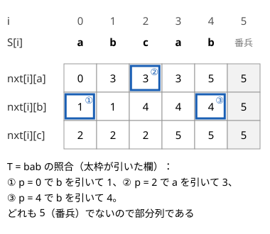

!!! abstract "要点"
    - **何ができるか**：$T$ が $S$ の部分列かを、$S$ を左から見て $T$ の文字をできるだけ早く拾う貪欲で、$O(\lvert S \rvert + \lvert T \rvert)$ で判定する。各位置から各文字が次に現れる位置の表を作れば、多数の判定や辞書順最小の部分列も速く求まる。
    - **いつ使うか**：
        - T を部分列として含むか（連続でなくてよい）。
        - 長さ K の部分列のうち辞書順で最小のもの。
        - S の部分列として現れない最短の文字列。
        - S を何回も繰り返した文字列の部分列として入るか。
        - $\lvert S \rvert \le 10^5$〜$10^6$、文字は英小文字で $26 \times (N+1)$ の表が持てる。
    - **計算量**：1 回の判定は $O(\lvert S \rvert + \lvert T \rvert)$。表を作ると構築 $O(\sigma N)$、判定 1 回 $O(\lvert T \rvert)$（$\sigma$ は文字の種類数、$N = \lvert S \rvert$）。文字ごとの位置のリストなら構築 $O(N)$、判定 $O(\lvert T \rvert \log N)$。
    - **前提**：[文字列の基本操作と辞書順](../string/string-basics.md)、[二分探索](../basics/binary-search.md)

<!-- textlint-disable -->
別名：部分列判定・次の出現位置・nxt 配列・部分列オートマトン・序列自動機・部分列として含むか・subsequence automaton
<!-- textlint-enable -->

部分列の判定は、$T$ の文字を $S$ の左から順に、見つけたらすぐ拾うだけで済む。この「すぐ拾う」を表引きにしたものが次の出現位置の表 $\mathrm{nxt}$ で、判定を何度も行う問題や、部分列を 1 文字ずつ組み立てる問題の道具になる。部分列と部分文字列の違いは[文字列の基本操作と辞書順](../string/string-basics.md#substring-vs-subsequence)を参照する。

## 貪欲な照合：できるだけ左で拾うのが最善な理由 {#greedy-matching}

$T$ が $S$ の部分列かは、次の貪欲で判定できる。添字は 0-indexed で書く。

```text
j = 0                       // T のうち照合済みの文字数
for i = 0 .. |S|-1:
    if j < |T| and S[i] == T[j]: j += 1
T が部分列 ⇔ 最後に j == |T|
```

正しさの要点は「$T[j]$ を拾える位置のうち、最も左の位置で拾っても損をしない」ことである。$T[j]$ を位置 $q$ で拾う照合があり、$T[j - 1]$ を拾った位置より右で $q$ より左の位置 $q'$ にも同じ文字があるとする。$T[j]$ を $q'$ で拾い直しても、$T[j+1]$ 以降に使える範囲は $[q' + 1, N)$ に広がるだけで、元の照合で使っていた位置はそのまま使える。これを $j = 0$ から順に繰り返すと、どの照合も貪欲の照合に置き換えられる。だから貪欲で拾いきれなければ、どんな拾い方でも拾いきれない（[貪欲法の交換論法](../basics/greedy-basics.md#proof)の形）。

貪欲は「$S[0, i)$ で照合できる $T$ の接頭辞の長さの最大値」を $j$ として保つ、と言い換えられる。この見方をすると、$S$ の接頭辞ごとに「$T$ の何文字目まで照合できたか」が分かる。同じように $S$ を後ろから見て $T$ の末尾と照合すれば、接尾辞ごとに照合できる $T$ の末尾の長さが分かる。2 つの文字列をつないだ $A + B$ が $T$ を含むかは、次の条件で判定できる（[ABC324 E](#practice) の型）。

$$
(A \text{ で前から照合できた長さ}) + (B \text{ で後ろから照合できた長さ}) \ge \lvert T \rvert
$$

??? question "確認問題：最初の a を使ってよい理由"
    $S =$ `abcab`、$T =$ `ab` を照合する。$T[0] =$ `a` を $S$ の位置 0 で拾ってよいのはなぜか。位置 3 の `a` で拾う照合と比べて答えよ。

    ??? success "答え"
        位置 3 で `a` を拾う照合では、`b` は位置 4 で拾う。位置 0 で `a` を拾い直しても、`b` に使える範囲は位置 1〜4 に広がるだけで、位置 4 の `b` はそのまま使える。左で拾って選択肢が減ることはないので、最初の `a` を使ってよい。

## 次の出現位置の表（後ろから作る・番兵 N） {#next-occurrence}

同じ $S$ に対して多数の $T$ を判定するとき、毎回 $S$ を走査すると $O(Q \lvert S \rvert)$ かかる。そこで貪欲の「次に $T[j]$ が現れる位置まで進む」を表にしておく。$\mathrm{nxt}[i][c]$ を、位置 $i$ 以降で文字 $c$ が最初に現れる位置（なければ $N$）と定める。$N$ はどの文字も見つからないことを表す[番兵](../guide/glossary.md#sentinel)で、表は $N + 1$ 行ある。

- **作り方**：$\mathrm{nxt}[N][c] = N$ から始め、$i = N - 1, \dots, 0$ の順に、$\mathrm{nxt}[i]$ を $\mathrm{nxt}[i + 1]$ の写しにしてから $\mathrm{nxt}[i][S[i]] = i$ と書き換える。位置 $i$ 以降の最初の $c$ は、$S[i] = c$ なら $i$ で、そうでなければ位置 $i + 1$ 以降の最初の $c$ に等しい
- **なぜ $O(\sigma N)$ か**：各行は直後の行の写しと 1 か所の書き換えで決まる。後ろの答えを使い回すので、行ごとに $S$ を走査し直す必要がない。1 行の写しが $O(\sigma)$ で、行は $N + 1$ 個ある
- **判定**：探し始める位置 $p = 0$ から、$T$ の各文字 $c$ について $q = \mathrm{nxt}[p][c]$ を引く。$q = N$ なら部分列ではない。そうでなければ $p = q + 1$ に進める。判定 1 回は $O(\lvert T \rvert)$ である

次の図は $S =$ `abcab`（$N = 5$）の表と、$T =$ `bab` の照合で引いた欄である。



図では $i$ を横に並べているので、右端の列（$i = 5$）がコードの番兵の行 $\mathrm{nxt}[5]$ にあたり、すべて 5 である。$T =$ `bc` なら、$\mathrm{nxt}[0][b] = 1$ の次に $\mathrm{nxt}[2][c] = 2$ を引いて照合できる。一方 $T =$ `cc` では、$\mathrm{nxt}[0][c] = 2$ の後に引く $\mathrm{nxt}[3][c]$ が番兵の 5 なので、部分列ではない。

```cpp
--8<-- "subsequence-matching/next-table.cpp:core"
```

`match_end(nxt, t, p)` は、位置 $p$ から照合して $T$ の最後の文字を拾った位置を返す。この位置を $r$ とすると、「$S[p, e)$ が $T$ を部分列に含む」となるのは $e > r$ のときだけである。照合できないときに $r = N$ を返すと、「$e \le r$ なら含まない」という式が照合できない場合にもそのまま使える。番兵を $N$ にしておく利点である。

??? question "確認問題：表を前から作れない理由"
    $\mathrm{nxt}$ の表を $i = 0$ から順に作ろうとすると、何が困るか。

    ??? success "答え"
        $\mathrm{nxt}[i][c]$ は位置 $i$ より後ろの文字で決まる。前から作ると、$\mathrm{nxt}[i]$ を決める時点で後ろの情報がまだないので、行ごとに右へ走査し直すことになり $O(N^2)$ かかる。後ろから作れば、すでに完成した $\mathrm{nxt}[i + 1]$ を写して 1 か所直すだけで済む。

## 文字ごとの位置のリストと lower_bound による代用 {#position-lists}

$\mathrm{nxt}$ の表は $(N + 1) \times \sigma$ の大きさがある。文字の種類が多い（数列の部分列で値が $10^9$ まで）か、$N$ が大きくて表が重いときは、文字ごとに出現位置を昇順に並べたリスト $\mathrm{pos}[c]$ で代える。

- **作り方**：$S$ を前から見て、$\mathrm{pos}[S[i]]$ の末尾に $i$ を足す。全体で $O(N)$ で、リストの長さの合計は $N$ である
- **次の出現位置**：位置 $p$ 以降の最初の $c$ は、$\mathrm{pos}[c]$ の中で $p$ 以上の最初の要素で、`lower_bound` で $O(\log N)$ で求まる。末尾まで見つからなければ番兵 $N$ として扱う
- **値が大きいとき**：文字が整数なら、[座標圧縮](../basics/coordinate-compression.md)して配列で持つか、`map<int, vector<int>>` で持つ

使い分けの目安は、$\sigma N$ が $10^7$ 台に収まり判定の回数が多いなら表、そうでなければリストである。リストには、「位置 $p$ 以降で $c$ が何個あるか」「$k$ 個目の $c$ はどこか」が添字の引き算で分かるという利点もある。これは[繰り返した文字列の部分列](#repeated-string)で使う。

## 辞書順最小の部分列（残りで足りる範囲の最小の文字を選ぶ） {#lexicographically-smallest}

この節は[辞書順最小を前から決める貪欲](../basics/lexicographic-greedy.md)を前提にする。長さ $N$ の $S$ から、長さ $K$ の部分列のうち辞書順で最小のものを作る。

答えを先頭から 1 文字ずつ決める。すでに $j$ 文字決めて、次に探し始める位置が $p$ のとき、文字 $c$ を `a` から順に試し、$q = \mathrm{nxt}[p][c]$ について次の条件を満たす最初の $c$ を選ぶ。

$$
q < N \quad\text{かつ}\quad N - q \ge K - j
$$

右の不等式は、位置 $q$ を含めて後ろに $K - j$ 文字以上残ることを表す。選んだら $p = q + 1$ に進める。同じ文字が何か所かにあるとき最も左の $q$ を使うのは、[貪欲な照合](#greedy-matching)と同じく、左で拾うほど後に選べる部分列が広がるだけだからである。各ステップで最大 $\sigma$ 回表を引くので、表の構築と合わせて $O(\sigma N)$ になる。コードは[残りで実現できるかの判定](../basics/lexicographic-greedy.md#feasibility)にある。

「$S$ の部分列として現れない最短の文字列」も同じ表で扱える。$\mathrm{dp}[i]$ ＝「$S[i, N)$ の部分列にならない最短の文字列の長さ」とする。$\mathrm{dp}[N + 1] = 0$ と置くと、次の式を $i = N, N - 1, \dots, 0$ の順に計算すればよい。

$$
\mathrm{dp}[i] = 1 + \min_c \mathrm{dp}[\mathrm{nxt}[i][c] + 1]
$$

[貪欲な照合](#greedy-matching)により、先頭が $c$ の文字列 $cX$ が $S[i, N)$ の部分列でないことは、$X$ が $S[\mathrm{nxt}[i][c] + 1, N)$ の部分列でないことと同じだからである。$\mathrm{nxt}[i][c] = N$ なら $c$ 1 文字で済み、$\mathrm{dp}[N + 1] = 0$ がそれを表す。辞書順最小の答えは、位置 0 から「最小を与える文字のうち最も小さいもの」を選んで進む[復元](../dp/dp-reconstruction.md)で作る（[ARC081 E](#challenge)）。

## 繰り返した文字列の部分列（文字ごとの累積個数で位置を飛ばす） {#repeated-string}

この節は[答えで二分探索](../basics/binary-search-answer.md)を前提にする。問題の記号に合わせて、この節では $N$ を繰り返しの回数とし、$S$ の長さは $\lvert S \rvert$ と書く。$S$ を $N$ 回つないだ文字列（長さ $N \lvert S \rvert$ は $10^{17}$ にもなる）の上で照合するときは、文字を 1 つずつ拾っていられない。「文字 $c$ を $k$ 個まとめて拾う」操作を、周の割り算と 1 周の中の位置の表で $O(\log \lvert S \rvert)$ にする。

位置は、$S$ を無限に繰り返した列の通し番号 $p$ で持つ。周の番号は $\lfloor p / \lvert S \rvert \rfloor$、周の中の位置は $p \bmod \lvert S \rvert$ である。$\mathrm{pos}[c]$ を 1 周の中での $c$ の出現位置のリスト、その長さを $m$ とする。

1. 周の中の位置 $p \bmod \lvert S \rvert$ より前にある $c$ の個数 $b$ を `lower_bound` で求める
2. この周の先頭から数えて $b + k - 1$ 番目（0-indexed）の $c$ を拾えばよい。これを $m$ で割った商だけ周を進め、余りの番目の位置 $\mathrm{pos}[c][(b + k - 1) \bmod m]$ を拾う
3. 次に探し始める位置は、拾った位置の次である

番目を 0-indexed の $b + k - 1$ で数えるのが要点である。1-indexed の $b + k$ を $m$ で割ると、ちょうど周の最後の $c$ で終わるとき余りが 0 になり、1 周余分に進めてしまう。

```cpp
--8<-- "subsequence-matching/repeated.cpp:core"
```

$T$ の各文字を $k$ 回ずつ並べた文字列が入るかは $k$ について単調なので、この判定で $k$ を二分探索できる（[ABC346 F](#practice) の型）。判定 1 回が $O(\lvert T \rvert \log \lvert S \rvert)$、二分探索が $O(\log V)$ 回（$V$ は $k$ の上限）である。周の番号が $N$ 以上になったら、その時点で不可を返す。続けて掛け算や足し算をすると `long long` があふれるからである。

## 落とし穴 {#pitfalls}

**部分文字列と取り違える**。「部分列」は飛ばしてよく、「部分文字列」は連続である。部分文字列の判定は[KMP 法](../string/kmp.md)や[ローリングハッシュ](../string/rolling-hash.md)の範囲で、この貪欲では判定できない。問題文の語と英語の題名で、subsequence と substring のどちらかを確かめる。

**拾った位置を次も使ってしまう**。照合を進めるときは $p = q + 1$ にする。$p = q$ のままだと、$T =$ `aa` のように同じ文字が続いたとき、$S$ の同じ `a` を 2 回使ってしまう。入出力例に同じ文字の連続がないと、この誤りは例で見つからない。小さな $S$・$T$ を自分で作り、素朴な貪欲と結果を比べるとよい。

**番兵の行を作らない**。$\mathrm{nxt}$ は $N + 1$ 行にして、$\mathrm{nxt}[N]$ をすべて $N$ にする。$S$ の最後の文字を拾うと $p = N$ になり、次の文字でこの行を引く。$N$ 行しか作らないと範囲外を読む。見つからないときの値を $-1$ にすると、$p = q + 1 = 0$ で先頭に戻ってしまうので、番兵は $N$ がよい。

**表の大きさ**。$N = 10^6$、$\sigma = 26$ なら `int` で約 $10^8$ バイト（約 100 MB）になる。`vector<vector<int>>` は行ごとに確保するので遅く、余分なメモリも使う。`vector<array<int, 26>>` で 1 つの配列にまとめるか、[位置のリスト](#position-lists)に代える。

**数え上げの答えのあふれ**。部分文字列の数は $N(N+1)/2$ 個あり、$N = 2 \times 10^5$ でも `int` を超える。始点ごとに足す答えは `long long` で持つ。

## 上位の手法へのつながり {#next-steps}

次の出現位置の表は、部分列を「最も左で拾う」ただ 1 通りの取り出し方に対応させる道具である。この対応を使うと、判定だけでなく数え上げや辞書順の問いにも進める。

- **異なる部分列の数を数える**：最も左で拾う取り出し方は部分列ごとに 1 通りなので、表の遷移の上で数えれば重複しない（[次の出現位置の表で配る DP](../dp/subsequence-dp.md#next-table-dp)）。
- **部分列として現れない最短の文字列・辞書順 K 番目の部分列**：後ろから DP して先頭から決める（[部分列として現れない最短の文字列](../dp/subsequence-dp.md#shortest-non-subsequence)、[辞書順 K 番目の部分列](../dp/subsequence-dp.md#kth-subsequence)）。
- **2 つの文字列に共通する部分列**：照合する相手も 1 文字ずつ動くので、[最長共通部分列](../dp/lcs.md#recurrence)の DP になる。
- **部分列ではなく部分文字列を照合する**：失敗すると戻り先を決める必要があるので、[KMP 法](../string/kmp.md#matching)か [Z-algorithm](../string/z-algorithm.md#pattern-search) を使う。

## 使い分け {#comparison}

- **部分列として何通り取り出せるか・異なる部分列の数**：判定ではなく数え上げなので[部分列 DP](../dp/subsequence-dp.md#positions-or-strings)を使う。異なる部分列を重複なく数えるには、各文字列を「最も左で拾う取り方」で代表させ、$\mathrm{nxt}$ に沿って遷移する
- **2 つの文字列の共通の部分列の最長**：一方を固定した判定ではないので[最長共通部分列と編集距離](../dp/lcs.md)の DP を使う
- **辞書順最小の文字列を作る**：表は「残りで足りるか」の判定に使い、決め方は[辞書順最小を前から決める貪欲](../basics/lexicographic-greedy.md)に従う
- **連続する部分の一致**：[KMP 法](../string/kmp.md)・[Z-algorithm](../string/z-algorithm.md)・[ローリングハッシュ](../string/rolling-hash.md)を使う。問われ方ごとの対応は[部分列と部分文字列](../patterns/subsequence-and-substring.md#overview)にまとめてある

## 例題 {#examples}

### ABC452 D. No-Subsequence Substring {#abc452_d}

<div class="kp-problems" data-role="example" markdown>

- [ABC452 D. No-Subsequence Substring](https://atcoder.jp/contests/abc452/tasks/abc452_d)（diff 903）：S の部分文字列のうち、T を部分列として含まないものの数を求める。

</div>

部分文字列は始点 $l$ と終点 $e$ の組 $S[l, e)$ で決まる。始点を固定すると、$e$ を伸ばすほど $T$ を含みやすくなるので、「含まない」のは $e$ がある値以下の範囲である。その境目は、$l$ から貪欲に照合したとき $T$ の最後の文字を拾う位置 $r_l$ で決まる。$T$ が短いので、始点ごとに表を引いて照合しても間に合う。

??? note "解法の詳細"
    - $\mathrm{nxt}$ の表を後ろから作る（[次の出現位置の表](#next-occurrence)）。$O(26N)$。
    - 各始点 $l$ で、$p = l$ から $T$ の各文字を表で引き、$p = q + 1$ と進める。最後の文字を拾った位置を $r_l$ とし、途中で番兵 $N$ が出たら $r_l = N$ とする。
    - $S[l, e)$ が $T$ を含まないのは $l < e \le r_l$ のときなので、始点 $l$ の分は $r_l - l$ 個である。照合できない始点も $r_l = N$ で同じ式になる。
    - 答え $\sum_l (r_l - l)$ は `long long` で足す。全体で $O(26N + N \lvert T \rvert)$。
    - $T$ に同じ文字が続くとき、$p = q$ のままにすると $S$ の同じ位置を 2 回使ってしまう。必ず $q + 1$ から探す。

## 練習問題 {#practice}

<div class="kp-problems" data-role="practice" markdown>

- [ABC324 E. Joint Two Strings](https://atcoder.jp/contests/abc324/tasks/abc324_e)（diff 1153）：N 個の文字列から 2 つを順に連結したものが T を部分列に含むような組の数を求める。
- [典型90 006. Smallest Subsequence（★5）](https://atcoder.jp/contests/typical90/tasks/typical90_f)（diff —）：文字列の長さ K の部分列のうち、辞書順最小のものを求める。
- [ABC346 F. SSttrriinngg in StringString](https://atcoder.jp/contests/abc346/tasks/abc346_f)（diff 1840）：S を N 回並べた文字列に、T の各文字を k 回ずつ並べた文字列が部分列として入る最大の k を求める。

</div>

??? note "練習の方針"
    - **ABC324 E**：各 $S_i$ について、$T$ の先頭から照合できる長さ $l_i$ と、後ろから見て $T$ の末尾から照合できる長さ $r_i$ を貪欲で求める。$S_i + S_j$ が $T$ を含むのは $l_i + r_j \ge \lvert T \rvert$ のときなので、$r$ をソートして各 $i$ で `lower_bound` で数える
    - **典型90 006**：[辞書順最小の部分列](#lexicographically-smallest)の貪欲そのもの。表を作らずに毎回走査すると $O(NK)$ で間に合わない
    - **ABC346 F**：[繰り返した文字列の部分列](#repeated-string)の判定で $k$ を二分探索する。$S$ にない文字が $T$ にあれば答えは 0 なので、先に調べる。$k$ の上限は $N \lvert S \rvert / \lvert T \rvert$ 程度まで取る（ここの $N$ は繰り返しの回数）

## 力試し {#challenge}

<div class="kp-problems" data-role="challenge" markdown>

- [ARC081 E. Don't Be a Subsequence](https://atcoder.jp/contests/arc081/tasks/arc081_c)（diff 2072）：文字列 A の部分列として現れない最短の文字列のうち、辞書順最小のものを求める。

</div>

??? note "力試しの方針"
    - **ARC081 E**：$\mathrm{dp}[i]$ ＝「$A[i, N)$ の部分列にならない最短の長さ」を、表を使って後ろから求める（[辞書順最小の部分列](#lexicographically-smallest)の後半）。各 $i$ で最小を与える最初の文字を記録しておき、位置 0 から記録をたどって答えを組み立てる。表と DP はどちらも $O(26N)$

## 参考 {#references}

- [merom686「ABC452」](https://merom686.hatenablog.com/entry/2026/04/05/005148)：例題の方針（始点ごとの照合と、同じ位置を使わない注意）
- [comet725「ABC452Dを解いた【DP】」](https://qiita.com/comet725/items/f5d92e162ae4cac7f422)：例題の別解（照合位置を状態にした DP）
- [drken「AtCoder ABC 324 E - Joint Two Strings (1Q, 緑色, 500 点)」](https://drken1215.hatenablog.com/entry/2023/10/21/181937)：前後からの照合の長さを合わせる判定と数え方
- [drken「競プロ典型 90 問 006 - Smallest Subsequence（1Q, ★5）」](https://drken1215.hatenablog.com/entry/2021/10/10/195200)：次の出現位置の表の作り方と辞書順最小の貪欲
- [merom686「ABC346」](https://merom686.hatenablog.com/entry/2024/03/24/023206)：繰り返した文字列での割り算と累積個数による照合、余りが 0 のときの誤りとあふれ
- [drken「AtCoder ARC 081 E - Don't Be a Subsequence (黄色, 600 点)」](https://drken1215.hatenablog.com/entry/2018/09/22/201000)：部分列にならない最短の文字列の DP と復元
