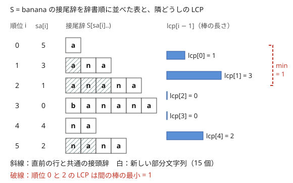

!!! abstract "要点"
    - **何ができるか**：文字列の全接尾辞を辞書順に並べた開始位置の列（SA）と、辞書順で隣り合う接尾辞どうしの最長共通接頭辞の長さの列（LCP 配列）を作る。この 2 つから、異なる部分文字列の数・任意の 2 接尾辞の LCP・パターンの出現回数が求まる。ACL の `suffix_array`・`lcp_array` で 1 行ずつ作れる。
    - **いつ使うか**：
        - 異なる部分文字列の個数を問われる。
        - 全接尾辞どうしの LCP の和を求める。
        - 回転したものどうしの辞書順の大小を数える。
        - 部分文字列を辞書順に並べたときの K 番目を求める。
        - $\lvert S \rvert \le 5 \times 10^5$ 程度で、全部分文字列を扱う。
    - **計算量**：SA は文字列なら $O(N)$、`vector<T>` なら $O(N \log N)$。LCP 配列は $O(N)$。任意の 2 接尾辞の LCP は、前計算 $O(N \log N)$ の後 1 回 $O(1)$。パターン $T$ の出現回数は 1 回 $O(\lvert T \rvert \log N)$。
    - **前提**：[文字列の基本操作と辞書順](../string/string-basics.md)、[二分探索](../basics/binary-search.md)

<!-- textlint-disable -->
別名：接尾辞配列・SA・LCP 配列・SA-IS・Kasai 法・suffix_array・lcp_array・異なる部分文字列の数
<!-- textlint-enable -->

Suffix Array は、文字列の接尾辞をすべて辞書順に並べ、その開始位置を並べた列である。辞書順で隣り合う接尾辞の[最長共通接頭辞](../guide/glossary.md#lcp)を並べた LCP 配列と組にすると、「すべての部分文字列」を接尾辞の接頭辞として整理して扱える。ACL を呼ぶだけで作れるので、作り方を知らなくても水色のうちから使える。

## SA と LCP 配列の定義（ACL の suffix_array・lcp_array。lcp の長さは N−1） {#definition}

長さ $N$ の文字列 $S$（0-indexed）について、位置 $p$ から始まる接尾辞を $S[p, N)$ と書く。2 つの配列を次のように定める。

- $\mathrm{sa}[i]$：辞書順で $i$ 番目（0 番目から数える）の接尾辞の開始位置。$\mathrm{sa}$ は $(0, 1, \dots, N - 1)$ の並べ替えである
- $\mathrm{lcp}[i]$（$0 \le i \le N - 2$）：$S[\mathrm{sa}[i], N)$ と $S[\mathrm{sa}[i+1], N)$ の最長共通接頭辞（LCP）の長さ。長さは $N - 1$ である

$\mathrm{sa}$ の逆写像 $\mathrm{rnk}$（位置 $p$ の接尾辞が辞書順で何番目か。$\mathrm{rnk}[\mathrm{sa}[i]] = i$）も、ほとんどの応用で使う。ACL は作らないので自分で作る。

次の図は $S = $ `banana` の例である。左の表は接尾辞を辞書順に並べたもので、$\mathrm{sa} = (5, 3, 1, 0, 4, 2)$ になる。右の棒は隣どうしの LCP で、$\mathrm{lcp} = (1, 3, 0, 0, 2)$ である。



図の要点は 2 つある。斜線のないマスの数が異なる部分文字列の数になる（[異なる部分文字列の数](#distinct-substrings)）。離れた 2 行の LCP は、間にある棒の最小になる（[任意の 2 接尾辞の LCP](#lcp-rmq)）。

ACL では次のように作る。

```cpp
--8<-- "suffix-array/usage.cpp:core"
```

完全なプログラム：[`usage.cpp`](https://github.com/yuukougun/kyopro-atlas/blob/main/snippets/suffix-array/usage.cpp)（GitHub）
{ .kp-code-src }

!!! info "ACL では"
    `#include <atcoder/string>`。`suffix_array(s)` は `string` なら $O(N)$、`vector<T>`（`T` は `int`・`unsigned int`・`long long`・`unsigned long long`）なら $O(N \log N)$、`suffix_array(v, upper)`（`vector<int>` で値が $0$ 以上 `upper` 以下）なら $O(N + \mathrm{upper})$。`lcp_array(s, sa)` は長さ $N - 1$ の `vector<int>` を $O(N)$ で返し、$N \ge 1$ が要る。テンプレート引数は書かずに推論させる（`suffix_array<int>(v)` とは書かない）。

素朴に接尾辞の文字列を作ってソートすると、比較 1 回に $O(N)$ かかるので $O(N^2 \log N)$ になる。$N = 5 \times 10^5$ では間に合わない。

## 異なる部分文字列の数 = N(N+1)/2 − Σlcp {#distinct-substrings}

異なる部分文字列の数は、重複も数えた部分文字列の数 $N(N+1)/2$ から $\mathrm{lcp}$ の総和を引けば求まる。

$$
\text{（異なる部分文字列の数）} = \frac{N(N+1)}{2} - \sum_{i=0}^{N-2} \mathrm{lcp}[i]
$$

**なぜ正しいか**：部分文字列はどれも、ある接尾辞の接頭辞である。接尾辞を辞書順に見ていき、各接尾辞の接頭辞のうち、それより前の接尾辞に現れなかったものだけを数える。$S[\mathrm{sa}[i], N)$ の接頭辞のうち前に現れたものは、ちょうど長さ $\mathrm{lcp}[i-1]$ 以下のものである。前の接尾辞のうち $S[\mathrm{sa}[i], N)$ と最も長く一致するのは、辞書順で直前の接尾辞だからである（辞書順に並べると、同じ接頭辞を持つものは連続する）。よって $\mathrm{sa}[i]$ が新しく足す部分文字列は $(N - \mathrm{sa}[i]) - \mathrm{lcp}[i-1]$ 個で（$i = 0$ では $\mathrm{lcp}[-1] = 0$ とする）、これを足し合わせると上の式になる。

`banana` なら $21 - (1 + 3 + 0 + 0 + 2) = 15$ である。前節の図では、斜線のないマスが新しく足される部分文字列にあたる。答えは最大で $N^2 / 2$ 程度なので、`long long` で持つ。

Library Checker の number_of_substrings がこの問題で、[PRACTICE2 I](#practice2_i) も同じ問いである。

## 任意の 2 接尾辞の LCP は LCP 配列の区間最小（Sparse Table） {#lcp-rmq}

位置 $p \ne q$ から始まる 2 つの接尾辞の LCP は、$l = \min(\mathrm{rnk}[p], \mathrm{rnk}[q])$、$r = \max(\mathrm{rnk}[p], \mathrm{rnk}[q])$ とすると、$\mathrm{lcp}[l], \dots, \mathrm{lcp}[r-1]$ の最小値に等しい。$p = q$ なら LCP は $N - p$ である。

**なぜ正しいか**：辞書順で $l$ 番目から $r$ 番目までの接尾辞を $X_l, \dots, X_r$ とし、$m = \min(\mathrm{lcp}[l], \dots, \mathrm{lcp}[r-1])$ とおく。隣どうしは先頭 $\mathrm{lcp}[i] \ge m$ 文字が一致するので、$X_l$ と $X_r$ は先頭 $m$ 文字が一致する。逆に $X_l$ と $X_r$ が先頭 $m + 1$ 文字で一致したとする。辞書順で間にある $X_i$ はどれも、先頭 $m + 1$ 文字が同じ文字列に挟まれるので、同じ先頭 $m + 1$ 文字を持つ。すると隣どうしの LCP がすべて $m + 1$ 以上になり、$m$ の定義に反する。

区間最小は [Sparse Table](../ds/sparse-table.md) で前計算 $O(N \log N)$、1 回 $O(1)$ で答えられる。クエリが少なければセグメント木でもよい。

```cpp
--8<-- "suffix-array/lcp-rmq.cpp:core"
```

完全なプログラム：[`lcp-rmq.cpp`](https://github.com/yuukougun/kyopro-atlas/blob/main/snippets/suffix-array/lcp-rmq.cpp)（GitHub）
{ .kp-code-src }

2 つの接尾辞の LCP $h$ が分かると、部分文字列どうしの比較もできる。$S[a, a + k)$ と $S[b, b + k)$ は、$h \ge k$ なら等しく、そうでなければ $S[a + h]$ と $S[b + h]$ の大小で決まる。[ローリングハッシュ](../string/rolling-hash.md)と二分探索でも同じことが $O(\log N)$ でできるが、こちらは衝突がなく 1 回 $O(1)$ である。

## パターンの出現回数：SA 上の二分探索で範囲を求める {#pattern-count}

パターン $T$ が $S$ に現れる回数は、$T$ を接頭辞に持つ接尾辞の数に等しい。それらの接尾辞は SA の上で連続した範囲 $[\mathrm{lo}, \mathrm{hi})$ をなすので、[二分探索](../basics/binary-search.md)で両端を求めれば、出現回数は $\mathrm{hi} - \mathrm{lo}$ である。出現位置は $\mathrm{sa}[\mathrm{lo}], \dots, \mathrm{sa}[\mathrm{hi} - 1]$ になる。

接尾辞の先頭 $\lvert T \rvert$ 文字（短ければ全体）を $T$ と比べると、SA の順に「$T$ より小さい」「$T$ と等しい」「$T$ より大きい」の 3 つに分かれる。

- $\mathrm{lo}$：先頭 $\lvert T \rvert$ 文字が $T$ 以上になる最初の順位
- $\mathrm{hi}$：先頭 $\lvert T \rvert$ 文字が $T$ より大きくなる最初の順位

```cpp
--8<-- "suffix-array/pattern-count.cpp:core"
```

完全なプログラム：[`pattern-count.cpp`](https://github.com/yuukougun/kyopro-atlas/blob/main/snippets/suffix-array/pattern-count.cpp)（GitHub）
{ .kp-code-src }

比較 1 回が $O(\lvert T \rvert)$ なので、1 つのパターンにつき $O(\lvert T \rvert \log N)$ である。パターンが多くても合計 $O(\sum \lvert T_i \rvert \log N)$ で済む（[ABC362 G](#practice)）。

**境界**：$S$ より長いパターンや、接尾辞の途中で切れる比較に気を付ける。`s.compare(pos, len, t)` は `pos + len` が $N$ を超えると末尾までで切って比べるので、短い接尾辞が $T$ の接頭辞なら「$T$ より小さい」と正しく判定される。$S$ を `substr` で切り出すと、比較のたびに文字列を作るので遅くなる。

## 全ペアの LCP の和：LCP 配列の上の単調スタック {#lcp-sum}

各位置 $p$ について $\sum_{q} \mathrm{LCP}(S[p, N), S[q, N))$ を求める問いは、[任意の 2 接尾辞の LCP](#lcp-rmq) を使うと「LCP 配列のすべての区間の最小値の和」の形になる。区間の最小値の和は、[単調スタック](../ds/monotonic-stack.md)を使えば $O(N)$ になる。

順位 $k$ の接尾辞について、前にある接尾辞との LCP の和を $\mathrm{left}[k] = \sum_{i < k} \min(\mathrm{lcp}[i], \dots, \mathrm{lcp}[k-1])$、後ろにある接尾辞との和を $\mathrm{right}[k]$ とする。求める値は $\mathrm{left}[k] + \mathrm{right}[k] + (N - \mathrm{sa}[k])$ で、最後の項は自分自身との LCP である。

$\mathrm{left}$ は次の漸化式で求まる。$h = \mathrm{lcp}[k-1]$ とし、$j$ を $\mathrm{lcp}[j] < h$ となる $k - 1$ 未満の最大の添字とする。

- $j < i \le k - 1$ の $i$ では、区間の最小値は $h$ である（$\mathrm{lcp}[j+1], \dots, \mathrm{lcp}[k-1]$ はどれも $h$ 以上）
- $i \le j$ の $i$ では、$\mathrm{lcp}[j] < h$ なので最小値は $\min(\mathrm{lcp}[i], \dots, \mathrm{lcp}[j])$ のままで、その和は $\mathrm{left}[j+1]$ である

よって $\mathrm{left}[k] = \mathrm{left}[j+1] + h \cdot (k - 1 - j)$ となる（$j$ がなければ $h \cdot k$）。$j$ は、$\mathrm{lcp}$ の値が増える順に添字を積んだスタックから、$h$ 以上のものを降ろした後の先頭で分かる。$\mathrm{right}$ は左右を入れ替えて同じように求める。

```cpp
--8<-- "suffix-array/lcp-sum.cpp:core"
```

完全なプログラム：[`lcp-sum.cpp`](https://github.com/yuukougun/kyopro-atlas/blob/main/snippets/suffix-array/lcp-sum.cpp)（GitHub）
{ .kp-code-src }

全ペアの LCP の和（$\sum_{p < q}$）だけが欲しいなら、$\sum_k \mathrm{left}[k]$ で求まる。複数の文字列どうしの LCP の和なら、[Trie](../string/trie.md) やソートで済むことが多い。[ABC213 F](#abc213_f) がこの節の代表である。

## 複数の文字列を連結するときの区切り（int の列と大きな値） {#concat-separator}

複数の文字列をまとめて扱うときは、間に区切りを挟んで 1 本につなげ、その SA を作る。区切りがないと、接尾辞の LCP が文字列の境目をまたいで伸び、どの文字列にも現れない部分文字列を数えてしまう。たとえば `ab` と `ab` をそのままつなぐと `abab` になり、`ba` や `aba` まで部分文字列に入る。

区切りは「どの文字とも、ほかの区切りとも違う値」にする。区切りが 1 つ（`$` など）なら `string` のままでよい。区切りが少なければ `#`・`%` など使わない文字で足りるが、文字列の数が多い（数百を超えうる）と区切りに使える文字が足りないので、`vector<int>` にする。文字を $1$〜$26$、$j$ 番目の区切りを $27 + j$ にし、`suffix_array(v, upper)` に値の上限を渡すと $O(N + \mathrm{upper})$ で作れる。

区切りがすべて違う値なら、2 つの接尾辞の LCP は区切りの手前で必ず止まる。区切りの値はつないだ列に 1 回ずつしか現れないので、区切りの位置で 2 つの接尾辞が一致することはないからである。位置 $p$ から次の区切りまでの長さを $\mathrm{len}[p]$ とする。どれかの文字列に現れる異なる部分文字列の数は $\sum_i (\mathrm{len}[\mathrm{sa}[i]] - \mathrm{lcp}[i-1])$ になる（$\mathrm{lcp}[-1] = 0$ とする）。

```cpp
--8<-- "suffix-array/multi-string.cpp:core"
```

完全なプログラム：[`multi-string.cpp`](https://github.com/yuukougun/kyopro-atlas/blob/main/snippets/suffix-array/multi-string.cpp)（GitHub）
{ .kp-code-src }

1 本の列を、ある条件で部分に切ってから数える問題も同じ形になる。[ABC452 G](#practice) は、列を[ランレングス圧縮](../basics/run-length-encoding.md)して切った部分の列について、この数え方をする。

## 回転どうしの比較：S+S+T+T の SA {#rotations}

長さ $N$ の文字列 $S$ の回転（先頭の文字を末尾へ移す操作を何回か行ったもの）は、$S + S$ の長さ $N$ の部分文字列 $S[i, i + N)$（$0 \le i < N$）である。$S$ の回転と $T$ の回転を辞書順で比べたいときは、$X = S + S + T + T$ の SA を作る。

$X$ の位置 $i$（$0 \le i < N$）の接尾辞は、先頭 $N$ 文字が $S$ の $i$ 回の回転で、位置 $2N + j$（$0 \le j < N$）の接尾辞は、先頭 $N$ 文字が $T$ の $j$ 回の回転である。回転の比較は先頭 $N$ 文字の比較なので、SA の順に並べてから、先頭 $N$ 文字が等しいもの（隣どうしの $\mathrm{lcp} \ge N$ でつながる範囲）を 1 つのまとまりにすればよい。まとまりの間の順序は回転の辞書順そのものである。

「$S$ の回転 $\le$ $T$ の回転」となる組を数えるには、まとまりを SA の順に見る。それまでに現れた $S$ の回転の数を数えておき、各 $T$ の回転の位置でその数を答えへ足す。同じまとまりの $S$ の回転は等しいので、先に数えに入れる。位置 $N$〜$2N - 1$ と $3N$ 以降の接尾辞は回転ではないので数えない。同じまとまりに入っても、$S$・$T$ のどちらとしても数えなければ答えに影響しない。

```cpp
--8<-- "suffix-array/rotations.cpp:core"
```

完全なプログラム：[`rotations.cpp`](https://github.com/yuukougun/kyopro-atlas/blob/main/snippets/suffix-array/rotations.cpp)（GitHub）
{ .kp-code-src }

**落とし穴**：SA の順だけで数えてまとまりを作らないと、先頭 $N$ 文字が等しい組の扱いが、$N$ 文字目より後ろの関係のない文字で決まってしまう。「より小さい」と「以下」を取り違えないために、等しいものを先にまとめる。[ABC272 F](#practice) がこの形である。

## 部分文字列の辞書順 K 番目 {#kth-substring}

この節は発展の内容で、[異なる部分文字列の数](#distinct-substrings)の考え方を使う。異なる部分文字列を辞書順に並べたとき、SA の順に接尾辞を見て、各接尾辞が新しく足す部分文字列を短い順に並べれば、そのまま辞書順になる。順位 $i$ の接尾辞は、長さ $\mathrm{lcp}[i-1] + 1$ から $N - \mathrm{sa}[i]$ までの接頭辞を、この順に足す（$i = 0$ では $\mathrm{lcp}[-1] = 0$ とする）。

**なぜ辞書順になるか**：順位 $i$ の接尾辞 $Y$ が足す部分文字列 $u$（長さ $L > \mathrm{lcp}[i-1]$）と、それより前の接尾辞 $X$ の接頭辞 $w$ を比べる。$X$ と $Y$ の LCP を $c$ とすると $c \le \mathrm{lcp}[i-1] < L$ である。$\lvert w \rvert \le c$ なら $w$ は $u$ の真の接頭辞なので $w < u$ である。$\lvert w \rvert > c$ なら、$X$ と $Y$ は $c$ 文字目で初めて異なり、$X < Y$ なので $w < u$ である。

よって、$c_i = (N - \mathrm{sa}[i]) - \mathrm{lcp}[i-1]$ の累積和を作り、$K$ がどの $i$ に入るかを二分探索すれば、K 番目は $S[\mathrm{sa}[i], \mathrm{sa}[i] + \ell)$ の形で求まる（$\ell = \mathrm{lcp}[i-1] + $ 残りの個数）。前計算 $O(N)$、1 回 $O(\log N)$ である。

```text
cnt[i] = (N - sa[i]) - (i > 0 ? lcp[i-1] : 0)
acc[i] = cnt[0] + … + cnt[i-1]           # acc[0] = 0
K 番目（1-indexed）：acc[i] < K ≤ acc[i+1] となる i を二分探索
    長さ ℓ = (i > 0 ? lcp[i-1] : 0) + (K - acc[i])
    答えは S[sa[i], sa[i] + ℓ)
```

重複も数えて並べる場合は、同じ部分文字列がいくつの接尾辞に現れるかを数える必要があり、LCP 配列の区間最小を使った分割（LCP の小さい位置で SA を区切る再帰）が要る。複数の文字列の部分文字列を合わせて並べるなら、[区切り](#concat-separator)を入れてつなぐ。

## 自作するなら：ダブリング O(N log^2 N) → O(N log N) → SA-IS {#build-your-own}

ACL が使えない場面や、仕組みを理解したいときのために、作り方の段階を示す。どれも出力は同じである。

**ダブリング**：「先頭 $w$ 文字での順位」$\mathrm{rnk}_w$ が分かれば、先頭 $2w$ 文字での順位は組 $(\mathrm{rnk}_w[p], \mathrm{rnk}_w[p + w])$ の順で決まる（$p + w \ge N$ なら後ろは $-1$ とし、短いものを先にする）。$w = 1, 2, 4, \dots$ と倍にしていき、順位がすべて異なったら止める。

- 各段を `sort` で行うと 1 段 $O(N \log N)$、段は $O(\log N)$ 個なので $O(N \log^2 N)$ である。$N = 2 \times 10^5$ 程度までなら間に合う
- 組の値はどちらも $-1$ 以上 $\max(N, 256)$ 未満の整数（$-1$ は 1 つずらして $0$ にする）なので、基数ソート（計数ソートを 2 回）にすると 1 段 $O(N)$、全体 $O(N \log N)$ になる
- SA-IS は、接尾辞を種類に分けて一部だけを再帰的に並べ、残りを誘導して並べる方法で、$O(N)$ である。ACL の `suffix_array(string)` はこれを使う。自分で書くことはまずない

**Kasai 法（LCP 配列）**：位置 $p = 0, 1, \dots, N - 1$ の順に、辞書順で直前の接尾辞との LCP を求める。位置 $p$ での値を $h$ とすると、位置 $p + 1$ での値は $h - 1$ 以上である。$h \ge 1$ の場合を考える（$h = 0$ なら明らか）。辞書順で $S[p, N)$ の直前にある接尾辞を $S[q, N)$ とする。先頭の 1 文字が同じなので、それを落とした $S[q + 1, N)$ は $S[p + 1, N)$ より前にあり、先頭 $h - 1$ 文字が一致する。辞書順でその間にある接尾辞も同じ $h - 1$ 文字を持つ（[任意の 2 接尾辞の LCP](#lcp-rmq)）ので、直前の接尾辞との LCP も $h - 1$ 以上である。よって $h$ を 1 減らしてから伸ばせばよく、$h$ は全体で $2N$ 回ほどしか増えないので $O(N)$ になる。

```cpp
--8<-- "suffix-array/doubling.cpp:core"
```

完全なプログラム：[`doubling.cpp`](https://github.com/yuukougun/kyopro-atlas/blob/main/snippets/suffix-array/doubling.cpp)（GitHub）
{ .kp-code-src }

Library Checker の suffixarray で、自作の SA を確かめられる。

## 落とし穴 {#pitfalls}

- **lcp の添字のずれ**：ACL の $\mathrm{lcp}[i]$ は「順位 $i$ と $i + 1$」の LCP で、位置 $i$ の接尾辞の値ではない。位置 $p$ から引くときは $\mathrm{rnk}[p]$ を介す。長さは $N - 1$ なので、$\mathrm{lcp}[N-1]$ は配列の外である
- **rnk の作り忘れ**：位置から順位への変換が要る応用（2 接尾辞の LCP、Kasai 法）では、$\mathrm{rnk}[\mathrm{sa}[i]] = i$ を自分で作る
- **区切りの入れ忘れ**：複数の文字列や、切った部分をつなぐときは、[互いに違う区切り](#concat-separator)を挟む。同じ区切りを使い回すなら、数えるときに LCP を区切りまでの長さで抑える
- **オーバーフロー**：異なる部分文字列の数や LCP の和は $N^2$ 程度になるので、`long long` で数える
- **空文字列**：`lcp_array` は $N \ge 1$ が要る。$N = 1$ なら長さ 0 の配列が返る
- **テンプレート引数**：ACL のドキュメントは `suffix_array<int>(v)` ではなく `suffix_array(v)` と、引数から推論させる書き方を求めている。`vector<int>` で値の上限が小さいなら、`suffix_array(v, upper)` の方が速い

## 例題 {#examples}

### PRACTICE2 I. Number of Substrings {#practice2_i}

<div class="kp-problems" data-role="example" markdown>

- [PRACTICE2 I. Number of Substrings](https://atcoder.jp/contests/practice2/tasks/practice2_i)（diff なし）：文字列の異なる部分文字列の個数を求める。

</div>

ACL の練習用の問題で、$\lvert S \rvert \le 5 \times 10^5$ である。[異なる部分文字列の数](#distinct-substrings)の式 $N(N+1)/2 - \sum \mathrm{lcp}$ をそのまま使う。

??? note "解法の詳細"
    `suffix_array(s)` と `lcp_array(s, sa)` を作り、$N(N+1)/2$ から $\mathrm{lcp}$ の総和を引いて出力する。答えは約 $1.25 \times 10^{11}$ まで大きくなるので `long long` で持つ。全体で $O(N)$ である。

### ABC213 F. Common Prefixes {#abc213_f}

<div class="kp-problems" data-role="example" markdown>

- [ABC213 F. Common Prefixes](https://atcoder.jp/contests/abc213/tasks/abc213_f)（diff 2215）：各 i について、Σ_j LCP(S[i:], S[j:]) を求める。

</div>

$N \le 10^6$ なので、2 接尾辞の LCP を全ペアで求める $O(N^2)$ は間に合わない。[全ペアの LCP の和](#lcp-sum)のとおり、SA の順位で考えると「LCP 配列のある位置で終わる区間・始まる区間の最小値の和」になる。これは単調スタックを使えば $O(N)$ になる。

??? note "解法の詳細"
    `suffix_array`・`lcp_array` を作る。左から単調スタックで $\mathrm{left}[k]$ を、右から $\mathrm{right}[k]$ を求める。位置 $\mathrm{sa}[k]$ の答えは $\mathrm{left}[k] + \mathrm{right}[k] + (N - \mathrm{sa}[k])$ で、最後の項は自分自身との LCP である。答えを位置の順に並べ替えて出力する。

    $\mathrm{left}[k]$ の漸化式は、$\mathrm{lcp}[k-1]$ より小さい最後の LCP の添字 $j$ を使って $\mathrm{left}[k] = \mathrm{left}[j+1] + \mathrm{lcp}[k-1] \cdot (k - 1 - j)$ である。答えは $N^2$ 程度になるので `long long` で持つ。SA と LCP 配列の構築も単調スタックも $O(N)$ である。

## 練習問題 {#practice}

<div class="kp-problems" data-role="practice" markdown>

- [ABC362 G. Count Substring Query](https://atcoder.jp/contests/abc362/tasks/abc362_g)（diff 1625）：文字列 S と多数の T_i について、S の中での各 T_i の出現回数を答える。
- [ABC433 G. Substring Game](https://atcoder.jp/contests/abc433/tasks/abc433_g)（diff 2060）：空の文字列から始めて 2 人が交互に末尾へ 1 文字ずつ足し、つねに S の部分文字列であるようにするゲームで、両者が最適に動いたときの勝者を求める。
- [ABC272 F. Two Strings](https://atcoder.jp/contests/abc272/tasks/abc272_f)（diff 2238）：S の回転と T の回転の組のうち、S 側が辞書順で T 側以下になる組の数を求める。
- [ABC452 G. 221 Substring](https://atcoder.jp/contests/abc452/tasks/abc452_g)（diff 2255）：条件を満たす連続部分列の種類数を求める。

</div>

??? note "方針"
    - **ABC362 G**：各 $T_i$ について、[SA 上の二分探索](#pattern-count)で $T_i$ を接頭辞に持つ接尾辞の範囲を求め、その幅を答える。合計 $O(\sum \lvert T_i \rvert \log \lvert S \rvert)$ である。[Aho-Corasick 法](../string/aho-corasick.md#abc362_g)でも解ける
    - **ABC433 G**：ゲームが止まるのは、いまの文字列が伸ばせない接尾辞に一致したときである。勝敗はその長さの偶奇で決まる。SA の順に並べた接尾辞を、LCP の大きい順に隣どうしでまとめていく。LCP が $k$ の分かれ目で手番の人が、自分に有利な側を選ぶ。最後に残った 1 つの結果が答えである
    - **ABC272 F**：[回転どうしの比較](#rotations)のとおり $S + S + T + T$ の SA を作り、先頭 $N$ 文字が等しいものをまとめてから、$S$ の回転の数を数えながら $T$ の回転に足す
    - **ABC452 G**：列をランレングス圧縮し、塊を長さと値の関係で 3 種類に分ける。「使えない塊」はそこで列を切る。「どこでも使える塊」はそのまま並べる。「端にだけ使える塊」はそこで切り、前の部分の末尾と次の部分の先頭の両方に置く。使える塊はどれも長さちょうど（値と同じ長さ）で並ぶので、各塊を値の 1 文字に置き換えてよい。そうして切った部分の列を互いに違う区切りでつなぎ、[区切りのある異なる部分文字列の数](#concat-separator)を数える。[Suffix Automaton](../string/suffix-automaton.md#abc452_g) でも解ける

## 確認問題 {#quiz}

??? question "確認問題：S = abab の SA と LCP 配列を書け"
    接尾辞は abab（0）・bab（1）・ab（2）・b（3）で、辞書順は ab・abab・b・bab である。よって $\mathrm{sa} = (2, 0, 3, 1)$、$\mathrm{lcp} = (2, 0, 1)$ になる。異なる部分文字列の数は $10 - 3 = 7$ で、a・b・ab・ba・aba・bab・abab の 7 個と一致する。

??? question "確認問題：異なる部分文字列の数で、直前の接尾辞との LCP だけを引けばよいのはなぜか"
    順位 $i$ の接尾辞の接頭辞のうち、前の順位の接尾辞にも現れるものは、前のどれかの接尾辞との LCP 以下の長さのものである。辞書順に並べると同じ接頭辞を持つ接尾辞は連続するので、前の接尾辞との LCP の最大は直前の接尾辞との LCP である。よって重複して数えた分は、ちょうど $\mathrm{lcp}[i-1]$ 個になる。

??? question "確認問題：SA 上の二分探索で、出現回数が範囲の幅になるのはなぜか"
    $T$ の出現位置 $p$ と、$T$ を接頭辞に持つ接尾辞 $S[p, N)$ は 1 対 1 に対応する。辞書順では、$T$ を接頭辞に持つ文字列は、$T$ より小さい文字列と、先頭が $T$ より大きい文字列の間に連続して並ぶ。よって両端を二分探索で求めれば、その間の個数が出現回数になる。

??? question "確認問題：2 つの文字列 A・B に共通して現れる最長の部分文字列は、どう求めるか"
    $A$ と $B$ を、どちらにも現れない文字（`#` など）を挟んでつなぎ、SA と LCP 配列を作る。辞書順で隣り合う 2 つの接尾辞のうち、一方が $A$ 側、他方が $B$ 側から始まるものについての $\mathrm{lcp}$ の最大値が答えである。区切りがあるので、LCP が境目をまたぐことはない。

    隣どうしだけ見ればよい理由：$A$ 側と $B$ 側の離れた 2 つの接尾辞の間のどこかには、$A$ 側と $B$ 側が隣り合う組が必ずある。その組の LCP は、間の $\mathrm{lcp}$ の最小値以上なので、離れた 2 つの LCP 以上になる。

## 使い分け {#comparison}

| 問い | 使う手法 |
| --- | --- |
| 2 つの部分文字列が等しいかを多数判定する | [ローリングハッシュ](../string/rolling-hash.md)（短く書ける）、または SA と [Sparse Table](../ds/sparse-table.md)（衝突がない） |
| 各位置と $S$ 全体の LCP だけが要る | [Z-algorithm](../string/z-algorithm.md) |
| 多数の文字列どうしの共通接頭辞・LCP の和 | [Trie](../string/trie.md)、またはソートして隣どうしの LCP |
| 異なる部分文字列の数・辞書順 K 番目・全接尾辞の LCP | Suffix Array と LCP 配列 |
| 文字を後ろに足しながら異なる部分文字列を数える | [Suffix Automaton](../string/suffix-automaton.md#suffix-automaton) |
| 多数のパターンの出現をまとめて数える | [Aho-Corasick 法](../string/aho-corasick.md)、または SA 上の二分探索 |

## 参考 {#references}

- [AtCoder Library「String」（document_ja）](https://github.com/atcoder/ac-library/blob/master/document_ja/string.md)：`suffix_array`・`lcp_array` の多重定義・制約・計算量・lcp の長さ（v1.6 の手元の版で確かめた）
- [AtCoder Library「Appendix」（document_ja）](https://github.com/atcoder/ac-library/blob/master/document_ja/appendix.md)：テンプレート引数を推論させる書き方
- [drken「ACL Practice Contest I - Number of Substrings」](https://drken1215.hatenablog.com/entry/2022/12/15/022900)：例題 practice2_i の式と制約
- [drken「AtCoder ABC 213 F - Common Prefixes」](https://drken1215.hatenablog.com/entry/2021/08/12/012000)：例題 abc213_f の LCP 配列の区間最小への言い換えと、単調スタックの漸化式
- [ikatakos「AtCoder Beginner Contest 362」](https://ikatakos.com/pot/programming_algorithm/contest_history/atcoder/2024/0713_abc362)：練習 abc362_g の SA 上の二分探索（解法の部分だけ）
- [ikatakos「AtCoder Beginner Contest 433」](https://ikatakos.com/pot/programming_algorithm/contest_history/atcoder/2025/1122_abc433)：練習 abc433_g の LCP の大きい順にまとめる方針（解法の部分だけ）
- [merom686「ABC272」](https://merom686.hatenablog.com/entry/2022/10/09/013149)：練習 abc272_f の S+S+T+T の連結と、等しい回転のまとめ方
- [ikatakos「AtCoder Beginner Contest 452 E,F,G問題メモ」](https://ikatakos.com/pot/programming_algorithm/contest_history/atcoder/2026/0404_abc452)：練習 abc452_g のランレングスでの切り方と、区切りを入れた SA での数え方（解法の部分だけ）
