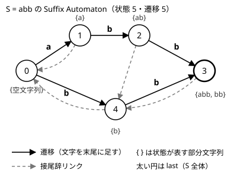

!!! abstract "要点"
    - **何ができるか**：文字列 $S$ の全部分文字列をちょうど受理する、状態数 $2N - 1$ 以下・遷移数 $3N - 4$ 以下の DFA（Suffix Automaton）を作り、文字を末尾に足しながら、異なる部分文字列の数・出現回数・2 つの文字列の最長共通部分文字列を答える。回文木で異なる回文を数え、Lyndon 分解で最小の巡回シフトを求め、Run を列挙し、Z 配列などから文字列を復元する。ABC では Suffix Array・Z-algorithm・Manacher で代えられることが多い。
    - **いつ使うか**：
        - 文字を 1 つずつ追加しながら、異なる部分文字列の数を答える。
        - 2 つの文字列の最長共通部分文字列を求める。
        - 異なる回文の部分文字列の種類数と、それぞれの出現回数を求める。
        - 辞書順最小の巡回シフトを求める。
        - Z 配列（回文半径）が与えられ、それを満たす文字列を作る。
    - **計算量**：Suffix Automaton の構築は $O(N)$（文字の種類 $\sigma$ を定数とみる。遷移を配列で持つとメモリ $O(N\sigma)$）。回文木の構築はならし $O(N)$、Lyndon 分解は $O(N)$、Run の列挙は Main-Lorentz 法で $O(N \log N)$
    - **前提**：[Suffix Array と LCP 配列](../string/suffix-array.md)

<!-- textlint-disable -->
別名：SAM・接尾辞オートマトン・DAWG・回文木・eertree・Palindromic Tree・Lyndon 分解・Duval・最小回転・Run の列挙・Main-Lorentz・逆 Manacher・逆 Z
<!-- textlint-enable -->

Suffix Automaton は、文字列のすべての部分文字列を、状態数が線形の有限オートマトン（文字を読むたびに状態が 1 つに決まる機械。DFA）にまとめたものである。部分文字列は $O(N^2)$ 個あるが、「後ろにどう伸ばせるか」が同じものを 1 つの状態にまとめるので、状態も遷移も $O(N)$ 個で済む。このページは発展の概要で、Suffix Automaton のほかに回文木・Lyndon 分解・Run の列挙・文字列の逆問題を、何ができるか・計算量・自作するときの要点・練習の入口に絞って並べる。証明と実装の詳しい流れは[参考](#references)の資料に任せる。

## Suffix Automaton（状態数 2N−1 以下・遷移数 3N−4 以下。文字の追加に強い） {#suffix-automaton}

Suffix Automaton は、空文字列に当たる状態 0 から文字に沿って遷移をたどると、たどれる文字列がちょうど $S$ の部分文字列になるオートマトンである。部分文字列 $t$ の出現の終わりの位置の集合を $\mathrm{endpos}(t)$ と書くと、$\mathrm{endpos}$ が等しい部分文字列を 1 つの状態にまとめたものになっている。

各状態 $v$ に属す部分文字列は、最長のもの（長さ $\mathrm{len}[v]$）の接尾辞のうち、長さが $\mathrm{len}[\mathrm{link}[v]] + 1$ 以上 $\mathrm{len}[v]$ 以下のものである。ここで $\mathrm{link}[v]$ は接尾辞リンクで、$v$ の文字列の接尾辞のうち、$v$ に属さない最長のものが入る状態を指す。$S = \mathtt{abb}$ の場合を図にする。



状態 3 は abb と bb の 2 つを表す。どちらも出現の終わりが位置 2 だけなので、まとめても後ろへの伸ばし方は変わらない。状態 3 の接尾辞リンクは、次に短い接尾辞 b が入る状態 4 を指す。

この形から、次のことが分かる。

- **異なる部分文字列の数**：各状態は $\mathrm{len}[v] - \mathrm{len}[\mathrm{link}[v]]$ 個の部分文字列を表すので、状態 0 以外での和が答えである。図では $1 + 1 + 2 + 1 = 5$ で、a・b・ab・bb・abb と一致する。文字を 1 つ足したときに増える数は、新しく作った状態 $\mathrm{cur}$ の $\mathrm{len}[\mathrm{cur}] - \mathrm{len}[\mathrm{link}[\mathrm{cur}]]$ である。
- **出現回数**：文字を足すたびに作る状態（複製でない方）に 1 を置き、$\mathrm{len}$ の大きい順に $\mathrm{cnt}[\mathrm{link}[v]] \mathrel{+}= \mathrm{cnt}[v]$ と足し上げる。$\mathrm{cnt}[v]$ が、状態 $v$ に属す各文字列の出現回数になる。
- **2 つの文字列の最長共通部分文字列**：$S$ の Suffix Automaton の上で $T$ を 1 文字ずつ読み、（状態, いま一致している長さ）を持つ。遷移がなければ接尾辞リンクをたどって一致の長さを $\mathrm{len}$ に縮める。一致の長さの最大が答えで、$O(\lvert S \rvert + \lvert T \rvert)$ である。
- **部分文字列のゲームや数え上げ**：状態と遷移は閉路のないグラフ（[DAG](../guide/glossary.md#dag)）になるので、「いまの文字列の末尾に 1 文字足す」操作を状態の上の DP や勝敗の判定にできる。$\mathrm{len}$ の大きい順に処理すれば、行き先が先に決まる。

状態数が $2N - 1$ 以下、遷移数が $3N - 4$ 以下（それぞれ $N \ge 2$、$N \ge 3$ のとき）であることの証明は[参考](#references)の資料にある。$S = \mathtt{abb}$ は状態数が上限の 5 に届く例で、遷移数も 5 で上限に等しい。

### 自作するときの要点 {#build-your-own}

構築はオンラインで、文字を 1 つずつ末尾に足していく。各状態に $\mathrm{len}$・$\mathrm{link}$・遷移の表を持ち、文字列全体が入る状態を $\mathrm{last}$ とする。文字 $c$ を足す手順は次のとおりである。

1. 新しい状態 $\mathrm{cur}$ を作り、$\mathrm{len}[\mathrm{cur}] = \mathrm{len}[\mathrm{last}] + 1$ とする。
2. $p = \mathrm{last}$ から接尾辞リンクをたどり、$c$ の遷移がない状態に $c \to \mathrm{cur}$ を張る。状態 0 も越えたら $\mathrm{link}[\mathrm{cur}] = 0$ で終わる。
3. $c$ の遷移を持つ状態 $p$ で止まったら、その行き先を $q$ とする。$\mathrm{len}[p] + 1 = \mathrm{len}[q]$ なら $\mathrm{link}[\mathrm{cur}] = q$ で終わる。
4. そうでなければ $q$ を複製した $\mathrm{clone}$（遷移とリンクを写し、$\mathrm{len}[\mathrm{clone}] = \mathrm{len}[p] + 1$）を作り、$p$ から接尾辞リンクをたどって $c \to q$ の遷移を $c \to \mathrm{clone}$ に付け替える。最後に $\mathrm{link}[q] = \mathrm{link}[\mathrm{cur}] = \mathrm{clone}$ とする。

```cpp
--8<-- "suffix-automaton/sam.cpp:core"
```

完全なプログラム：[`sam.cpp`](https://github.com/yuukougun/kyopro-atlas/blob/main/snippets/suffix-automaton/sam.cpp)（GitHub）
{ .kp-code-src }

- 状態は最大 $2N - 1$ 個なので、配列を先に確保するならその大きさにする。遷移を `array<int, 26>` で持つと、$N = 5 \times 10^5$ でおよそ $2N \times 26 \times 4$ バイト $\approx 10^8$ バイトになる。文字の種類が多いときは `map` にして $O(N \log \sigma)$ にする。
- 構築が $O(N)$ なのは、手順 2 と 4 でたどる回数の合計が $O(N)$ に抑えられるからである（ならし）。証明は資料に任せる。
- 複数の文字列をまとめて扱うとき（一般化 Suffix Automaton）は、文字列ごとに $\mathrm{last}$ を状態 0 に戻して足していけばよい。すでにある遷移をなぞると中身のない状態ができるが、その状態は $\mathrm{len}$ が接尾辞リンク先と等しく、異なる部分文字列の数には影響しない（手元の総当たりで確かめた）。

## 回文木（eertree） {#palindromic-tree}

回文木は、$S$ に現れる異なる回文をすべて頂点に持つ木である。前提の回文の扱いは[回文](../string/palindrome.md)にある。各頂点は回文 1 つを表し、子は両端に同じ文字 $c$ を足した回文（$cPc$）である。根は長さ $-1$ の仮の回文（奇数長の親）と長さ 0 の空文字列（偶数長の親）の 2 つで、各頂点は接尾辞リンクとして「自分より短い最長の回文接尾辞」を持つ。

異なる回文は $N$ 個以下である。文字を 1 つ足したとき新しく現れうる回文は、その時点の最長の回文接尾辞だけだからである（それより短い回文接尾辞は、最長のものを折り返した位置にすでに現れている）。だから頂点数は $N + 2$ 以下になる。

自作するときの要点は次のとおりである。

- **文字の追加**：位置 $i$ に文字 $c$ を足すときは、直前の最長の回文接尾辞の頂点から接尾辞リンクをたどり、$S[i - \mathrm{len} - 1] = c$ となる最初の頂点 $P$ を探す。$P$ に $c$ の子があれば、それが新しい最長の回文接尾辞である。なければ長さ $\mathrm{len}[P] + 2$ の頂点を作る。
- **新しい頂点の接尾辞リンク**：長さが 1 なら空文字列の根を指す。そうでなければ $P$ の接尾辞リンク先から同じようにたどり、条件を満たした頂点の $c$ の子を指す。
- **出現回数**：各位置 $i$ で最長の回文接尾辞の頂点に 1 を足し、作った順の逆に接尾辞リンク先へ足し上げる。位置 $i$ で終わる回文の個数は、その頂点の接尾辞リンクの木での深さに等しい。
- **計算量**：リンクをたどる回数の合計は $O(N)$ で、構築はならし $O(N)$ である（文字の種類を定数とみて、子を配列で持つ場合）。

ABC で「異なる回文の種類数」を問われたら、[Manacher](../string/palindrome.md#manacher) とローリングハッシュでも求められる。Manacher で半径を伸ばすとき、鏡に写した値より先を新しく比べて一致した分だけが、新しく現れうる回文である。その回文を候補として集め（合計 $O(N)$ 個）、ハッシュで重複を除く考え方である。出現回数まで要るなら回文木の方が素直である。Library Checker の [Eertree](#practice) は回文木の親・接尾辞リンク・各接頭辞の最長の回文接尾辞をそのまま出力させる問題である。

## Lyndon 分解（Duval）と最小回転 {#lyndon-factorization}

Lyndon 語とは、自分の真の接尾辞のどれよりも辞書順で真に小さい、空でない文字列である。たとえば aab・ab・b は Lyndon 語で、aba（接尾辞 a の方が小さい）や abab（接尾辞 ab の方が小さい）は違う。どの文字列も、辞書順で広義に減っていく Lyndon 語の列 $w_1 \ge w_2 \ge \dots \ge w_k$ にただ 1 通りに分けられる。これを Lyndon 分解と呼ぶ（Chen-Fox-Lyndon の定理）。

Duval のアルゴリズムは、Lyndon 分解を $O(N)$ 時間・追加メモリ $O(1)$ で求める。左から「ある Lyndon 語 $w$ の繰り返しと、$w$ の接頭辞」の形の区間を伸ばしていき、伸ばせなくなったら $w$ の繰り返しの分を切り出す。

```cpp
--8<-- "suffix-automaton/lyndon.cpp:core"
```

完全なプログラム：[`lyndon.cpp`](https://github.com/yuukougun/kyopro-atlas/blob/main/snippets/suffix-automaton/lyndon.cpp)（GitHub）
{ .kp-code-src }

- 内側のループの $j$ は「1 周期前の対応する位置」である。$S[j] < S[k]$ なら、$S[i, k]$ 全体が 1 つの Lyndon 語になるので、周期をその長さに取り直す（$j = i$ に戻す）。$S[j] > S[k]$ なら止めて、周期 $k - j$ の片を切り出す。
- **辞書順最小の巡回シフト**：$S + S$ を Lyndon 分解し、開始位置が $N$ 未満の片のうち最後のものから始めると、それが最小の巡回シフトの開始位置である。$S$ が周期的（abab など）なら最小の巡回シフトは複数の位置から始まり、コード片はそのうち後ろの位置を返す。
- ABC で最小の巡回シフトを問われたら、[Suffix Array](../string/suffix-array.md#rotations) や [Z-algorithm](../string/z-algorithm.md#cyclic-shift) でも求められる。Lyndon 分解が要るのは、分解そのものや Lyndon 語の性質を使う問題である。

Library Checker の [Lyndon Factorization](#practice) で確かめられる。

## Run の列挙（Main-Lorentz） {#run-enumeration}

Run（極大な繰り返し）とは、最小周期が $t$ で長さが $2t$ 以上の区間 $S[l, r)$ のうち、左右どちらに 1 文字広げても最小周期 $t$ を保てないものである。たとえば $S = \mathtt{aabaabab}$ の run は、周期 3 の $S[0, 7) = \mathtt{aabaaba}$、周期 2 の $S[4, 8) = \mathtt{abab}$、周期 1 の $S[0, 2)$ と $S[3, 5)$（どちらも aa）の 4 つである（手元の総当たりで確かめた）。$S[0, 6) = \mathtt{aabaab}$ も周期 3 だが、右に 1 文字広げても周期 3 のままなので極大ではない。周期と最小周期の考え方は [KMP 法の周期と繰り返し](../string/kmp.md#string-period)にある。

- **個数**：長さ $N$ の文字列の run は $N$ 個未満で、各 run の指数（長さ ÷ 周期）の和は $3N$ 以下である（Bannai らの Runs theorem）。だから全部を列挙しても出力は $O(N)$ に収まる。
- **Main-Lorentz 法**：列を半分に分け、それぞれを再帰的に処理し、真ん中をまたぐ繰り返しを [Z-algorithm](../string/z-algorithm.md) で求める。またぐものは、周期 $t$ ごとに、真ん中から左右へ周期 $t$ がどこまで続くかを Z-algorithm で求め、その長さの和が $2t$ 以上かで判定できる。各段が $O(N)$ で段数が $O(\log N)$ なので、全体は $O(N \log N)$ である。見つけた区間を周期ごとにまとめ、重なるものをつないでから極大なものだけを残す。
- Lyndon 語を使って線形時間で列挙する方法もある（Runs theorem の論文）。

ABC で run の列挙が要る問題はまれで、「平方（同じ文字列を 2 回並べた形）の部分文字列」の数え上げなどで出番がある。Library Checker の [Run Enumerate](#practice) で確かめられる。

## 文字列アルゴリズムの逆問題（逆 Manacher・逆 Z） {#inverse-string-problems}

逆問題とは、Z 配列や各中心の回文半径のような「文字列から計算する配列」が与えられ、その配列になる文字列を作る（なければないと答える）問題である。辞書順最小のものを求めさせることが多い。

考え方はどれも共通で、配列の値を「等しい位置の組」と「異なる位置の組」に読み替える。

- **等しい組**：Z 配列なら $z_i = k$ から $S[j] = S[i + j]$（$0 \le j < k$）、回文半径なら中心から左右対称な位置どうしが等しい。これを [Union-Find](../ds/union-find.md) でまとめる。
- **異なる組**：一致がちょうど $k$ で止まるので、その次の 1 組（Z 配列なら $S[k] \ne S[i + k]$、ただし $i + k < N$ のとき）は異なる。
- **割り当て**：位置を左から見て、まだ文字が決まっていないグループに、異なる組の相手がすでに使っている文字を避けた最小の文字を割り当てる。左から最小を選ぶので辞書順最小になる。
- **確かめ**：等しい組が異なる組と矛盾していれば答えはない。最後に作った文字列の Z 配列（回文半径）を計算し直して一致を確かめると安全である。

素朴に等しい組をすべて作ると $O(N^2)$ 組になる。Z-algorithm や Manacher と同じく、すでに一致が分かっている区間の内側は値をコピーできることを使い、新しく比べた分だけ組を作れば $O(N)$ 組で済む（maspy 氏のライブラリの inverse_z_algorithm・inverse_manacher がこの形である）。Suffix Array から文字列を作る逆問題も同じ系統である。

## そのほかの名前（2 次元ローリングハッシュ・Suffix Tree・Boyer-Moore の検索） {#others}

- **2 次元ローリングハッシュ**：格子のパターンを格子の中から探すとき、行方向と列方向に別の基数を使ってハッシュを取る。1 次元の[ローリングハッシュ](../string/rolling-hash.md)を行ごとに取り、その列をさらにハッシュすればよい。衝突の扱いは 1 次元と同じである。
- **Suffix Tree**：全接尾辞を入れた Trie の、分岐のない道を 1 本の辺に縮めたものである。競プロでできることは Suffix Array と LCP 配列でほぼ代えられる。$S$ を反転した文字列の Suffix Automaton の接尾辞リンクの木は、$S$ の Suffix Tree の形になる。
- **Boyer-Moore の文字列検索**：パターンの末尾から比べて大きくずらす検索法で、実用の検索では速いが、競プロでは [KMP 法](../string/kmp.md)や [Z-algorithm](../string/z-algorithm.md) で足りる。多数決の「Boyer-Moore の投票」とは別物である。

## ライブラリと Library Checker での確かめ方 {#library}

ACL には Suffix Automaton も回文木も Lyndon 分解もない。異なる部分文字列の数や最長共通部分文字列だけなら、[Suffix Array と LCP 配列](../string/suffix-array.md#distinct-substrings)（ACL の `suffix_array`・`lcp_array`）で同じ答えが出る。Suffix Automaton が要るのは、文字を足すたびに答える場合や、状態の DAG の上で DP をする場合である。

自作するときの要点は、Suffix Automaton は[自作するときの要点](#build-your-own)、回文木は[回文木の節](#palindromic-tree)に書いた。Lyndon 分解・Run の列挙・逆問題の手順もそれぞれの節にある。公開ライブラリの実装は参考の節に挙げた（Nyaan 氏・ei1333 氏・maspy 氏のライブラリ）。

Library Checker では次の問題で確かめられる（[練習問題](#practice)）。

- Suffix Automaton：Number of Substrings（異なる部分文字列の数）と Longest Common Substring（最長共通部分文字列）。
- 回文木：Eertree。
- Lyndon 分解：Lyndon Factorization。
- Run の列挙：Run Enumerate。
- 逆 Manacher・逆 Z：対応する問題はない。復元した文字列に Manacher・Z-algorithm をかけ、与えられた配列と照らし合わせて確かめる。

## 学ぶための資料 {#resources}

- [cp-algorithms「Suffix Automaton」](https://cp-algorithms.com/string/suffix-automaton.html)：endpos と接尾辞リンク、状態数・遷移数の上限の証明、構築の手順と計算量を、応用（異なる部分文字列の数・出現回数・最長共通部分文字列）まで通して説明している（文章と図の利用条件は CC BY-SA）。
- [OI Wiki「后缀自动机 (SAM)」](https://oi-wiki.org/string/sam/)と [OI Wiki「回文树」](https://oi-wiki.org/string/pam/)（中国語）：Suffix Automaton と回文木の性質と応用の一覧がある（同じく CC BY-SA）。
- [M. Rubinchik, A. M. Shur「EERTREE: An Efficient Data Structure for Processing Palindromes in Strings」](https://arxiv.org/abs/1506.04862)：回文木の原論文。構築がならし $O(N)$ になる理由がある。
- [cp-algorithms「Lyndon factorization」](https://cp-algorithms.com/string/lyndon_factorization.html)と [cp-algorithms「Finding repetitions」](https://cp-algorithms.com/string/main_lorentz.html)：Duval のアルゴリズムと、Main-Lorentz 法の分割統治。

## 例題 {#examples}

### ABC452 G. 221 Substring {#abc452_g}

<div class="kp-problems" data-role="example" markdown>

- [ABC452 G. 221 Substring](https://atcoder.jp/contests/abc452/tasks/abc452_g)（diff 2255）：条件を満たす連続部分列の種類数を求める。

</div>

数列をランレングス圧縮すると、各塊が使えるかは長さ $l$ と値 $c$ の大小で決まる。使える塊を値 1 文字に置き換えると、問いは「いくつかの列に現れる異なる部分文字列の数」になる。これは一般化 Suffix Automaton で数えられる。

??? note "解法の詳細"
    - **塊の分類**：$l < c$ の塊はどこにも使えないので、そこで列を切る。$l = c$ の塊はどの位置でも使えるので、値 $c$ の 1 文字としてそのまま残す。$l > c$ の塊は、選ぶ連続部分列の端でだけ $c$ 個を使えるので、その位置で列を切り、前の列の末尾と次の列の先頭の両方に値 $c$ の 1 文字を置く。
    - **数え上げ**：こうしてできた列をそれぞれ、$\mathrm{last}$ を状態 0 に戻しながら 1 つの Suffix Automaton に足していく（[自作するときの要点](#build-your-own)の一般化）。状態 0 以外の $\mathrm{len}[v] - \mathrm{len}[\mathrm{link}[v]]$ の和が答えである。値は 1〜9 なので遷移は長さ 9 の配列で足りる。
    - **計算量**：列の長さの合計は元の数列の長さの定数倍なので、全体で $O(N)$ である。
    - **別解**：列どうしを、どの値とも違う区切りでつないで 1 本にし、[Suffix Array と LCP 配列](../string/suffix-array.md#concat-separator)で区切りを含まない異なる部分文字列を数えてもよい。

## 練習問題 {#practice}

### Library Checker

- [Number of Substrings](https://judge.yosupo.jp/problem/number_of_substrings)：長さ $5 \times 10^5$ までの文字列の、異なる部分文字列の数を求める。Suffix Automaton の $\mathrm{len}[v] - \mathrm{len}[\mathrm{link}[v]]$ の和（Suffix Array でも解ける）。
- [Longest Common Substring](https://judge.yosupo.jp/problem/longest_common_substring)：2 つの文字列の最長共通部分文字列を、両方での位置とともに 1 つ答える。$S$ の Suffix Automaton の上で $T$ を読む。
- [Eertree](https://judge.yosupo.jp/problem/eertree)：回文木の各頂点の親と接尾辞リンク、各接頭辞の最長の回文接尾辞の頂点を出力する。
- [Lyndon Factorization](https://judge.yosupo.jp/problem/lyndon_factorization)：Lyndon 分解の区切りの位置を出力する。Duval のアルゴリズムをそのまま使う。
- [Run Enumerate](https://judge.yosupo.jp/problem/runenumerate)：長さ $2 \times 10^5$ までの文字列の run をすべて（周期, 左端, 右端）で列挙する。

## 確認問題 {#quiz}

??? question "確認問題：S = aaaa の Suffix Automaton の状態数と、異なる部分文字列の数は"
    状態は空文字列の 0 と、a・aa・aaa・aaaa に 1 つずつの計 5 つである。どの状態も $\mathrm{len}[v] - \mathrm{len}[\mathrm{link}[v]] = 1$ なので、異なる部分文字列は 4 個（a・aa・aaa・aaaa）になる。複製は起きず、状態数は上限の $2N - 1 = 7$ より少ない。

??? question "確認問題：S = abaab に左から 1 文字ずつ足すとき、各段階で新しく現れる回文は何か。S = abca の 4 文字目では何が増えるか"
    abaab では、足すたびの最長の回文接尾辞が a・b・aba・aa・baab で、どれもそれまでに現れていないので毎回 1 つずつ増える。異なる回文は 5 個で、$N = 5$ に等しい。abca の 4 文字目では、最長の回文接尾辞は a で、1 文字目にすでに現れているので何も増えない。どちらの場合も、新しく現れうるのは最長の回文接尾辞だけである。

## 参考 {#references}

- [cp-algorithms「Suffix Automaton」](https://cp-algorithms.com/string/suffix-automaton.html)：endpos と接尾辞リンク、状態数・遷移数の上限の証明、構築の手順と計算量、異なる部分文字列の数・出現回数・最長共通部分文字列の求め方。文章と図は使っていない
- [OI Wiki「后缀自动机 (SAM)」](https://oi-wiki.org/string/sam/)：Suffix Automaton の性質と応用の一覧。文章と図は使っていない
- [Nyaan「Suffix Automaton」](https://nyaannyaan.github.io/library/string/suffix-automaton.hpp)：ライブラリの実装例
- [M. Rubinchik, A. M. Shur「EERTREE: An Efficient Data Structure for Processing Palindromes in Strings」](https://arxiv.org/abs/1506.04862)：回文木の原論文
- [OI Wiki「回文树」](https://oi-wiki.org/string/pam/)：回文木の構築と出現回数。文章と図は使っていない
- [ei1333「Palindromic Tree (回文木)」](https://ei1333.github.io/library/string/palindromic-tree.hpp)：回文木の構築の計算量、出現回数、位置で終わる回文の数が接尾辞リンクの木の深さに等しいこと
- [cp-algorithms「Lyndon factorization」](https://cp-algorithms.com/string/lyndon_factorization.html)：Duval のアルゴリズムと、最小の巡回シフトへの応用。文章は使っていない
- [H. Bannai ほか「The "Runs" Theorem」](https://arxiv.org/abs/1406.0263)：run の個数が $N$ 未満、指数の和が $3N$ 以下であることと、Lyndon 語による線形時間の列挙
- [cp-algorithms「Finding repetitions」](https://cp-algorithms.com/string/main_lorentz.html)：Main-Lorentz 法の分割統治と Z-algorithm の使い方、$O(N \log N)$。文章は使っていない
- [Nyaan「run-enumerate.hpp」](https://nyaannyaan.github.io/library/string/run-enumerate.hpp)：分割統治と Z-algorithm による run の列挙の実装例
- [maspy「library/string」](https://github.com/maspypy/library/tree/main/string)：inverse_z_algorithm・inverse_manacher（Union-Find で等しい組をまとめ、異なる組を避けて最小の文字を割り当てる）、find_runs・suffix_automaton・palindromic_tree の実装
- [library-checker-problems「string」](https://github.com/yosupo06/library-checker-problems/tree/master/string)：練習の問題の内容と制約（問題文の定義だけを確かめた）
- [ikatakos「AtCoder Beginner Contest 452 E,F,G問題メモ」](https://ikatakos.com/pot/programming_algorithm/contest_history/atcoder/2026/0404_abc452)：例題 abc452_g の塊の分類と、一般化 Suffix Automaton・SA と LCP 配列の 2 通りの数え方（解法の部分だけ）
