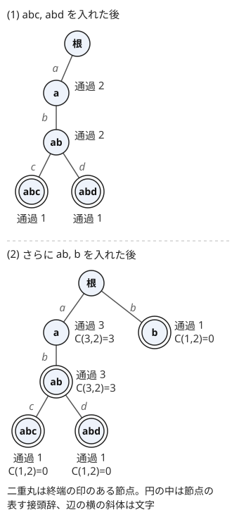

!!! abstract "要点"
    - **何ができるか**：文字列の集合を、共通の接頭辞を共有する木に入れる。各節点に通過数を持てば、全ペアの最長共通接頭辞の和や、ある接頭辞を持つ文字列の数が、長さの総和に比例する時間で求まる。
    - **いつ使うか**：
        - 全ペアの最長共通接頭辞（LCP）の長さの和
        - 各文字列について、ほかの文字列との LCP の最大
        - ある文字列を接頭辞に持つ文字列の数（追加・削除あり）
        - 数列（文字列）の集合を辞書順にたどる
        - 文字列の個数が多く、長さの総和が $5 \times 10^5$ 程度まで
    - **計算量**：長さ $\lvert S \rvert$ の文字列の挿入・検索は $O(\lvert S \rvert)$、全体の構築は $O(\sum \lvert S_i \rvert)$。子を配列で持つと領域は $O(\sigma \sum \lvert S_i \rvert)$ である（$\sigma$ は文字の種類）。`map` で持つと領域は $O(\sum \lvert S_i \rvert)$ になり、操作は $O(\log \sigma)$ 倍になる
    - **前提**：[文字列の基本操作と辞書順](../string/string-basics.md)、[深さ優先探索（DFS）](../graph/dfs.md)

<!-- textlint-disable -->
別名：トライ木・接頭辞木・prefix tree・全ペアの LCP の和
<!-- textlint-enable -->

Trie は、文字列の集合を根からの経路で表す根付き木である。各節点は「根からその節点までの文字を並べた接頭辞」を表し、共通の接頭辞を持つ文字列は同じ経路を共有する。2 つの文字列の最長共通接頭辞（LCP）は、両方が通る最も深い節点の深さになるので、LCP に関する集計が節点ごとの数え上げに変わる。

## 節点・挿入・検索（子を配列で持つか map で持つか・節点数の上限） {#basic-operations}

文字列が $N$ 個あり、全ペアの LCP を 1 組ずつ比べると、比較だけで $O(N^2)$ 組になる。$N = 3 \times 10^5$ なら $4.5 \times 10^{10}$ 組で間に合わない。Trie に入れると、共通の接頭辞を 1 度だけ持つので、どの集計も長さの総和 $L = \sum \lvert S_i \rvert$ に比例する時間で済む。

Trie の節点は 0 から番号を付けて配列で持ち、節点 0 を根（空の接頭辞）にする。各節点 $v$ に子の表 $\mathrm{nxt}[v][c]$（文字 $c$ で進む先。なければ $-1$）を持たせる。

- **挿入**：根から始め、文字列の文字を順に見る。$\mathrm{nxt}[v][c]$ がなければ新しい節点を作ってつなぎ、その子へ進む。最後に着いた節点が文字列全体を表す
- **検索**：同じように根から文字をたどり、途中で子がなければ「その接頭辞を持つ文字列はない」と分かる
- **節点数の上限**：挿入 1 回で増える節点は文字数以下なので、節点数は $L + 1$ 以下である。配列をあらかじめ確保するならこの大きさでよい

どちらも 1 文字につき $O(1)$（子を `map` で持つなら $O(\log \sigma)$）なので、長さ $\lvert S \rvert$ の文字列で $O(\lvert S \rvert)$ である。次のコードは英小文字の Trie で、通過数と終端の数（[次の節](#counts)）も持たせている。

```cpp
--8<-- "trie/basic.cpp:core"
```

完全なプログラム：[`basic.cpp`](https://github.com/yuukougun/kyopro-atlas/blob/main/snippets/trie/basic.cpp)（GitHub）
{ .kp-code-src }

子の表の持ち方は、文字の種類 $\sigma$ と節点数で選ぶ。

| 持ち方 | 1 文字の遷移 | 領域 | 向いている場面 |
| --- | --- | --- | --- |
| `array<int, 26>` | $O(1)$ | $26 (L + 1)$ 個の `int` | 英小文字で $L \le 10^6$ 程度 |
| `map<int, int>` | $O(\log \sigma)$ | $O(L)$ | 数列の Trie など、$\sigma$ が大きい |
| 辺のリスト（`vector<pair>`） | 子の数に比例 | $O(L)$ | 子が少なく、領域を節約したい |

`array<int, 26>` は $L = 5 \times 10^5$ で約 $1.3 \times 10^7$ 個の `int`（約 50 MiB）になる。メモリ制限が 1024 MiB なら問題ないが、文字の種類が英大小文字と数字（62 種類）になると約 2.4 倍（約 118 MiB）になる。数列の Trie で値が $10^9$ までなら配列は作れないので、`map` で持つ。[座標圧縮](../basics/coordinate-compression.md)しても、節点ごとに「値の種類数」の大きさの配列が要る。配列にできるのは、値の種類が数十程度に収まるときだけである。

## 通過数と終端の印の区別 {#counts}

Trie の節点に持たせる数は 2 種類あり、問われている量に合わせて使い分ける。

- **通過数** $\mathrm{cnt}[v]$：根から $v$ への経路を通る文字列の数。すなわち $v$ の表す接頭辞 $P$ を接頭辞に持つ文字列の数で、$v$ の部分木にある終端の数の和に等しい
- **終端の数** $\mathrm{ed}[v]$：ちょうど $v$ で終わる文字列（$P$ に等しい文字列）の数

「$P$ を接頭辞に持つ文字列はいくつか」は $\mathrm{cnt}[v]$、「$P$ と同じ文字列はいくつか」は $\mathrm{ed}[v]$ で答える。たとえば abc・abd・ab を入れると、節点 ab の通過数は 3、終端の数は 1 である。終端を `bool` の印にすると、同じ文字列が 2 回入ったときに数え落とすので、個数で持つ方が安全である。

削除は、挿入と同じ経路をたどって通過数と終端の数を 1 ずつ減らせばよい。節点そのものは消さず、通過数が 0 の節点を「ない」とみなす。検索で $\mathrm{cnt}[v] = 0$ の節点に着いたら、今その接頭辞を持つ文字列はない。

接頭辞の関係にある文字列も、この 2 つの数で分けて数えられる。文字列 $S$ の節点を $v$ とすると、

- $S$ を接頭辞に持つ、自分以外の文字列の数（$S$ と等しいものを含む）：$\mathrm{cnt}[v] - 1$。$S$ を真の接頭辞に持つものだけなら $\mathrm{cnt}[v] - \mathrm{ed}[v]$
- $S$ の真の接頭辞になっている文字列の数：$S$ の経路上で $v$ より上（根を含む）の節点の $\mathrm{ed}$ の和

である。後者は経路をたどりながら足せば $O(\lvert S \rvert)$ で求まる。[Trie 上の確率・期待値](#expectation-on-trie)ではこの 2 つを使う。

??? question "確認問題：消した文字列の検索"
    abc と abd を入れてから abd を削除した。この後 abd を検索すると、節点 abd はまだ残っている。「abd を接頭辞に持つ文字列はあるか」に正しく答えるには、何を見ればよいか。

    ??? success "答え"
        節点 abd の通過数を見る。削除で 1 減って 0 になっているので、abd を接頭辞に持つ文字列はない。節点が見つかったかどうかだけで判定すると、消した文字列があると誤って答える。

## 全ペアの LCP の和：節点ごとに C(通過数, 2) を足す（主客転倒） {#lcp-sum}

$N$ 個の文字列の全ペア $i < j$ について $\mathrm{LCP}(S_i, S_j)$ の和を求める。LCP の長さは「両方が持つ、空でない共通の接頭辞の個数」と同じである。$\mathrm{LCP}(S_i, S_j) = k$ なら、共通の接頭辞は長さ $1, 2, \dots, k$ の $k$ 個だからである。Trie では、これは「根以外で $S_i$ と $S_j$ の両方が通る節点の数」になる。

そこで、組ごとに LCP を数える代わりに、節点ごとに「その節点を両方とも通る組の数」を数える（[主客転倒](../thinking/contribution.md)）。節点 $v$ を通る文字列は $\mathrm{cnt}[v]$ 個なので、そのうちの 2 つを選ぶ組は $\binom{\mathrm{cnt}[v]}{2}$ 個ある。

$$
\sum_{i < j} \mathrm{LCP}(S_i, S_j) = \sum_{v \ne \text{根}} \binom{\mathrm{cnt}[v]}{2}
$$

次の図は abc・abd・ab・b を順に入れたときの Trie である。(1) では abc と abd が根・a・ab を共有し、通過数は 2 になる。(2) で ab と b を足すと、a と ab の通過数が 3 になる。



下の Trie で $\binom{3}{2} + \binom{3}{2} = 6$ になる。実際に組ごとに数えると、abc・abd・ab のどの 2 つも LCP は 2 で、b とほかの組は 0 なので、和は $3 \times 2 = 6$ で一致する。

```cpp
--8<-- "trie/lcp-sum.cpp:core"
```

完全なプログラム：[`lcp-sum.cpp`](https://github.com/yuukougun/kyopro-atlas/blob/main/snippets/trie/lcp-sum.cpp)（GitHub）
{ .kp-code-src }

同じことは、文字列を 1 つずつ入れながら求めることもできる。$S_j$ を入れるとき、根以外の経路上の各節点の通過数（$S_j$ を足す前の値）を足すと、$\sum_{i < j} \mathrm{LCP}(S_i, S_j)$ になる。節点 $v$ の通過数は、それまでに $v$ を通った $S_i$ の数だからである。これを $j = 1, \dots, N$ で足しても同じ答えになる。

和は $\binom{N}{2} \times \max \lvert S_i \rvert$ 程度まで大きくなりうるので、`long long` で持つ。通過数を `int` で持つと、$\mathrm{cnt}[v] \times (\mathrm{cnt}[v] - 1)$ の積が、通過数が約 4.6 万を超えるとあふれる。

??? question "確認問題：手で数える"
    abc・abd・b の Trie を描き、全ペアの LCP の和を求めよ。

    ??? success "答え"
        根の下に a と b があり、a の下に b、その下に c と d がある。通過数は a が 2、ab が 2、abc・abd・b が 1 である。和は $\binom{2}{2} + \binom{2}{2} = 2$ で、組ごとに見ても abc と abd の LCP が 2、ほかの 2 組は 0 なので一致する。

## ソートして隣どうしの LCP を見る代用 {#sort-alternative}

Trie を作らずに、文字列を辞書順にソートして済ませられる問題も多い。根拠は次の性質である。

> 辞書順に並べた $T_0 \le T_1 \le \dots \le T_{N-1}$ について、$p < q$ なら $\mathrm{LCP}(T_p, T_q) = \min_{p \le k < q} \mathrm{LCP}(T_k, T_{k+1})$

辞書順に並べると、Trie を子の文字の小さい順に深さ優先でたどった順になる。共通の接頭辞 $P$ を持つ文字列は、$P$ の節点の部分木にまとまるので、並べた列の中で連続した区間をなす。$T_p$ と $T_q$ が長さ $k$ の接頭辞を共有するなら、その間の文字列も同じ接頭辞を持つ。逆に、間のどこかで隣どうしの LCP が $k$ より小さければ、そこで長さ $k$ の接頭辞が途切れている。

この性質から、各文字列の「ほかの文字列との LCP の最大」は、辞書順で隣り合う 2 つとの LCP の大きい方である。離れた文字列との LCP は、隣との LCP 以下だからである。

```cpp
--8<-- "trie/max-lcp.cpp:sort"
```

完全なプログラム：[`max-lcp.cpp`](https://github.com/yuukougun/kyopro-atlas/blob/main/snippets/trie/max-lcp.cpp)（GitHub）
{ .kp-code-src }

同じ値を Trie で求めるなら、各文字列の経路上で通過数が 2 以上の最も深い節点の深さを答える。通過数が 2 以上なら、自分のほかにもその接頭辞を持つ文字列がある。

```cpp
--8<-- "trie/max-lcp.cpp:trie"
```

完全なプログラム：[`max-lcp.cpp`](https://github.com/yuukougun/kyopro-atlas/blob/main/snippets/trie/max-lcp.cpp)（GitHub）
{ .kp-code-src }

ソートで済ませるときの注意は 2 つある。

- **比較の費用**：文字列の比較 1 回は、短い方の長さまでかかる。`stable_sort`（マージソート）では、比較 1 回の費用を、そのとき列に出る側の文字列の長さ＋1 で抑えられる。各段で各文字列は 1 回だけ出るので 1 段は $O(L + N)$、段の数は $O(\log N)$ で、合計 $O((L + N) \log N)$ に収まる
- **元の番号を持つ**：答えを入力の順に出すなら、番号を並べ替えて文字列は動かさない（コードの `idx`）。文字列をキーにした `map` で答えを戻すと、同じ文字列が複数あるときに上書きされる

全ペアの LCP の和をソートで求めるには、隣どうしの LCP の列で、すべての区間の最小値の和を求める必要がある。これは[単調スタック](../ds/monotonic-stack.md)を使えば $O(N)$ で求まるが、Trie で $\binom{\mathrm{cnt}}{2}$ を足す方が短い。1 つの文字列の接尾辞どうしなら、長さ $N$ の文字列でも接尾辞の長さの総和が $N(N+1)/2$ になり、Trie もそのままのソートも間に合わないので [Suffix Array](../string/suffix-array.md#lcp-sum) を使う。

??? question "確認問題：隣だけで足りる理由"
    ソートした列で $T_3$ との LCP が最大になる相手として、$T_1$ を調べなくてよいのはなぜか。

    ??? success "答え"
        $\mathrm{LCP}(T_1, T_3) = \min(\mathrm{LCP}(T_1, T_2), \mathrm{LCP}(T_2, T_3)) \le \mathrm{LCP}(T_2, T_3)$ だからである。離れた相手との LCP は、間にある隣との LCP を超えない。

## Trie 上の DFS と、節点に値を持つ DP {#dp-on-trie}

この節は [木 DP](../dp/tree-dp.md) を前提にする。Trie は根付き木なので、DFS で節点をたどったり、節点に値を持たせて部分木から集めたりできる。

**辞書順にたどる**。子を文字の小さい順に訪れる DFS で、各節点で $\mathrm{ed}[v]$ 個の文字列を出力すると、集合が辞書順に並ぶ。接頭辞は子孫より先に出るので、「短い方が小さい」という辞書順の約束（[辞書順の定義](../string/string-basics.md#lexicographic-order)）とも合う。同じ文字列を入力の順に並べたいなら、終端に番号のリストを持たせる。数列の Trie で子を `map` に持てば、`map` を前から回すだけで値の小さい順になる。

**部分木から集める**。部分木の文字列の数、最短の長さ、最大の重みなどは、子の値から親の値を作る帰りがけの計算になる。挿入で節点を作ると、子の番号は必ず親の番号より大きい。だから、番号の大きい順に「自分の値を親へ反映する」ループを回せば、再帰を使わずに子から親へ集められる。

```text
par[v] を挿入のときに記録しておく（根は除く）
for v = 節点数 - 1, ..., 1:
    val[par[v]] = merge(val[par[v]], val[v])
```

Trie の深さは最長の文字列の長さ（最大で $L$）なので、再帰の DFS は 1 本の長い文字列で深さ $5 \times 10^5$ になり、スタックがあふれうる。辞書順に出力するときも、自前のスタックで DFS するか、上の番号の順を使える処理か考える。

**節点に値を持ち、入れながら答える**。「それより前の文字列」との関係を問われたら、文字列を 1 つずつ処理し、答えを求めてから Trie に入れる。節点 $v$ には「$v$ を通る、これまでの文字列の重みの最小値」のような値を持ち、挿入のたびに経路上の値を更新する。相手との最長共通接頭辞は自分の経路上のどれかの節点なので、答えは自分の経路上の各節点の値から求まる。答えを求めるときは、自分を入れる前の値を使う。入れた後の値を使うと、自分自身を相手として数えてしまう。

**ゲーム**。2 人が交互に、既存の文字列のどれとも接頭辞の関係にならない文字列を足していき、足せなくなった方が負けとするゲームを考える。Trie で使われていない子（節点からまだ伸びていない枝）は、その先がどれも空いている部分木である。この部分木どうしは互いに影響しないので、空いた部分木ごとに[Grundy 数](../comb/grundy-number.md#sum)を求めて XOR すれば勝ち負けが決まる。文字列の長さに上限があるなら、空いた部分木の Grundy 数はその深さと上限だけで決まる。

## Trie 上の確率・期待値 {#expectation-on-trie}

この節は [期待値の線形性](../comb/linearity-of-expectation.md)・[確率の対称性](../comb/probability-symmetry.md)・[有理数の mod](../comb/rational-mod.md) を前提にする。

文字の大小の順序を一様ランダムに決めるとき、相異なる $N$ 個の文字列のうち $S_i$ が辞書順で何番目になるかの期待値を考える。順位は「$S_i$ より小さい文字列の数 $+ 1$」なので、期待値の線形性から

$$
E[\text{順位}] = 1 + \sum_{j \ne i} P(S_j < S_i)
$$

である。相手 $S_j$ は 3 種類に分かれる。

- $S_j$ が $S_i$ の真の接頭辞：文字の順序によらず $S_j < S_i$ なので確率 1。この個数 $f$ は、$S_i$ の経路上で終点より上の節点の $\mathrm{ed}$ の和である
- $S_i$ が $S_j$ の真の接頭辞：必ず $S_j > S_i$ なので確率 0。この個数 $g$ は $\mathrm{cnt}[v] - 1$ である（$v$ を $S_i$ の終点とする）
- それ以外：最初に食い違う位置の 2 文字の大小で決まる。2 文字を入れ替える対応で $S_j < S_i$ と $S_j > S_i$ が同じ確率になるので、確率 $1/2$

よって $E[\text{順位}] = 1 + f + (N - 1 - f - g) / 2$ で、$f$ と $g$ は各文字列の経路を 1 回たどれば求まる。全体で $O(L)$ である。答えを mod で出すなら、$1/2$ を 2 の逆元に置き換える。

接頭辞の関係にある組だけが対称でない、という見方は、ほかの「ランダムな順序での辞書順」の問題でも使える。Trie はその組を数える道具として使う。

## 落とし穴 {#pitfalls}

**節点の参照を持ったまま節点を足す**。`auto& node = nxt[v];` と参照を取ってから `nxt.push_back(…)` で節点を足すと、`vector` の再確保で参照が無効になり、未定義動作になる。参照は節点を足した後に取り直すか、番号で持つ。配列を $L + 1$ 個あらかじめ確保すれば再確保は起きない。

**子を `map` で持って遅くなる**。英小文字なのに `map<char, int>` で子を持つと、遷移のたびに $O(\log \sigma)$ と、節点ごとの確保の定数倍がかかる。$L = 5 \times 10^5$ 程度なら間に合うことが多いが、配列の方が数倍速い。逆に、文字の種類が多いのに配列で持つと、メモリが足りなくなる（[持ち方の表](#basic-operations)）。

**根を数える**。全ペアの LCP の和で根を含めると、根の通過数は $N$ なので $\binom{N}{2}$ だけ多くなる。根は深さ 0 で、空の接頭辞は LCP の長さに数えない。

**終端を `bool` で持つ**。同じ文字列が複数あると、終端の印だけでは個数が分からない。「同じ文字列が入力に何度も現れうるか」を制約で確かめ、終端は個数で持つ。

**文字から番号への変換**。`ch - 'a'` は英小文字だけを想定している。大文字や数字が混ざると負の番号や 26 以上になり、配列の外を読む。入力の文字の種類を確かめてから変換を決める。

**再帰が深い**。長い文字列が 1 本あると、Trie の深さは数十万になる。再帰の DFS ではなく、[番号の大きい順のループ](#dp-on-trie)か自前のスタックを使う。

## 例題 {#examples}

### ABC287 E. Karuta {#abc287_e}

<div class="kp-problems" data-role="example" markdown>

- [ABC287 E. Karuta](https://atcoder.jp/contests/abc287/tasks/abc287_e)（diff 1093）：各文字列について、ほかの文字列との最長共通接頭辞の長さの最大を求める。

</div>

全文字列を Trie に入れ、各文字列の経路上で通過数が 2 以上の最も深い節点の深さを答える。通過数が 2 以上の節点は、自分のほかにもその接頭辞を持つ文字列があることを表す。辞書順にソートして、隣り合う 2 つとの LCP の大きい方を答えてもよい（[ソートの代用](#sort-alternative)）。

??? note "解法の詳細"
    - 1 周目：全文字列を挿入し、経路上の通過数を 1 ずつ増やす
    - 2 周目：各文字列の経路を根からたどり、通過数が 2 以上の節点では、その深さを答えの候補とする。最後の候補が答えで、なければ 0 である
    - 同じ文字列が 2 つあると、終点まで通過数が 2 以上なので、答えはその文字列の長さになる
    - 計算量は $O(L)$。コードは[ソートの代用](#sort-alternative)の節の Trie 版と同じ形である

### ABC353 E. Yet Another Sigma Problem {#abc353_e}

<div class="kp-problems" data-role="example" markdown>

- [ABC353 E. Yet Another Sigma Problem](https://atcoder.jp/contests/abc353/tasks/abc353_e)（diff 1217）：すべての組について最長共通接頭辞の長さを足した値を求める。

</div>

全ペアの LCP の和なので、節点ごとに「そこを通る組の数」を数える主客転倒にする。全文字列を Trie に入れ、根以外の節点 $v$ で $\binom{\mathrm{cnt}[v]}{2}$ を足す（[全ペアの LCP の和](#lcp-sum)）。

??? note "解法の詳細"
    - 全文字列を挿入し、経路上の通過数を 1 ずつ増やす。節点数は長さの総和 $+ 1$ 以下である。配列はその大きさで確保すればよい
    - 根以外の全節点で $\mathrm{cnt}[v] (\mathrm{cnt}[v] - 1) / 2$ を `long long` で足す
    - 入れながら求めるなら、挿入のときに根以外の経路上の通過数（足す前の値）を足していく。どちらも $O(L)$
    - ソートして先頭の文字で区間に分け、先頭を除いて再帰する方法でも解ける

## 練習問題 {#practice}

<div class="kp-problems" data-role="practice" markdown>

- [ABC437 E. Sort Arrays](https://atcoder.jp/contests/abc437/tasks/abc437_e)（diff 1279）：前の数列に 1 要素を足して作る数列たちを、辞書順に並べる。
- [ABC403 E. Forbidden Prefix](https://atcoder.jp/contests/abc403/tasks/abc403_e)（diff 1447）：X と Y に文字列を加えるたびに、X のどれも接頭辞に持たない Y の要素の数を答える。
- [ABC377 G. Edit to Match](https://atcoder.jp/contests/abc377/tasks/abc377_g)（diff 1782）：末尾の削除と追加で、それより前の文字列のどれかに一致させる最小のコストを、各文字列について求める。

</div>

??? note "練習の方針"
    - **ABC437 E**：数列 $i$ は数列 $x_i$ の節点の子なので、数列そのものを作らずに、値 $y_i$ を辺にした Trie の節点を 1 つ足すだけでよい。子は値が大きいので `map` で持つ。同じ数列は同じ節点にまとめ、終端に番号のリストを持つ。最後に子を値の小さい順にたどる DFS で番号を出力する（深さが大きくなりうるので、自前のスタックで書く）
    - **ABC403 E**：X と Y の文字列を同じ Trie に入れ、各節点に Y の通過数を持つ。Y に加えるときは、経路上に X の終端があれば数えない。X に加えるときは、その節点の部分木にある Y の数を祖先の通過数から引き、部分木を「消えた」とする。答えは根の Y の通過数である
    - **ABC377 G**：[節点に値を持つ DP](#dp-on-trie) の型である。節点 $v$ には「$v$ の接頭辞から末尾へ足す文字数の最小値（既存の文字列と一致させるため）」を持つ。文字列を 1 つ処理するたびに、答えを求めてから経路上の値を更新する。空文字列にする（全部削る）候補も忘れない

## 力試し {#challenge}

<div class="kp-problems" data-role="challenge" markdown>

- [ABC268 G. Random Student ID](https://atcoder.jp/contests/abc268/tasks/abc268_g)（diff 2311）：文字の大小の順序がランダムに決まるとき、各文字列の辞書順の順位の期待値を求める。

</div>

??? note "力試しの方針"
    - **ABC268 G**：[Trie 上の確率・期待値](#expectation-on-trie)の式そのものである。各文字列について、真の接頭辞になっている文字列の数 $f$ と、自分を真の接頭辞に持つ文字列の数 $g$ を Trie で数え、$1 + f + (N - 1 - f - g)/2$ を mod 998244353 で出力する。$1/2$ は 2 の逆元にする

## 確認問題 {#quiz}

??? question "確認問題：根の扱い"
    全ペアの LCP の和を $\sum_v \binom{\mathrm{cnt}[v]}{2}$ で求めるとき、根まで含めて足すとどうなるか。

    ??? success "答え"
        根はすべての文字列が通るので通過数は $N$ で、$\binom{N}{2}$ だけ答えが多くなる。根は空の接頭辞（長さ 0）を表すので、LCP の長さには数えない。

??? question "確認問題：子の持ち方"
    $N$ 個の数列（各要素は $10^9$ 以下）の集合を辞書順にたどりたい。要素の合計個数は $3 \times 10^5$ である。子をどう持てばよいか。

    ??? success "答え"
        値の種類が多いので、大きさ $10^9$ の配列は作れない。`map<int, int>` で子を持てば、領域は $O(L)$ で、`map` の順に回すと値の小さい順にたどれる。値を座標圧縮しても、節点ごとに大きさ「値の種類数」の配列を持つと領域が足りなくなるので、`map` がよい。

## 使い分け {#comparison}

- 各文字列の最大の LCP など、隣どうしの比較で決まる量は、[ソートの代用](#sort-alternative)で短く書けることが多い
- 1 つの文字列の接尾辞どうしの LCP は、[Suffix Array](../string/suffix-array.md) と LCP 配列を使う
- 2 つの文字列の LCP を 1 回ずつ速く求めたいだけなら、[ローリングハッシュ](../string/rolling-hash.md)と二分探索で足りる
- 整数を 2 進数で入れて XOR の最小・最大を求めるのは [Binary Trie](../ds/binary-trie.md#xor-min-max) である
- テキストの中で多数のパターンの出現を数えるなら、Trie に失敗リンクを張った [Aho-Corasick 法](../string/aho-corasick.md#count-occurrences)を使う

## 参考 {#references}

- [merom686「ABC287」](https://merom686.hatenablog.com/entry/2023/01/28/234655)：例題 ABC287 E の方針（ソートと LCP）
- [プロひろ「ABC287 E問題（Karuta）を解く」](https://programming-hiroba.com/abc287-e/)：例題 ABC287 E の問い、ソートして隣と比べる方法、同じ文字列があるときの注意
- [merom686「ABC353」](https://merom686.hatenablog.com/entry/2024/05/12/015723)：例題 ABC353 E のソートと再帰による方法
- [プロひろ「ABC353 E問題（Yet Another Sigma Problem）を解く」](https://programming-hiroba.com/abc353-e/)：例題 ABC353 E の Trie と通過数による方法、節点数の上限
- [ikatakos「ユニークビジョンプログラミングコンテスト2025 クリスマス（AtCoder Beginner Contest 437）C,E,F,G問題メモ」](https://ikatakos.com/pot/programming_algorithm/contest_history/atcoder/2025/1220_abc437)：練習 ABC437 E の数列の Trie と辞書順の DFS（解説の部分だけを参照）
- [merom686「ABC403」](https://merom686.hatenablog.com/entry/2025/04/28/015126)：練習 ABC403 E の部分木を消す方針
- [ikatakos「トヨタシステムズプログラミングコンテスト2024（AtCoder Beginner Contest 377) E,F,G問題メモ」](https://ikatakos.com/pot/programming_algorithm/contest_history/atcoder/2024/1026_abc377)：練習 ABC377 G の節点に最小コストを持つ DP（解説の部分だけを参照）
- [kmjp「AtCoder ABC #268 (ユニークビジョンプログラミングコンテスト2022 夏) : G - Random Student ID」](https://kmjp.hatenablog.jp/entry/2022/09/10/0900)：力試し ABC268 G の期待値の式
- [merom686「ABC268」](https://merom686.hatenablog.com/entry/2022/09/11/000905)：力試し ABC268 G の接頭辞の関係と確率 1/2 の場合分け
