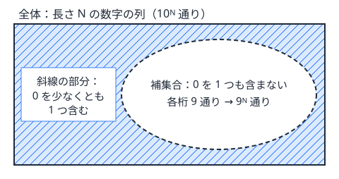
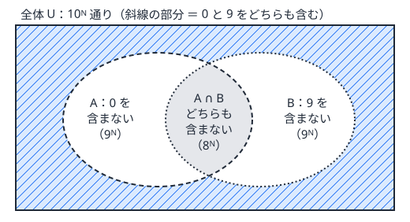

!!! abstract "要点"
    - **何ができるか**：「少なくとも 1 つ」「〜でない」ものは、全体から数えやすい補集合を引いて数える。条件が 2〜3 個なら包除原理で重なりを足し引きし、mod での引き算は負にならないように直す。
    - **いつ使うか**：
        - 〜でないもの・少なくとも 1 つ含むもの
        - すべて異なる・条件を 1 つでも満たす
        - A でも B でもないものの個数
        - 直接数えると場合分けが多いが、条件を満たさない側は数えやすい
    - **計算量**：全体と補集合をそれぞれ数える計算量の和。条件が $k$ 個の包除なら $2^k$ 項を数える。
    - **前提**：なし

<!-- textlint-disable -->
別名：補集合・全体から引く・少なくとも 1 つ・2 条件の包除・complementary counting
<!-- textlint-enable -->

余事象は、求めたいものを直接数えず、「全体」と「求めたいものでない側（補集合）」を数えて引く考え方である。「少なくとも 1 つ」は何個含むかで場合が分かれるが、その反対の「1 つも含まない」は場合が 1 つにまとまる。数えにくい側と数えやすい側が入れ替わる、というのがこの考え方の要点である。

## 全体 − 補集合 {#whole-minus-complement}

全体の集合を $U$、求めたいものの集合を $A$ とする。$U$ の各要素は「$A$ に入る」か「$A$ に入らない」かのどちらか一方だけなので、

$$
\lvert A \rvert = \lvert U \rvert - \lvert U \setminus A \rvert
$$

が成り立つ。重複と漏れのない分け方なので、引き算で正しく数えられる。

最小の例として、長さ $N$ の数字の列（各桁が 0〜9）のうち、0 を少なくとも 1 つ含むものを数える。直接数えると「0 が 1 個」「0 が 2 個」…と場合が分かれ、さらに 0 の位置も選ぶことになる。補集合の「0 を 1 つも含まない」なら、各桁が 1〜9 の 9 通りで $9^N$ 通りと一度に決まる。答えは $10^N - 9^N$ である。



補集合に直すと数えやすくなる問われ方には、次のようなものがある。

| 求めたいもの | 補集合 | 数えやすくなる理由 |
| --- | --- | --- |
| 少なくとも 1 つ含む | 1 つも含まない | 各位置の選択肢が一律に減るだけになる |
| すべて異なる | どこかが等しい | 等しい組の方が少なく、列挙できることがある |
| 表せない数・条件を満たさない数 | 表せる数・満たす数 | 満たす側が少なく、全列挙できる |

「全体」は本当の全体でなくてよい。求めたいものを含み、かつ数えやすい集合なら何でもよい。たとえば「色がすべて異なり、添字が等間隔でない 3 つ組」なら、「色がすべて異なる 3 つ組」を全体にとり、そこから等間隔のものを引く（[例題 ABC162 D](#abc162_d)）。全体の条件を 1 つ緩めると数えやすくなり、緩めた分だけを補集合として数えればよい。

補集合が数えやすいかは、「小さいので全部列挙できる」か「式で一度に出る」かで判断する。補集合も同じくらい場合が分かれるなら、余事象では楽にならない。そのときは [DP](../dp/dp-basics.md) で直接数えるか、条件を分けて[包除原理](../comb/inclusion-exclusion.md)を使う。

??? question "確認問題：隣が等しい箇所"
    長さ $N$ の 0 と 1 の列のうち、隣り合う 2 つが等しい箇所が少なくとも 1 つあるものはいくつか。

    ??? success "答え"
        $2^N - 2$ 通りである。補集合は「どの隣り合う 2 つも異なる」列で、先頭を決めると残りは交互に決まるので 0101… と 1010… の 2 通りしかない。$N = 1$ なら隣り合う箇所がなく、式も $2 - 2 = 0$ で合う。

## 2〜3 条件の包除（重なりを足し戻す） {#two-conditions}

「0 と 9 をどちらも含む」のように、満たしたい条件が 2 つあると、補集合は「0 を含まないか、9 を含まない」になる。この補集合は 2 つの集合の和なので、単純に足すと重なりを 2 回数える。

$A$ を「0 を含まない」、$B$ を「9 を含まない」列の集合とする。求めたいのは $A$ と $B$ のどちらにも入らない列で、

$$
\lvert U \rvert - \lvert A \rvert - \lvert B \rvert + \lvert A \cap B \rvert
$$

で数えられる。$\lvert A \rvert$ と $\lvert B \rvert$ を引くと、両方に入る列（0 と 9 をどちらも含まない）を 2 回引いてしまうので、1 回足し戻す。長さ $N$ の数字の列なら $10^N - 2 \cdot 9^N + 8^N$ である。



小さい $N$ で式を確かめておく。$N = 2$ なら $100 - 162 + 64 = 2$ で、実際に 09 と 90 の 2 つである。$N = 1$ なら $10 - 18 + 8 = 0$ で、1 桁の列は 0 と 9 を同時に含めないことと合う。

条件が 3 つなら、引く・足す・引くを 1 段ずつ重ねる。

$$
\lvert U \rvert - (\lvert A \rvert + \lvert B \rvert + \lvert C \rvert) + (\lvert A \cap B \rvert + \lvert B \cap C \rvert + \lvert C \cap A \rvert) - \lvert A \cap B \cap C \rvert
$$

符号は「いくつの条件の共通部分か」で決まり、偶数個なら $+$、奇数個なら $-$ である。どの要素も、入っている集合の個数によらず、最後にちょうど 1 回（求めたい側なら）か 0 回（そうでなければ）数えられる。たとえば 3 つの集合すべてに入る要素は、全体の項で $+1$、1 つずつの項で $-3$、2 つの共通部分の項で $+3$、3 つの共通部分の項で $-1$ と数えられ、合計は $0$ になる。

共通部分が何を表すかは、問題ごとに言い換えて確かめる。

- **倍数**：「$C$ の倍数」と「$D$ の倍数」の共通部分は「$\operatorname{lcm}(C, D)$ の倍数」である。$C \times D$ の倍数ではない（$C = 4$、$D = 6$ なら 12 の倍数）
- **等しさ**：「$x = y$」と「$y = z$」の共通部分は「3 つとも等しい」である。3 つのうちどの 2 つの等式を選んでも共通部分は同じになるので、同じ集合を何度も足し引きすることになる（[練習 ABC455 E](#practice) の方針を参照）

条件が 4 個以上になると項の数が $2^k$ に増えるので、手で式を書くのをやめ、条件の組を [bit 全探索](../basics/bit-full-search.md)して符号付きで足す。この一般形は[包除原理](../comb/inclusion-exclusion.md#bit-enumeration)のページで扱う。

??? question "確認問題：3 つの数で割り切れない"
    1 以上 100 以下の整数のうち、2 でも 3 でも 5 でも割り切れないものはいくつか。

    ??? success "答え"
        26 個である。2・3・5 の倍数はそれぞれ 50・33・20 個、6・10・15 の倍数は 16・10・6 個、30 の倍数は 3 個なので、$100 - (50 + 33 + 20) + (16 + 10 + 6) - 3 = 26$ となる。2 つの共通部分は積（2 と 3 なら 6）で済むが、それは互いに素だからで、一般には lcm を使う。

## mod の引き算と空集合の扱い {#mod-and-empty}

余事象では必ず引き算をするので、答えを $10^9 + 7$ などで割った余りで出す問題では、負の数の扱いでつまずきやすい。C++ の `%` は割られる数の符号を受け継ぎ、`-3 % 7` は `-3` になる（[整数の割り算と余り](../math/integer-division.md#cpp-vs-math)）。

次のコードは、0 と 9 をどちらも含む長さ $n$ の数字の列の数を $10^9 + 7$ で割った余りで求める。各項は $[0, \mathrm{MOD})$ にあるので、2 回引いて 1 回足した値は $-2\,\mathrm{MOD}$ から $2\,\mathrm{MOD}$ の間にある。`%` で $(-\mathrm{MOD}, \mathrm{MOD})$ に収めてから、負なら $\mathrm{MOD}$ を足す。

```cpp
--8<-- "complement/two-conditions-mod.cpp:core"
```

- **`+ MOD` を 1 回足すだけでは足りないことがある**：`(a - b + MOD) % MOD` は引き算が 1 回なら正しいが、`(a - b - c + MOD) % MOD` は $a - b - c$ が $-\mathrm{MOD}$ より小さいと負のままになる。先に `%` を取ってから負なら足す、という形にしておけば、引く回数によらず正しい（[引き算の後の負の数を 0 以上に直す](../math/mod-arithmetic.md#negative)）
- **modint を使えば気にしなくてよい**：ACL の modint は引き算の結果を自動で $[0, \mathrm{MOD})$ に戻す（[modint](../math/modint.md#what-is-automatic)）
- **余りの大小で場合分けしない**：全体の余りが補集合の余りより小さくても、本当の個数が負になったわけではない。「引いた結果が負なら 0 を出す」のような処理は誤りである（[mod を取った値で大小比較・最大値を考えてはいけない](../math/mod-arithmetic.md#no-compare)）

もう 1 つのつまずきは、全体と補集合で数える範囲がずれることである。特に空集合と、順序の扱いに気をつける。

- **空集合**：$n$ 個の中から選ぶ方法の $2^n$ には「何も選ばない」が入っている。「1 個以上を選ぶ」なら全体は $2^n - 1$ で、そこから禁止された選び方を引く。式を立てたら、全体に空集合・長さ 0・$i = j$ のような端の場合が入っているかを確かめる
- **順序**：全体を「順序付きの組」で数えたのに、補集合を「順序なしの組」で数えると、引き算が合わない。全体と補集合で、数える対象の定義（$i < j$ か、$(i, j)$ と $(j, i)$ を区別するか）をそろえる
- **確かめ方**：小さい入力で全列挙した個数と式の値を比べる（[小さいケースの全探索で式を検算する](../comb/counting-mindset.md#verify-small)）。上のコードの `main` も、$n \le 5$ で全列挙と比べている

## 使い分け {#comparison}

- 条件が 1 つなら全体 − 補集合、2〜3 個なら共通部分を書き出して包除、4 個以上や対称な条件なら[包除原理](../comb/inclusion-exclusion.md)の一般形を使う
- 「ちょうど $K$ 個」は「$K$ 個以下」−「$K - 1$ 個以下」で数えると楽なことがある。全体を「$K$ 個以下」に置きかえた余事象と見られる（[「ちょうど」を「以下」の差で数える](../comb/counting-mindset.md#exactly-vs-at-most)）
- 確率では「少なくとも 1 回起きる確率」を $1 - (\text{1 回も起きない確率})$ で求める。考え方は同じである（[独立・排反・余事象](../comb/probability-basics.md#independence)）
- 補集合も場合が分かれて数えにくいなら、余事象をやめて DP で直接数える。真ん中や最大値を固定して数える[一部を固定して数える](../thinking/fix-variable.md)と組み合わせることも多い

## 例題 {#examples}

### ABC178 C. Ubiquity {#abc178_c}

<div class="kp-problems" data-role="example" markdown>

- [ABC178 C. Ubiquity](https://atcoder.jp/contests/abc178/tasks/abc178_c)（diff 653）：0 と 9 をどちらも含む、長さ N の数字の列の数を求める。

</div>

??? note "方針"
    「0 と 9 をどちらも含む」を直接数えると、0 と 9 の個数と位置で場合が分かれる。補集合の「0 を含まない」「9 を含まない」は各桁の選択肢が一律に減るだけなので、[2〜3 条件の包除](#two-conditions)で数える。

    - 全体は $10^N$、0 を含まない列と 9 を含まない列はそれぞれ $9^N$、どちらも含まない列は $8^N$ である
    - 答えは $10^N - 2 \cdot 9^N + 8^N$ を $10^9 + 7$ で割った余りである。累乗は[繰り返し二乗法](../math/mod-pow.md)を使えば $O(\log N)$ で求まる
    - 2 回引くので、[mod の引き算](#mod-and-empty)で負にならないように直す

### ABC162 D. RGB Triplets {#abc162_d}

<div class="kp-problems" data-role="example" markdown>

- [ABC162 D. RGB Triplets](https://atcoder.jp/contests/abc162/tasks/abc162_d)（diff 757）：R・G・B からなる文字列で、3 文字の色がすべて異なり、添字が等間隔でない 3 つ組の数を求める。

</div>

??? note "方針"
    条件は「色がすべて異なる」と「等間隔でない」の 2 つである。「等間隔でない」を外した「色がすべて異なる 3 つ組」を[全体](#whole-minus-complement)にとると、式で一度に数えられる。そこから、色がすべて異なり等間隔のものを引く。

    - R・G・B の個数を $r, g, b$ とする。各色から添字を 1 つずつ選んで小さい順に並べれば、色がすべて異なる 3 つ組がちょうど 1 回ずつ得られるので、全体は $r \times g \times b$ である
    - 等間隔の組は、$i < j$ を決めると $k = 2j - i$ に決まる。$k < N$ で 3 文字の色がすべて異なるものを数えて引く。$O(N^2)$ で、$N \le 4000$ なら間に合う
    - 全体を順序なしの組（添字の小さい順）で数えたので、引く側も $i < j < k$ の組として数える

## 練習問題 {#practice}

<div class="kp-problems" data-role="practice" markdown>

- [ABC193 C. Unexpressed](https://atcoder.jp/contests/abc193/tasks/abc193_c)（diff 379）：1 以上 N 以下の整数のうち、a^b（a, b ≥ 2）と表せないものの個数を求める。
- [ABC131 C. Anti-Division](https://atcoder.jp/contests/abc131/tasks/abc131_c)（diff 518）：A 以上 B 以下の整数のうち、C でも D でも割り切れないものの個数を求める。
- [ABC455 E. Unbalanced ABC Substrings](https://atcoder.jp/contests/abc455/tasks/abc455_e)（diff 1157）：文字列 S の空でない部分文字列（位置で区別する）のうち、含まれる A・B・C の個数が互いに異なるものの数を求める。

</div>

??? note "練習の方針"
    - **ABC193 C**：$N \le 10^{10}$ なので、1 から $N$ までを 1 つずつ調べることはできないが、表せる数は $a \le \sqrt{N}$ の範囲で列挙できるほど少ない。$a^2, a^3, \dots$ を $N$ 以下の間だけ集合に入れて重複（$3^4 = 9^2$ など）を除き、$N$ から集合の大きさを引く。値は `long long` で持つ（[整数の平方根・K 乗根と累乗数](../math/integer-root.md)）
    - **ABC131 C**：$N$ 以下で $C$ でも $D$ でも割り切れない数の個数を $f(N) = N - \lfloor N / C \rfloor - \lfloor N / D \rfloor + \lfloor N / L \rfloor$（$L = \operatorname{lcm}(C, D)$）とし、$f(B) - f(A - 1)$ を答える。$L$ は $C / \gcd(C, D) \times D$ の順に計算してあふれを避ける（[区間の K の倍数の個数](../math/integer-division.md#count-multiples)）
    - **ABC455 E**：全体は $N(N + 1) / 2$ 個の区間である。補集合は「A と B」「B と C」「C と A」のどれかの個数が等しい区間で、[3 条件の包除](#two-conditions)で数える。2 文字の個数が等しい区間は、累積の個数の差が両端で一致する組なので、連想配列で数えられる（[累積和と連想配列で区間を数える](../basics/prefix-sum-counting.md#equal-k)）。どの 2 つの等式の共通部分も「3 つとも等しい」区間 $T$ になるので、包除の 2 段目と 3 段目は $-3T + T$ にまとまり、答えは「全体 − 3 種類の等しい区間の数の和 + $2T$」になる。全体で $O(N)$（連想配列の分を除く）

## 参考 {#references}

- [drken「AtCoder ABC 178 C - Ubiquity (3Q, 茶色, 300 点)」](https://drken1215.hatenablog.com/entry/2020/10/09/162600)：例題の方針（2 条件の包除の式と mod の扱い）
- [drken「AtCoder ABC 162 D - RGB Triplets (2Q, 茶色, 400 点)」](https://drken1215.hatenablog.com/entry/2020/04/12/225900)：例題の方針（色がすべて異なる組から等間隔の組を引く）
- [drken「AtCoder ABC 193 C - Unexpressed (3Q, 灰色, 300 点)」](https://drken1215.hatenablog.com/entry/2021/03/02/140000)：練習の方針（表せる数を集合で列挙して引く）
- [drken「AtCoder ABC 131 C - Anti-Division (4Q, 茶色, 300 点)」](https://drken1215.hatenablog.com/entry/2019/06/22/224100)：練習の方針（f(B) − f(A − 1) と lcm の計算順）
- [comet725「ABC455Eを解いた【包除原理】」](https://qiita.com/comet725/items/ef3bf31a249dcf3e48f3)：練習の方針（累積の差の一致と、3 つとも等しい区間の足し戻し）
- [Authns「ABC455 E - Unbalanced ABC Substrings: 余事象から始めて包除原理にたどり着く」](https://qiita.com/Authns/items/f01569d1cf0daa9dffe1)：練習の方針（包除の展開で 2 段目と 3 段目が同じ値になること）
- [drken「AtCoder ABC 156 D - Bouquet (2Q, 緑色, 400 点)」](https://drken1215.hatenablog.com/entry/2020/04/22/013400)：空集合を全体から除く例（2^n − 1）
