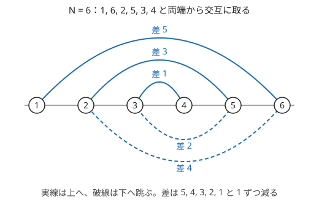
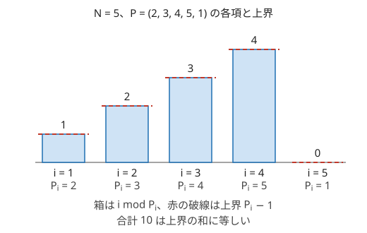

!!! abstract "要点"
    - **何ができるか**：条件を満たすものを 1 つ作る問題は、小さい $N$ で手で作って規則を見つけ、不可能な場合の必要条件を先に挙げてから一般化する。最大値を求める問題では、上界を示してそれを達成する例を作る。
    - **いつ使うか**：
        - 条件を満たすものを 1 つ出力せよ（存在しなければ −1）
        - 操作手順を出力せよ（回数の上限が与えられている）
        - 最大値を求めるが、答えに自然な上限がありそう
    - **計算量**：構築した答えを出力する時間、つまり出力の大きさに比例する（多くは $O(N)$ か $O(N + M)$）。規則を探す全探索は小さい $N$ でだけ行う（順列なら $O(N! \cdot N)$）。
    - **前提**：なし

<!-- textlint-disable -->
別名：構築・constructive・1 つ出力せよ・上界と下界・必要条件と十分性・constructive algorithms
<!-- textlint-enable -->

構築問題の考え方は、答えを探すのではなく「必ず条件を満たす作り方」を自分で決める考え方である。作り方が正しいことは、手順そのものが条件を満たす理由で示す。作れない場合があるなら、その場合を[必要条件](../guide/glossary.md#necessary-condition)で切り分け、残りをすべて作り方で覆う。

使える合図は 3 つある。「1 つ出力せよ（なければ −1）」のように答えを 1 つだけ出させること、「$N - 1$ 回以下の操作で」のように回数の上限つきの手順を出力させること、最大値を問われ、各項の上限の和のような自然な上界が見えることである。構築の問題で、ほかにどの型を試すかは[詰まったときの発想リスト](../guide/thinking-checklist.md#shape-construct)の「1 つ作る（構築）」の表で引ける。

## 小さい N で作って規則を一般化する {#small-cases}

構築の規則は、いきなり一般の $N$ で考えるより、$N = 1, 2, 3, \dots$ で実際に作って並べた方が見つかりやすい。例として、次の問題を考える。

- $1$ から $N$ の並べ替え $P$ のうち、隣り合う 2 項の差の絶対値 $\lvert P_i - P_{i+1} \rvert$ がすべて異なるものを 1 つ作る

手で作れるのは $N = 4$ くらいまでなので、その先は[全探索](../basics/brute-force.md)に任せる。次のコードは、小さい $N$ ごとに辞書順で最初に見つかる答えを出す `brute` と、その結果から予想した作り方 `zigzag` である。

```cpp
--8<-- "construction/small-cases.cpp:core"
```

`brute` を $N = 1$ から $8$ まで動かすと、次の列が出る。

```text
1
1 2
1 3 2
1 4 2 3
1 5 2 4 3
1 6 2 5 3 4
1 7 2 6 3 5 4
1 8 2 7 3 6 4 5
```

並べると、残っている数の最小と最大を交互に取っていると読める。これが `zigzag` の予想である。予想が当たる理由は次のとおりで、残りの数は常に連続した範囲 $[l, r]$（閉区間）になる。

- 最小 $l$ を取った後に最大 $r$ へ跳ぶと差は $r - l$、次に $l + 1$ へ戻ると差は $r - l - 1$ になる
- 1 歩ごとに範囲が 1 つ縮むので、差は $N - 1, N - 2, \dots, 1$ と 1 ずつ減り、すべて異なる



規則を見つけるときは、次の見方を順に試すとよい。

- **答えを 1 つに決めて出す**：全探索は答えが何通りもあると見づらいので、辞書順で最小のものだけを出す。辞書順最小の答えは、規則的な形になりやすい
- **$N$ から $N + 1$ を作る**：小さい答えの末尾に足す、両端に足す、全体をずらすなど、前の答えを壊さずに伸ばせないかを見る
- **$N$ の偶奇で分ける**：偶数と奇数で形の違うことが多い。表を偶奇の 2 列に分けて見比べる
- **大きい $N$ で確かめる**：予想した作り方を、条件を確かめる関数で $N = 3000$ などまで調べる。上のコードの `main` もそうしている

??? question "確認問題：使われる差の集合"
    隣り合う差がすべて異なる長さ $N$ の並べ替えでは、差の値の集合は何になるか。そこから、$1$ と $N$ について何が言えるか。

    ??? success "答え"
        差は $N - 1$ 個あり、どれも $1$ 以上 $N - 1$ 以下で、すべて異なる。だから差の集合はちょうど $\{1, 2, \dots, N - 1\}$ である。差が $N - 1$ になるのは $1$ と $N$ が隣り合うときだけなので、どの答えでも $1$ と $N$ は隣り合う。このように、答えが満たすはずの性質を先に見つけると、作り方の見当が付く。

## 必要条件を先に挙げる {#necessary-conditions}

「存在しなければ −1」と書かれた構築問題では、作り方を考える前に、答えが存在するための必要条件を挙げる。必要条件を満たす場合をすべて作り方で覆えれば、その条件は十分でもある。判定は「条件を満たすか」だけになり、満たすなら作り方を、満たさないなら −1 を出せばよい。

必要条件は、たいてい次のどれかから見つかる。

- **数の上限**：作れる量には上限がある。$N$ 頂点の連結なグラフは辺が $N - 1$ 本以上あり、辺で結ばれた組は距離が 1 になる。だから距離がちょうど 2 の組は $\binom{N}{2} - (N - 1) = \binom{N - 1}{2}$ 個以下である（[ABC131 E](#abc131_e)）
- **偶奇・不変量**：操作で変わらない量や、1 歩ごとに入れ替わる偶奇が、作れない場合を教える（[偶奇に着目する](../thinking/parity.md)・[不変量](../thinking/invariant.md)）
- **小さい場合の例外**：$N = 1, 2$ や $M = 0, 1$ のように、作り方の部品の足りない場合がある。一般の作り方が成り立つ最小の $N$ を確かめる

必要条件と作り方は、次の順に行き来して詰める。

```text
1. 必要条件を思いつくだけ挙げる
2. 必要条件を満たす小さいケースを全探索し、本当にすべて作れるかを確かめる
3. 作れないケースが残れば、それを説明する条件を必要条件に足す
4. 条件を満たすケースをすべて覆う作り方を考える
```

手順 2 で作れないケースが見つかったら、それは見落としていた必要条件の手がかりである。逆に、全探索ではすべて作れるのに作り方が思いつかないなら、調べた範囲では条件は正しいと見て、作り方の工夫に集中してよい。作り方が見つかったら、それが条件を満たすすべての場合を覆うことを確かめる。全探索で調べられるのは小さい $N$ だけなので、大きい $N$ でだけ作れない場合を見落とさないためである。

## 上界・下界を示して達成する例を作る {#bound-and-construct}

最大値を求める問題で、答えに自然な上限がありそうなら、次の 2 つを別々に示す。

- **上界**：どんな選び方でも値は $U$ 以下である
- **達成**：値がちょうど $U$ になる選び方が 1 つある

2 つがそろえば答えは $U$ である。上界だけでは「$U$ に届かないかもしれない」し、例だけでは「もっと大きくできるかもしれない」。最小値を求めるなら、下界と、それを達成する例を示す。

例として、$1$ から $N$ の並べ替え $P$ について $\sum_i (i \bmod P_i)$ の最大を求める（[ABC139 D](#abc139_d)）。$i$ を $P_i$ で割った余りは $P_i - 1$ 以下なので、和は $\sum_i (P_i - 1) = N(N - 1) / 2$ 以下である。これが上界である。$P_i = i + 1$（$i < N$）、$P_N = 1$ とすると、$i < N$ の項は $i \bmod (i + 1) = i = P_i - 1$ で上界にちょうど届く。残る $P_N = 1$ の項も $0 = P_N - 1$ なので、和は上界に等しい。



上界・下界は、次のような形で見つかることが多い。

- **項ごとの上界の和**：和の最大なら、各項を個別に上から抑えて足す。全項が同時に上界に届く例を作れれば答えになる
- **互いに異ならなければならない要素の列**：最小の種類数を求める問題で、どの 2 つも同じ値にできない $k$ 個の要素が見つかれば、答えは $k$ 以上である
- **1 回の操作で変わる量の上限**：量を目標まで減らすのに 1 回で高々 $c$ しか減らないなら、回数は $\lceil (\text{初めの量} - \text{目標}) / c \rceil$ 以上である（不変量の単調量）。割り切れないときは切り上げる

上界に届く例がどうしても作れないときは、上界が甘い（もっと小さい）可能性がある。そのときは小さい $N$ について全探索で本当の最大を求め、上界と比べる。差があれば、上界の議論で使っていない制約を探す。上界と達成がきれいに一致しない問題には、「$x$ を達成できるか」の判定をくり返す[答えで二分探索](../basics/binary-search-answer.md)の方が向く。

??? question "確認問題：木の辺の塗り分け"
    $N$ 頂点の木の各辺に色を塗り、同じ頂点に接する辺はすべて違う色にしたい。必要な色の数の最小は何か。下界と、それを達成する塗り方を答えよ。

    ??? success "答え"
        最小は最大次数 $D$ である。下界：次数 $D$ の頂点に接する $D$ 本の辺は互いに違う色が要るので、$D$ 色以上は必要である。達成：根から[深さ優先探索](../graph/dfs.md)し、各頂点で子への辺に、親への辺の色を避けて $1, 2, \dots$ と順に色を割り当てる。各頂点に接する辺は次数の本数で、根以外では親への辺 1 本と子への辺（次数 $- 1$ 本）、根では子への辺（次数の本数）である。どの頂点でも次数は $D$ 以下なので、$D$ 色のうち親への辺の色を除いた残りで子への辺を塗り分けられ、$D$ 色で足りる。

## 出力を検査するプログラムで確かめる {#checker}

構築問題は答えが何通りもあるので、入出力例と出力が一致しなくても正しいことがある。逆に、例が合っても条件を満たさない出力を出していることもある。そこで、出力が条件を満たすかを確かめるプログラム（チェッカー）を書いて確かめる。

次のコードは「連結な単純グラフで、距離がちょうど 2 の頂点の組が $K$ 個」の出力を確かめるチェッカーである。各頂点から[幅優先探索](../graph/bfs.md)して距離 2 の頂点を数え、多重辺・自己ループ・非連結もはじく。

```cpp
--8<-- "construction/checker.cpp:core"
```

チェッカーは、次の 2 つと組み合わせて使う。

- **ランダムな小さい入力**：自分の解の出力をチェッカーに通し、OK にならない入力を探す。条件を確かめる処理は、作る処理より素朴に書けるので間違えにくい
- **−1 の判定の確認**：チェッカーは「作れない」という主張を確かめられない。小さい入力では全探索で存在するかを求め、自分の解が −1 を出す入力と一致するかを比べる

チェッカーの計算量は気にしなくてよい。上のコードは $O(N(N + M))$ だが、小さい入力でしか動かさない。手順の組み立て方は[ストレステスト](../guide/stress-testing.md#procedure)にある。

## ABC の構築の型（手順・数列・グラフ） {#abc-patterns}

この節は[グラフの基本](../graph/graph-basics.md)を前提にする。ABC の構築問題は、作るものの種類ごとに定石の作り方がある。

| 作るもの | 定石の作り方 | 問題 |
| --- | --- | --- |
| 操作の手順（回数の上限つき） | 1 回の操作で 1 つを正しい位置に確定させ、確定したものは二度と動かさない | ABC350 C |
| 条件をちょうど $K$ 回満たす数列 | 条件を満たす部分を $K$ 個だけ作り、残りは条件に決して関わらない値で埋める | KEYENCE2020 C |
| 最小の種類数の割り当て | 下界を与える列を見つけ、その列の中の位置（深さ）で値を決める | ARC115 C |
| 量がちょうど $K$ のグラフ | 量が最大（最小）になる極端な形から始め、辺を 1 本足すごとに量を 1 ずつ動かす | [ABC131 E](#abc131_e) |
| 対称な数列 | 組にした値を、対称な順（回文や入れ子）に並べて打ち消し合わせる | ABC126 F |

表の型には、共通する見方がある。

- **上限の数字を読む**：「$N - 1$ 回以下」は「1 回で 1 つ確定させよ」、「$2N$ 回以下」は「1 つにつき 2 回まで使える」という作り方の手がかりである
- **干渉しない部品に分ける**：数列やグラフを、互いに影響しない部分に分けて作ると、条件を部分ごとに数えられる。値の大きさの差で干渉を断つのが定石である
- **1 ずつ動かせる操作を探す**：「ちょうど $K$」を作るには、量を 1 だけ変える操作を見つければ、最大から $K$ まで下ろせる

グラフや木の作り方そのもの（距離の表から作る、次数の条件から作るなど）は[グラフの構築](../graph/graph-construction.md)と[木の構築](../tree/tree-construction.md)にある。グリッドをすべて通る道筋は、[市松模様の偶奇](../thinking/parity.md#checkerboard)で必要条件を出してから、蛇行する道筋を作る。

## 落とし穴 {#pitfalls}

**少ない $N$ だけで規則を信じる**。$N = 1, 2, 3$ では偶然に成り立つ規則が多い。$N$ の偶奇で形が変わる問題もある。全探索は少なくとも $N = 7, 8$ ほどまで、偶数と奇数をどちらも見る。

**値の範囲の上限を超える**。「残りは $S + 1$ で埋める」のような作り方は、$S$ が値の上限（$10^9$ など）のとき範囲を超える。作った値が問題の範囲に入るかを、境界の入力で確かめる。超えるなら、その場合だけ別の値（十分小さい値など）で埋める。

**単純グラフの条件を破る**。辺を足していく作り方では、同じ辺を 2 回足したり、自己ループを作ったりしやすい。足す辺をあらかじめ「まだ結んでいない組」から選ぶ形にし、チェッカーで多重辺を調べる。

**回数の上限を 1 回だけ越える**。「$N - 1$ 回以下」で $N$ 回使うと WA になる。最後の 1 つは前のものを確定させれば自動で正しい位置に来る、といった理由で回数を数え、上限を超えないことを示す。

**出力の形式**。操作の回数を先に出すか、添字は 1-indexed か、`Yes` の後に答えを出すかを、問題文で確かめる。構築問題は答えが一致しなくても正しいことがあるので、入出力例と比べるだけでは形式の誤りに気づきにくい。

## 例題 {#examples}

### ABC139 D. ModSum {#abc139_d}

<div class="kp-problems" data-role="example" markdown>

- [ABC139 D. ModSum](https://atcoder.jp/contests/abc139/tasks/abc139_d)（diff 357）：1〜N の並べ替え P について Σ (i mod P_i) の最大値を求める。

</div>

??? note "方針"
    最大値を求める問題なので、[上界・下界を示して達成する例を作る](#bound-and-construct)の 2 段で考える。

    - 上界：$i \bmod P_i \le P_i - 1$ なので、和は $\sum_i (P_i - 1) = N(N - 1) / 2$ 以下である
    - 達成：$P = (2, 3, \dots, N, 1)$ とすると、$i < N$ の項は $i$、最後の項は $0$ で、和は $0 + 1 + \dots + (N - 1)$ になり上界に等しい
    - 答えは $N(N - 1) / 2$ で、$O(1)$ で求まる。$N$ は $10^9$ まであるので、積は `long long` で計算する

### ABC131 E. Friendships {#abc131_e}

<div class="kp-problems" data-role="example" markdown>

- [ABC131 E. Friendships](https://atcoder.jp/contests/abc131/tasks/abc131_e)（diff 1433）：最短距離が 2 の頂点の組がちょうど K 個になる、N 頂点の連結な単純グラフを 1 つ作る（なければ −1）。

</div>

??? note "方針"
    まず[必要条件を先に挙げる](#necessary-conditions)。連結なら辺は $N - 1$ 本以上あり、辺で結ばれた組は距離 1 なので、距離 2 の組は $\binom{N - 1}{2}$ 個以下である。次に、この上限に届く形を探すと、1 つの頂点にほかの全頂点をつないだスターが見つかる。スターでは葉どうしがすべて距離 2 である。

    - $K > \binom{N - 1}{2}$ なら −1 を出す（$N = 2$ では上限が $0$ なので常に −1）
    - スター（頂点 $N$ と頂点 $1, \dots, N - 1$ を結ぶ $N - 1$ 本）を作る。距離 2 の組は $\binom{N - 1}{2}$ 個
    - 葉どうしに辺を 1 本足すと、その組は距離 2 から距離 1 になり、ほかの組の距離は変わらない。$\binom{N - 1}{2} - K$ 本だけ、まだ結んでいない葉の組に辺を足す
    - 辺は $O(N^2)$ 本で、出力の大きさに比例する時間で済む。[出力を検査するプログラム](#checker)で、距離 2 の組の数と多重辺がないことを確かめるとよい

## 練習問題 {#practice}

<div class="kp-problems" data-role="practice" markdown>

- [ABC350 C. Sort](https://atcoder.jp/contests/abc350/tasks/abc350_c)（diff 394）：順列を N−1 回以下の swap でソートする手順を出力する。
- [KEYENCE2020 C. Subarray Sum](https://atcoder.jp/contests/keyence2020/tasks/keyence2020_c)（diff 625）：和が S になる区間がちょうど K 個ある、長さ N の数列を 1 つ作る。
- [ARC115 C. ℕ Coloring](https://atcoder.jp/contests/arc115/tasks/arc115_c)（diff 706）：i が j の約数（i < j）なら A_i ≠ A_j となる数列のうち、最大値が最小のものを 1 つ作る。

</div>

??? note "練習の方針"
    - **ABC350 C**：$i = 1$ から $N - 1$ まで順に、値 $i$ を位置 $i$ へ swap で運ぶ。各値の今の位置を配列で持って swap のたびに更新すれば、全体で $O(N)$ で済む。最後の値 $N$ は自動で正しい位置に来るので、回数は $N - 1$ 以下に収まる
    - **KEYENCE2020 C**：先頭の $K$ 個を $S$ にし、残りを $S$ と干渉しない値で埋める。要素はすべて正なので、和が $S$ の区間は「$S$ 1 個だけ」に限られる。埋める値は $S + 1$ がよい。ただし $S$ が値の上限 $10^9$ のときは $1$ で埋める。$N \le 10^5$ なので、$1$ を並べても和は $S$ に届かない
    - **ARC115 C**：前の数が次の数の約数になっている列は、どの 2 つも違う値が要るので、列の長さが答えの下界になる。最も長い列は $1, 2, 4, \dots, 2^k$（$2^k \le N$）と 2 を掛け続けたもので、下界は $\lfloor \log_2 N \rfloor + 1$ である。$A_n$ を「$n$ の素因数の個数（重複を数える）$+ 1$」にすると、約数は必ず素因数が少ないので条件を満たす。$n \le N$ の素因数の個数は $\log_2 N$ 以下なので、最大値も $\lfloor \log_2 N \rfloor + 1$ で下界に等しい（[素因数分解](../math/prime-factorization.md)）

## 力試し {#challenge}

<div class="kp-problems" data-role="challenge" markdown>

- [ABC126 F. XOR Matching](https://atcoder.jp/contests/abc126/tasks/abc126_f)（diff 1770）：0〜2^M − 1 をそれぞれ 2 回ずつ含み、同じ値の 2 つの間の XOR がすべて K になる数列を作る（なければ −1）。

</div>

??? note "力試しの方針"
    - **ABC126 F**：必要条件から入る。$K \ge 2^M$ なら作れない。$M = 0, 1$ は小さいので全探索で確かめると、$K = 0$ だけが作れる。$M \ge 2$ で $K = 0$ なら、$0, 1, \dots, 2^M - 1$ の後に同じ値を逆順に並べる。間の値が 2 回ずつ現れるので XOR が打ち消し合う。$M \ge 2$ で $1 \le K < 2^M$ なら、$x$ と $x \oplus K$ を組にする。組は $2^{M-1}$ 個で偶数なので、2 つずつ $(a, b), (c, d)$ と取り、$a, b, c, d, b, a, d, c$ と並べると、どの値の間も XOR が $K$ になる（[XOR の性質](../basics/bit-operations.md#xor-properties)）

## 参考 {#references}

- [drken「AtCoder ABC 139 D - ModSum (3Q, 灰色, 400 点)」](https://drken1215.hatenablog.com/entry/2020/05/16/154500)：例題の方針（各項の上界と、それに届く並べ方）
- [drken「AtCoder ABC 131 E - Friendships (1Q, 水色, 500 点)」](https://drken1215.hatenablog.com/entry/2019/06/22/232000)：例題の方針（距離 2 の組の上限、スターから辺を足す構築）
- [drken「AtCoder ABC 350 C - Sort (3Q, 灰色, 300 点)」](https://drken1215.hatenablog.com/entry/2024/04/22/130300)：練習の方針（位置の配列を持って 1 つずつ確定させる）
- [drken「キーエンス プログラミング コンテスト 2020 C - Subarray Sum (茶色, 400 点)」](https://drken1215.hatenablog.com/entry/2020/01/19/012600)：練習の方針（干渉しない値で埋める、S が上限のときの例外）
- [drken「AtCoder ARC 115 C - ℕ Coloring (2Q, 茶色, 500 点)」](https://drken1215.hatenablog.com/entry/2021/03/22/172600)：練習の方針（約数の列による下界と、素因数の個数による達成）
- [drken「AtCoder ABC 126 F - XOR Matching (青色, 600 点)」](https://drken1215.hatenablog.com/entry/2019/05/19/230600)：力試しの方針（作れない条件と、組を対称に並べる構築）
