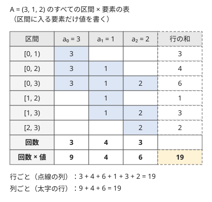

!!! abstract "要点"
    - **何ができるか**：全ペア・全区間・全部分集合についての総和を、「各要素が何回数えられるか × 値」の和に入れ替えて求める。対象は $N^2$ 個や $2^N$ 個あっても、要素は $N$ 個しかないので、各要素の回数を式で数えれば列挙せずに済む。
    - **いつ使うか**：
        - すべての組・区間・部分集合についての総和
        - 各要素が答えに何回足されるか
        - 全区間の最小値・2 番目に大きい値などの和
        - $N \le 2 \times 10^5$ で、組・区間は $N^2$ 個あり列挙できない
    - **計算量**：各要素の回数を $O(1)$ で数えれば $O(N)$。ソートや BIT を使うなら $O(N \log N)$、単調スタックで回数を数えるなら $O(N)$ である。
    - **前提**：なし

<!-- textlint-disable -->
別名：主客転倒・寄与・貢献度・contribution technique・足された回数・各要素が何回数えられるか
<!-- textlint-enable -->

主客転倒は、「対象ごとに中身を足す」という和を「中身の要素ごとに、何個の対象に入っているかを数えて掛ける」和に入れ替える考え方である。各要素が答えに足される量を、その要素の寄与と呼ぶ。対象を主、要素を客とみて、主と客を入れ替えるのでこの名がある。

## 数える対象を入れ替える（表の行と列。式の規則は Σ の変形のページ） {#swap-roles}

「すべての区間の和の総和」を考える。長さ $N$ の列 $a_0, \dots, a_{N-1}$（0-indexed）の区間 $[l, r)$ は $N(N+1)/2$ 個あり、$N = 2 \times 10^5$ なら約 $2 \times 10^{10}$ 個で列挙できない。

対象（区間）を行、要素を列にした表を作り、区間に入る要素のマスにだけ値を書く。答えは表の全マスの和である。行ごとに足すと区間を列挙することになるが、列ごとに足せば列は $N$ 本しかない。



列 $i$ の和は「$a_i$ を含む区間の数 $\times a_i$」である。$a_i$ を含む区間 $[l, r)$ は $0 \le l \le i < r \le N$ を満たすので、$l$ が $i + 1$ 通り、$r$ が $N - i$ 通りで、$(i + 1)(N - i)$ 個ある。式で書くと次のとおりである。

$$
\sum_{\text{対象 } T} \ \sum_{x \in T} w(x) = \sum_{\text{要素 } x} w(x) \cdot c(x), \qquad c(x) = (x \text{ を含む対象の数})
$$

両辺は同じ（対象, 要素）の組を足していて、外側の和の順番が違うだけなので等しい。和の順序の入れ替えの規則（範囲が絡み合うときの添字の付け替え）は [Σ の変形](../math/sigma-manipulation.md#swap-order)にまとめてある。

主客転倒を試すときは、次の順で考える。

- 答えを「対象ごとの量の和」と書き、その量を要素ごとの量の和に分ける（最大値のように和でない量は、[各要素が最大・最小になる回数](#max-min-count)で和に直す）
- 要素 $x$ を固定し、$x$ が効く対象の数 $c(x)$ を数える。左右の選び方の積、二項係数、データ構造での個数などになる
- $\sum_x w(x) \, c(x)$ を計算する。小さい入力で対象を列挙した結果と比べて確かめる

```cpp
--8<-- "contribution/basic.cpp:core"
```

??? question "確認問題：部分集合の和の総和"
    $N$ 個の整数 $a_0, \dots, a_{N-1}$ のすべての部分集合（空集合も含む $2^N$ 個）について、要素の和を求め、その総和を求めたい。$a_i$ は何回足されるか。

    ??? success "答え"
        $2^{N-1}$ 回である。$a_i$ を含む部分集合は、ほかの $N - 1$ 個をそれぞれ入れるか入れないかで決まる。答えは $2^{N-1} \sum_i a_i$ になる。

## ソートで符号を決める（全ペアの差） {#sort-signs}

「すべての組 $i < j$ についての $\lvert a_i - a_j \rvert$ の総和」は、絶対値のせいで要素ごとに分けられない。組の集合が順番によらない（$\{i, j\}$ の組をすべて見る）なら、列を昇順に並べ替えても答えは変わらない。並べ替えると、$i < j$ の組では $\lvert a_i - a_j \rvert = a_j - a_i$ と符号が決まる。

昇順に並べた $a_i$（0-indexed）は、左の $i$ 個との組で大きい側として $+a_i$、右の $N - 1 - i$ 個との組で小さい側として $-a_i$ で現れる。よって

$$
\sum_{i < j} \lvert a_i - a_j \rvert = \sum_{i=0}^{N-1} a_i \, \bigl( i - (N - 1 - i) \bigr) = \sum_{i=0}^{N-1} (2i - N + 1) \, a_i
$$

で、ソートを含めて $O(N \log N)$ になる。[例題 ABC186 D](#abc186_d) がこの形である。同じ考え方で、$\max(a_i, a_j)$ の総和は「昇順で $i$ 番目の値は $i$ 回だけ最大になる」から $\sum_i i \, a_i$ になる。

並べ替えてよいのは、組の集合が添字の順番に依存しないときだけである。「$i < j$ のすべての組について $\max(a_j - a_i, 0)$」のように、もとの並びでの前後が条件に入っていると、ソートすると答えが変わる。この場合は $j$ を左から動かし、「前にある $a_j$ 以下の値の個数と和」を [BIT](../ds/fenwick-tree.md#count-by-value) で数える。$j$ の寄与は（個数）$\times a_j - $（和）である。

マンハッタン距離 $\lvert x_i - x_j \rvert + \lvert y_i - y_j \rvert$ の総和は、$x$ と $y$ に分けてそれぞれ同じ式で足せる。XOR の総和も bit ごとに分けて数える（[bit ごとの寄与](../basics/bitwise-independence.md#per-bit-contribution)）。

## 各桁・各約数の寄与 {#digits-divisors}

**各桁の寄与**。数字列 $S = s_0 s_1 \dots s_{N-1}$ のすべての部分文字列が表す整数の総和を考える。部分文字列 $S[l, r)$ の中で、$s_i$（$l \le i < r$）は $10^{r-1-i}$ の位にある。$s_i$ を固定すると、$l$ は $0$ から $i$ の $i + 1$ 通りで位に関係しない。$r$ を $i + 1$ から $N$ まで動かすと、位は $10^0$ から $10^{N-1-i}$ まで 1 回ずつ現れる。よって $s_i$ の寄与は

$$
s_i \cdot (i + 1) \cdot \bigl( 10^0 + 10^1 + \dots + 10^{N-1-i} \bigr)
$$

である。答えを mod で求めるなら、括弧の中を $R_k = 10 R_{k-1} + 1$ のように前計算すれば $O(N)$ になる。答えを正確な整数で出す問題では、位 $10^k$ ごとに係数 $\sum_{i \le N-1-k} s_i (i + 1)$ を累積和で集め、下の位から 10 で割って繰り上げれば、多倍長整数なしで $O(N)$ で出せる。

**各約数の寄与**。$\sum_{k=1}^{N} (k \text{ の約数の個数})$ は、約数 $d$ を主にすると「$d$ を約数に持つ $k$ の数」すなわち $\lfloor N / d \rfloor$ の和になる。

$$
\sum_{k=1}^{N} \sum_{d \mid k} 1 = \sum_{d=1}^{N} \left\lfloor \frac{N}{d} \right\rfloor
$$

$k$ ごとに約数を数えると約数の列挙が要るが、右辺は $O(N)$ で足せる。$k \times (k \text{ の約数の個数})$ の和なら、$d$ の倍数 $d, 2d, \dots$ の和を足して $\sum_d d \cdot \frac{m(m+1)}{2}$（$m = \lfloor N/d \rfloor$）になる。倍数を 1 つずつたどる場合の計算量は[調和級数](../math/harmonic-sum.md)で $O(N \log N)$ である。

## 各要素が最大・最小になる回数（同じ値の扱い） {#max-min-count}

最大値・最小値は和ではないので、そのままでは要素ごとに分けられない。そこで、各対象の最大値を「最大になる要素の値」と読み替え、「$a_i$ が最大になる対象の数 $\times a_i$」を足す。どの対象でも最大になる要素は 1 つに決めておく必要があり、ここで同じ値の扱いが問題になる。

**部分集合の場合**。$N$ 個から $K$ 個を選ぶすべての選び方について最大値の総和を求める。昇順に並べた $a_i$（0-indexed）が最大になるのは、$a_i$ を選び、残り $K - 1$ 個を左の $i$ 個から選ぶときで、$\binom{i}{K-1}$ 通りである。同じ値があるときは「並べた後の添字が大きい方を最大とみなす」と決めれば、各選び方の最大がちょうど 1 つになる。最小値なら右の $N - 1 - i$ 個から選ぶ $\binom{N-1-i}{K-1}$ 通りである。並べて固定する考え方は[ソートして最大・最小を固定する](../comb/counting-fix-order.md#sort-and-fix)にもある。

**区間の場合**。すべての区間の最小値の和では、$a_i$ が最小になる区間は、左右に $a_i$ より小さい値が来るまで広げられる。左で初めて現れる小さい位置を $L_i$、右を $R_i$ とすると（なければ $L_i = -1$、$R_i = N$）、区間の数は $(i - L_i)(R_i - i)$ である。$L_i$ と $R_i$ は単調スタックを使えば全体 $O(N)$ で求まる（[単調スタックでの寄与の数え上げ](../ds/monotonic-stack.md#contribution)）。

同じ値があると、最小値をとる要素が区間に 2 つ以上あって二重に数える。片側を「より小さい」、もう片側を「以下」で止めて、代表を 1 つに決める。

- 左は $a_j < a_i$ の位置で止め、右は $a_j \le a_i$ の位置で止める。こうすると、最小値をとる要素のうち最も右のものだけが数えられる
- 両側を「より小さい」で止めると二重に数え、両側を「以下」で止めると 1 回も数えない区間が出る

??? question "確認問題：同じ値が並ぶとき"
    $A = (2, 2)$ のすべての区間の最小値の和は $2 + 2 + 2 = 6$ である。両側を「より小さい」で止めて $(i - L_i)(R_i - i)$ を数えると、いくつになるか。両側を「以下」で止めるとどうか。

    ??? success "答え"
        両側を「より小さい」で止めると、どちらの要素も区間 $[0, 2)$ を数えるので、回数は $2 + 2 = 4$ で和は $8$ になる。両側を「以下」で止めると、どちらも $[0, 2)$ を数えないので、回数は $1 + 1 = 2$ で和は $4$ になる。片側だけを「以下」にすると、回数は $3$ で正しく $6$ になる。

2 番目に大きい値の和も同じ形で数える。$a_i$ が 2 番目になる区間は、自分より大きい値をちょうど 1 つ含む区間なので、左右それぞれ 2 つ先までの大きい値の位置から数える（[力試し ABC140 E](#challenge)）。

## 数え上げ・期待値での使い方（数え上げの章へ） {#counting}

主客転倒は、数え上げや期待値の問題の中で部品として何度も使う。それぞれの詳しい扱いは数え上げの章にある。

- **残りの選び方を掛ける**：要素や組を固定したとき、それが効く選び方の数が二項係数で書けることが多い（[二項係数と組み合わせた寄与](../comb/counting-mindset.md#contribution-with-binomial)）
- **期待値は総和 ÷ 総数**：一様に選ぶときの期待値は、総和を対象の総数で割ったものである。逆に、各要素が効く確率を足して期待値を求めるのが[期待値の線形性](../comb/linearity-of-expectation.md)で、主客転倒を確率で言ったものにあたる
- **対象ごとに重みが違う**：区間の平均の総和のように、対象 $T$ ごとに係数 $g(T)$（平均なら $1 / \text{長さ}$）が掛かる場合は、$c(x) = \sum_{T \ni x} g(T)$ を寄与にする。$g$ が長さだけで決まるなら、長さごとに「$x$ を含む区間の数」を数え、累積和で $c(x)$ をまとめて求める
- **木の辺の寄与**：木のすべての頂点の組の距離の総和は、辺ごとに「その辺を通る組の数」を数える（[辺の寄与](../tree/tree-edge-contribution.md)）

## 落とし穴 {#pitfalls}

**同じ値の二重数え**。最大・最小になる回数を数えるときに、同じ値をどちらにも「最大」と数えてしまう。値の大小に添字の大小を組み合わせた順序（値が同じなら添字で比べる）で「最大」を決め、片側を「より小さい」、もう片側を「以下」で止める。

**掛け算のオーバーフロー**。$a_i (i + 1)(N - i)$ は $N = 2 \times 10^5$・$a_i = 10^9$ で約 $10^{19}$ になり、`long long` を超える。答えが mod なら掛けるたびに余りを取り、正確な値が要るなら `__int128` を使う（[整数のオーバーフロー](../cpp/cpp-integer-overflow.md)）。`int` のまま `(i + 1) * (n - i)` を計算するのも、$N = 2 \times 10^5$ で $10^{10}$ になってあふれる。

**mod での負の係数**。$2i - N + 1$ や「最大になる回数 − 最小になる回数」は負になる。負のまま足してから `%` を取ると、結果が負の値のまま残って答えがずれる。法を足してから余りを取るか、[modint](../math/modint.md) を使う。

**ソートしてはいけない場面**。「$i < j$」が添字の前後を意味しているのに、値でソートしてしまう。組の集合が対称（$\{i, j\}$ のどちらを先に書いても同じ）なときだけソートでき、そうでなければ前から順に見てデータ構造で数える。

**重みを忘れる**。平均や「長さを掛けた値」の総和では、対象ごとの重みを寄与に入れ忘れる。表を作るとき、マスに書くのが $w(x)$ か $g(T) \, w(x)$ かを最初に決める。

## 使い分け {#comparison}

- 各対象の値を $O(1)$ で求められ（累積和など）、対象の数が $10^7$ 程度までなら列挙して足せばよい。主客転倒は列挙できないときに使う
- 要素ごとの回数が位置や値だけで決まらず、操作の順番に左右されるなら、[DP](../dp/dp-basics.md) で数えると素直なことがある
- 条件を満たす対象の「個数」を数えるだけなら、主客転倒より[余事象](../thinking/complement.md)などで直接数える方が早いことも多い

## 例題 {#examples}

### ABC186 D. Sum of difference {#abc186_d}

<div class="kp-problems" data-role="example" markdown>

- [ABC186 D. Sum of difference](https://atcoder.jp/contests/abc186/tasks/abc186_d)（diff 436）：N 個の整数のすべてのペアについて、差の絶対値の総和を求める。

</div>

??? note "方針"
    すべてのペアを見るので、並べ替えても答えは変わらない（[ソートで符号を決める](#sort-signs)）。

    - 昇順に並べると、0-indexed で $i$ 番目の値は左の $i$ 個に対して足され、右の $N - 1 - i$ 個に対して引かれる
    - 答えは $\sum_i (2i - N + 1) \, a_i$ で、ソートを含めて $O(N \log N)$
    - 答えは $N^2 \times \max a_i$ 程度になりうるので `long long` で足す

### ABC151 E. Max-Min Sums {#abc151_e}

<div class="kp-problems" data-role="example" markdown>

- [ABC151 E. Max-Min Sums](https://atcoder.jp/contests/abc151/tasks/abc151_e)（diff 1344）：N 個から K 個を選ぶすべての選び方について、（最大値 − 最小値）の総和を求める。

</div>

??? note "方針"
    （最大値 − 最小値）の総和は、最大値の総和から最小値の総和を引いたものである。それぞれを[各要素が最大・最小になる回数](#max-min-count)で数える。

    - 昇順に並べる。同じ値は並べた後の添字で大小を決めるので、特別な扱いは要らない
    - 0-indexed で $i$ 番目の値は $\binom{i}{K-1}$ 通りで最大、$\binom{N-1-i}{K-1}$ 通りで最小になる
    - 答えは $\sum_i a_i \left( \binom{i}{K-1} - \binom{N-1-i}{K-1} \right)$ を $10^9 + 7$ で割った余り。係数が負になりうるので、mod での引き算に気をつける
    - 二項係数は階乗とその逆元を前計算して $O(1)$ で求める（[二項係数の前計算](../comb/binomial-precompute.md)）。全体で $O(N \log N)$

    隣り合う値の差 $a_{i+1} - a_i$ が何通りの選び方で「最小と最大の間」に入るかを数える方法もある。全体 $\binom{N}{K}$ から、左側だけ・右側だけから選ぶ数を引けばよい。

## 練習問題 {#practice}

<div class="kp-problems" data-role="practice" markdown>

- [ABC468 E. Sum of Average](https://atcoder.jp/contests/abc468/tasks/abc468_e)（diff 1038）：整数列のすべての区間について平均値を求め、その総和を 998244353 で割った余りを求める。
- [ABC379 E. Sum of All Substrings](https://atcoder.jp/contests/abc379/tasks/abc379_e)（diff 1246）：数字列のすべての部分文字列が表す整数の総和を求める。
- [ABC351 F. Double Sum](https://atcoder.jp/contests/abc351/tasks/abc351_f)（diff 1253）：i < j のすべての組について max(A_j − A_i, 0) の総和を求める。

</div>

??? note "練習の方針"
    - **ABC468 E**：$A_i$ の寄与は「$i$ を含む長さ $w$ の区間の数 $\times 1/w$」を $w$ について足したものである。$w$ を増やすと、区間の数は 1 ずつ増え、一定になり、1 ずつ減る。増える段では区間の数 × $1/w$ が 1 になり、一定の段と減る段は逆数の累積和で書ける。逆数の累積和を前計算すれば、各 $i$ の寄与は $O(1)$ で求まる（[数え上げ・期待値での使い方](#counting)の重みの例）
    - **ABC379 E**：$s_i$ の寄与は $s_i (i + 1)(10^0 + \dots + 10^{N-1-i})$。答えは正確な整数で出すので、位ごとの係数を累積和で集め、下の位から繰り上げる（[各桁・各約数の寄与](#digits-divisors)）
    - **ABC351 F**：前後の条件があるのでソートで符号を決めることはできない。$j$ ごとに、前にある $A_j$ 以下の値の個数と和を BIT で数え、（個数）$\times A_j - $（和）を足す。値は座標圧縮してから BIT の添字にする

## 力試し {#challenge}

<div class="kp-problems" data-role="challenge" markdown>

- [ABC140 E. Second Sum](https://atcoder.jp/contests/abc140/tasks/abc140_e)（diff 1873）：順列のすべての区間について、2 番目に大きい値の総和を求める。

</div>

??? note "力試しの方針"
    - **ABC140 E**：$P_i$ が 2 番目になる区間は、$P_i$ より大きい値をちょうど 1 つ含む。左で $P_i$ より大きい位置を近い順に $b, a$、右を $c, d$ とする（なければ左は $-1$、右は $N$）。大きい値が左の $b$ なら区間の数は $(b - a)(c - i)$、右の $c$ なら $(i - b)(d - c)$ である。それぞれ $b$・$c$ があるときだけ足す。大きい値から順に位置を [set](../ds/ordered-set.md) に入れていけば、前後の 2 つずつが $O(\log N)$ で求まる

## 参考 {#references}

- [drken「AtCoder ABC 186 D - Sum of difference (3Q, 茶色, 400 点)」](https://drken1215.hatenablog.com/entry/2020/12/19/231000)：例題の方針（ソート後の係数）
- [drken「AtCoder ABC 151 E - Max-Min Sums (1Q, 水色, 500 点)」](https://drken1215.hatenablog.com/entry/2020/01/12/224100)：例題の方針（最大・最小になる回数、隣り合う差による数え方）
- [ikatakos「AtCoder Beginner Contest 468 D,E,F,G問題メモ」](https://ikatakos.com/pot/programming_algorithm/contest_history/atcoder/2026/0725_abc468)：練習 ABC468 E の方針（長さごとの区間の数と累積和。解説の部分だけを参照）
- [drken「AtCoder ABC 379 E - Sum of All Substrings (1D, 水色, 475 点)」](https://drken1215.hatenablog.com/entry/2024/11/10/181617)：練習 ABC379 E の方針（各桁の寄与と繰り上げ）
- [oraclesqlpuzzle「ABC351-F Double Sum」](https://oraclesqlpuzzle.ninja-web.net/kyoupro/05-atcoder-02-abc/kyoupro-abc351-f.html)：練習 ABC351 F の方針
- [torus711「AtCoder Beginner Contest 351, F : Double Sum」](https://torus711.hatenablog.com/entry/2024/04/28/182823)：練習 ABC351 F の方針（個数と和の BIT 2 本）
- [hamayan「Second Sum [AtCoder Beginner Contest 140 E]」](https://blog.hamayanhamayan.com/entry/2019/09/11/203310_3)：力試しの方針（左右 2 つずつの大きい値の位置）
