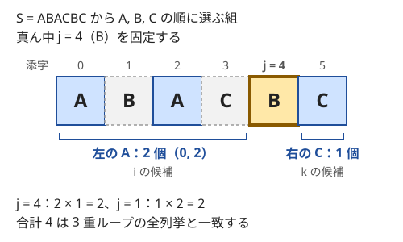

!!! abstract "要点"
    - **何ができるか**：変数の一部（3 つ組の真ん中・最大値・余りなど）を固定すると、残りの条件が単純になって独立に数えられる。固定したあとは二分探索・累積和・連想配列で残りを速く数える。
    - **いつ使うか**：
        - 3 つ組 (i < j < k) を数える
        - 2 つの値の組で、片方を決めればもう片方の条件が単純になる
        - 最大値（最小値）を決めて残りを最適化する
        - N ≤ 2×10^5 で 3 つ組は N^3 通りあり、全部は試せない
    - **計算量**：固定する値の通り数 × 固定したあとに残りを数える時間。3 つ組の真ん中を固定するなら、前計算を合わせて $O(N)$ か $O(N \log N)$ である。
    - **前提**：[全探索の設計](../basics/brute-force.md)

<!-- textlint-disable -->
別名：決め打ち・固定して全探索・真ん中を固定・片方を固定・最大値を固定・fix one variable
<!-- textlint-enable -->

一部を固定して数えるとは、組をつくる変数のうち 1 つ（または一部）をループで固定し、残りの変数の条件を単純にしてまとめて数える考え方である。変数どうしが絡み合った条件も、どれか 1 つを決めると「左側だけの条件」と「右側だけの条件」に分かれたり、相手が 1 通りに決まったりする。どれを固定すると残りが単純になるかを選ぶのが、この考え方の要点である。

## 真ん中を固定して左右を独立に数える {#fix-middle}

$i < j < k$ の 3 つ組を数える問題では、真ん中の $j$ を固定するのが基本である。$j$ を決めると、条件は「$i$ と $j$ の条件」と「$j$ と $k$ の条件」に分かれ、$i$ と $k$ は互いに関係しなくなる。よって $j$ ごとの組の数は「条件を満たす $i$ の個数」×「条件を満たす $k$ の個数」になり、積の法則で一度に数えられる。

左端の $i$ を固定するとこうはならない。$i$ を決めても $j < k$ という $j$ と $k$ の関係が残るので、残りは単純な積にならず、もう 1 段の前計算が要る。3 つのうち、ほかの 2 つの両方と条件で結ばれているものを固定すると、残りがばらばらになる。

最小の例として、A・B・C からなる文字列 $S$ で、A・B・C をこの順に選ぶ組（$i < j < k$ で $S[i] = \mathrm{A}$、$S[j] = \mathrm{B}$、$S[k] = \mathrm{C}$）を数える。B の位置 $j$ を固定すると、$i$ の候補は「$j$ より左の A」、$k$ の候補は「$j$ より右の C」で、互いに独立である。



$S = \mathrm{ABACBC}$ では、B は添字 1 と 4 にある。$j = 1$ なら左の A は 1 個、右の C は 2 個で $1 \times 2 = 2$ 通り、$j = 4$ なら $2 \times 1 = 2$ 通りで、合計は 4 通りである。3 重ループで全列挙した $(0, 1, 3)$・$(0, 1, 5)$・$(0, 4, 5)$・$(2, 4, 5)$ の 4 組と一致する。どの組も真ん中の B はちょうど 1 つなので、$j$ で分けても重複と漏れはない。

左右の個数は、$j$ を左から右へ動かしながら更新すれば $O(1)$ ずつで求まる。右の C の個数をはじめに全部数えておき、$j$ を通り過ぎるたびに 1 つ減らす。全体で $O(N)$ である。

```cpp
--8<-- "fix-variable/middle-abc.cpp:core"
```

完全なプログラム：[`middle-abc.cpp`](https://github.com/yuukougun/kyopro-atlas/blob/main/snippets/fix-variable/middle-abc.cpp)（GitHub）
{ .kp-code-src }

$j$ 自身を左右のどちらにも入れないように、更新の順番に気をつける。上のコードでは、`s[j]` が C なら数える前に右側から外し、A なら数えた後に左側へ入れている。

条件が文字の種類ではなく値の大小（$A_i < A_j < A_k$ など）でも、同じく真ん中を固定する。位置の条件 $i < j < k$ もあるなら、「$j$ より左にあって $A_j$ より小さいもの」の個数は、$j$ を動かしながら [BIT](../ds/fenwick-tree.md) で数える。列全体をソートすると位置の情報が消えるので、二分探索では数えられない。位置の条件がなく、3 つの別の列から 1 つずつ選ぶ（$A_i < B_j < C_k$）なら、各列をソートして[二分探索](../basics/binary-search.md#fix-one-side)で数えられる。

??? question "確認問題：両端を固定すると"
    長さ $N$ の列で $i < j < k$ の 3 つ組を数えるのに、両端 $i, k$ を固定して、間の $j$ の個数を数える方法もある。どんなときに使えて、計算量はどうなるか。

    ??? success "答え"
        条件が「$A_i$ と $A_k$ の関係」と「$j$ が $i$ と $k$ の間にあること」でできているときに使える。$(i, k)$ を全部試すと $O(N^2)$ 通りあるので、$N \le 3000$ 程度までしか間に合わない。$N$ が大きいなら、$(i, k)$ の組をまとめて数える工夫が要る。たとえば $A_i = A_k$ という条件なら、値ごとに出現位置を集めて、その中で組をまとめる（[例題 ABC318 E](#abc318_e)）。

## 角・余り・平方因子を除いた部分を固定する {#fix-parts}

真ん中は「位置が真ん中の要素」だが、一般には「ほかの要素と共有している部分」を固定すればよい。共有部分が決まると、残りの要素は互いに関係しなくなるか、1 通りに決まる。

- **角**：マス目から 3 マスを選んで L 字（2 マスが同じ行、2 マスが同じ列）を作るなら、行と列の両方を共有する角のマスを固定する。角と同じ行からもう 1 マス、同じ列からもう 1 マスを選べば L 字が決まり、行と列の選び方は独立である（[例題 ABC330 D](#abc330_d)）
- **余り**：$a + b$ が $m$ の倍数になる組なら、$a$ の余り $r$ を固定すると、$b$ の余りは $(m - r) \bmod m$ の 1 通りに決まる。相手の値そのものは多くても、余りごとの個数を数えておけば相手をまとめて数えられる
- **平方因子を除いた部分**：$i \times j$ が平方数になる組なら、$i$ から平方数の因子を除いた核を固定すると、$j$ も同じ核を持つ形に決まる（[平方因子を除いた核](../math/prime-exponent-vector.md#squarefree-kernel)）

余りの型で、$i < j$ のうち $A_i + A_j$ が $m$ の倍数になる組を数えるコードを示す。右側の要素 $j$ を固定し、それより左で余りが $(m - r) \bmod m$ の要素の個数を配列で引く。

```cpp
--8<-- "fix-variable/remainder-pairs.cpp:core"
```

完全なプログラム：[`remainder-pairs.cpp`](https://github.com/yuukougun/kyopro-atlas/blob/main/snippets/fix-variable/remainder-pairs.cpp)（GitHub）
{ .kp-code-src }

「全要素について余りの個数を数えてから、余り $r$ と $(m - r) \bmod m$ の個数を掛ける」と書くと、$r = 0$ や $2r = m$ のときに自分自身との組を数え、$i, j$ の順序を入れ替えた組も 2 回数える。左から走査し「数えてから入れる」と書けば、相手は必ず自分より左にあるので、この 2 つの誤りが同時に防げる。

共有部分を固定する考え方では、固定したものが各組で 1 つに決まることを確かめる。L 字の角は、3 マスのうち同じ行のマスと同じ列のマスを両方持つただ 1 つのマスなので、角で分けても組を 2 回数えない。

??? question "確認問題：余りが m/2 のとき"
    $m = 4$、$A = (2, 2, 2, 1)$ で、$i < j$ かつ $A_i + A_j$ が 4 の倍数になる組はいくつか。余りの個数を掛けるだけの誤った方法では、いくつになるか。

    ??? success "答え"
        正しくは 3 組である。余り 2 の要素 3 つから 2 つを選ぶ $\binom{3}{2} = 3$ 組で、余り 1 の要素の相手（余り 3）はない。余り 2 の個数どうしを掛ける誤った方法では $3 \times 3 = 9$ になる。自分自身との組 3 つと、順序を入れ替えた組 3 つが余分に入っている。

## 最大値を固定して残りを最適化する {#fix-maximum}

「選んだものの最大値」と「残りの和や個数」を合わせた値を最適化する問題では、最大値（または最小値）を固定すると、残りは制約の少ない最適化になる。固定した値 $x$ に対して「使ってよいのは値が $x$ 以下のものだけ」となり、その中では和を大きくする（小さくする）方向に貪欲に選べばよいことが多い。

最小の例として、正の整数の列から 1 個以上を選び、「選んだ値の最小値 × 選んだ個数」を最大にする。最小値を $x$ に固定すると、値が $x$ 以上のものは全部選んでよく、全部選ぶのが最もよい。値を大きい順に並べて $a_0 \ge a_1 \ge \dots \ge a_{N-1}$ とすれば、答えは $\max_i a_i \times (i + 1)$ である。

固定した $x$ が、選んだものの本当の最小値でなくてもかまわない。正しさは次の 2 つの不等式で分かる。

- 各 $i$ の候補の値 $a_i \times (i + 1)$ は、先頭の $i + 1$ 個を実際に選んだときの値以下である（本当の最小値は $a_i$ 以上だから）。よって、どの候補も実現できる値を超えない
- 最適な選び方の最小値を $a_{i^\ast}$ とすると、その選び方は $a_{i^\ast}$ 以上の値しか含まないので、個数は $i^\ast + 1$ 以下である（同じ値が並ぶなら、$i^\ast$ はその値の最後の添字にとる）。よって $i = i^\ast$ の候補は最適値以上になる

2 つを合わせると、候補の最大が最適値と一致する。「ちょうど $x$」を「$x$ 以上（以下）」に緩めて固定するので、場合分けがいらなくなる。

固定した値を小さい順（大きい順）に動かすと、使ってよいものが 1 つずつ増える。そこで「使ってよいものの中の上位 $K$ 個の和」のような量は、ヒープで更新しながら保てる（[最大値を固定して上位 K 個を保つ](../basics/greedy-priority-queue.md#fix-max-keep-k)）。数え上げでも同じく、ソートして「どれが最大か」で選び方を分ける（[ソートして最大・最小を固定する](../comb/counting-fix-order.md#sort-and-fix)）。

固定する値に対して判定が単調なら、全部を試さずに[答えで二分探索](../basics/binary-search-answer.md)できる。全部を試す方法は単調性を必要としない。固定した値ごとの最適値を比べるだけなので、通り数が $N$ 程度なら全部を試すのが考えやすい。

## 固定したあとを速くする（二分探索・累積和・連想配列） {#speed-up}

固定するループが $N$ 回で、そのたびに残りを $O(N)$ かけて数えると $O(N^2)$ になり、3 つ組を全部試すよりはましでも $N = 2 \times 10^5$ では間に合わない。固定した後の「残りの条件」の形に合わせて、1 回あたり $O(1)$ か $O(\log N)$ で数える道具を選ぶ。

| 固定した後の残りの条件 | 道具 | 1 回の計算量 |
| --- | --- | --- |
| 相手の値が範囲に入る（$b \le D - a$ など） | ソートして[二分探索](../basics/binary-search.md#fix-one-side) | $O(\log N)$ |
| 左側・右側にある特定の種類の個数 | [累積和](../basics/prefix-sum.md)・走査しながら更新 | $O(1)$ |
| 相手の値（余り・核）が特定の値に等しい | 個数の配列・[連想配列](../ds/stl-containers.md#counting-map) | $O(1)$〜$O(\log N)$ |
| 左側にある、値が $A_j$ より小さいものの個数 | [BIT](../ds/fenwick-tree.md)（座標圧縮と組み合わせる） | $O(\log N)$ |

固定する変数を小さい順に動かすと、相手の境界も一方向にしか動かないことが多い。そのときは二分探索の代わりに[尺取り法](../basics/two-pointers.md)を使えば、ソートの後の数える部分を $O(N)$ にできる。

「固定するものを左から順に動かし、左側の情報を更新しながら数える」書き方はよく使う。[真ん中を固定する](#fix-middle)コードと[余りを固定する](#fix-parts)コードはどちらもこの形で、右側を固定すると左側だけを持てばよい。区間の和が $K$ になる組を数える[累積和と連想配列](../basics/prefix-sum-counting.md#equal-k)も、右端を固定して左端を連想配列で引く、同じ形である。

2 つの変数を固定する方が残りを速く数えられる場合もある。たとえば長方形の部分を数えるときに、上下の行の組を固定すると列方向は 1 次元の問題になる（[行の組を固定して 1 次元に落とす](../basics/prefix-sum-2d.md#fix-rows)）。固定する変数の通り数と、固定した後の 1 回の計算量の積が全体の計算量なので、制約からどこまで固定できるかを見積もる。

## 落とし穴 {#pitfalls}

- **固定したものが 1 つに決まらない**：最大値で分けるとき、同じ値が複数あると、1 つの組がどの要素でも最大と数えられたり、どれでも数えられなかったりする。値ではなくソート後の添字で「どれが最大か」を決める。L 字の角のように、固定する役割が各組でちょうど 1 つの要素に決まるかを、分ける前に確かめる
- **自分自身や逆順の組を数える**：個数を掛けるときは、固定した要素自身が相手の個数に入っていないか（L 字の $-1$、余り $0$ と $m/2$）を確かめる。$i < j$ の組を数えるのか、$(i, j)$ と $(j, i)$ を区別するのかも、問題文に合わせる。左から走査して「数えてから入れる」と書けば、どちらも自然に防げる
- **固定した後に毎回数え直す**：固定するループの中で、残りを毎回ループで数えると $O(N^2)$ に戻る。ループの外で前計算するか、固定する値を動かしながら差分だけ更新する
- **答えのあふれ**：3 つ組の数は $N^3 / 6$ 程度まで、個数の積は $N^2$ 程度まで大きくなる。$N = 2 \times 10^5$ なら $10^{15}$ を超えるので、個数と答えは `long long` で持つ（[整数のあふれ](../cpp/cpp-integer-overflow.md)）
- **確かめ方**：小さい入力で、3 重ループの全列挙と固定した数え方の答えを比べる。上の 2 つのコードの `main` も、短い列をすべて試して比べている（[ストレステスト](../guide/stress-testing.md#setups)）

## 使い分け {#comparison}

- 3 つ以上の変数の組を数えるなら、まず「ほかの 2 つと条件で結ばれているもの」を固定する。等式で結ばれていて残りが計算で決まるだけなら、[何を全探索するか](../basics/brute-force.md#what-to-enumerate)の考え方で足りる
- 組の数ではなく、全組についての値の和を求めるなら、各要素がいくつの組に入るかを数えて和の順序を入れ替える（[寄与](../thinking/contribution.md)）。要素を 1 つ固定して相手の個数を数える点は、この考え方と同じ形である
- 固定する値に対して判定が単調で、値の範囲が広い（$10^9$ など）なら、全部を試さずに[答えで二分探索](../basics/binary-search-answer.md)する
- 変数が多く、どれを固定しても残りが単純にならないなら、前半と後半に分けて列挙する[半分全列挙](../basics/meet-in-the-middle.md)か、[DP](../dp/dp-basics.md) を考える

## 例題 {#examples}

### ABC330 D. Counting Ls {#abc330_d}

<div class="kp-problems" data-role="example" markdown>

- [ABC330 D. Counting Ls](https://atcoder.jp/contests/abc330/tasks/abc330_d)（diff 569）：N×N のマス目で、o のマスを 3 つ選んで L 字（2 つが同じ行・2 つが同じ列）を作る組の数を求める。

</div>

??? note "方針"
    3 マスを全部試すと $O(N^6)$ で、$N \le 2000$ では間に合わない。L 字の[角を固定する](#fix-parts)。

    - 各行の o の個数 $\mathrm{row}[i]$ と、各列の o の個数 $\mathrm{col}[j]$ を前計算する
    - o のマス $(i, j)$ を角に固定すると、同じ行のほかの o の選び方は $\mathrm{row}[i] - 1$ 通り、同じ列のほかの o の選び方は $\mathrm{col}[j] - 1$ 通りで、互いに独立である。積を全マスについて足す
    - $-1$ は角のマス自身を除くためである。角は 3 マスの中で 1 つに決まるので、重複もない。全体で $O(N^2)$、答えは `long long` で持つ

### ABC318 E. Sandwiches {#abc318_e}

<div class="kp-problems" data-role="example" markdown>

- [ABC318 E. Sandwiches](https://atcoder.jp/contests/abc318/tasks/abc318_e)（diff 1004）：A_i = A_k ≠ A_j となる i < j < k の組の数を求める。

</div>

??? note "方針"
    条件の中心は $A_i = A_k$ なので、真ん中ではなく、両端の共通の値 $v$ を固定する。値ごとに出現位置を集めると、両端の組はその中だけで作ればよい。

    - 値 $v$ の出現位置を小さい順に $p_0 < p_1 < \dots < p_{s-1}$ とする。両端を $p_a, p_b$（$a < b$）にすると、間にある位置は $p_b - p_a - 1$ 個で、そのうち値が $v$ のものは $b - a - 1$ 個なので、$j$ の選び方は $(p_b - p_a - 1) - (b - a - 1)$ 通りである
    - $q_t = p_t - t$ とおくと、この値は $q_b - q_a$ と書ける。$b$ を[固定して](#speed-up)、$a < b$ についての $q_a$ の和を累積で持てば、$v$ ごとに $O(s)$ で足せる
    - 出現位置の総数は $N$ なので、全体で $O(N)$ である。答えは $N^3$ 程度まで大きくなるので `long long` で持つ

## 練習問題 {#practice}

<div class="kp-problems" data-role="practice" markdown>

- [ARC102 C. Triangular Relationship](https://atcoder.jp/contests/arc102/tasks/arc102_a)（diff 966）：N 以下の正の整数の組 (a, b, c) で、a+b・b+c・c+a がすべて K の倍数になるものの数を求める。
- [ABC254 D. Together Square](https://atcoder.jp/contests/abc254/tasks/abc254_d)（diff 1191）：N 以下の正の整数の組 (i, j) で、i × j が平方数になるものの数を求める。

</div>

??? note "練習の方針"
    - **ARC102 C**：$a$ の $K$ で割った余り $r$ を固定すると、$a + b \equiv 0$ から $b$ の余りは $(K - r) \bmod K$、$a + c \equiv 0$ から $c$ の余りも同じに決まる。$s = (K - r) \bmod K$ とおき、余りが $x$ の数の個数を $\mathrm{cnt}[x]$ とする。$b + c \equiv 0$ すなわち $2s \equiv 0 \pmod{K}$ を満たす $r$ ごとに、$\mathrm{cnt}[r] \cdot \mathrm{cnt}[s]^2$ を足す。$a$ の選び方が $\mathrm{cnt}[r]$ 通り、$b$ と $c$ の選び方が $\mathrm{cnt}[s]$ 通りずつである。$r$ は $K$ 通りなので $O(N + K)$ である。式を整理すると $2a \equiv 0 \pmod{K}$ となり、$K$ の偶奇で場合を分ければ $O(1)$ にもなる
    - **ABC254 D**：$i$ を固定し、$i$ の[核](../math/prime-exponent-vector.md#squarefree-kernel)を $c$ とすると、$i \times j$ が平方数になるのは $j = c \times t^2$ の形のときである。$j \le N$ となる $t$ は $\lfloor \sqrt{N / c} \rfloor$ 個なので、これを $i = 1, \dots, N$ について足す。核は最小素因数の篩で求めると速い

## 力試し {#challenge}

<div class="kp-problems" data-role="challenge" markdown>

- [ABC453 E. Team Division](https://atcoder.jp/contests/abc453/tasks/abc453_e)（diff 1513）：N 人を 2 つのチーム A・B（どちらも 1 人以上）に分ける。各人 i は、所属するチームの人数が L_i 以上 R_i 以下でなければならない。分け方の数を 998244353 で割った余りで求める。

</div>

??? note "力試しの方針"
    - **ABC453 E**：チーム A の人数 $a$ を固定すると、チーム B は $N - a$ 人に決まる。各人は「A にだけ入れる」「B にだけ入れる」「どちらにも入れる」「どちらにも入れない」の 4 つに分かれ、どちらにも入れない人がいればその $a$ は 0 通りである。そうでなければ、どちらにも入れる人から A の残りの枠 $a - (\text{A にだけ入れる人数})$ 人を選ぶ二項係数を足す。4 種類の人数は、各人の分類が変わる $a$ の境界だけで差分を更新すれば（[いもす法](../basics/imos.md)）、全体で $O(N)$ になる

## 参考 {#references}

- [drken「AtCoder ABC 330 D - Counting Ls (2Q, 茶色, 400 点)」](https://drken1215.hatenablog.com/entry/2023/11/26/204900)：例題の方針（角を固定して行と列の個数の積を足す）
- [drken「AtCoder ABC 318 E - Sandwiches (1Q, 緑色, 450 点)」](https://drken1215.hatenablog.com/entry/2023/09/03/192823)：例題の方針（値ごとに出現位置を集めて、間の個数をまとめて数える）
- [drken「AtCoder ABC 108 C - Triangular Relationship (ARC 102 C) (2Q, 緑色, 300 点)」](https://drken1215.hatenablog.com/entry/2018/09/02/011000)：練習の方針（余りの固定と、K の偶奇による場合分け）
- [drken「AtCoder ABC 254 D - Together Square (1Q, 緑色, 400 点)」](https://drken1215.hatenablog.com/entry/2023/05/17/024900)：練習の方針（平方因子を除いた部分を固定して j の個数を数える）
- [comet725「ABC453Eを解いた【二項係数】」](https://qiita.com/comet725/items/0747fd1209e978e74e66)：力試しの方針（人数を固定した分類と差分の更新）
- [Billlly「ABC 453 个人题解」](https://www.cnblogs.com/CR-J/p/19853087)：力試しの問いの確認（チームの区別と各人の人数の条件）
