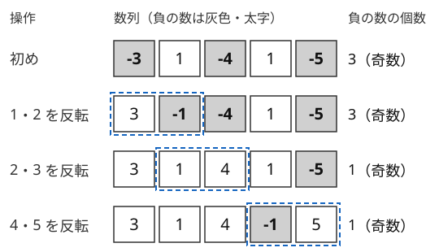

!!! abstract "要点"
    - **何ができるか**：操作で変わらない量（和の余り・個数の偶奇・XOR）を見つけて必要条件を得て、十分性は構築で示す。操作で必ず減る量（単調量）は、操作回数の上界・下界や、操作が必ず止まることの証明に使う。
    - **いつ使うか**：
        - 操作を好きな回数・好きな順に行える
        - 目標の状態に到達できるか・最終状態の最大値
        - 操作の前後で変わらない量（和・偶奇・余り）がありそう
    - **計算量**：不変量や単調量を数えるだけの判定なら多くは $O(N)$。予想を確かめる全探索は小さい $N$ だけで行う（状態数が $2^N$ などになる）。
    - **前提**：なし

<!-- textlint-disable -->
別名：モノバリアント・保存量・単調量・操作の順序によらない・invariant・monovariant
<!-- textlint-enable -->

不変量・単調に変わる量とは、「操作を何度でも行える」問題で、状態そのものを追う代わりに、操作で変わらない量や一方向にしか動かない量に注目する考え方である。到達できる状態は膨大でも、不変量が違えば届かないとすぐに言える。単調に変わる量（単調量）は、1 回の操作でどれだけ動くかの上限から、操作回数の下限を与える。どちらも得られるのは必要条件なので、条件を満たせば本当に届くことは、手順を作って別に示す。

使える合図は 3 つある。「0 回以上好きな回数行える」のように回数と順序が自由なこと、「$B$ にできるか」「最後に残る値の最大値」のように行き着く先だけを問うこと、「操作できなくなるまで繰り返す」「最小の操作回数」のように回数を問うことである。操作の問題で、ほかにどの型を試すかは[詰まったときの発想リスト](../guide/thinking-checklist.md#shape-operation)の「操作できるか・最小回数」の表で引ける。

## 不変量で必要条件を見つけ、構築で十分性を示す {#necessary-and-sufficient}

不変量の考え方は「必要条件 → 十分性」の 2 段で進める（[証明の型](../math/proof-patterns.md#necessary-sufficient)の必要十分の考え方）。

1. **候補の量を挙げ、1 回の操作でどう変わるかを書く**：和・和を $m$ で割った余り・ある値の個数の偶奇・全体の XOR・交互に符号を付けた和などを試す。変化が毎回 0（または $m$ の倍数）なら、その量（の余り）は不変量である
2. **初めと目標で不変量を比べる**：違えば届かない。これが必要条件である
3. **十分性を構築で示す**：不変量が等しければ届くことを、具体的な手順で示す。手順が作れなければ、まだ見つけていない不変量がある

最小の例として、0 を含まない数列で「隣り合う 2 つの符号を同時に反転する」操作を考える。1 回の操作で負の数の個数は $-2$・$0$・$+2$ のどれかだけ変わるので、**負の数の個数の偶奇**は不変量である。



十分性は次の手順で示せる。位置 $i$ と $j$（$i < j$）について、$(i, i+1), (i+1, i+2), \dots, (j-1, j)$ と順に反転する。間の要素は 2 回ずつ反転されて元に戻り、$i$ と $j$ の符号だけが変わる。つまり任意の 2 か所の符号を同時に反転できるので、負の数の個数の偶奇が同じ状態にはすべて届く。不変量が「届くための必要十分条件」になった。

不変量の予想が正しいかは、小さい $N$ で届く状態を全探索して確かめるのが確実である。状態を負の位置の bit 列で表すと、$2^N$ 通りを幅優先探索でたどれる。次のコードは、すべて正の状態から届く状態が「負の数の個数が偶数」とちょうど一致することを `assert` で確かめる。

```cpp
--8<-- "invariant/reachable-bfs.cpp:core"
```

$N = 1$ では操作が 1 回もできないので、すべて正の状態にしかいられない。不変量の予想は、操作ができない小さな場合で崩れやすい。

よく使う不変量を挙げる。

| 操作の形 | 不変量の候補 |
| --- | --- |
| 2 つを選んで $a, b$ を $a + b$ と $0$ にする・値を移す | 和 |
| 2 つを選んで消し、その差や和を書く | 和の偶奇 |
| いくつかの要素に $k$ ずつ足す（引く） | 和を $k$ で割った余り・2 つの差を $k$ で割った余り |
| 2 つを選んで消し、その XOR を書く | 全体の XOR |
| 隣り合う 2 つに同時に同じ値を足す | 交互に符号を付けた和 |

??? question "確認問題：黒板の数"
    黒板に $1, 2, \dots, 10$ が書かれている。2 つを選んで消し、その差の絶対値を書く。これを 9 回くり返すと数が 1 つ残る。残った数の偶奇を答えよ。

    ??? success "答え"
        奇数である。$a + b$ と $\lvert a - b \rvert$ は偶奇が同じなので、黒板の数の和の偶奇は変わらない。初めの和は $55$ で奇数なので、最後の 1 つも奇数である。

??? question "確認問題：3 つの山"
    3 つの山に $1, 2, 3$ 個の石がある。2 つの山から 1 個ずつ取り、残りの山に 2 個足す操作を何度でも行えるとき、$(0, 0, 6)$ にできるか。

    ??? success "答え"
        できない。どの 2 つの山の差も、1 回の操作で $0$ か $\pm 3$ しか変わらないので、差を 3 で割った余りは不変量である。初めの 1 番目と 2 番目の差は $1 - 2 = -1$ で、余りは $2$ である。目標では $0 - 0 = 0$ で、余りが違う。

## 単調量（必ず減る量）で操作回数を抑える {#monovariant}

単調量は、操作のたびに一方向にしか動かない量である。整数で下限のある量 $\Phi$ について、次の 2 つの使い方がある。

- **停止性・回数の上界**：$\Phi \ge 0$ で、1 回の操作で必ず 1 以上減るなら、操作は $\Phi$ の初めの値の回数以内で必ず止まる。「操作できなくなるまで繰り返す」問題で、愚直に模擬しても回数が抑えられることの根拠になる
- **最小回数の下限**：1 回の操作で $\Phi$ が高々 $c$ しか減らず、目標の状態で $\Phi = 0$ なら、操作は少なくとも $\lceil \Phi / c \rceil$ 回要る

下限は、毎回ちょうど $c$ ずつ減らす手順を作れて初めて答えになる。代表は次の 3 つである。

- **隣接 swap と転倒数**：値の違う隣り合う 2 つの交換で転倒数はちょうど 1 増減する（等しい 2 つなら変わらない）ので、昇順にする最小回数は転倒数に等しい（[転倒数](../ds/inversion-number.md#adjacent-swaps)）
- **区間の反転と境界の数**：L と R の列で区間を反転すると、隣り合う 2 文字が違う箇所（境界）は両端の 2 か所でしか変わらないので、1 回で高々 2 減る。塊を 1 つ反転すれば実際に 2 減る（[ランレングス圧縮](../basics/run-length-encoding.md#count-boundaries)）
- **重複の数**：要素を 2 つずつ取り除く操作なら、「(要素数) − (値の種類数)」は 1 回で高々 2 減る（[例題 ARC068 D](#arc068_b)）

回数の下限 $\lceil \Phi / c \rceil$ を達成できても、答えがそれだけで決まるとは限らない。$\Phi$ が奇数で $c = 2$ なら、最後の 1 回は $\Phi$ を 1 しか減らさない。その 1 回で余分に失うもの（[例題 ARC068 D](#arc068_b) では値の種類が 1 つ）がないかを、小さな例で必ず確かめる。

??? question "確認問題：止まることの証明"
    正の整数の列で、「隣り合う 2 つ $a_i > a_{i+1}$ を選んで入れ替える」操作を、選べる組がなくなるまで好きな順に繰り返す。どの順に選んでも必ず止まるのはなぜか。

    ??? success "答え"
        転倒数（$i < j$ かつ $a_i > a_j$ の組の数）が単調量になる。$a_i > a_{i+1}$ の隣り合う 2 つを入れ替えると、その 2 つの組だけが転倒でなくなり、ほかの組の大小関係は変わらないので、転倒数はちょうど 1 減る。転倒数は 0 以上の整数なので、初めの転倒数の回数で必ず止まる。

## 操作の順序によらないなら都合のよい順で考える {#order-independence}

操作が「決まった場所に値を足す」形なら、操作どうしは入れ替えても結果が同じである。最終状態は、各操作を合計でどれだけ行ったか（正味の量）だけで決まる。そこで、操作の順序は忘れて「各操作の正味の量」を未知数とみなし、都合のよい順に 1 つずつ決めていく。

$H \times W$ の行列で「$2 \times 2$ の正方形の 4 マスに同じ値を足す」操作を考える。左上の正方形を $(i, j)$ の位置に置く操作の正味の量を $x_{i,j}$（$0 \le i < H - 1$、$0 \le j < W - 1$）とする。

- マス $(0, 0)$ を覆うのは $x_{0,0}$ だけなので、$x_{0,0}$ は目標との差で決まる
- 行ごとに左から見ると、マス $(i, j)$ を覆う正方形のうち、まだ決めていないのは $x_{i,j}$ だけである。だから $x_{i,j}$ も一意に決まる
- すべての $x_{i,j}$ を決めた後、最後の行と最後の列が目標と一致するかを調べる。一致しなければ、どの順でどう操作しても届かない

正味の量が一意に決まるので、操作回数の最小も分かる。1 回の操作で足し引きできるのが 1 だけなら、各位置で $\lvert x_{i,j} \rvert$ 回より少なくはできず、その回数で足りる。

同じ操作を 2 回行うと元に戻る形（反転・XOR）では、各操作は「行う・行わない」の 2 通りだけを考えればよい。たとえばマスを押すとそのマスと上下左右の 0 と 1 が反転するパズルでは、1 行目の押し方を [bit 全探索](../basics/bit-full-search.md)で決めると、2 行目以降の押し方は上のマスを 0 にする条件で一意に決まる。

## 独立な部分に分ける（奇数部分ごと） {#independent-parts}

操作が決して混ざり合わない部分に分けられるなら、部分ごとに不変量を考え、答えを足し合わせればよい。分け方の典型は次の 2 つである。

- **奇数部分で分ける**：大きさ $X$ の 2 つを合わせて $2X$ にする操作では、大きさを $2$ で割れるだけ割った奇数（奇数部分）が変わらない。奇数部分が違うものは合体できず、奇数部分ごとに独立に考えられる（[例題 ABC323 D](#abc323_d)）
- **添字の余りで分ける**：「$i$ 番目と $i + K$ 番目を入れ替える」操作なら、添字を $K$ で割った余りが同じ要素どうししか動かない。余りごとの値の多重集合が不変量になり、余りごとに隣り合う交換を繰り返せば好きに並べ替えられる。だから「余りごとにソートしてから全体が昇順か」で判定できる

部分ごとに分けた後は、部分の中の不変量を探す。奇数部分で分けた例では、奇数部分が $o$ の部分の中の合計の大きさ $o \times Y$ が不変量になる。合計そのものではなく、それを $o$ で割った $Y$（大きさを $o$ を単位に数えた合計）を 2 進数で書いたときの 1 の個数（[popcount](../guide/glossary.md#popcount)）が、残せる最小の個数になる。たとえば大きさ 3 のスライム 1 体では、$Y = 1$ で答えは 1 である（合計 $3$ の 1 の個数 2 ではない）。

## 偶奇・構築・ゲームとのつながり {#connections}

不変量の考え方は、ほかのページの考え方の土台になっている。

- **偶奇**：不変量で最もよく出るのは偶奇である。1 歩ごとに偶奇が入れ替わる、ちょうど $K$ 回なら偶奇がそろう、などの型は[偶奇に着目する](../thinking/parity.md)にまとめてある
- **構築**：不変量で得た必要条件から、条件を満たせば作れることを示すのは[構築問題の考え方](../thinking/construction.md#necessary-conditions)の仕事である。単調量の下限を達成する手順を作るのも、上界・下界を示して達成する例を作る型（[構築問題の考え方](../thinking/construction.md#bound-and-construct)）と同じ形である
- **差分列**：区間に一律に足す操作を[差分列](../basics/difference-sequence.md#to-point-operations)で見ると、2 か所だけを変える操作になる。差分列の上で不変量や単調量を探すと見通しがよくなる
- **ゲーム**：総手数の偶奇が決まっているゲームや、[Nim](../comb/nim.md) の「全体の XOR が 0 の局面からは、どう動いても 0 でない局面になる」という性質は、不変量による必勝法の証明である（[ゲームの基本](../comb/game-basics.md#move-parity)）
- **後ろから考える**：操作の結果から元の状態を求めるときは、[後ろから・逆順に考える](../thinking/reverse-thinking.md)と組み合わせる。逆向きの操作でも不変量は変わらない

## 落とし穴 {#pitfalls}

**必要条件だけで答える**。不変量が一致しても、ほかの不変量が違えば届かない。十分性の手順が作れないときは、[不変量で必要条件を見つける](#necessary-and-sufficient)のコードのように小さい $N$ で全探索し、予想した条件と到達できる状態が一致するかを確かめる。

**0 や端で不変量が崩れる**。符号の反転で 0 を含むと、$(0, -3)$ を反転して $(0, 3)$ にでき、負の数の個数が 1 だけ変わる。0 があると負の数の個数の偶奇は不変量でなくなり、負号を 0 の位置で消して全部を 0 以上にできる。$N = 1$ で操作が 1 回もできない場合も、一般の議論が当てはまらない。

**下限がそのまま答えになると思い込む**。単調量の下限 $\lceil \Phi / c \rceil$ は、毎回 $c$ ずつ減らす手順があって初めて答えになる。手順があっても、$\Phi$ が割り切れず最後の 1 回で余分に失うものがあれば、その分を答えに反映する（[例題 ARC068 D](#arc068_b) では $\Phi$ が奇数のとき、残せる枚数が種類数より 1 少ない）。

**合計のオーバーフロー**。奇数部分ごとに $Y_o = \sum 2^k \times (\text{個数})$ を求めると、$10^{18}$ 近くになりうる。合計の大きさ $o \times Y_o$ はさらに大きく `long long` に入らないので、求めない。$Y_o$ を `long long` で足し、1 の個数は `__builtin_popcountll` で数える（`__builtin_popcount` は `unsigned int` を受け取るので上位の bit が落ちる）。

## 例題 {#examples}

### ABC125 D. Flipping Signs {#abc125_d}

<div class="kp-problems" data-role="example" markdown>

- [ABC125 D. Flipping Signs](https://atcoder.jp/contests/abc125/tasks/abc125_d)（diff 833）：隣り合う 2 つの符号を反転する操作を何度でも行えるとき、数列の和の最大値を求める。

</div>

??? note "方針"
    [不変量で必要条件を見つけ、構築で十分性を示す](#necessary-and-sufficient)の最小の例そのものである。負の数の個数の偶奇が不変量で、任意の 2 か所の符号を同時に反転できるので、偶奇が同じ状態にはすべて届く。

    - 負の数の個数が偶数なら、すべてを 0 以上にできる。答えは $\sum_i \lvert A_i \rvert$
    - 奇数なら、負の数が 1 つは残る。損が最も小さいのは絶対値の最小の要素を負にすることなので、答えは $\sum_i \lvert A_i \rvert - 2 \min_i \lvert A_i \rvert$
    - 0 を含むと偶奇の議論は崩れるが、そのときは $\min_i \lvert A_i \rvert = 0$ なので、奇数の場合の式も $\sum_i \lvert A_i \rvert$ になり、同じ式で正しい
    - 和は `long long` で求める。全体で $O(N)$

### ABC323 D. Merge Slimes {#abc323_d}

<div class="kp-problems" data-role="example" markdown>

- [ABC323 D. Merge Slimes](https://atcoder.jp/contests/abc323/tasks/abc323_d)（diff 852）：同じ大きさのスライム 2 体を合体させる操作を繰り返したときの、スライムの数の最小値を求める。

</div>

??? note "方針"
    [独立な部分に分ける](#independent-parts)の例である。合体しても奇数部分は変わらないので、奇数部分ごとに独立に考え、それぞれの最小を足す。

    - 大きさ $S$ を奇数部分 $o$ と $2^k$ の積に分け、奇数部分 $o$ ごとに $Y_o = \sum 2^k \times (\text{その大きさの数})$ を求める（`map` などでまとめる）
    - 部分の中では合計の大きさ $o \times Y_o$ が不変量である。残ったスライムの大きさはどれも $o \times 2^j$ の形なので、$Y_o$ を 2 の冪の和で書くことになり、個数は $Y_o$ の 1 の個数以上である
    - 小さい大きさから順に 2 体ずつ合体して余りを残せば、ちょうど 1 の個数にできる（2 進数の繰り上がりと同じ）
    - 答えは $\sum_o \operatorname{popcount}(Y_o)$。$Y_o$ は `long long` で持つ

### ARC068 D. Card Eater {#arc068_b}

<div class="kp-problems" data-role="example" markdown>

- [ARC068 D. Card Eater](https://atcoder.jp/contests/arc068/tasks/arc068_b)（diff 1084）：カードを 3 枚取って最大と最小を食べ、真ん中を戻す操作で、すべて異なる値にしたときに残せる最大の枚数を求める。

</div>

??? note "方針"
    [単調量で操作回数を抑える](#monovariant)の例で、回数の下限を使う。値の種類数を $K$ とし、重複の数 $\Phi = N - K$ を単調量にする。

    - 1 回の操作で枚数は 2 減り、種類数は 0〜2 減るので、$\Phi$ は高々 2 しか減らない。すべて異なる状態では $\Phi = 0$ なので、操作は $\lceil \Phi / 2 \rceil$ 回以上要り、残る枚数は $N - 2 \lceil \Phi / 2 \rceil$ 以下である
    - $\Phi \ge 2$ なら、同じ値 3 枚、または 2 枚ずつ重なった 2 種類から 3 枚を選ぶと、重複だけを 2 つ減らせる。$\Phi = 1$ なら 1 回で 0 にできる。だから上の回数で足りる
    - 答えは $\Phi$ が偶数なら $K$、奇数なら $K - 1$ である。ソートして種類数を数えれば $O(N \log N)$

## 練習問題 {#practice}

<div class="kp-problems" data-role="practice" markdown>

- [典型90 079. Two by Two（★3）](https://atcoder.jp/contests/typical90/tasks/typical90_ca)（diff —）：2×2 の正方形の 4 マスに同じ値を足し引きする操作で、行列 A を B にできるか判定する。
- [ABC140 D. Face Produces Unhappiness](https://atcoder.jp/contests/abc140/tasks/abc140_d)（diff 1074）：向き（L/R）の列に区間の反転を K 回まで行い、幸福な人の数を最大化する。

</div>

??? note "練習の方針"
    - **典型90 079**：操作の順序によらないので、左上から各正方形の正味の量を一意に決め、最後の行と列が一致するかを調べる（[操作の順序によらないなら都合のよい順で考える](#order-independence)）。できるときは操作回数の最小も問われ、正味の量の絶対値の和になる
    - **ABC140 D**：幸福な人の数は「(N − 1) − 境界の数」である。境界の数は 1 回で高々 2 しか減らず、塊を 1 つ反転すれば 2 減らせるので、$K$ 回の後の境界の数の最小は $\max(\text{境界の数} - 2K, 0)$ になる（[単調量で操作回数を抑える](#monovariant)）

## 参考 {#references}

- [drken「AtCoder ABC 125 D - Flipping Signs (2Q, 緑色, 400 点)」](https://drken1215.hatenablog.com/entry/2019/04/27/224100)：例題の方針（負の数の個数の偶奇が不変で、負号を寄せて打ち消せること）
- [drken「AtCoder ABC 323 D - Merge Slime (2Q, 緑色, 425 点)」](https://drken1215.hatenablog.com/entry/2023/10/12/020919)：例題の方針（奇数部分ごとに分け、合計の 1 の個数が答えになること）
- [drken「AtCoder ABC 053 D - Card Eater (ARC 068 D) (3Q, 緑色, 400 点)」](https://drken1215.hatenablog.com/entry/2024/09/21/200934)：例題の方針（重複の数が 1 回で高々 2 減ることと、その回数で足りること）
- [drken「AtCoder ABC 140 D - Face Produces Unhappiness (1Q, 緑色, 400 点)」](https://drken1215.hatenablog.com/entry/2020/05/16/005300)：練習の方針（境界の数が 1 回で高々 2 減ること）
- [Reputeless「tenkei_90」](https://github.com/Reputeless/tenkei_90)：練習の方針（典型90 079 の要点が「操作順序によらない」こと）
- [E869120「kyopro_educational_90」の 079 の解答](https://github.com/E869120/kyopro_educational_90/blob/main/sol/079.cpp)：練習の方針（左上から差を決めていく手順と、最小の操作回数を出力すること）
