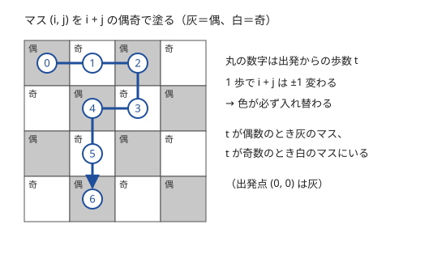

!!! abstract "要点"
    - **何ができるか**：1 歩ごとに $(x + y)$ の偶奇が入れ替わる、±1 をちょうど $K$ 回なら差と $K$ の偶奇がそろう、など偶奇の必要条件から可否を判定する。グリッドでは市松模様の色の偶奇が不変量になる。
    - **いつ使うか**：
        - ちょうど $K$ 回の操作・±1 の移動
        - 和が偶数という条件
        - グリッドを 1 マスずつ動く操作の可否
        - チェス盤の塗り分け・ドミノの敷き詰め
    - **計算量**：判定そのものは差や個数の偶奇を数えるだけで $O(N)$。偶奇の条件でつながった成分を求めるときは Union-Find でならし $O(\alpha(N))$ ずつ。
    - **前提**：なし

<!-- textlint-disable -->
別名：パリティ・偶奇性・mod 2・市松模様・チェッカーボード・parity
<!-- textlint-enable -->

偶奇に着目するとは、操作のたびに決まった量だけ変わる値を見つけ、その値を 2 で割った余りがどう動くかから「できない」を見抜く考え方である。偶奇の条件はたいてい[必要条件](../guide/glossary.md#necessary-condition)にすぎないので、それを満たせば本当にできることを、具体的な手順（往復でむだに 1 往復させる、など）で別に確かめる。偶奇は[不変量](../thinking/invariant.md)の中で最もよく出る例である。

使える合図は 3 つある。「ちょうど $K$ 回の操作で」「時刻 $t$ に」のように回数や時刻が決まっていること、「上下左右に 1 マス動く」のように 1 回で量が奇数だけ変わること、「2 つの値の和が偶数」のように偶奇の関係が条件にあることである。操作の問題で、ほかにどの型を試すかは[詰まったときの発想リスト](../guide/thinking-checklist.md#shape-operation)の「操作できるか・最小回数」の表で引ける。

## 1 歩ごとに偶奇が入れ替わる {#alternating}

格子点 $(x, y)$ を上下左右に 1 歩動くと、$x + y$ はちょうど $1$ 増えるか $1$ 減る。どちらでも $x + y$ の偶奇は必ず入れ替わる。だから原点から $t$ 歩動いた後の点は、

$$
x + y \equiv t \pmod{2}
$$

を必ず満たす。$(x, y)$ にちょうど $t$ 歩で着けるかを問われたら、まずこの式で半分の場合を落とせる。

格子点 $(x, y)$ をグリッドのマス $(i, j)$ と見ると、$i + j$ の偶奇で塗った 2 色を 1 歩ずつ交互に踏む（下の図）。

一般には、次の手順で偶奇の条件を探す。

- 操作で変わる量 $S$（座標の和・要素の総和・ある値の個数など）を 1 つ決める
- 1 回の操作による $S$ の変化が、毎回奇数か、毎回偶数かを確かめる
- 毎回奇数なら $S$ の偶奇は操作の回数の偶奇で決まり、毎回偶数なら $S$ の偶奇は変わらない（不変量）

変わる量が操作によって奇数のことも偶数のこともあると、この方法では何も言えない。たとえば「その場にとどまってもよい」移動では偶奇の条件は消える。問題文に、動かずに時間をつぶす手段があるかを必ず確かめる。

??? question "確認問題：桂馬のように跳ぶ駒"
    チェスのナイトは $(\pm 1, \pm 2)$ または $(\pm 2, \pm 1)$ だけ動く。原点のナイトが $(3, 4)$ にちょうど $4$ 回の移動で着くことはありうるか。$5$ 回ではどうか。

    ??? success "答え"
        $4$ 回ではありえない。1 回の移動で $x + y$ は $\pm 1$ か $\pm 3$ 変わり、どれも奇数なので偶奇が毎回入れ替わる。4 回動いた後の $x + y$ は偶数だが、$3 + 4 = 7$ は奇数である。$5$ 回なら偶奇では否定できず、実際に着ける。$(2, 1), (4, 2), (3, 4)$ と 3 回で着き、途中で $(2, 1)$ と $(4, 2)$ の間を 1 往復すれば 5 回になる。偶奇の条件は否定にしか使えず、満たしたときは道筋を作って確かめる。

## ちょうど K 回なら偶奇がそろうことが必要 {#exactly-k}

「数列 $A$ のどれかに $+1$ か $-1$ をする操作を、ちょうど $K$ 回行って $B$ にできるか」を考える。$D = \sum_i \lvert A_i - B_i \rvert$ とおく。

- **回数の下限**：1 回の操作で $D$ は $1$ しか減らないので、$K \ge D$ が必要である
- **偶奇**：1 回の操作で $\sum_i A_i$ は $\pm 1$ 変わるので、$K$ 回の後の $\sum_i A_i$ の偶奇は $K$ で決まる。一方、$\lvert A_i - B_i \rvert$ と $A_i - B_i$ は偶奇が同じなので、$\sum_i A_i - \sum_i B_i \equiv D \pmod{2}$ である。終わりに $B$ と一致するには $K \equiv D \pmod{2}$ が必要である
- **十分性**：$K - D$ が $0$ 以上の偶数なら、最短の $D$ 回で $B$ にした後、どれか 1 つに $+1$ と $-1$ を組にして $(K - D) / 2$ 回くり返せばよい

この「下限以上で、余りが偶数なら、往復でむだに使える」という形は、移動の問題でも操作の問題でもよく出る。必要条件の 2 つ（下限と偶奇）を出し、往復の 1 組で十分性を示す、という順で考える。

往復ができない場合は十分性が崩れる。動ける場所が 1 マスしかない場合や、同じマスを 2 度通れない場合がそうである。操作の対象を毎回変えなければならない制約でも同じで、余りの使い方を別に考える。

「$10^{100}$ 回くり返した後」のような非常に大きい回数も、偶奇で片づくことがある。状態が 2 回ごとに元に戻る（周期が 2 の）形になれば、回数の偶奇だけを見ればよい。周期の見つけ方は[周期性の検出](../basics/periodicity.md)にある。

## 偶奇の条件でつながった成分（Union-Find） {#components}

「$A_x + A_y + Z$ が偶数」のような条件は、2 で割った余りで見ると

$$
A_x \equiv A_y + Z \pmod{2}
$$

になる。$Z$ が偶数なら「$A_x$ と $A_y$ の偶奇が同じ」、奇数なら「偶奇が違う」という、2 つの値の関係が 1 本ずつ与えられているだけである。

値を頂点、条件を辺としたグラフで考える。

- **成分の中は 1 つで決まる**：辺の一方の偶奇が分かれば、もう一方も決まる。これを辺に沿ってたどれば、連結成分の 1 つの偶奇から成分全体の偶奇が決まる
- **成分どうしは独立**：別の成分の間には条件がないので、ある成分の全員の偶奇を一斉に反転しても、すべての条件は保たれる。だから成分ごとに少なくとも 1 つは別の手段で調べないと値が定まらない

連結成分は [Union-Find](../ds/union-find.md) で数えられる。ここで Union-Find が持つのは「同じ成分か」だけで、偶奇が同じか違うかは持たない。条件どうしの矛盾を見つける必要があるとき、または 2 つの値の偶奇が同じかどうかを答える必要があるときは、根からの偶奇の差も持つ[重み付き Union-Find](../ds/weighted-union-find.md#generalization) を使う。頂点を「偶の $v$」「奇の $v$」の 2 つに分けて Union-Find をする方法もある。

## 市松模様の偶奇 {#checkerboard}

この節は[1 歩ごとに偶奇が入れ替わる](#alternating)の考え方をグリッドの道筋に広げる。マス $(i, j)$ を $i + j$ の偶奇で 2 色に塗る（市松模様）。隣り合うマスは必ず色が違うので、上下左右に動く道筋は 2 色を交互に踏む。

$L$ マスを通る道筋で、最初のマスの色を灰とすると、

- $L$ が奇数なら最後も灰で、灰のマスは白より 1 つ多い
- $L$ が偶数なら最後は白で、灰と白は同じ数

である。この数え方から、「すべてのマスをちょうど 1 回ずつ通る」道筋に強い必要条件が出る。

- **始点と終点が同じ色**：通るマスの数が奇数で、その色のマスがもう一方の色より 1 つ多くなければならない
- **始点と終点が違う色**：通るマスの数が偶数で、2 色のマスが同じ数でなければならない

たとえば $N \times N$ のグリッドで左上 $(0, 0)$ から右下 $(N - 1, N - 1)$ へ行くとき、2 つのマスはどちらも $i + j$ が偶数なので同じ色である。$N$ が偶数なら 2 色は $N^2 / 2$ ずつで同じ数なので、全マスを通る道筋はない。逆に $N$ が奇数なら灰が 1 つ多いので、色の数え方では否定できない。

ドミノ（$1 \times 2$ の板）の敷き詰めも同じ考え方で調べる。1 枚のドミノは隣り合う 2 マス、つまり灰と白を 1 つずつ覆う。だから敷き詰めるには、2 色のマスの数が等しくなければならない。$8 \times 8$ の盤から対角の 2 隅（どちらも同じ色）を除くと、色の数が 2 つずれるので敷き詰められない。

市松模様の条件も必要条件である。条件を満たす場合に実際の道筋を作るのは[構築](../thinking/construction.md)の仕事で、小さい $N$ で全探索して条件が十分かを確かめてから構築を考えるとよい。

??? question "確認問題：1 マス欠けたグリッド"
    $4 \times 4$ のグリッドから 1 マスを除き、残り 15 マスをちょうど 1 回ずつ通って $(0, 0)$ から $(3, 3)$ へ行きたい。除くマス $(a, b)$ は、$a + b$ が偶数・奇数のどちらでなければならないか。

    ??? success "答え"
        奇数である。$(0, 0)$ と $(3, 3)$ はどちらも $i + j$ が偶数（灰）なので、15 マスの道筋では灰が白より 1 つ多くなければならない。もとは灰 8・白 8 なので、白（$a + b$ が奇数）を 1 つ除いて灰 8・白 7 にするしかない。

## 二部グラフ・ゲームとのつながり {#bipartite-game}

偶奇の考え方は、グラフやゲームの問題に形を変えて現れる。

- **二部グラフ**：市松模様に塗ったグリッドは、隣り合う頂点の色が必ず違う[二部グラフ](../graph/bipartite-graph.md)である。二部グラフでは、2 頂点を結ぶウォークの長さの偶奇が道筋によらず決まる。奇数長の閉路があると二部グラフでなくなり、その閉路を 1 周すれば偶奇を変えられる
- **ちょうど K 歩で着けるか**：一般の無向グラフでは、頂点を「偶数歩で着いた $v$」「奇数歩で着いた $v$」の 2 つに分けて[幅優先探索](../graph/bfs.md)をし、$\mathrm{dist}[v][p]$（$p$ は歩数の偶奇）を求める。$\mathrm{dist}[v][K \bmod 2] \le K$ なら、最後の辺を往復して 2 歩ずつ足せるので、ちょうど $K$ 歩で着ける（出発点に辺が 1 本もないときだけは、どこへも動けないので例外である）
- **ゲーム**：誰がどう動いても総手数の偶奇が決まっているゲームでは、勝ち負けが偶奇だけで決まる。詳しくは[ゲームの基本](../comb/game-basics.md#move-parity)にある
- **置換**：swap の回数の偶奇は、どんな swap の列で同じ並べ替えを作っても変わらない（[置換の偶奇](../comb/permutation-parity.md#sign)）
- **偶奇だけを答える質問**：「いくつかの和の偶奇」だけを聞ける[インタラクティブ](../misc/interactive.md)の問題では、答えを 2 で割った余りの連立方程式とみて、差を取りながら 1 つずつ決める

## 落とし穴 {#pitfalls}

**負の数の余り**。C++ の `%` は割られる数の符号を受け継ぐので、`-3 % 2` は `-1` になる。`x % 2 == 1` で奇数を判定すると、負の奇数を偶数と取り違える。`x % 2 != 0` と書くか、`x & 1`（2 の補数で負の数にも正しい）を使う。

**偶奇の条件だけで Yes にする**。偶奇がそろっても、回数の下限（距離が時間以下、差の合計が $K$ 以下）を満たさなければできない。下限と偶奇の両方を確かめ、さらに余りを往復で使えるか（動かずにいられるか、往復が禁じられていないか）を見る。

**区間ごとの判定を忘れる**。地点と時刻の組が何個も与えられる問題では、出発点からの距離だけを見ても足りない。前の地点から次の地点までの各区間で、距離と時間の差の両方を確かめる。

**和のオーバーフロー**。差の合計 $D$ は $N \times \max \lvert A_i - B_i \rvert$ まで大きくなるので、`long long` で足す。偶奇だけが要るなら、各項の偶奇を XOR していけばあふれない。

## 例題 {#examples}

### ARC089 C. Traveling {#arc089_a}

- [ARC089 C. Traveling](https://atcoder.jp/contests/arc089/tasks/arc089_a)（diff 397）：時刻 t_i に地点 (x_i, y_i) にいるという旅行の計画が、上下左右に 1 歩ずつ動いて実行できるか判定する。

??? note "方針"
    上下左右に 1 歩ずつ動くので、[1 歩ごとに偶奇が入れ替わる](#alternating)と[ちょうど K 回なら偶奇がそろうことが必要](#exactly-k)がそのまま使える。各区間で「距離が時間以下」と「時間と距離の差が偶数」を確かめる。

    - 時刻 $0$ に原点にいる状態を最初の「前の地点」にする
    - 各区間で、使える時間 $dt$ と、前の地点とのマンハッタン距離 $d$ を求める
    - $d > dt$ なら最短でも間に合わない。$dt - d$ が奇数なら、余った時間を 1 歩進んで 1 歩戻る往復（2 歩ずつ）では使い切れない
    - どちらでもなければ、余りを往復で使えるのでその区間は可能である。すべての区間が可能なら Yes。全体で $O(N)$

### ABC126 E. 1 or 2 {#abc126_e}

- [ABC126 E. 1 or 2](https://atcoder.jp/contests/abc126/tasks/abc126_e)（diff 1340）：A_x + A_y + Z が偶数という条件がいくつか与えられたとき、すべてのカードの値を知るために見る最小の枚数を求める。

??? note "方針"
    カードの値は 1 か 2 なので、偶奇が分かれば値が分かる。条件は「2 枚の偶奇が同じ」か「違う」かの関係なので、[偶奇の条件でつながった成分](#components)の考え方がそのまま使える。

    - 条件ごとに $x$ と $y$ を Union-Find で併合する
    - 成分の中では 1 枚を見れば残りの偶奇がすべて決まるので、各成分 1 枚で足りる
    - 成分どうしには条件がなく、成分の偶奇を一斉に反転しても条件が保たれるので、どの成分も 1 枚は見ないと決まらない
    - 答えは連結成分の個数である。矛盾がないことは保証されているので、$Z$ の偶奇は答えに使わない。全体で $O((N + M) \alpha(N))$

## 練習問題 {#practice}

- [典型90 024. Select +／- One（★2）](https://atcoder.jp/contests/typical90/tasks/typical90_x)（diff —）：A の要素に ±1 する操作をちょうど K 回行って B にできるか判定する。
- [ABC454 E. LRUD Moving](https://atcoder.jp/contests/abc454/tasks/abc454_e)（diff 1627）：N×N のグリッドで、指定された 1 マスだけを通らずにほかのすべてのマスをちょうど 1 回ずつ通って左上から右下へ行く移動の列があるかを判定し、あれば 1 つ示す。

??? note "練習の方針"
    - **典型90 024**：差の合計 $D$ が $K$ 以下で、$D$ と $K$ の偶奇が一致すれば可能である（[ちょうど K 回なら偶奇がそろうことが必要](#exactly-k)）
    - **ABC454 E**：左上と右下は市松模様で同じ色なので、通るマスはその色が 1 つ多くなければならない。ここから「$N$ が偶数で、除くマスがもう一方の色」が必要と分かる（[市松模様の偶奇](#checkerboard)）。十分性は構築で示す。除くマスの位置で場合を分け、反転・回転で 1 つの場合に寄せて、蛇行しながら進む道筋を作る

## 力試し {#challenge}

- [ABC474 G. LRUD Moving 2](https://atcoder.jp/contests/abc474/tasks/abc474_g)（diff 2280）：N×N のグリッドのすべてのマスをちょうど 1 回ずつ通って左上から右下へ行く移動のうち、右への移動がちょうど K 回のものがあるかを判定し、あれば 1 つ示す。

??? note "力試しの方針"
    - **ABC474 G**：市松模様から $N$ が奇数であることが必要と分かる。右と左の移動の差は横幅で決まり、移動の総数はマスの数より 1 少ないので、$K$ の範囲も数え上げで決まる。さらに $K$ の偶奇にも条件があり、小さい $N$ で全探索して条件を推測するのが近道である。構築は、上の 2 行を往復して盤面を 2 行減らすか、左の 2 列を使って 2 列減らすかを、残りの $K$ に合わせて選んでいく

## 参考 {#references}

- [hamayan「Traveling [AtCoder Regular Contest 089 / AtCoder Beginner Contest 086 C]」](https://blog.hamayanhamayan.com/entry/2018/01/21/225430)：例題の方針（区間ごとの距離と時間の差の偶奇、時刻 0 の扱い）
- [drken「AtCoder ABC 126 E - 1 or 2 (1Q, 水色, 500 点)」](https://drken1215.hatenablog.com/entry/2019/05/19/224500_1)：例題の方針（偶奇の関係のグラフと、連結成分の個数が答えになる理由）
- [Reputeless「tenkei_90」](https://github.com/Reputeless/tenkei_90)：練習の方針（典型90 024 の要点）
- [E869120「kyopro_educational_90」の 024 の解答](https://github.com/E869120/kyopro_educational_90/blob/main/sol/024.cpp)：練習の方針（差の合計と偶奇の判定）
- [ikatakos「キーサイト・テクノロジープログラミングコンテスト（AtCoder Beginner Contest 454）E,F,G問題メモ」](https://ikatakos.com/pot/programming_algorithm/contest_history/atcoder/2026/0418_abc454)：練習の方針（市松模様による可否と構築。解法の部分だけを参照）
- [ikatakos「AtCoder Beginner Contest 474 G問題メモ」](https://ikatakos.com/pot/programming_algorithm/contest_history/atcoder/2026/0906_abc474)：力試しの方針（N の偶奇・K の範囲と、2 行・2 列ずつ減らす構築。解法の部分だけを参照）
