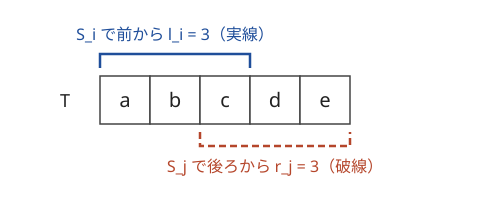

!!! abstract "要点"
    - **何ができるか**：条件や目的関数を、数えやすい・判定しやすい形に書き直す。区間和が $M$ の倍数 ⇔ 累積和の余りが等しい、平均 $\ge x$ ⇔ $\sum (a_i - x) \ge 0$ のように、手法に結びつく言い換えの型を表で引ける。
    - **いつ使うか**：
        - 条件が複雑で直接は数えにくい・判定しにくい
        - x 方向と y 方向・bit ごと・連結成分ごとに結果が独立に決まる
        - 式を変形すると $i$ の項と $j$ の項に分離できる
    - **計算量**：言い換え自体は $O(1)$〜$O(N)$ で済むことが多い。全体の計算量は言い換えた後に使う手法で決まる（同じ鍵の組を連想配列で数えるなら $O(N \log N)$）。
    - **前提**：なし

<!-- textlint-disable -->
別名：言い換え・式変形・条件の言い換え・独立に分解・x と y を分ける・変数変換・reformulation
<!-- textlint-enable -->

言い換えとは、問題の条件・目的関数・操作を、意味を変えずに別の形へ書き直し、知っている手法がそのまま使える形にする考え方である。「区間」「組」「操作の回数」のように直接は扱いにくい対象が、「2 つの累積和の比較」「添字ごとの鍵」「点の増減」に変わると、累積和・連想配列・転倒数などで速く処理できる。このページは型ごとの言い換えを集めた表と、それぞれの考え方の要点をまとめる。中身の手法は各ページに任せる。

使える合図は 3 つある。「区間の和が $M$ の倍数」のように 2 つの添字にまたがる条件を数えさせること、「平均が $x$ 以上」のように全体を見ないと決まらない量を問うこと、「区間に 1 を足す」「隣と入れ替える」操作の最小回数を問うことである。

## 言い換えの一覧表（元の条件 → 言い換え → 使う手法のページ） {#table}

言い換えの典型を、元の条件から引けるように並べた。左の列の言い回しが問題文や自分の立てた式に出てきたら、中央の形に直せないかを試す。どの行も両向きに成り立つ（⇔）言い換えである。

| 元の条件・量 | 言い換えた形 | 使う手法 |
| --- | --- | --- |
| 区間 $[l, r)$ の和が $K$ | 累積和で $S_r - S_l = K$ | [累積和と連想配列](../basics/prefix-sum-counting.md) |
| 区間の和が $M$ の倍数 | $S_r \equiv S_l \pmod{M}$ | [余りが等しい組](../basics/prefix-sum-counting.md#same-remainder) |
| $A_j - A_i = j - i$ | $A_i - i = A_j - j$ | [i と j を分離する](#separate-indices) |
| 狭義単調増加（整数） | $A_i - i$ が広義単調増加 | [差分列](../basics/difference-sequence.md#strict-to-weak) |
| 平均 $\ge x$ | $\sum (a_i - x) \ge 0$ | [平均の言い換え](../basics/fractional-binary-search.md#average) |
| 中央値 $\ge x$ | $x$ 以上を $+1$、未満を $-1$ にした和が正 | [中央値の言い換え](../basics/fractional-binary-search.md#median) |
| 最大値 $\le x$ | すべての要素が $x$ 以下 | [答えで二分探索](../basics/binary-search-answer.md#minimax) |
| $K$ 番目に小さい値 $\le x$ | $x$ 以下の要素が $K$ 個以上 | [K 番目の値を求める](../basics/kth-value.md#why-count) |
| $a + b = a \oplus b$ | $a \text{ AND } b = 0$（同じ bit に 1 が重ならない） | [bit ごとに独立](../basics/bitwise-independence.md) |
| マンハッタン距離 | $u = x + y$、$v = x - y$ でチェビシェフ距離 | [45 度回転](../geometry/manhattan-chebyshev.md#rotate-45) |
| 正しい括弧列 | $+1$・$-1$ の累積和が負にならず最後に 0 | [括弧列の判定](../patterns/bracket-sequence.md#check) |
| 区間に一律に加算 | 差分列の 2 点の増減 | [区間の操作を 2 点の操作に直す](../basics/difference-sequence.md#to-point-operations) |
| 隣接 swap の最小回数 | 転倒数 | [なぜ隣接 swap の最小回数か](../ds/inversion-number.md#adjacent-swaps) |
| $S_i$ と $S_j$ をつなぐと $T$ を部分列に含む | 前からの一致長 + 後ろからの一致長 $\ge \lvert T \rvert$ | [例題 ABC324 E](#abc324_e) |

中央値の行は、偶数個のとき中央値を小さい方の中央とする（このサイトの約束）なら奇数個と同じく「正」のままで、大きい方の中央とするなら「0 以上」になる。

表の多くは、次の 3 つの動きのどれかである。

- **全体の条件を要素ごとの条件に分ける**：最大値・平均・中央値・$K$ 番目のように全体を見ないと決まらない量を、$x$ を決めて「各要素が $x$ 以上か」の和や「かつ」に直す。$x$ は[答えで二分探索](../basics/binary-search-answer.md)によって動かすことが多い
- **2 つの添字にまたがる条件を、添字ごとの値の比較に分ける**：区間の条件を累積和 $S_r$ と $S_l$ の関係に、$i$ と $j$ が混ざった式を「$i$ だけの式」と「$j$ だけの式」に分ける。分けた後は、同じ値の個数を数える・ソートして二分探索するなどで速くなる
- **操作を扱いやすい単位に分解する**：区間への操作を差分列の点の操作に、並べ替えを隣接 swap の数（転倒数）に直す（[操作の言い換え](#operations)）

??? question "確認問題：⇔ になっているか"
    「区間の和が偶数」を「区間の両端の値の偶奇が等しい」と言い換えた。この言い換えは正しいか。正しくなければ、正しい言い換えは何か。

    ??? success "答え"
        正しくない。区間の和の偶奇は、端の 2 つだけでなく区間の全要素で決まる。正しくは、累積和で「$S_r$ と $S_l$ の偶奇が等しい」である。累積和の偶奇ごとの個数を数えれば、和が偶数の区間は $O(N)$ で数えられる。

## i と j を分離する（a_i − i などの変数変換） {#separate-indices}

組 $(i, j)$ についての条件や目的関数に、$i$ と $j$ が混ざって現れることがある。式を移項して「$i$ だけで決まる量」と「$j$ だけで決まる量」に分けると、全部の組を調べる $O(N^2)$ が、左から 1 回なめる $O(N)$ や $O(N \log N)$ になる。

小さな例で動かす。$A = (2, 0, 4, 2, 6)$（0-indexed）で、$A_j - A_i = j - i$ となる組 $i < j$ を数える。この条件は「添字が 1 増えるごとに値もちょうど 1 増える」ことで、$i$ と $j$ が両辺にまたがっている。移項すると

$$
A_j - A_i = j - i \iff A_i - i = A_j - j
$$

になり、各添字に鍵 $B_i = A_i - i$ を付ければ「鍵が等しい組」を数える問題になる。鍵は $B = (2, -1, 2, -1, 2)$ なので、鍵 $2$ の 3 個から $3$ 組、鍵 $-1$ の 2 個から $1$ 組で、合わせて $4$ 組である。左から見ながら「これまでに見た鍵ごとの個数」を連想配列に持てば、1 回なめるだけで数えられる。

最大化でも同じである。$i < j$ について $A_i + A_j + i - j$ の最大を求めるなら、$(A_i + i) + (A_j - j)$ と分ける。$j$ を左から動かし、それより左での $A_i + i$ の最大を持ち歩けば、各 $j$ で最良の相手が $O(1)$ で分かる。

```cpp
--8<-- "reformulation/separate-indices.cpp:core"
```

完全なプログラム：[`separate-indices.cpp`](https://github.com/yuukougun/kyopro-atlas/blob/main/snippets/reformulation/separate-indices.cpp)（GitHub）
{ .kp-code-src }

よく出る形をまとめる。

- **等式**：$f(i) = g(j)$ の形にできれば、左から $f(i)$ の個数を連想配列で数え、各 $j$ で $g(j)$ の個数を足す。両辺が同じ形（$f = g$）なら「鍵が等しい組」になる
- **余りの等式**：区間の和の余りが区間の長さに等しい、のような条件は、累積和 $S$ を使って $S_j - j \equiv S_i - i \pmod{K}$ に分けられる。これは各要素から 1 を引いた列の累積和の余りが等しい、と言っても同じである。ただし、余りは $K$ 未満なので区間の長さも $K$ 未満に限られ、この条件は言い換えで消えてしまう（[長さの制限付き](../basics/prefix-sum-counting.md#length-limited)。[練習](#practice)の ABC146 E）
- **不等式**：$f(i) \le g(j)$ の形にできれば、$f$ の値をソートして二分探索するか、値で添字を付けた [BIT](../ds/fenwick-tree.md) で「これまでの $f(i)$ のうち $g(j)$ 以下の個数」を数える（[言い換えてからデータ構造に載せる](#then-data-structure)）
- **最大・最小**：$f(i) + g(j)$ の最大なら、左側の $f$ の最大を持ち歩く

分離できるかどうかは、式を「$i$ を含む項」と「$j$ を含む項」に分けて書いてみると分かる。$i \times j$ や $A_i \times A_j$ のような積の項が残ると、この方法では分けられない。その場合は、片方を固定して残りを数える（[一部を固定して数える](../thinking/fix-variable.md)）か、積の形を[Convex Hull Trick](../dp/cht.md#lines) などで扱う。

??? question "確認問題：鍵の付け方"
    $A_i + A_j = j - i$ となる組 $i < j$ を数えたい。どんな鍵を比べればよいか。

    ??? success "答え"
        移項すると $A_i + i = j - A_j$ になる。左辺は $i$ だけ、右辺は $j$ だけで決まる。左から見ながら $A_i + i$ の個数を連想配列に数え、各 $j$ で鍵 $j - A_j$ の個数を足す。$i < j$ の組だけを数えるため、$j$ では先に鍵 $j - A_j$ の個数を足し、その後で $A_j + j$ を登録する（逆にすると $A_j = 0$ のとき自分自身と組になる）。

## 独立に分解する（x と y・bit ごと・連結成分ごと） {#independence}

結果がいくつかの部分（座標の軸・bit・連結成分）ごとの計算だけで決まり、部分どうしが影響し合わないなら、部分ごとに解いて最後に組み合わせる。2 次元の問題が 1 次元の問題 2 つになり、60 bit の値の問題が 0 と 1 の問題 60 個になるので、1 つずつはずっと易しい。

**x と y を分ける**。上下左右に動く移動では、南北の動きは $y$ 座標だけを、東西の動きは $x$ 座標だけを変える。だから「原点に戻れるか」は「$y$ 方向で戻れるか、かつ $x$ 方向で戻れるか」に分かれる（[練習](#practice)の AGC003 A）。マンハッタン距離 $\lvert \Delta x \rvert + \lvert \Delta y \rvert$ の和も、$x$ の部分と $y$ の部分の和に分かれるので、軸ごとに最小化して足せばよい（[x と y を独立に扱う](../geometry/manhattan-chebyshev.md#axis-independence)、[絶対値の和の最小化と中央値](../basics/median-absolute.md)）。

**bit ごとに分ける**。XOR・AND・OR は、各 bit の結果がその bit の値だけで決まる。すべての組 $i < j$ についての $A_i \oplus A_j$ の総和なら、bit $k$ ごとに「その bit が 1 になる組の数」$\times 2^k$ を足す（[bit ごとに独立](../basics/bitwise-independence.md)）。足し算は繰り上がりで下の bit が上の bit に影響するので、そのままでは分けられない。表の $a + b = a \oplus b$ のように、繰り上がりが起きない条件に言い換えてから分ける。

**連結成分ごとに分ける**。2 つの要素の関係（同じ色・偶奇が等しいなど）だけが条件のとき、関係の辺でつないだグラフの[連結成分](../graph/connected-components.md)どうしは互いに制約を持たない。成分ごとに場合の数を求めて掛ける、成分ごとの最小値を足す、という形で全体が求まる。

分けてよいかの確かめ方は 1 つである。目的関数が「部分ごとの値の和（積・かつ）」になり、どの制約も 1 つの部分の中だけで閉じていればよい。「合計で $K$ 回まで」のように部分をまたぐ制約があるときは、そのままでは分けられない。ただし、答えを $x$ に決めると各部分で要る回数が別々に計算でき、その合計を $K$ と比べるだけになることが多い。この形なら、二分探索の判定の中で部分ごとに計算して足せばよい。

??? question "確認問題：分けられない場合"
    $N$ 個の点を、上下左右の 1 マスの移動を合計 $K$ 回まで使って動かし、すべての点を 1 辺 $d$ の正方形に入れたい。$x$ と $y$ を完全に別々の問題として解き、それぞれ $K$ 回まで使ってよいとすると何がまずいか。どう直せばよいか。

    ??? success "答え"
        $x$ と $y$ で合わせて $K$ 回という制約が部分をまたいでいるので、別々に $K$ 回ずつ使うと回数を数えすぎる。$d$ を決めると、$x$ 方向に要る最小の回数と $y$ 方向に要る最小の回数は別々に計算できる。その和が $K$ 以下かで判定し、$d$ を二分探索する。

## 操作の言い換え（区間操作を差分列で・隣接 swap を転倒数で） {#operations}

操作を何回も行う問題では、1 回の操作が「何をどれだけ変えるか」を別の量で見直すと、操作が単純になることがある。代表は次の 3 つで、ここでは気づき方と結論だけを書く。手順と証明は、それぞれのリンク先の節にある。

**区間への加算を差分列の 2 点の操作にする**。隣どうしの差 $d_i = a_i - a_{i-1}$ の列（差分列）で見ると、区間 $[l, r)$ に $+1$ する操作は、$d_l$ を $+1$ し $d_r$ を $-1$ する 2 点の操作になる。区間の位置と長さの組み合わせを考える代わりに、差分列の各点をいくつ増減させるかを考えればよい。たとえば、すべて 0 の列から区間への $+1$ だけで $a$ を作る最小回数は、両端の外を 0 として差分を取ったときの正の差分の和である（証明と、$\pm 1$ のどちらもできる型・長さが決まった型は[最小回数・可否を差分列の正負で考える](../basics/difference-sequence.md#min-operations)）。

**区間の反転を切り替え点の 2 つにする**。0 と 1 の列で区間を反転する操作は、隣どうしが異なる位置（切り替え点）の列で見ると、両端の 2 点の有無を反転する操作になる。差分列の XOR 版である（[区間反転を切り替え点 2 つで表す](../basics/imos.md#range-flip)）。

**並べ替えを隣接 swap の回数にする**。隣り合う 2 つの入れ替えで列をソートする最小回数は、転倒数（$i < j$ かつ $a_i > a_j$ の組の数）に等しい。1 回の隣接 swap で転倒数は高々 1 しか変わらず、隣り合う転倒した組を入れ替えればちょうど 1 減るからである（証明は[なぜ隣接 swap の最小回数か](../ds/inversion-number.md#adjacent-swaps)）。一見 swap に見えない操作も、空いた位置に仮の要素を置くと隣接 swap になることがある（[力試し](#challenge)の ABC479 F）。

操作の言い換えでは、操作の向きを逆にする（最後の操作から考える）・操作で変わらない量を探す、という見方も合わせて使う（[後ろから・逆順に考える](../thinking/reverse-thinking.md)、[不変量](../thinking/invariant.md)）。

## 言い換えてからデータ構造に載せる {#then-data-structure}

この節は [BIT](../ds/fenwick-tree.md) と[セグメント木](../ds/segment-tree.md)を前提にする。最近の ABC の F では、言い換えで「添字ごとの値の比較」や「点の操作」に直した後、それをデータ構造で速く処理する型がよく出る。言い換えだけでは $O(N^2)$ のままで、データ構造を足して初めて間に合う。

- **不等式の組を数える**：[i と j を分離する](#separate-indices)で $f(i) \le g(j)$ の形にしたら、左から見ながら $f(i)$ を BIT に登録し、各 $j$ で $g(j)$ 以下の個数を取る。値が大きいときは[座標圧縮](../basics/coordinate-compression.md)する。$f(i) = g(j) = a$ で不等号を $a_i > a_j$ にすれば、これは[転倒数](../ds/inversion-number.md)を数える手順そのものである
- **区間の条件を累積和の範囲に言い換える**：区間の和が $L$ 以上 $R$ 以下、なら $S_r - R \le S_l \le S_r - L$ で、「これまでの $S_l$ のうち範囲に入る個数」を BIT か[順序付き集合](../ds/ordered-set.md)で数える
- **しきい値で 0 と 1 にする**：「値が $x$ 以上か」だけが効く条件なら、$x$ 以上を 1、未満を 0 とした列で考える。区間の 1 の個数はセグメント木で数える。$x$ を変えながら扱うときは、値の大きい順に 1 を立てていく
- **差分列の点の操作を区間の操作に戻す**：差分列で言い換えた後に元の値も要るなら、区間加算・区間の最小値を[遅延セグメント木](../ds/lazy-segment-tree.md)で持つ

言い換えた列の長さが座標の範囲（$10^9$ など）と等しいときは、組を 1 つずつ数えず、種類で分けて数える工夫が要る。[力試し](#challenge)の ABC479 F では仮の要素を置くので列が長くなる。仮の要素どうしの組は寄与しない。実際の要素と仮の要素の組は、左側にある仮の要素の個数の差から 1 つあたり $O(1)$ で求める。BIT で数えるのは実際の要素どうしの組だけである。

## 落とし穴 {#pitfalls}

**片向きにしか成り立たない言い換え**。「A ならば B」しか言えない B で数えると、数えすぎる（判定なら誤って Yes を出す）。言い換えたら逆向き（B ならば A）も確かめる。逆向きが言えないときは、B は必要条件にすぎないので、十分であることを構築で別に示すか、足りない条件を加える。

**言い換えで消えた条件**。余りが区間の長さに等しい、を累積和の余りが等しいに直すと、「区間の長さは $K$ 未満」という条件が式から消える。言い換えの前後で、値の範囲（余りは $0$ 以上 $K$ 未満、長さは 1 以上など）や $i < j$ の向きが保たれているかを確かめる。

**空の区間と $S_0$**。区間の和を $S_r - S_l$ に直したら、$l = 0$（先頭から始まる区間）に対応する $S_0 = 0$ を最初に数えておく。入れ忘れると先頭から始まる区間がすべて漏れる。

**負の余り**。C++ の `%` は割られる数の符号を受け継ぐので、$A_i - i$ や負を含む累積和の余りは負になりうる。同じ余りが別の鍵として数えられないよう、`((x % m) + m) % m` で $0$ 以上に直してから連想配列に入れる。

**オーバーフロー**。$A_i - i$・$A_i - x$ の和・累積和は `long long` で持つ。組の数は $N^2 / 2$ 程度になるので、答えも `long long` にする。実数の $x$ を引く言い換え（平均）は、分母を払って整数で比べられないかを先に考える。

## 例題 {#examples}

### ABC324 E. Joint Two Strings {#abc324_e}

<div class="kp-problems" data-role="example" markdown>

- [ABC324 E. Joint Two Strings](https://atcoder.jp/contests/abc324/tasks/abc324_e)（diff 1153）：N 個の文字列から 2 つを順に連結したものが T を部分列に含むような組の数を求める。

</div>

??? note "方針"
    $S_i$ と $S_j$ をつないだ列が $T$ を部分列に含むかは、そのままでは組ごとに照合が要り、組は $N^2$ 個ある。これを $S_i$ だけで決まる量と $S_j$ だけで決まる量に分ける（[i と j を分離する](#separate-indices)）。

    - $l_i$ ＝ $S_i$ の中で $T$ を前から貪欲に照合して、何文字目まで拾えたか
    - $r_j$ ＝ $S_j$ の中で $T$ を後ろから貪欲に照合して、末尾の何文字を拾えたか
    - つないだ列が $T$ を部分列に含む ⇔ $l_i + r_j \ge \lvert T \rvert$

    

    図は $T = \texttt{abcde}$、$l_i = 3$、$r_j = 3$ の場合で、$3 + 3 \ge 5$ なので、前の 3 文字を $S_i$ で、残りの 2 文字を $S_j$ で拾える。

    ⇐ は、前の $l_i$ 文字を $S_i$ で拾い、残りの $\lvert T \rvert - l_i$ 文字（$r_j$ 文字以下）を $S_j$ で拾えばよいから成り立つ。⇒ は、$T$ のうち $S_i$ の部分で拾う文字数を $p$ とすると、前から貪欲に拾うのが最も多く拾えるので $p \le l_i$、残りの $\lvert T \rvert - p$ 文字は $S_j$ で後ろから拾えるので $\lvert T \rvert - p \le r_j$ となり、足して $l_i + r_j \ge \lvert T \rvert$ である。

    ??? note "解法の詳細"
        - 各 $S_i$ を 1 回なめて $l_i$ と $r_i$ を求める。全体で文字列の長さの合計に比例する
        - $r$ をソートし、各 $i$ について $r_j \ge \lvert T \rvert - l_i$ となる $j$ の個数を `lower_bound` で数えて足す
        - 全体で $O(\sum \lvert S_i \rvert + N \log N)$。組の数は $N^2$ 近くになるので、答えは `long long` にする

### ABC105 D. Candy Distribution {#abc105_d}

<div class="kp-problems" data-role="example" markdown>

- [ABC105 D. Candy Distribution](https://atcoder.jp/contests/abc105/tasks/abc105_d)（diff 1458）：区間和が M の倍数になる区間の数を求める。

</div>

??? note "方針"
    区間は $O(N^2)$ 個あるので、区間ごとに和を調べると間に合わない。入力を 0-indexed にして $a_i = A_{i+1}$ と置き、累積和を $S_0 = 0$、$S_{i+1} = S_i + a_i$ とすると、区間 $[l, r)$ の和は $S_r - S_l$ で、

    $$
    S_r - S_l \equiv 0 \pmod{M} \iff S_r \equiv S_l \pmod{M}
    $$

    と言い換えられる。区間を数える問題が、余りが等しい累積和の組を数える問題になる（[余りが等しい組](../basics/prefix-sum-counting.md#same-remainder)）。

    ??? note "解法の詳細"
        - $S_0, \dots, S_N$ の $N + 1$ 個の余りを求める。$S_0$ を入れ忘れると先頭から始まる区間が漏れる
        - 余りごとの個数 $c$ を数え、$\binom{c}{2} = c(c - 1) / 2$ を足す。$M$ が大きいので、余りを添字にした配列ではなく連想配列を使う
        - 累積和と答えは `long long` で持つ。全体で $O(N \log N)$

## 練習問題 {#practice}

<div class="kp-problems" data-role="practice" markdown>

- [AGC003 A. Wanna go back home](https://atcoder.jp/contests/agc003/tasks/agc003_a)（diff 436）：N・S・E・W の移動の各日の距離を自由に決めて、家に戻れるか判定する。
- [ABC460 E. x + y ≡ x + y](https://atcoder.jp/contests/abc460/tasks/abc460_e)（diff 1362）：N 以下の正の整数の組 (x, y) のうち、x と y を 10 進でこの順につないだ数が x + y と M を法として合同になるものの数を求める。
- [ABC146 E. Rem of Sum is Num](https://atcoder.jp/contests/abc146/tasks/abc146_e)（diff 1762）：区間和を K で割った余りが区間の長さに等しい区間の数を求める。

</div>

??? note "練習の方針"
    - **AGC003 A**：$x$ 方向と $y$ 方向は独立である（[独立に分解する](#independence)）。南北のどちらか一方だけが現れると $y$ は戻れず、両方が現れれば距離を調整して戻れる。東西も同じで、両方の軸で「両方ある、または両方ない」なら戻れる
    - **ABC460 E**：$y$ の桁数を $d$ とすると、つないだ数は $10^d x + y$ である。条件は $(10^d - 1) x \equiv 0 \pmod{M}$ に変形でき、$y$ が式から消える。$g = \gcd(10^d - 1, M)$ として $x$ は $M / g$ の倍数になる。桁数 $d$ ごとに、条件を満たす $x$ の個数と $d$ 桁の $y$ の個数を掛けて足す
    - **ABC146 E**：累積和を $S$ として、条件は $S_j - j \equiv S_i - i \pmod{K}$ と $j - i < K$ に分かれる（[i と j を分離する](#separate-indices)）。左から見ながら、直近 $K - 1$ 個の $i$ の鍵だけを連想配列に残して数える（[長さの制限付き](../basics/prefix-sum-counting.md#length-limited)）

## 力試し {#challenge}

<div class="kp-problems" data-role="challenge" markdown>

- [ABC479 F. Narrow Passage](https://atcoder.jp/contests/abc479/tasks/abc479_f)（diff 1938）：数直線上の N 人を、1 人を 1 歩動かし、その先に人がいれば入れ替わる操作で、それぞれの目的地へ動かすのに要る操作の最小回数を求める。

</div>

??? note "力試しの方針"
    - **ABC479 F**：空いているすべての整数の位置に仮の人を置くと、1 回の操作は隣り合う 2 人の入れ替えになり、答えは並べ替えの転倒数になる（[操作の言い換え](#operations)）。仮の人どうしは追い越す必要がないので、左から $k$ 番目の仮の人は目的の並びでも左から $k$ 番目に対応させる。座標が大きいので組を種類で分け、実際の人と仮の人の組は「左側にいる仮の人の数」の始めと終わりの差から、実際の人どうしの組は座標圧縮した BIT で数える（[言い換えてからデータ構造に載せる](#then-data-structure)）

## 使い分け {#comparison}

- 和の対象を「各要素が何回数えられるか」に入れ替えるなら[主客転倒・寄与](../thinking/contribution.md)、条件を満たさない方を数えるなら[余事象](../thinking/complement.md)を使う。どちらも言い換えの一種だが、型として別のページにまとめてある
- 変数の一部を固定すると残りが単純になるなら[一部を固定して数える](../thinking/fix-variable.md)。$i$ と $j$ を分離できないときの次の手である
- 詰まったときにどの言い換えを試すかの問いの一覧は[詰まったときの発想リスト](../guide/thinking-checklist.md#q-rephrase)にある

## 参考 {#references}

- [drken「AtCoder ABC 324 E - Joint Two Strings (1Q, 緑色, 500 点)」](https://drken1215.hatenablog.com/entry/2023/10/21/181937)：例題の方針（前からと後ろからの一致長への言い換えと、ソートと二分探索で数えること）
- [drken「AtCoder ABC 105 D - Candy Distribution (2Q, 水色, 400 点)」](https://drken1215.hatenablog.com/entry/2018/08/13/125300)：例題の方針（余りが等しい累積和の組、$S_0$ と連想配列）
- [drken「AtCoder AGC 003 A - Wanna go back home (茶色, 200 点)」](https://drken1215.hatenablog.com/entry/2019/03/26/175200)：練習の方針（x と y を独立に判定する）
- [comet725「ABC460Eを解いた【桁ごとの数え上げ】」](https://qiita.com/comet725/items/7ac6436793b6e5d1ee4f)：練習の方針（桁数ごとに式を変形して y を消す）
- [ikatakos「AtCoder Beginner Contest 460 E,F,G問題メモ」](https://ikatakos.com/pot/programming_algorithm/contest_history/atcoder/2026/0530_abc460)：練習の方針（gcd による x の数え方。解説の部分だけを参照）
- [drken「AtCoder ABC 146 E - Rem of Sum is Num (1D, 青色, 500 点)」](https://drken1215.hatenablog.com/entry/2024/11/23/183549)：練習の方針（S_i − i への変形と長さの制限）
- [ikatakos「オムロンプログラミングコンテスト2026 （AtCoder Beginner Contest 479）F,G問題メモ」](https://ikatakos.com/pot/programming_algorithm/contest_history/atcoder/2026/1011_abc479)：力試しの方針（仮の人を置いて隣接 swap に言い換え、組を種類で分けて転倒数を数える。解説の部分だけを参照）
