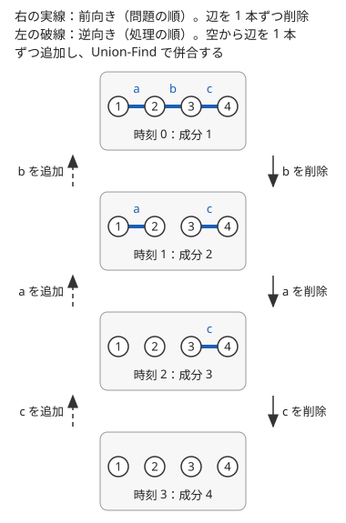

!!! abstract "要点"
    - **何ができるか**：後ろから決めると選択肢が一意になる、最後の操作が特定できれば逆再生で取り除ける、削除を逆にすると追加になる、など時間の向きを逆にして考える。前から見ると分岐や上書きで無駄が出る問題が、後ろから見ると 1 本道になる。
    - **いつ使うか**：
        - 辺・要素の削除のクエリ
        - 操作列を復元する・操作の結果から元を求める
        - 後ろから決めると選択肢が 1 つに決まる
    - **計算量**：問題による。逆順に処理するだけなら前向きと同じで、上書きの問題は各要素を 1 回だけ確定させて $O(N + Q)$ にできることが多い。
    - **前提**：なし

<!-- textlint-disable -->
別名：逆から考える・操作を逆再生・クエリを逆順に処理・削除を追加に・work backwards
<!-- textlint-enable -->

後ろから・逆順に考えるとは、列や操作を最初から順に追う代わりに、最後の要素や最後の操作から逆向きにたどる考え方である。前から見ると「この先どうなるか」が分からないので選択肢が分かれるが、後ろから見ると「もう決まっているもの」に合わせるだけで選択肢が 1 つに絞れることがある。

使える合図は 3 つある。「$i$ の倍数番目の和」のように各条件が自分以降の値だけを参照すること、「結果から操作列を求めよ」のように最後の操作の跡が結果に残ること、「辺を削除する」「区間を塗る」のように後の操作が前のものを削除・上書きすることである。操作の問題で、ほかにどの型を試すかは[詰まったときの発想リスト](../guide/thinking-checklist.md#shape-operation)の「操作できるか・最小回数」の表で引ける。

## 後ろから決めると一意になる {#decide-from-back}

決めたい値 $x_1, \dots, x_N$ があり、各条件に出てくる値の添字が「自分以上」に偏っているときは、大きい添字から決める。条件 $i$ に $x_i$ と、それより後ろの値しか出てこなければ、後ろを先に決めておくと、条件 $i$ に残る未知数は $x_i$ だけになり、その値は一意に決まる。前から決めると $x_i$ を決める時点で後ろの値が分からないので、試すしかない。

最小の例として、「各 $i$ について、$i$ の倍数番目の $b$ の和の偶奇が $a_i$ になる 0/1 の列 $b$ を作る」ことを考える。条件 $i$ に出てくるのは $b_i, b_{2i}, b_{3i}, \dots$ で、$b_i$ 以外はすべて添字が大きい。だから $i = N$ から 1 へ順に、$b_i = a_i \oplus b_{2i} \oplus b_{3i} \oplus \cdots$ と決めればよい。偶奇は XOR（$\oplus$）で計算できる。

```cpp
--8<-- "reverse-thinking/multiples-parity.cpp:core"
```

内側のループは $N / i$ 回なので、合計は $N / 1 + N / 2 + \cdots + N / N$ で $O(N \log N)$ である（[倍数の箱を後ろから決める](../math/harmonic-sum.md#decide-from-back)）。この例では、どの $i$ でも $b_i$ がちょうど 1 通りに決まる。だから答えは必ず存在し、しかも 1 つしかない。

一意に決まる理由は「依存の向き」にある。条件 $i$ が後ろの値だけを参照するなら、依存の矢印はすべて後ろから前へ向くので、後ろから決める順は依存を壊さない（この矢印の向きでの[トポロジカルソート](../graph/topological-sort.md)の順そのものである）。文字列でも同じことが起きる。単語の連結に区切る問題では、末尾から照合すると、末尾に一致する単語がいつも高々 1 つになる組合せがある（[例題 ARC065 C](#arc065_a)）。前から照合すると「dream」で切るか「dreamer」で切るかが分かれるが、後ろからは分かれない。

??? question "確認問題：前からでは決まらない理由"
    上の例で、$i = 1$ から順に決めようとすると何が困るか。

    ??? success "答え"
        条件 1 は $b_1 \oplus b_2 \oplus \cdots \oplus b_N = a_1$ で、$b_1$ を決める時点では $b_2, \dots, b_N$ がまだ決まっていない。$b_1$ を 0 と 1 のどちらにしてもよいように見え、後で矛盾したら戻ることになる。後ろから決めれば、この迷いがなくなる。

## 最後の操作を特定して逆再生する {#undo-last}

「操作を何回か行った結果がこれになった。操作列を求めよ」と問われたら、最後の操作から考える。最後の操作の跡は結果にそのまま残っているので、それを手がかりに「どの操作が最後だったか」を特定できることがある。特定できたら、その操作を取り消して 1 つ前の状態に戻し、同じことを繰り返す。取り出した操作を逆順に並べれば、操作列が復元できる。

特定するには、操作が残す「跡」と、操作の後もずっと保たれる性質を組み合わせる。例として、空の列に「位置 $j$ に値 $j$ を挿入する」操作を繰り返す場合を考える（[例題 AGC032 A](#agc032_a)）。

- **跡**：最後に挿入した値 $j$ は位置 $j$ にある。つまり、最後の操作は $b_j = j$ となる位置（[固定点](../guide/glossary.md#fixed-point)）を作る
- **保たれる性質**：挿入された値は、その後の挿入で右にずれるだけなので、どの時点でも $b_k \le k$ である
- **特定**：固定点が複数あるとき、最後の操作は最も右の固定点である。もっと左の固定点 $p$ が最後だったとすると、$p$ より右の固定点 $q$ は挿入の前には位置 $q - 1$ に値 $q$ があったことになり、$b_k \le k$ に反する

このように最後の操作が一意に決まるなら、逆再生の各段階に分岐はない。固定点が 1 つもない段階に来たら、どの操作でもこの状態は作れないので、答えは存在しない。保たれる性質の見つけ方は[不変量](../thinking/invariant.md)のページが詳しい。

上書きの操作も、後ろから見ると簡単になる。「区間や集合をある値で塗る」操作が続くとき、各要素の最終的な値は、その要素を塗った最後の操作で決まる。操作を逆順にたどれば、各要素は最初に当たった塗りで確定し、それより前の操作はその要素について無視してよい。未確定の要素の全体を塗る操作なら、確定した要素を集合から外していけば各要素は 1 回しか処理されないので、全体で $O(N + Q)$ になる（[練習 ABC477 D](#practice) の方針を参照）。区間を塗る操作では、区間の中の確定済みの要素を飛ばして次の未確定の位置を探す仕組みが要る。それを Union-Find で持てば $O((N + Q)\,\alpha(N))$、`std::set` で持てば $O((N + Q) \log N)$ になる。前向きに処理すると、同じ要素を何度も塗り直す分が無駄になる。

??? question "確認問題：固定点が 2 つあるとき"
    列 $(1, 1, 3)$ の段階で、逆再生の次の一手は何か。続けるとどうなるか。

    ??? success "答え"
        固定点は位置 1（値 1）と位置 3（値 3）で、最も右の位置 3 を取り除いて $(1, 1)$ にする。次は位置 1 だけが固定点（位置 2 は値 1）なので取り除いて $(1)$、最後に $(1)$ の位置 1 を取り除いて空になる。取り除いた位置は 3, 1, 1 なので、操作列はその逆の 1, 1, 3 である。

## 締め切りを後ろから見る {#deadlines}

「期限までに終える」「日ごとに 1 つ選ぶ」という問題では、時間を後ろの日から見ると、選べる候補が増える一方になる。前の日から見ると、ある仕事を今日やるか後に回すかで分かれるが、最後の日から見ると「この日に間に合う仕事」は日を戻すほど増えていく。増える一方の候補から毎回最良のものを取るのは、[優先度付きキュー](../ds/priority-queue.md#patterns)の得意な形である。

たとえば「報酬を受け取るまでに日数がかかる仕事を 1 日 1 件選び、期限までに受け取れる報酬の合計を最大にする」問題を考える。最後の日から 1 日ずつ戻りながら、その日に始めて間に合うようになった仕事をキューに入れ、最も報酬の大きいものを 1 件選ぶ。後ろの日ほど間に合う仕事が少ないので、後ろの日を先に埋めても損をしない。詳しい手順と正しさの理由は[後ろの日から決める](../basics/greedy-priority-queue.md#from-last-day)と、その例題の [ABC137 D](../basics/greedy-priority-queue.md#abc137_d) にある。

時間を後ろから見る考え方は、終わりの状態の値が先に分かる問題に共通する。

- **期待値 DP**：終わりの状態の期待値は 0 と決まっているので、後ろ向きに計算する（[なぜ後ろ向きか](../comb/expected-value-dp.md#why-backward)）
- **ゲーム**：終局の勝敗は決まっているので、そこから戻って必勝・必敗を決める（[必勝・必敗の定義と後ろ向きに決まる理由](../comb/game-basics.md#win-lose)）

## 削除を逆順の追加にする（Union-Find はグラフの章） {#delete-to-add}

この節は [Union-Find](../ds/union-find.md) を知っていると読みやすい。データ構造の多くは、要素を足すのは得意でも、取り除くのは苦手である。Union-Find は 2 つのグループを併合できるが、分割はできない。そこで「辺を 1 本ずつ削除し、そのつど連結成分の数を答える」問題は、クエリを先に全部読み（[オフライン](../ds/offline-queries.md#reverse-time)）、時間を逆にして「空のグラフに辺を 1 本ずつ追加する」問題に直す。



逆向きに処理するときの手順は次のとおりである。

1. 最後まで削除されない辺だけを入れた状態から始める（全部削除されるなら空のグラフ）
2. 削除の列を後ろから見て、辺を 1 本ずつ Union-Find で併合する
3. 答えは逆順に得られるので、配列に記録してから反転して出力する

前向きの「削除の直後の答え」が、逆向きでは「追加の直前の答え」になる。どちらの時点の値を記録するかで 1 つずれやすいので、時刻 0（何も削除していない状態）と最後の状態を含めて何個の答えを出すのかを先に決めておく。実装の詳細と、成分の大きさの積で組の数を数える方法は[削除を逆順の追加にする](../graph/union-find-connectivity.md#reverse-deletion)にある（[練習 ABC120 D](#practice)）。

逆順にできるのは、すべてのクエリが先に分かっているときだけである。前の答えを使って次のクエリが決まる（オンラインを強制される）問題では使えない。追加と削除が混ざる場合は[辺の追加と削除が混ざるとき](../graph/union-find-connectivity.md#mixed-updates)を見る。

## 落とし穴 {#pitfalls}

**後ろから決めても一意にならないのに、貪欲に決めてしまう**。後ろから見る方法が正しいのは、各段階で選択肢が 1 つしかない（または、どれを選んでも後に響かない）と示せたときだけである。単語の区切りの例では、4 つの単語の末尾がうまく分かれているから後ろからの照合で済む。単語の組が変わると後ろからでも分かれることがあり、そのときは[位置ごとの可否の DP](../dp/dp-sequence-partition.md) で調べる。一意になる理由を 1 文で言えるかを確かめてから書く。

**逆再生の段階で「存在しない」の判定を忘れる**。最後の操作が特定できない段階が来たら、答えは存在しない。そこで止めずに適当な操作を選ぶと、誤った操作列を出してしまう。

**答えを反転し忘れる・1 つずれる**。逆順に処理した答えは逆順に並んでいる。記録する時点（追加の前か後か）と、出力する個数を、前向きの問いと突き合わせて確かめる。小さい入力で前向きの素朴な解と比べるのが確実である。

**逆順の初期状態を間違える**。逆向きの出発点は「すべての操作を終えた後の状態」である。削除の問題なら最後まで残る辺、上書きの問題なら最後の状態での塗れる・塗れないを、先に前向きに 1 回たどって求めておく。

## 例題 {#examples}

### AGC032 A. Limited Insertion {#agc032_a}

<div class="kp-problems" data-role="example" markdown>

- [AGC032 A. Limited Insertion](https://atcoder.jp/contests/agc032/tasks/agc032_a)（diff 738）：空の列に「j 番目に j を挿入する」操作を N 回行って列 b を作れるか判定し、できるなら操作列を求める。

</div>

??? note "方針"
    操作列を復元する問題なので、[最後の操作を特定して逆再生する](#undo-last)。最後の操作は $b_j = j$ となる最も右の $j$ に決まる。

    - その位置の要素を取り除いて 1 つ前の列に戻し、同じことを繰り返す。取り除いた $j$ を逆順に並べたものが操作列である
    - 途中で $b_j = j$ となる位置が 1 つもなくなったら、作れないので $-1$ を出力する
    - 1 段で $O(N)$ の探索と削除をするので全体で $O(N^2)$ である。$N \le 100$ なので十分速い

### ABC134 D. Preparing Boxes {#abc134_d}

<div class="kp-problems" data-role="example" markdown>

- [ABC134 D. Preparing Boxes](https://atcoder.jp/contests/abc134/tasks/abc134_d)（diff 926）：i の倍数番目の箱に入れたボールの数の和の偶奇が、すべての i で指定どおりになる入れ方を求める。

</div>

??? note "方針"
    条件 $i$ に出てくる箱は $i, 2i, 3i, \dots$ で、$i$ 以外は番号が大きい。だから[後ろから決めると一意になる](#decide-from-back)。

    - $i = N$ から 1 へ順に、$2i, 3i, \dots$ の箱のボールの数の和の偶奇を数え、条件の偶奇と合うように箱 $i$ に入れるかを決める
    - どの $i$ でも必ず値が決まるので、条件を満たす入れ方は必ず存在する
    - 合計 $O(N \log N)$ で、コードは[後ろから決めると一意になる](#decide-from-back)の節のものと同じ形である

### ARC065 C. Daydream {#arc065_a}

<div class="kp-problems" data-role="example" markdown>

- [ARC065 C. Daydream](https://atcoder.jp/contests/arc065/tasks/arc065_a)（diff 930）：文字列 S が dream・dreamer・erase・eraser の連結で作れるか判定する。

</div>

??? note "方針"
    前から照合すると、「dream」と「dreamer」、「erase」と「eraser」のどちらで切るかが分かれる。たとえば「dreamer」を「dream」で切ると「er」が残って行き詰まる。

    - 後ろから照合すると、末尾に一致する単語はいつも高々 1 つである。最後の文字が m なら dream、e なら erase、r なら dreamer か eraser で、末尾の 4 文字（amer と aser）で区別できる
    - 一致する単語があれば末尾から取り除き、なければ作れないと判定する。空になれば作れる
    - 全体で $O(\lvert S \rvert)$ である

## 練習問題 {#practice}

<div class="kp-problems" data-role="practice" markdown>

- [ABC477 D. Masking Tape](https://atcoder.jp/contests/abc477/tasks/abc477_d)（diff 946）：マスにマスキングテープを貼る（貼ってあればはがす）操作と、テープのないすべてのマスを指定の文字で塗る操作を順に行った後の、各マスの文字を求める。
- [ABC120 D. Decayed Bridges](https://atcoder.jp/contests/abc120/tasks/abc120_d)（diff 1355）：橋が 1 本ずつ崩落していくとき、各時点で行き来できなくなった島の組の数を求める。

</div>

??? note "練習の方針"
    - **ABC477 D**：各マスの文字は、テープのない状態で最後に塗った操作で決まる。先に前向きにテープの操作だけをたどって最後の状態を求め、クエリを逆順に処理する。テープの操作は未確定のマスの「塗れる」集合への出し入れを戻し、塗る操作は集合のマスをすべて確定させて集合を空にする。各マスは 1 回だけ確定するので $O(N + Q)$ である
    - **ABC120 D**：すべての橋が崩落した状態（不便さは $N(N - 1) / 2$）から、橋を逆順に架けていく。2 つの島が別の成分なら、併合で成分の大きさの積だけ不便さが減る。崩落の直後の答えは、逆向きでは架ける直前の値なので、記録してから反転する。積は `long long` で計算する

## 力試し {#challenge}

<div class="kp-problems" data-role="challenge" markdown>

- [ABC466 F. Many Mod Calculation](https://atcoder.jp/contests/abc466/tasks/abc466_f)（diff 1887）：数列 A の先頭から順に余りを取っていくと 0 になる、1 以上 X 以下の整数の個数を求める。

</div>

??? note "力試しの方針"
    - **ABC466 F**：最後に 0 になる値の集合を、最後の剰余から 1 つずつ逆にたどって組み立てる。$A_i$ で余りを取る前の値の集合は、取った後の集合を $A_i$ ずつずらして並べたものになる。これは、長さ $X + 1$ の棒を左から $A_1, A_2, \dots$ の順に切っていく問題と見直せる。逆向きに組み立てた集合では、0 になる値が各棒の左端に 1 つずつあるので、集合の代わりに棒を数えればよい。棒を前から切る見方に直すと、同じ長さの棒をまとめて扱える。最後に残った棒の本数から、$x = 0$ の分の 1 を引いた値が答えである。同じ長さの棒は以後の扱いが同じなので、長さごとに本数をまとめて持つ。端数の棒は切られるたびに長さが半分以下になるので、切られる回数は $O(\log X)$ 回で済む

## 参考 {#references}

- [drken「AtCoder AGC 032 A - Limited Insertion (茶色, 400 点)」](https://drken1215.hatenablog.com/entry/2019/03/24/091900)：例題の方針（最後の操作が最も右の固定点に決まる理由と、保たれる性質 b_k ≤ k）
- [drken「AtCoder ABC 134 D - Preparing Boxes (1Q, 緑色, 400 点)」](https://drken1215.hatenablog.com/entry/2020/12/25/175400)：例題の方針（大きい i から決めると一意になること、調和級数の計算量）
- [drken「AtCoder ABC 049 C - 白昼夢 (ARC 065 C) (2Q, 緑色, 300 点)」](https://drken1215.hatenablog.com/entry/2021/07/28/003500)：例題の方針（4 つの単語の照合が同時に起きないこと）
- [comet725「ABC477Dを解いた【クエリ逆順処理】」](https://qiita.com/comet725/items/a3fca15e86349dadf4b2)：練習の方針（クエリを逆順に処理して各マスを 1 回だけ確定させる）
- [ikatakos「UNICORNプログラミングコンテスト2026(AtCoder Beginner Contest 477)D,E,F,G問題メモ」](https://ikatakos.com/pot/programming_algorithm/contest_history/atcoder/2026/0926_abc477)：練習の方針（逆順の処理と O(N + Q) の計算量。解説の部分だけを参照）
- [drken「AtCoder ABC 120 D - Decayed Bridges (1Q, 水色, 400 点)」](https://drken1215.hatenablog.com/entry/2019/03/03/224600)：練習の方針（削除を逆順の追加にして Union-Find で併合する）
- [ikatakos「AtCoder Beginner Contest 466 E,F問題メモ」](https://ikatakos.com/pot/programming_algorithm/contest_history/atcoder/2026/0711_abc466)：力試しの方針（0 になる値の集合を後ろから組み立て、棒の切断に見直して同じ長さをまとめる。解説の部分だけを参照）
