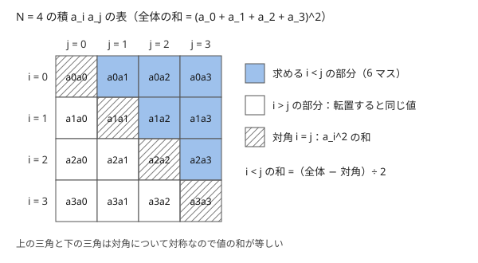
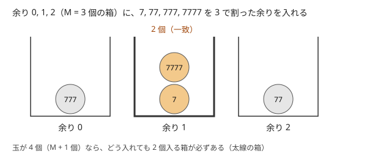

!!! abstract "要点"
    - **何ができるか**：対称性で計算や場合を半分に減らし、鳩の巣原理で「必ず一致が起きる」ことから探索の回数の上限を得る。端の場合（$N = 1$ など）や大小関係で場合を分けて、それぞれを単純な問題にする。
    - **いつ使うか**：
        - $i < j$ の組の和など、$i$ と $j$ を入れ替えても同じ形の式
        - 自分以外の全員の XOR（和）が与えられる
        - 余りや状態が $M$ 種類しかなく、$M + 1$ 個以上の候補がある
        - $N = 1$ や $N$ が小さいときだけ答えの形が違う
    - **計算量**：$i < j$ の組の和は、全体の和の 2 乗から対角を引いて半分にすれば $O(N)$。鳩の巣原理では、種類が $M$ 個なら候補を $M + 1$ 個まで調べれば必ず一致が見つかる。
    - **前提**：なし

<!-- textlint-disable -->
別名：対称性・鳩の巣原理・部屋割り論法・場合分け・pigeonhole principle・端の場合を分ける
<!-- textlint-enable -->

対称性・鳩の巣原理・場合分けは、どれも問題を解く手法ではなく、手法を使える形に問題を整える小さな考え方である。対称性は「入れ替えても同じ」ことを使って計算や場合の数を減らす。鳩の巣原理は「種類が少ないので必ず一致が起きる」ことから、全探索の回数に上限を付ける。場合分けは、1 つの式で書けない端の場合を切り離して、残りを単純にする。

## 対称性で計算を半分にする（添字の小さい順の組の和・全体の XOR から 1 つ除く） {#symmetry}

$i < j$ の組すべてについて $A_i A_j$ を足す計算は、そのまま書くと $O(N^2)$ である。$N = 2 \times 10^5$ では間に合わない。ここで $A_i A_j = A_j A_i$ という対称性を使う。

$N \times N$ の表に $A_i A_j$ を書くと、表全体の和は $(A_1 + \dots + A_N)^2$ になる。表は対角について対称なので、対角より上（$i < j$）と下（$i > j$）の和は等しい。だから

$$
\sum_{i < j} A_i A_j = \frac{1}{2} \left( \Bigl( \sum_i A_i \Bigr)^2 - \sum_i A_i^2 \right)
$$

である。和 $S_1 = \sum_i A_i$ と 2 乗の和 $S_2 = \sum_i A_i^2$ を 1 回ずつ求めればよいので $O(N)$ になる。



答えを剰余で求めるときは、2 で割る代わりに 2 の[逆元](../math/mod-inverse.md)を掛ける。割り算を避けたいなら、$j$ を右へ動かしながら「$j$ より左の $A_i$ の和」を持ち、$A_j$ に掛けて足す書き方でもよい。どちらも次のコードにある。

```cpp
--8<-- "symmetry-pigeonhole-casework/pair-sum.cpp:core"
```

同じ形は XOR でも現れる。$N$ 人のそれぞれについて「自分以外の全員の XOR」$B_i$ が与えられたとする。$B_1 \oplus \dots \oplus B_N$ では各人の値が $N - 1$ 回ずつ現れる。$N$ が偶数なら $N - 1$ は奇数なので、これは全員の値の XOR $T$ に等しい。各人の値は $T \oplus B_i$ で求まる（同じ値の XOR は打ち消し合う。[XOR の性質](../basics/bit-operations.md#xor-properties)）。$N$ が奇数なら各人の値は偶数回ずつ現れるので、$B$ の XOR は $0$ になり、この方法では $T$ が求まらない。和の場合も同じで、自分以外の和の総和は全員の和の $N - 1$ 倍になる。

対称性は「全体を数えてから、重複した分で割る・引く」とまとめられる。$i < j$ の組を数えるときは $i \ne j$ の順序付きの組を数えて 2 で割り、円順列は回転で同じになる $N$ 通りで割る。確率の問題で「入れ替えて移り合う事象は同じ確率」とみる考え方は[確率の対称性](../comb/probability-symmetry.md#symmetry)にある。

??? question "確認問題：3 つ組の和"
    $i < j < k$ の組すべてについて $A_i A_j A_k$ を足したい。$S_1 = \sum A_i$、$S_2 = \sum A_i^2$、$S_3 = \sum A_i^3$ で表せるか。

    ??? success "答え"
        表せる。$S_1^3$ を展開すると、3 つの添字がすべて違う項は $3! = 6$ 通りの順に 1 回ずつ現れる。添字が 2 つ同じ項（$A_i^2 A_j$、$i \ne j$）の和は $S_1 S_2 - S_3$ で、$S_1^3$ の中に 3 回ずつ現れる。すべて同じ項は $S_3$ である。よって $\sum_{i<j<k} A_i A_j A_k = (S_1^3 - 3 S_1 S_2 + 2 S_3) / 6$。式に自信がなければ、小さい $N$ の全探索と比べて確かめる。

## 対称性で場合を減らす（N ≤ M に入れ替える） {#symmetry-cases}

縦と横、正と負、2 人の役割などを入れ替えても答えが変わらない問題では、入力を 1 つの形にそろえてから考える。そろえた後だけを考えればよいので、場合分けの数が半分以下になる。

- **縦と横**：$N \times M$ のグリッドで縦横を入れ替えても答えが同じなら、$N > M$ のとき $N$ と $M$ を入れ替えて、常に $N \le M$ として考える
- **正と負**：原点から $(X, Y)$ へ動く問題で、移動が上下・左右について対称なら、$X$ と $Y$ を絶対値に直して第 1 象限だけを考える
- **$x$ と $y$**：さらに直線 $y = x$ について対称なら、$X \le Y$ になるように入れ替える

入れ替えるときは、その軸に結びついた量をすべて一緒に入れ替える。横の移動のコストと縦の移動のコストが違う問題で $X$ と $Y$ だけを入れ替えると、答えが変わる。$X$ と $Y$ を入れ替えるなら、横のコストと縦のコストも入れ替える。

対称に見えて対称でない問題もある。始点が中央にない、手番が先手から始まる、端だけ条件が違う、などである。そろえる前に「入れ替えた入力でも、問題文の条件がすべて同じ形で成り立つか」を確かめる。迷ったら、小さい入力で入れ替える前と後の答えが一致するかを全探索で比べる（[ストレステストと実験](../guide/stress-testing.md#experiment)）。ゲームで相手の手を真似る戦略は、盤面の対称性を使う別の型である（[真似戦略](../comb/game-basics.md#mirror-strategy)）。

## 鳩の巣原理（必ず一致が起きる・探索の打ち切り回数） {#pigeonhole}

鳩の巣原理は、「$M$ 個の箱に $M + 1$ 個以上の玉を入れると、玉が 2 個以上入る箱が必ずある」という主張である。どの箱にも 1 個以下しか入らないとすると、玉は全部で $M$ 個以下になって矛盾する。競技プログラミングでは、箱を「余り」や「状態」にして使う。



使い方は次の 3 つの型に分かれる。

- **一致するものが必ずある → 少数だけ全探索する**：「和の余りが等しい 2 つの組を見つけよ」で、余りが $M$ 種類なら、候補を $M + 1$ 個作った時点で必ず一致する。全部の候補（$2^N$ 個など）を調べる必要はなく、先頭のいくつかの要素から作れる $M + 1$ 個だけを調べればよい
- **同じ状態に戻るまでの回数に上限がある**：次の値が今の値だけで決まる列で、値が $M$ 種類しかなければ、$M + 1$ 項目までに同じ値が 2 回現れ、そこから先は繰り返しになる。だから「いつか条件を満たすか」は $M$ 回程度まで調べれば決まる。繰り返しの長さを求めて先の値を計算するのは[周期性の検出](../basics/periodicity.md#rho)である
- **範囲が広ければ答えが決まる**：閉区間 $[L, R]$ が連続する $M$ 個以上の整数を含む（$R - L + 1 \ge M$）なら、余りが $0$ になる数を必ず含む。連続する $M$ 個の整数は、$M$ で割った余りが $0$ から $M - 1$ まで一巡するからである。だから幅が広い場合は答えを即座に決め、狭い場合だけ全探索する、という場合分けになる

累積和と組み合わせた有名な例がある。長さ $N$ の整数列には、和が $N$ の倍数になる空でない連続部分列が必ずある。累積和 $S_0 = 0, S_1, \dots, S_N$ は $N + 1$ 個あり、$N$ で割った余りは $N$ 種類しかないので、余りの等しい $S_l$ と $S_r$（$l < r$）がある。すると $S_r - S_l$、すなわち半開区間 $[l, r)$ の和は $N$ の倍数である。

次のコードは「和の余りが等しい異なる 2 つの部分集合」を探す。部分集合を $M + 1$ 個作れるだけの要素（$2^k - 1 \ge M + 1$ となる $k$ 個）だけを [bit 全探索](../basics/bit-full-search.md#bitmask)し、余りごとに最初に現れた部分集合を覚えておき、同じ余りの 2 つ目で止める。要素が少なくて $2^N - 1 < M + 1$ のときだけは、すべて調べても一致しないことがある。

```cpp
--8<-- "symmetry-pigeonhole-casework/pigeonhole-subsets.cpp:core"
```

鳩の巣原理は「ある」ことを保証するだけで、どれが一致するかは教えてくれない。見つける部分は全探索や記録の配列に任せる。余りについての証明の型は[整数の証明の型](../math/proof-patterns.md#pigeonhole-remainder)にある。グラフで探索を打ち切る応用（長さ 4 の閉路の検出、黄の帯）は[次数で分ける](../graph/degree-sqrt.md#four-cycles)にある。

??? question "確認問題：何個調べればよいか"
    整数列から、和を $1000$ で割った余りが等しい異なる 2 つの部分集合を見つけたい。要素が十分あるとき、先頭の何個の要素の部分集合を調べれば必ず見つかるか。

    ??? success "答え"
        $10$ 個である。空でない部分集合は $2^k - 1$ 個あり、余りは $1000$ 種類なので、$2^k - 1 \ge 1001$ が要る。$2^9 - 1 = 511$ では足りず、$2^{10} - 1 = 1023$ で足りる。空集合も候補に入れてよい問題なら $2^k \ge 1001$ で、やはり $k = 10$ である。

## 場合分け（端の場合・大小関係・操作の順序によらないこと） {#casework}

1 つの式で全部を書こうとすると、端の場合で式が崩れやすい。場合分けは、崩れる場合を先に切り離して、残りを単純な式にする考え方である。

- **端の場合**：$N = 1$、$N = 2$、全部が同じ値、$K = 0$ などは、一般の式の前提（「両隣がある」「2 つ以上ある」）が成り立たない。一般の場合の式を立てたら、その式が $N = 1$ でも正しいかを必ず手で確かめる
- **大小関係**：$A \le B$ と $A > B$、$X$ が中央の左と右、負の数を含む場合と含まない場合で答えの形が変わる問題は、それぞれで式を作る。入れ替えで片方に寄せられるなら[対称性で場合を減らす](#symmetry-cases)
- **操作の順序によらないこと**：反転・加算・XOR のように、操作どうしの順序を入れ替えても結果が変わらない操作は、各場所にかかった操作の合計だけで結果が決まる。反転なら回数（の偶奇）、加算なら足した量の和、XOR なら XOR した値の XOR である。操作を時間順にシミュレーションせず、場所ごとに合計を求めればよい

場合分けをするときは、すべての入力がどれか 1 つの場合にだけ入るかを確かめる。$N = 1$ と $M = 1$ を別々に書いて、$N = M = 1$ が両方に入る（または、どちらにも入らない）のはよくある誤りである。条件を「$N = 1$ かつ $M = 1$」「片方だけ 1」「両方 2 以上」のように、互いに重ならない形で並べる。

場合ごとの答えは、小さい入力の全探索と比べて確かめるのが確実である。とくに端の場合は、自分で考えた式よりも全探索の方が信頼できる（[ストレステストと実験](../guide/stress-testing.md#experiment)）。

## 落とし穴 {#pitfalls}

**2 で割る前に剰余を取る**。$(S_1^2 - S_2) / 2$ を剰余で計算するとき、`(s1 * s1 - s2) % MOD / 2` と書くと誤る。剰余を取った後の値は偶数とは限らないからである。2 の逆元を掛けるか、割り算を使わない書き方にする。引き算の結果が負になるときの `+ MOD` も忘れやすい。

**2 乗のオーバーフロー**。$A_i \le 10^9$、$N = 2 \times 10^5$ なら $S_1$ は $2 \times 10^{14}$ になり、$S_1^2$ は `long long` の上限（約 $9.2 \times 10^{18}$）を超える。剰余を取らない問題では、この例だと答え自体も約 $2 \times 10^{28}$ で `long long` に収まらないので、`__int128` などの大きい型が要る（[整数のオーバーフロー](../cpp/cpp-integer-overflow.md)）。累積和で 1 つずつ足す書き方は $S_1^2$ という途中の値を避けるだけで、答えが `long long` に収まる場合にしか効かない。

**鳩の巣原理で要素が足りない場合**。「$M + 1$ 個調べれば見つかる」は、候補を $M + 1$ 個作れるときに限る。要素が少なくて候補が $M$ 個以下なら、一致がないことがある。その場合は「なし」を出す処理を書く。

**入れ替えたまま出力する**。対称性で $N$ と $M$、$X$ と $Y$ を入れ替えて解いた場合、出力が座標や向きを含むなら元の向きに戻す。値だけを答える問題では気にしなくてよい。

## 例題 {#examples}

### ABC177 C. Sum of product of pairs {#abc177_c}

<div class="kp-problems" data-role="example" markdown>

- [ABC177 C. Sum of product of pairs](https://atcoder.jp/contests/abc177/tasks/abc177_c)（diff 386）：N 個の整数から 2 つを選ぶすべての組（i < j）について、積 A_i A_j の総和を求める。

</div>

??? note "方針"
    $i < j$ の組の和は、$i$ と $j$ を入れ替えても同じ形なので、全体の和の 2 乗から対角を引いて半分にする。$O(N^2)$ の 2 重ループを $O(N)$ にできる。

    - $S_1 = \sum A_i$ と $S_2 = \sum A_i^2$ を求め、$(S_1^2 - S_2) / 2$ を答える
    - 剰余を取って計算するので、2 で割る代わりに 2 の逆元を掛ける。または、左からの累積和を $A_j$ に掛けて足す
    - コードは[対称性で計算を半分にする](#symmetry)の節のものと同じ形である

### ARC091 C. Flip,Flip, and Flip...... {#arc091_a}

<div class="kp-problems" data-role="example" markdown>

- [ARC091 C. Flip,Flip, and Flip......](https://atcoder.jp/contests/arc091/tasks/arc091_a)（diff 514）：N×M 枚のカードのそれぞれについて周り 9 枚を反転する操作をした後、裏向きのカードの枚数を求める。

</div>

??? note "方針"
    反転は順序によらないので、各カードが何回反転されるかだけを数え、奇数回なら裏向きになる。$N$ と $M$ が大きいのでシミュレーションはできず、端の場合で場合分けする。

    - 対称性で $N \le M$ にそろえる
    - カード $(i, j)$ が反転される回数は、周り 3×3 の中で盤面に入るマスの数（縦に入る数 × 横に入る数）である
    - $N = M = 1$：1 枚が 1 回反転されるので答えは 1
    - $N = 1$、$M \ge 2$：両端は 2 回、内側は 3 回反転されるので、答えは $M - 2$
    - $N, M \ge 2$：角は 4 回、角以外の縁は 6 回、内側は 9 回なので、答えは $(N - 2)(M - 2)$
    - 値が大きいので `long long` で掛ける

### ABC200 D. Happy Birthday! 2 {#abc200_d}

<div class="kp-problems" data-role="example" markdown>

- [ABC200 D. Happy Birthday! 2](https://atcoder.jp/contests/abc200/tasks/abc200_d)（diff 1217）：数列から、和を 200 で割った余りが等しい 2 つの異なる部分列を見つける（なければ No）。

</div>

??? note "方針"
    余りは 200 種類しかないので、部分列を 201 個作れば必ず一致する（鳩の巣原理）。すべての部分列を調べる必要はない。

    - 先頭の $\min(N, 8)$ 個の要素だけを bit 全探索する。$2^8 - 1 = 255 \ge 201$ なので、要素が 8 個以上あれば必ず見つかる
    - 余りごとに最初に現れた部分列を覚え、同じ余りが 2 回目に現れたら、その 2 つを出力する
    - $N < 8$ ですべて調べても一致しなければ No を出す
    - コードは[鳩の巣原理](#pigeonhole)の節のものと同じ形で、mask から添字の列（1-indexed）に直して出力する

## 練習問題 {#practice}

<div class="kp-problems" data-role="practice" markdown>

- [ABC174 C. Repsept](https://atcoder.jp/contests/abc174/tasks/abc174_c)（diff 902）：7, 77, 777, … のうち最初に K の倍数になる項が何番目かを求める（なければ −1）。
- [ABC471 E. Sum of Square of Sum](https://atcoder.jp/contests/abc471/tasks/abc471_e)（diff 990）：N 個の整数から K 個を選ぶすべての選び方について、選んだ数の和の 2 乗を足し合わせた値を 998244353 で割った余りを求める。
- [ABC462 E. Alternating Costs](https://atcoder.jp/contests/abc462/tasks/abc462_e)（diff 1226）：原点から上下左右に 1 マスずつ動き、奇数回目の移動は横が A・縦が B、偶数回目は横が B・縦が A のコストがかかるとき、(X, Y) へ行く最小のコストを求める。

</div>

??? note "練習の方針"
    - **ABC174 C**：項を直接作らず、余りだけを $r \leftarrow (10r + 7) \bmod K$ で更新する。余りは $K$ 種類なので、$K$ 回以内に $0$ にならなければ同じ余りに戻って繰り返すだけで、答えは −1 である
    - **ABC471 E**：和の 2 乗を展開し、$A_i^2$ の項と $i \ne j$ の $A_i A_j$ の項に分ける。それぞれの項を含む選び方が何通りあるかを二項係数で数える。$i \ne j$ の項の和は $S_1^2 - S_2$ で求まる。二項係数は[二項係数](../comb/binomial-coefficient.md)、和の変形は[Σ の式変形](../math/sigma-manipulation.md)を見る
    - **ABC462 E**：$X$ と $Y$ を絶対値に直し、$A > B$ なら $A$ と $B$、$X$ と $Y$ を一緒に入れ替えて、$A \le B$ の第 1 象限だけを考える。そろえた後で、斜めに進む部分と残りの部分に分け、移動の回数の偶奇に注意して候補を比べる

## 参考 {#references}

- [E869120「アルゴリズム・AtCoder のための数学【後編：数学的考察編】」](https://qiita.com/e869120/items/1ccb2bdf16890637e767)：対称性で全体を数えてから半分にする考え方と、ABC177 C の式
- [hamayan「Flip,Flip, and Flip...... [AtCoder Regular Contest 091 C]」](https://blog.hamayanhamayan.com/entry/2018/03/12/091553)：例題の場合分け（N ≤ M にそろえる・端の場合）
- [oraclesqlpuzzle「ABC200-D Happy Birthday! 2」](https://oraclesqlpuzzle.ninja-web.net/kyoupro/05-atcoder-02-abc/kyoupro-abc200-d.html)：例題の問いと出力の形
- [m193h「AtCoder 京セラプログラミングコンテスト2021 ABC200 個人的メモ」](https://zenn.dev/m193h/articles/20210508sat225714m193habc200)：例題で 201 個調べれば一致が見つかること
- [oraclesqlpuzzle「ABC174-C Repsept」](https://oraclesqlpuzzle.ninja-web.net/kyoupro/05-atcoder-02-abc/kyoupro-abc174-c.html)：練習の方針（余りだけを持ち、繰り返しで打ち切る）
- [hyouri「ABC471のPython解答（A～E）」](https://qiita.com/hyouri/items/941cbb14aaf4c810fa90)：練習の方針（和の 2 乗の展開と二項係数）
- [bit_otter「Shrike-LiteでAtCoder問題を解く(35)：Interlude - ABC471の各問題をFPGA目線で見てみる」](https://qiita.com/bit_otter/items/b032b01dcf3ab95a042e)：練習の問いと、i ≠ j の和を S1² − S2 で表すこと
- [comet725「ABC462Eを解いた【対称性を用いた最小化】」](https://qiita.com/comet725/items/2edf7be7b7b4cd846d29)：練習の方針（符号と大小をそろえてから式を立てる）
- [ikatakos「CodeQUEEN 2026 予選 (AtCoder Beginner Contest 462)E,F,G問題メモ」](https://ikatakos.com/pot/programming_algorithm/contest_history/atcoder/2026/0613_abc462)：練習の問いと、絶対値と入れ替えで場合を減らすこと（解説の部分だけを参照）
- [drken「AtCoder ABC 171 E - Red Scarf (2Q, 茶色, 500 点)」](https://drken1215.hatenablog.com/entry/2020/06/22/122500)：自分以外の全員の XOR から各人の値を求める型
