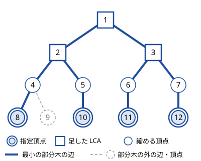
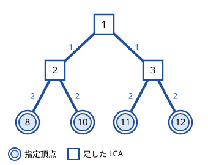

!!! abstract "要点"
    - **何ができるか**：色ごと・クエリごとに少数の頂点だけが関わる木の問題で、指定頂点と DFS 順で隣り合う 2 点の LCA だけからなる圧縮木を作って木 DP をする。関わる頂点数の合計が $O(N)$ なら全体で $O(N \log N)$ になる。
    - **いつ使うか**：
        - 色ごと・クエリごとに少数の頂点だけが関わり、その頂点数の合計が $N$ 程度
        - クエリごとに指定された頂点をすべてつなぐのに必要な辺の数を答える
        - クエリごとに $K_i$ 個の頂点が指定され、$\sum K_i \le 2 \times 10^5$
    - **計算量**：LCA の前計算 $O(N \log N)$。$K$ 頂点からの構築はソートと LCA で $O(K \log N)$ で、圧縮木の頂点数は $2K - 1$ 以下。指定頂点の数の合計を $\sum K$ とすると、全体は $O(N \log N + \sum K \log N)$
    - **前提**：[最小共通祖先（LCA）](../tree/lca.md)、[オイラーツアー](../tree/euler-tour.md)、[指定頂点を結ぶ最小の部分木](../tree/steiner-subtree.md)、[木 DP](../dp/tree-dp.md)

<!-- textlint-disable -->
別名：Virtual Tree・虚樹・圧縮木・LCA 木・指定頂点の圧縮木
<!-- textlint-enable -->

Auxiliary Tree は、木の頂点の部分集合 $X$ に対して作る小さな根付き木である。$X$ の頂点と $X$ の 2 点の LCA だけを残し、祖先と子孫の関係を保ったまま間の頂点を縮める。頂点数が $2 \lvert X \rvert - 1$ 以下なので、クエリごとに $N$ 頂点の木を全部たどる代わりに、この小さな木の上で木 DP をすればよい。名前は日本の競技プログラミングでの呼び方である。一般の語「補助的な木」と紛らわしいので、資料によっては「指定された頂点たちの LCA 関係を保って圧縮した木」と呼ぶ。

## 指定頂点を結ぶ部分木の大きさ（DFS 順で隣り合う 2 点の距離の和の半分） {#steiner-queries}

圧縮木を作らなくても答えが出る入口の問いが、「指定された $K$ 個の頂点をすべて含む最小の部分木の辺の数」をクエリごとに答えるものである。1 回なら [指定頂点を結ぶ最小の部分木](../tree/steiner-subtree.md) の $O(N)$ の方法で足りるが、クエリが $Q$ 個あると $O(NQ)$ になる。

指定頂点を DFS の行きがけ順に $x_0, x_1, \dots, x_{K-1}$ と並べると、答えは

$$
\frac{1}{2} \sum_{i=0}^{K-1} d(x_i, x_{(i+1) \bmod K})
$$

である（最後の点から最初の点への距離も足す）。DFS の順に指定頂点を 1 周すると最小の部分木を外側からなぞることになり、各辺をちょうど 2 回（下りと上り）通るからである。最小の部分木の辺 $(p, v)$ について、$v$ の部分木に入る指定頂点は行きがけ順で連続した区間になる。区間の外にも指定頂点があるので、1 周の巡回はこの区間に入るときと出るときの 2 回だけ辺 $(p, v)$ を通る。距離は [LCA](../tree/lca.md#distance) の $d(u, v) = \mathrm{dep}[u] + \mathrm{dep}[v] - 2\,\mathrm{dep}[\mathrm{lca}(u, v)]$ で求め、行きがけ順は[オイラーツアー](../tree/euler-tour.md#in-out)の $\mathrm{in}[v]$ でソートする。クエリ 1 回は $O(K \log N)$ になる。



この木で指定頂点 8・10・11・12 は行きがけ順にこの順で並ぶ。隣り合う 2 点の距離は $d(8, 10) = 4$、$d(10, 11) = 6$、$d(11, 12) = 4$、$d(12, 8) = 6$ で、和の 20 の半分の 10 が太線の本数と一致する。

## DFS 順に並べて隣り合う 2 点の LCA を足す {#build}

最小の部分木の上で DP をしたいとき、通過点（4・5・6・7 のように、枝分かれせず指定されてもいない頂点）は情報を持たないので縮めてよい。残すべきなのは、指定頂点と枝分かれの点、すなわち指定頂点の 2 点の LCA である。全部の組の LCA を求めると $O(K^2)$ だが、**行きがけ順で隣り合う 2 点の LCA だけで全部の組の LCA がそろう**。

1. 指定頂点を $\mathrm{in}[v]$ の順にソートする。
2. 隣り合う 2 点 $x_i, x_{i+1}$ の LCA を $K - 1$ 個求めて足す。
3. もう一度 $\mathrm{in}[v]$ の順にソートし、重複を除く。この頂点の集合が圧縮木の頂点で、$K + (K - 1) = 2K - 1$ 個以下である。
4. 各頂点の親を、集合の中で最も深い真の祖先にする（[スタックで組み立てる](#stack-build)）。



指定頂点 8・10・11・12 の例では LCA として 1・2・3 が足され、頂点数は $2 \cdot 4 - 1 = 7$ になる。圧縮木の辺 $(p, v)$ は元の木の $\mathrm{dep}[v] - \mathrm{dep}[p]$ 本の辺を縮めたもので、この値を辺の長さとして持てば、距離や辺の本数を圧縮木の上で数えられる。例の長さの和は 10 で、最小の部分木の辺の数と一致する。

??? note "隣り合う 2 点の LCA で足りる理由"
    行きがけ順で $x < y < z$ と並ぶ 3 頂点について、$\mathrm{lca}(x, z)$ は $\mathrm{lca}(x, y)$ と $\mathrm{lca}(y, z)$ のうち浅い方に等しい。$a = \mathrm{lca}(x, z)$ の部分木は行きがけ順の区間 $[\mathrm{in}[a], \mathrm{out}[a])$ になる。この区間は $x$ と $z$ を含むので、間の $y$ も含む。$x = a$ なら $y$ も $a$ の部分木にあるので $\mathrm{lca}(x, y) = a$ である。そうでなければ $x$ と $z$ は $a$ の異なる子の部分木にあり、$y$ はそのどちらかと同じ子の部分木にあるか、どちらとも違う子の部分木にある（$\mathrm{in}[a] \le \mathrm{in}[x] < \mathrm{in}[y]$ なので $y = a$ にはならない）。どの場合も、$y$ と組んだ 2 つの LCA の一方が $a$ になり、もう一方は $a$ 以下（$a$ かその子孫）になる。

    これを繰り返すと、$i < j$ の $\mathrm{lca}(x_i, x_j)$ は、間の隣り合う組の LCA $\mathrm{lca}(x_i, x_{i+1}), \dots, \mathrm{lca}(x_{j-1}, x_j)$ のうち最も浅いものになる。よって全部の組の LCA は、隣り合う組の $K - 1$ 個の LCA の中にある。

## スタックで組み立てる {#stack-build}

頂点の集合を行きがけ順に並べたら、親はスタックで決まる。スタックには「今見ている頂点の祖先の鎖（根から順）」を保つ。次の頂点 $v$ を見るとき、先頭が $v$ の祖先でない間は取り除き、残った先頭が $v$ の親である。$u$ が $v$ の祖先かどうかは、部分木が行きがけ順の区間になることから $\mathrm{in}[u] \le \mathrm{in}[v] < \mathrm{out}[u]$ で判定できる。行きがけ順に見ているので $\mathrm{in}[u] \le \mathrm{in}[v]$ はいつも成り立ち、$\mathrm{out}[u] \le \mathrm{in}[v]$ なら祖先でない。

```text
vs を in の順にソートし、隣り合う 2 点の LCA を足して、もう一度ソートして重複を除く
stack ← 空
for v in vs:
    while stack が空でない かつ out[stack の先頭] ≤ in[v]:
        stack から取り除く          // v はもう先頭の部分木の外
    if stack が空でない: parent[v] ← stack の先頭
    stack に v を積む
```

最初の頂点は全体の LCA で、圧縮木の根になる。各頂点はスタックに 1 回積まれて高々 1 回取り除かれるので、組み立ては頂点数に比例し、全体の時間はソートと LCA の $O(K \log N)$ で決まる。ダブリングの LCA を使ったコード片は次のとおりである（完全なプログラムは `snippets/auxiliary-tree/build.cpp`。図の例で頂点数 7・辺の数 10 を出し、DFS 順の距離の公式と一致することも確かめている）。

```cpp
--8<-- "auxiliary-tree/build.cpp:core"
```

LCA を[オイラーツアーと Sparse Table](../ds/sparse-table.md) で 1 回 $O(1)$ にすれば、構築はソートの $O(K \log K)$ になる。ソートを 1 回で済ませ、隣り合う 2 点の LCA を求めながら深さで取り除く書き方もある（参考の smijake3 氏の記事に両方がある）。

## 圧縮木で木 DP をするときの要点と学ぶための資料 {#usage}

ACL には Auxiliary Tree がなく、Library Checker にも専用の問題はない。構築の中で使う LCA は Library Checker の [Lowest Common Ancestor](https://judge.yosupo.jp/problem/lca) で検証できる。自作するときの要点は次のとおりである。

- **縮めた辺の長さを持つ**：圧縮木の辺 $(p, v)$ の長さ $\mathrm{dep}[v] - \mathrm{dep}[p]$（重み付きなら根からの累積の差）を使う。縮めた辺の上の頂点はどれも、部分木に含む指定頂点が $v$ の部分木のものと同じなので（別の枝に指定頂点があればその頂点は LCA として残る）、まとめて数えてよい。
- **足した LCA と指定頂点を区別する**：LCA として足した頂点は指定頂点ではない。指定頂点かどうかの印を別に持ち、DP の場合分けに使う。
- **配列を毎回 $O(N)$ で初期化しない**：DP の値や印を長さ $N$ の配列に持つなら、使った頂点だけを使い終えたときに戻す。毎回全体を初期化すると、クエリや色ごとに $O(N)$ かかって圧縮した意味がなくなる。
- **重複を除く**：隣り合う 2 点の LCA は同じ頂点になりやすく、指定頂点そのものになることもある。2 回目のソートの後で重複を除かないと、同じ頂点が 2 回現れて親子関係が壊れる。
- **根を固定する**：行きがけ順・深さ・LCA は、元の木を 1 つの根（頂点 0 など）で根付けたものを全クエリで共有する。圧縮木の根は集合全体の LCA で、クエリごとに変わる。

学ぶための資料は次の 3 つがよい。

- Kyopro Encyclopedia of Algorithms の項目：定義（2 点の LCA 全体を頂点とする木）、頂点数が $2 \lvert X \rvert - 1$ 以下であること、線形時間の構築まで含む計算量の整理、呼び名の注意。
- smijake3 氏のブログの記事：行きがけ順にソートして LCA を足す手順と、ソート 1 回・2 回の 2 通りのスタックの組み立てを、図と実装で説明している。
- ngtkana 氏のブログの記事：LCA を使わず、[マージテク](../tree/small-to-large.md)で色ごとの圧縮木をまとめて作る方法。

## マージテク・平方分割で代用できる場合 {#alternatives}

色ごとの量を数える問題では、Auxiliary Tree を使わずに解けることが多い。

- **マージテク**：部分木ごとに「色 → その色の情報」の連想配列を持ち、小さい方を大きい方へ併合する（[部分木ごとの集合の併合](../tree/small-to-large.md#subtree-merge)、[木 DP のマージテク](../dp/tree-dp.md#tree-dp-merge)）。全体 $O(N \log^2 N)$ 程度で、根からの深さなどを持てば色ごとの距離の和も数えられる。[例題の ABC340 G](#abc340_g) も同じ DP をこの形で書ける。
- **平方分割**：頂点数が $\sqrt{N}$ 程度より多い色は少ないので、多い色は木全体を $O(N)$ でたどり、少ない色は頂点の組を総当たりにする（[根号で場合分け](../ds/sqrt-decomposition.md#heavy-light)）。
- **重心分解**：同じ色の組の距離の和のように「組」を数えるなら、[重心を通る組を数える](../tree/centroid-decomposition.md#count-through)方法も使える。

Auxiliary Tree が向くのは、指定頂点がクエリごとに与えられてマージテクの形にならないときと、色ごとの DP が「枝分かれの点」での場合分けを要するときである。

## 例題 {#examples}

### 典型90 035. Preserve Connectivity（★7） {#typical90_ai}

<div class="kp-problems" data-role="example" markdown>

- [典型90 035. Preserve Connectivity（★7）](https://atcoder.jp/contests/typical90/tasks/typical90_ai)（diff —）：木と多数のクエリが与えられ、各クエリで指定された頂点をすべてつなぐのに必要な辺の数の最小値を答える。

</div>

[指定頂点を結ぶ部分木の大きさ](#steiner-queries)の公式をそのまま使う。圧縮木を組み立てる必要はない。

??? note "解法の詳細"
    - 頂点 1 を根にして DFS し、行きがけ番号 $\mathrm{in}[v]$ と深さを求め、ダブリングで LCA を前計算する。
    - 各クエリで指定頂点を $\mathrm{in}[v]$ の順にソートし、隣り合う 2 点（最後と最初も）の距離を足して 2 で割る。
    - 指定頂点の数の合計を $\sum K$ として、全体は $O((N + \sum K) \log N)$ である。指定頂点が 1 つなら距離の和は 0 で、答えも 0 になる。

### ABC340 G. Leaf Color {#abc340_g}

<div class="kp-problems" data-role="example" markdown>

- [ABC340 G. Leaf Color](https://atcoder.jp/contests/abc340/tasks/abc340_g)（diff 2401）：各頂点に色が付いた木で、頂点の空でない部分集合のうち、誘導部分グラフが木になり、次数 1 の頂点の色がすべて同じになるものの個数を 998244353 で割った余りで求める。

</div>

選んだ集合の葉の色を $c$ とすると、集合は「色 $c$ の頂点の Auxiliary Tree」の上に収まる。色 $c$ の頂点がない枝へ伸ばすと、その先に色 $c$ でない葉ができるからである。色ごとに圧縮木を作って木 DP をし、各集合をその最も浅い頂点で 1 回ずつ数える。色ごとの頂点数の合計は $N$ なので、圧縮木の頂点数の合計は $2N$ 以下で、全体は $O(N \log N)$ になる。

??? note "解法の詳細"
    - 色 $c$ を固定し、色 $c$ の頂点すべてで圧縮木を作る。縮めた辺の上の頂点は色 $c$ でなく、選べば次数 2 になるので葉にならない。圧縮木の子 $u$ を選ぶことは、$v$ から $u$ までの元の木のパスを丸ごと選ぶことに当たる。
    - $f(v)$ を「$v$ を含み、$v$ の下側に広がり、$v$ から親の方へさらにつなぐ集合で、$v$ 以外の葉がすべて色 $c$ のものの数」とする。$v$ が色 $c$ なら $f(v) = \prod_u (1 + f(u))$、そうでなければ子を 1 つも選ばないと $v$ が色 $c$ でない葉になるので $f(v) = \prod_u (1 + f(u)) - 1$ である。
    - $v$ が色 $c$ なら、$v$ を最も浅い頂点とする集合は $\prod_u (1 + f(u))$ 個ある（$v$ だけの集合と、$v$ が葉になる集合を含む）。そうでなければ子を 2 つ以上選ぶ必要があり、$\prod_u (1 + f(u)) - 1 - \sum_u f(u)$ 個である。
    - すべての色・すべての圧縮木の頂点についてこれを足す。葉の色を $c$ とすると、集合の最も浅い頂点は色 $c$ の頂点か色 $c$ の 2 点の LCA である。よって色 $c$ の圧縮木に必ず現れる。
    - [マージテク](../tree/small-to-large.md)で「色 → $f$ の値」の連想配列を併合しても、同じ DP が書ける。

## 練習問題 {#practice}

<div class="kp-problems" data-role="practice" markdown>

- [ABC359 G. Sum of Tree Distance](https://atcoder.jp/contests/abc359/tasks/abc359_g)（diff 2099）：木の頂点に色が付いているとき、同じ色の頂点の組すべてについて距離を足し合わせた値を求める。

</div>

??? note "方針"
    - **Sum of Tree Distance**：色 $c$ の頂点が $k$ 個あるとき、色 $c$ の圧縮木の辺 $(p, v)$ の上を通る組は、$v$ の部分木にある色 $c$ の頂点の数を $s$ として $s(k - s)$ 個である。辺の長さ $\mathrm{dep}[v] - \mathrm{dep}[p]$ を掛けて足せば、色 $c$ の距離の和になる（[辺の寄与](../tree/tree-edge-contribution.md#edge-pairs)を圧縮木の上でする）。[マージテク](../tree/small-to-large.md)・[重心分解](../tree/centroid-decomposition.md)・平方分割でも解ける。

## 確認問題 {#quiz}

??? question "確認問題：指定頂点を DFS 順でなく入力の順に並べて、隣り合う 2 点の LCA を足すと何が困るか"
    全部の組の LCA がそろう保証がなくなる。図の木で指定頂点を 8・11・9・12 の順に並べると、隣り合う組の LCA はどれも 1 になる。8 と 9 の LCA の 4 や、11 と 12 の LCA の 3 は足されない。枝分かれの点が欠けると、LCA の関係を保った木にならない。この例では圧縮木が根 1 に 8・9・11・12 をじかにつないだ木になり、8 と 9 の LCA が 1 になる。辺の長さ（どれも 3）の和は 12 で、1-2-4 などの辺を重ねて数えるので、最小の部分木の 10 本と合わない。「最小の部分木の辺の数」の公式も、DFS 順でなければ各辺をちょうど 2 回通るとは限らず、成り立たない。この並びでは隣り合う距離がどれも 6 で、$6 \times 4 / 2 = 12$ になる。

## 参考 {#references}

- [Kyopro Encyclopedia of Algorithms「指定された頂点たちの最小共通祖先関係を保って木を圧縮してできる補助的な木」](https://noshi91.github.io/algorithm-encyclopedia/auxiliary-tree)：定義、頂点数の上限 $2 \lvert X \rvert - 1$、構築の計算量、呼び名の注意
- [smijake3「LCAをベースに構築するAuxiliary Treeのメモ」](https://smijake3.hatenablog.com/entry/2019/09/15/200200)：行きがけ順にソートして隣り合う 2 点の LCA を足す手順、ソート 1 回・2 回のスタックの組み立てと in・out による祖先の判定
- [はまやんはまやんはまやん「競技プログラミングにおけるLCA問題まとめ [auxiliary tree]」](https://blog.hamayanhamayan.com/entry/2017/05/03/131624)：Auxiliary Tree の構築手順（行きがけ順にソートして隣どうしの LCA を足す）
- [ngtkana「マージテクで、いわゆる auxiliary tree を構築する方法」](https://ngtkana.hatenablog.com/entry/2024/03/13/202220)：ABC340 G で Auxiliary Tree を使うことの裏付けと、マージテクで色ごとの圧縮木を作る方法
- [kmjp「AtCoder ABC #340 (鹿島建設プログラミングコンテスト2024) : G - Leaf Color」](https://kmjp.hatenablog.jp/entry/2024/02/10/0930)：例題の問いの確認と、マージテクで書く同じ DP
- [E869120「kyopro_educational_90 sol/035-04.cpp」](https://github.com/E869120/kyopro_educational_90/blob/main/sol/035-04.cpp)：典型90 035 の、DFS 順に並べて隣り合う 2 点の距離を足す解法
- [drken「AtCoder ABC 359 G - Sum of Tree Distance (3D, 黄色, 600 点)」](https://drken1215.hatenablog.com/entry/2024/06/23/025552)：練習の問いの確認と、マージテクでの解き方
- [kmjp「AtCoder ABC #359 (ユニークビジョンプログラミングコンテスト2024 夏) : G - Sum of Tree Distance」](https://kmjp.hatenablog.jp/entry/2024/06/23/0930)：練習の平方分割での解き方（頂点の多い色は辺の寄与、少ない色は組の総当たり）
- [yosupo06「library-checker-problems」](https://github.com/yosupo06/library-checker-problems)：Library Checker の tree・graph の問題一覧に Auxiliary Tree の専用の問題がないことの確認
