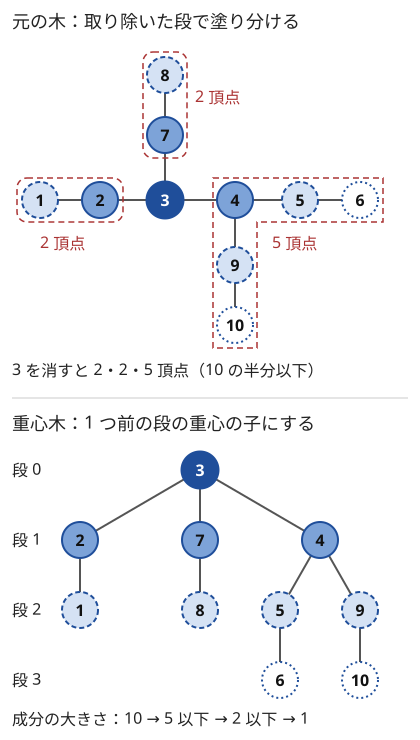

!!! abstract "要点"
    - **何ができるか**：重心を取り、重心を通るパスを一度に処理してから重心を消し、残った各成分で再帰する。成分の大きさが半分以下になるので深さは $O(\log N)$ で、距離がちょうど $K$ のペアの数など、辺ごとに分けられない全ペアの量を数えられる。
    - **いつ使うか**：
        - 距離がちょうど $K$ の頂点の組の個数
        - 全ペアのパスについての量で、辺ごとに分解できないもの
        - ある頂点から距離 $d$ 以内の頂点の集計クエリ
    - **計算量**：分解と重心木の構築は $O(N \log N)$。各成分での処理が成分の大きさに比例すれば全体 $O(N \log N)$、[畳み込み](../math/convolution-ntt.md)を使えば $O(N \log^2 N)$。重心木を上にたどるクエリは、祖先ごとの処理が $O(1)$ なら 1 回 $O(\log N)$ で、領域は $O(N \log N)$
    - **前提**：[木の重心](../tree/tree-centroid.md)、[分割統治](../basics/divide-and-conquer.md)

<!-- textlint-disable -->
別名：centroid decomposition・点分治・木の分割統治
<!-- textlint-enable -->

重心分解は、列を中央で割る[分割統治](../basics/divide-and-conquer.md)を木に移したものである。木の[重心](../tree/tree-centroid.md)で割ると、残る成分はどれも元の半分以下になる。だから「重心を通るパス」だけをその場で処理し、通らないパスを各成分の再帰に任せれば、どのパスもちょうど 1 回、$O(\log N)$ 段のどこかで処理される。

## 再帰の深さが log N になる理由 {#depth}

木の頂点の組 $(u, v)$ すべてについて何かを数えたいとき、組は $N^2 / 2$ 個ほどあり、$N = 2 \times 10^5$ では 1 つずつ見られない。列なら中央で割って「中央をまたぐ組」をまとめて数えるところだが、木には中央がない。適当な頂点 $r$ を選んで「$r$ を通るパス」をまとめて数え、$r$ を消した後の各成分で再帰する、という形なら木でも書ける。問題は $r$ の選び方である。

$r$ を適当に選ぶと、パス状の木の端を選び続けて成分が 1 頂点ずつしか小さくならず、段の数が $N$、全体が $O(N^2)$ になる。そこで $r$ に成分の重心を選ぶ。重心は「取り除いたときに残る各成分の頂点数が、どれも元の半分以下になる頂点」で、どの木にも存在する（[木の重心](../tree/tree-centroid.md)）。

次の図は、10 頂点の木を重心で分解する様子である。上の木では、頂点 3 が最初の重心（段 0）である。頂点は取り除いた段で塗り分け、段 0 を濃い実線、段 1 を中間の実線、段 2 を破線、段 3 を点線で描いている。3 を消すと、残りは $\{1, 2\}$・$\{7, 8\}$・$\{4, 5, 6, 9, 10\}$ の 3 つの成分になる。どれも 10 の半分の 5 頂点以下である。各成分でまた重心（段 1 の 2・7・4）を取って消し、1 頂点になるまで続ける。下は、各成分の重心を 1 つ前の段の重心の子にして作った根付き木である。これを重心木と呼ぶ。



図の要点を文章で言うと次のとおりである。

- 段 $l$ の重心を含む成分の頂点数は $N / 2^l$ 以下である。段が 1 つ進むたびに、成分の大きさが半分以下になるからである
- 成分は少なくとも 1 頂点あるので $N / 2^l \ge 1$、すなわち段の数は $\lfloor \log_2 N \rfloor + 1$ 以下である。図では $N = 10$ で、段は 0〜3 の 4 つである
- 同じ段の成分は互いに頂点を共有しない。だから各段で成分の大きさに比例する処理をしても、1 段の合計は $O(N)$ である

よって、各成分で「重心を見つける」「重心を通るパスを処理する」がその成分の大きさに比例する時間でできれば、全体は $O(N \log N)$ になる。これは列の分割統治の漸化式 $T(N) = 2T(N/2) + O(N)$ と同じ形の評価である（[分割統治の計算量](../basics/divide-and-conquer.md#recurrence)）。

**重心の見つけ方**：成分の適当な頂点 $r$ を根にして部分木サイズ $\mathrm{sz}[v]$ を求める。$r$ から始めて、$\mathrm{sz}$ が成分の大きさの半分を超える子があればそちらへ進み、なければ止まる。止まった頂点では、子の側の成分はどれも半分以下で、親の側の成分も「半分を超えたから進んできた」ので残りは半分未満である。部分木サイズは成分ごとに求め直す（最初に全体で求めた値は、頂点を消すと使えない）。

```cpp
--8<-- "centroid-decomposition/count-k.cpp:centroid"
```

完全なプログラム：[`count-k.cpp`](https://github.com/yuukougun/kyopro-atlas/blob/main/snippets/centroid-decomposition/count-k.cpp)（GitHub）
{ .kp-code-src }

部分木サイズは再帰の DFS ではなく、BFS の順を逆にたどって求めている。分解の段の数は $O(\log N)$ でも、成分の中の DFS はパス状の木で深さ $N$ になり、再帰で書くとスタックがあふれることがあるからである。

## 重心を通るペアを数え、同じ成分の中のペアを引く {#count-through}

重心分解で全ペアを数えるときの基本形は、「成分の全体で数えた組」から「同じ子の成分の中の組」を引くことである。題材として、重みのない木で距離がちょうど $K$（$K \ge 1$）の頂点の組 $\{u, v\}$ の個数を数える。

成分の重心を $c$ とし、成分の各頂点 $v$ の $c$ からの距離を $\mathrm{dep}[v]$ とする（$c$ 自身は 0）。$c$ を消すと、成分は $c$ の隣の頂点ごとに子の成分 $C_1, \dots, C_k$ に分かれる。成分の 2 頂点 $u, v$ について、次の 2 つのどちらか一方だけが成り立つ。

- $u, v$ が別の子の成分にある（片方が $c$ の場合を含む）：$u$-$v$ パスは $c$ を通り、$d(u, v) = \mathrm{dep}[u] + \mathrm{dep}[v]$
- $u, v$ が同じ子の成分 $C_i$ にある：パスは $c$ を通らず、$C_i$ の再帰で数える。$\mathrm{dep}[u] + \mathrm{dep}[v]$ は本当の距離より大きい

成分の全体で $\mathrm{dep}[u] + \mathrm{dep}[v] = K$ の組を数えると、1 つ目の組に加えて 2 つ目の組も混ざる。そこで各 $C_i$ の中だけで同じ数え方をして引く。$C_i$ の頂点の深さも $c$ から測った $\mathrm{dep}$ のまま使うのが要点で、$C_i$ の中での距離に測り直すと、引くべき組とずれる。

数え方は距離ごとの頻度表を使う。$\mathrm{cnt}[d]$ を深さ $d$ の頂点の数とすると、$\mathrm{dep}[u] + \mathrm{dep}[v] = K$ となる順序付きの組 $(u, v)$ の数は $\sum_{d} \mathrm{cnt}[d] \cdot \mathrm{cnt}[K - d]$ である。

$$
\text{（c を通る順序付きの組）} = \sum_{d} \mathrm{cnt}[d]\,\mathrm{cnt}[K-d] \;-\; \sum_{i=1}^{k} \sum_{d} \mathrm{cnt}_i[d]\,\mathrm{cnt}_i[K-d]
$$

$K \ge 1$ なら $u = v$ の組は入らず、順序付きの組は $\{u, v\}$ を 2 回ずつ数えるので、2 で割れば $c$ を通る組の数になる。処理の流れは次のとおりである。

```text
stack ← {0}                              # これから分解する成分の代表の頂点
while stack が空でない:
    r ← pop;  c ← r を含む成分の重心
    ans += ( pairs(c から BFS した頻度表)
             − Σ_{c の隣の消されていない to} pairs(to から深さ 1 で BFS した頻度表) ) / 2
    c に消した印を付け、c の隣の消されていない頂点を stack に積む
```

```cpp
--8<-- "centroid-decomposition/count-k.cpp:core"
```

完全なプログラム：[`count-k.cpp`](https://github.com/yuukougun/kyopro-atlas/blob/main/snippets/centroid-decomposition/count-k.cpp)（GitHub）
{ .kp-code-src }

頻度表の長さは成分の中の最大の深さ $+1$ で、成分の大きさを超えない。頻度表を長さ $N$ や $K$ で毎回作ると、成分は全部で $O(N)$ 個あるので $O(N^2)$ になる。上のコードは表の範囲の外の $K - d$ を 0 として扱い、長さを成分の大きさに合わせている。各段の BFS と頻度表の計算が成分の大きさに比例するので、全体は $O(N \log N)$ である。

引く代わりに、子の成分を 1 つずつ足していく書き方もある。累積の頻度表 $\mathrm{acc}$ は「$c$ だけ（$\mathrm{acc}[0] = 1$）」から始める。子の成分 $C_i$ ごとに、$C_i$ の各深さ $d$ の頂点数と $\mathrm{acc}[K - d]$ の積を答えに足し、その後で $C_i$ を $\mathrm{acc}$ に加える。前の子の成分とだけ組むので、同じ成分の中の組は最初から入らない。引き算ができない量（最大値など）を扱うときは、この書き方にする。

**応用の型**：

- 距離が $K$ 以下の組の数（サイン「距離が $K$ 以下の頂点の組の個数」）：深さをソートして[尺取り法](../basics/two-pointers.md)で数え、同じ子の成分の中の組を同じ方法で引く。ソートの分だけ重く、全体 $O(N \log^2 N)$ になる
- 重み付きの辺で、パスの重みの和が $K$ になる組：深さが大きな値になるので頻度表を配列で持てない。`map` で持つか、ソートして数える
- 色や値に条件のある組（同じ色の組の距離の和など）：頻度表を色ごとの「個数と深さの和」にする。同じ色の組 $\{u, v\}$ の $\mathrm{dep}[u] + \mathrm{dep}[v]$ の総和は、その色の個数を $m$、深さの和を $s$ として $(m - 1) s$ である。ここから子の成分ごとの同じ値を引く

## 木全体の数え上げと、重心木を上にたどるクエリ {#centroid-tree-queries}

重心分解の使い方は 2 つに分かれる。1 つは[重心を通るペアを数える](#count-through)ような、木全体の量を 1 回だけ求める使い方で、分解の途中で処理を済ませ、重心木は残さない。もう 1 つは、重心木（各成分の重心を 1 つ前の重心の子にした根付き木）を残しておき、「頂点 $v$ から距離 $d$ 以内の頂点の数」のようなクエリに答える使い方である。

クエリに使えるのは、重心木の次の性質による。

> 頂点 $u, v$ の、重心木での[最小共通祖先](../tree/lca.md) $c$ は、元の木の $u$-$v$ パスの上にある。よって $d(u, v) = d(u, c) + d(c, v)$ である。

$c$ は、$u$ と $v$ を両方含む成分のうち最後に分解されたものの重心である。$c$ が $u$ か $v$ そのものなら明らかに成り立つ。そうでなければ、$c$ を消すと $u$ と $v$ は別の子の成分に分かれる（同じ子の成分に入るなら、そちらの方が後に分解される）。成分は連結なので、$u$-$v$ パスはその成分の中にあり、$c$ を消すと切れるので $c$ を通る。

この性質から、$v$ と任意の頂点 $u$ の距離は、$v$ の重心木での祖先 $c$（$v$ 自身を含む）のどれか 1 つを経由する形で表せる。祖先は $O(\log N)$ 個しかないので、各祖先 $c$ について「$c$ の成分の頂点 $u$ の $d(c, u)$ の分布」を前計算しておけば、クエリは祖先を上にたどるだけで答えられる。

**距離 $d$ 以内の頂点の数**：各重心 $c$ に次の 2 つの累積の表を持たせる。

- $\mathrm{all}_c[x]$：$c$ の成分の頂点のうち、$d(c, u) \le x$ のものの数
- $\mathrm{from\_par}_c[x]$：$c$ の成分の頂点のうち、重心木での親 $p$ からの距離 $d(p, u) \le x$ のものの数

$v$ から根へ上りながら、祖先 $c$ ごとに $\mathrm{all}_c[d - d(v, c)]$ を足す。添字が負なら 0、表の長さを超えたら最後の値（成分全体の数）とする。ただし $c$ の 1 つ下の祖先 $c'$ の成分（$v$ を含む側）の頂点 $u$ は、二重に数えないよう気をつける。$c$ 経由の見積もり $d(v, c) + d(c, u)$ は本当の距離以上なので、見積もりが $d$ 以下の $u$ は本当の距離も $d$ 以下で、もっと下の祖先ですでに数えてある。$c$ でも足すと二重に数えるので、 $\mathrm{from\_par}_{c'}[d - d(v, c)]$ を引く。これは[重心を通るペアを数える](#count-through)ときの「同じ子の成分の中のペアを引く」と同じ考え方である。

```cpp
--8<-- "centroid-decomposition/centroid-tree.cpp:query"
```

完全なプログラム：[`centroid-tree.cpp`](https://github.com/yuukougun/kyopro-atlas/blob/main/snippets/centroid-decomposition/centroid-tree.cpp)（GitHub）
{ .kp-code-src }

$d(v, c)$ は、分解の途中で各頂点に「段 $l$ の祖先の重心までの距離」を書いておけば $O(1)$ で引ける。頂点 $v$ は自分を含む成分すべて（$O(\log N)$ 個）で BFS されるので、表の大きさは全部で $O(N \log N)$ である。$\mathrm{all}_c$ と $\mathrm{from\_par}_c$ の長さもそれぞれ $c$ の成分の大きさ $+1$ 以下なので、合計 $O(N \log N)$ に収まる。

??? note "重心木を作るコード"
    分解のときに、重心 $c$ の成分を BFS して、各頂点の距離の列に $d(c, u)$ を書き足す。親の重心からの距離は、親を処理したときに書いた値を読む。

    ```cpp
    --8<-- "centroid-decomposition/centroid-tree.cpp:build"
    ```

    完全なプログラム：[`centroid-tree.cpp`](https://github.com/yuukougun/kyopro-atlas/blob/main/snippets/centroid-decomposition/centroid-tree.cpp)（GitHub）
    { .kp-code-src }

**値の更新があるクエリ**：「頂点 $v$ に印を付ける」と「$v$ から最も近い印の付いた頂点までの距離」の 2 つの操作が交互に来るとする。各重心 $c$ に、$c$ の成分の印の付いた頂点 $u$ についての $d(c, u)$ の最小値 $\mathrm{best}[c]$ を持たせる。$\mathrm{best}$ は $\infty$ で始め、答えが $\infty$ のままなら印の付いた頂点はない。印を付けるときは、$v$ の祖先 $c$ すべてで $\mathrm{best}[c]$ を $d(v, c)$ との小さい方にする。答えは、祖先 $c$ についての $d(v, c) + \mathrm{best}[c]$ の最小値である。このクエリでは同じ側の成分を引かなくてよい。同じ側の頂点を $c$ 経由で見積もった値は、本当の距離以上になる。本当の距離はその 2 頂点を分けた祖先で必ず現れるので、最小値は変わらない。どちらの操作も 1 回 $O(\log N)$ である。

**応用の型**：

- 距離 $d$ 以内の頂点の重みの和や、距離がちょうど $d$ の頂点の数（サイン「ある頂点から距離 $d$ 以内の頂点の集計クエリ」）：累積の表を重みの累積にする。重みの更新もあるなら、表を [BIT](../ds/fenwick-tree.md) にして 1 回 $O(\log^2 N)$
- 重心木の形そのものを答えにする問題もある。どの頂点の子の部分木も自分の部分木の半分以下で、深さが $\log_2 N$ 以下の根付き木になる（[例題](#abc291_h)）

## 距離の頻度表は畳み込みと組む {#with-convolution}

この節は発展の内容で、[畳み込み（NTT）](../math/convolution-ntt.md)を前提にする。

すべての $k = 1, \dots, N - 1$ について、距離がちょうど $k$ の頂点の組の数を求める（距離の頻度表。Library Checker の frequency_table_of_tree_distance）。[重心を通るペアを数える](#count-through)の式は、$K$ を固定せずに見ると頻度表どうしの畳み込みである。

$$
\text{（c を通る順序付きの組で、距離が k のもの）} = (\mathrm{cnt} * \mathrm{cnt})[k] - \sum_{i=1}^{k'} (\mathrm{cnt}_i * \mathrm{cnt}_i)[k]
$$

ここで $*$ は畳み込み、$\mathrm{cnt}$ は重心からの深さごとの頂点数、$\mathrm{cnt}_i$ は子の成分 $C_i$ での同じ表、$k'$ は子の成分の数である。$\mathrm{cnt}$ の長さは成分の大きさ $s$ 以下なので、1 つの成分の畳み込みは $O(s \log s)$ でできる。1 段の合計は $O(N \log N)$ で、段は $O(\log N)$ あるので全体 $O(N \log^2 N)$ になる。最後に $k \ge 1$ の値を 2 で割る（$k = 0$ の項は $u = v$ の組なので捨てる）。

- 頻度表の長さを $N$ にして畳み込むと、成分ごとに $O(N \log N)$ かかり、全体 $O(N^2 \log N)$ になる。長さは成分の中の最大の深さ $+1$ にする
- 組の数は $N^2$ 程度（$N = 2 \times 10^5$ なら $4 \times 10^{10}$）で、998244353 を超える。mod を取らない答えには [convolution_ll](../math/convolution-ntt.md#convolution-ll) を使う
- 子の成分の数が多く、それぞれが小さいときは、短い表どうしは素朴な二重ループで掛けた方が速い

引かずに子の成分を 1 つずつ足す書き方（[重心を通るペアを数える](#count-through)の後半）は、畳み込みと組むと長い累積の表を何度も掛けることになり遅くなりやすい。畳み込みでは引く書き方を使う。

## 落とし穴 {#pitfalls}

**重心ではなく適当な頂点で割る**。成分の代表の頂点（BFS を始めた頂点）でそのまま割ると、パス状の木で段の数が $N$ になり、$O(N^2)$ で間に合わない。毎回、成分の中で重心を探し直す。

**部分木サイズを使い回す**。最初に全体で求めた $\mathrm{sz}$ は、頂点を消した後の成分では正しくない。重心を探すたびに、その成分だけで部分木サイズを求め直す。消した頂点に入らないよう、BFS・DFS では消した印を必ず確かめる。

**同じ子の成分の中の組の引き忘れ・測り直し**。子の成分の組を引くときは、深さを $c$ から測ったまま数える（子の成分の頂点は深さ 1 から始まる）。子の成分の内側で距離を測り直すと、全体の数え方と合わず誤答になる。

**重心自身を数え忘れる**。$c$ を深さ 0 の頂点として頻度表へ入れておけば、$c$ と成分のほかの頂点の組も自然に数えられる。$c$ を入れ忘れると、端点が重心の組がどこでも数えられない。逆に $K = 0$ を許す問題では、$u = v$ の組が順序付きの数へ 1 回ずつ入る。2 で割る前に別に扱う。

**作業用の配列を毎回大きく作る**。長さ $N$ の配列を成分ごとに確保・初期化すると、成分は $N$ 個あるので $O(N^2)$ になる。表の長さは成分の大きさに合わせるか、使った位置だけを戻す。

**再帰が深くなる**。分解そのものの深さは $O(\log N)$ だが、成分の中で部分木サイズや深さを求める DFS は、パス状の木で深さ $N$ になる。BFS の順を逆にたどるなど、再帰を使わない書き方にする（[BFS 順の逆で集約する](../tree/tree-traversal.md#bfs-order)）。

## 例題 {#examples}

### ABC291 Ex. Balanced Tree {#abc291_h}

<div class="kp-problems" data-role="example" markdown>

- [ABC291 Ex. Balanced Tree](https://atcoder.jp/contests/abc291/tasks/abc291_h)（diff 2097）：木 T と同じ頂点の根付き木で、どの 2 頂点についても根付き木での最小共通祖先が T 上のその 2 頂点を結ぶパスの上にあり、どの頂点の部分木の頂点数も親の部分木の頂点数の半分以下になるものを 1 つ作り、各頂点の親を答える。

</div>

答えは重心木そのものである。重心木では、成分の重心の子は「その重心を消した後の成分」の重心なので、子の部分木の頂点数は親の部分木の半分以下になる。最小共通祖先の条件は、[重心木を上にたどるクエリ](#centroid-tree-queries)で示した性質（重心木での最小共通祖先は、元の木のパスの上にある）である。

??? note "解法の詳細"
    重心分解の途中で成分の重心 $c$ を見つけたら、「$c$ の親は、この成分を作った 1 つ前の重心」と記録する。その後 $c$ を消して、隣の各成分へ進む。最初の重心の親は $-1$ にする。重心木を作るコード（[重心木を上にたどるクエリ](#centroid-tree-queries)の折りたたみ）の `cpar` がそのまま答えである。出力するときは 1-indexed に直す。

    **部分木の条件**：重心木での $c$ の部分木は、$c$ が重心になった成分の頂点全体である。$c$ の子 $c'$ の部分木は $c$ を消した後の成分の 1 つで、$c$ が重心なので元の成分の半分以下である。

    **最小共通祖先の条件**：重心木での $u, v$ の最小共通祖先 $c$ は、$u, v$ を両方含む最後の成分の重心である。$c \ne u, v$ なら $c$ を消すと $u, v$ は別の成分に分かれるので、$u$-$v$ パスは $c$ を通る。

    全体で $O(N \log N)$ である。

## 練習問題 {#practice}

<div class="kp-problems" data-role="practice" markdown>

- [YAHOO-PROCON2018-FINAL C. 木の問題](https://atcoder.jp/contests/yahoo-procon2018-final/tasks/yahoo_procon2018_final_c)（diff なし）：木の頂点 V_i から距離がちょうど K_i の頂点の個数を、多数のクエリについて答える。
- [ABC267 F. Exactly K Steps](https://atcoder.jp/contests/abc267/tasks/abc267_f)（diff 1939）：木の頂点 U_i から距離がちょうど K_i の頂点を 1 つ答える（なければ −1）クエリに、Q 回答える。
- [ABC359 G. Sum of Tree Distance](https://atcoder.jp/contests/abc359/tasks/abc359_g)（diff 2099）：各頂点に色がついた木で、同じ色の頂点の組すべてについての距離の総和を求める。

</div>

??? note "練習の方針"
    - **YAHOO-PROCON2018-FINAL C**：重心分解し、各クエリで重心木の祖先 $c$ ごとに「$c$ からの距離が $K_i - d(V_i, c)$ の頂点数」を足す。$V_i$ と同じ子の成分に入る分は二重に数えるので引く。全体は $O((N + Q) \log N)$ である
    - **ABC267 F**：上の問題と同じく重心木の祖先 $c$ をたどる。個数ではなく具体的な頂点が要るので、各 $c$ について距離ごとに、別の子の成分に属する頂点を高々 2 個持っておき、$U_i$ と別の成分のものを答える。想定解は直径の端点と祖先のたどりで、重心分解は別解である
    - **ABC359 G**：成分の重心 $c$ から BFS し、色ごとに「頂点の個数 $m$ と深さの和 $s$」を数える。$c$ を通る同じ色の組の距離の和は、色ごとの $(m - 1) s$ の総和から、子の成分ごとに同じ式で数えた値を引いたものである（[重心を通るペアを数える](#count-through)の引き算と同じ形）。色ごとの表は `map` か、成分に出てきた色だけを書いて使い終えたら戻す配列で持つ。[マージテク](../tree/small-to-large.md)や [Auxiliary Tree](../tree/auxiliary-tree.md) でも解ける

## 力試し {#challenge}

<div class="kp-problems" data-role="challenge" markdown>

- [DDCC2016-QUAL D. 道路網](https://atcoder.jp/contests/ddcc2016-qual/tasks/ddcc_2016_qual_d)（diff なし）：N 頂点の完全グラフで、N−1 本の辺は木をなして長さが与えられ、残りの辺の長さがすべて X のとき、全頂点対の最短距離の総和を求める。
- [NIKKEI2019-FINAL G. Greatest Journey](https://atcoder.jp/contests/nikkei2019-final/tasks/nikkei2019_final_g)（diff なし）：重み付きの木で、頂点 V_i から始まる長さ L_i のウォークについて、通った辺の重みの和の最大値を多数のクエリについて答える。
- [KEYENCE2019 E. Connecting Cities](https://atcoder.jp/contests/keyence2019/tasks/keyence2019_e)（diff 2623）：一列に並ぶ都市を結ぶ完全グラフで、辺の重みが番号の差と両端の値で決まるときの最小全域木の重みを求める。

</div>

??? note "力試しの方針"
    - **DDCC2016-QUAL D**：木の上で別の子の成分にある 2 頂点の距離を $\min(X, D(v) + D(w))$ とみて、重心からの距離ごとの個数と和を 2 本の BIT で持ち、重心分解で総和を数える。そのうえで、長さが $X$ を超える木の辺を経由する組を、別の経路の候補と比べて直す
    - **NIKKEI2019-FINAL G**：最適なウォークは「$V_i$ から別の頂点へ向かう最短のパス」と「最後にある辺の往復を繰り返す部分」に分けられる。パスを重心を通るものとして重心ごとに集計し、残りの長さに比例する往復の分を直線の最大値の問題として、クエリを並べて処理する
    - **KEYENCE2019 E**：都市 $i, j$ を結ぶ辺の重みは $D \lvert i - j \rvert + A_i + A_j$ である。都市の並びはパスなので、その重心分解は「番号の中央で割る」分割統治になる。中央をまたぐ辺のうち、左右それぞれで「$A_i - D i$ が最小の都市」「$A_j + D j$ が最小の都市」との辺だけを候補に残せば、最小全域木の辺はその中から選べる（閉路のうち最も重い辺は使わなくてよい）。候補は $O(N \log N)$ 本で、[クラスカル法](../graph/minimum-spanning-tree.md)で $O(N \log^2 N)$ である。都市の並びがパスではなく一般の木で、$\lvert i - j \rvert$ が木の上の距離に変わっても、同じ考え方を重心分解で行える

## 確認問題 {#quiz}

??? question "確認問題：重心分解の段の数が log2 N + 1 以下になるのはなぜか"
    成分の重心を消すと、残る各成分の頂点数は元の半分以下になる。段 $l$ の成分の頂点数は $N / 2^l$ 以下で、成分は 1 頂点以上なので $2^l \le N$、すなわち $l \le \log_2 N$ である。段は $0, 1, \dots, \lfloor \log_2 N \rfloor$ の高々 $\lfloor \log_2 N \rfloor + 1$ 個になる。

??? question "確認問題：重心を通る組だけを数えたいのに、成分全体で数えた組から何を引けばよいか"
    同じ子の成分（重心を消した後の同じ連結成分）に両端がある組である。それらは重心を通らないのに、重心からの深さの和で距離を見積もると条件を満たしてしまうことがある。引くときは、子の成分の頂点の深さも重心から測った値のまま数える。

??? question "確認問題：最も近い印の付いた頂点のクエリでは、同じ側の成分を引かなくてよいのはなぜか"
    答えが最小値だからである。同じ側の頂点 $u$ を祖先 $c$ 経由で見積もった $d(v, c) + d(c, u)$ は、本当の距離 $d(v, u)$ 以上になる。本当の距離は、$v$ と $u$ を分けた祖先（重心木での最小共通祖先）で正しく現れるので、大きく見積もった値が混ざっても最小値は変わらない。個数や和を数えるときは、混ざった値がそのまま答えに入るので引く必要がある。

??? question "確認問題：成分の代表の頂点で割る（重心を探さない）と、どんな木で遅くなるか"
    パス状の木で、代表の頂点が端にあるときである。端を消しても成分は 1 頂点しか小さくならず、段の数が $N$ になる。各段で成分の大きさに比例する処理をすると、合計は $N + (N - 1) + \dots + 1 = O(N^2)$ になる。

## 使い分け {#comparison}

全ペアについての量は、量の形で手法を選ぶ。重心分解は最も汎用だが重いので、軽い手法で済まないかを先に確かめる。

| 量の形 | 使う手法 |
| --- | --- |
| 辺ごとの和に分けられる（距離の総和など） | [辺の寄与](../tree/tree-edge-contribution.md) |
| 各頂点ごとの量（各点からの距離の和・最遠距離） | [全方位木 DP](../dp/rerooting.md) |
| 色やグループごとの量 | [マージテク](../tree/small-to-large.md)・[Auxiliary Tree](../tree/auxiliary-tree.md)・重心分解 |
| 距離そのものに条件がある（距離が $K$ の組、距離の頻度表） | 重心分解（頻度表は畳み込みと組む） |
| 2 頂点を指定したパスの集約 | [LCA](../tree/lca.md)・[HL 分解](../tree/hld.md) |
| 頂点から距離 $d$ 以内の集計クエリ | 重心木を上にたどる |

## 参考 {#references}

- [kmjp「AtCoder ABC #291 (Sponsored by TOYOTA SYSTEMS) : Ex - Balanced Tree」](https://kmjp.hatenablog.jp/entry/2023/02/26/0930)：例題 abc291_h の問いと、重心木をそのまま答えにする方針
- [navel_tos「重心分解のPython実装例」](https://qiita.com/navel_tos/items/d1a2fd2b63e73380eadb)：重心の探し方（半分を超える子へ進む）、重心木の祖先をたどるクエリと同じ側を引く処理、再帰を使わない実装
- [drken「キーエンス プログラミング コンテスト 2019 E - Connecting Cities (橙色, 600 点)」](https://drken1215.hatenablog.com/entry/2019/01/15/081500)：力試し keyence2019_e の問い、中央で割って辺の候補を減らす方針と、木の場合は重心分解で同じことを行えること
- [drken「AtCoder ABC 359 G - Sum of Tree Distance (3D, 黄色, 600 点)」](https://drken1215.hatenablog.com/entry/2024/06/23/025552)：練習 abc359_g の問いと制約（記事の本文の解法はマージテク）
- [Library Checker「Frequency Table of Tree Distance」](https://judge.yosupo.jp/problem/frequency_table_of_tree_distance)：距離の頻度表を求める問題（自作のライブラリの確かめ先）
- [hamayan「競技プログラミングにおける重心分解問題まとめ」](https://blog.hamayanhamayan.com/entry/2017/12/19/152143)：練習 YAHOO2018 決勝 C の分類
- [Kazun「AtCoder Beginner Contest 267 F問題 Exactly K Steps」](https://kazun-kyopro.hatenablog.com/entry/ABC/267/F)：練習 ABC267 F の直径を使う想定の解き方
- [kmjp「DISCO presents ディスカバリーチャンネル コードコンテスト2016 予選 : D - 道路網」](https://kmjp.hatenablog.jp/entry/2016/11/22/0930)：力試し DDCC2016 予選 D の重心分解と 2 本の BIT、長い辺の補正
