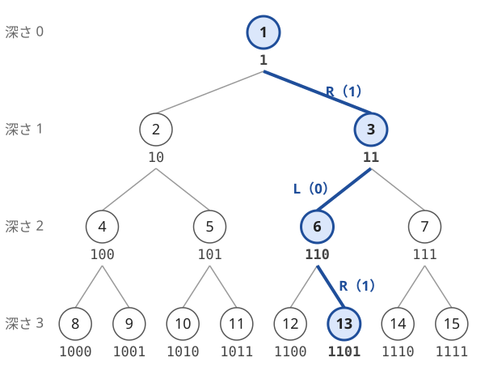

!!! abstract "要点"
    - **何ができるか**：頂点 $i$ の子が $2i$ と $2i + 1$、親が $\lfloor i/2 \rfloor$ の木は深さが $\log_2 N$ 程度しかないので、$N$ が $10^{18}$ でも祖先を全部たどれる。番号の 2 進表記が根からの道順を表し、LCA と距離も番号だけで求まる。
    - **いつ使うか**：
        - 頂点 $i$ と $\lfloor i/2 \rfloor$ を結ぶ・L/R/U の移動の列。
        - $N \le 10^{18}$ の木。
    - **計算量**：子・親への移動は $O(1)$。LCA と距離は大きい方を 2 で割り続けて $O(\log N)$。頂点 $X$ から距離 $K$ の頂点の数は $O((\log N)^2)$。
    - **前提**：[木の基本性質と表現](../tree/tree-basics.md)、[bit 演算の基本と XOR の性質](../basics/bit-operations.md)

<!-- textlint-disable -->
別名：ヒープ番号・親は i/2・K 分木・heap numbering・perfect binary tree
<!-- textlint-enable -->

完全二分木は、根を 1 とし、頂点 $i$ の左の子を $2i$、右の子を $2i + 1$ と番号を付けた二分木である。頂点 $1, \dots, N$ だけを使うと、最後の段だけが左詰めで欠けた形になる。辺を持たずに番号の計算だけで親・子・LCA・距離が求まり、深さが $\lfloor \log_2 N \rfloor$ なので、$N = 10^{18}$ の木でも祖先は 60 個ほどしかない。

## 番号の 2 進表記と根からの道順 {#binary-path}

完全二分木では、頂点の番号を 2 進表記で書くと根からの道順がそのまま読める。左の子 $2i$ は $i$ の 2 進表記の末尾に 0 を付けた数、右の子 $2i + 1$ は末尾に 1 を付けた数だからである。



図の頂点 13 は 2 進表記で `1101` である。根 1（`1`）から始め、先頭の 1 の後ろの桁を左から読んで、0 なら左、1 なら右へ進むと、`1` → `11`（3）→ `110`（6）→ `1101`（13）と着く。ここから次の性質が出る。

- 親は末尾の 1 桁を消した数で、$\lfloor i/2 \rfloor$（`i >> 1`）である。子は `i << 1` と `(i << 1) | 1` である
- 深さは 2 進表記の桁数から 1 を引いた値で、$\mathrm{dep}[i] = \lfloor \log_2 i \rfloor$ である。`long long` なら `63 - __builtin_clzll(i)` で求まる
- 深さ $d$ の頂点は、$2^d$ 以上 $2^{d+1}$ 未満（かつ $N$ 以下）の番号に左から順に並ぶ。同じ深さの中では番号の小さい方が左にある
- $u$ が $v$ の祖先であることと、$u$ の 2 進表記が $v$ の 2 進表記の先頭部分（接頭辞）であることは同じである

最後の性質から、2 頂点の LCA は 2 進表記の共通の接頭辞のうち最長のものになる。たとえば 13（`1101`）と 11（`1011`）の共通の接頭辞は `1` だけなので、LCA は根 1 である。

この木を使う理由は、祖先の少なさにある。頂点 $i$ の祖先は $\lfloor \log_2 i \rfloor + 1$ 個（自分を含む）なので、$i \le 10^{18}$ なら 60 個以下になる。頂点数が巨大で辺を配列に持てなくても、祖先を 1 つずつたどる処理なら $O(\log N)$ で済む。

## L/R/U の移動はスタックで打ち消す {#lru-moves}

完全二分木の上を「左の子へ（L）」「右の子へ（R）」「親へ（U）」と移動する列が与えられ、最後の頂点を求める問題では、そのまま番号を計算すると途中であふれることがある。L・R は番号をおよそ 2 倍にするので、L を 100 回続けてから U を 100 回続けると、最後の頂点は小さくても途中の番号は $2^{100}$ 倍になる。

L か R の直後の U は打ち消し合い、何もしなかったのと同じである。そこで、まだ適用していない L・R をスタックに積み、U を読んだときは次のように処理する。

- スタックが空でなければ、末尾の L・R を降ろす（打ち消す）
- スタックが空なら、それより前の L・R はすべて打ち消し済みなので、その場で番号を親に移す（$x \gets \lfloor x/2 \rfloor$）

最後にスタックに残った L・R を順に適用する。残りは L・R だけなので番号は増える一方であり、途中の値は最終的な答えを超えない。答えが `long long` に収まると保証されていれば、途中でもあふれない。

```cpp
--8<-- "complete-binary-tree/lru-moves.cpp:core"
```

計算量は移動の列を $S$ として $O(\lvert S \rvert)$ である。打ち消しの考え方は、括弧列や「消すべき並びを取り除く」問題と同じ形である（[直前と打ち消し合うものを消す](../ds/stack-techniques.md#cancel)）。

別の方法として、番号の 2 進表記を文字列で持ち、L で `0` を、R で `1` を末尾に足し、U で末尾を消してもよい。文字列の長さは最初の桁数と移動の数の和を超えないので、これも $O(\lvert S \rvert)$ である。最後に文字列を数に戻す。

??? question "確認問題：スタックが空のときの U"
    頂点 2 から始めて `URL` と移動する。スタックで処理すると、どの順に番号が変わるか。

    ??? success "答え"
        最初の U ではスタックが空なので、その場で $2 \to 1$ と親へ移る。R と L は積まれ、最後に適用されて $1 \to 3 \to 6$ となる。答えは 6 である。U を後回しにして「R・L の後に U」と並べ替えると $2 \to 5 \to 10 \to 5$ となり、誤りになる。U は打ち消せないときだけ、その時点で適用する。

## 番号だけで LCA を求める（大きい方を 2 で割る） {#lca-by-index}

完全二分木の 2 頂点 $x$・$y$ の LCA は、「$x \ne y$ の間、大きい方を 2 で割る」を繰り返すだけで求まる。最後に一致した値が LCA で、割った回数が距離 $d(x, y)$ である。

これで正しい理由は、祖先の番号は子孫の番号より必ず小さいことにある（親 $\lfloor i/2 \rfloor$ は $i \ge 1$ より小さい）。$x \ne y$ で $x > y$ なら、$x$ は $y$ の祖先ではありえない。$x$ は LCA でないので、LCA は $x$ の親の祖先でもあり、$x$ を親へ上げても LCA は変わらない。上げるたびに $x$ から LCA までの道の辺を 1 本たどるので、割った回数の合計は $d(x, y)$ になる。

深さを見なくてよいのがこの方法の利点である。一般の木で使う「深さをそろえてから同時に上がる」方法（[LCA](../tree/lca.md#jump)）と同じ結果になるが、深さの小さい頂点ほど番号が小さいので、大小の比較が深さの比較を兼ねている。

```cpp
--8<-- "complete-binary-tree/lca-by-index.cpp:core"
```

各頂点の祖先は $O(\log N)$ 個なので、ループは $O(\log N)$ 回で終わる。距離は深さを使って $d(x, y) = \mathrm{dep}[x] + \mathrm{dep}[y] - 2\,\mathrm{dep}[\mathrm{lca}(x, y)]$ とも書ける（[距離の式](../tree/lca.md#distance)）。コードは $k$ 分木のまま書いてあり、$k = 2$ が完全二分木である（[K 分木への一般化](#k-ary)）。

## K 分木への一般化 {#k-ary}

各頂点の子が $K$ 個の木でも、番号の付け方を決めれば同じ計算が使える。頂点 $i$ の親を $\lfloor i/K \rfloor$ とすると、子は $Ki, Ki + 1, \dots, Ki + K - 1$ になる。番号を $K$ 進表記で書くと、末尾に 1 桁を付けるのが子へ進むこと、末尾の 1 桁を消すのが親へ戻ることである。

- $K = 2$ なら、根 1 の完全二分木（2 進表記で道順を読む木）そのものである
- $1, \dots, K - 1$ の親は 0 になる。頂点 0 を根とみなすと、0 以上の整数全体が 1 つの木になる（0 の親は 0 なので、0 では止める）
- 親の番号は子より小さいので、[大きい方を割る LCA](#lca-by-index) は $\lfloor x/K \rfloor$ に変えるだけでそのまま正しい
- 深さは $K$ 進表記の桁数で決まり、祖先は $\log_K N + 1$ 個程度になる

「$x$ を $\lfloor x/K \rfloor$ に変える」と「$\lfloor y/K \rfloor = x$ となる $y$ に変える」の 2 種類の操作がある問題は、この木の上で親と子へ移動する問題と見なせる。最小の操作回数は 2 頂点の距離であり、大きい方を $K$ で割り続けて数えればよい。

頂点を 0 から番号付けする流儀もある。根を 0 とし、子を $Ki + 1, \dots, Ki + K$、親を $\lfloor (i - 1)/K \rfloor$ とする書き方で、$K = 2$ なら子は $2i + 1$ と $2i + 2$ になる。どちらの流儀か最初に決め、式を混ぜない（[落とし穴](#pitfalls)）。

??? question "確認問題：K 分木の距離"
    親を $\lfloor i/3 \rfloor$ とする 3 分木で、頂点 14 と 5 の距離はいくつか。

    ??? success "答え"
        大きい方を 3 で割る。$14 > 5$ なので $14 \to 4$、$5 > 4$ なので $5 \to 1$、$4 > 1$ なので $4 \to 1$ となり、3 回で一致する。LCA は 1、距離は 3 である。3 進表記では 14 は `112`、5 は `12` で、共通の接頭辞 `1` が LCA である。

## 距離 K の頂点の数（部分木の深さの範囲を N で切る） {#count-at-distance}

この節は [LCA と距離](../tree/lca.md#distance)の考え方を前提にする。この節の $K$ は距離であり、K 分木の $K$ とは別である。頂点 $1, \dots, N$ の完全二分木で、頂点 $X$ からの距離がちょうど $K$ の頂点を数える。$N$ が $10^{18}$ でも、$X$ の祖先が 60 個ほどしかないことを使えば数えられる。

距離 $K$ の頂点 $v$ を、$\mathrm{lca}(X, v)$ で分類する。LCA は $X$ の祖先のどれかなので、場合は 60 通りほどである。

1. **LCA が $X$ 自身**：$v$ は $X$ の部分木の中で、$X$ から $K$ 段下にある
2. **LCA が $X$ から $j$ 段上の祖先 $p$（$1 \le j < K$）**：$v$ は $p$ のもう一方の子（$X$ を含まない側の子 $c'$）の部分木の中で、$c'$ から $K - j - 1$ 段下にある
3. **LCA が $X$ から $K$ 段上の祖先**：$v$ はその祖先そのもので、1 個である（$K$ 段上の祖先がなければ 0 個）

どの場合も、残るのは「頂点 $v$ の部分木で、$v$ から $d$ 段下にある頂点の数」を求めることである。2 進表記で考えると、$v$ から $d$ 段下の子孫は $v$ の後ろに $d$ 桁を付けた数なので、番号はちょうど閉区間 $[v \cdot 2^d,\ v \cdot 2^d + 2^d - 1]$ に並ぶ。頂点は $N$ までしかないので、この区間を $N$ で切った長さが答えである。$v \cdot 2^d > N$ なら 0 個になる。

$c'$ の番号は、$X$ の側の子 $c$ の最後の桁を反転した $c \oplus 1$ である。$c' > N$ ならその部分木は空で、0 個として扱えばよい。

```cpp
--8<-- "complete-binary-tree/count-at-distance.cpp:core"
```

`count_below` では $v \cdot 2^d$ を一度に計算せず、1 段ずつ区間の両端を 2 倍しながら、左端が $N$ を超えたら止める。$d$ が $10^{18}$ のように大きくても 60 回ほどで抜け、`long long` もあふれない。祖先が $O(\log N)$ 個で、それぞれで $O(\log N)$ 回の 2 倍をするので、1 回の問い合わせは $O((\log N)^2)$ である。

??? question "確認問題：区間を N で切る"
    $N = 10$ の木で、頂点 2 から 2 段下の頂点はいくつか。

    ??? success "答え"
        2 段下の番号は閉区間 $[2 \cdot 4,\ 2 \cdot 4 + 3] = [8, 11]$ に並ぶ。頂点は 10 までなので $[8, 10]$ に切り、3 個（8・9・10）である。

## 落とし穴 {#pitfalls}

**番号をそのまま計算してあふれる**。子へ進むと番号はおよそ 2 倍になるので、移動の列を素直にシミュレーションすると、最後の頂点が小さくても途中で $2^{63}$ を超える。[打ち消してから適用する](#lru-moves)か、2 進表記を文字列で持つ。部分木の範囲 $v \cdot 2^d$ も、[1 段ずつ上限で止めて](#count-at-distance)計算する。

**最後の段が欠けていることを忘れる**。頂点 $1, \dots, N$ の木は、すべての段が埋まった木（perfect binary tree）とは限らない。子 $2i$・$2i + 1$ や兄弟 $c \oplus 1$ が $N$ を超えていないか、子孫の範囲を $N$ で切ったかを確かめる。$N$ が $2^d - 1$ の形のときだけ試すと、このバグは見つからない。

**1-indexed と 0-indexed の式を混ぜる**。根を 1 とする流儀では、子は $2i$・$2i + 1$ で、親は $\lfloor i/2 \rfloor$ である。根を 0 とする流儀では、子は $2i + 1$・$2i + 2$ で、親は $\lfloor (i - 1)/2 \rfloor$ になる。片方の子の式ともう片方の親の式を組むと、親子の対応が崩れる。2 進表記と道順が素直に対応する根 1 の流儀を、迷ったときの基準にする。

**根で親へ上がる**。根 1 の親を $\lfloor 1/2 \rfloor = 0$ と計算すると、頂点でない 0 に移る。LCA のループは $x \ne y$ で止まるので問題ないが、祖先を上がるループは「根に着いたら止める」（`c > 1`）条件を必ず付ける。K 分木で頂点 0 を根に使うときも、0 の親は 0 なので止める条件が要る。

**深さを int 用の関数で求める**。`__builtin_clz` は `unsigned int` を受け取るので、`long long` の番号を渡すと上位の桁が切り捨てられる。`__builtin_clzll` を使う。0 を渡すと未定義動作になる点も同じである（[bit 演算の落とし穴](../basics/bit-operations.md#pitfalls)）。

## 上位の手法へのつながり {#next-steps}

番号で親子を決める完全二分木は、配列で木を持つデータ構造の土台である。

- **セグメント木**：葉を 2 の冪の個数にそろえ、ノード $k$ の子を $2k$・$2k + 1$ とする配置は、この木の番号の付け方そのものである。葉から根へ上がる処理は `k >>= 1` で書ける（[セグメント木の保つ性質](../ds/segment-tree.md#invariants)）
- **二分ヒープ**：優先度付きキューの中身も、完全二分木の形で配列に並べる。push で上げる・pop で下げる処理も、親と子の番号の計算だけで書ける（[二分ヒープの仕組み](../ds/priority-queue.md#binary-heap)）
- **一般の木の LCA**：番号に構造がない木では、大きい方を割る方法は使えない。深さをそろえて $2^k$ 個ずつ跳ぶダブリングなどを使う（[LCA](../tree/lca.md)）。完全二分木で「LCA で分類して数える」考え方は、一般の木でのパスの扱いにもつながる（[木のパス](../tree/tree-path.md)）

## 例題 {#examples}

### ABC243 D. Moves on Binary Tree {#abc243_d}

<div class="kp-problems" data-role="example" markdown>

- [ABC243 D. Moves on Binary Tree](https://atcoder.jp/contests/abc243/tasks/abc243_d)（diff 758）：完全二分木の頂点 X から L・R・U の移動の列に従って進んだ後の頂点を求める（途中の番号は大きくなりうる）

</div>

移動の数は最大 $10^6$ で、L・R を続けると途中の番号は桁違いに大きくなる。一方で答えは $10^{18}$ 以下と保証されている。L・R の直後の U を[スタックで打ち消し](#lru-moves)、残った移動だけを適用すれば、途中の値は答えを超えない。

??? note "解法の詳細"
    - 空のスタック（文字列でよい）を用意し、移動の列を左から読む
    - L・R なら積む。U なら、スタックが空でなければ末尾を降ろし、空なら $X \gets \lfloor X/2 \rfloor$ とする
    - 最後に、スタックに残った L・R を前から順に適用する（L は $X \gets 2X$、R は $X \gets 2X + 1$）
    - 残った列は「U がいくつか続いた後に L・R が続く」形になる。L・R の間に番号は増える一方なので、`long long` であふれない。全体で $O(\lvert S \rvert)$（$S$ は移動の列）。コードは [L/R/U の移動](#lru-moves)の節のものと同じである

## 練習問題 {#practice}

<div class="kp-problems" data-role="practice" markdown>

- [ABC465 D. X to Y](https://atcoder.jp/contests/abc465/tasks/abc465_d)（diff 839）：整数 x を ⌊x/K⌋ に置き換えるか、⌊y/K⌋ = x となる整数 y に置き換える操作を繰り返して、X を Y にするための最小の操作回数を求める（テストケースが複数ある）。

</div>

??? note "練習の方針"
    - **ABC465 D**：$x$ と $\lfloor x/K \rfloor$ を結ぶと、操作は [K 分木](#k-ary)の上で親か子へ 1 歩動くことになる。最小の操作回数は 2 頂点の距離なので、$X \ne Y$ の間、大きい方を $K$ で割って回数を数える（[大きい方を割る LCA](#lca-by-index)）。テストケースごとに $O(\log_K \max(X, Y))$

## 力試し {#challenge}

<div class="kp-problems" data-role="challenge" markdown>

- [ABC220 E. Distance on Large Perfect Binary Tree](https://atcoder.jp/contests/abc220/tasks/abc220_e)（diff 1593）：頂点 i の子が 2i と 2i+1 の、2^N − 1 頂点の完全二分木（N ≤ 10^6）で、距離がちょうど D の頂点の順序対の個数を 998244353 で割った余りで求める。
- [ABC321 E. Complete Binary Tree](https://atcoder.jp/contests/abc321/tasks/abc321_e)（diff 1627）：頂点 i が頂点 ⌊i/2⌋ とつながる N 頂点の木で、頂点 X からの距離がちょうど K の頂点の数を求める

</div>

??? note "力試しの方針"
    - **ABC220 E**：2 頂点を結ぶパスの最も浅い頂点（LCA）を深さ $d$ ごとにまとめる。まっすぐ $D$ 段降りる組と、左右の子孫から深さ $l$ と $D - l$ の頂点を 1 個ずつ選ぶ組を数え、深さ $d$ の頂点が $2^d$ 個あることを掛けて足す。$l$ の取れる範囲を $N$ で切れば $O(N)$ である
    - **ABC321 E**：$N$ は $10^{18}$ まであり、テストケースも多い。距離 $K$ の頂点を、$X$ との LCA が $X$ から何段上の祖先かで分類する。各祖先について、$X$ を含まない側の子の部分木で深さが合う頂点の数を、番号の区間を $N$ で切って求める（[距離 K の頂点の数](#count-at-distance)）。$K$ が非常に大きい場合と、$X$ を含まない側の子が $N$ を超える場合に注意する

## 参考 {#references}

- [drken「AtCoder ABC 243 D - Moves on Binary Tree (2Q, 茶色, 400 点)」](https://drken1215.hatenablog.com/entry/2024/09/24/123142)：例題の、L・R の直後の U をスタックで打ち消す方針と、残った移動であふれない理由
- [comet725「ABC465Dを解いた【LCA】」](https://qiita.com/comet725/items/ed5414a8d8a200ec863b)：練習の、大きい方を K で割って共通の祖先まで上がる方針
- [2yuu「Atcoder解いてみた　AtCoder Beginner Contest D - X to Y」](https://qiita.com/2yuu/items/b4d70003b7f311f8b8d1)：練習の問題の操作（⌊x/K⌋ への置き換えとその逆）の確認
- [drken「AtCoder ABC 321 E - Complete Binary Tree (2D, 青色, 450 点)」](https://drken1215.hatenablog.com/entry/2023/09/24/231639)：力試しの、祖先へ上がりながら反対側の子の部分木を数える方針
- [ikatakos「AtCoder Beginner Contest 220 E,F問題メモ」](https://ikatakos.com/pot/programming_algorithm/contest_history/atcoder/2021/0926_abc220)：力試し ABC220 E の LCA の深さごとの数え方（解説の部分だけを参照）
