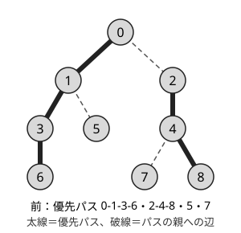
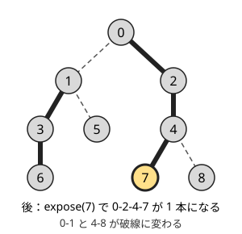

!!! abstract "要点"
    - **何ができるか**：辺の追加と削除がある森で、パスの集約の取得・パスへの一括更新・根の付け替えを、Link-Cut Tree はならし $O(\log N)$ で行う。部分木のクエリには Euler Tour Tree、パスと部分木の両方には Top Tree を使う。
    - **いつ使うか**：
        - 辺の追加と削除をくり返す森でのパスのクエリ
        - 根の付け替えがある
    - **計算量**：Link-Cut Tree の各操作はならし $O(\log N)$（splay 木で持つとき）。Euler Tour Tree の link・cut・部分木の取得と更新は $O(\log N)$（載せる平衡二分探索木に応じて期待かならし）
    - **前提**：[HL 分解](../tree/hld.md)、[平衡二分探索木と pb_ds の tree](../ds/balanced-bst.md)

<!-- textlint-disable -->
別名：Link-Cut Tree・LCT・Euler Tour Tree・Top Tree・dynamic tree
<!-- textlint-enable -->

動的木は、辺を足したり切ったりして形が変わる[森](../guide/glossary.md#forest)の上で、パスや部分木のクエリに答えるデータ構造の総称である。木の形が変わらないなら [HL 分解](../tree/hld.md)や[オイラーツアー](../tree/euler-tour.md)で列に直せるが、辺が変わると番号を振り直す必要があり、そのままでは使えない。動的木は、その「列」を[平衡二分探索木](../ds/balanced-bst.md#what-it-does)で持ち、分割と結合で形の変化に追従する。

ABC で動的木が必須になる問題は、調査では見つからなかった。辺の追加だけの問題は[マージテク](#add-only)で解けることが多いので、まずそちらを考える。

## Link-Cut Tree でできること {#link-cut}

Link-Cut Tree（LCT）は、森の各木を根付き木として持ち、次の操作をどれもならし $O(\log N)$ で行う（$N$ は頂点数。[ならし計算量](../guide/glossary.md#amortized-complexity)）。

- **link(u, v)**：別の木にある $u$ と $v$ を辺で結ぶ。
- **cut(u, v)**：辺 $(u, v)$ を切る。
- **evert(v)**：$v$ を木の根にする（根の付け替え）。
- **パスの取得・更新**：$u$-$v$ パス上の頂点の値の和・最大値・1 次関数の合成などの取得と、パスへの一括の加算などの更新。
- **そのほか**：2 頂点が同じ木にあるかの判定、根を固定したときの LCA、パス上の $k$ 番目の頂点。

しくみは HL 分解の動的な版である。各頂点は子のうち高々 1 つを「優先する子」に選び、優先する子への辺をたどった縦の鎖を**優先パス**と呼ぶ。HL 分解の[重いパス](../guide/glossary.md#heavy-path)と違い、どの子を優先するかは部分木の大きさで決めず、操作のたびに付け替える。各優先パスは深さの順に並べた列として splay 木で持つ。splay 木は、触れた頂点を回転で根まで持ち上げる平衡二分探索木で、各操作がならし $O(\log N)$ になる。splay 木の根には「パスの親」（優先パスの最も浅い頂点の親）への印を持たせる。

中心の操作は **expose(v)**（access とも呼ぶ）で、根から $v$ までのパスを 1 本の優先パスにし、$v$ より深い側を切り離す。$v$ から根へ向かって、通った各頂点で優先する子を付け替えていく。





expose(7) で付け替わったのは、頂点 4 の優先する子（8 から 7 へ）と頂点 0 の優先する子（1 から 2 へ）の 2 か所である。expose の後は、根から 7 までのパスがちょうど 1 本の splay 木にまとまるので、その根に持たせた集約値がパスの答えになる。

ほかの操作は expose と、splay 木での反転の保留から組み立てる。

- **evert(v)**：expose(v) で根から $v$ のパスを 1 本にし、その列を反転する。深さの順が逆になり、$v$ が最も浅い頂点、すなわち根になる。反転は[平衡二分探索木](../ds/balanced-bst.md#library)の区間の反転と同じく、保留にして遅らせる。
- **$u$-$v$ パスの取得**：evert(u) の後で expose(v) とすれば、$v$ の splay 木がちょうど $u$-$v$ パスになる。
- **link(u, v)**：evert(u) で $u$ を根にし、$u$ のパスの親を $v$ にする。
- **cut(u, v)**：evert(u) の後で expose(v) とすると、$v$ の splay 木は $u$ と $v$ の 2 頂点だけになる。$v$ の左の子（$u$）を切り離す。

なぜ速いかの筋は 2 段である。1 回の expose で優先する子が付け替わる回数は、HL 分解と同じく重い辺・軽い辺で数えると、ならし $O(\log N)$ 回になる。さらに splay 木のポテンシャルを合わせて数えると、付け替えのたびの splay の費用が打ち消し合い、expose 全体がならし $O(\log N)$ になる。証明は[学ぶための資料](#resources)に任せる。splay 木の代わりにほかの平衡二分探索木を使うと、付け替え 1 回ごとに $O(\log N)$ かかり、expose 1 回はならし $O(\log^2 N)$ になる。

部分木のクエリは、LCT のままでは苦手である。部分木の頂点は多くの優先パスにまたがるからである。和のように[逆元](../guide/glossary.md#inverse-element)のある演算なら、各頂点に「パスの親の印で自分にぶら下がる部分の和」を別に持たせ、expose で優先する子を付け替えるたびに足し引きすれば、部分木の和も答えられる。逆元のない演算（最大値など）や部分木への一括更新は、次の Euler Tour Tree か Top Tree の領分になる。

## Euler Tour Tree・Top Tree {#ett-top-tree}

**Euler Tour Tree**（ETT）は、木の[オイラーツアー](../tree/euler-tour.md)の列を平衡二分探索木で持つ。列には各頂点を 1 回ずつと、各辺を向きごとに 2 回（$u \to v$ と $v \to u$）入れる。形が変わると、列は次のように切って貼り直すだけで済む。

- **根の付け替え**：列を根の位置で 2 つに切り、前後を入れ替えてつなぐ（巡回シフト）。
- **link(u, v)**：$u$ と $v$ をそれぞれ根にした 2 本の列を、「$u$ の列・$u \to v$・$v$ の列・$v \to u$」の順につなぐ。
- **cut(u, v)**：$u \to v$ と $v \to u$ の 2 つの位置で列を 3 つに切り、真ん中（今の根から見て遠い側の木）を取り出して、残りの前後をつなぐ。

親を $p$ としたときの $v$ の部分木は、列の $p \to v$ から $v \to p$ までの区間になる（形が変わらない場合の[部分木が区間になる理由](../tree/euler-tour.md#in-out)と同じ）。区間を切り出せば、部分木の和の取得も部分木への一括の加算も、遅延評価つきの平衡二分探索木の区間の操作になる。連結成分全体の和は、列全体の集約値である。一方で、パスは列の区間にならないので、パスのクエリはできない。辺の削除がある連結性の判定（オンライン）の部品としても使われる。

**Top Tree** は、木を「パスをつなぐ圧縮（compress）」と「枝を頂点に寄せる合体（rake）」の 2 種類の併合で表した木を動的に持つ。パスのクエリと部分木のクエリを、逆元のない演算でも両方扱え、直径や最も遠い頂点のような木 DP の値も link・cut を挟んで保てる。ならし $O(\log N)$ だが、実装は 3 つの中で最も重い。木の形が変わらず、頂点の値の更新だけなら、同じ考えを静的に組んだ [Static Top Tree](../tree/static-top-tree.md#compress-rake) で足りる。

| 欲しい操作 | 使う構造 |
| --- | --- |
| パスの集約・パスへの一括更新・根の付け替え | Link-Cut Tree |
| 部分木の和（逆元がある） | Link-Cut Tree に「ぶら下がる部分の和」を足す |
| 部分木への一括更新・連結成分全体の集約 | Euler Tour Tree |
| パスと部分木の両方・木 DP の値 | Top Tree |

## 辺の追加だけならマージテク {#add-only}

動的木を使う前に、問題の形で軽い方法が使えないかを確かめる。

| 問題の形 | 使う方法 |
| --- | --- |
| 木の形が変わらず、頂点の値だけが変わる | [HL 分解](../tree/hld.md#when-to-use)か[オイラーツアー](../tree/euler-tour.md) |
| 辺の追加だけで、親子の関係を問う | [小さい方を根付け直す](../tree/small-to-large.md#reroot-smaller)（全体 $O(N \log N)$） |
| 辺の追加だけで、連結かどうかだけを問う | [Union-Find](../ds/union-find.md) |
| 辺の削除もあり、連結かどうかを問う。クエリを先読みできる | [オフライン動的連結性](../graph/offline-dynamic-connectivity.md) |
| 森で、辺の削除もあり、パスや部分木の値を問う。または森で先読みできない | 動的木 |

辺の追加だけなら、2 つの木をつなぐときに頂点数の少ない方を根付け直せば、各頂点が付け直される回数は $\log_2 N$ 回以下になる。親の配列をそのまま持てるので、平衡二分探索木は要らない。ABC350 G（[練習問題](#practice)）は、前の答えでクエリを復号するので先読みはできないが、辺の追加だけなのでこの方法で解ける。

森でない一般のグラフで辺の削除があり、先読みできない連結性の問題は、動的木だけでは解けない（ETT を部品にした重い方法が要る）。このページでは扱わない。

辺の削除があっても、問いが連結かどうかだけならもっと軽い方法がある。クエリを先読みできる（[オフライン](../guide/glossary.md#offline)）なら、各辺が存在する時間の区間をセグメント木に載せ、ロールバックできる Union-Find で処理すればよい。

## 自作するときの要点と Library Checker {#library}

ACL に動的木はない。LCT を自作するときに保つ性質は次の 3 つである。

- 各 splay 木を通りがけ順に並べると、1 本の優先パスを浅い方から深い方へ並べた列になる
- `par[x]` は、splay 木の中の親か、$x$ が splay 木の根なら「パスの親」を指す。親から見て子でないことで、2 つを区別する
- 各ノードの集約値は、保留（反転）を除いた子の値から作られている。保留は「自分には反映済みで、子にはまだ配っていない」作用である。印を立てるとき（`toggle`）に自分の左右の子を入れ替え、`push` では子に `toggle` を配るだけにする

splay 木の部分では、`rotate` が $x$ とその親の親子を入れ替える回転、`splay` が $x$ を回転で splay 木の根まで上げる操作である。ここは折りたたみに入れた。完全なプログラムは `snippets/dynamic-tree/link-cut-tree.cpp` にあり、乱数の link・cut・加算・パスの和を、隣接集合と DFS による愚直な方法と比べて確かめている。

??? note "splay 木の部分（is_root・toggle・push・rotate・splay）"
    ```cpp
    --8<-- "dynamic-tree/link-cut-tree.cpp:node"
    ```

expose と、それで書く操作は次のとおりである。

```cpp
--8<-- "dynamic-tree/link-cut-tree.cpp:expose"
```

実装で間違えやすい点は次のとおりである。

- **根の判定**：splay 木の根は、`par` が $-1$ のときだけでなく、`par` がパスの親を指しているときもある。回転で祖父の子を付け替えるのは、親が splay 木の根でないときだけにする。
- **保留を降ろす順**：splay の前に、splay 木の根から $x$ までの保留を上から順に降ろす。回転の途中で子を読むので、降ろし忘れると左右が入れ替わったままになる。
- **反転と非可換な演算**：パスの和や最大値は反転しても変わらないが、1 次関数の合成のように順序で結果が変わる演算では、各ノードに「逆向きに合成した値」も持つ。反転の印を立てるとき（`toggle`）に、左右の子と一緒に入れ替える（[平衡二分探索木](../ds/balanced-bst.md#library)と同じ）。
- **辺に値があるとき**：根を付け替えるので、「辺の値を子の頂点に置く」小技は使えない。辺 $(u, v)$ ごとに頂点を 1 つ足し、$u$-$e$-$v$ の 2 本の辺として link する（頂点の数は、元の頂点数と、これまでに link した辺の本数の和になる）。
- **cut の前提**：辺 $(u, v)$ が本当にあることを確かめずに切ると、木が壊れる。evert(u)・expose(v) の後で、$v$ の左の子が子のない $u$ であることを確かめるとよい（コード片では `assert` にした）。

自作したら、Library Checker で確かめる。

- [Dynamic Tree Vertex Add Path Sum](https://judge.yosupo.jp/problem/dynamic_tree_vertex_add_path_sum)：辺の付け替え・頂点への加算・パスの和（LCT の基本。このページの検証問題）
- [Dynamic Tree Vertex Set Path Composite](https://judge.yosupo.jp/problem/dynamic_tree_vertex_set_path_composite)：辺の付け替え・頂点の 1 次関数の変更・$u$ から $v$ への合成（非可換な演算と反転の確認）
- [Dynamic Tree Vertex Add Subtree Sum](https://judge.yosupo.jp/problem/dynamic_tree_vertex_add_subtree_sum)：辺の付け替え・頂点への加算・部分木の和（LCT にぶら下がる部分の和を足す版か ETT）
- [Dynamic Tree Subtree Add Subtree Sum](https://judge.yosupo.jp/problem/dynamic_tree_subtree_add_subtree_sum)：部分木への加算と部分木の和（ETT か Top Tree）
- [Dynamic Graph Vertex Add Component Sum](https://judge.yosupo.jp/problem/dynamic_graph_vertex_add_component_sum)：一般のグラフで辺の追加と削除をしながら、連結成分の和を答える（オフライン動的連結性の確認）

## 学ぶための資料 {#resources}

- ei1333 氏の記事「Link-Cut 木」：優先パスを splay 木で持つ考え方と、expose・link・cut・evert の組み立てを、HL 分解との対応から説明している
- ferin 氏の記事「Link-Cut tree」：splay 木の回転から、expose・evert・LCA・パス上の $k$ 番目、遅延評価つきのパスのクエリ、ぶら下がる部分を使った部分木のクエリまでを順に扱う
- Luzhiled's Library（ei1333 氏）の dynamic-tree の項目：LCT・部分木向けの LCT・Top Tree の実装と、使う関数の切り分けの参考になる
- kopricky 氏のライブラリの Euler Tour Tree：頂点と向きつきの辺を列に入れる形の実装と、部分木・連結成分の操作

## 練習問題 {#practice}

<div class="kp-problems" data-role="practice" markdown>

- [ABC350 G. Mediator](https://atcoder.jp/contests/abc350/tasks/abc350_g)（diff 2058）：森に辺を 1 本ずつ足しながら、2 頂点の両方に隣接する頂点を答える質問に答える（オンライン）。

</div>

??? note "練習の方針"
    - ABC350 G：辺の追加だけなので、[小さい方を根付け直す](../tree/small-to-large.md#reroot-smaller)方法で親の配列を持てば、共通の隣接点は親と祖父を比べる 3 通りで分かる（全体 $O(N \log N + Q)$）。LCT なら辺の追加は link のままで済む。質問では evert(u)・expose(v) で $u$-$v$ パスを取り出し、頂点数が 3 なら真ん中の頂点を答える（同じ木にないか頂点数が 3 でなければ 0）。次数の大きい頂点だけ隣接集合を bitset で持つ方法もある（[共通の隣接頂点](../misc/bitset-speedup.md#common-neighbors)）

## 参考 {#references}

- [ei1333「Link-Cut 木」](https://ei1333.hateblo.jp/entry/2018/05/29/011140)：学ぶための資料。優先パスと expose・link・cut・evert の組み立て、ならし $O(\log N)$
- [ferin「Link-Cut tree」](https://ferin-tech.hatenablog.com/entry/2020/01/11/012443)：学ぶための資料。splay 木の回転、evert・LCA・パスのクエリ、ぶら下がる部分による部分木のクエリ
- [ei1333「Luzhiled's Library」](https://ei1333.github.io/library/)：学ぶための資料。structure/dynamic-tree の LCT・Top Tree の操作と計算量
- [kopricky「Euler Tour Tree」](https://kopricky.github.io/code/DataStructure_OnGraph/euler_tour_tree.html)：学ぶための資料。ETT の列の持ち方、部分木・連結成分の操作、LCT との違い
- [yosupo06「library-checker-problems/tree」](https://github.com/yosupo06/library-checker-problems/tree/master/tree)：検証に使う問題の内容
- [drken「AtCoder ABC 350 G - Mediator (3D, 黄色, 600 点)」](https://drken1215.hatenablog.com/entry/2024/04/21/014200)：練習 ABC350 G の、小さい方を根付け直す解き方とクエリの復号
- [No_Play_Yes_Splay「AtCoder Beginner Contest 350 解题报告」](https://www.cnblogs.com/No-play-Yes-splay/p/18148245/atcoder-beginner-contest-350-sol)：練習 ABC350 G の、次数で分けて bitset を使う解き方
