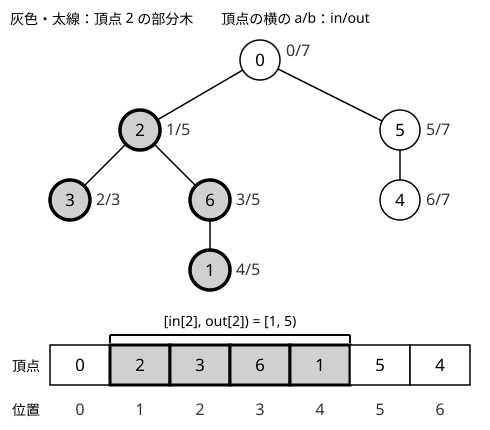

!!! abstract "要点"
    - **何ができるか**：DFS の行きがけ順に番号 $\mathrm{in}[v]$ を振り、子孫を回り終えた時点の番号 $\mathrm{out}[v]$ を記録すると、$v$ の部分木が列の区間 $[\mathrm{in}[v], \mathrm{out}[v])$ になる。部分木の和や加算が BIT・セグメント木の区間クエリになる。
    - **いつ使うか**：
        - 部分木の和・最大・個数を、更新を挟みながら聞かれる
        - 部分木に加算する・辺を取り除いたときの片側の和
        - $u$ が $v$ の祖先か・$v$ の子孫のうち深さ $d$ のもの
        - 辺の重みの変更と 2 点間の距離のクエリ
        - $N, Q \le 2 \times 10^5$ で、部分木への更新と質問が交互に来る
    - **計算量**：番号付けの DFS は $O(N)$。部分木の取得・更新は、列に載せたデータ構造の 1 回分（BIT・セグメント木なら $O(\log N)$）
    - **前提**：[根付き木と走査順](../tree/tree-traversal.md)、[BIT（Fenwick Tree）](../ds/fenwick-tree.md)

<!-- textlint-disable -->
別名：Euler Tour・行きがけ順の番号付け・in/out・木の平坦化・tree flattening・辺のオイラーツアー・DFS 順で部分木を区間にする
<!-- textlint-enable -->

オイラーツアーは、木の頂点を DFS の順で 1 列に並べ、部分木を列の区間へ置き換える技法である。区間になれば、[BIT](../ds/fenwick-tree.md)や[セグメント木](../ds/segment-tree.md)をそのまま使える。木の問題を列の問題に直す入口であり、根からのパスの和や、2 頂点の距離の更新つきのクエリにも使える。

このページでは頂点を 0-indexed で $0, \dots, N - 1$ と書き、根を頂点 $0$ とする。問題文の頂点 $V$（1-indexed）は頂点 $V - 1$ に読み替える。

## 「オイラーツアー」の 4 つの意味 {#meanings}

「オイラーツアー」という語は、資料によって次の 4 つのどれかを指す。解説を読むときは、どの列のことかを先に確かめる。

| 指すもの | 記録する列 | 長さ | 主な用途 |
| --- | --- | --- | --- |
| (a) 全辺を 1 回ずつ通る路 | （グラフの路） | $M$ 辺 | [オイラー路](../graph/euler-path.md) |
| (b) 入ったときに番号を振る | 行きがけ順 | $N$ | 部分木を区間にする（このページの中心） |
| (c) 頂点に着くたびに記録する | 子から戻ったときも記録 | $2N - 1$ | [LCA](../tree/lca.md) を区間の最小に直す |
| (d) 入るときと出るときに記録する | 入りと出の両方 | $2N$ | 辺の重みの $\pm$・[木上の Mo](#mo-on-tree) |

(a) は木に限らないグラフの話で、名前が同じだけである。(b)〜(d) はどれも DFS の訪問の記録で、(b) が最も短く、部分木のクエリには (b) で足りる。(c) の長さが $2N - 1$ なのは、根で 1 回記録し、$N - 1$ 本の辺それぞれを下りと上りで 1 回ずつ通るたびに記録するからである。(c) の列で 2 頂点の位置の間にある深さ最小の頂点が LCA になるので、Sparse Table を使えば前処理 $O(N \log N)$・1 回 $O(1)$ で LCA が求まる（方式の比べ方は [LCA](../tree/lca.md) のページ）。

## 部分木が区間になる理由と in・out の定義 {#in-out}

部分木の和を毎回 DFS で求めると、1 回 $O(N)$ かかる。$N, Q \le 2 \times 10^5$ で更新と質問が交互に来ると、合わせて $4 \times 10^{10}$ 回ほどになり間に合わない。部分木を列の区間にできれば、BIT で 1 回 $O(\log N)$ になる。

根から DFS し、次の 2 つを記録する。

- $\mathrm{in}[v]$：$v$ に入ったときの番号（$0, 1, 2, \dots$ と順に振る）
- $\mathrm{out}[v]$：$v$ の子孫をすべて回り終えて $v$ から出るときの、**次に振る番号**

すると、$v$ の部分木の頂点の番号はちょうど $\mathrm{in}[v], \mathrm{in}[v] + 1, \dots, \mathrm{out}[v] - 1$ になる。すなわち部分木は[半開区間](../guide/glossary.md#half-open-interval) $[\mathrm{in}[v], \mathrm{out}[v])$ で、その長さ $\mathrm{out}[v] - \mathrm{in}[v]$ は部分木サイズ $\mathrm{sz}[v]$ に等しい。



図の木で根 0 から子を番号の小さい順に回ると、入る順は $0, 2, 3, 6, 1, 5, 4$ である。頂点 2 には番号 1 で入り、子孫 3・6・1 に番号 2〜4 を振ってから出る。出るときの次の番号は 5 なので、$\mathrm{out}[2] = 5$ である。頂点 2 の部分木は列の区間 $[1, 5)$ になり、ほかの頂点はこの区間に入らない。

次の動く図では、上に木、下に行きがけ順で頂点を並べた列 $\mathrm{ord}$ と頂点ごとの in・out の表を置く。DFS が頂点へ入るごとに番号を振り、出るときは out を書き込む様子を追ったあと、頂点 2・5・6・0 の部分木と、それに当たる列の区間を括弧で順に示す。

<div class="kp-viz" data-viz="euler-tour" data-config='{"n": 7, "parents": [-1, 6, 0, 2, 5, 0, 2], "select": [2, 5, 6, 0]}'></div>

図がなくても、上の例の数字で同じことが確かめられる。たとえば頂点 6 の部分木（6・1）は区間 $[3, 5)$、頂点 5 の部分木（5・4）は区間 $[5, 7)$、根の部分木は全体 $[0, 7)$ である。

**なぜ正しいか**：番号は DFS が頂点に入った順で振る。DFS は $v$ に入ってから、子孫をすべて回り終えるまで $v$ から出ない。その間に入る頂点は $v$ の子孫だけで、$v$ の子孫はすべてその間に入る。だから、$v$ に入ってから出るまでに振られた番号 $\mathrm{in}[v], \dots, \mathrm{out}[v] - 1$ は、$v$ の部分木の頂点とちょうど 1 対 1 に対応する。

### 処理の流れ

```text
timer ← 0
dfs(v):
    in[v] ← timer;  timer ← timer + 1
    v の各子 c について dfs(c)
    out[v] ← timer

列 b を長さ N で用意し、各頂点 v の値を b[in[v]] に置く
部分木 v の取得   ＝ b の区間 [in[v], out[v]) の取得
頂点 v の値の更新 ＝ b の位置 in[v] の更新
```

逆に、位置 $t$ の頂点が要るなら、$\mathrm{ord}[\mathrm{in}[v]] = v$ となる配列 $\mathrm{ord}$ も作っておく。一点加算と部分木の和を ACL の `fenwick_tree` で書くと次のようになる。

```cpp
--8<-- "euler-tour/subtree-sum.cpp:core"
```

### 計算量とその根拠

番号付けの DFS は各頂点に 1 回ずつ入るので $O(N)$ である。その後の部分木の操作は列の区間の操作そのものなので、載せたデータ構造の 1 回分の計算量になる。

| やりたいこと | 列に載せるもの | 1 回 |
| --- | --- | --- |
| 一点の加算・部分木の和 | [BIT](../ds/fenwick-tree.md) | $O(\log N)$ |
| 一点の更新・部分木の最大値 | [セグメント木](../ds/segment-tree.md) | $O(\log N)$ |
| 部分木への加算・一点の取得 | 差分の [BIT](../ds/fenwick-tree.md#variants) | $O(\log N)$ |
| 部分木への加算・部分木の和や最大値 | [遅延セグメント木](../ds/lazy-segment-tree.md) | $O(\log N)$ |

更新がなく、最後に全頂点の値を出力するだけなら、[木の上のいもす法](../tree/tree-imos.md)の $O(N)$ で足りる。

## 祖先の判定と深さごとの頂点の数 {#ancestor-depth}

部分木が区間なので、祖先と子孫の関係は区間の包含で判定できる。$u$ が $v$ の祖先（$u = v$ を含む）であることは、$v$ が $u$ の部分木に入ること、すなわち次と同じである。

$$
\mathrm{in}[u] \le \mathrm{in}[v] < \mathrm{out}[u]
$$

前計算の後は 1 回 $O(1)$ で判定できる。2 つの頂点の区間は、一方が他方を含むか、まったく交わらないかのどちらかである。祖先と子孫の関係にあれば含み、なければ互いの部分木に共通の頂点がないからである。区間が途中だけ重なることはない。

この形を使うと「$u$ の部分木のうち、条件を満たす頂点の数」が、列の区間の数え上げになる。条件が深さなら、深さ $d$ の頂点の $\mathrm{in}$ を昇順に並べた列 $L_d$ を作る。$u$ の部分木の中で深さ $d$ の頂点の数は、$L_d$ のうち $[\mathrm{in}[u], \mathrm{out}[u])$ に入る要素の数で、二分探索 2 回で求まる。DFS の順に $L_{\mathrm{dep}[v]}$ へ積めば、並べ替えなくても昇順になる。どの頂点もちょうど 1 つの列に入るので、列の長さの合計は $N$ である。

```cpp
--8<-- "euler-tour/depth-count.cpp:core"
```

1 回の質問は $O(\log N)$ である。条件が「値が $x$ 以下」のように深さ以外なら、同じく値ごとの列を作るか、質問を値の順に並べて BIT に頂点を足していく[オフライン](../guide/glossary.md#offline)の処理にする（[ABC202 E](#abc202_e) の別解）。

??? question "確認問題：u が v の祖先であることを、区間の両端の比較で書くとどうなるか"
    $\mathrm{in}[u] \le \mathrm{in}[v]$ かつ $\mathrm{out}[v] \le \mathrm{out}[u]$ と書ける。部分木の区間 $[\mathrm{in}[v], \mathrm{out}[v])$ が $[\mathrm{in}[u], \mathrm{out}[u])$ に含まれることを、両端で書いたものである。$\mathrm{out}$ だけでは判定できない。たとえば葉 $v$ とその親 $u$ で、$v$ が最後の子なら $\mathrm{out}[u] = \mathrm{out}[v]$ になる。

## 部分木の補集合は 2 つの区間 {#complement}

$v$ の部分木に入らない頂点は、列の $[0, \mathrm{in}[v])$ と $[\mathrm{out}[v], N)$ の 2 つの区間にまとまる。部分木の区間の外側がそのまま残りだからである。

これは辺を 1 本取り除く問題で効く。辺 $(p, c)$（$p = \mathrm{par}[c]$）を取り除くと、木は $c$ の部分木と残りの 2 つに分かれる（[木の基本性質](../tree/tree-basics.md)）。$c$ の側は区間 $[\mathrm{in}[c], \mathrm{out}[c])$、$p$ の側はその補集合の 2 つの区間である。

- **和を聞かれる**：補集合の和は「全体の和 − 部分木の和」で求まり、区間を 2 つ聞く必要はない。全体の和は変数で持てばよい
- **補集合に加算する**：2 つの区間にそれぞれ加算する。または全体に加算してから、部分木に同じ量の逆を加算する
- **最大値を聞かれる**：引き算が使えないので、2 つの区間の最大値をそれぞれ取って比べる

辺が「頂点 $a$ と $b$ を結ぶ」と与えられたときは、どちらが子かを先に決める。$\mathrm{dep}[a] > \mathrm{dep}[b]$ なら $a$ が子である。片方の端点だけを見て子だと決めつけるのは、よくある誤りである。

??? question "確認問題：根の部分木の補集合を、この 2 つの区間で表すとどうなるか"
    $\mathrm{in}[0] = 0$、$\mathrm{out}[0] = N$ なので、$[0, 0)$ と $[N, N)$ の 2 つの空区間になる。根の部分木は全体なので、補集合は空である。空区間への加算は何もせず、空区間の和は 0 なので、場合分けせずに同じ式で書ける。

## 根からのパスを区間で扱う（辺の重みを子の部分木に配る） {#root-path}

根から $v$ までのパスの重みの和を $S[v]$ とする。辺 $(\mathrm{par}[c], c)$ の重み $w$ が $S$ に加わるのは、根からのパスがこの辺を通る頂点、すなわち $c$ の部分木の頂点だけである。よって、辺の重みを $w$ から $w'$ に変える更新は「$c$ の部分木の全頂点の $S$ に $w' - w$ を加える」ことと同じになる。

部分木は区間なので、これは区間加算で、$S[v]$ は一点の取得である。差分の BIT（[BIT の変種](../ds/fenwick-tree.md#variants)）を使えば、どちらも $O(\log N)$ でできる。辺の重みは子の頂点に置く（[木の基本性質](../tree/tree-basics.md)の小技）。

2 頂点 $u, v$ の距離は、[LCA](../tree/lca.md) $l = \mathrm{lca}(u, v)$ を使って次のように書ける。

$$
d(u, v) = S[u] + S[v] - 2 S[l]
$$

根から $u$ と $v$ へのパスは $l$ までが共通で、その部分を 2 回足しているので引く。辺の重みの変更と距離の質問が交互に来ても、LCA と合わせて 1 回 $O(\log N)$ で答えられる。

```cpp
--8<-- "euler-tour/root-path.cpp:core"
```

差分の BIT では、$+w$ を位置 $\mathrm{in}[c]$、$-w$ を位置 $\mathrm{out}[c]$ に足す。これは (d) の入りと出の両方を記録した列で、$+w$ を $c$ の入りの位置、$-w$ を出の位置に置いて累積和を取るのと同じである。資料によってはこちらの形で説明する。

この方法は、和や XOR のように引き算で打ち消せる演算に限られる（[BIT の何ができるか](../ds/fenwick-tree.md#what-it-does)）。パスの最大値は引き算で求まらないので、[HL 分解](#to-hld)などを使う。頂点に値がある場合のパスの和は、$S[v]$ を頂点の値の和として $S[u] + S[v] - 2 S[l] + a_l$ になる。$l$ の値を 2 回引いてしまうので 1 回足し戻す。

??? question "確認問題：辺 (par[c], c) の重みを変えたとき、S が変わる頂点はどれか"
    $c$ の部分木の頂点だけである。根からそれらへのパスはどれもこの辺を通り、ほかの頂点へのパスは通らない。部分木は区間 $[\mathrm{in}[c], \mathrm{out}[c])$ なので、区間加算 1 回で $S$ を直せる。

## 木上の Mo（データ構造の章） {#mo-on-tree}

部分木やパスについて「値の種類数」「出現回数が条件を満たす値の数」を聞かれると、区間の値をまとめて合成できず、BIT やセグメント木に載らない。クエリを先に全部読める（オフライン）なら、列の区間に直してから [Mo's algorithm](../ds/mo-algorithm.md) を使う。

- **部分木のクエリ**：(b) の列で区間 $[\mathrm{in}[v], \mathrm{out}[v])$ になるので、そのまま列の Mo にかける
- **パスのクエリ**：(d) の長さ $2N$ の列を使う。$\mathrm{in}$ の早い方を $u$ とし、列での入りの位置を $\mathrm{ST}$、出の位置を $\mathrm{EN}$ とする。$u$ が $v$ の祖先なら閉区間 $[\mathrm{ST}(u), \mathrm{ST}(v)]$、そうでなければ閉区間 $[\mathrm{EN}(u), \mathrm{ST}(v)]$ を取る。区間にちょうど 1 回現れる頂点がパス上の頂点で、2 回現れる頂点はパスの外である。ただし後者の場合は LCA が区間に 1 度も現れないので、別に足す

2 回現れた頂点を打ち消す実装は、Mo のページの木上の Mo の節で扱う。

## 逆元がない演算・パスへの一括更新は HL 分解 {#to-hld}

この節は[HL 分解](../tree/hld.md)の概要と合わせて読む。オイラーツアーで直接扱えるのは部分木と、引き算で打ち消せる演算での根からのパスまでである。次の場合は HL 分解に進む。

- パスの最大値・最小値を、更新を挟みながら聞かれる（引き算が使えない）
- パス上の全頂点に一括で加算・代入する
- パスに沿って、順序で結果が変わる演算（1 次関数の合成など）を集約する

HL 分解の番号付けも行きがけ順で、重い子を先に回るだけである。だから部分木は同じく区間 $[\mathrm{in}[v], \mathrm{in}[v] + \mathrm{sz}[v])$ のままで、1 つの番号付けでパスと部分木の両方を扱える（[番号の振り方](../tree/hld.md#numbering)）。どちらで足りるかの表は [HL 分解の使い分け](../tree/hld.md#when-to-use)にある。

!!! info "ACL では"
    ACL に木専用の機能はなく、DFS で作った長さ $N$ の列に次のものを載せる。部分木 $v$ は `[in[v], out[v])` で、どれも 0-indexed の半開区間を受け取る。

    - 一点の加算・部分木の和：`fenwick_tree<long long> fw(n);`。`fw.add(in[v], x)`・`fw.sum(in[v], out[v])` はどれも $O(\log N)$
    - 一点の更新・部分木の最大値：`segtree<S, op, e> seg(n);`。`seg.set(in[v], x)`・`seg.prod(in[v], out[v])` はどれも $O(\log N)$
    - 部分木への加算と部分木の集約：`lazy_segtree<S, op, e, F, mapping, composition, id> seg(n);`。`seg.apply(in[v], out[v], f)`・`seg.prod(in[v], out[v])` はどれも $O(\log N)$
    - 根からのパスの和：長さ $N + 1$ の `fenwick_tree` に差分を置き、$S[v]$ を `sum(0, in[v] + 1)` で取る

## 落とし穴 {#pitfalls}

- **out の定義を混ぜる**：「次に振る番号」（半開区間 $[\mathrm{in}, \mathrm{out})$）と「最後の子孫の番号」（閉区間 $[\mathrm{in}, \mathrm{out}]$）の 2 つの流儀がある。資料のコードを混ぜると、区間の端が 1 つずれる。このページは前者で、`fenwick_tree` や `segtree` の半開区間にそのまま渡せる
- **頂点番号と位置の取り違え**：頂点 $v$ の値は位置 $\mathrm{in}[v]$ に置く。`fw.add(v, x)` と書くと、別の頂点の値を変えてしまう。小さい例では $\mathrm{in}[v] = v$ になりやすく、手元の例で気づけないことがある。番号どおりに並ばない木（図の木など）で確かめる
- **初期値の置き忘れ**：BIT を `fenwick_tree<long long> fw(n)` で作るとすべて 0 である。各頂点の初期値を位置 $\mathrm{in}[v]$ に足してから質問に答える
- **辺のどちらの端が子か**：辺の値は子に置き、辺を取り除いた片側は子の部分木である。入力の辺の端点の順は親子の順とは限らないので、深さか親の配列で子を決める
- **無向の木で親へ戻る**：隣接リストが無向なら、DFS で親を引数に渡して親へ戻らないようにする。戻ると番号が壊れ、再帰が止まらない
- **再帰の深さ**：パス状の木では再帰が $N$ 段になる。手元でスタックが溢れるときは、[根付き木と走査順](../tree/tree-traversal.md)の非再帰の書き方にする
- **「オイラーツアー」の意味の取り違え**：LCA の解説の長さ $2N - 1$ の列と、部分木の長さ $N$ の列は別物である（[4 つの意味](#meanings)）。長さ $2N - 1$ の列で部分木の区間を取ると、同じ頂点が何度も入る

## 例題 {#examples}

### ABC406 F. Compare Tree Weights {#abc406_f}

<div class="kp-problems" data-role="example" markdown>

- [ABC406 F. Compare Tree Weights](https://atcoder.jp/contests/abc406/tasks/abc406_f)（diff 1470）：最初はどの頂点の重みも 1 の木で、頂点の重みへの加算と、指定した辺で木を 2 つに分けたときの両側の重みの和の差の絶対値の質問に答える。

</div>

辺で分けた片側は子の部分木なので、[部分木の補集合](#complement)の形そのものである。頂点の重みを位置 $\mathrm{in}[v]$ に置いた BIT で部分木の和を取り、全体の和との差から答えを出す。

??? note "解法の詳細"
    頂点 0 を根にして DFS し、$\mathrm{in}$・$\mathrm{out}$・$\mathrm{dep}$ を求める。BIT の位置 $\mathrm{in}[v]$ に 1 を置き、全体の和 $T = N$ を変数で持つ。

    - **加算**：頂点 $x$ に $w$ を加えるなら、位置 $\mathrm{in}[x]$ に $w$ を足し、$T$ にも $w$ を足す
    - **質問**：辺の 2 つの端点のうち深い方を $c$ とする。$c$ の側の和は $s = $ `sum(in[c], out[c])`、反対側は $T - s$ なので、答えは $\lvert T - 2s \rvert$ である

    どちらの操作も $O(\log N)$ で、全体で $O((N + Q) \log N)$ になる。辺の端点の一方だけを見て子だと決めると誤答になる。

### ABC202 E. Count Descendants {#abc202_e}

<div class="kp-problems" data-role="example" markdown>

- [ABC202 E. Count Descendants](https://atcoder.jp/contests/abc202/tasks/abc202_e)（diff 1638）：根付き木で、頂点 U_i を祖先に持つ（U_i 自身を含む）深さ D_i の頂点の数を Q 個の質問に答える。

</div>

「$U_i$ を祖先に持つ」は「$U_i$ の部分木に入る」と同じである。[深さごとの頂点の数](#ancestor-depth)の方法で、深さ $D_i$ の頂点の $\mathrm{in}$ を並べた列のうち、区間 $[\mathrm{in}[U_i], \mathrm{out}[U_i])$ に入るものを二分探索で数える。

??? note "解法の詳細"
    頂点 $V$（1-indexed）を頂点 $V - 1$ として、根 0 の深さを 0 とする。DFS で $\mathrm{in}$・$\mathrm{out}$ を振りながら、深さ $\mathrm{dep}[v]$ の列に $\mathrm{in}[v]$ を積む。質問 $(U, D)$ には、深さ $D$ の列で $\mathrm{out}[U]$ 以上の最初の位置から、$\mathrm{in}[U]$ 以上の最初の位置を引いたものを答える。$D$ が $U$ の深さより小さいときは、子孫がいないので 0 である。

    前処理 $O(N)$、1 回 $O(\log N)$ で、全体で $O(N + Q \log N)$ になる。別解として、質問を深さの順に並べ、深さ $D - 1$ までと $D$ までの頂点を BIT に足したときの区間の個数の差を取るオフラインの方法もある。

### ABC294 G. Distance Queries on a Tree {#abc294_g}

<div class="kp-problems" data-role="example" markdown>

- [ABC294 G. Distance Queries on a Tree](https://atcoder.jp/contests/abc294/tasks/abc294_g)（diff 1702）：重み付きの木で、辺の重みの変更と 2 頂点間の距離の質問に答える。

</div>

[根からのパスを区間で扱う](#root-path)の形そのものである。根からの距離 $S[v]$ を差分の BIT で持ち、辺の重みの変更を子の部分木への区間加算にする。距離は $S[u] + S[v] - 2 S[\mathrm{lca}(u, v)]$ で求める。

??? note "解法の詳細"
    根を決めて DFS し、各辺の深い方の端点（子）を求め、辺の重みをその子に置く。差分の BIT（長さ $N + 1$）では、各辺の子 $c$ の $+w$ を位置 $\mathrm{in}[c]$、$-w$ を位置 $\mathrm{out}[c]$ に足す。

    - **重みの変更**：辺の子 $c$ について、$w' - w$ を区間 $[\mathrm{in}[c], \mathrm{out}[c])$ に加え、置いた重みを $w'$ に書き換える
    - **距離**：$S[v]$ は BIT の $[0, \mathrm{in}[v] + 1)$ の和である。LCA をダブリングで求め、$S[u] + S[v] - 2 S[\mathrm{lca}(u, v)]$ を答える

    LCA の前処理が $O(N \log N)$ で、どちらの操作も $O(\log N)$ なので、全体で $O((N + Q) \log N)$ になる。距離は最大で「辺の重みの上限 × $(N - 1)$」になる。制約からこの積を見積もり、`int` を超えるなら `long long` で持つ。

## 練習問題 {#practice}

<div class="kp-problems" data-role="practice" markdown>

- [ABC240 E. Ranges on Tree](https://atcoder.jp/contests/abc240/tasks/abc240_e)（diff 1068）：根付き木の各頂点に区間を割り当て、祖先の区間が子孫の区間を含み、祖先と子孫の関係にない頂点どうしの区間は交わらないようにするとき、区間の端の最大値を最小にする割り当てを出力する。
- [ABC239 E. Subtree K-th Max](https://atcoder.jp/contests/abc239/tasks/abc239_e)（diff 1084）：根付き木で、頂点 V の部分木に含まれる値のうち K 番目（K ≤ 20）に大きいものを Q 個の質問に答える。

</div>

??? note "方針"
    - **ABC240 E**：葉どうしの区間は交わらないので、最大値は葉の数以上である。葉にだけ DFS の順に $1, 2, \dots$ と番号を振ると、各頂点の部分木の葉は連続した番号になる。各頂点の区間を「部分木の葉の番号の最小から最大まで」とすれば条件を満たし、最大値は葉の数になる。祖先と子孫の関係が区間の包含に対応する、という[祖先の判定](#ancestor-depth)の性質を逆向きに使う問題である
    - **ABC239 E**：$K \le 20$ なので、各頂点で子の上位 20 個を集めて自分の上位 20 個を作る木 DP で足りる。列で考えるなら、各ノードに上位 20 個を持たせたセグメント木を DFS 順の列に載せ、区間 $[\mathrm{in}[V], \mathrm{out}[V])$ の上位を取る

## 力試し {#challenge}

<div class="kp-problems" data-role="challenge" markdown>

- [ABC337 G. Tree Inversion](https://atcoder.jp/contests/abc337/tasks/abc337_g)（diff 2080）：頂点 1〜N の木の各頂点 u について、u と v を結ぶパス上に w があり w > v となる組 (v, w) の数を求める。

</div>

??? note "方針"
    - **ABC337 G**：組 $(v, w)$ を $w$ ごとに数える。$w$ を取り除いてできる各方向の側 $X$ について、$X$ の中で $w$ より小さい頂点の数を $t$ とする。$X$ の中の $v$ と組になる $u$ は、$X$ の外のすべての頂点（$w$ 自身を含む）なので、それらの答えに $t$ を加える。$X$ が子 $c$ の部分木なら加える先は[部分木の補集合](#complement)の 2 つの区間、$X$ が親の側なら $w$ の部分木である。$t$ は、ラベルの小さい順に頂点を BIT に足しながら部分木の区間の個数として数える（親の側は「$w$ − $w$ の部分木の中の個数」。0-indexed のラベルでは $w$ より小さい頂点は $w$ 個）。加算は差分の BIT で行い、最後に各頂点の値を読む。全体で $O(N \log N)$

## 確認問題 {#quiz}

??? question "確認問題：out を「最後の子孫の番号」と定めたとき、部分木の区間はどう書けるか"
    閉区間 $[\mathrm{in}[v], \mathrm{out}'[v]]$ になる。$\mathrm{out}'[v] = \mathrm{out}[v] - 1$ なので、半開区間を受け取る ACL には `sum(in[v], out'[v] + 1)` と渡す。どちらの流儀でも、区間の長さは部分木サイズに等しい。

??? question "確認問題：2 つの頂点の区間が途中だけ重なることがないのはなぜか"
    重なるなら共通の頂点 $x$ があり、$x$ は両方の頂点の子孫である。根から $x$ へのパスは 1 本しかないので、2 つの頂点はどちらもそのパス上にあり、一方が他方の祖先になる。祖先の区間は子孫の区間を丸ごと含むので、途中だけ重なることはない。

??? question "確認問題：部分木の最大値を、更新を挟みながら答えるには何を載せるか"
    最大値は引き算で取り消せないので、BIT ではなくセグメント木を載せる。一点の更新は `set(in[v], x)`、部分木の最大値は `prod(in[v], out[v])` で、どちらも $O(\log N)$ である。部分木への一括の加算も来るなら遅延セグメント木にする。

## 使い分け {#comparison}

| やりたいこと | 使う手法 |
| --- | --- |
| 部分木への加算をまとめて、最後に出力するだけ | [木の上のいもす法](../tree/tree-imos.md) |
| 部分木の取得・更新を交互に（オンライン） | オイラーツアーと BIT・セグメント木 |
| 根からのパスの和・2 点間の距離（辺や頂点の更新） | オイラーツアーと差分の BIT と [LCA](../tree/lca.md) |
| パスの最大値（更新あり）・パスへの一括更新 | [HL 分解](../tree/hld.md) |
| 部分木・パスの種類数や頻度（オフライン） | オイラーツアーと [Mo's algorithm](../ds/mo-algorithm.md) |
| 部分木ごとの集合を作る（種類数など） | [マージテク](../tree/small-to-large.md) |

自作のライブラリは、Library Checker の [Vertex Add Subtree Sum](https://judge.yosupo.jp/problem/vertex_add_subtree_sum) で確かめられる。

## 参考 {#references}

- [AtCoder Library「Fenwick Tree」（document_ja）](https://github.com/atcoder/ac-library/blob/master/document_ja/fenwicktree.md)：`fenwick_tree` の `add`・`sum` の引数（半開区間）と計算量
- [merom686「ABC406」](https://merom686.hatenablog.com/entry/2025/05/18/151742)：例題 abc406_f の方針（片側は子の部分木の和）と、辺の端点の片方しか見ない誤り
- [bfs「【JavaScript】ABC406まとめ（A~F）」](https://qiita.com/bfs/items/8d3f7bf6c8e90b073086)：例題 abc406_f の操作の中身（初期の重み、加算と差の絶対値）
- [2yuu「AtCoder Beginner Contest E - Count Descendants」](https://qiita.com/2yuu/items/898b95864905dcbc8e7d)：例題 abc202_e の深さごとの列と二分探索
- [はまやんはまやんはまやん「Count Descendants」](https://blog.hamayanhamayan.com/entry/2021/05/22/225525)：例題 abc202_e の別解（深さの順の平面走査と BIT）
- [kmjp「AtCoder ABC #294 G」](https://kmjp.hatenablog.jp/entry/2023/04/18/0900)：例題 abc294_g の方針（根からの距離、辺の重みを部分木への区間加算に、LCA）
- [Kazun「ABC240 E」](https://kazun-kyopro.hatenablog.com/entry/ABC/240/E)：練習 abc240_e の下限と葉の番号付け
- [kmjp「AtCoder ABC #337 G」](https://kmjp.hatenablog.jp/entry/2024/01/20/1000)：力試し abc337_g の問いと方針（部分木の補集合への加算）
