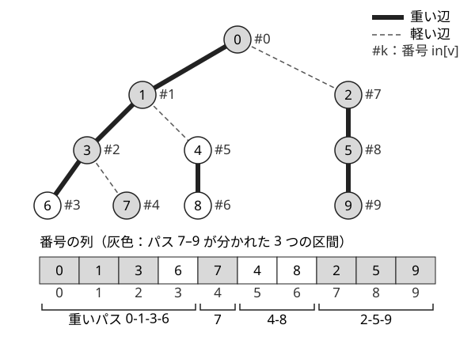

!!! abstract "要点"
    - **何ができるか**：木の任意のパスを、番号の連続する $O(\log N)$ 個の区間に分ける。セグメント木と組むと、パスへの一括更新や最大値のような逆元のない演算の集約を、更新を挟みながら 1 回 $O(\log^2 N)$ で処理できる。
    - **いつ使うか**：
        - パスへの一括更新とパスの取得が混ざる
        - パス上の最大値（逆元のない演算）を更新つきで答える
        - 部分木とパスの両方のクエリ
    - **計算量**：構築 $O(N)$。セグメント木と組むと、パスの取得・更新が 1 回 $O(\log^2 N)$、部分木の取得・更新と LCA が $O(\log N)$
    - **前提**：[オイラーツアー](../tree/euler-tour.md)、[最小共通祖先（LCA）](../tree/lca.md)、[セグメント木](../ds/segment-tree.md)

<!-- textlint-disable -->
別名：HLD・Heavy-Light Decomposition・重軽分解
<!-- textlint-enable -->

HL 分解は、木を「重いパス」と呼ぶ縦の鎖に切り分け、鎖ごとに番号が連続するように頂点を並べる方法である。木のパスの問題が、列の区間の問題に置き換わる。列の側には[セグメント木](../ds/segment-tree.md)や[遅延セグメント木](../ds/lazy-segment-tree.md)をそのまま載せる。

ABC で HL 分解が必須になるのはおおむね difficulty 2400 以上の問題で、黄の帯では別解として現れる程度である。ただし、パスの更新と取得を一度に扱える汎用の道具なので、自作ライブラリに 1 つ持っておく価値がある。

## 重い辺と軽い辺・根からの軽い辺が log N 本以下の理由 {#heavy-light}

根付き木の各頂点 $v$ で、子のうち部分木サイズ $\mathrm{sz}$ が最大のもの（同じなら 1 つを選ぶ）を**重い子**、$v$ からそこへの辺を**重い辺**と呼ぶ。ほかの子への辺は**軽い辺**である。重い辺だけをたどると、木は縦の鎖に分かれる。この鎖が**重いパス**で、各頂点はちょうど 1 本の重いパスに属する。

要になる性質は「根から任意の頂点までのパスに、軽い辺は $\log_2 N$ 本以下しかない」ことである。

- 軽い辺で $v$ から子 $c$ へ下りるとき、$v$ の重い子 $h$ は $\mathrm{sz}[h] \ge \mathrm{sz}[c]$ を満たす。$c$ と $h$ の部分木は重ならない。
- よって $2\,\mathrm{sz}[c] \le \mathrm{sz}[c] + \mathrm{sz}[h] \le \mathrm{sz}[v] - 1$、すなわち $\mathrm{sz}[c] < \mathrm{sz}[v] / 2$ になる。
- 根の部分木サイズは $N$ で、軽い辺を 1 本下りるたびに部分木サイズは半分未満になる。サイズは 1 以上なので、軽い辺は $\log_2 N$ 本以下で尽きる。

根から頂点までのパスは「重いパスの一部」と「軽い辺」が交互に並ぶので、通る重いパスは $\log_2 N + 1$ 本以下である。2 頂点 $u, v$ のパスは根から $u$ と根から $v$ のパスに含まれるから、通る重いパスも $O(\log N)$ 本で済む。

根を端に取ったパス状の木（一直線）では、重いパスが 1 本だけになる。完全二分木では、根から葉へ向かうパスに軽い辺が最大で深さぶん（約 $\log_2 N$ 本）現れ、上限がほぼそのまま効く。

??? question "確認問題：重い子を「部分木サイズ最大」ではなく「番号が最小の子」にしたらどうなるか"
    軽い辺で下りても部分木が半分未満になるとは限らなくなる。たとえば各頂点の番号最小の子が葉で、もう 1 つの子に残りがすべてぶら下がる木（毛虫のような形）を考える。根からの軽い辺が $\Theta(N)$ 本になり、1 本のパスが $\Theta(N)$ 個の区間に分かれる。

## 番号の振り方（重い子を先に）とパスの区間への分解 {#numbering}

番号は、2 回の DFS で振る。

1. 1 回目の DFS で、$\mathrm{par}[v]$・$\mathrm{dep}[v]$・$\mathrm{sz}[v]$ と重い子を求める
2. 2 回目の DFS で、行きがけ順に番号 $\mathrm{in}[v]$ を振る。このとき**重い子を必ず最初に訪れる**。あわせて、$v$ が属する重いパスの最も浅い頂点 $\mathrm{head}[v]$ を記録する（重い子は親と同じ head、軽い子は自分が head）

重い子を先に訪れるので、1 本の重いパスの頂点は番号が連続し、浅い方から深い方へ番号が増える。番号は行きがけ順のままなので、[オイラーツアー](../tree/euler-tour.md)と同じく部分木 $v$ は区間 $[\mathrm{in}[v], \mathrm{in}[v] + \mathrm{sz}[v])$ になる。1 つの番号付けで、パスと部分木の両方を扱える。



パス $u$–$v$ を区間に分ける手順は次のとおりである。

```text
while head[u] != head[v]:
    head が深い方を u にする（dep[head[u]] < dep[head[v]] なら u と v を入れ替える）
    区間 [in[head[u]], in[u] + 1) を取る
    u = par[head[u]]        # 重いパスの先頭の親へ上がる（軽い辺を 1 本上る）
# 同じ重いパスに来た
in[u] > in[v] なら入れ替え、区間 [in[u], in[v] + 1) を取る   # u が LCA
```

図の木で $u = 7, v = 9$ とすると、まず head が深い 7 の側で区間 $[4, 5)$ を取って頂点 3 へ上がる。次に head が深い 9 の側で区間 $[7, 10)$ を取って頂点 0 へ上がる。最後に 0 と 3 は同じ重いパスにあるので区間 $[0, 3)$ を取って終わる。ループは 1 回ごとに軽い辺を 1 本上るので、回数は $O(\log N)$ である。最後に残った浅い方の頂点が LCA なので、HL 分解は LCA を 1 回 $O(\log N)$ で求める方法にもなる。

各区間をセグメント木で $O(\log N)$ で処理するので、パスのクエリは 1 回 $O(\log^2 N)$ になる。

??? question "確認問題：head が深い方ではなく、頂点そのものが深い方を上げるとどうなるか"
    誤りになる。頂点が深くても、その重いパスの先頭はもう一方より浅いことがある。先頭の親へ上がると LCA を通り越し、パスにない頂点を区間に含めてしまう。比べるのは $\mathrm{dep}[\mathrm{head}[\cdot]]$ である。

## 辺の値は子の頂点に置く・非可換な演算の向き {#edge-values}

辺に値がある問題では、辺 $(\mathrm{par}[c], c)$ の値を子の頂点 $c$ に置く（[木の基本性質](../tree/tree-basics.md)の小技）。根以外の頂点と親への辺は 1 対 1 に対応する。このときパス $u$–$v$ の辺は「LCA を除いたパス上の頂点」になる。[パスを区間に分ける手順](#numbering)で、同じ重いパスへ来た後で取る区間を $[\mathrm{in}[u] + 1, \mathrm{in}[v] + 1)$ に変えれば、LCA の分が外れる。$u$ と $v$ が同じ頂点ならこの区間は空になる。セグメント木の `prod` は空の区間で単位元を返すので、そのまま集約してよい。

演算が可換でない（順序で結果が変わる）ときは、向きに注意する。たとえば頂点ごとの 1 次関数を $u$ から $v$ の順に合成する問題がそうである。

- $u$ の側の区間は、パスの上で深い方から浅い方へたどる。番号は浅い方が小さいので、区間の中は**番号の逆順**に合成する。
- $v$ の側の区間は浅い方から深い方へたどるので、番号の順に合成する。ただし区間は $v$ から上へ向かって見つかるので、**見つけた順と逆に**つなぐ。

このためには、[番号の振り方](#numbering)の手順のように $u$ と $v$ を入れ替えてはいけない。入れ替えると、どの区間がどちらの側かが分からなくなる。どちらの側を上げたかで区間を 2 つの列に分けて積み、最後の区間は向きを場合分けする。

```text
up = [], down = []
while head[u] != head[v]:
    if dep[head[u]] >= dep[head[v]]:
        up に [in[head[u]], in[u] + 1) を「逆順」として積む;   u = par[head[u]]
    else:
        down に [in[head[v]], in[v] + 1) を「番号の順」として積む; v = par[head[v]]
dep[u] >= dep[v] なら up に [in[v], in[u] + 1) を「逆順」として積む
そうでなければ   up に [in[u], in[v] + 1) を「番号の順」として積む
答えの並び = up を積んだ順 → down を積んだ順と逆
```

逆順の積は、演算の左右を入れ替えたセグメント木をもう 1 本持つか、各ノードに「左から合成した値」と「右から合成した値」の 2 つを持たせれば $O(\log N)$ で取り出せる。最大値や和のような可換な演算なら、区間をどの順に集めてもよい。

## いつ使うか（オイラーツアーと LCA で足りる場合との使い分け） {#when-to-use}

HL 分解は実装が重いので、軽い方法で足りるかを先に考える。

| パスの問題の形 | 使う方法 |
| --- | --- |
| 和・XOR のように逆元があり、更新は 1 点だけ | 根からの累積と [LCA](../tree/lca.md)。更新は[オイラーツアー](../tree/euler-tour.md)で部分木への加算にする |
| 最大値などの集約で、更新がない | LCA のダブリングの表に集約を一緒に持つ |
| パスへの一括更新がある | HL 分解と遅延セグメント木 |
| 逆元のない演算や非可換な演算を、更新つきで集約する | HL 分解とセグメント木 |
| 木の形が変わる（辺の付け替え） | 動的木（HL 分解では扱えない） |

和の場合は、パス $u$–$v$ の頂点の値の和が $S[u] + S[v] - 2 S[\mathrm{lca}(u, v)] + a_{\mathrm{lca}(u, v)}$ と書ける（$S[v]$ は根から $v$ までの和）。引き算の使えない最大値ではこの式が成り立たない。これが HL 分解の要る典型の理由である。パスの判定（頂点がパス上にあるか、など）だけなら[木の上のパスの判定と分解](../tree/tree-path.md#on-path)で足りる。木 DP の値を更新つきで求め直す問題は、重いパスの上にさらに構造を作る [Static Top Tree](../tree/static-top-tree.md#heavy-path-dp) の領分になる。

## 自作ライブラリでの扱い {#library}

自作するときに保つ性質は次の 3 つである。

- 重いパスの番号は連続し、浅い方ほど小さい（重い子を先に訪れる）
- $\mathrm{head}[v]$ は $v$ の重いパスの最も浅い頂点で、$\mathrm{par}[\mathrm{head}[v]]$ への辺は軽い辺である
- 部分木 $v$ の番号は $[\mathrm{in}[v], \mathrm{in}[v] + \mathrm{sz}[v])$ に収まる（番号は行きがけ順）

境界は半開区間でそろえ、頂点の値か辺の値か（LCA を含めるか）を引数で切り替えられるようにしておくとよい。構築は 2 回の DFS で、パス状の木では再帰が $N$ 段になる。AtCoder ではたいてい通るが、スタックの小さい環境では再帰を使わない走査に書き換える。

構築の中心は次のとおりである（完全なプログラムは `snippets/hld/usage.cpp`）。

```cpp
--8<-- "hld/usage.cpp:build"
```

パスを区間に分ける関数は、区間の列を返す形にしておくと、載せるデータ構造を選ばない。次の `path` は区間の向きを捨てるので、可換な演算（和・最大値など）専用である。

```cpp
--8<-- "hld/usage.cpp:path"
```

非可換な演算には、$u$ から $v$ への順に並べ、各区間をたどる向きを添えて返す版を別に持つ。コード片では、演算の左右を入れ替えたセグメント木と組み、乱数の木で Vertex Set Path Composite と同じ合成を愚直な方法と比べて確かめている。

```cpp
--8<-- "hld/usage.cpp:ordered"
```

!!! info "ACL では"
    ACL に HL 分解そのものはない。番号 $\mathrm{in}[v]$ の位置に頂点 $v$ の値を置いた列に、`segtree<S, op, e> seg(n);` を載せる。`seg.set(p, x)`・`seg.prod(l, r)` はどちらも $O(\log N)$ で、`op` は[結合法則](../guide/glossary.md#associativity)を満たし、`e()` は[単位元](../guide/glossary.md#identity-element)である必要がある。パスへの一括更新には `lazy_segtree` の `seg.apply(l, r, f)` を、パスの各区間に対して呼ぶ。

次のコード片は、番号の列に `segtree` を載せて、頂点の値の 1 点変更とパス上の最大値の取得を処理する。入力の頂点は 1-indexed で、読んだ直後に 1 を引く。

```cpp
--8<-- "hld/usage.cpp:query"
```

自作したら、Library Checker で確かめる。使う問題は[練習問題](#practice)の Library Checker の節にまとめた。

## 学ぶための資料 {#resources}

- けんちょん（drken）氏の yukicoder 399 の記事：パスへの区間加算と区間和を HL 分解で処理する実例。区間の処理を関数として渡す書き方が参考になる
- Luzhiled's Library（ei1333 氏）の HL 分解は、パスの集約・更新・LCA・K 個上の祖先をまとめたライブラリで、自作するときの関数の切り分けの参考になる
- 正しさと計算量の確認には cp-algorithms の Heavy-light decomposition の記事がある（英語）

## 例題 {#examples}

### ABC460 G. Vertex Flip Query {#abc460_g}

<div class="kp-problems" data-role="example" markdown>

- [ABC460 G. Vertex Flip Query](https://atcoder.jp/contests/abc460/tasks/abc460_g)（diff 2838）：木の頂点の色の反転と重みの加算をしながら、指定した頂点を含む同じ色の頂点のつながった部分の重みの和を答える。

</div>

方針：重いパスを列として扱い、各頂点に「自分の重みと、軽い子の重いパスのうち先頭から同じ色で続く部分の和」をまとめて持たせる。同じ色の連結部分は、重いパスの上では連続する区間になる。更新の影響は軽い辺を上って親の重いパスへ伝わり、その回数は軽い辺の本数で抑えられる。

??? note "解法の詳細"
    - 各重いパスで、色が変わる位置を順序付き集合に持つ。ある頂点を含む同じ色の区間の端は二分探索で分かる。
    - 値の定義：頂点 $i$ の値 $V_i$ は、重み $W_i$ に軽い子の寄与を足したものとする。軽い子の寄与は、その子の重いパスで先頭から同じ色が続く部分の重みの和である。
    - 持ち方：重いパスごとに $V$ の区間和を BIT かセグメント木で持つ。軽い子の寄与の和は、子の重いパスの先頭が白のものと黒のものに分けて持つ。
    - 質問：質問の頂点から同じ色が続く限り親の重いパスへ上がる。最後に着いた重いパスで、着いた頂点を含む同じ色の区間の $V$ の和を答える。
    - 色の反転と重みの加算：その頂点の値を直す。重いパスの先頭の色か、先頭から続く部分の和が変わったときだけ、親の頂点の値を差分で直す。伝わるのは軽い辺の本数ぶんで $O(\log N)$ 回。
    - 計算量は全体で $O(N \log N + Q \log^2 N)$。実装が重く、定数倍にも気を配る必要がある。

## 練習問題 {#practice}

<div class="kp-problems" data-role="practice" markdown>

- [ABC294 G. Distance Queries on a Tree](https://atcoder.jp/contests/abc294/tasks/abc294_g)（diff 1702）：重み付きの木で、辺の重みの変更と 2 頂点間の距離の質問に答える。

</div>

??? note "練習の方針"
    - ABC294 G：辺の重みを子の頂点に置けば、距離は LCA を除いたパス上の頂点の値の和になる。HL 分解の番号の列に BIT を載せれば、重みの変更は 1 点の更新、距離はパスの区間和で、1 回 $O(\log^2 N)$ になる。和は逆元があるので、根からの距離と LCA を使い、重みの変更をオイラーツアーで部分木への加算にする方法でも解ける（こちらの方が軽い）

### Library Checker

- [Vertex Add Path Sum](https://judge.yosupo.jp/problem/vertex_add_path_sum)：頂点への加算とパスの和（可換な演算の基本）
- [Vertex Add Subtree Sum](https://judge.yosupo.jp/problem/vertex_add_subtree_sum)：同じ番号付けで部分木が区間になることの確認
- [Vertex Set Path Composite](https://judge.yosupo.jp/problem/vertex_set_path_composite)：頂点の 1 次関数の変更と、$u$ から $v$ への合成（非可換な演算の向きの確認。このページの検証問題）
- [Lowest Common Ancestor](https://judge.yosupo.jp/problem/lca)：LCA の部分の確認

## 参考 {#references}

- [AtCoder「AC Library のドキュメント（document_ja）」](https://github.com/atcoder/ac-library/tree/master/document_ja)：ACL の囲みの宣言・計算量・要件
- [yosupo06「library-checker-problems/tree」](https://github.com/yosupo06/library-checker-problems/tree/master/tree)：検証に使う問題の内容
- [drken「yukicoder 399 動的な領主 (HL分解で通す)」](https://drken1215.hatenablog.com/entry/2018/08/14/014800)：学ぶための資料。パスへの区間加算を HL 分解で処理する実例
- [ei1333「Luzhiled's Library: Heavy-Light-Decomposition(HL分解)」](https://ei1333.github.io/library/graph/tree/heavy-light-decomposition.hpp)：学ぶための資料。ライブラリの関数の切り分け
- [cp-algorithms「Heavy-light decomposition」](https://cp-algorithms.com/graph/hld.html)：軽い辺が $\log N$ 本以下であることと計算量の確認（文章・図は使っていない）
- [ikatakos「AtCoder Beginner Contest 460 E,F,G問題メモ」](https://ikatakos.com/pot/programming_algorithm/contest_history/atcoder/2026/0530_abc460)：例題 ABC460 G の方針（解法の節だけを読んだ）
- [kmjp「AtCoder ABC #294 : G - Distance Queries on a Tree」](https://kmjp.hatenablog.jp/entry/2023/04/18/0900)：練習 ABC294 G の、オイラーツアーと LCA による解き方
