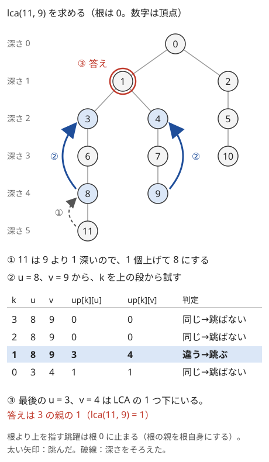

!!! abstract "要点"
    - **何ができるか**：根付き木で 2 頂点の共通の祖先のうち最も深いもの（LCA）を、各頂点の $2^k$ 個上の祖先の表（ダブリング）で、前処理 $O(N \log N)$・1 回 $O(\log N)$ で求める。同じ表で、2 点間の距離・K 個上の祖先・パス上の最大値や和も 1 回 $O(\log N)$ で求まる。
    - **いつ使うか**：
        - 木の 2 頂点の距離をクエリでたくさん聞かれる
        - パス u–v に関するクエリが $Q \le 2 \times 10^5$ 個
        - ちょうど距離 K の頂点・K 個上の祖先
    - **計算量**：前処理 $O(N \log N)$（表の大きさも $O(N \log N)$）、1 回の LCA・距離・K 個上の祖先・パス上の集約はどれも $O(\log N)$
    - **前提**：[根付き木と走査順](../tree/tree-traversal.md)、[ダブリング](../basics/doubling.md)

<!-- textlint-disable -->
別名：LCA・Lowest Common Ancestor・最近共通祖先・木のダブリング・K 個上の祖先・level ancestor
<!-- textlint-enable -->

最小共通祖先（LCA）は、根付き木の 2 頂点 $u, v$ の両方の[祖先](../guide/glossary.md#ancestor)である頂点のうち、最も深いものである（頂点は自分自身の祖先にも数える）。$u$ から $v$ へのパスは「$u$ から $\mathrm{lca}(u, v)$ へ上る」と「$\mathrm{lca}(u, v)$ から $v$ へ下る」の 2 本に分かれるので、パスについての問いの多くが根の方向への問いに直せる。求め方はいくつかあるが、ここでは[ダブリング](../basics/doubling.md)の表を使う方法を主にする。同じ表が K 個上の祖先とパス上の集約にもそのまま使えるからである。

## 深さをそろえてから同時に跳ぶ {#jump}

頂点数 $N$、クエリ数 $Q$ がどちらも $2 \times 10^5$ 程度で、各クエリで 2 頂点の LCA を聞かれるとする。素朴には、深いほうを親へ 1 つずつ上げて深さをそろえ、2 頂点が一致するまで両方を 1 つずつ上げればよい。しかし木がパス状なら深さは $N - 1$ まであるので、1 回 $O(N)$、全体で $4 \times 10^{10}$ 回ほどになり間に合わない。

そこで、1 つずつ上る代わりに $2^k$ 個ずつ跳ぶ。各頂点 $v$ について $\mathrm{up}[k][v]$ ＝「$v$ の $2^k$ 個上の祖先」の表を作る。$\mathrm{up}[0][v] = \mathrm{par}[v]$ で、$2^{k+1}$ 個上は「$2^k$ 個上のさらに $2^k$ 個上」なので次の式で埋まる。根の親は根自身にしておく。こうすると、根より上へ跳んでも根で止まる。

$$
\mathrm{up}[k+1][v] = \mathrm{up}[k]\bigl[\mathrm{up}[k][v]\bigr]
$$

これは[ダブリング](../basics/doubling.md#table)の表で、遷移 $f$ を「親へ 1 つ上がる」にしたものである。この表を使って、LCA を次の 2 段階で求める。頂点は 0-indexed で、根を $0$ とする。

1. **深さをそろえる**：$\mathrm{dep}[u] \ge \mathrm{dep}[v]$ とし、$u$ を $\mathrm{dep}[u] - \mathrm{dep}[v]$ 個上げる。個数を 2 進数に分け、1 の桁ごとに表で跳ぶ。上げた結果が $v$ と一致したら、$v$ が元の $u$ の祖先だったので、$v$ が答えである
2. **同時に跳ぶ**：$k$ を大きいほうから順に試し、$\mathrm{up}[k][u] \ne \mathrm{up}[k][v]$ なら $u, v$ の両方を $2^k$ 個上げる。等しければ跳ばない。最後まで試すと $u, v$ は LCA のすぐ下の子にいるので、$\mathrm{up}[0][u]$ が答えである

次の図は、12 頂点の木で $\mathrm{lca}(11, 9)$ を求める様子である。$11$ は $9$ より 1 深いので、まず $11$ を 1 個上げて $8$ にする。次に $k = 3, 2$ では $8$ と $9$ の $2^k$ 個上がどちらも根 $0$ で等しいので跳ばない。$k = 1$ では $3$ と $4$ で違うので跳び、$u = 3, v = 4$ になる。$k = 0$ では 2 つの親がどちらも $1$ で等しいので跳ばず、答えは $3$ の親の $1$ になる。



<div class="kp-viz" data-viz="lca" data-config='{"n": 12, "parents": [-1, 0, 0, 1, 1, 2, 3, 4, 6, 7, 5, 8], "query": [11, 9]}'></div>

ステップ送りの図では、左に木、右に $\mathrm{up}[k][u]$ と $\mathrm{up}[k][v]$ の表を並べ、$k$ を上から 1 段ずつ試す。跳ぶのは 2 つの値が違う段だけであることを確かめてほしい。

**なぜ正しいか**：深さをそろえた後の $u, v$ について、LCA までの距離を $D$ とする。同じ深さの 2 頂点を同じ個数 $d$ だけ上げたとき、$d \ge D$ なら両方とも LCA かその祖先に着くので一致し、$d < D$ なら一致しない。1 つの頂点の祖先は深さごとに 1 つしかないので、一度合流した後に分かれることはないからである。すなわち「$d$ 個上が違う」は $d$ について単調で、$d = D - 1$ が条件を満たす最大の $d$ である。2 段目は、この最大の $d$ を 2 進数の上の桁から決めている（[ダブリング上の二分探索](../basics/doubling.md#binary-search-on-doubling)）。跳ばなかった段は「跳ぶと合流してしまう」段なので、最後に $u, v$ は合流の 1 つ手前の LCA の子にいる。

**なぜ速いか**：表は $L$ 段 × $N$ 個で、各要素を $O(1)$ で埋めるので前処理は $O(NL)$ である。深さは $N - 1$ 以下なので、$2^L \ge N$ となる $L = \lceil \log_2 N \rceil$ 段あれば、どの深さの差も $L$ 桁の 2 進数で表せる。1 回の LCA は 2 つの段階でそれぞれ $L$ 回の表引きなので $O(L) = O(\log N)$ である。$N = 2 \times 10^5$ なら $L = 18$ である。

親と深さは BFS で求め、表を下の段から埋める。BFS にしておくと、パス状の木でも再帰が深くならない（[再帰の深さ](../tree/tree-traversal.md#recursion-depth)）。

```cpp
--8<-- "lca/lca.cpp:build"
```

LCA を求める関数は、上の 2 段階をそのまま書いたものである。距離も同じ所に置く（[距離](#distance)）。

```cpp
--8<-- "lca/lca.cpp:lca"
```

## 距離 = dep(u) + dep(v) − 2 dep(lca) {#distance}

重みのない木で、2 頂点 $u, v$ の距離 $d(u, v)$ は LCA を使って次のように書ける。$l = \mathrm{lca}(u, v)$ とする。

$$
d(u, v) = \mathrm{dep}[u] + \mathrm{dep}[v] - 2\,\mathrm{dep}[l]
$$

パスは $u$ から $l$ へ上る $\mathrm{dep}[u] - \mathrm{dep}[l]$ 本と、$l$ から $v$ へ下る $\mathrm{dep}[v] - \mathrm{dep}[l]$ 本の辺からなるからである。根から $l$ までの部分は $u$ 側と $v$ 側の両方に含まれるので、2 回引く。

辺に重みがあるときは、深さの代わりに根からの重みの和 $S[v]$ を使い、$S[u] + S[v] - 2 S[l]$ とする。同じ形で、引き算ができる演算（和・XOR など）なら何でもパス上の値が求まる。ただし値が頂点にあるときは、$l$ の値が 2 回とも引かれて消えるので、$S[u] + S[v] - 2 S[l] + a_l$ と 1 回足し戻す。辺の値は子の頂点に置くと、根から $v$ までの和が $S[v]$ にそのままなる。

辺の重みが途中で変わるなら、$S$ を[根からのパスを区間で扱う](../tree/euler-tour.md#root-path)形で BIT に持てばよい。点がパス上にあるかの判定や 3 点の合流点など、距離を使う判定は[木の上のパスの判定と分解](../tree/tree-path.md)で扱う。

## K 個上の祖先（K を 2 進数に分けて跳ぶ） {#kth-ancestor}

頂点 $v$ の K 個上の祖先は、$K$ を 2 進数に分けて、1 の桁 $k$ ごとに $\mathrm{up}[k]$ で跳べば求まる。LCA の 1 段目（深さをそろえる）と同じ操作である。足し算の順番を入れ替えても結果は同じなので、桁は下からでも上からでもよい。たとえば $K = 13 = 1101_{(2)}$ なら、$k = 0, 2, 3$ の段で 1 回ずつ跳ぶ。

$K > \mathrm{dep}[v]$ なら祖先はない。根の親を根自身にした表は、根を越えても根に止まるだけで、越えたことを教えてくれない。そのため、先に深さと比べて $-1$ などを返す。

```cpp
--8<-- "lca/lca.cpp:kth"
```

K 個上の祖先は、LCA と組み合わせると「パス $u$–$v$ 上で $u$ から $K$ 番目の頂点」にもなる。$l = \mathrm{lca}(u, v)$、$0 \le K \le d(u, v)$ とする。$K \le \mathrm{dep}[u] - \mathrm{dep}[l]$ なら $u$ の K 個上で、そうでなければ $v$ の $d(u, v) - K$ 個上である。

もう 1 つの代表的な使い方は、「頂点 $u$ から距離がちょうど $K$ の頂点」を探す型である。最も遠い頂点は直径の両端のどちらかにとれるので、両端それぞれを根にした 2 つの木を作り、$u$ の深さが $K$ 以上のほうで $u$ の K 個上を求めればよい（[直径の端点を根にして距離 K の頂点を探す](../tree/tree-diameter.md#root-at-end)、[ABC267 F](#abc267_f)）。

## パス上の最大値・和を表と一緒に持つ {#path-aggregate}

パス $u$–$v$ 上の辺の重みの最大値は、引き算ができないので[距離](#distance)の式では求まらない。この場合は、跳び先の表と一緒に「跳ぶ間に通る辺の最大値」の表を持つ。$\mathrm{mx}[k][v]$ ＝「$v$ から $2^k$ 本の辺を上る間の重みの最大値」とし、辺 $(v, \mathrm{par}[v])$ の重みを子 $v$ に置いて $\mathrm{mx}[0][v]$ とする。

$$
\mathrm{mx}[k+1][v] = \max\bigl(\mathrm{mx}[k][v],\ \mathrm{mx}[k][\mathrm{up}[k][v]]\bigr)
$$

前半の $2^k$ 本と後半の $2^k$ 本は辺を共有しないので、和を持つときも同じ形で足せる。これは[途中の和・最小値を同じ表に持つ](../basics/doubling.md#aggregates)の、遷移を親にした場合である。根の $\mathrm{mx}[0]$ は演算の[単位元](../guide/glossary.md#identity-element)（最大値なら重みより小さい値、和なら $0$）にする。

```cpp
--8<-- "lca/path-max.cpp:build"
```

問い合わせは、LCA を求める手順の中で、跳ぶたびに跳ぶ区間の値を答えに足す。

- 深さをそろえる段階では、$u$ が跳ぶ区間の $\mathrm{mx}[k][u]$ を足す
- 同時に跳ぶ段階では、$u$ 側の $\mathrm{mx}[k][u]$ と $v$ 側の $\mathrm{mx}[k][v]$ の両方を足す
- 最後に $u, v$ は LCA の子にいるので、LCA へ上る 2 本の辺 $\mathrm{mx}[0][u]$ と $\mathrm{mx}[0][v]$ を足す。1 段目で一致して終わったときは足さない

```cpp
--8<-- "lca/path-max.cpp:path-max"
```

順序で結果が変わる演算（アフィン変換の合成など）も持てるが、$u$ 側は「下から上へ」、$v$ 側は「上から下へ」たどる向きになるので、上り用と下り用の 2 種類の表が要る。パスへの一括の更新もあるなら、表では扱えないので [HL 分解](../tree/hld.md#when-to-use)を使う。

最小全域木の上でパスの最大の辺を求めると、「辺 $(u, v, w)$ を足したら最小全域木が変わるか」がオンラインに判定できる。

## 条件を満たす最も遠い祖先 {#farthest-ancestor}

頂点 $v$ から根へ上るとき、「ここまで通った辺の重みがすべて $X$ 以下」のような条件を満たしたまま行ける最も遠い祖先を求めたいことがある。上るほど条件が崩れる向きに単調なら、上の段から「跳んでも条件を満たすなら跳ぶ」を繰り返せばよい。LCA の 2 段目と同じく、上った個数を 2 進数の上の桁から決めることになる（[ダブリング上の二分探索](../basics/doubling.md#binary-search-on-doubling)）。

辺の重みについての条件なら、[パス上の最大値](#path-aggregate)の表 $\mathrm{mx}[k][v]$ を使う。$\mathrm{mx}[k][v] \le X$ なら、$2^k$ 個跳んでも条件を満たす。

木では、跳ぶ前に根を越えないことも確かめる。$2^k \le \mathrm{dep}[v]$（$v$ は今いる頂点）なら跳んでも根を越えない。

```cpp
--8<-- "lca/path-max.cpp:farthest"
```

K 個上ごとに表を引き直して二分探索すると 1 回 $O(\log^2 N)$ になるが、この方法なら $O(\log N)$ で済む。条件が単調でないと使えない。たとえば重みに負の値がある和で「和が $X$ 以下」を問うと、途中で一度超えてから戻ることがあり、跳ぶかどうかの判断が正しくなくなる。

## 落とし穴 {#pitfalls}

- **段の数が足りない**：$N \le 2 \times 10^5$ なのに段を 17 にすると、深さの差が $2^{17} = 131072$ 以上になると（パス状の木で起きる）届かず、深さがそろわない。$2^L \ge N$ になる $L$（$N = 2 \times 10^5$ なら 18）を `while ((1 << L) < n) L++;` で求める
- **根の親を −1 にしたまま表を作る**：$\mathrm{up}[k][-1]$ を引いて配列の外を読む。根の親を根自身にするか、$-1$ を見たら跳ばないようにする
- **深さをそろえた後の一致の確認を忘れる**：$v$ が $u$ の祖先のとき、そろえた時点で $u = v$ になる。確かめずに 2 段目へ進むと、どの段でも等しいので跳ばず、最後に $\mathrm{up}[0][u]$（LCA の親）を返してしまう
- **2 段目を下の段から試す**：2 段目は二分探索なので、上の段から試す必要がある。下から試すと、たとえば LCA まで 3 個のとき、$k = 0$ で 1 個跳んだ後に $k = 1$ では合流してしまい跳べず、LCA の子より 1 つ下で止まる。下からでよいのは、跳ぶ個数が先に決まっている K 個上の祖先と 1 段目だけである
- **K 個上の祖先で根を越える**：$K > \mathrm{dep}[v]$ を確かめないと、根に止まった値をそのまま答えにしてしまう
- **パス上の集約で最後の 2 本を忘れる**：2 段目の後、LCA へ上る $\mathrm{mx}[0][u]$ と $\mathrm{mx}[0][v]$ を足さないと、LCA に接する辺が抜ける。頂点の値なら逆に、LCA の値を 1 回だけ足す
- **再帰の深さ**：親と深さを再帰の DFS で求めると、パス状の木では再帰が $2 \times 10^5$ 段になる。スタックがあふれることがある。BFS か非再帰の DFS で求める
- **表の向きとメモリ**：`up[k][v]` の順（段が外側）にすると、表を作るときに同じ段を続けて読むので速い。大きさは $18 \times 2 \times 10^5$ 個の `int` で約 14 MB に収まる

!!! info "ACL では"
    ACL には LCA も木のダブリングもない。自作のライブラリは Library Checker の lca（前処理と LCA のクエリ）で確かめられる。

## 例題 {#examples}

### ABC014 D. 閉路 {#abc014_4}

<div class="kp-problems" data-role="example" markdown>

- [ABC014 D. 閉路](https://atcoder.jp/contests/abc014/tasks/abc014_4)（diff 1856）：木に辺 (a, b) を 1 本足したときにできる閉路の長さを、Q 個の質問に答える

</div>

木に辺 $(a, b)$ を足すと、木の上の $a$–$b$ のパスと足した辺で閉路が 1 つだけできる。閉路の長さは $d(a, b) + 1$ なので、各質問は 2 点間の距離に帰着する。$N, Q$ はどちらも $10^5$ 以下で、質問ごとに木をたどると間に合わないので、LCA と深さで距離を求める。

??? note "解法の詳細"
    頂点 1 を根にして BFS で深さと親を求め、ダブリングの表を作る（入力は 1-indexed なので、読むときに 1 を引く）。各質問では $l = \mathrm{lca}(a, b)$ を求め、$\mathrm{dep}[a] + \mathrm{dep}[b] - 2\,\mathrm{dep}[l] + 1$ を出力する。前処理 $O(N \log N)$、質問 1 回 $O(\log N)$ で、全体は $O((N + Q) \log N)$ である。

### ABC267 F. Exactly K Steps {#abc267_f}

<div class="kp-problems" data-role="example" markdown>

- [ABC267 F. Exactly K Steps](https://atcoder.jp/contests/abc267/tasks/abc267_f)（diff 1939）：木の頂点 u から距離がちょうど k の頂点を 1 つ答える質問に Q 回答える（なければ −1）

</div>

木では、頂点 $u$ からの距離は $0$ から「$u$ から最も遠い頂点までの距離」まで切れ目なく現れ、最も遠い頂点は直径の端点 $x, y$ のどちらかにとれる。そこで $x$ を根にした木と $y$ を根にした木を用意し、$u$ の深さが $K$ 以上のほうで $u$ の K 個上の祖先を答える。$N, Q$ はどちらも $2 \times 10^5$ 以下である。

??? note "解法の詳細"
    BFS を 2 回行って直径の端点 $x, y$ を求める。$x$ を根にした深さと表、$y$ を根にした深さと表を、それぞれ BFS で作る（[直径の端点を根にして距離 K の頂点を探す](../tree/tree-diameter.md#root-at-end)）。

    $x$ を根にした木で $u$ の深さが $K$ 以上なら、そこでの $u$ の K 個上の祖先が答えである。根へのパスは $u$–$x$ のパスそのものなので、K 個上の頂点は $u$ からちょうど距離 $K$ にある。そうでなく $y$ を根にした木で深さが $K$ 以上なら、同じように答える。どちらも $K$ 未満なら、$u$ から最も遠い頂点までの距離が $K$ 未満なので $-1$ である。

    表が 2 つで前処理 $O(N \log N)$、質問 1 回 $O(\log N)$ である。質問をまとめて読み、DFS 中に根からのパスをスタックに持って後ろから $K$ 番目を読む方法なら、全体 $O(N + Q)$ でも解ける。

## 練習問題 {#practice}

<div class="kp-problems" data-role="practice" markdown>

- [ABC235 E. MST + 1](https://atcoder.jp/contests/abc235/tasks/abc235_e)（diff 1304）：グラフと Q 本の追加の辺が与えられ、各辺を 1 本だけ足したときにその辺が最小全域木に含まれうるかを判定する
- [ABC294 G. Distance Queries on a Tree](https://atcoder.jp/contests/abc294/tasks/abc294_g)（diff 1702）：重み付きの木で、辺の重みの変更と 2 頂点間の距離の質問に答える

</div>

??? note "方針"
    - **ABC235 E**：辺の重みはすべて異なる。元のグラフの最小全域木を作り、追加の辺 $(u, v, w)$ について、木の上の $u$–$v$ のパスの最大の辺の重み $h$ を[パス上の最大値](#path-aggregate)の表で求める。$w < h$ なら、その最大の辺と入れ替えて木が軽くなるので含まれる（[閉路性質](../graph/minimum-spanning-tree.md#why-correct)）。質問をまとめて重み順に処理する解き方は[最小全域木](../graph/minimum-spanning-tree.md#query-edges)にある
    - **ABC294 G**：根からの重みの和 $S[v]$ を使うと、距離は $S[u] + S[v] - 2 S[\mathrm{lca}(u, v)]$ である。辺の重みの変更は、子の部分木の $S$ への一律の加算になるので、行きがけ順の列の上の差分の BIT で持つ（[根からのパスを区間で扱う](../tree/euler-tour.md#root-path)）。木の形は変わらないので、LCA の表は最初に 1 回作ればよい

## 力試し {#challenge}

<div class="kp-problems" data-role="challenge" markdown>

- [ABC460 F. Farthest Pair Query](https://atcoder.jp/contests/abc460/tasks/abc460_f)（diff 1987）：木の頂点の白と黒を切り替えるクエリのたびに、黒い頂点どうしの距離の最大を答える。

</div>

??? note "力試しの方針"
    - **ABC460 F**：頂点集合の最も遠い 2 点は、2 つの集合それぞれの最も遠い 2 点の 4 頂点の中から選べる（[木の直径](../tree/tree-diameter.md)）。頂点番号の順に並べたセグメント木の各区間に、黒い頂点だけの最も遠い 2 点を持ち、この性質で合成する。合成のたびに 2 点間の距離を LCA で何回も求めるので、1 回の更新で距離の計算が $O(\log N)$ 回になる。距離を 1 回 $O(1)$ で求める[オイラーツアーと Sparse Table](#comparison) の方式にすると速い

## 確認問題 {#quiz}

??? question "確認問題：深さをそろえた後、2^k 個上が等しい段で跳ばないのはなぜか"
    等しいということは、$2^k$ 個上が LCA かその祖先だということである。跳ぶと LCA を通り過ぎるおそれがあり、通り過ぎたかどうかを後から見分けられない。跳ばないでおけば、$u, v$ は常に LCA より下にいて、最後に LCA の子で止まる。

??? question "確認問題：u が v の祖先のとき、手順はどう終わるか"
    $v$ のほうが深いので、$v$ を $\mathrm{dep}[v] - \mathrm{dep}[u]$ 個上げると $u$ に着き、2 つが一致する。この時点で $u$ が答えなので、2 段目には進まずに返す。

??? question "確認問題：K = 22 のとき、どの段の表で跳ぶか"
    $22 = 16 + 4 + 2 = 10110_{(2)}$ なので、$k = 4, 2, 1$ の段で 1 回ずつ跳ぶ。順番はどれからでもよい。

??? question "確認問題：頂点の値の和で、S[u] + S[v] − 2S[l] に a_l を足し戻すのはなぜか"
    $S[v]$ は根から $v$ までの頂点の値の和で、$l$ 自身の値を含む。$S[u] - S[l]$ と $S[v] - S[l]$ はどちらも $l$ を含まないので、パス上でただ 1 つ両側に共通する $l$ の値が抜ける。辺の値を子に置く場合は、$l$ に置いた値は $l$ と親を結ぶ辺のものでパスに含まれないので、足し戻さない。

## LCA の求め方の比較（ダブリング・オイラーツアーと Sparse Table・HL 分解・オフライン） {#comparison}

LCA の求め方は、前処理の重さ・1 回の重さ・一緒に手に入るもので選ぶ。

| 方式 | 前処理 | 1 回 | 一緒に手に入るもの |
| --- | --- | --- | --- |
| 親を 1 つずつたどる | $O(N)$ | $O(\text{深さ})$ | — |
| ダブリング（このページ） | $O(N \log N)$ | $O(\log N)$ | K 個上の祖先・パス上の集約 |
| オイラーツアーと Sparse Table | $O(N \log N)$ | $O(1)$ | 部分木の区間 |
| HL 分解 | $O(N)$ | $O(\log N)$ | パスの区間への分解 |
| オフライン（Union-Find） | — | 全体でほぼ $O(N + Q)$ | — |

- **親を 1 つずつたどる**：クエリが 1 回だけか、木が浅いと分かっているときに使う。パス状の木では 1 回 $O(N)$ になる
- **ダブリング**：最初に覚える標準の方法である。K 個上の祖先・パス上の最大値・最も遠い祖先が同じ表で済む
- **オイラーツアーと Sparse Table**：頂点に着くたびに記録した長さ $2N - 1$ の列を作る。2 頂点の位置の間で最も浅い頂点が LCA である（[オイラーツアーの 4 つの意味](../tree/euler-tour.md#meanings)）。区間最小を [Sparse Table](../ds/sparse-table.md) で引くと 1 回 $O(1)$ になる。クエリが非常に多いときに向く
- **HL 分解**：[HL 分解](../tree/hld.md)を作ってあれば、重いパスを上る途中で LCA も求まる。パスへの一括の更新があるなど、パスを区間に直す必要があるときに使う
- **オフライン**：質問が先に全部分かるなら、DFS の帰りがけに [Union-Find](../ds/union-find.md) で頂点を親へ併合しながら答える方法（Tarjan の方法）もある

指定された頂点の集合を、LCA を使って小さな木に縮める手法は [Auxiliary Tree](../tree/auxiliary-tree.md) にある。

## 参考 {#references}

- [はまやんはまやんはまやん「競技プログラミングにおけるLCA問題まとめ [auxiliary tree]」](https://blog.hamayanhamayan.com/entry/2017/05/03/131624)：LCA の求め方の分類と、根付き木の情報と LCA を組み合わせる型
- [cp-algorithms「Lowest Common Ancestor - Binary Lifting」](https://cp-algorithms.com/graph/lca_binary_lifting.html)：ダブリングの前処理と 1 回の計算量の確認（文章と図は使っていない）
- [cp-algorithms「Lowest Common Ancestor」](https://cp-algorithms.com/graph/lca.html)：オイラーツアーと区間最小による方法の計算量の確認（文章と図は使っていない）
- [drken「AtCoder ABC 014 D - 閉路 (試験管青色)」](https://drken1215.hatenablog.com/entry/2021/06/19/175900)：例題 abc014_4 の言い換え（閉路の長さ ＝ 距離 ＋ 1）と制約
- [Kazun「AtCoder Beginner Contest 267 F問題 Exactly K Steps」](https://kazun-kyopro.hatenablog.com/entry/ABC/267/F)：例題 abc267_f の直径の端点を根にする方針と、スタックを使うオフラインの別法
- [drken「AtCoder ABC 235 E - MST + 1 (1D, 水色, 500 点)」](https://drken1215.hatenablog.com/entry/2023/06/11/023548)：練習 abc235_e の制約（重みがすべて異なる）とまとめて処理する解き方
- [Kazun「AtCoder Beginner Contest 235 E 問題 MST+1」](https://kazun-kyopro.hatenablog.com/entry/ABC/235/E)：練習 abc235_e の判定条件（パス上の最大の辺の重みと比べる）
- [kmjp「AtCoder ABC #294 : G - Distance Queries on a Tree」](https://kmjp.hatenablog.jp/entry/2023/04/18/0900)：練習 abc294_g の根からの距離・行きがけ順・BIT・LCA の組み合わせ
