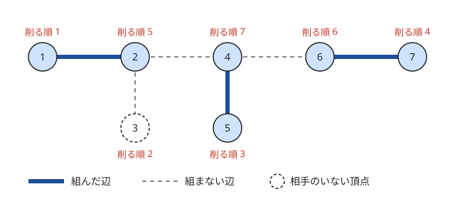

!!! abstract "要点"
    - **何ができるか**：木の上の選び方の問題を、葉から順に 1 つずつ決めて解く。葉は辺が 1 本しかないので選択肢が少なく、「葉の唯一の辺を今使っても悪くならない」が交換論法で示せれば、貪欲がそのまま正しい。実装は次数 1 の頂点をキューで削るか、帰りがけ順に情報を親へ送る。
    - **いつ使うか**：
        - 木を K 頂点ずつのパスに分ける
        - 辺をすべて使う・すべて覆う
        - 葉を消していく操作
    - **計算量**：$O(N)$（各頂点を 1 回ずつ削り、各辺を定数回だけ見る）。一般のグラフで次数 1 の頂点を削り続けるなら $O(N + M)$
    - **前提**：[根付き木と走査順](../tree/tree-traversal.md)、[貪欲法の考え方と正当性](../basics/greedy-basics.md)

<!-- textlint-disable -->
別名：葉から貪欲・葉を刈る・次数 1 の頂点を削る・葉から決める貪欲・greedy from leaves
<!-- textlint-enable -->

[葉](../guide/glossary.md#leaf)から考えるとは、木の問題で「どの頂点から決めるか」に迷ったとき、葉から順に決めていく考え方である。葉の決め方は親との 1 本の辺しか関わらないので、ほとんど一通りに決まるか、交換論法で「こう決めて損しない」と言える。決めた葉を取り除くと残りもまた木（森）なので、同じ議論をくり返せる。

## 葉の唯一の辺を今使ってよい理由（交換論法） {#why-greedy}

葉から決める貪欲が正しいことは、次の 2 つを示して確かめる。

1. **今の決め方を含む最適解がある**：葉 $u$ とその隣 $p$ について、ある決め方（$u$ と $p$ を組む・辺 $(u, p)$ を使う・$p$ を選ぶなど）をした最適解が存在する
2. **決めた後の残りが同じ形の問題になる**：$u$（と必要なら $p$）を取り除いた森で、同じ問題を解けばよい

1 つ目は[交換論法](../basics/exchange-argument.md)で示す。任意の最適解を 1 つ取り、葉の決め方が違っていたら、その部分だけを入れ替えても悪くならないことを言う。葉は辺が 1 本しかないので、入れ替えで影響を受けるのは $u$ と $p$ の周りだけで済む。これが葉から決める利点である。

最大マッチング（端点を共有しない辺をできるだけ多く選ぶ）で確かめる。葉 $u$ の隣を $p$ とし、最適解 $M$ を 1 つ取る。

- $M$ が辺 $(u, p)$ を含むなら、そのままでよい
- $u$ が組まれず、$p$ がほかの頂点 $w$ と組まれているなら、$(p, w)$ を外して $(u, p)$ を入れる。辺の数は変わらず、$u$ の辺は $(u, p)$ しかないのでほかの辺とぶつからない
- $u$ も $p$ も組まれていないなら、$(u, p)$ を足せば辺が増えるので、$M$ が最適だったことに反する

どの場合も「$(u, p)$ を含む最適解」が作れる。$u$ と $p$ を取り除いた森の最大マッチングに $(u, p)$ を足したものが、元の木の最大マッチングになる。

辺をすべて覆う問題（どの辺も、少なくとも一方の端点が選ばれている頂点の集合を最小にする）でも同じ形になる。葉 $u$ の辺 $(u, p)$ を覆うには $u$ か $p$ を選ぶしかない。$u$ が覆う辺は $(u, p)$ だけで、$p$ はそれを含めて多くの辺を覆うので、$u$ を選んだ解は $u$ を $p$ に取り替えても悪くならない。だから「葉の隣を選ぶ」と決めてよい。

上の交換は、どの辺（頂点）を選んでも価値が同じだから成り立つ。重みがあると、たとえばマッチングでは葉の辺を使うことで隣の重い辺を使えなくなり、この議論は崩れる。そのときは[木 DP](../dp/tree-dp.md) に切り替える。

??? question "確認問題：重み付きの最大マッチング"
    パス $1 - 2 - 3$ で、辺 $(1, 2)$ の重みが 1、辺 $(2, 3)$ の重みが 10 とする。重みの和が最大のマッチングを、葉 1 から「葉と隣を組む」貪欲で作るとどうなるか。

    ??? success "答え"
        葉 1 を 2 と組むと重みは 1 で、2 が使われるので $(2, 3)$ は選べない。最適は $(2, 3)$ だけを選ぶ重み 10 である。交換の段階で「$(2, 3)$ を外して $(1, 2)$ を入れる」と重みが減るので、交換論法が成り立たない。重みがあるときは「$v$ が親と組むか」を状態に持つ木 DP で解く。

## 次数 1 の頂点をキューで削る {#peel-leaves}

葉から決めるときの素直な実装は、次数 1 の頂点をキューに入れ、1 つずつ取り出して削ることである。削った頂点の隣は次数が 1 減り、ちょうど 1 になったら新しい葉としてキューに足す。根を決める必要はない。

```text
deg[v] ← v の次数（削られていない隣の数）
次数が 1 以下の頂点をすべてキューに入れる
キューが空でない間：
    u を取り出し、削った印を付ける
    u の隣のうち削られていない p（たかだか 1 つ）について：
        u と p についての決め方をする（組む・辺を使う・p を選ぶ など）
        deg[p] を 1 減らし、ちょうど 1 になったら p をキューに入れる
```

保つ性質は「$\mathrm{deg}[v]$ は $v$ の削られていない隣の数に等しい」と「キューから取り出した時点の頂点は、残りの森の葉（または孤立点）である」の 2 つである。各頂点がキューに入るのは、最初に次数が 1 以下だったときか、次数が 2 から 1 に下がったときの 1 回だけである。次数が 1 から 0 に下がっても入れ直さない。各頂点の隣接リストを削るときに 1 回だけ見るので、全体で $O(N)$ になる。

最後に残る頂点を根とすると、削る順は、どの頂点も親より先に来る順になっている。帰りがけ順や BFS 順の逆と同じ性質だが、帰りがけ順そのものではなく、部分木の頂点が連続するとは限らない。削った時点で残っていた唯一の隣が、その根から見た親である。だから、子の結果を親へ送る処理は、次の節の「帰りがけ順に送る」と同じように書ける。

一般のグラフでも、次数 1 の頂点を削り続けると、閉路に乗らない木の部分がすべて消える。[なもりグラフ](../graph/namori-graph.md#peel-leaves)（頂点数と辺数が等しい連結なグラフ）では、残った頂点がちょうど 1 つの閉路になる。有向グラフで入次数 0 の頂点を削っていく [Kahn 法](../graph/topological-sort.md#kahn-dfs)も同じ形のアルゴリズムである。

## 帰りがけ順に葉から情報を上へ送る {#send-up}

根を 1 つ決め、[帰りがけ順](../tree/tree-traversal.md#pre-post-order)に各頂点で子から届いた情報をまとめて親へ送る書き方もある。部分木の中の決め方が葉から強制的に決まっていくなら、親に伝える必要があるのは「親との辺を通して外へ出ていくもの」だけになる。この量が 1 つの数で表せると、状態を持つ木 DP より簡単に書ける。

木を頂点数 $K$ のパスに分ける問題で確かめる。$\mathrm{up}[v]$ を「$v$ から親へ伸びる、まだ $K$ 頂点に満たないパスの頂点数（$v$ の部分木の中で閉じたなら 0）」とする。$v$ では、未完成のまま届いた子の数 $c$ と、その頂点数の和 $s$ を数え、$v$ を足した長さ $s + 1$ で場合分けする。

- $c \ge 3$ なら失敗する。3 本のパスが $v$ で出会うと、1 本のパスにならない
- $s + 1 > K$ なら失敗する
- $c = 2$ なら、2 本は $v$ でつながるしかなく、それ以上は伸ばせない。$s + 1 = K$ のときだけ閉じてよく、それ以外は失敗する
- $s + 1 = K$ なら閉じて切り離し、$\mathrm{up}[v] = 0$ とする
- それ以外は $\mathrm{up}[v] = s + 1$ として親へ伸ばす

未完成のパスは親との辺を通る以外に伸ばしようがないので、どの場合も決め方は一通りである。選択の余地がないので、正しさは「強制された決め方をしているだけ」と言える。最後に根で $\mathrm{up} = 0$ なら分けられる。

次のコードは、根 0 からの BFS 順を逆にたどって帰りがけ順の代わりにしている。パス状の木でも再帰が深くならない（[BFS 順の逆で集約する](../tree/tree-traversal.md#bfs-order)）。

```cpp
--8<-- "leaf-first/path-split.cpp:core"
```

数え上げでも同じ考え方が使える。各頂点 $v$ が自分の部分木の中から $D_v$ 個の物を、ほかの頂点と重ならないように選ぶとする。葉から決めていくと、$v$ の番が来たとき、子孫はすでに部分木の中の物をちょうど（子孫の $D$ の和）個使っている。どれを使ったかによらず、$v$ が選べる物の個数は

$$
(\text{部分木の物の数}) - (\text{子孫の } D \text{ の和})
$$

で決まる。だから $v$ の選び方の数は二項係数 1 つで書け、全体はその積になる。どこかでこの個数が $D_v$ より小さくなれば 0 通りである。選べる個数が子孫の選び方に依存しないことが、葉から順に掛けてよい理由である。

たとえば根 1 と子 2 だけの木で、物が 1 に 1 個、2 に 2 個あり、$D_2 = 1$、$D_1 = 2$ とする。2 は自分の部分木の 2 個から 1 個を選ぶので $\binom{2}{1} = 2$ 通りである。1 は部分木の 3 個から 2 が使った 1 個を除いた 2 個から 2 個を選ぶので $\binom{3 - 1}{2} = 1$ 通りである。全体は $2 \times 1 = 2$ 通りになる。

??? question "確認問題：根を先に決めると"
    上の数え上げで、根から順に「$v$ が部分木から $D_v$ 個選ぶ」と決めていくと、なぜ積の形にならないか。

    ??? success "答え"
        根が選んだ物がどの子の部分木に入っているかによって、子が選べる物の数が変わるからである。根の選び方ごとに子の場合の数が違うので、単純な積にならない。葉から決めると、子孫が使った物はすべて $v$ の部分木の中にあるので、$v$ の選択肢の数は使われ方によらない。

## 木の最大マッチング（葉と親を組む） {#tree-matching}

木の最大マッチングは、葉から順に「自分と隣がどちらもまだ組まれていなければ組む」と決めるだけで求まる。葉とその隣を組む最適解が必ずあることは、[交換論法の節](#why-greedy)で示した。組んだ頂点は取り除いたのと同じで、コードの `matched` はその印である。だから $u$ がすでに組まれていれば $u$ はもう残っておらず、$p$ が組まれていれば $u$ は残りの森で孤立点なので、どちらも何もしないでよい。

次の図は、7 頂点の木で次数 1 の頂点をキューで削りながら組んだ結果である。最初の葉は 1・3・5・7 で、1 は 2 と組む。3 を取り出した時点で、2 はすでに組まれている。だから 3 は相手なしで削られる。5 は 4 と、7 は 6 と組む。その後に葉になった 2・6・4 はどれも組まれ済みなので何もしない。



```cpp
--8<-- "leaf-first/peel-matching.cpp:core"
```

木は[二部グラフ](../graph/bipartite-graph.md)なので、König の定理により最大マッチングの大きさは最小頂点被覆（辺をすべて覆う頂点の最小数）の大きさに等しい。最小頂点被覆も、葉から見て「葉の隣を選ぶ」貪欲で同じ形に求まる。二部グラフ一般の最大マッチングは[二部マッチング](../graph/bipartite-matching.md)のページで扱う。

??? question "確認問題：星グラフ"
    中心 1 つと葉 $N - 1$ 個からなる星グラフ（$N \ge 2$）で、葉と隣を組む貪欲の結果はどうなるか。それは最大か。

    ??? success "答え"
        最初に取り出した葉が中心と組み、残りの葉は中心がすでに組まれているので相手なしで削られる。大きさは 1 である。どの辺も中心を端点に持つので、2 本以上を選ぶと中心を共有してしまう。だから 1 が最大である。

## 落とし穴 {#pitfalls}

**新しく葉になった頂点をキューに足し忘れる**。削った頂点の隣の次数を減らすだけで、ちょうど 1 になったときに足さないと、途中で処理が止まる。逆に、次数が 0 になったときまで足すと同じ頂点が 2 回入る。足すのは「2 から 1 に下がったとき」だけにする。

**最初の次数が 1 以下を見落とす**。$N = 1$ の木では唯一の頂点の次数が 0 で、「次数がちょうど 1」で探すとキューが空のまま終わる。$N = 2$ では 2 頂点とも最初から葉で、一方を削るともう一方の次数は 0 になる。最初は「次数 1 以下」で入れ、取り出した頂点は残りの隣が 0 個でも動くように書く。

**根を葉と数えるかどうかを混ぜる**。根付き木の「子がない頂点」と、根のない木の「次数 1 の頂点」は違う。子が 1 つだけの根は次数 1 なので、キューで削る書き方では葉として扱われる。帰りがけ順に送る書き方では根を最後に処理するので、根で特別な判定（パスの分割なら $\mathrm{up}[\text{根}] = 0$ か）を忘れない。

**2 本の未完成のパスを合わせる条件を落とす**。パスの分割で、2 本を $v$ でつないだのに長さが $K$ に満たないまま親へ送ると、親でさらに伸ばされて枝分かれしたパスになる。2 本をつないだら「ちょうど $K$」以外は失敗にする。

**二項係数の上の数が大きい**。数え上げで部分木の物の数が階乗の表を作れないほど大きい（たとえば $10^6$ を大きく超える）と、階乗の表を上の数まで作れない。下の数 $D_v$ の和が小さいなら、$\binom{n}{r} = \frac{n (n - 1) \cdots (n - r + 1)}{r!}$ を $r$ 個の積として毎回計算し、$r!$ の逆元だけを表から引く（[二項係数](../comb/binomial-coefficient.md)）。

**パス状の木で再帰が深くなる**。$N = 2 \times 10^5$ のパスで DFS を再帰で書くと、スタックがあふれることがある。キューで削る書き方か、BFS 順の逆を使えば再帰はいらない（[再帰の深さ](../tree/tree-traversal.md#recursion-depth)）。

## 使い分け {#comparison}

- 葉からの貪欲で済む問題の多くは、[木 DP](../dp/tree-dp.md) でも書ける。木 DP は「親と組むか」などの状態を持つ分だけ一般的で、重み付きの問題にも使える。葉からの貪欲は状態が少なく速いが、交換論法で正しさを示せるときに限る
- グラフに閉路があるなら、次数 1 の頂点を削って木の部分を外し、残る閉路を別に扱う（[なもりグラフ](../graph/namori-graph.md)）
- 有向グラフで「入ってくる辺がなくなった頂点から処理する」なら[トポロジカルソート](../graph/topological-sort.md)である
- 子をどの順で親に併合するかが問題になるなら、[比で親に併合する貪欲](../tree/tree-ratio-greedy.md)を見る

## 例題 {#examples}

### ABC459 E. Select from Subtrees {#abc459_e}

<div class="kp-problems" data-role="example" markdown>

- [ABC459 E. Select from Subtrees](https://atcoder.jp/contests/abc459/tasks/abc459_e)（diff 1298）：根付き木の各頂点が、自分の部分木の頂点にあるアメから決まった個数を、ほかの頂点と重ならないように選ぶ方法の数を求める。

</div>

各頂点が自分の部分木にある物から決まった個数を重ならないように選ぶ数え上げで、根から決めると、どの物が使われたかで子の選択肢が変わってしまう。葉から決めると、$v$ の番では子孫が使った個数だけが分かっていればよく、$v$ の選び方は二項係数 1 つになる（[帰りがけ順に送る節](#send-up)）。

??? note "解法の詳細"
    - 帰りがけ順に、各頂点 $v$ の部分木の物の数 $S_v$ と、部分木の要求の和 $E_v$（$v$ 自身の $D_v$ を含む）を求める
    - $v$ が選べる物は $S_v - (E_v - D_v)$ 個あるので、$v$ の選び方は $\binom{S_v - E_v + D_v}{D_v}$ 通りである。全頂点の積が答えになる
    - どこかの頂点で $S_v < E_v$ なら、その部分木の要求を満たせないので答えは 0 である
    - 物の数が大きくなるので、二項係数は上の数まで階乗を作らず、$D_v$ 個の積と $D_v!$ の逆元で計算する。$D_v$ の和だけの手間で済む
    - 全体で $O(N + \sum D_v)$

### ABC397 E. Path Decomposition of a Tree {#abc397_e}

<div class="kp-problems" data-role="example" markdown>

- [ABC397 E. Path Decomposition of a Tree](https://atcoder.jp/contests/abc397/tasks/abc397_e)（diff 1484）：NK 頂点の木を、K 頂点ずつの N 本のパスに分けられるかを判定する。

</div>

葉から見ると、葉を含むパスは親の方へ伸ばすしかない。各頂点で「子から未完成のまま届いたパスの本数と頂点数の和」を数えれば、閉じる・伸ばす・失敗のどれかに一通りに決まる。

??? note "解法の詳細"
    - この問題の $N$ はパスの本数で、頂点数は $NK$ である（本文の $N$ は頂点数だった）
    - 適当な根から帰りがけ順に処理し、$\mathrm{up}[v]$ を「$v$ から親へ伸びる未完成のパスの頂点数（閉じたなら 0）」とする
    - 未完成の子が 3 本以上なら失敗、2 本なら頂点数の和に 1 を足してちょうど $K$ のときだけ閉じる。1 本以下なら 1 を足し、$K$ に達したら閉じ、超えたら失敗する
    - 根で $\mathrm{up} = 0$ なら Yes である。全体で $O(NK)$（頂点数に比例）
    - コードは[帰りがけ順に送る節](#send-up)のものと同じ形である

## 練習問題 {#practice}

<div class="kp-problems" data-role="practice" markdown>

- [ABC333 D. Erase Leaves](https://atcoder.jp/contests/abc333/tasks/abc333_d)（diff 704）：木から葉を 1 つずつ消す操作をくり返し、頂点 1 を消すまでに要る操作の最小の回数を求める。
- [ABC409 E. Pair Annihilation](https://atcoder.jp/contests/abc409/tasks/abc409_e)（diff 973）：辺に重みのある木の各頂点に電子か陽電子が置かれ（合計は打ち消し合う数）、粒子を辺に沿って動かすと重みの分だけ費用がかかるとき、すべてを打ち消すのに要る費用の最小を求める。
- [ABC266 F. Well-defined Path Queries on a Namori](https://atcoder.jp/contests/abc266/tasks/abc266_f)（diff 1525）：N 頂点 N 辺の連結な無向グラフで、2 頂点の間の単純パスがただ 1 つに決まるかを、多数の質問に答える。

</div>

??? note "練習の方針"
    - **ABC333 D**：葉を消す操作では枝が外側からしか削れないので、頂点 1 を葉にするには 1 本を残してほかの枝をすべて消すしかない。残すのは最大の枝にして、答えは $N$ から最大の子の部分木の大きさを引いた値になる
    - **ABC409 E**：帰りがけ順に、各頂点で自分の値と子から届いた余りを足して親へ送り、親との辺の重みと送った量の絶対値の積を足していく。辺を切った片側の和の絶対値の分は必ずその辺を通るので、これが下界でありちょうど達成できる。$O(N)$ である
    - **ABC266 F**：次数 1 の頂点をキューで削り続けると閉路が残る（一般のグラフでも木の部分が消える）。2 頂点が閉路の同じ頂点からぶら下がる木に入っているときだけ一意と答える。解き方はなもりグラフのページの例題と同じで、ここではキューで葉を削る部分を練習する

## 力試し {#challenge}

<div class="kp-problems" data-role="challenge" markdown>

- [ABC345 F. Many Lamps](https://atcoder.jp/contests/abc345/tasks/abc345_f)（diff 2157）：グラフの辺をいくつか選んで両端のランプを切り替え、点いているランプをちょうど K 個にする選び方を 1 つ出力する。
- [AGC014 D. Black and White Tree](https://atcoder.jp/contests/agc014/tasks/agc014_d)（diff 2266）：2 人が交互に木の頂点を白と黒に塗り、塗り終えた後に黒と隣り合う白を黒に変えたとき白が残るかで勝敗が決まるゲームで、勝つのはどちらかを求める。

</div>

??? note "力試しの方針"
    - **ABC345 F**：1 回の操作で点いている数は偶数だけ変わるので、$K$ が奇数なら不可能である。グラフの全域森を作り、葉から順に「葉のランプが消えていれば、その葉の唯一の辺を使って点ける」と決める。葉のランプを点けられる辺はこの 1 本しかないので、決め方は強制される。点いている数が $K$ に達したら止める。1 回で 0 か 2 だけ増えるので、届く偶数の値は途中で必ず通る。すべての葉を処理しても $K$ に届かなければ不可能である（各連結成分で点けられるのは、頂点数を偶数に切り下げた数まで）
    - **AGC014 D**：木に完全マッチングがあれば、後手が相手の塗った頂点の相方を塗って勝つ。なければ先手が勝つ。葉から「葉と隣を組む」貪欲で最大マッチングを作り、キューで判定する

## 参考 {#references}

- [Shizen_Tota「ABC397個人的備忘録[A-C,E]」](https://qiita.com/Shizen_Tota/items/df1f142c879a61c21838)：例題の方針（未完成のパスの長さを親へ送り、2 本ならちょうど $K$、3 本以上なら失敗）
- [alpha0314alpha「ABC459の記録」](https://qiita.com/alpha0314alpha/items/42353a57131f9fff8f9f)：例題の方針（部分木の和と二項係数の積）
- [merom686「ABC459」](https://merom686.hatenablog.com/entry/2026/05/24/005253)：例題の方針（末端から残りを求めて二項係数を掛ける）と、二項係数の上の数が大きい点
- [gotoki_no_joe「ABC345 A～F をHaskellで」](https://qiita.com/gotoki_no_joe/items/f9770e81cc38a70b5300)：力試しの方針（全域森の葉から辺を使うかを決める）
- [drken「AtCoder AGC 014 D - Black and White Tree (2D, 黄色, 900 点)」](https://drken1215.hatenablog.com/entry/2019/05/30/021200)：葉から貪欲に最大マッチングを作り、キューで実装すること
- [drken のカテゴリ「葉から考える」](https://drken1215.hatenablog.com/archive/category/%E8%91%89%E3%81%8B%E3%82%89%E8%80%83%E3%81%88%E3%82%8B)：葉から決める問題の型の一覧
- [drken「AtCoder ABC 333 D - Erase Leaves (2Q, 茶色, 400 点)」](https://drken1215.hatenablog.com/entry/2024/11/02/192645)：練習 ABC333 D の残す枝を最大にする方針
- [untan「【ABC409】E問題 - Pair Annihilation　考察から実装(c++)まで」](https://qiita.com/untan/items/92f4a5e02356bdb9fae7)：練習 ABC409 E の辺ごとの下界と葉から送る方針
- [gotoki_no_joe「ABC409 A～F をHaskellで」](https://qiita.com/gotoki_no_joe/items/6431ec91a0bef27665aa)：練習 ABC409 E の帰りがけ順で余りを親へ送る実装
- [fjnkt98「ABC266 F - Well-defined Path Queries on a Namori Python解答例」](https://zenn.dev/fjnkt98/articles/98c9dfbd0702a4)：練習 ABC266 F の次数 1 の頂点をキューで削る方針
