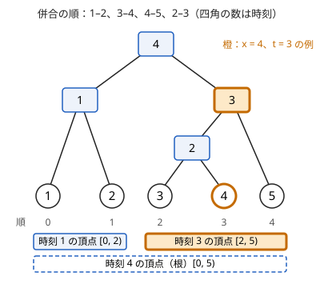

!!! abstract "要点"
    - **何ができるか**：Union-Find の併合のたびに新しい頂点を作って 2 つの成分を子にした木を作ると、ある時点のグループが DFS 順の区間になる。辺を重みの順に併合すれば、2 点の LCA の重みが経路の最大の辺の最小値になる。
    - **いつ使うか**：
        - ある時点のグループについての問い合わせ（オフライン）
        - パス上の最大の辺の最小値（ボトルネック）をオンラインで多数答える
        - 辺を重みの順に足していく過程を後から問われる
    - **計算量**：構築は Union-Find の操作 $O(M \alpha(N))$ とダブリングの表 $O(N \log N)$（重みの順に並べるなら辺のソート $O(M \log M)$ が加わる）。ある時点のグループと 2 点のボトルネックは 1 回 $O(\log N)$
    - **前提**：[最小全域木](../graph/minimum-spanning-tree.md)、[オイラーツアー](../tree/euler-tour.md)、[最小共通祖先（LCA）](../tree/lca.md)

<!-- textlint-disable -->
別名：クラスカル再構築木・Kruskal 再構築木・Kruskal reconstruction tree・KRT・DSU-tree・Union-Find の併合の過程を表す木
<!-- textlint-enable -->

併合過程の木は、[Union-Find](../ds/union-find.md) が行った併合の履歴を、そのまま 1 本の根付き木として残したものである。Union-Find は最新の状態しか持たないが、この木を作っておけば「時刻 $t$ の時点の $x$ のグループ」を後から部分木として取り出せる。部分木の葉は DFS 順で区間になるので、過去のグループについての問いが列の区間の問いに変わる。

出題は少なく、ABC では[マージテク](../tree/small-to-large.md)や[並列二分探索](../ds/parallel-binary-search.md)で解ける問題の別解として現れる。過程を木の形で持つので、過去のグループの中身を区間の問い合わせで、2 点のボトルネックを LCA で答えられるのが強みである。

## 併合のたびに新しい頂点を作る {#new-vertex}

元の $N$ 頂点を葉として用意し、Union-Find の併合を順に行う。2 つの異なる成分を併合するたびに新しい頂点 $x$ を 1 つ作り、次のようにする。

- $x$ の重み（時刻）を、その併合に使った辺の重み（または何回目の併合か）にする。
- 併合した 2 つの成分を表す木の頂点を、$x$ の 2 つの子にする。
- 併合後の成分を表す木の頂点を $x$ に替える。

すでに同じ成分にある 2 頂点を結ぶ辺は、成分を変えないので頂点を作らない。$N - 1$ 回併合すれば $2N - 1$ 頂点の二分木になり、最後まで連結にならなければ根が複数ある森になる。辺を重みの昇順（時刻の順）に処理するので、頂点の重みは根に近いほど大きい（等しいこともある）。この単調性が以下の性質の土台である。



木の頂点は「ある時刻にできたグループ」を表す。たとえば上の図の時刻 3 の頂点は、時刻 3 の併合でできたグループ $\{3, 4, 5\}$ を表す。このグループは時刻 4 まで変わらず、時刻 4 で根のグループに吸収される。

実装では、Union-Find の[代表元](../guide/glossary.md#representative)ごとに「その成分を表す木の頂点」の番号 $\mathrm{top}$ を持てばよい。Union-Find の木そのものは経路圧縮やサイズによる併合で形が変わるので、併合過程の木とは別に持つ（[自作するときの要点](#library)）。

```cpp
--8<-- "merge-process-tree/usage.cpp:build"
```

## ある時点のグループは DFS 順の区間 {#group-as-interval}

この節は[オイラーツアー](../tree/euler-tour.md#in-out)と[ダブリング](../basics/doubling.md)を前提にする。

時刻 $t$ の時点で $x$ を含むグループは、$x$ の祖先のうち重みが $t$ 以下で最も根に近い頂点 $p$ の部分木の葉の集合である。

- $p$ の部分木の葉は、$p$ の重みの時刻に $x$ と同じグループになっている。重みは $t$ 以下なので、時刻 $t$ でも同じグループにいる。
- $p$ のグループがほかと併合するのは $p$ の親を作る併合だけで、その重みは $t$ より大きい（$p$ が根なら併合は起きない）。だから時刻 $t$ までにグループは広がらない。

たとえば図で $x = 4$、$t = 3$ とすると、4 の祖先は時刻 2・3・4 の頂点で、重みが 3 以下で最も根に近いのは時刻 3 の頂点である。時刻 3 のグループは $\{3, 4, 5\}$ になる。

$p$ は「重みが $t$ 以下」という根へ向かって崩れる条件を満たす最も遠い祖先なので、[条件を満たす最も遠い祖先](../tree/lca.md#farthest-ancestor)と同じく、ダブリングの表で上の段から跳んで $O(\log N)$ で求まる。

葉だけに DFS 順の番号を振ると、どの頂点の部分木の葉も番号の連続する区間 $[\mathrm{lo}[p], \mathrm{hi}[p])$ になる（図の時刻 3 の頂点は $[2, 5)$）。グループの大きさは $\mathrm{hi}[p] - \mathrm{lo}[p]$ で、グループの中の値の和・最大値・種類ごとの個数は、葉の番号の順に並べた列の区間の問い合わせになる。

```cpp
--8<-- "merge-process-tree/usage.cpp:query"
```

合流の操作とグループについての質問が交互に来る問題でも、すべての操作を先に読めば（[オフライン](../guide/glossary.md#offline)）、合流の列から木を作り、各質問を「質問の時点のグループを表す頂点の区間」に置き換えられる。種類ごとの個数なら、種類ごとに葉の番号を並べておけば、区間に入る個数を二分探索で数えられる。

??? question "確認問題：時刻 t のグループを求めるとき、重みが t 以下の祖先のうち「最も根に近い」ものではなく「最も葉に近い」ものを取るとどうなるか"
    ??? success "答え"
        最も葉に近い祖先は $x$ 自身（葉の重みは $-\infty$ とする）なので、グループは $\{x\}$ になってしまう。時刻 $t$ までに起きた併合をすべて含めるには、重みが $t$ 以下である限り上り続ける必要がある。頂点の重みは根に近いほど大きい。だから、上れなくなった位置が答えである。

## ボトルネックは LCA の重み {#bottleneck}

この節は[最小共通祖先（LCA）](../tree/lca.md)と[最小ボトルネック路](../graph/bottleneck-path.md)を前提にする。

辺を重みの昇順に併合して木を作ると、2 頂点 $u, v$ の LCA は、$u$ と $v$ が初めて同じ成分になった併合を表す。よって LCA の重みは「$u$ と $v$ がつながる最小のしきい値」、すなわち $u$–$v$ を結ぶパスの最大の辺の最小値（[ボトルネック](../guide/glossary.md#bottleneck)）である。LCA が存在しない（別の木にある）なら、$u$ と $v$ はどの重みでもつながらない。$u = v$ のときは辺を使わないので、何を返すかは問題に合わせて決める（コード片は 0 を返す）。

前計算の後は、質問を先読みしなくても（オンラインで）1 組 $O(\log N)$ で答えられる。LCA を Sparse Table で $O(1)$ にする方法もある。クラスカル法の順に併合しながら答える方法や、最小全域木の上のパスの最大値との使い分けは、[最小ボトルネック路](../graph/bottleneck-path.md#reconstruction-tree)にまとめてある。

「重み $x$ 以下の辺だけで $v$ から行ける頂点」は、[ある時点のグループ](#group-as-interval)の $t$ を $x$ にしたものである。行ける頂点の個数や最大値も、同じく区間の問い合わせで答えられる。

## マージテク・部分永続 Union-Find・並列二分探索との使い分け {#alternatives}

過去のグループや連結性を問う問題は、ほかの方法でも解けることが多い。

| 方法 | 向いている場面 | 質問の答え方 |
| --- | --- | --- |
| [マージテク](../tree/small-to-large.md#map-on-root) | 最新のグループの種類ごとの個数を、オンラインで | 代表元の map を読む |
| [部分永続 Union-Find](../ds/partially-persistent-union-find.md) | 過去の時刻の連結性と大きさを、オンラインで | find が $O(\log N)$ |
| [並列二分探索](../ds/parallel-binary-search.md) | 過程が Union-Find 以外（BIT への加算など）でもよい。オフライン | 全体で $O(\log M)$ 段の再現（1 段 $O((N + M + Q)\alpha(N))$） |
| 併合過程の木 | 過去のグループの中身（区間の問い合わせ）やボトルネック | $O(\log N)$ |

- 併合過程の木を作るには、併合の列をすべて先に知っている必要がある。前の答えで次の併合が決まる問題では使えない。木を作った後の質問はオンラインでよい。
- 部分永続 Union-Find でも、和や最大値のように併合で 1 つの値にまとまるものは、大きさと同じく根ごとの履歴に持てる。種類ごとの個数や $k$ 番目の値のように 1 つの値にまとまらない問いは持てない。併合過程の木なら、中身が区間になるので[セグメント木](../ds/segment-tree.md)や累積和をそのまま使える。
- 「初めて条件を満たす時刻」を質問ごとに求めるときは、併合過程の木で時刻を二分探索するか、木の上を条件を保ったまま上る。並列二分探索と違って質問をオンラインで答えられ、部分永続 Union-Find と違ってグループの中身も問える。

## 自作するときの要点と Library Checker {#library}

自作するときに保つ性質と境界は次のとおりである。

- **Union-Find の木と併合過程の木を分ける**：Union-Find はサイズによる併合と経路圧縮をそのまま使い、代表元から木の頂点への対応 $\mathrm{top}$ だけを持つ。ACL の `merge` は新しい代表元を返すので、その位置の $\mathrm{top}$ を新しい頂点にする。Union-Find の親をそのまま木の親として使う書き方では、サイズによる併合ができなくなる。
- **頂点の番号**：葉を $0, \dots, N - 1$、新しい頂点を $N$ から順に振ると、子の番号は親より小さい。根は自分自身を親にしておくと、ダブリングで根を越えて跳んでも根にとどまる。
- **重みの番兵**：葉の重みは $-\infty$（`LLONG_MIN`）にする。葉は最初からある 1 頂点のグループで、どの $t$ でも成り立つ。こうすると重みが根に近いほど大きいという単調性が葉まで保たれる。コード片の `group` は跳び先の重みしか見ないが、葉の重みを読む書き方でも崩れない。
- **森**：非連結なら根が複数ある。DFS 順の番号は根ごとに続けて振り、LCA を求めるときは「同じ木にあるか」を区間の包含で確かめる。
- **同じ重みの辺**：重みの等しい辺がいくつあっても、併合ごとに頂点を作れば性質は崩れない。重みの等しい親子ができるだけである。
- **再帰の深さ**：一列に併合すると木の高さが $N$ になる。DFS は非再帰にするか、新しい頂点の番号が子より大きいことを使って番号の大きい順に処理する。

Library Checker に併合過程の木そのものを確かめる問題はない（2026-10-22 に問題の一覧で確かめた）。部品ごとに確かめ、全体は小さなグラフで愚直な方法と比べる。コード片 `snippets/merge-process-tree/usage.cpp` は、乱数のグラフで、重み $t$ 以下の辺だけを Union-Find に入れた結果とグループ・ボトルネックを比べている。

- [Lowest Common Ancestor](https://judge.yosupo.jp/problem/lca)：LCA の部分
- [Jump on Tree](https://judge.yosupo.jp/problem/jump_on_tree)：ダブリングで祖先へ跳ぶ部分

!!! info "ACL では"
    `dsu d(n);` で併合を管理し、`d.leader(a)` で代表元を、`d.merge(a, b)` で併合後の代表元を得る（どちらもならし $O(\alpha(N))$）。木の頂点・子・重み・ダブリングの表は自分で持つ。

## 学ぶための資料 {#resources}

- [drken「AtCoder ABC 183 F - Confluence (水色, 600 点)」](https://drken1215.hatenablog.com/entry/2020/12/20/192100)：マージテクの解法と並べて、併合の過程を木にして DFS で数える解法を説明している。木の作り方（代表元ごとに最新の併合の頂点を持つ）が具体的である
- [mzhang2021「Kruskal Reconstruction Tree」](https://mzhang2021.github.io/cp-blog/kruskal/)（英語）：LCA がボトルネックになること、しきい値以下で行ける頂点が部分木になることを、問題の例とともにまとめている
- [OI Wiki「最小生成树」](https://oi-wiki.org/graph/mst/)の「Kruskal 重构树」の節（中国語）：性質の確認に使える

## 練習問題 {#practice}

<div class="kp-problems" data-role="practice" markdown>

- [ABC183 F. Confluence](https://atcoder.jp/contests/abc183/tasks/abc183_f)（diff 1586）：生徒がクラスに属し、2 人の生徒の集団を合流させるクエリと、生徒 x の集団にいるクラス y の生徒の数を問うクエリに答える。
- [AGC002 D. Stamp Rally](https://atcoder.jp/contests/agc002/tasks/agc002_d)（diff 2514）：最初の t 本の辺だけを使ったとき、x と y を含む成分の頂点数（同じ成分なら 1 回）が z 以上になる最小の t を各クエリで答える。

</div>

??? note "方針"
    - **Confluence**：クエリをすべて読み、合流のクエリを時刻の順の併合として木を作る（同じ集団どうしの合流は頂点を作らない）。質問のクエリは、その時点の $x$ の集団を表す頂点（$\mathrm{top}[\mathrm{leader}(x)]$）に置き換える。クラスごとに葉の DFS 順の番号を並べておけば、区間 $[\mathrm{lo}, \mathrm{hi})$ に入るクラス $y$ の個数を二分探索で数えられる。マージテクの解法は[マージテク](../tree/small-to-large.md#abc183_f)にある。
    - **Stamp Rally**：辺の番号を時刻として木を作る。質問ごとに $t$ を二分探索し、$x$ と $y$ の時刻 $t$ のグループを表す頂点を求める。同じ頂点ならその葉の数、違えば 2 つの葉の数の和を $z$ と比べる。2 つのグループが合わさる時刻には、和と合わさったグループの葉の数が等しいので、この値は $t$ について減らない。だから二分探索できる。1 回の判定が $O(\log N)$ なので、1 つの質問は $O(\log M \log N)$ である。並列二分探索の解法は[並列二分探索](../ds/parallel-binary-search.md#agc002_d)にある。

## 参考 {#references}

- [AtCoder Library「DSU」（document_ja）](https://github.com/atcoder/ac-library/blob/master/document_ja/dsu.md)：`merge` が新しい代表元を返すこと・計算量
- [drken「AtCoder ABC 183 F - Confluence (水色, 600 点)」](https://drken1215.hatenablog.com/entry/2020/12/20/192100)：学ぶための資料。併合の過程を木にして DFS で数える別解と、練習 ABC183 F の方針
- [drken「AtCoder AGC 002 D - Stamp Rally (橙色, 1000 点)」](https://drken1215.hatenablog.com/entry/2018/09/15/193722)：練習 AGC002 D の判定の形（部分永続 Union-Find・並列二分探索の解法）
- [mzhang2021「Kruskal Reconstruction Tree」](https://mzhang2021.github.io/cp-blog/kruskal/)：学ぶための資料。LCA がボトルネックになること、しきい値以下で行ける頂点が部分木になること
- [OI Wiki「最小生成树」](https://oi-wiki.org/graph/mst/)：学ぶための資料。Kruskal 重构树の性質の確認（文章・図は使っていない）
- [yosupo06「library-checker-problems/tree」](https://github.com/yosupo06/library-checker-problems/tree/master/tree)：対応する問題がないことの確認と、部品の検証に使う問題
