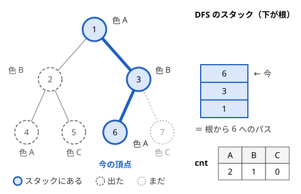

!!! abstract "要点"
    - **何ができるか**：DFS で頂点に入るときにデータ構造へ情報を足し、出るときに元に戻すと、常に根から今の頂点までのパスの情報だけを持てる。パス上の色の数・LIS・中央値などを全頂点について求められる。
    - **いつ使うか**：
        - 根から頂点 $v$ までのパス上の…を、すべての $v$ について求める。
        - 祖先の情報だけで決まる値を、全頂点について求める。
        - 操作の取り消しや、保存した状態の読み込みがある。
    - **計算量**：全体で $O(N \times \text{1 頂点の変更の計算量})$。戻す回数は変更の回数と同じで、記録 1 件につき $O(1)$。色の数なら $O(N + C)$（$C$ は色の範囲）、LIS・中央値なら $O(N \log N)$。
    - **前提**：[根付き木と走査順](../tree/tree-traversal.md)

<!-- textlint-disable -->
別名：DFS の巻き戻し・根からのパスの情報・入るとき足して出るとき戻す・rollback on DFS
<!-- textlint-enable -->

根からのパスを DFS で持ち回る方法は、データ構造を 1 つだけ用意し、DFS で頂点へ入るときにその頂点の情報を足し、出るときに足した分を戻す方法である。こうすると、データ構造の中身はいつも「根から今の頂点までのパス」だけを表す。根からのパスごとにデータ構造を作り直す必要がなくなり、変更の総数は頂点数の定数倍で済む。

このページの実装は 0-indexed で、頂点 $0$（問題文の頂点 1）を根にする。

## DFS のスタックは根からのパス {#stack-is-path}

「根から頂点 $v$ までのパス上に、$v$ と同じ色の頂点がほかにあるか」を、すべての $v$ について答える問題を考える。頂点ごとに根までたどって調べると、1 頂点あたり深さぶんかかる。パス状の木では深さが $N$ に近いので、全体で $O(N^2)$ になる。

DFS で頂点 $v$ にいるとき、呼び出し中の頂点（再帰のスタックに積まれた頂点）を下から並べると、ちょうど根から $v$ までのパスになる。DFS は $v$ に入ってから、$v$ の子孫をすべて回り終えるまで $v$ から出ないからである。$v$ から出た後は、$v$ が再びスタックに載ることはない。

次の図は（頂点の番号は問題文と同じく 1 から）、根 1 から DFS して、頂点 2・4・5 を回り終え、頂点 3 を経て頂点 6 に入ったところである。スタックにあるのは 1・3・6 で、これが根から 6 へのパスである。



そこで、色ごとの出現回数 $\mathrm{cnt}$ を 1 本だけ持ち、DFS で頂点に入るとき $+1$、出るとき $-1$ する。すると $\mathrm{cnt}$ は、いつもスタックにある頂点、すなわち根から今の頂点までのパスだけを数えた値になる。図では、頂点 5 の色 C は出るときに引いたので、頂点 6 にいる今は数えられていない。頂点 6 に入る前の $\mathrm{cnt}[\mathrm{A}]$ が 1 なので、祖先に同じ色 A があると分かる。

```cpp
--8<-- "root-path-dfs/unique-color.cpp:core"
```

各頂点へは 1 回入って 1 回出るので、$\mathrm{cnt}$ の変更は全体で $2N$ 回である。根からのパスごとに数え直す $O(N^2)$ が、$O(N)$ になる。

この方法が働くのは、知りたい値が「根から $v$ までのパス上の頂点の集まり」だけで決まるときである。言い換えると、祖先の情報だけで決まる値である。子孫や兄弟の部分木の情報が要るなら、部分木を区間にする[オイラーツアー](../tree/euler-tour.md)や[木 DP](../dp/tree-dp.md)を使う。

!!! tip "足すだけで済むなら引数で渡す"
    パス上の和・XOR・最大値のように、親の値と自分の値から 1 つの数が決まるなら、データ構造は要らない。`dfs(to, v, s + a[to])` のように引数で渡せば、戻す処理も書かずに済む（根からの累積 $S[v]$）。[巻き戻し](../guide/glossary.md#rollback)が要るのは、持つものが配列・集合・Union-Find のような大きな状態で、子へのコピーが重いときである。

再帰の深さは根から最も深い頂点までの頂点数で、パス状の木では $N$ になる。手元でスタックがあふれるときは、[再帰の深さと非再帰の書き方](../tree/tree-traversal.md#recursion-depth)のとおりに書き直す。非再帰では、入るときの処理をしてから「出る」の印 $\sim v$ を子より先に積む。

```cpp
--8<-- "root-path-dfs/unique-color.cpp:iterative"
```

`~v` は子より先に積むので、子孫がすべて出た後に取り出される。取り出したときに戻せば、再帰版の「子を回り終えてから戻す」と同じ順になる。

## 変更の記録と巻き戻し（後に変えたものから戻す） {#undo-log}

出現回数の $+1$ は $-1$ で打ち消せる。一方、配列の 1 か所を別の値で上書きしたときや、最小値で更新したときは、新しい値から元の値を計算できない。このときは変更の前に「どこを・元は何だったか」を記録しておき、出るときに記録から元の値を書き戻す。この記録を変更の記録（undo log）と呼び、記録した変更を新しい順に元へ戻すことを巻き戻しと呼ぶ。

記録をスタックで持つと、どの頂点でも同じ手順で書ける。

```text
dfs(v):
    mark ← log の長さ             # 入った時点の記録の長さ
    v の情報をデータ構造に入れる    # 書き換えるたびに (位置, 元の値) を log に積む
    v の答えを読む
    for 子 c: dfs(c)
    while log の長さ > mark:       # v が入れた分だけを、新しい順に戻す
        (位置, 元の値) ← log から取り出す
        位置 ← 元の値
```

**なぜ正しいか**：次の性質を保つ。

> 頂点 $v$ に入った直後と、$v$ から出る直前で、データ構造は「根から $v$ までのパスの情報を入れた状態」になっている。

$v$ の子 $c$ を回る間に積まれた記録は、$c$ を出るときにすべて取り除かれ、データ構造は $c$ に入る直前の状態に戻る（$c$ についての同じ性質による）。よって子をすべて回り終えたとき、記録のスタックの上にあるのは $v$ 自身が積んだ分だけである。それを新しい順に書き戻せば、$v$ に入る直前、すなわち親のパスの状態に戻る。

**新しい順に戻す理由**：同じ位置を 2 回書き換えたとき、古い順に戻すと誤る。位置 $p$ の値が $5$ のとき、1 回目で $5 \to 3$（記録は「$p$ は元 5」）、2 回目で $3 \to 1$（記録は「$p$ は元 3」）と書き換えたとする。新しい順に戻せば $1 \to 3 \to 5$ と元に戻る。古い順に戻すと $1 \to 5 \to 3$ となり、最後に 3 が残る。根からのパス上の別々の頂点が同じ位置を書き換えることはよくあるので（LIS の配列の同じ添字など）、記録はスタックとして使う。

**計算量**：記録 1 件を戻すのは 1 回の代入なので $O(1)$ である。記録の件数は変更の回数と同じなので、巻き戻しの合計は変更の合計を超えない。全体の計算量は「1 頂点の変更の計算量 × $N$」で決まる。ただし、ならし計算量のデータ構造は別である。ならしの保証は「高くつく操作の後は安くなる」ことに頼るが、巻き戻すと高くつく前の状態に戻り、同じ高い操作をくり返させられる（[経路圧縮つきの Union-Find は戻せない](#no-path-compression)）。

## パス上の LIS・中央値・種類数 {#path-statistics}

根からのパス上の値の列について、統計量をすべての頂点で求める型をまとめる。どれも、入るときの変更が 1 頂点あたり $O(1)$ 回か $O(\log N)$ で済むので、全体は $O(N)$ か $O(N \log N)$ である。

**種類数・重複の有無**。値ごとの出現回数 $\mathrm{cnt}$ と、$\mathrm{cnt} > 0$ の値の個数 $k$ を持つ。入るとき $\mathrm{cnt}[x]$ が $0 \to 1$ なら $k$ を 1 増やし、出るとき $1 \to 0$ なら 1 減らす。値が大きければ[座標圧縮](../basics/coordinate-compression.md)してから配列で数える。`map` で数えてもよいが、$\log$ がかかる。

**LIS**。[最長増加部分列の二分探索版](../dp/lis.md#binary-search)の配列 $L$（$L[k]$ は長さ $k + 1$ の増加列の末尾の最小値）は、値を 1 つ足すと 1 か所だけ変わる（書き換えか末尾への追加）。そこで、変えた位置と元の値を覚えておき、出るときに戻す。$L$ の長さがその頂点までの LIS の長さである。

```cpp
--8<-- "root-path-dfs/lis-on-tree.cpp:core"
```

1 頂点の変更は二分探索 1 回と代入 1 回で $O(\log N)$、戻すのは $O(1)$ なので、全体で $O(N \log N)$ になる。記録は 1 頂点で 1 件だけなので、スタックの代わりに再帰の局所変数（`pos`・`old`）で足りる。局所変数は呼び出しごとに別にあるので、これも新しい順に戻すことになっている。

**中央値・$K$ 番目の値**。値を座標圧縮して、値を添字にした [BIT](../ds/fenwick-tree.md#count-by-value) に個数を持つ。入るとき $+1$、出るとき $-1$ し、$K$ 番目に小さい値は [BIT 上の二分探索](../ds/fenwick-tree.md#binary-search)で $O(\log N)$ で求める。中央値なら、パスの頂点数 $m$（深さ $+ 1$）から $K = \lceil m / 2 \rceil$ とする。

```cpp
--8<-- "root-path-dfs/median-on-path.cpp:core"
```

BIT の代わりに、小さい半分と大きい半分の 2 つの `multiset` を持ち、個数の差を 1 以内に保ってもよい（[中央値を保つ](../ds/top-k-multiset.md#median)）。出るときは、入るときに入れた値を、どちらかの `multiset` から 1 つだけ消してから個数をそろえ直す。`erase(x)` は同じ値をすべて消すので、`erase(find(x))` と書く。

**祖先から何世代下まで届くか**。「頂点 $u$ から $y_u$ 世代下までの子孫に効果が及ぶ（効果は合わせて $Q$ 個）。各頂点にいくつの効果が届くか」という形も、根からのパスの情報で決まる。祖先 $u$ の効果が $v$ に届くのは $\mathrm{dep}[u] + y_u \ge \mathrm{dep}[v]$ のときである。そこで、パス上の効果を「最後に届く深さ」$\mathrm{dep}[u] + y_u$ ごとに数える配列 $\mathrm{end}$ を持つ。

$$
\mathrm{reach}[v] = \mathrm{reach}[\mathrm{par}[v]] - \mathrm{end}[\mathrm{dep}[v] - 1] + (\text{v を起点とする効果の数})
$$

親に届いていた効果のうち、親の深さで尽きるもの（$\mathrm{end}[\mathrm{dep}[v] - 1]$ 個）だけが $v$ に届かない。根では右辺の初めの 2 項を 0 とする。$v$ に入るとき、$v$ を起点とする効果を $\mathrm{end}[\mathrm{dep}[v] + y]$ に足し、出るときに引く。変更は効果 1 つにつき 2 回なので、全体で $O(N + Q)$ である（$\mathrm{dep}[v] + y$ が $N$ を超えるなら $N$ に切り詰める）。最大値だけでよいなら、[木の上のいもす法](../tree/tree-imos.md#depth-limited)のように親から $\max$ を受け継ぐだけで済む。

**パス上の Union-Find**。パス上の要素どうしのつながり（連結成分の数や、成分ごとの頂点数・辺数）を全頂点で求めるなら、入るときに併合し、出るときに併合を取り消す。経路圧縮を使えないので、[経路圧縮つきの Union-Find は戻せない](#no-path-compression)で述べる形にする。

この節の型は、どれも「1 頂点の変更が少ない」ことに頼っている。1 頂点の変更で配列全体が変わるような処理（並べ替え直しなど）では、巻き戻しも同じだけ重くなる。

## 操作の履歴を木にする型は永続データ構造の版の木へ {#to-version-tree}

「末尾に追加」「末尾を削除」「今の状態を保存」「保存した状態を読み込む」が混ざる問題では、状態の移り変わりそのものが根付き木になる。各状態を頂点にし、追加は子を作ってそこへ移る、削除は親へ移る（根では動かない）、保存は今の頂点を覚える、読み込みは覚えた頂点へ移る、と読み替える。このとき、ある頂点の状態は、根からその頂点までのパス上の操作を順に施したものである。

列の末尾を答えるだけなら、頂点に値を持たせて今の頂点を動かすだけで足りる。この形は[永続データ構造の版の木](../ds/persistent-data-structures.md#version-tree)にある。

状態から和や個数などを答える必要があり、クエリをすべて先に読める（[オフライン](../guide/glossary.md#offline)）なら、このページの方法がそのまま使える。版の木を先に作り、データ構造を 1 つだけ持って木を DFS する。頂点へ入るときはその版を作った操作を施し、出るときに巻き戻せば、頂点 $v$ にいる間のデータ構造はちょうど $v$ の版になる。各版の質問はその頂点にいる間に答える（[版の木の DFS と取り消し](../ds/persistent-data-structures.md#offline-version-tree)）。

質問のたびにすぐ答える必要がある（オンライン）なら、DFS の順に処理を並べ替えられないので、[永続データ構造](../ds/persistent-data-structures.md)で版ごとの状態を残す。

## 経路圧縮つきの Union-Find は戻せない（取り消せる Union-Find はデータ構造の章） {#no-path-compression}

この節は [Union-Find](../ds/union-find.md) の経路圧縮と union by size を前提にする。

Union-Find の併合だけを戻すなら、記録するのは 2 か所でよい。根 $s$ を根 $r$ の下につないだとき、変わるのは $\mathrm{par}[s]$（$s$ 自身を指していたのが $r$ を指すようになる）と $r$ の大きさだけだからである。出るときは、この 2 つを元の値に戻す。

経路圧縮をすると、これでは戻せない。$\mathrm{find}$ が $s$ の下の頂点 $w$ から根までたどると、経路上の頂点の親をすべて $r$ に書き換える。その後で $\mathrm{par}[s]$ だけを戻しても、$w$ は $r$ を直接指したままなので、$s$ の成分に戻らない。$\mathrm{find}$ の書き換えもすべて記録すれば正しく戻せるが、1 回の $\mathrm{find}$ で記録が何件も増える。しかも経路圧縮の「ならし $O(\alpha(N))$」は、圧縮した経路を二度とたどらないことに頼っている。巻き戻すと深い経路が元に戻り、同じ深い $\mathrm{find}$ を何度でもくり返させられる。

そこで、経路圧縮をせず、union by size（小さい方を大きい方の下につなぐ）だけにする。これだけで木の高さは $\log_2 N$ 以下に保たれ、$\mathrm{find}$ は最悪でも $O(\log N)$ である。併合 1 回の記録は 2 件、戻すのは $O(1)$ なので、DFS 全体は $O(N \log N)$ になる。成分ごとに辺の数や答えの合計などを持たせるときは、それらの元の値も同じ記録に積む。

ACL の `dsu` は `leader` の中で経路圧縮をするので、この用途には使えない。取り消せる Union-Find の詳しい作り方は[ロールバックできる Union-Find](../ds/rollback-union-find.md#no-path-compression)にある。

## 落とし穴 {#pitfalls}

- **途中で抜けて戻し忘れる**：答えが決まった頂点で `return` したり、非再帰版で $\sim v$ を積む前に `continue` したりすると、出るときの処理が飛ばされ、兄弟の部分木に情報が残る。戻す処理は関数の最後に 1 か所だけ置き、途中で抜けない。分かりにくいときは、DFS が終わった後にデータ構造が空に戻っているかを `assert` で確かめる
- **引けない変更を引いて戻す**：最小値で上書きした・ほかの値に書き換えた変更は、引き算では戻せない。変更の前に元の値を記録する（[変更の記録と巻き戻し](#undo-log)）
- **古い順に戻す**：同じ位置を何度も書き換えるので、記録は新しい順に戻す。記録を `vector` の末尾から取り出せばよい
- **子へデータ構造をコピーする**：`dfs(to, v, L)` のように配列を値渡しすると、頂点ごとにコピーが起き、パス状の木で $O(N^2)$ になる。データ構造は 1 つだけを参照（ラムダの `[&]`）で共有する
- **非再帰で出る処理が早すぎる**：明示的なスタックで書くとき、「出る」の印を子より後に積むと、子より先に取り出されて戻してしまう。入る処理の直後に $\sim v$ を積み、その後に子を積む
- **答えを読む時刻**：頂点 $v$ の答えは、$v$ の情報を入れた直後（子を回る前）か、子から戻った直後（$v$ を戻す前）に読む。$v$ を戻した後に読むと親の答えになる

## 例題 {#examples}

### ABC198 E. Unique Color {#abc198_e}

<div class="kp-problems" data-role="example" markdown>

- [ABC198 E. Unique Color](https://atcoder.jp/contests/abc198/tasks/abc198_e)（diff 1161）：木の各頂点に色があり、頂点 1 から頂点 x へのパス上に x と同じ色の頂点がほかにないとき x を良い頂点とする。良い頂点をすべて求める。

</div>

頂点 $x$ が良いかどうかは、根から $x$ までのパス上の色だけで決まる。色ごとの出現回数を 1 本の配列で持ち、DFS で入るとき $+1$、出るとき $-1$ すれば、配列はいつも根から今の頂点までの色を数えている。$x$ へ入る前の $x$ の色の出現回数が 0 なら、良い頂点である。

??? note "解法の詳細"
    [DFS のスタックは根からのパス](#stack-is-path)のコードがそのまま解答の中心になる。色の範囲ぶんの配列を用意し、頂点 0 から DFS する。各頂点で「入る前の $\mathrm{cnt}[c_x]$ が 0 か」を記録し、最後に番号の昇順で出力する。変更は各頂点で 2 回なので、全体で $O(N + C)$（$C$ は色の範囲）である。パス状の木で再帰が深くなるので、手元で落ちるなら非再帰の形にする。

### ABC165 F. LIS on Tree {#abc165_f}

<div class="kp-problems" data-role="example" markdown>

- [ABC165 F. LIS on Tree](https://atcoder.jp/contests/abc165/tasks/abc165_f)（diff 1843）：木の各頂点に数が書かれ、頂点 1 から各頂点 k へのパス上の数を並べた列の最長増加部分列の長さを、すべての k について求める。

</div>

根からのパスの列の LIS を、頂点ごとに作り直すと $O(N^2 \log N)$ かかる。二分探索版の配列 $L$ は値を 1 つ足しても 1 か所しか変わらないので、その 1 か所を記録しておけば、出るときに $O(1)$ で戻せる。DFS 全体で $L$ を 1 本だけ持てば、$O(N \log N)$ で全頂点の答えが求まる。

??? note "解法の詳細"
    頂点 $v$ に入ったら、$L$ で $a_v$ 以上の最初の位置 $\mathrm{pos}$ を `lower_bound` で探す（狭義の増加なので `lower_bound`）。$\mathrm{pos}$ が $L$ の長さに等しければ末尾に追加し、そうでなければ $L[\mathrm{pos}]$ を $a_v$ に書き換え、元の値を局所変数に残す。$L$ の長さが $v$ の答えである。子をすべて回った後、追加したなら末尾を取り除き、書き換えたなら元の値を書き戻す。コードは[パス上の LIS・中央値・種類数](#path-statistics)の LIS の部分にある。$N$ は $2 \times 10^5$ ほどなので、手元では再帰の深さに気を付ける。

## 練習問題 {#practice}

<div class="kp-problems" data-role="practice" markdown>

- [ABC273 E. Notebook](https://atcoder.jp/contests/abc273/tasks/abc273_e)（diff 1624）：末尾への追加・末尾の削除・ページへの保存・ページの読み込みの操作のたびに、列の末尾を答える。

</div>

??? note "方針"
    - **ABC273 E**：列の状態を頂点とする木を作り、今の頂点を指す変数とページから頂点への表を持つ。追加は子を作って移る、削除は親へ移る（根にいるなら動かない）、保存は表に今の頂点を書く、読み込みは表の頂点へ移る。根に $-1$ を置けば空の列を特別に扱わずに済む。詳しくは[永続データ構造の版の木](../ds/persistent-data-structures.md#version-tree)

## 力試し {#challenge}

<div class="kp-problems" data-role="challenge" markdown>

- [ABC218 G. Game on Tree 2](https://atcoder.jp/contests/abc218/tasks/abc218_g)（diff 2217）：根から葉までのパス上の数の中央値をスコアとし、2 人が交互に子へ進むゲームで、先手が最大化・後手が最小化するときのスコアを求める。
- [ABC302 Ex. Ball Collector](https://atcoder.jp/contests/abc302/tasks/abc302_h)（diff 2407）：木の根から各頂点へのパス上で各頂点のボールの片方を選ぶとき、書かれた値の種類数の最大値を各頂点について求める。

</div>

??? note "方針"
    - **ABC218 G**：DFS で根からのパス上の値を BIT（または 2 つの `multiset`）に出し入れし、葉に着いたらパス上の中央値（個数が偶数なら真ん中の 2 つの平均）を求める。同じ DFS の帰りがけで、深さの偶奇に応じて子の値の最大か最小を取る（[木の上のゲーム](../comb/minimax.md#tree)）
    - **ABC302 Ex**：値を頂点、各頂点の 2 つのボールを「値と値を結ぶ辺」とするグラフを考える。連結成分ごとに選べる種類数の最大は「頂点数と辺数の小さい方」になる。DFS で入るとき辺を足して併合し、出るとき取り消す。成分ごとの辺数と答えの合計も記録に積み、経路圧縮なしの Union-Find で $O(N \log N)$

## 確認問題 {#quiz}

??? question "確認問題：巻き戻しが記録 1 件につき O(1) で済むのはなぜか。全体が変更の合計を超えないのはなぜか"
    記録には「どの位置を・元は何だったか」があり、戻すのはその位置に元の値を書く代入 1 回だからである。データ構造の中で、どの位置を戻すかを探し直す必要がない。記録は変更 1 回につき 1 件しか積まれず、各記録は 1 回だけ取り出されるので、戻す回数は変更の回数と同じになる。

??? question "確認問題：経路圧縮つきの Union-Find で、併合だけを記録して戻すと何が起きるか"
    根 $s$ を根 $r$ の下につないだ後、$s$ の下の頂点 $w$ で $\mathrm{find}$ を呼ぶと、経路圧縮で $w$ の親が $r$ に書き換わる。併合を戻して $\mathrm{par}[s]$ を元に戻しても、$w$ は $r$ を指したままなので、$w$ は $r$ の成分にいると判定される。成分が正しく分かれない。

??? question "確認問題：根からのパス上の値の和を全頂点で求めるとき、巻き戻しは要るか"
    要らない。和は親の和に自分の値を足した 1 つの数なので、DFS の引数で子へ渡せばよい（$S[v] = S[\mathrm{par}[v]] + a_v$）。巻き戻しが要るのは、パスの情報を 1 つの数に畳めず、配列や集合として持つ必要があるときである。

??? question "確認問題：頂点 v の答えに「v の子孫の情報」が要るときは、この方法で求まるか"
    求まらない。DFS で $v$ にいるときデータ構造にあるのは根から $v$ までのパスだけで、子孫の情報はまだ入っていない。子から戻ったときにもすでに巻き戻されている。部分木の情報は、[オイラーツアー](../tree/euler-tour.md)で区間にするか、[木 DP](../dp/tree-dp.md)で子から集める。

## 使い分け {#comparison}

| 知りたいもの | 使う手法 |
| --- | --- |
| 根からのパスの和・最大値など、1 つの数に畳めるもの | 引数で渡す（根からの累積 $S[v]$） |
| 根からのパスの集合・列の統計量を全頂点で | このページ（入るとき足して出るとき戻す） |
| 部分木の和・個数 | [オイラーツアー](../tree/euler-tour.md)・[木 DP](../dp/tree-dp.md) |
| 部分木の種類数・最頻値 | [マージテク](../tree/small-to-large.md) |
| 任意の 2 頂点 $u$・$v$ のパス | [LCA](../tree/lca.md)・[HL 分解](../tree/hld.md) |
| 版ごとの状態をオンラインで | [永続データ構造](../ds/persistent-data-structures.md) |

辺の重みの変更を挟みながら根からの距離を聞かれるなら、根からのパスを DFS 順の区間に直す[根からのパスを区間で扱う](../tree/euler-tour.md#root-path)を使う。

## 参考 {#references}

- [hamayanhamayan「Unique Color [AtCoder Beginner Contest 198 E]」](https://blog.hamayanhamayan.com/entry/2021/04/11/225651)：例題 abc198_e の出現回数を足して引く DFS
- [kmjp「AtCoder ABC #165 : F - LIS on Tree」](https://kmjp.hatenablog.jp/entry/2020/05/02/0930)：例題 abc165_f の 1 か所の更新を記録して戻す方法
- [kazun「AtCoder Beginner Contest 273 E問題 Notebook」](https://kazun-kyopro.hatenablog.com/entry/ABC/273/E)：練習 abc273_e の状態の木と今の頂点の動かし方
- [kmjp「AtCoder ABC #218 : G - Game on Tree 2」](https://kmjp.hatenablog.jp/entry/2021/09/12/0900)：力試し abc218_g の BIT（または 2 つの multiset）での出し入れとミニマックス
- [drken「AtCoder ABC 302 Ex - Ball Collector (橙色, 625 点)」](https://drken1215.hatenablog.com/entry/2023/06/10/032900)：力試し abc302_h のグラフへの言い換えと、取り消せる Union-Find で記録するもの
