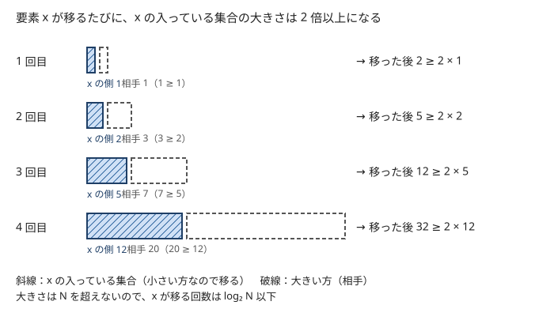

!!! abstract "要点"
    - **何ができるか**：2 つの集合を併合するとき小さい方の要素を大きい方へ移すと、1 つの要素が移るのは高々 $\log_2 N$ 回なので、移動の合計は $O(N \log N)$ 回になる。グループの併合と種類数の問い合わせや、部分木ごとの集計（DSU on Tree）に使う。
    - **いつ使うか**：
        - グループの併合と、グループ内の種類数・個数の問い合わせ
        - 部分木ごとに集合（map）を持って併合する
        - すべての部分木について、色の種類数・最頻値を求める
    - **計算量**：要素の移動は合計 $O(N \log N)$ 回（ならし。1 回の併合は最悪 $O(N)$）。移す先が set・map なら合計 $O(N \log^2 N)$、DSU on Tree は $O(N \log N)$
    - **前提**：[Union-Find](../ds/union-find.md)、[set・multiset・map の応用](../ds/ordered-set.md)

<!-- textlint-disable -->
別名：small-to-large・小さい方を大きい方へ移す・データ構造をマージする一般的なテク・weighted union heuristic・DSU on Tree・Sack
<!-- textlint-enable -->

マージテクは、集合どうしの併合をくり返すとき、毎回「要素の少ない方」を「多い方」へ 1 つずつ移す工夫である。1 回の併合は遅いこともあるが、1 つの要素が移る回数に $\log_2 N$ の上限があるので、全体では速い。和や最大値のように 2 つの値から合成できる情報は [Union-Find](../ds/union-find.md) の根に持てば足り、色の種類数のように集合そのものが要るときにこの工夫が要る。

## 要素が移るのは高々 log N 回の理由 {#why-log}

マージテクが要るのは、併合の相手を選べない場面である。たとえば $N$ 個の箱に色の付いたボールが 1 個ずつ入っていて、「箱 $a$ の中身をすべて箱 $b$ へ移し、箱 $b$ の色の種類数を答える」操作が $Q$ 回来るとする。箱の中身を色の集合で持ち、毎回「$a$ の要素を $b$ へ移す」と書くと、大きな箱を小さな箱へ何度も移す入力で遅くなる。箱 $0$ に全部を集めてから、箱 $0 \to 1$、$1 \to 2$、… と移し続けると、毎回 $N$ 個近くが動いて $O(NQ)$ になる。

そこで、どちらへ移す操作でも、実際に要素を動かすのは要素の少ない方にする（中身の入れ替え方は[次の節](#swap)）。まず、併合する 2 つの集合に重なりがない場合を考える。ボールそのもの・頂点そのもののように、併合後の大きさが 2 つの大きさの和になる場合である。このとき次のことが言える。

> 要素 $x$ が移るとき、$x$ の入っている集合の大きさは 2 倍以上になる。

$x$ のいる集合の大きさを $a$、相手を $b$ とする。$x$ が移るのは $x$ の側が小さい方のときなので $a \le b$ で、移った後の大きさは $a + b \ge 2a$ である。最初の大きさは 1 で、集合の大きさは要素の総数 $N$ を超えない。よって $x$ が移るのは高々 $\log_2 N$ 回で、$N$ 個の要素を合わせて移動は $N \log_2 N$ 回以下になる。

言いかえると、併合 1 回の手間を「2 つの集合の大きさの小さい方」$\min(a, b)$ とすれば、どんな順で併合しても手間の合計は $N \log_2 N$ 以下である。$\min(a, b)$ を小さい方の要素 1 つにつき 1 ずつ払うと考えれば、各要素が払う回数は上の「移る回数」そのものになる。

箱の例のように中身を色の集合で持つと、同じ色が重なって 1 つにまとまるので、併合後の大きさは和より小さくなることがある。このときは上の「2 倍以上」が色の集合の大きさでは成り立たない。それでも合計の上限は変わらない。1 回の手間は「小さい方の色の集合の大きさ」で、これは小さい方の箱のボールの個数以下である。ボールの個数は併合で和になるので、ボールについて上の議論を使えば、手間の合計は $N \log_2 N$ 以下になる。[部分木の集合の併合](#subtree-merge)で同じ色の項目がまとまる場合も同じである。



図は 1 つの要素 $x$ の側から見た記録である。$x$ の入っている集合（斜線）は、毎回それ以上の大きさの集合（破線）と併合され、$1 \to 2 \to 5 \to 12 \to 32$ と 2 倍以上ずつ大きくなる。$x$ の側が大きい方だった併合では、$x$ は動かないので数えない。

この見積もりは、1 回の併合が速いことを言っていない。大きさ $N/2$ どうしの併合は 1 回で $N/2$ 個を動かす。全体の合計に上限があるという、[ならし計算量](../guide/glossary.md#amortized-complexity)の主張である。

計算量は「移動の回数 × 1 回の移動の手間」で決まる。

| 移す先 | 1 回の移動 | 全体 |
| --- | --- | --- |
| `vector`（重複を気にしない） | $O(1)$ | $O(N \log N)$ |
| `set`・`map` | $O(\log N)$ | $O(N \log^2 N)$ |
| `unordered_set`・`unordered_map` | 期待 $O(1)$ | 期待 $O(N \log N)$ |

$N = 2 \times 10^5$ なら $N \log_2^2 N$ は $6 \times 10^7$ ほどで、`set` や `map` でも間に合う。

## swap で入れ替える・大きい方を代表に残す {#swap}

「箱 $a$ の中身を箱 $b$ へ移す」で $a$ の方が大きいとき、要素を動かすのは $b$ の側である。ただし、操作の後で中身を持つのは箱 $b$ でなければならない。この食い違いを解く方法は 2 つある。

- **中身を入れ替える**：`swap(s[a], s[b])` で 2 つの集合の中身を入れ替えてから、$a$（もとの $b$ の中身。小さい方）を $b$ へ移す。`std::set`・`std::map`・`std::vector` の `swap` は内部のポインタを付け替えるだけなので、要素数によらず $O(1)$ である
- **番号を付け替える**：箱 $i$ の中身が入っている集合の番号 $\mathrm{id}[i]$ を持つ。小さい方の集合を大きい方へ移し、$\mathrm{id}[b]$ を大きい方の番号にする。集合を表に持つときや、集合が `swap` できない自作の構造のときに使う

どちらでも、操作が求める「移す向き」と、実際に要素を動かす向きを切り離すのが要点である。次のコードは中身を入れ替える書き方である。

```cpp
--8<-- "small-to-large/swap-sets.cpp:core"
```

完全なプログラム：[`swap-sets.cpp`](https://github.com/yuukougun/kyopro-atlas/blob/main/snippets/small-to-large/swap-sets.cpp)（GitHub）
{ .kp-code-src }

`a == b` の判定は省けない。自分自身へ移すと、`for` で `s[a]` を読みながら同じ集合に挿入し、最後の `clear` で中身が全部消える。Union-Find と組み合わせるなら、同じ成分どうしの併合がこれにあたる。

!!! warning "コピーで移すと $O(N)$ が毎回かかる"
    `s[b] = s[a];` や、集合を値渡しの引数にする書き方は、大きい方の中身を丸ごとコピーするので、マージテクの意味がなくなる。大きい方を引き継ぐときは `swap` か `std::move` を使う。

## Union-Find の代表元に map を持たせる {#map-on-root}

グループの併合と「グループ内に色 $y$ が何個あるか」の問い合わせは、[Union-Find](../ds/union-find.md) の代表元（根）に「色ごとの個数」の map を持たせて処理する。根に情報を持たせる考え方は [Union-Find の応用の根に成分の情報を持たせる](../ds/union-find-applications.md#data-on-root)にある。ここでは map の併合をマージテクにする。

**保つ性質**：$\mathrm{cnt}[r]$ は、$r$ が代表元のときだけ「$r$ の成分の色ごとの個数」として正しい。代表元でない頂点の map は空にしておき、読まない。

**併合の手順**：

1. $r_a = \mathrm{leader}(a)$、$r_b = \mathrm{leader}(b)$ を先に求める。$r_a = r_b$ なら何もしない
2. 併合して新しい代表元 $r$ を得る。代表元でなくなった方を $o$ とする
3. 項目数で $\mathrm{cnt}[o]$ が多ければ、$\mathrm{cnt}[o]$ と $\mathrm{cnt}[r]$ の中身を `swap` する
4. $\mathrm{cnt}[o]$ の各項目（色, 個数）を $\mathrm{cnt}[r]$ に足し、$\mathrm{cnt}[o]$ を空にする

ACL の `dsu` は、サイズ（頂点数）の大きい方を代表元に残す。map の項目数は成分の頂点数以下なので、手順 3 の `swap` がなくても、移す項目数は小さい方の成分の頂点数以下に収まり、[理由の節](#why-log)の見積もりがそのまま使える。手順 3 は、頂点数は多いが色が少ない成分のときに手間を減らす保険である。

```cpp
--8<-- "small-to-large/map-on-root.cpp:core"
```

完全なプログラム：[`map-on-root.cpp`](https://github.com/yuukougun/kyopro-atlas/blob/main/snippets/small-to-large/map-on-root.cpp)（GitHub）
{ .kp-code-src }

問い合わせで `m[y]` と書くと、ない色の項目が作られて map が大きくなる。読むだけなら `find` か `count` を使う。

!!! info "ACL では"
    `dsu d(n);`。`d.merge(a, b)` は併合して新しい代表元を返し（サイズが同じなら `leader(a)` の側が残る）、`d.leader(a)` は代表元を、`d.size(a)` は成分の頂点数を返す。どれもならし $O(\alpha(N))$。代表元に持たせる map は自分の配列で持ち、`merge` の前に両方の `leader` を取っておく（`merge` の後では、どちらが代表元でなくなったか分からない）。経路圧縮をするので、併合の取り消しはできない。

## 小さい方の要素だけを書き換える（ずれ・クエリの集合） {#relabel-smaller}

マージテクで移すのは、集合の要素に限らない。「併合のたびに、片方のグループの全員について何かを書き換えたい」なら、小さい方の全員を書き換えれば、書き換えの合計は $O(N \log N)$ 回で済む。よく出る形は次の 3 つである。

- **所属の書き換え**：各要素がどのグループにいるかを $\mathrm{group}[v]$ で持ち、併合では小さい方の全員の $\mathrm{group}$ を大きい方の番号にする。Union-Find を使わずに、グループの一覧と所属を $O(1)$ で引ける
- **基準値からのずれ**：グループの全員に同じ値を足す操作では、グループごとの基準値 $\Gamma$ と、各要素の基準値とのずれ $\delta_v$ を持ち、要素の値を $\Gamma + \delta_v$ で表す。2 つのグループを併合すると、基準値が 1 つにまとまる。小さい方の全員の $\delta_v$ を、大きい方の基準値に合わせて直す。全員への加算は基準値への加算 1 回で済む
- **クエリの集合**：「2 点が初めて同じグループになる時刻」を答えるオフラインのクエリは、各グループに「片方の端点がこのグループにあるクエリの番号」の集合を持つ。併合では小さい方の集合の各クエリを見て、相手の端点が大きい方にあれば、その時刻を答えにする。答えの出ないクエリは大きい方の集合へ移す

ずれの書き換えは、小さい方の要素を 1 つずつ見るので、各グループの要素の一覧（`vector`）も持っておく。一覧の併合もマージテクで行い、一覧の長さで小さい方を決める。

??? question "確認問題：全員への加算とずれ"
    グループ $P$（基準値 $\Gamma_P$）をグループ $Q$（基準値 $\Gamma_Q$）へ併合するとき、$P$ の要素 $v$ のずれ $\delta_v$ をどう直せばよいか。

    ??? success "答え"
        $v$ の値は $\Gamma_P + \delta_v$ で、併合後は $\Gamma_Q + \delta'_v$ で表したい。値を変えないので $\delta'_v = \delta_v + \Gamma_P - \Gamma_Q$ である。$Q$ の要素は基準値が変わらないので直さない。$P$ が小さい方なら、直すのは小さい方の要素だけになる。

## 森に辺を足すとき小さい方を根付け直す {#reroot-smaller}

この節は[木の基本性質](../tree/tree-basics.md)の根付き木と親の配列、[深さ優先探索](../graph/dfs.md)を前提にする。

辺が 1 本ずつ足されて森が育っていき、その途中で「$u$ と $v$ の両方に隣接する頂点」のような親子の関係を使う問い合わせに答えたいことがある。各木を根付き木として親 $\mathrm{par}[v]$ を持てば、2 頂点の共通の隣接点は次の 3 通りの形しかない（木には閉路がないので、共通の隣接点は高々 1 つ）。

- $\mathrm{par}[\mathrm{par}[u]] = v$ のとき $\mathrm{par}[u]$
- $\mathrm{par}[\mathrm{par}[v]] = u$ のとき $\mathrm{par}[v]$
- $\mathrm{par}[u] = \mathrm{par}[v]$（根でない）のとき $\mathrm{par}[u]$

困るのは辺 $(u, v)$ を足すときで、$v$ の木を $u$ の木にぶら下げるには、$v$ の木を $v$ が根になるように付け直す必要がある。そこで、頂点数の少ない方の木を付け直す。

```text
add_edge(u, v):
    木の頂点数を比べ、v の側が小さくなるように u と v を入れ替える
    v の木を v から DFS し、通った各頂点 w の par[w] を「DFS で来た頂点」にする
    par[v] ← u
    隣接リストに辺 (u, v) を足し、Union-Find で 2 つの木を併合する（頂点数を数えるため）
```

付け直しで par が書き換わる頂点は小さい方の木の全員で、これは「小さい方の要素を書き換える」形そのものである。1 つの頂点が付け直されるたびに、その頂点の木の頂点数は 2 倍以上になるので、付け直しは 1 頂点あたり $\log_2 N$ 回以下、全体で $O(N \log N)$ である。問い合わせは親を 2 回たどるだけなので $O(1)$ になる。

付け直しの DFS は、付け直す木の頂点数の分だけ深くなる。一直線の木で再帰の DFS を書くと、環境によってはスタックが足りなくなる。気になるなら明示的なスタックで書く。

## 部分木ごとの集合の併合（木 DP での使い方は DP の章） {#subtree-merge}

この節は[木 DP](../dp/tree-dp.md) を前提にする。数え方の例（同じ色の頂点の組の距離の和）は、[木 DP の部分木の情報をデータ構造で持ってマージする](../dp/tree-dp.md#tree-dp-merge)にある。

各頂点 $v$ に「$v$ の部分木に含まれる色ごとの個数」のような map を持たせ、子の map を親で併合していく木 DP では、親の map を新しく作って全部の子を足すと、一直線の木で $O(N^2)$ になる。マージテクでは次のように併合する。

1. $v$ の子の map のうち、いちばん大きいものを `swap`（または `std::move`）で $v$ の map として引き継ぐ
2. ほかの子の map の各項目を、$v$ の map へ足す。このとき、組を数える問題なら足す前に相手の map と照らし合わせて数える
3. $v$ 自身の色を足す

同じ色の項目は 1 つにまとまるので、併合後の項目数は 2 つの項目数の和より小さいことがある。それでも 1 回の手間は「小さい方の map の項目数」である。項目数の小さい方は、どちらの map の項目数以下でもあるので、頂点数の小さい方の部分木の map の項目数以下であり、その部分木の頂点数以下でもある。よって [手間の合計が $\min(a, b)$ の和で抑えられる議論](#why-log)が使え、項目の移動は合計 $O(N \log N)$ 回、map なら $O(N \log^2 N)$ になる。

実装では、頂点 $v$ の使う map の番号 $\mathrm{id}[v]$ を持つと、引き継ぎは $\mathrm{id}[v] \leftarrow \mathrm{id}[\text{大きい子}]$ の代入で済む（[番号を付け替える](#swap)書き方）。再帰の関数が map を値で返すのはムーブで済む。ただし、名前の付いた map を `=` で別の変数に入れるとコピーになる。

部分木の集合を併合する問題のうち、「部分木ごとの種類数・最頻値」のように配列 1 本で数えられる問い合わせなら、次の [DSU on Tree](#dsu-on-tree) を使うと定数倍が軽い。

## DSU on Tree（重い子の結果を残す） {#dsu-on-tree}

この節は[オイラーツアーで部分木を区間にすること](../tree/euler-tour.md#in-out)を前提にする。

頂点 $v$ の子のうち部分木の頂点数が最大のもの（同じなら 1 つを選ぶ）を**重い子**と呼び、ほかの子を軽い子、親と軽い子を結ぶ辺を軽い辺と呼ぶ。同じ呼び方は [HL 分解](../tree/hld.md#heavy-light)でも使う。

DSU on Tree は、すべての部分木について「色の種類数」「最頻値」などを、map を使わずに配列 1 本（色ごとの個数 $\mathrm{cnt}[x]$）で求める方法である。配列は全体で 1 本しかないので、ある時点で数えているのは 1 つの部分木だけである。各頂点 $v$ で次の順に処理する。

```text
dfs(v, keep):                          # keep：v の部分木を数えたまま返るか
    v の軽い子 u それぞれについて dfs(u, false)     # 答えを求めて、cnt を空に戻す
    重い子 h があれば dfs(h, true)                  # h の部分木を数えたまま返る
    軽い子の部分木の頂点をすべて cnt に足す
    v を cnt に足す
    v の答えを cnt から求める
    keep が false なら、v の部分木の頂点をすべて cnt から引く
```

部分木の頂点を列挙するところは、行きがけ順の列 $\mathrm{ord}$ の区間 $[\mathrm{in}[u], \mathrm{out}[u])$ を走査すると速い。

**なぜ $O(N \log N)$ か**：頂点 $w$ が $\mathrm{cnt}$ に足されるのは、$w$ 自身を処理するときと、$w$ の祖先 $v$ で「$w$ を含む軽い子の部分木を足し直す」ときである。後者は、根から $w$ へのパス上の軽い辺 1 本につき 1 回である（引く回数も同じ）。軽い辺で子へ下りると、重い子の部分木はそれ以上の大きさなので、部分木の頂点数は半分以下になる。そのため、根からのパス上の軽い辺は $\log_2 N$ 本以下である（[HL 分解](../tree/hld.md#heavy-light)と同じ理由）。よって足す・引くの合計は $O(N \log N)$ で、$\mathrm{cnt}$ の更新と答えの取り出しが $O(1)$ なら全体も $O(N \log N)$ になる。

重い子だけを残すのが要点である。もし残す子を選ばずに最後の子を残すと、大きな部分木を何度も足し直す木（一直線の木の途中から小さな枝が出ている形など）で $O(N^2)$ になる。

次のコードは、すべての部分木の色の種類数を求める。

```cpp
--8<-- "small-to-large/dsu-on-tree.cpp:core"
```

完全なプログラム：[`dsu-on-tree.cpp`](https://github.com/yuukougun/kyopro-atlas/blob/main/snippets/small-to-large/dsu-on-tree.cpp)（GitHub）
{ .kp-code-src }

最頻値の出現回数を求めるなら、色ごとの個数 $\mathrm{cnt}[x]$ に加えて、「個数が $k$ の色の数」$\mathrm{freq}[k]$ と最大の個数 $\mathrm{mx}$ を持つ。色 $x$ を足すときは $\mathrm{freq}[\mathrm{cnt}[x]]$ を 1 減らし、$\mathrm{cnt}[x]$ を 1 増やし、$\mathrm{freq}[\mathrm{cnt}[x]]$ を 1 増やして、$\mathrm{mx}$ を必要なら 1 増やす。引くときは $\mathrm{cnt}$ と $\mathrm{freq}$ を同じように 1 つずつ戻す。引くのは部分木を空にするときだけなので、$\mathrm{mx}$ は全部引き終えてから $0$ に戻せばよい。

DSU on Tree が使えるのは、答えを部分木ごとに求めればよく、数えるものを 1 頂点ずつ足し引きできるときである。部分木どうしの組（異なる子の部分木から 1 つずつ選ぶ組）を数えるなら、軽い子を足す前に、その部分木の頂点を今の $\mathrm{cnt}$ と照らし合わせて数えれば、同じ順序で処理できる。

## 落とし穴 {#pitfalls}

- **大きい方を移している**：「$a$ を $b$ へ移す」をそのまま書き、大きさを比べ忘れる。箱を 1 つに集めてから順に移していく入力で $O(N^2)$ になる。テストで小さな入力しか試さないと気づかないので、全部を 1 か所に集める入力で時間を測る
- **自分自身へ移す**：`a == b` や同じ成分どうしの併合を判定しないと、`clear` で中身が消える（[swap の節](#swap)）
- **コピーで引き継ぐ**：`s[b] = s[a]`、map の値渡し、`auto m = cnt[r];`（参照でない）は毎回丸ごとコピーする。`auto& m = cnt[r];` と参照で受ける
- **`merge` の後に代表元を取る**：ACL の `dsu` で `merge` した後に `leader(a)` と `leader(b)` を取っても、どちらも新しい代表元で、代表元でなくなった方の情報の場所が分からない。`merge` の前に両方を取る
- **`m[y]` で読む**：map にない色を `m[y]` で読むと項目が増え、項目数で大きさを比べているときに見積もりが狂う
- **再帰の深さ**：部分木の併合と DSU on Tree は木の高さの分だけ再帰する。一直線の木（$N = 2 \times 10^5$ の深さ）で手元の環境がスタックあふれを起こすことがある
- **vector の容量**：`clear` しても `vector` の確保した領域は残る。合計で問題になることはまれだが、気になるなら `vector<int>().swap(v)` で解放する

## 例題 {#examples}

### ABC329 F. Colored Ball {#abc329_f}

<div class="kp-problems" data-role="example" markdown>

- [ABC329 F. Colored Ball](https://atcoder.jp/contests/abc329/tasks/abc329_f)（diff 1207）：箱に色のついたボールが入っており、箱 a のボールをすべて箱 b へ移すたびに、箱 b のボールの色の種類数を答える

</div>

箱ごとに色の集合を持ち、[swap の節](#swap)のとおりに「小さい方を大きい方へ移し、必要なら中身を入れ替える」と書けば解ける。$N, Q \le 2 \times 10^5$ で、色の移動は合計 $N \log_2 N$ 回以下である。同じ色はまとまるので、色の集合の大きさでなくボールの個数で数える（[理由の節](#why-log)の最後の段落）。

??? note "解法の詳細"
    箱 $i$ の集合 $s_i$ を、最初は $\{C_i\}$ にする（0-indexed に直して持つ）。操作 $(a, b)$ では、$\lvert s_a \rvert > \lvert s_b \rvert$ なら $s_a$ と $s_b$ を `swap` し、$s_a$ の各色を $s_b$ に挿入して $s_a$ を空にする。答えは $\lvert s_b \rvert$ である。箱 $a$ は空になるので、入れ替えた後に $s_a$ を空にするのは正しい。`set` なら全体で $O(N \log^2 N + Q)$、`unordered_set` なら期待 $O(N \log N + Q)$ である。

### ABC183 F. Confluence {#abc183_f}

<div class="kp-problems" data-role="example" markdown>

- [ABC183 F. Confluence](https://atcoder.jp/contests/abc183/tasks/abc183_f)（diff 1586）：生徒がクラスに属し、2 人の生徒の集団を合流させるクエリと、生徒 x の集団にいるクラス y の生徒の数を問うクエリに答える

</div>

集団を Union-Find で管理し、代表元に「クラスごとの人数」の map を持たせる。合流では[代表元に map を持たせる節](#map-on-root)の手順で小さい方の map を大きい方へ足し、問い合わせでは代表元の map を読む。$N, Q \le 2 \times 10^5$ である。

??? note "解法の詳細"
    最初は生徒 $i$ の map を $\{C_i : 1\}$ にする。合流のクエリでは、両方の代表元を先に求め、同じなら何もしない。違えば併合し、代表元でなくなった方の map の各項目を新しい代表元の map に足す。問い合わせ $(x, y)$ では、$\mathrm{leader}(x)$ の map で $y$ を `find` し、なければ 0 を答える。map の移動は合計 $O(N \log N)$ 回なので、全体で $O(N \log^2 N + Q \log N)$ になる。

    併合の過程を木にして、オフラインで数える別解もある（[併合過程の木](../tree/merge-process-tree.md#practice)）。

## 練習問題 {#practice}

<div class="kp-problems" data-role="practice" markdown>

- [ABC314 F. A Certain Game](https://atcoder.jp/contests/abc314/tasks/abc314_f)（diff 1736）：1 人ずつのチームから始め、2 つのチームが戦って人数に比例する確率で勝ち、合併することをくり返すとき、各人の属するチームが勝つ回数の期待値を求める
- [ABC394 G. Dense Buildings](https://atcoder.jp/contests/abc394/tasks/abc394_g)（diff 2031）：建物が格子状に並び、隣り合う建物の間は両方の高さ以下の階で行き来できるとき、2 つの建物の指定された階どうしを移動する際の、上り下りする階数の最小値を各質問に答える
- [ABC350 G. Mediator](https://atcoder.jp/contests/abc350/tasks/abc350_g)（diff 2058）：森に辺を 1 本ずつ足しながら、2 頂点の両方に隣接する頂点を答える質問に答える（オンライン）
- [ABC359 G. Sum of Tree Distance](https://atcoder.jp/contests/abc359/tasks/abc359_g)（diff 2099）：木の頂点に色が付いているとき、同じ色の頂点の組すべてについて距離を足し合わせた値を求める

</div>

??? note "練習の方針"
    - **ABC314 F**：チームごとに基準値、各人にずれを持つ（[小さい方の要素だけを書き換える](#relabel-smaller)）。大きさ $a$ と $b$ のチームが戦うと、それぞれ $a/(a+b)$ と $b/(a+b)$ の確率で勝つので、期待値を各チームの基準値に足す。合併では小さい方のメンバーのずれを、大きい方の基準値に合わせて直す
    - **ABC394 G**：経路上のいちばん低い階をなるべく高くしたいので、建物を高い順に Union-Find でつなぐ。各成分に「端点がこの成分にある質問」の集合を持ち、併合で小さい方の集合を調べれば、2 つの建物が初めてつながる高さ $h$ が分かる。指定された 2 つの階を $Y, Z$ とすると、低い方が $h$ 以下なら答えは $\lvert Y - Z \rvert$、どちらも $h$ より高ければ $h$ 階まで下りて上るので $Y + Z - 2h$ である。同じ建物の質問は、併合を待たずに $\lvert Y - Z \rvert$ と答える
    - **ABC350 G**：[森に辺を足すとき小さい方を根付け直す](#reroot-smaller)の形そのものである。クエリは前の答えで復号するのでオンラインで処理する
    - **ABC359 G**：色ごとの（頂点数, 深さの和）を map に持って部分木を併合する（[部分木ごとの集合の併合](#subtree-merge)）。LCA が $v$ になる同じ色の組の距離の和は、2 つの map の同じ色について $s_1 m_2 + s_2 m_1 - 2\,\mathrm{dep}[v]\, m_1 m_2$（$s$ は深さの和、$m$ は個数）である

## 力試し {#challenge}

<div class="kp-problems" data-role="challenge" markdown>

- [ABC454 G. Mode in the Subtree](https://atcoder.jp/contests/abc454/tasks/abc454_g)（diff 2253）：根付き木の各頂点の部分木について、色ごとの頂点数の最大値と、その最大値をとる色の数を求める

</div>

??? note "力試しの方針"
    - **ABC454 G**：$N$ が数百万まであり、map を使う併合では間に合わない。[DSU on Tree](#dsu-on-tree) で、色ごとの個数・「個数が $k$ の色の数」・最大の個数の 3 つを配列で持てば、足すのが $O(1)$ になり全体で $O(N \log N)$ になる。親の番号が子より小さいので、番号の大きい順に処理すれば部分木サイズと重い子を再帰なしで求められる

## 確認問題 {#quiz}

??? question "確認問題：1 つの要素が移る回数が log₂ N 以下なのはなぜか"
    ??? success "答え"
        要素が移るのは、その要素のいる集合が小さい方（大きさ $a \le b$）のときだけで、移った後の大きさは $a + b \ge 2a$ になる。最初の大きさは 1 で、$N$ を超えないので、2 倍になれるのは $\log_2 N$ 回までである。

??? question "確認問題：毎回大きい方を小さい方へ移すと、最悪どうなるか"
    ??? success "答え"
        大きさ $N - 1$ の集合と大きさ 1 の集合の併合をくり返す入力で、毎回ほぼ $N$ 個が動く。たとえば箱 $0$ に全部を集めた後、$0 \to 1 \to 2 \to \dots$ と移していくと $Q$ 回で $O(NQ)$ になる。要素が移っても、その要素のいる集合がほとんど大きくならないからである。

??? question "確認問題：DSU on Tree で重い子の結果を残し、軽い子を数え直す。逆ではいけないのはなぜか"
    ??? success "答え"
        数え直す頂点の数が、数え直す部分木の大きさの和になるからである。軽い子を数え直す場合、頂点が数え直されるのは根からのパス上の軽い辺の数（$\log_2 N$ 以下）だけである。重い子を数え直すと、一直線に近い木で大きな部分木を各段で足し直し、$O(N^2)$ になる。

??? question "確認問題：部分木の map の併合で、map の項目数で大小を比べてもよいか"
    ??? success "答え"
        よい。1 回の手間は小さい方の map の項目数で、これは小さい方の部分木の頂点数以下である。手間の合計は「併合する 2 つの部分木の頂点数の小さい方」の和以下で、これは $N \log_2 N$ 以下である。部分木の頂点数で比べても、同じ上限になる。

## 使い分け {#comparison}

| 状況 | 使う手法 |
| --- | --- |
| グループの情報が和・最大値・個数で、2 つから合成できる | [Union-Find](../ds/union-find.md) の根に値を持つ（[根に成分の情報を持たせる](../ds/union-find-applications.md#data-on-root)） |
| グループ内の種類数・値ごとの個数をオンラインで | マージテク（[代表元に map を持たせる](#map-on-root)） |
| 併合の過程が先に全部分かっていて、各時点のグループを問う | [併合過程の木](../tree/merge-process-tree.md#group-as-interval)＋オイラーツアー |
| 部分木ごとの種類数・最頻値 | [DSU on Tree](#dsu-on-tree)、またはオイラーツアーの区間で数える（[オイラーツアー](../tree/euler-tour.md)） |
| 部分木の組を数える（同じ色の組の距離など） | [部分木ごとの集合の併合](#subtree-merge)、[重心分解](../tree/centroid-decomposition.md#count-through)、[Auxiliary Tree](../tree/auxiliary-tree.md) |
| 森に辺を足すだけ（削除なし） | [小さい方を根付け直す](#reroot-smaller)。削除もあるなら[動的木](../tree/dynamic-tree.md) |

## 参考 {#references}

- [AtCoder Library「DSU」（document_ja）](https://github.com/atcoder/ac-library/blob/master/document_ja/dsu.md)：`merge` が新しい代表元を返すこと・計算量（v1.6 の手元の版と `dsu.hpp` で、サイズの大きい方が残ることを確かめた）
- [drken「AtCoder ABC 329 F - Colored Ball」](https://drken1215.hatenablog.com/entry/2025/03/13/094339)：例題 abc329_f の制約と、入れ替えてから移す方針
- [drken「AtCoder ABC 183 F - Confluence (水色, 600 点)」](https://drken1215.hatenablog.com/entry/2020/12/20/192100)：例題 abc183_f の制約と、代表元に map を持たせる方針・併合過程の木による別解
- [Kazun「ABC 314 F」](https://kazun-kyopro.hatenablog.com/entry/ABC/314/F)：練習 abc314_f の基準値とずれの持ち方
- [kmjp「AtCoder ABC #394 (鹿島建設プログラミングコンテスト2025) : G - Dense Buildings」](https://kmjp.hatenablog.jp/entry/2025/02/24/1000)：練習 abc394_g の問いと、高い順に併合してクエリの集合を移す方針
- [drken「AtCoder ABC 350 G - Mediator (3D, 黄色, 600 点)」](https://drken1215.hatenablog.com/entry/2024/04/21/014200)：練習 abc350_g の問いと、小さい方を根付け直す方針・共通の隣接点の 3 通り
- [drken「AtCoder ABC 359 G - Sum of Tree Distance (3D, 黄色, 600 点)」](https://drken1215.hatenablog.com/entry/2024/06/23/025552)：練習 abc359_g の map の持ち方と距離の和の式
- [kmjp「AtCoder ABC #454 G」](https://kmjp.hatenablog.jp/entry/2026/04/19/0900)：力試し abc454_g の問いと、DSU on Tree で個数の個数を持つ方針
- [ikatakos「キーサイト・テクノロジープログラミングコンテスト（AtCoder Beginner Contest 454）E,F,G問題メモ」](https://ikatakos.com/pot/programming_algorithm/contest_history/atcoder/2026/0418_abc454)：力試し abc454_g の制約と DSU on Tree の手順（解法の部分だけ）
