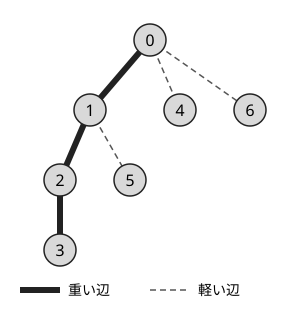
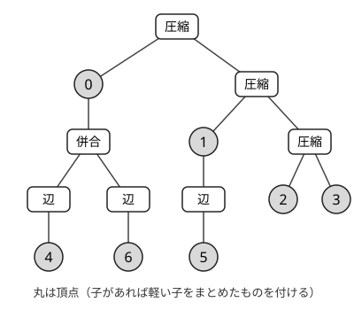

!!! abstract "要点"
    - **何ができるか**：頂点の値を書き換えるたびに、木 DP の根の値を $O(\log N)$ 程度で更新する。HL 分解の重いパスの上で DP をセグメント木に載せる方法と、木をパスの圧縮と部分木の併合で平衡に組み直す Static Top Tree がある。
    - **いつ使うか**：頂点の値を更新するたびに、木全体についての最適値・数え上げの結果を答える
    - **計算量**：Static Top Tree は構築 $O(N \log N)$（工夫すれば $O(N)$）、1 点の更新 $O(\log N)$（節点の値の計算が $O(1)$ のとき）。HL 分解とセグメント木なら更新 $O(\log^2 N)$
    - **前提**：[HL 分解](../tree/hld.md)、[木 DP](../dp/tree-dp.md)

<!-- textlint-disable -->
別名：Static Top Tree・動的木 DP・dynamic tree DP
<!-- textlint-enable -->

Static Top Tree は、根付き木を「重いパスを縦につなぐ操作」と「軽い子の部分木を横に束ねる操作」の組み立ての手順として表し、その手順を高さ $O(\log N)$ の二分木に並べたものである。二分木の各節点に「その部分の木 DP の要約」を持たせれば、頂点の値を 1 つ変えても、根までの $O(\log N)$ 個の節点を計算し直すだけで根の DP の値が求まる。木の形は変わらない（静的な）前提で、辺の付け替えがあるなら[動的木](../tree/dynamic-tree.md)の領分になる。

素朴に木 DP をやり直すと 1 回 $O(N)$ かかる。変わった頂点から根へ親をたどって計算し直しても、パス状の木では深さが $N$ なので同じである。ABC では difficulty 2400 を超える問題でまれに必要になる程度だが、「更新のたびに木全体の DP の答え」という形を見たら、この 2 つの方法を思い出せばよい。

## 重いパスの上で DP をセグ木に載せる {#heavy-path-dp}

この節は [HL 分解](../tree/hld.md)の重いパスを前提にする。

例として、根 $0$ の木で頂点のハッシュを $f(v) = A_v$（$v$ が葉）、$f(v) = A_v + \prod_{c} f(c)$（$c$ は $v$ の子。葉でないとき）と定め、$A_v$ を書き換えるたびに $f(0)$ を答える問題を考える。$v$ の[重い子](../guide/glossary.md#heavy-edge)を $h$ とし、軽い子の値の積を $p_v = \prod_{c \ne h} f(c)$ とまとめると、

$$
f(v) = p_v \cdot f(h) + A_v
$$

になる。重い子の値 $x = f(h)$ を入れると $f(v)$ を返す一次関数 $\varphi_v(x) = p_v x + A_v$ を頂点 $v$ に持たせる。葉は $\varphi_v(x) = A_v$（$p_v = 0$ とみる）である。1 本の[重いパス](../guide/glossary.md#heavy-path)の頂点を浅い順に $u_1, \dots, u_k$（$u_k$ は葉）とすると、パスの先頭の値は合成

$$
f(u_1) = (\varphi_{u_1} \circ \varphi_{u_2} \circ \cdots \circ \varphi_{u_k})(0)
$$

で求まる。一次関数の合成は[結合法則](../guide/glossary.md#associativity)を満たすので、HL 分解の番号の列にセグメント木を載せればよい。番号は重いパスの浅い方ほど小さいので、積は番号の順（浅い方が左）に並ぶ。[木の上の動的 DP](../dp/dynamic-dp.md#on-trees) の行列の書き方と同じ向きである。

$A_v$ を書き換えたときは次のように直す。

1. $\varphi_v$ を直し、$v$ の重いパスのセグメント木を 1 点更新する
2. パスの先頭 $u$ の新しい $f(u)$ を、パス全体の合成から求める
3. $u$ は親 $\mathrm{par}[u]$ の軽い子なので、$p_{\mathrm{par}[u]}$ の中の古い $f(u)$ を新しい値に取り替え、$\mathrm{par}[u]$ の重いパスで 1 に戻る

根までの軽い辺は $O(\log N)$ 本なので、1 回の更新は $O(\log N)$ 本の重いパスでセグメント木を更新し、$O(\log^2 N)$ になる。

手順 3 には落とし穴がある。古い $f(u)$ を積から外すのに割り算を使うと、$f(u) \equiv 0$ のとき[逆元](../guide/glossary.md#inverse-element)がなく外せない。積を「0 でない値の積」と「0 の個数」の組で持つか、頂点ごとに軽い子の値を並べたセグメント木を持って積を取り直す。max でまとめる DP のように、そもそも引き算や割り算のない演算でも、同じく軽い子を集める構造が要る。

重い子を特別に扱う考え方は、更新のない木 DP にも使われる。親の DP の配列を子の再帰へそのまま渡し、渡し方が 1 通りで済む重い子へは 1 回、軽い子へは必要な通り数だけ再帰する方法は**重軽再帰 DP** と呼ばれ、ナップサック型の木 DP を $O(N^{\log_2 3} X)$ ほどに抑える。名前は似ているが、値の更新を扱う方法ではない。

## Static Top Tree（圧縮と併合） {#compress-rake}

HL 分解の方法で $\log$ が 2 つ付くのは、重いパスごとのセグメント木が列を個数の半分で分けるからである。ぶら下がっている部分木の大きさは考えていない。Static Top Tree は、木全体を 1 本の平衡な二分木にまとめ、部分木の大きさで分けることで $\log$ を 1 つにする。

前の節のハッシュ $f(v) = A_v + \prod_c f(c)$ を例にする。木を部品に分けて、2 種類の部品を考える。

- **パスの部品**：重いパスの連続する一部の頂点と、それらにぶら下がる軽い子の部分木全体。上端の頂点で上につながり、下端の頂点の重い子の位置に「穴」が 1 つある。値は「穴に入る値 $x$ から上端の DP の値を返す関数」で、上の例では一次関数 $(a, b)$：$x \mapsto ax + b$ になる。
- **束の部品**：1 つの頂点にぶら下がる軽い子の部分木をいくつか束ねたもの（頂点そのものは含まない）。上の例では、束ねた子の値の積を持つ。

部品は次の 5 つの操作で組み立てる（名前は資料によって英語のまま Vertex・AddEdge・Rake・AddVertex・Compress と呼ぶ）。

| 操作 | 入力 → 出力 | 上の例での値 |
| --- | --- | --- |
| 頂点 | 軽い子のない頂点 $v$ → パス | 重い子があれば $(1, A_v)$、葉なら $(0, A_v)$ |
| 辺を付ける | 葉まで続くパス → 束 | 穴がないので定数 $b$ がその子の値 |
| 併合（rake） | 束・束 → 束 | 2 つの積 |
| 頂点を付ける | 束と頂点 $v$ → パス | $(\text{束の積}, A_v)$ |
| 圧縮（compress） | 上のパス・下のパス → パス | 上の穴に下を入れた合成 $(a_1 a_2,\ a_1 b_2 + b_1)$ |

組み立て方は再帰的である。重いパス 1 本について、各頂点を「その頂点の軽い子を併合した束に、頂点を付けたパス」にし、それらを上から順に圧縮する。軽い子はそれぞれ、自分から始まる重いパスを同じように組み立ててから辺を付ける。



この木を組み立てると次の二分木になる。根は重いパス 0–1–2–3 の圧縮で、頂点 0 の下には軽い子 4 と 6 を併合した束が付く。



平衡にするのは、圧縮と併合で部品の列を 2 つに分ける位置である。各部品の頂点数を重みにして、列を「重みの和がおよそ半分ずつ」になる位置で分け、それぞれを再帰的にまとめる。真ん中の個数で分けるのではない点が、HL 分解とセグメント木の方法との違いである。重み $w$ の部品は、重みの和 $W$ の列の中で深さがおよそ $\log_2 (W / w)$ に置かれる。その部品の中へ進むと全体の重みが $W$ から $w$ に減る。根から葉までの深さは各列での $\log_2 (W / w)$ の和で、これが打ち消し合って $\log_2 N$ 以下になり、列 1 つあたりの定数が足される。通る列の数は軽い辺の数のおよそ 2 倍で $O(\log N)$ なので、高さは $O(\log N)$ になる（詳しい証明は[学ぶための資料](#resources)に任せる）。節点の数は、頂点・軽い辺・重い辺にそれぞれ定数個が対応するので $O(N)$ である。このページのコード片は分ける位置を探すのに列を毎回走査するので組み立てが $O(N \log N)$ になるが、工夫すれば $O(N)$ で組める（ei1333 氏の Luzhiled's Library は構築を $O(n)$ とする）。

頂点 $v$ の値 $A_v$ を変えたときは、$v$ に当たる節点から二分木の根までの節点を、子の値から計算し直すだけでよい。根の節点は根の重いパス全体（葉で終わる）なので、その定数 $b$ が答え $f(0)$ になる。HL 分解の方法で軽い子の積から古い値を外す手順と違い、束の積は 2 つの子の積を掛け直して作るので、割り算は要らない。

演算に要る性質は次のとおりである。

- 圧縮は結合法則を満たす必要がある（列をどこで分けても同じ値にするため）。順番は変えられない。
- 併合は結合法則に加えて[交換法則](../guide/glossary.md#commutativity)も満たす必要がある。組み立てで軽い子の順番を入れ替えるためである。子の順番に意味がある DP では、この形のままでは使えない。

??? question "確認問題：パス状の木（重いパスが 1 本だけ）では、Static Top Tree はどんな形になるか"
    重いパス 1 本の頂点がすべて重み 1 の部品になる。重みの半分（ここでは個数の半分）で分けて圧縮するので、高さ $\log_2 N$ ほどの、完全二分木とほぼ同じ形になる。これは列の DP をセグメント木に載せたものと同じである。[列の動的 DP](../dp/dynamic-dp.md#matrix-on-segment-tree) は Static Top Tree の特別な場合と見られる。

## 自作するときの要点と検証 {#library}

ACL に Static Top Tree はない。自作するときは、木の形から二分木を作る部分と、問題ごとの DP の部分を分ける。木の形の部分は一度書けば使い回せ、問題ごとに書くのは 2 種類の値と 5 つの操作の関数だけになる。ei1333 氏の Luzhiled's Library の Static Top Tree DP も、利用者が `vertex`・`add_vertex`・`add_edge`・`rake`・`compress` の 5 つを渡す形になっている。

二分木を作る部分の中心は次のようになる。`add(k, l, r, t)` は節点 $k$（$-1$ なら新しく作る）を、子 $l$・$r$ と種類 $t$ の節点にする関数である。完全なプログラムは `snippets/static-top-tree/stt.cpp` にあり、親の番号が子より小さい入力を前提にし、部分木サイズを番号の逆順で求めて再帰を避けている。頂点 $v$ を表す節点（頂点・頂点を付ける）の番号を $v$ にしておくと、更新のときに出発点を探さずに済む。

```cpp
--8<-- "static-top-tree/stt.cpp:build"
```

DP の部分は、5 つの操作を `switch` で書き分け、更新では頂点 $v$ の節点から親をたどって計算し直す。上の例のハッシュの場合は次のとおりである。

```cpp
--8<-- "static-top-tree/stt.cpp:dp"
```

自作するときの要点は次のとおりである。

- **値の意味を先に決める**：パスの部品の値は「穴に入る値の関数」、束の部品の値は「束ねた子の値の要約」である。関数を有限個の数で表せる（一次関数・小さな行列・max と足し算の組など）ことが、Static Top Tree を使える条件になる。
- **穴のある・なしを区別する**：パスの部品のうち、下端が葉で終わるもの（辺を付ける直前と根）だけが定数になる。葉の頂点を $(0, A_v)$ のように「穴を無視する関数」にしておくと、場合分けが減る。
- **再帰の深さ**：組み立ての再帰は軽い辺と分割の深さぶんで $O(\log N)$ 段に収まる。部分木サイズを求める DFS は $N$ 段になりうるので、BFS 順の逆で求める。
- **確かめ方**：小さな乱数の木で、毎回 DP をやり直す愚直な方法と比べる。値に 0 を多く混ぜ、パスと星の形でも高さが $O(\log N)$ に収まるかを見る（コード片の `self_test` がその形である）。

Library Checker では次の 2 問で確かめられる（[練習問題](#practice)に載せた）。どちらも頂点の値 $a_v$ と辺の一次関数 $f_e$ を書き換えるたびに、パスに沿って合成した値の総和を答える問題である。

- Point Set Tree Path Composite Sum (Fixed Root)：根 0 からの合成の総和。パスの部品に「合成した一次関数」「部品の中の値の和」「頂点数」を持たせる。辺の値は、辺の子の側の頂点に寄せて持つ。
- Point Set Tree Path Composite Sum：毎回指定される頂点 $r$ を根にしたときの総和。パスの部品に上向きと下向きの両方の値を持たせる必要があり、さらに難しい。このページの検証問題である。

## 学ぶための資料 {#resources}

- [ABC351 G](#abc351_g) の公式解説は、ABC の想定解として Static Top Tree を初めて正面から扱ったもので、下の記事の多くが出発点にしている。AtCoder の解説ページなので、このサイトからは解説へリンクしない。
- [blue_jam「Static Top Treeの覚書」](https://zenn.dev/blue_jam/articles/0526c70b74f6bb)（Zenn）：5 つの操作の前後に来られる操作の組と、節点の数が $O(N)$ になる理由を整理している。
- [noya2「式変形で導出する Static Top Tree」](https://trap.jp/post/2861/)（traP ブログ）：部品（クラスタ）の考え方から入らず、HL 分解の式を変形して同じ構造にたどり着く。HL 分解とセグメント木の方法から入りたい人に向く。全方位木 DP への広げ方にも触れている。
- [maspy「[Library Checker] Point Set Tree Path Composite Sum」](https://maspypy.com/library-checker-point-set-tree-path-composite-sum)：根を毎回変える版を Static Top Tree で解く方法と、部品に持たせる値を説明している。
- [ei1333「Luzhiled's Library: Static Top Tree DP」](https://ei1333.github.io/library/graph/tree/static-top-tree-dp.hpp.html)と [hitonanode「cplib-cpp: Static top tree」](https://hitonanode.github.io/cplib-cpp/data_structure/static_toptree.hpp.html)：実装の参考になる。

## 例題 {#examples}

### ABC351 G. Hash on Tree {#abc351_g}

<div class="kp-problems" data-role="example" markdown>

- [ABC351 G. Hash on Tree](https://atcoder.jp/contests/abc351/tasks/abc351_g)（diff 2920）：根付き木で、葉のハッシュは頂点の値 $A_v$、ほかの頂点のハッシュは $A_v$ に子のハッシュの積を足したものとする。$A_v$ を 1 つ書き換えるたびに、根のハッシュを 998244353 で割った余りを答える。

</div>

方針：頂点 $v$ のハッシュは、重い子のハッシュ $x$ の一次関数 $p_v x + A_v$（$p_v$ は軽い子のハッシュの積）になる。この一次関数を重いパスに沿って合成すれば、[重いパスの上で DP をセグ木に載せる](#heavy-path-dp)方法で 1 回 $O(\log^2 N)$、[Static Top Tree](#compress-rake) で 1 回 $O(\log N)$ になる。

??? note "解法の詳細"
    - Static Top Tree では、パスの部品に一次関数 $(a, b)$、束の部品に子のハッシュの積を持たせる。5 つの操作の値は [Static Top Tree の節](#compress-rake)の表のとおりで、コード片の `HashDP` がこの問題の形そのものである。コード片の組み立て方では、全体で $O(N \log N + Q \log N)$ になる。
    - HL 分解とセグメント木で解くときは、$p_v$ の中の古い値を外す割り算が問題になる。ハッシュは 998244353 で割った余りなので 0 になりうる。軽い子の値を「0 でない値の積」と「0 の個数」の組で持てば、割り算を 0 でない値に限れる。全体で $O(N + Q \log^2 N)$ である。
    - 素朴に親をたどる方法は、パス状の木で 1 回 $O(N)$ になり間に合わない。

## 練習問題 {#practice}

<div class="kp-problems" data-role="practice" markdown>

- [ABC311 Ex. Many Illumination Plans](https://atcoder.jp/contests/abc311/tasks/abc311_h)（diff 3605）：美しさ・重さ・2 色のどちらかを持つ頂点の根付き木で、頂点 $v$ ごとに、$v$ の部分木から $v$ 以外の頂点を取り除いて親子の色がすべて異なる木を作る。残した頂点の重さの和が $X$ 以下での美しさの和の最大値を求める（取り除いた頂点の子は残った最も近い祖先につなぎ直す）。

</div>

??? note "練習の方針"
    - ABC311 Ex：値の更新はなく、[重いパスの上で DP をセグ木に載せる](#heavy-path-dp)の節の最後に触れた重軽再帰 DP の問題である。部分木の配列どうしを合わせる（$O(X^2)$）代わりに、親の DP の配列を子の再帰へそのまま渡し、頂点を 1 つずつ $O(X)$ で足していく。重い子へは 1 回、軽い子へは「最も浅い残した頂点の色」の 2 通りで 2 回再帰すると、$T(n) = 3T(n/2) + O(X)$ の形から $O(N^{\log_2 3} X)$ になる。

### Library Checker

- [Point Set Tree Path Composite Sum (Fixed Root)](https://judge.yosupo.jp/problem/point_set_tree_path_composite_sum_fixed_root)：根 0 からパスに沿って一次関数を合成した値の総和を、頂点の値と辺の関数の書き換えのたびに答える。
- [Point Set Tree Path Composite Sum](https://judge.yosupo.jp/problem/point_set_tree_path_composite_sum)：同じ総和を、クエリごとに指定される頂点を根にして答える。

## 参考 {#references}

- [yosupo06「library-checker-problems/tree」](https://github.com/yosupo06/library-checker-problems/tree/master/tree)：point_set_tree_path_composite_sum と point_set_tree_path_composite_sum_fixed_root の問いの確認
- [blue_jam「Static Top Treeの覚書」](https://zenn.dev/blue_jam/articles/0526c70b74f6bb)：学ぶための資料。5 つの操作と、節点の数が $O(N)$ になる理由
- [noya2「式変形で導出する Static Top Tree」](https://trap.jp/post/2861/)：学ぶための資料。HL 分解の式から同じ構造を導く見方と、例題 ABC351 G の一次関数の形。ABC351 G で Static Top Tree が ABC の想定解として初めて明示的に扱われたこと
- [maspy「[Library Checker] Point Set Tree Path Composite Sum」](https://maspypy.com/library-checker-point-set-tree-path-composite-sum)：学ぶための資料。根を変える版で部品に持たせる値と、ほかの方法との比較
- [ei1333「Luzhiled's Library: Static Top Tree DP」](https://ei1333.github.io/library/graph/tree/static-top-tree-dp.hpp.html)：5 つの操作を渡す形のライブラリの関数の切り分けと計算量
- [hitonanode「cplib-cpp: Static top tree」](https://hitonanode.github.io/cplib-cpp/data_structure/static_toptree.hpp.html)：学ぶための資料。実装の参考
- [ikatakos「AtCoder Beginner Contest 351 G問題メモ」](https://ikatakos.com/pot/programming_algorithm/contest_history/atcoder/2024/0427_abc351)：例題 ABC351 G の HL 分解による解き方と、0 の個数を別に持つ工夫（解法の節だけを読んだ）
- [Nyaan「解説一覧」](https://nyaannyaan.github.io/docs/problems/editorials/)：例題 ABC351 G が Static Top Tree、練習 ABC311 Ex が重軽再帰 DP の問題であることの確認
- [KK_lang「题解：AT_abc311_h [ABC311Ex] Many Illumination Plans」](https://www.luogu.com.cn/article/1s1aiccu)：練習 ABC311 Ex の、親の配列を渡す再帰と $O(N^{\log_2 3} X)$ の評価
- [下蛋爷「[ABC311Ex] Many Illumination Plans 题解」](https://www.cnblogs.com/Scarab/p/19057649)：練習 ABC311 Ex の問い（頂点ごとの答え・共通の上限 $X$・色の条件）の確認
