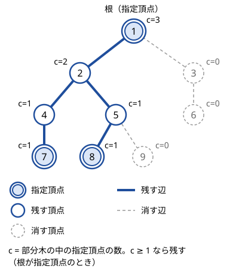

!!! abstract "要点"
    - **何ができるか**：指定した $K$ 頂点をすべて含む最小の連結な部分グラフは一意に決まる部分木である。指定頂点の 1 つを根にして、$v$ の部分木（$v$ とその子孫）に指定頂点を含む頂点 $v$ だけを残せば求まる。指定されていない葉を削り続けても同じ形になる。
    - **いつ使うか**：指定した $K$ 頂点をすべて連結に保つための、最小の頂点数・辺数を求める。
    - **計算量**：指定頂点の集合 1 つにつき $O(N)$（DFS 1 回、または葉を削る処理 1 回）。
    - **前提**：[根付き木と走査順](../tree/tree-traversal.md)

<!-- textlint-disable -->
別名：指定頂点を含む最小の部分木・必要な辺の数・木の上のシュタイナー木・Steiner tree on a tree
<!-- textlint-enable -->

指定頂点を結ぶ最小の部分木は、木から頂点と辺を取り除いて、指定した頂点どうしをつなぐのに要る部分だけを残したものである。木では 2 頂点を結ぶパスが 1 本しかないので、残すべき頂点は選ぶ余地なく決まる。一般のグラフでは難しい問題が、木の上では DFS 1 回で解ける。

## 指定頂点を根にして、部分木に指定頂点を含むかで判定する {#root-at-terminal}

指定頂点の集合を $T$ とする。木では 2 頂点 $u, v$ を結ぶパスが 1 本だけなので、$u$ と $v$ を含む連結な部分グラフは必ずそのパスを含む。したがって、求める答えの木は「$T$ の 2 点を結ぶパスすべての和集合」であり、これより小さい連結な部分グラフはない。以下、「$v$ の部分木」は根付き木での $v$ とその子孫を指し、答えのほうは「答えの木」と呼んで区別する。

この和集合は、指定頂点の 1 つ $r$ を根にすると次のように言い換えられる。

$$
v \text{ を残す} \iff v \text{ の部分木に指定頂点が 1 つ以上ある}
$$

- **部分木に指定頂点 $t$ があれば残す**：$v$ は根 $r$ と $t$ を結ぶパスの上にある。$r$ と $t$ はどちらも指定頂点なので、$v$ は要る
- **部分木に指定頂点がなければ消す**：$T$ の 2 点 $a, b$ を結ぶパスは、$a$ から $\mathrm{lca}(a, b)$ へ上り、$b$ へ下りる。このパスの頂点は、どれも $a$ か $b$ の祖先（自分自身を含む）である。$v$ がこのパスに乗るなら、$a$ か $b$ は $v$ の部分木の中にある。部分木に指定頂点がない $v$ は、どのパスにも乗らない

残した頂点は根 $r$ から下に続く形なので連結で、指定頂点をすべて含む。次の図は、頂点 1・7・8 を指定し、頂点 1 を根にした例である。$c$ は部分木の中の指定頂点の数で、$c \ge 1$ の 6 頂点が残り、辺は 5 本になる。



判定は[帰りがけ順](../tree/tree-traversal.md#pre-post-order)に子から親へ集めれば 1 回の DFS で済む。自分が指定頂点か、子のどれかが残るなら、自分も残す。

```cpp
--8<-- "steiner-subtree/root-dfs.cpp:core"
```

根を指定頂点にするのが要点である。指定されていない頂点を根にすると、根から指定頂点たちの LCA までのパスも「部分木に指定頂点がある」と判定され、余分に残ってしまう。

根を自由に選びたいときは、辺で判定すればよい。根を任意の頂点にし、$c[v]$ を $v$ の部分木の中の指定頂点の数とする。辺 $(v, \mathrm{par}[v])$ を残すのは、辺の両側に指定頂点があるとき、すなわち $1 \le c[v] \le K - 1$ のときである。辺の数はこの条件を満たす $v$ の個数で、頂点の数はそれに 1 を足したものになる。

??? question "確認問題：指定されていない頂点を根にしたら"
    図の木で頂点 3 を根にし、「部分木に指定頂点を含む頂点を残す」をそのまま使うと、何頂点が残るか。辺の条件 $1 \le c[v] \le K - 1$ を使うと、何本の辺が残るか。

    ??? success "答え"
        頂点 3 を根にすると、頂点 3 の部分木は木全体で、頂点 1 の部分木は頂点 3・6 以外の 7 頂点になる。頂点 3 と頂点 1 の部分木に指定頂点があるので、正しい 6 頂点に頂点 3 が加わり 7 頂点が残る。辺の条件なら、頂点 3 の部分木は全体なので根の側に辺はなく、頂点 1 は $c = 3 = K$ で辺 $(1, 3)$ は残らない。残る辺は 1–2・2–4・4–7・2–5・5–8 の 5 本で正しい。

## 指定されていない葉を削り続ける {#prune-leaves}

根を決めずに求める方法もある。指定されていない葉（次数 1 の頂点）を削り、削ったせいで新しく葉になった頂点も指定されていなければ続けて削る。削れる葉がなくなったときに残った部分が、答えの木である。

- **指定されていない葉は不要**：葉はどのパスでも端にしかならないので、指定されていない葉を通る指定頂点どうしのパスはない。削っても残りは連結で、指定頂点の数は変わらない
- **止まったときは最小**：残った木の葉はすべて指定頂点である。残った木から葉を 1 つ消すと、指定頂点が減る。葉でない頂点を消すと木が 2 つ以上に分かれ、どの側にも元の木の葉、つまり指定頂点が残る。だから指定頂点どうしがつながらなくなる

実装は、[次数 1 の頂点をキューで削る](../tree/leaf-first.md#peel-leaves)処理に「指定頂点はキューに入れない」という条件を足したものである。各頂点は高々 1 回しか削られないので $O(N)$ で済む。

```cpp
--8<-- "steiner-subtree/prune.cpp:core"
```

結果は根から DFS する方法と同じである。葉を削る方法は再帰を使わないので、パス状の木でも再帰の深さを気にしなくてよい。

## 一般のグラフのシュタイナー木は別物（グラフの章） {#vs-graph}

一般のグラフで「指定頂点をすべてつなぐ辺の集合の重みの最小」を求める問題を、シュタイナー木問題と呼ぶ。木の場合と違い、2 頂点を結ぶ道がいくつもあるので、どの道を使うかを選ぶ必要がある。指定頂点の数 $K$ が大きいときに速く解く方法は知られていない（[NP 困難](../guide/glossary.md#np-hard)）。

競技プログラミングで出るのは、$K$ が 10 前後と小さい場合である。指定頂点の部分集合と頂点の組を状態にした DP と、ダイクストラ法を組み合わせて解く（[最小シュタイナー木](../graph/steiner-tree.md#state)）。問題文に「シュタイナー木」とあっても、グラフが木ならこのページの方法で、木でなければグラフの章の方法を使う。

## 落とし穴 {#pitfalls}

**根に指定されていない頂点を選ぶ**。頂点 1 を根にする癖で書くと、頂点 1 が指定頂点でないときに余分な頂点を数える。根は指定頂点の 1 つにするか、辺の条件 $1 \le c[v] \le K - 1$ で判定する。

**頂点数と辺の数を取り違える**。問われているのが頂点数なら残した頂点の数、辺の数ならそれから 1 を引く。辺の条件で数えた場合は逆に 1 を足すと頂点数になる。

**$K = 1$ で 0 を出す**。指定頂点が 1 つなら、答えは頂点 1 つ・辺 0 本である。このページの方法はどれも場合分けなしでこの答えになるが、辺の条件や距離の公式で辺の数を数えたあと、頂点数を問われているのに 1 を足し忘れると 0 を出す。

**葉を削るときに指定頂点まで削る**。キューに入れる条件と、次数が 1 に下がったときの条件の両方で「指定されていない」を確かめる。片方だけだと、指定された葉が削られて答えが小さくなる。

**再帰が深すぎる**。パス状の木では DFS の再帰の深さが $N$ になる。AtCoder はスタックの上限が大きく、通ることが多い。一方、手元の Linux の既定（8 MiB）ではパス状の $N = 2 \times 10^5$ の木で落ちる（[再帰の深さ](../tree/tree-traversal.md#recursion-depth)）。手元で確かめたいなら、葉を削る方法を使うか、スタックの上限を広げる。

## 上位の手法へのつながり {#next-steps}

指定頂点の集合が 1 つなら $O(N)$ で十分だが、集合が何度も変わると毎回 $O(N)$ では間に合わない。その場合の道具が次の 2 つである。

- **クエリが多いとき**：指定頂点を DFS の行きがけ順に並べ、隣り合う 2 点の距離（最後の点から最初の点への距離も含める）を足して 2 で割ると、答えの木の辺の数になる。DFS の順に 1 周すると、答えの木の各辺をちょうど 2 回ずつ通るからである。距離は [LCA](../tree/lca.md#distance) で求め、行きがけ順は[オイラーツアー](../tree/euler-tour.md#in-out)の $\mathrm{in}[v]$ を使う。クエリ 1 回が $O(K \log N)$ になる（[Auxiliary Tree](../tree/auxiliary-tree.md#steiner-queries)）
- **答えの木の上で DP をしたいとき**：指定頂点と、行きがけ順で隣り合う 2 点の LCA だけを残して辺を縮めた小さな木（Auxiliary Tree）を作ると、頂点数が $2K - 1$ 以下になる。クエリごとに小さな木の上で木 DP をすればよい。指定頂点の数の合計を $\sum K$ とすると、全体の計算量は $O(\sum K \log N)$ 程度になる（[Auxiliary Tree](../tree/auxiliary-tree.md#build)）

辺の条件 $1 \le c[v] \le K - 1$ は、「各辺が答えに何回寄与するか」を辺ごとに数える考え方の最も簡単な例でもある（[辺の寄与](../tree/tree-edge-contribution.md#edge-pairs)）。

## 例題 {#examples}

### ABC368 D. Minimum Steiner Tree {#abc368_d}

<div class="kp-problems" data-role="example" markdown>

- [ABC368 D. Minimum Steiner Tree](https://atcoder.jp/contests/abc368/tasks/abc368_d)（diff 816）：木と K 個の指定頂点が与えられ、指定頂点をすべて含む部分木（辺と頂点を取り除いてできる木）の頂点数の最小値を求める。

</div>

問われているのは、指定頂点を結ぶ最小の部分木の頂点数そのものである。指定頂点の 1 つを根にして DFS し、部分木に指定頂点を含む頂点を数えればよい。

??? note "解法の詳細"
    - 入力の頂点は 1-indexed なので、1 を引いて 0-indexed に直す。指定頂点かどうかは配列 `is_term` に持っておく
    - 指定頂点の最初の 1 つ $V_1$ を根にして DFS し、帰りがけに「自分が指定頂点か、子のどれかが残る」なら自分を残す
    - 残した頂点の数を出力する。DFS は各頂点を 1 回ずつ訪れるので $O(N)$
    - コードは[根を指定頂点にする節](#root-at-terminal)のものと同じである。葉を削る方法でも同じ答えになる

## 練習問題 {#practice}

例題のほかに練習に置ける問題は確認できなかった。

## 力試し {#challenge}

<div class="kp-problems" data-role="challenge" markdown>

- [典型90 035. Preserve Connectivity（★7）](https://atcoder.jp/contests/typical90/tasks/typical90_ai)（diff なし）：木と多数のクエリが与えられ、各クエリで指定された頂点をすべてつなぐのに必要な辺の数の最小値を答える。
- [ABC149 F. Surrounded Nodes](https://atcoder.jp/contests/abc149/tasks/abc149_f)（diff 2208）：木の各頂点を確率 1/2 で黒に塗り、黒い頂点をすべて含む最小の部分木に含まれる白い頂点の数の期待値を求める。

</div>

??? note "力試しの方針"
    - **典型90 035**：指定頂点を行きがけ順に並べ、隣り合う 2 点（最後と最初も）の距離を LCA で求めて足し、2 で割る。クエリが 1 つなら本文の $O(N)$ で解けるが、クエリが多いので次の段の考え方が要る
    - **ABC149 F**：頂点 $v$ が答えの木に入るのは、$v$ を除いた成分のうち 2 つ以上に黒があるときである。各頂点についてその確率を成分の大きさから求め、白である確率を掛けて期待値の線形性で足す

## 参考 {#references}

- [mattsunkun「ABC368(Atcoder Beginner Contest)のA~F(A,B,C,D,E,F)問題をPythonで解説(復習)」](https://qiita.com/mattsunkun/items/686d98f71383ec29eaf7)：例題の問いと、指定頂点を根にして帰りがけに判定する方針
- [E869120「kyopro_educational_90 sol/035-04.cpp」](https://github.com/E869120/kyopro_educational_90/blob/main/sol/035-04.cpp)：クエリが多い場合に、行きがけ順で隣り合う 2 点（最後と最初も）の距離の和の半分を使う方法
- [kmjp「AtCoder ABC #149 : F - Surrounded Nodes」](https://kmjp.hatenablog.jp/entry/2019/12/30/0930)：力試し ABC149 F の成分の 2 つ以上に黒がある条件
