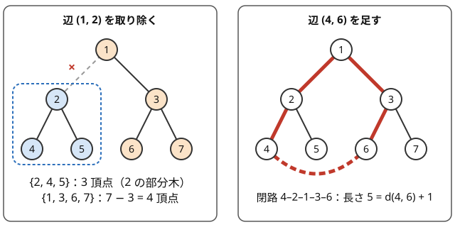

!!! abstract "要点"
    - **何ができるか**：$N$ 頂点のグラフについて、連結で閉路がない・連結で辺が $N - 1$ 本・閉路がなく辺が $N - 1$ 本・2 点間のパスがちょうど 1 本、の 4 つは同値で、辺を 1 本除くと 2 つに分かれ、1 本足すと閉路が 1 つできる。根の決め方と、辺の値を子の頂点に寄せる小技が多くの問題の出発点になる。
    - **いつ使うか**：
        - 辺を 1 本取り除く・1 本足す・閉路をなくして森にする。
        - 森として残せる辺の数・消す辺の数。
    - **計算量**：根を決めて親・深さ・部分木サイズを求めるのは $O(N)$。隣接リストの長さの和が $2(N - 1)$ なので、各頂点で隣をすべて見ても合計は $O(N)$ である。
    - **前提**：[深さ優先探索（DFS）](../graph/dfs.md)

<!-- textlint-disable -->
別名：木の定義・森・根付き木・木の性質・親の番号が自分より小さい入力・tree・forest
<!-- textlint-enable -->

木の基本性質は、入力が木だと分かった時点で使える事実の集まりである。木は「閉路のない連結な無向グラフ」だが、問題を解くときに効くのは定義そのものより、そこから出る言い換えである。辺の本数・パスの一意性・辺を 1 本動かしたときの変化を道具として持っておくと、一般のグラフの手法（閉路の検出・ダイクストラ法）を持ち出さずに済む場面が多い。

## 木の同じ意味の定義と、そこから使える事実の一覧 {#definitions}

$N$ 頂点の無向グラフについて、次の 4 つは同値である。どれか 1 つを確かめれば、残りもすべて使ってよい。

1. 連結で、閉路がない
2. 連結で、辺が $N - 1$ 本
3. 閉路がなく、辺が $N - 1$ 本
4. どの 2 頂点の間にも、単純パス（同じ頂点を 2 度通らない道）がちょうど 1 本ある

??? note "証明の筋"
    辺のない $N$ 頂点から 1 本ずつ辺を足していく。各辺は、別々の成分を結んで成分の数を 1 減らすか、同じ成分の中を結んで閉路を作るかのどちらかである。

    - 1 ⇒ 2・3：閉路がないので、どの辺も成分を 1 減らす。最後に成分が 1 つなので、辺は $N - 1$ 本である
    - 2 ⇒ 1：成分を $N$ 個から 1 個にするには、成分を減らす辺が $N - 1$ 本要る。辺がちょうど $N - 1$ 本なので、閉路を作った辺は 1 本もない
    - 3 ⇒ 1：閉路がないので、$N - 1$ 本の辺がすべて成分を減らし、成分は $N - (N - 1) = 1$ 個になる
    - 1 ⇔ 4：2 頂点の間に単純パスが 2 本あれば、2 本が分かれてから再び合うまでの部分で閉路ができる。逆に閉路があれば、閉路上で隣り合う 2 頂点の間に「辺そのもの」と「閉路の残り」の 2 本の単純パスがある

性質と、それで楽になることを並べると次のようになる。

| 性質 | 解くときの使い方 |
| --- | --- |
| 辺は $N - 1$ 本、次数の和は $2(N - 1)$ | 各頂点で隣をすべて見ても合計 $O(N)$。入力の辺は $N - 1$ 行 |
| 2 点間のパスが一意 | 重み付きでも 1 回の DFS か BFS で 1 点からの距離がすべて決まる。最短路の手法が要らない |
| 根以外の頂点と「親への辺」が 1 対 1 | 辺の情報を子の頂点に置ける（[辺の値を子の頂点に寄せる](#edge-to-child)） |
| 辺を除くと 2 成分、足すと閉路 1 つ | 辺ごとの寄与、閉路の長さ ＝ 距離 ＋ 1（[次の節](#remove-add-edge)） |
| $N \ge 2$ なら[葉](../guide/glossary.md#leaf)（次数 1）が 2 個以上 | 葉から順に決める・削る議論の出発点になる |
| 二部グラフである | 2 点の距離の偶奇は深さの和の偶奇で決まる（[木の 2 色塗り分け](../tree/tree-bipartite.md)） |

$N \ge 2$ では、葉の数は次数だけで決まる。次数の和 $\sum_v \deg v = 2N - 2$ を $\sum_v (\deg v - 2) = -2$ と書き直す。$N \ge 2$ では次数 0 の頂点がないので、葉は $-1$、次数 2 の頂点は $0$ ずつ寄与するので、次の式になる。

$$
(\text{葉の数}) = 2 + \sum_{\deg v \ge 3} (\deg v - 2)
$$

枝分かれが多いほど葉が増え、次数 3 以上の頂点がなければ葉はちょうど 2 個で、木はパスになる。次数の和の条件は、木の次数列であるための必要条件でもある。各次数が 1 以上で和が $2N - 2$ なら、その次数列を持つ木が必ず作れる（[次数と次数列](../tree/tree-degree.md)）。

??? question "確認問題：木の次数列"
    次数列 $(3, 1, 1, 1)$ と $(2, 2, 2, 2)$ は、それぞれ 4 頂点の木の次数列になりうるか。

    ??? success "答え"
        $(3, 1, 1, 1)$ はなりうる。和が $6 = 2 \times 4 - 2$ で、中心 1 つに葉 3 つの星がこの次数列を持つ。$(2, 2, 2, 2)$ は和が $8$ で $6$ にならないのでなりえない。辺が 4 本あり、4 頂点の閉路になる。

## 入力の形（辺のリスト・親の配列・親の番号が自分より小さい形）と根の決め方 {#input-forms}

木の入力は主に 3 つの形で来る。どれも隣接リストに直せば同じに扱える。

- **辺のリスト**：$N$ の後に $N - 1$ 行の辺 $u_i\ v_i$ が続く。辺の本数 $M$ は入力にないので、$N - 1$ 回読む。無向なので両方向に入れる
- **親の配列**：$p_2, \dots, p_N$ のように根以外の親が与えられる。根は与えられた頂点（多くは頂点 1）に決まっている。子の一覧が要るなら `g[p].push_back(v)` で作る
- **$p_i < i$**：親の番号が自分より小さい形。番号の小さい順がそのまま「親が先」の順なので、番号の逆順に回せば子から親へ集約できる。DFS も再帰も要らない（[根付き木と走査順](../tree/tree-traversal.md#parent-index)）

辺のリストで根が指定されていなければ、根は好きな頂点に決めてよい。木はどの頂点から見ても木なので、根を決めても問題の答えは変わらない。ふつうは頂点 1（0-indexed で 0）を根にし、そこから DFS か BFS で親と深さを決める。問題によっては、葉を根にすると端から順に形が決まって見通しがよい（[例題](#abc303_e)の別解）。

無向の隣接リストには親も入っているので、探索では親を引数で渡して戻らないようにする。木では親以外の隣はすべて未訪問の子なので、訪問済みの配列は要らない（[親・深さ・部分木サイズを求める](../tree/tree-traversal.md#parent-depth-size)）。

## 辺を 1 本取り除くと 2 つの成分、1 本足すと閉路が 1 つ {#remove-add-edge}

木の辺を 1 本取り除くと、ちょうど 2 つの連結成分に分かれる。逆に、木に辺を 1 本足すと、閉路がちょうど 1 つできる。次の図は 7 頂点の木で両方を行ったものである。



**取り除く**。辺は $N - 1$ 本から $N - 2$ 本に減り、閉路は生じない。[森の式](#forest)により、成分は $N - (N - 2) = 2$ 個である。根付き木なら、辺 $(\mathrm{par}[c], c)$ を取り除いたときの片側は $c$ の部分木で、大きさは $\mathrm{sz}[c]$、もう片側は $N - \mathrm{sz}[c]$ である。この辺を通るパスは、両側から 1 頂点ずつ選ぶ組と 1 対 1 なので、$\mathrm{sz}[c] \times (N - \mathrm{sz}[c])$ 本ある。全ペアの距離の和を「辺ごとの寄与」に分けて数える方法の土台になる（[辺で切って数える](../tree/tree-edge-contribution.md)）。

**足す**。もとの木で $u$ と $v$ を結ぶ単純パスは 1 本だけなので、新しい辺 $(u, v)$ と合わせた閉路も 1 つだけである。閉路の頂点はそのパスの頂点と一致し、長さ（辺の数）は $d(u, v) + 1$ になる。図では $d(4, 6) = 4$ なので、長さは 5 である。閉路のどの辺を取り除いても木に戻る。木に 1 本足したグラフは[なもりグラフ](../graph/namori-graph.md)と呼ばれ、閉路とそこにぶら下がる木に分けて考える。

$u$ と $v$ がもともと隣り合っていると、足した辺は多重辺になり、長さ 2 の閉路ができる。「単純グラフのまま」という条件があれば、隣り合う 2 頂点の組は数から除く。

??? question "確認問題：閉路の長さ"
    パス $1 - 2 - 3 - \cdots - N$ の形の木に、辺 $(1, N)$ を足した。閉路はいくつできて、長さはいくつか。$N = 2$ のときはどうなるか。

    ??? success "答え"
        閉路は 1 つで、長さは $d(1, N) + 1 = N$ である（全体が 1 つの輪になる）。$N = 2$ では 1 と 2 がもともと隣り合っているので、足した辺は多重辺になり、長さ 2 の閉路ができる。単純グラフを保つ問題では、この足し方は許されない。

## 森の連結成分の数 = 頂点数 − 辺数 {#forest}

閉路を持たないグラフを[森](../guide/glossary.md#forest)と呼ぶ。森の各成分は木なので、$V_i$ 頂点の成分は $V_i - 1$ 本の辺を持つ。成分が $C$ 個なら足し合わせて $M = N - C$、すなわち $C = N - M$ である。探索しなくても、頂点数と辺数だけで成分の数が分かる（証明の別の見方は[連結成分](../graph/connected-components.md#forest)）。

この式は 2 つの向きで使う。

- **森にするために消す辺の数**：$N$ 頂点 $M$ 辺のグラフで成分が $C$ 個なら、成分を保ったまま残せる辺は各成分の全域木の分、合わせて $N - C$ 本である。消す辺の最小本数は $M - (N - C)$ になる。成分の数は Union-Find で数えればよく、併合に失敗した辺の本数がそのまま答えになる
- **成分の数の和を分ける**：森の成分の数を「頂点の数 − 辺の数」と見ると、たくさんの部分グラフについての成分の数の和を、頂点ごとの寄与と辺ごとの寄与に分けて数えられる（[主客転倒](../comb/counting-mindset.md)）

??? question "確認問題：森の辺の本数"
    $K$ 個の成分からなる $N$ 頂点の森には、辺が何本あるか。

    ??? success "答え"
        $N - K$ 本である。各成分が木で、頂点数より 1 少ない辺を持つ。

## 辺の値を子の頂点に寄せる {#edge-to-child}

根を決めると、根以外の頂点 $c$ と、親への辺 $(\mathrm{par}[c], c)$ が 1 対 1 に対応する。そこで、辺の重みや印を子の頂点の値 $\mathrm{val}[c]$ として持つ（根は使わないので 0 や単位元にする）。辺についての質問が頂点についての質問になり、頂点を扱う道具をそのまま使える。

- **根からの距離**：$S[v]$ を根から $v$ までの $\mathrm{val}$ の和とすると、$S[c] = S[\mathrm{par}[c]] + \mathrm{val}[c]$ で、根から $v$ への距離が $S[v]$ になる
- **2 点間の距離**：$u$ と $v$ のパスの辺は、パス上の頂点のうち $\mathrm{lca}(u, v)$ 以外の頂点に 1 本ずつ対応する。距離は $S[u] + S[v] - 2 S[\mathrm{lca}(u, v)]$ である（[最小共通祖先](../tree/lca.md#distance)）
- **辺の重みの変更**：辺 $(\mathrm{par}[c], c)$ の重みを変えると、$c$ の部分木のすべての頂点の $S$ が同じだけ変わる（[オイラーツアー](../tree/euler-tour.md#root-path)）。パスへの一括の更新なら[HL 分解](../tree/hld.md#edge-values)でも同じ置き方をする

パスの集約で lca の頂点を含めてしまうのが典型的な誤りである。lca の $\mathrm{val}$ は lca とその親を結ぶ辺の値で、$u$ と $v$ のパスの外にある。

次のコードは、辺の重みを子に寄せたうえで、[辺を取り除いた片側の大きさ](#remove-add-edge)を使って全ペアの距離の和を求める。根から BFS した順 `order` を前から読んで親と $\mathrm{val}$ を決め、逆から読んで部分木サイズと寄与を足す。

```cpp
--8<-- "tree-basics/edge-to-child.cpp:core"
```

あふれは 1 辺の寄与ではなく、足し合わせた答え全体の大きさで見積もる。1 辺の寄与 `val[c] * sz[c] * (n - sz[c])` は最大で 重み × $N^2 / 4$ だが、答え全体はパスの形で最大の 重み × $(N^3 - N) / 6$ になる。$N = 2 \times 10^5$ では重みが 1 でも答えは約 $1.3 \times 10^{15}$ で、重みが $10^4$ 程度を超えると `long long` の上限（約 $9.2 \times 10^{18}$）に収まらない。問題が mod を求めるなら各項で mod を取り、そうでなければ `__int128` を使う（[整数のオーバーフロー](../cpp/cpp-integer-overflow.md)）。

## 形の両極端（パスと星）でテストする {#extremes}

木の問題で落ちる入力の多くは、形の両極端にある。提出の前に、この 2 つと小さい $N$ を手で作って試す。

- **パス（一直線の木）**：深さが $N - 1$ になる。$N = 2 \times 10^5$ で再帰の DFS を書くと、手元の環境ではスタックがあふれることがある（[再帰の深さと非再帰の書き方](../tree/tree-traversal.md#recursion-depth)）。「親を根までたどる」処理を質問ごとに行うと、1 回 $O(N)$ で全体 $O(NQ)$ になる
- **[星](../guide/glossary.md#star-graph)（中心 1 つに葉 $N - 1$ 個）**：中心の次数が $N - 1$ になる。各頂点で「隣の組をすべて見る」「隣の隣まで見る」処理は、中心だけで $O(N^2)$ かかる。次数の和は $2(N - 1)$ でも、次数の 2 乗の和は星で $\Theta(N^2)$ になる
- **小さい $N$**：$N = 1$ では辺が 0 本で、入力の辺の行がない。葉の定義（次数 1）に当たる頂点もない。$N = 2$ では両方の頂点が葉で、根も葉になる

パスと星は、直径・重心・次数など多くの量の最大と最小を取る形でもある。直径（$N \ge 3$）はパスが最大の $N - 1$、星が最小の 2 である。重心はパスなら真ん中の 1 頂点か 2 頂点、星なら中心になる。答えの範囲を見積もるときにも、この 2 つで計算してみるとよい。

## 落とし穴 {#pitfalls}

**辺の本数を $M$ として読む**。木の入力に $M$ はない。グラフの問題のテンプレートで `cin >> n >> m` と書くと、1 行目の読み方がずれる。木なら辺は $N - 1$ 行である。

**根のない木で「親」を前提にする**。辺のリストの $u_i\ v_i$ は、どちらが親とは限らない。$u_i$ を親とみなして `par[v] = u` と書くと、向きが逆の辺で壊れる。根を決めてから探索で親を決める。

**入力が森のこともある**。「閉路のないグラフ」「辺を何本か消した後」のように、連結とは限らない問題がある。頂点 1 から 1 回探索しただけでは、ほかの成分の頂点が未訪問のまま残る。すべての頂点を見て、未訪問なら新しい根として探索する。

**辺の値を lca に持たせたまま集約する**。[辺の値を子の頂点に寄せる](#edge-to-child)では、パスの集約から lca の頂点を除く。頂点の値の問題と同じ書き方をそのまま使うと、パスの外の辺を 1 本足してしまう。

## 上位の手法へのつながり {#next-steps}

- **走査と集約**：親・深さ・部分木サイズ、行きがけ順と帰りがけ順は[根付き木と走査順](../tree/tree-traversal.md)、部分木ごとの値を子から集める一般の形は[木 DP](../dp/tree-dp.md)
- **辺ごとの寄与**：辺を取り除いた両側の大きさの積で、全ペアについての和を数える（[辺で切って数える](../tree/tree-edge-contribution.md)）
- **木に 1 本足したグラフ**：閉路が 1 つのグラフは[なもりグラフ](../graph/namori-graph.md)、各頂点から 1 本ずつ辺が出る有向グラフは [Functional graph](../graph/functional-graph.md)
- **次数**：木を作れる次数列の条件と、次数を配る最適化（[次数と次数列](../tree/tree-degree.md)）
- **パスと部分木の質問**：距離は[最小共通祖先](../tree/lca.md)、部分木を区間にするのは[オイラーツアー](../tree/euler-tour.md)、パスを区間に分けるのは [HL 分解](../tree/hld.md)

## 例題 {#examples}

### ABC303 E. A Gift From the Stars {#abc303_e}

<div class="kp-problems" data-role="example" markdown>

- [ABC303 E. A Gift From the Stars](https://atcoder.jp/contests/abc303/tasks/abc303_e)（diff 1113）：いくつかの星（中心と葉からなる木）をつないで作った木が与えられ、元の星の大きさをすべて求める

</div>

星の葉どうしを結ぶ辺を足していったので、葉の次数は増えても 2 までで、中心の次数は変わらない。だから次数 3 以上の頂点は元の星の中心で、その次数が星の大きさ（葉の数）である。葉が 2 個の星だけは中心の次数も 2 なので次数では見分けられないが、星の頂点数の合計が $N$ になることから個数を逆算できる。

??? note "解法の詳細"
    - 葉が $k$ 個の星（頂点 $k + 1$ 個）の個数を $x_k$ とする。$k \ge 3$ の $x_k$ は次数 $k$ の頂点の数である。
    - 元の星の頂点はどれもちょうど 1 つの星に属するので、$\sum_{k \ge 2} (k + 1) x_k = N$。これから $x_2 = \left(N - \sum_{k \ge 3} (k + 1) x_k\right) / 3$ が求まる。
    - 次数を数えるだけなので $O(N)$。大きさを昇順に、$x_k$ 個ずつ出力する。
    - 別解：葉を根にすると、根の隣が最初の中心で、そこから中心は 3 辺おき（中心・葉・つないだ辺・葉・中心）に現れる。深さを 3 で割った余りが 1 の頂点が中心で、その次数が大きさである。

## 練習問題 {#practice}

<div class="kp-problems" data-role="practice" markdown>

- [ABC263 B. Ancestor](https://atcoder.jp/contests/abc263/tasks/abc263_b)（diff 136）：親の番号 P_i（P_i < i）で与えられる家系図で、人 N が人 1 の何代後の子孫かを求める
- [ABC399 C. Make it Forest](https://atcoder.jp/contests/abc399/tasks/abc399_c)（diff 321）：単純無向グラフから辺をいくつか消して森にするとき、消す辺の最小数を求める
- [ABC378 F. Add One Edge 2](https://atcoder.jp/contests/abc378/tasks/abc378_f)（diff 1436）：木に辺を 1 本足してできる閉路について、閉路上の頂点の次数がすべて 3 になるような足し方の数を求める

</div>

??? note "練習の方針"
    - **ABC263 B**：人 N から親をたどり、人 1 に着くまでの回数を数える。$P_i < i$ なので、番号順に「深さ ＝ 親の深さ ＋ 1」を埋めてもよい
    - **ABC399 C**：森として残せる辺は $N - C$ 本（$C$ は連結成分の数）なので、答えは $M - (N - C)$。Union-Find で併合に失敗した辺を数えても同じ
    - **ABC378 F**：足した辺の両端は閉路の上で次数が 1 増えるので、もとの次数が 2 である。両端を結ぶパスの途中の頂点は次数がもとのままなので 3 である。次数 3 の頂点だけで作った成分ごとに、そこに隣接する次数 2 の頂点の数 $K$ を数え、$\binom{K}{2}$ を足す。隣り合う次数 2 の頂点の組は、間に次数 3 の頂点がないので数に入らない

## 参考 {#references}

- [drken「AtCoder ABC 303 E - A Gift From the Stars (1Q, 緑色, 475 点)」](https://drken1215.hatenablog.com/entry/2023/05/29/134700)：例題の方針（次数 3 以上が中心であること、頂点数の式、葉を根にする別解）
- [gotoki_no_joe「ABC263 A～E をHaskellで」](https://qiita.com/gotoki_no_joe/items/98225d578c885656a959)：練習の方針（親をたどる回数）
- [mattsunkun「[ABC399] ABC 399(Atcoder Beginner Contest)のA~D(A,B,C,D)問題をPythonで解説(復習)」](https://qiita.com/mattsunkun/items/c060dc9d1d22e298ed02)：練習の方針（Union-Find で併合に失敗した辺を数える）
- [drken「AtCoder ABC 378 F - Add One Edge 2 (1D, 水色, 500 点)」](https://drken1215.hatenablog.com/entry/2024/11/04/002341)：練習の方針（次数 3 の頂点の成分と次数 2 の頂点の組）
