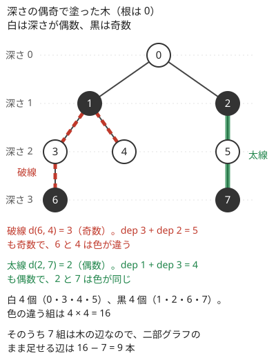

!!! abstract "要点"
    - **何ができるか**：木の頂点を、どの辺の両端も違う色になるように 2 色で塗る。木は閉路がないので深さの偶奇で必ず塗れ、2 点の距離の偶奇は色が同じか違うかだけで分かる。多い方の色が $N/2$ 個以上あることや、色の違う組の数を使う問題に効く。
    - **いつ使うか**：
        - 距離の偶奇・2 人が同時に動いて出会う場所。
        - 辺の重みの偶奇で頂点を塗り分ける。
        - 独立集合を $N/2$ 個以上選ぶ・二部グラフのまま辺を足す。
    - **計算量**：塗り分けは DFS か BFS で $O(N)$。その後、2 点の距離の偶奇は 1 回 $O(1)$ で答えられる。
    - **前提**：[根付き木と走査順](../tree/tree-traversal.md)、[二部グラフ判定](../graph/bipartite-graph.md)

<!-- textlint-disable -->
別名：木は二部グラフ・深さの偶奇・距離の偶奇・tree bipartition
<!-- textlint-enable -->

木の 2 色塗り分けは、根からの深さが偶数の頂点を白、奇数の頂点を黒に塗ることである。木はいつも[二部グラフ](../graph/bipartite-graph.md)なので、一般のグラフと違って矛盾の検出は要らない。このページの主役は塗り方ではなく、塗った結果から分かる 3 つの事実（距離の偶奇・多い方の色の大きさ・色の違う組の数）である。

## 深さの偶奇で塗る（重みがあるなら重みの偶奇で） {#by-depth}

根を 1 つ決め、深さ $\mathrm{dep}[v]$ の偶奇を色にする。辺 $(\mathrm{par}[v], v)$ の両端は深さが 1 違うので、必ず色が違う。木の辺はすべて親子の辺なので、これで塗り分けが完成する。頂点は 0-indexed で書き、問題文の頂点 1 を根 0 にする。



図の木では、白が 4 個・黒が 4 個になる。塗り方は、根の色を決めれば 1 通りに決まる。木は連結なので、ある頂点の色を決めると隣の色も決まり、それが全体に伝わるからである。違うのは白と黒を入れ替えた塗り方だけである。

**辺に重みがあるとき**は、「距離の偶奇」で塗るなら深さではなく、根からの重みの和 $S[v]$ の偶奇を色にする。親から子へ進むとき、重みが偶数の辺なら同じ色、奇数の辺なら反対の色にすればよい。この塗り方では、両端が同じ色の辺もできる。それでも、次の節の「色が同じなら距離が偶数」はそのまま成り立つ。重みがすべて 1 なら深さの偶奇と同じになる。

次のコードは、重み付きの木を BFS で塗り、色ごとの頂点数と色の違う組の数を求める。重みが 1 の木なら `w % 2` は常に 1 で、深さの偶奇で塗ることになる。

```cpp
--8<-- "tree-bipartite/coloring.cpp:core"
```

完全なプログラム：[`coloring.cpp`](https://github.com/yuukougun/kyopro-atlas/blob/main/snippets/tree-bipartite/coloring.cpp)（GitHub）
{ .kp-code-src }

親を記録しなくても `color[c] != -1` で親へ戻るのを防げるのは、木では塗り済みの隣が親しかないからである。再帰の DFS でもよいが、パス状の木では再帰が $N$ 段になるので、BFS で書いておくと安心である（[再帰の深さ](../tree/tree-traversal.md#recursion-depth)）。

## 距離の偶奇は深さだけで分かる {#distance-parity}

2 点 $u, v$ の距離は、[最小共通祖先](../tree/lca.md)を使って次の式で書ける。

$$
d(u, v) = \mathrm{dep}[u] + \mathrm{dep}[v] - 2\,\mathrm{dep}[\mathrm{lca}(u, v)]
$$

最後の項は偶数なので、偶奇だけを見ると LCA が消える。

$$
d(u, v) \equiv \mathrm{dep}[u] + \mathrm{dep}[v] \pmod{2}
$$

つまり、$u$ と $v$ の色が同じなら距離は偶数、違えば奇数である。図の木では、6 と 4 は深さ 3 と 2 で色が違い、距離は 3（奇数）になる。2 と 7 は深さ 1 と 3 で色が同じで、距離は 2（偶数）になる。重みがある木でも、$\mathrm{dep}$ を根からの重みの和 $S$ に置き換えれば同じ式が成り立つ。

この事実が効くのは、距離そのものではなく偶奇だけが問われるときである。代表は「2 人が別々の頂点から同時に同じ速さで向かい合って進むと、どこで出会うか」で、距離が偶数なら頂点の上、奇数なら辺の途中で出会う（[例題](#abc209_d)）。前計算で色を求めておけば、クエリごとに $O(1)$ で答えられる。

偶奇は「1 歩ごとに入れ替わる」量の典型で、木の上でも同じ見方が使える（[偶奇](../thinking/parity.md#alternating)）。木では 2 点を結ぶパスが 1 本しかないので、ウォーク（頂点の繰り返しを許す道。[用語](../graph/graph-basics.md#terms)）の長さの偶奇も道筋によらず決まる。

??? question "確認問題：同じ色の 2 点"
    辺の重みがすべて 1 の木で、同じ色の 2 点の距離は偶数と奇数のどちらか。また、距離がちょうど 1 の 2 点は同じ色か。

    ??? success "答え"
        同じ色なら深さの和が偶数なので、距離は偶数である。距離が 1 の 2 点は辺で結ばれていて、深さが 1 違うので色が違う。

## 多い方の色は N/2 個以上 {#majority-color}

この節と次の節の表の 3 行目は、重みを見ずに深さの偶奇で塗ったときの話である（重みの偶奇で塗ると、両端が同じ色の辺ができるので成り立たない）。白の数を $a$、黒の数を $b$ とすると $a + b = N$ なので、多い方は $\lceil N/2 \rceil$ 個以上ある。同じ色の 2 頂点は辺で結ばれていないので、1 つの色の頂点の集まりは[独立集合](../guide/glossary.md#independent-set)（どの 2 つも隣り合わない頂点の集まり）である。だから「どの 2 つも隣り合わない頂点を $\lfloor N/2 \rfloor$ 個選べ」と問われたら、多い方の色から $\lfloor N/2 \rfloor$ 個を取ればよい。

逆の見方もできる。どの辺も両端の色が違うので、一方の色だけで、すべての辺の端点を少なくとも 1 つ含む。少ない方の色を選べば、$\lfloor N/2 \rfloor$ 個以下の頂点で全辺を押さえられる。$N \ge 2$ なら、どの頂点も反対の色の隣を持つので、少ない方の色の頂点だけで全頂点に「自分か隣」が届く。

ここで言えるのは「$N/2$ 個以上ある」ことだけで、多い方の色が最大の独立集合とは限らない。最大を求めるには[木 DP](../dp/tree-dp.md#vertex-states) を使う。

??? question "確認問題：多い方の色は最大か"
    辺 $(0, 1)$ の両端に、葉を 2 枚ずつ付けた 6 頂点の木（0 に 2・3、1 に 4・5 がつながる）を考える。深さの偶奇で塗ったときの多い方の色の個数と、最大の独立集合の大きさを比べよ。

    ??? success "答え"
        0 を根にすると、白は 0・4・5、黒は 1・2・3 で、どちらも 3 個である。一方、4 枚の葉 2・3・4・5 はどの 2 つも隣り合わないので、大きさ 4 の独立集合がある。多い方の色は $N/2$ 個以上を保証するだけで、最大とは限らない。

## 色の違う組の数（二部グラフのまま足せる辺） {#cross-pairs}

深さの偶奇で塗ったときの白の数を $a$、黒の数を $b$ とすると、色の違う頂点の組は $ab$ 個、同じ色の組は $\binom{a}{2} + \binom{b}{2}$ 個ある。[距離の偶奇](#distance-parity)の事実（色が同じなら距離は偶数）と合わせると、次の量が式だけで求まる。重みの偶奇で塗ったときも、距離を重みの和と読めば 1・2 行目は同じように成り立つ。3 行目は深さで塗ったときだけ成り立つ。

| 求めるもの | 式 |
| --- | --- |
| 距離が奇数の頂点の組 | $ab$ |
| 距離が偶数の頂点の組（$u \ne v$） | $\binom{a}{2} + \binom{b}{2}$ |
| 二部グラフのまま足せる辺 | $ab - (N - 1)$ |

3 行目は、奇数長の閉路を作らずに足せる辺の数である。同じ色の 2 頂点を結ぶと、その間の偶数長のパスと合わせて奇数長の閉路ができる。色の違う 2 頂点を結んでも、塗り分けがそのまま使えるので二部グラフのままである。木の $N - 1$ 本の辺はすべて色の違う組を結んでいるので、$ab$ からそれを引く。図の木なら $4 \times 4 - 7 = 9$ 本である。

木は連結なので、塗り分けは白と黒の入れ替えを除いて 1 通りで、$ab$ は塗り方によらず決まる。だから「奇数長の閉路を作らないように辺を交互に足し、足せなくなった方が負け」のゲームでは、総手数が $ab - (N - 1)$ に決まり、その偶奇で勝敗が決まる（[ゲームの基本](../comb/game-basics.md#move-parity)、[力試し](#challenge)）。森や一般のグラフでは成分ごとに色を入れ替えられるので、数え方が変わる（[成分ごとの色の数を使う数え上げ](../graph/bipartite-graph.md#count-by-color)）。

$N = 2 \times 10^5$ なら $ab$ は最大 $10^{10}$ になり、`int` に収まらない。`long long` で掛ける。

## 落とし穴 {#pitfalls}

**重みを無視して深さで塗る**。辺に長さがある木で「距離が偶数どうしを同じ色に」と問われたとき、深さの偶奇で塗ると誤りである。長さ 2 の辺の両端は距離が偶数なのに、深さでは色が違ってしまう。親から子へ進むたびに `w % 2` で色を入れ替えるかを決める。

**偶奇だけでよいのに LCA で距離を求める**。誤りではないが、ダブリングの表を作る手間と $O(\log N)$ の時間が余計にかかり、実装のバグの元にもなる。問われているのが偶奇だけなら、色を比べるだけで済む。

**距離の偶奇と出会う場所の取り違え**。2 人が同時に同じ速さで向かい合って進むとき、距離が偶数なら頂点、奇数なら辺の途中で出会う。逆に覚えないよう、隣り合う 2 頂点（距離 1）なら辺の真ん中で出会う、と小さい例で確かめる。

**$N$ が奇数のときの個数**。「$N/2$ 個選べ」の $N/2$ が切り捨てか切り上げかを問題文で確かめる。多い方の色は $\lceil N/2 \rceil$ 個以上あるので、どちらでも足りる。

**出力の添字**。0-indexed で塗った頂点を出力するときは 1 を足す。

**組の数のあふれ**。$ab$ や $\binom{a}{2}$ は $10^{10}$ を超えることがある。`int` どうしの積は代入先が `long long` でもあふれるので、`a` と `b` を `long long` で持つ。

**森や非連結のグラフに同じ式を使う**。色の違う組の数 $ab$ が塗り方によらず決まるのは、連結な木だからである。森では成分ごとに色を入れ替えられるので、成分ごとの色の数から数え直す。

## 上位の手法へのつながり {#next-steps}

木が二部グラフであることは、上位の手法の前提や近道になる。

- **距離そのものが要るとき**：偶奇ではなく距離の値を比べるなら、LCA で $d(u, v)$ を求める（[距離 = dep(u) + dep(v) − 2 dep(lca)](../tree/lca.md#distance)）。重みがなければ、2 点からの距離は BFS でも求まる（[木の上の距離](../tree/tree-distance.md)）
- **最大の独立集合**：多い方の色は $N/2$ 個以上を保証するだけである。最大を求めるなら木 DP で各頂点を選ぶ・選ばないの 2 状態にする（[頂点の選択を状態に足す](../dp/tree-dp.md#vertex-states)）か、葉から貪欲に選ぶ（[葉から考える](../tree/leaf-first.md)）
- **マッチング・最小頂点被覆**：木は二部グラフなので、二部グラフでしか使えない手法がそのまま使える（[二部マッチング](../graph/bipartite-matching.md)、[König の定理](../graph/konig-theorem.md#theorem)）。色で頂点を左右に分けて最大流のグラフを作る問題もある
- **ゲーム**：辺を足していくゲームの総手数が色の違う組の数で決まる（[ゲームの基本](../comb/game-basics.md#move-parity)）

## 使い分け {#comparison}

- 一般のグラフでは塗る途中で矛盾（同じ色どうしの辺）が起きうるので、その検出が要る（[二部グラフ判定](../graph/bipartite-graph.md)）。木では矛盾が起きないので、深さの偶奇を求めるだけでよい
- 偶奇だけが問われるなら色を比べ、距離の大小や値が問われるなら LCA か BFS で距離を求める

## 例題 {#examples}

### ABC209 D. Collision {#abc209_d}

<div class="kp-problems" data-role="example" markdown>

- [ABC209 D. Collision](https://atcoder.jp/contests/abc209/tasks/abc209_d)（diff 686）：木の上で 2 人が別々の町から同時に同じ速さで向かい合って進むとき、出会う場所が町か道路かを各質問に答える

</div>

2 人は同じ速さで進むので、出会うのはパスのちょうど真ん中である。距離が偶数なら真ん中は町（頂点）、奇数なら道路（辺）の途中になる。距離の偶奇は 2 人の出発点の色が同じかで分かるので、最初に木を塗っておけば、質問ごとに色を比べるだけで答えられる。

??? note "解法の詳細"
    - 町 1 を根にして BFS か DFS で深さの偶奇を求め、$\mathrm{color}[v] = \mathrm{dep}[v] \bmod 2$ とする。$O(N)$
    - 各質問 $(c, d)$ で、$\mathrm{color}[c] = \mathrm{color}[d]$ なら町、違えば道路と答える。1 問 $O(1)$
    - 全体で $O(N + Q)$。LCA で距離を求めても解けるが、偶奇だけなら要らない

## 練習問題 {#practice}

<div class="kp-problems" data-role="practice" markdown>

- [典型90 026. Independent Set on a Tree（★4）](https://atcoder.jp/contests/typical90/tasks/typical90_z)（diff なし）：N 頂点の木から、どの 2 つも隣り合わない頂点をちょうど N/2 個選んで出力する
- [ABC126 D. Even Relation](https://atcoder.jp/contests/abc126/tasks/abc126_d)（diff 1279）：辺に長さがある木の頂点を白と黒に塗り、同じ色の 2 頂点の距離がすべて偶数になるようにする

</div>

??? note "練習の方針"
    - **典型90 026**：深さの偶奇で塗り、多い方の色から $N/2$ 個を出力する。多い方は $N/2$ 個以上あり、同じ色どうしは隣り合わない。出力は 1-indexed に直す
    - **ABC126 D**：根から BFS か DFS で進み、辺の長さが偶数なら同じ色、奇数なら反対の色で子を塗る。色が根からの長さの和の偶奇なので、同じ色の 2 頂点の距離は偶数になる

## 力試し {#challenge}

<div class="kp-problems" data-role="challenge" markdown>

- [ABC398 E. Tree Game](https://atcoder.jp/contests/abc398/tasks/abc398_e)（diff 1238）：N 頂点の木に、奇閉路を作らないように辺を交互に足していき、足せなくなった方が負けのゲームを、ジャッジと対戦して勝つ（インタラクティブ）。

</div>

??? note "力試しの方針"
    - **ABC398 E**：奇数長の閉路を作らずに足せるのは、色の違う 2 頂点でまだ辺のない組だけで、どの順に足しても最後は全部足される。総手数 $ab - (N - 1)$ が奇数なら先手、偶数なら後手を選ぶ。足せる組を最初に列挙して集合で持ち、自分の手でも相手の手でも使った組を消して、残りから 1 つずつ足せばよい

## 参考 {#references}

- [hamayan「Collision [AtCoder Beginner Contest 209 D]」](https://blog.hamayanhamayan.com/entry/2021/07/11/154020)：例題の問いと、偶奇だけで出会う場所が決まること（LCA で距離を求める別解）
- [E869120「競プロ典型 90 問 026 の解答例」](https://github.com/E869120/kyopro_educational_90/blob/main/sol/026.cpp)：練習の方針（多い方の色から N/2 個を選ぶ）
- [drken「AtCoder ABC 126 D - Even Relation (2Q, 水色, 400 点)」](https://drken1215.hatenablog.com/entry/2019/05/19/224500)：練習の方針（辺の長さの偶奇で色を入れ替えて塗る）
- [gotoki_no_joe「ABC398 A～F をHaskellで」](https://qiita.com/gotoki_no_joe/items/5fbb19b3022933cc370b)：力試しの方針（足せる辺は色の違う組で、その数の偶奇で手番を選ぶ）
