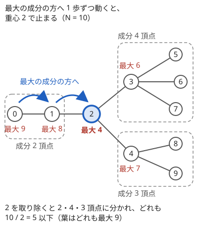
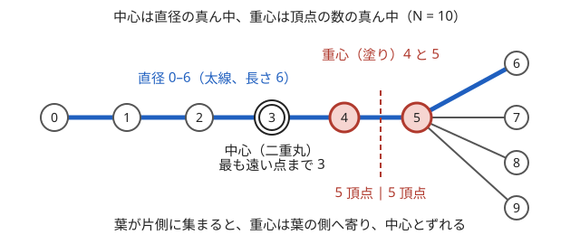

!!! abstract "要点"
    - **何ができるか**：取り除いたときに残る成分の大きさがすべて $N / 2$ 以下になる頂点（重心。1 個か隣り合う 2 個ある）を、部分木サイズから $O(N)$ で求める。重心から見るとどの枝も全体の半分以下なので、別の枝の頂点どうしを組めばすべての組が重心を通り、距離の和を最大にするペアの作り方や重心分解の土台になる。
    - **いつ使うか**：
        - ペアを作ってパスの長さの和を最大化する。
        - どの成分も半分以下になるように分ける。
    - **計算量**：重心を求めるのは $O(N)$（部分木サイズを 1 回求め、各頂点で隣を 1 回ずつ見る）。
    - **前提**：[根付き木と走査順](../tree/tree-traversal.md)

<!-- textlint-disable -->
別名：重心・centroid・重み付き重心・tree centroid
<!-- textlint-enable -->

木の重心は、木を「頂点の数でつり合う所」で切る頂点である。重心を取り除くと、残る成分はどれも元の半分以下になる。この性質から、重心を根にすると「どの枝も半分以下」という形が手に入り、全頂点への距離の和の最小化、ペアの距離の和の最大化、分割統治の分け目（[重心分解](../tree/centroid-decomposition.md)）に使える。

このページでは頂点を 0-indexed で書き、頂点数を $N$、根付き木での部分木サイズを $\mathrm{sz}[v]$、親を $\mathrm{par}[v]$ と書く（[記法と用語の約束](../start/notation.md#tree)）。

## 定義と求め方（子の部分木と親側の N − sz） {#definition}

頂点 $v$ を木から取り除くと、木はいくつかの[連結成分](../graph/connected-components.md)に分かれる。その最大の成分の頂点数を $\mathrm{mx}(v)$ と書く。$\mathrm{mx}(v) \le N / 2$ となる頂点 $v$ を**重心**と呼ぶ。「$\mathrm{mx}(v)$ を最小にする頂点」と定めることもあり、次の節で示すとおり 2 つの定義は同じ頂点を指す。

$\mathrm{mx}(v)$ は部分木サイズだけで書ける。適当な頂点（たとえば 0）を根にすると、$v$ を取り除いた後の成分は「$v$ の各子 $c$ の部分木（$\mathrm{sz}[c]$ 頂点）」と「親の側（$N - \mathrm{sz}[v]$ 頂点）」である。

$$
\mathrm{mx}(v) = \max\Bigl(N - \mathrm{sz}[v],\ \max_{c \text{ は } v \text{ の子}} \mathrm{sz}[c]\Bigr)
$$

根では親の側が 0 頂点になる。部分木サイズは BFS 順の逆に子から親へ足せば再帰なしで求まり（[BFS 順の逆で集約する](../tree/tree-traversal.md#bfs-order)）、各頂点で隣を 1 回ずつ見るので全体で $O(N)$ である。

```cpp
--8<-- "tree-centroid/centroid.cpp:core"
```

**重心は必ずある**。次の図のように、適当な頂点から始めて「最大の成分の方の隣」へ 1 歩ずつ動くと、いつか重心で止まる。



止まる理由は、来た道を戻らないことにある。$v$ の最大の成分が $N / 2$ より大きく、その成分にある隣を $u$ とする。$u$ に移ると、$v$ を含む側の成分は「$v$ から見た $u$ の側の成分」の残りなので、$N / 2$ 未満である。だから $u$ から $v$ へは戻らず、木は有限なのでどこかで止まる。止まった頂点ではどの成分も $N / 2$ 以下になっている。重心分解のように 1 つだけ要るときは、根から出発して「$\mathrm{sz}[c] > N / 2$ の子」へ下り続けてもよい。下りるときは親の側が $N - \mathrm{sz}[c] < N / 2$ なので、子の側だけを見れば足りる。

**全頂点への距離の和は重心で最小になる**。$f(v) = \sum_u d(v, u)$ とする。隣り合う $v$ から $u$ へ移ると、$u$ の側の $s$ 頂点（$v$ を取り除いたときの $u$ を含む成分）は 1 近づき、残りの $N - s$ 頂点は 1 遠ざかる。

$$
f(u) = f(v) + (N - s) - s = f(v) + N - 2s
$$

重心 $g$ から外へ向かってどのパスをたどっても、$s$ は最初の 1 歩で $N / 2$ 以下になり、その後は進むほど小さくなる。だから 1 歩ごとの増分 $N - 2s$ は 0 以上であり、$f$ は重心で最小になる。逆に重心でない頂点には $s > N / 2$ の隣があり、そちらへ動くと $f$ が減るので最小ではない。頂点に重み $C_v \ge 0$ があって $\sum_u C_u \, d(v, u)$ を最小にするときは、頂点の数の代わりに重みの和で同じ議論をする。取り除いた後のどの成分も重みの和が全体の半分以下になる頂点を、**重み付き重心**と呼ぶ。全頂点の値そのものが要るなら、この増分の式で根を動かせばよい（[根を動かした差分](../dp/tree-dp.md#reroot-difference)）。

**応用の型**：「どの成分も半分以下になるように頂点を選ぶ」は重心そのものである。「全頂点（重み付き）への距離の和が最小の頂点」は重み付き重心で、値も要るなら根を動かした差分で求める。重心で分けて枝ごとに再帰すると深さが $O(\log N)$ に収まるのが[重心分解](../tree/centroid-decomposition.md)である。

## 重心は 1 個か隣接する 2 個 {#one-or-two}

重心は 1 個か、辺で結ばれた 2 個である。2 個あるのは $N$ が偶数で、ちょうど $N / 2$ 頂点ずつに分ける辺があるときだけで、その辺の両端が重心になる。

理由は、重心どうしの「相手の側の成分」を足すと分かる。$a$ と $b$ がどちらも重心だとする。$a$ を取り除いたときに $b$ を含む成分を $A$、$b$ を取り除いたときに $a$ を含む成分を $B$ とする。$A$ は $a$ と $a$ のほかの枝を除いたすべてで、$B$ は $b$ と $b$ のほかの枝を除いたすべてなので、$A \cup B$ は全頂点になる。$a$–$b$ のパスの内側の頂点は $A$ と $B$ の両方に入る（そこからぶら下がる枝も両方に入る）ので、両方に入る頂点は少なくともパスの内側の頂点数だけある。

$$
N \le \lvert A \rvert + \lvert B \rvert - (\text{パスの内側の頂点数}) \quad\text{かつ}\quad \lvert A \rvert, \lvert B \rvert \le N / 2
$$

ここから内側の頂点は 0 個、すなわち $a$ と $b$ は隣り合い、$\lvert A \rvert = \lvert B \rvert = N / 2$ である。重心が 3 個あると、どの 2 個も隣り合うので木に閉路ができてしまう。だから 3 個以上はありえない。

この形から、定義の言い換えも分かる。重心でない頂点の $\mathrm{mx}$ は $N / 2$ より大きいので、重心はどれも重心でない頂点より $\mathrm{mx}$ が小さい。2 個のときはどちらも $\mathrm{mx} = N / 2$ で等しい。だから「$\mathrm{mx}(v) \le N / 2$ の頂点」と「$\mathrm{mx}$ を最小にする頂点」は同じ集合である。

重心が 2 個のときは、2 つを結ぶ辺を「重心の辺」とみなすと扱いやすい。その辺で切ると、ちょうど半分ずつの 2 つの木になる。根のない木の同型判定では、中心か重心を根にして形を比べる（[木の同型判定](../tree/tree-isomorphism.md#unrooted)は中心を使う）。どちらも 2 個のときは、どちらを根にするかで結果が変わるので、両方を試すか、辺の真ん中に仮の頂点を足して 1 個にする。

重み付き重心でも、重みがすべて正なら同じ議論で 1 個か隣り合う 2 個になる。ただし、パスの内側の頂点の重みがすべて 0 なら、上の議論は内側の頂点がないことまでは言えない。重み 0 の頂点があると、重み付き重心は 3 個以上並ぶことがある。

## 重心で分けて別の枝どうしを組む {#pair-across}

この節は[辺を通るペアは $s(N - s)$ 個](../tree/tree-edge-contribution.md#edge-pairs)を前提にする。

「頂点を 2 つずつ組にして、組の距離の和を最大にする」問題では、重心が答えの形を決める。まず上限を作る。距離の和は、辺ごとに「その辺を通る組の数」を足したものである。辺 $e$ で木を切って片側が $s$ 頂点・反対側が $N - s$ 頂点になるとする。$e$ を通る組は両側の頂点を 1 つずつ含むので、高々 $\min(s, N - s)$ 組である。

$$
\sum_{\text{組 } \{u, v\}} d(u, v) = \sum_e (\text{辺 } e \text{ を通る組の数}) \le \sum_e \min(s_e, N - s_e)
$$

重心 $g$ を根にすると、どの辺も子の側が $\mathrm{sz} \le N / 2$ なので、上限は $\sum_e \mathrm{sz}(e \text{ の子の側})$ になる。これに達するのは、各辺の子の側の頂点がすべて外の頂点と組になるとき、すなわち**どの組も重心を通るとき**である。重心を通る組の距離は $\mathrm{dep}[u] + \mathrm{dep}[v]$（$g$ からの深さの和）なので、組み方によらず深さの総和になる。

すべての組が重心を通るように組むには、重心の枝を 1 つずつまとめて頂点を 1 列に並べ、列を半分に切って前半と後半の同じ位置どうしを組めばよい。下のコードでは重心を `c`、列を `seq` と書く。

1. $N$ が偶数なら $g$ を列の先頭に置き、奇数なら $g$ を外す（外した $g$ が組にならない 1 頂点になる）
2. $g$ の各枝の頂点を、枝ごとに続けて列に足す。列の長さを $2k$ とする
3. $i = 0, 1, \dots, k - 1$ について、列の $i$ 番目と $i + k$ 番目を組にする

同じ枝の頂点は列の中で連続していて、その数は $N / 2$ 以下、すなわち $k$ 以下である（$N$ が奇数なら $\lfloor N / 2 \rfloor = k$）。$k$ 離れた 2 つの位置が長さ $k$ 以下の連続した範囲に両方入ることはないので、どの組も別の枝の頂点か $g$ を含み、重心を通る。

```cpp
--8<-- "tree-centroid/pair-across.cpp:core"
```

前半と後半を逆順に組む（$i$ 番目と $2k - 1 - i$ 番目）と、列の真ん中をまたぐ枝の頂点どうしが組になりうるので、同じ向きにずらして組む。

同じ上限は、組だけでなく順列にも使える。各頂点 $i$ の人を頂点 $p_i$ へ動かす移動の総距離を最大にするなら、辺 $e$ を通る移動は「片側から出る」「片側へ入る」が $\min(s_e, N - s_e)$ 回ずつまでである。だから上限は $2 \sum_e \min(s_e, N - s_e)$ になる。重心の枝ごとに頂点を並べて半分ずらせば、全員が重心を通って達成できる。巡回するパス（ハミルトン閉路）の長さの最大も同じ上限になり、閉路を 1 か所切ったパスなら、切る辺の分だけ損をする（[力試し](#challenge)）。

**応用の型**：「ペアを作ってパスの長さの和を最大化する」「並べ替え・巡回で移動距離の和を最大化する」は、辺ごとの上限 $\min(s, N - s)$ と、重心を通る組み方で解く。

## 中心との違い {#vs-center}

重心と[中心](../tree/tree-diameter.md#center)はどちらも「木の真ん中」だが、測るものが違う。重心は頂点の数でつり合う所、中心は距離でつり合う所である。

| | 重心 | 中心 |
| --- | --- | --- |
| 最小にするもの | 取り除いた後の最大の成分の頂点数 | 最も遠い頂点までの距離 |
| 個数 | 1 個か隣り合う 2 個 | 1 個か隣り合う 2 個 |
| 求め方 | 部分木サイズ | 直径の真ん中 |
| 主な使い道 | 距離の和の最小化・ペアの構成・重心分解 | 最も遠い点までの距離の最小化・直径の数え上げ |



図の木では、中心は直径 0–6（長さ 6）の真ん中の頂点 3 で、最も遠い頂点まで 3 である。一方、辺 4–5 で切ると 5 頂点ずつに分かれるので、重心は 4 と 5 の 2 個である。葉が片側に集まると、重心は頂点の多い側へ寄り、中心から離れる。「最も遠い点までの距離を最小に」なら中心、「全頂点への距離の和を最小に」「どの成分も半分以下に」なら重心を使う。

## 落とし穴 {#pitfalls}

**親の側の成分を忘れる**。根付き木で子の部分木サイズだけを見ると、根から遠い頂点ほど $\mathrm{mx}$ を小さく見積もり、葉（子がないので $\mathrm{mx} = 0$ になる）まで重心と誤る。根には親の側がないので、根だけは子だけで正しく求まる。$v$ を取り除いた後には親の側の $N - \mathrm{sz}[v]$ 頂点の成分も残る。根から下りながら探すときは、条件を「$\mathrm{sz}[c] > N / 2$ の子があれば下りる」とすれば親の側を見なくて済む。

**半分の判定の不等号**。条件は「$N / 2$ 以下」である。$N$ が奇数なら $\lfloor N / 2 \rfloor$ 以下と同じである。整数で `2 * mx <= n` と書けば割り算の切り捨てを気にしなくてよい。`mx < n / 2` と書くと、$N = 4$ の一直線（重心は真ん中の 2 個で $\mathrm{mx} = 2$）で重心が見つからなくなる。

**重心が 2 個のときに 1 個しか見ない**。答えが重心の選び方で変わる問題（重心を根にした形の比較、重心を数える問題など）では、2 個目を落とすと誤る。2 個は辺で結ばれ、その辺でちょうど半分に分かれる。

**中心と取り違える**。重心は頂点数が、中心は距離がつり合う所であり、[別の頂点になりうる](#vs-center)。「最も遠い点までの距離」を問われたら中心、「距離の和」を問われたら重心である。

**部分木サイズを古いまま使う**。重心分解では、重心を取り除いた後の各成分で重心を求め直す。元の木の $\mathrm{sz}$ を使い回すと、取り除いた頂点の分を含んだまま判定してしまう。成分ごとに、取り除いた頂点を避けて $\mathrm{sz}$ を数え直す。

**再帰の深さ**。一直線の木では、部分木サイズを再帰の DFS で求めると深さが $N$ になる。手元の環境ではスタックがあふれることがある。BFS 順の逆で集めれば再帰が要らない（[再帰の深さ](../tree/tree-traversal.md#recursion-depth)）。

**重みが 0 の頂点**。重み付き重心は、重み 0 の頂点があると 3 個以上になりうる。「1 個か 2 個」を前提にした処理（2 個目の重心を隣だけで探すなど）は、重みがすべて正のときに限る。

## 例題 {#examples}

### ABC362 F. Perfect Matching on a Tree {#abc362_f}

<div class="kp-problems" data-role="example" markdown>

- [ABC362 F. Perfect Matching on a Tree](https://atcoder.jp/contests/abc362/tasks/abc362_f)（diff 2186）：N 頂点の木の頂点を ⌊N/2⌋ 組のペアに分け、各ペアの距離の和を最大にする組み方を出力する。

</div>

方針：距離の和は辺ごとに「通る組の数」を足したもので、辺の片側が $s$ 頂点なら通る組は $\min(s, N - s)$ 組以下である。重心を根にすると、どの組も重心を通るように組めばこの上限にすべての辺で達する。重心の枝ごとに頂点を並べて半分ずらして組めばよい（[重心で分けて別の枝どうしを組む](#pair-across)）。

??? note "解法の詳細"
    - 頂点 0 を根に BFS 順と部分木サイズを求め、$2\,\mathrm{mx}(v) \le N$ の頂点を重心 $g$ とする（2 個あればどちらでもよい）。
    - $N$ が偶数なら $g$ を列の先頭に置き、奇数なら $g$ を外す。$g$ の各隣から $g$ を通らずに探索し、枝ごとに頂点を列に足す。
    - 列の長さを $2k$ として、$i$ 番目と $i + k$ 番目を組にして出力する。各枝は $k$ 頂点以下で列の中で連続するので、組の 2 頂点が同じ枝に入らない。
    - 距離の値は出力しないが、和は $g$ からの深さの総和になり、上限 $\sum_e \min(s_e, N - s_e)$ に一致する。全体で $O(N)$。

## 練習問題 {#practice}

<div class="kp-problems" data-role="practice" markdown>

- [ABC348 E. Minimize Sum of Distances](https://atcoder.jp/contests/abc348/tasks/abc348_e)（diff 1347）：頂点に重み C_i のついた木で、頂点 v を 1 つ選んだときの Σ C_i·d(v, i) の最小値を求める。
- [DWACON2018-PRELIMS E. ニワンゴくんの家探し](https://atcoder.jp/contests/dwacon2018-prelims/tasks/dwacon2018_prelims_e)（diff —）：次数が 5 以下の N 頂点（N ≤ 2000）の木で隠された頂点を、「2 頂点 u, v のどちらが近いか（等しければ 0）」を答える質問を 14 回までして当てる対話型の問題である。

</div>

??? note "練習の方針"
    - **ABC348 E**：根から隣へ動くと、値は「動いた先の側の重みの和」の 2 倍から全体の重みを引いた分だけ減る。重みの和が全体の半分を超える側へ動けなくなるまで進めば、その頂点（重み付き重心）で最小になる
    - **DWACON2018-PRELIMS E**：残った候補の成分で重心 $c$ を求め、$c$ の隣の 2 頂点を質問する。近い方の枝に絞るか、等距離なら 2 つの枝を候補から消せるので、候補は 1 回で半分以下か 2 回で 1/4 以下に減り、14 回に収まる。成分が変わるたびに部分木の大きさを数え直す

## 力試し {#challenge}

<div class="kp-problems" data-role="challenge" markdown>

- [AGC018 D. Tree and Hamilton Path](https://atcoder.jp/contests/agc018/tasks/agc018_d)（diff 2757）：辺の重みが木の上の距離で決まる完全グラフで、全頂点を 1 回ずつ通るパスの長さの最大値を求める。

</div>

??? note "力試しの方針"
    - **AGC018 D**：パスの両端を結んで閉路にして考える。閉路の長さは、辺 $e$ ごとに $2 \min(s_e, N - s_e)$ 回 × 重みが上限で、重心の枝を交互にたどる並べ方で達成できる。パスはこの閉路から両端を結ぶ 1 区間を除いたもので、両端を結ぶパス上の辺は通る回数が上限より 1 減るので、損は両端の距離以上になる。重心が 1 個なら重心とそれに接する最も軽い辺の先を両端にし、重心が 2 個なら 2 つの重心を両端にして、その辺の重みを引く。どちらも損は重心に接する辺 1 本で済む。距離の総和は `long long` で持つ。

## 確認問題 {#quiz}

??? question "確認問題：重心が 2 個あるとき、2 頂点はどうつながっているか"
    重心が 2 個ある木で、2 つの重心の位置関係と、そのとき $N$ について言えることを答えよ。

    ??? success "答え"
        2 つの重心は辺で直接結ばれ、その辺で切ると $N / 2$ 頂点ずつに分かれる。だから $N$ は偶数である。パスの内側に頂点があると、両方の重心の「相手の側の成分」の大きさの和が $N$ を超えてしまい、どちらかが $N / 2$ を超える（[重心は 1 個か隣接する 2 個](#one-or-two)）。

??? question "確認問題：全頂点への距離の和が重心で最小になるのはなぜか"
    $f(v) = \sum_u d(v, u)$ が重心で最小になる理由を、隣へ動いたときの $f$ の変化で説明せよ。

    ??? success "答え"
        隣 $u$ へ動くと $f$ は $N - 2s$ 変わる（$s$ は $v$ を取り除いたときの $u$ を含む成分の頂点数）。重心から外へ進むと $s$ は最初の 1 歩で $N / 2$ 以下で、その後は小さくなる一方なので、増分は 0 以上である。だから重心からどこへ動いても $f$ は減らない。

??? question "確認問題：根から下りて重心を探す"
    根から「$\mathrm{sz}[c] > N / 2$ の子があればそこへ下りる」を繰り返し、下りられなくなった頂点を答えにした。親の側の成分 $N - \mathrm{sz}[v]$ を確かめなくてよいのはなぜか。

    ??? success "答え"
        根では親の側が 0 頂点である。根以外の頂点 $v$ に下りてきたのは $\mathrm{sz}[v] > N / 2$ だったからなので、親の側は $N - \mathrm{sz}[v] < N / 2$ である。だから止まった頂点では子の側も親の側も $N / 2$ 以下になっている。

## 使い分け {#comparison}

- **全頂点への距離の和を最小にする頂点だけが要る**：重心（重みがあれば重み付き重心）を求めれば $O(N)$。全頂点の値が要るなら[根を動かした差分](../dp/tree-dp.md#reroot-difference)で求める。和の代わりに最大値（最も遠い点まで）を最小にするなら[中心](../tree/tree-diameter.md#center)
- **差分が部分木サイズで書けない量**：各頂点を根にした値を求めるのは[全方位木 DP](../dp/rerooting.md)
- **パス全体を数える・集約する**：重心で分けて重心を通るパスをまとめて数え、残りの成分で繰り返すのが[重心分解](../tree/centroid-decomposition.md)。重心 1 個の性質だけで済むなら、このページの手法で足りる
- **辺で切って数えるだけ**：全組の距離の和など、組み方を選ばない量は重心が要らず、[辺で切って数える](../tree/tree-edge-contribution.md#edge-pairs)方法で直接数える

## 参考 {#references}

- [tatyam「高難易度木問題を解くテクニック集」](https://speakerdeck.com/tatyam_prime/gao-nan-yi-du-mu-wen-ti-wojie-kutekunitukuji)：重心の定義と同値な言い換え、2 個のとき辺とみなす見方、移動距離の和の上限を辺ごとに作る議論、力試し AGC018 D の方針
- [gotoki_no_joe「ABC362をHaskellで」](https://qiita.com/gotoki_no_joe/items/63344a24b906bc9a74c9)：例題 ABC362 F の方針（枝ごとに並べた列を半分に切って前から組むこと、逆順に組むと失敗すること）
- [gotoki_no_joe「ABC348 A～F をHaskellで」](https://qiita.com/gotoki_no_joe/items/6a3a10194d5a276281ca)：練習 ABC348 E の差分が負の間だけ根を移す方針
- [drken「第4回 ドワンゴからの挑戦状 予選 2018 E - ニワンゴくんの家探し (1000 点)」](https://drken1215.hatenablog.com/entry/2023/05/07/144739)：練習 DWACON2018 予選 E の重心の隣の 2 頂点を聞く方針
