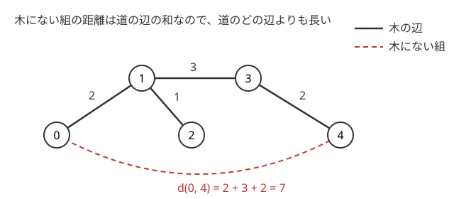
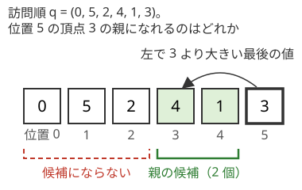

!!! abstract "要点"
    - **何ができるか**：距離の情報・訪問順・次数の条件などから、条件を満たす木を作るか、ないと判定する（何通りあるかを数えることもある）。必要条件から候補の木を 1 つに絞って作り、それが本当に条件を満たすかを最後に確かめるのが基本の形である。
    - **いつ使うか**：
        - 条件を満たす木を 1 つ出力せよ（なければ −1）。
        - 距離の情報から木を復元できるか。
        - 訪問順（DFS 順）から元の木が何通りあるか。
    - **計算量**：全点対の距離の表から作るなら、辺の候補 $O(N^2)$ 個のソートで $O(N^2 \log N)$、作った木を全点からの探索で確かめて $O(N^2)$。訪問順から各頂点の親の候補を数えるなら、単調スタックで $O(N)$。
    - **前提**：[根付き木と走査順](../tree/tree-traversal.md)、[最小全域木](../graph/minimum-spanning-tree.md)

<!-- textlint-disable -->
別名：木の構築・木の復元・距離の表から木・訪問順から木・tree construction
<!-- textlint-enable -->

木の構築・復元は、木について部分的な情報（全点対の距離・訪問順・次数・最遠距離など）が与えられたとき、それを満たす木を 1 つ作るか、ないと判定する問題の型である。木を全部試すことはできない（$N$ 頂点のラベル付きの木は $N^{N-2}$ 個ある）ので、条件から「もし木があるなら、この辺は必ずある」と言える性質を探し、候補を 1 つに絞る。絞った候補が本当に条件を満たすかは、最後にまとめて確かめる。

## 距離の情報から作る（最も近い頂点とは辺で結ばれる） {#from-distances}

この節は[最小全域木](../graph/minimum-spanning-tree.md)（クラスカル法と閉路性質）を前提にする。全点対の距離の表 $D$ が与えられ、辺の重みが正の木で $d(u, v) = D_{u,v}$ をすべて満たすものがあるかを問う型である。頂点は 0-indexed で書く。手がかりは、木の上の距離が道の辺の重みの和になることである。

各頂点 $v$ について、$v$ に最も近い頂点 $u$ は $v$ と辺で結ばれている。もし辺で結ばれていなければ、$v$ から $u$ への道の途中に別の頂点 $w$ があり、重みが正なので $d(v, w) < d(v, u)$ となって、$u$ が最も近いことに反する。ただしこれだけでは、辺が $N - 1$ 本そろうとは限らない。

全部の辺を決めるには、この見方を[最小全域木](../graph/minimum-spanning-tree.md)に広げる。すべての組 $(i, j)$ を重み $D_{i,j}$ の辺とした完全グラフを考えると、条件を満たす木 $T$ があれば、$T$ はこのグラフのただ 1 つの最小全域木になる。



理由は図のとおりである。木の辺 $(u, v)$ の重みは $d(u, v)$ そのものなので、$T$ の辺は完全グラフにも同じ重みで入っている。木にない組 $(a, b)$ の距離は、木の上の $a$–$b$ の道の辺の重みの和である。重みは正なので、その和は道のどの辺よりも真に大きい。$(a, b)$ と道を合わせた閉路の上で $(a, b)$ は真に最大の辺なので、[閉路性質](../graph/minimum-spanning-tree.md#why-correct)によりどの最小全域木にも入らない。木にない辺がすべて除かれるので、最小全域木は $T$ だけである。

したがって次の手順で解ける。

```text
1. すべての組 (i, j)（i < j）を D[i][j] の小さい順に並べる
2. クラスカル法：閉路を作らない組だけを辺に採る（N − 1 本）
3. 採った木で全点から距離を測り、D とすべて一致すれば「ある」、1 か所でも違えば「ない」
```

手順 2 で作った木は「木があるならこれしかない」という候補にすぎない。表が木で実現できないときも、クラスカル法は何かしらの木を返す。だから手順 3 の確かめが欠かせない（[作った木を必ず確かめる](#verify-output)）。

```cpp
--8<-- "tree-construction/from-distances.cpp:core"
```

!!! info "ACL では"
    `atcoder::dsu uf(n);` でクラスカル法を書く。`uf.same(a, b)` で閉路になるかを調べ、`uf.merge(a, b)` で辺を採る（どちらもならし $O(\alpha(N))$）。

計算量は、組が $O(N^2)$ 個あるのでソートが $O(N^2 \log N)$、確かめは 1 回の探索が $O(N)$ で $N$ 回行って $O(N^2)$ である。木があるなら、同じ距離の組をどの順に見てもクラスカル法はその木を返す（最小全域木がただ 1 つなので）。木がないなら、返る木は見る順によって変わりうるが、どれも確かめで落ちるので答えは変わらない。

重みが 0 の辺を許すと、この節の証明（木がただ 1 つの最小全域木になること）は使えなくなる。距離 0 の 2 頂点はどちらを道の途中に置いても距離が変わらず、木が 1 つに決まらない。問題の制約で重みが正（距離の表の対角以外が正）かを確かめる。

## 訪問順から親の候補を数える {#from-order}

決まった規則で木をたどったときの訪問順 $q = (q_0, q_1, \dots, q_{N-1})$ が与えられ、その順になる木の個数を求める型である。どの規則でも、まず「位置 $i$ の頂点の親は、$q$ のどの位置の頂点になれるか」を調べる。親は必ず自分より前に訪れる。各頂点の親の選び方が互いに独立に決まるなら、答えは候補の個数の積になる。

例として、「頂点 0 から始め、訪問済みの頂点に隣接する未訪問の頂点のうち番号が最小のものを次に訪れる」規則を考える。候補の集合 $S$ を優先度付きキューで持ち、最小を取り出して訪れ、その未訪問の隣を $S$ に入れる手順と同じである。位置 $j$ の頂点を取り出す時点を時刻 $j$ と呼ぶ。これは辺の重みを行き先の頂点の番号にした[プリム法](../graph/minimum-spanning-tree.md#kruskal-prim)の訪問順にあたる。

位置 $i$ の頂点 $v = q_i$ の親が位置 $j$（$j < i$）の頂点だとする。$v$ は時刻 $j$ に $S$ に入り、時刻 $i$ に取り出される。その間 $v$ は $S$ にあるので、間に取り出された $q_{j+1}, \dots, q_{i-1}$ はどれも $v$ より小さくなければならない。つまり $j$ は、$i$ より左で $v$ より大きい値が最後に出る位置 $L_i$ 以上である（なければ $L_i = 0$）。



逆に、$q_0 = 0$ で、すべての $i \ge 1$ について親を位置 $L_i, \dots, i - 1$ から選べば、訪問順はちょうど $q$ になる。時刻 $i$ に $S$ にあるのは、親がすでに出ていて自分はまだ出ていない頂点である。$v$ 以外のそのような頂点 $u$ は時刻 $i$ より後に出るので、$u$ が $S$ にいる間に出た $v$ は、$u$ の条件から $u$ より小さい。したがって時刻 $i$ の最小は $v$ になる。親の選び方と木は 1 対 1 に対応するので、木の個数は次の式になる。

$$
\prod_{i=1}^{N-1} (i - L_i)
$$

$L_i$ は「左にある自分より大きい最後の位置」なので、[単調スタック](../ds/monotonic-stack.md#procedure)で全部を $O(N)$ で求められる。[セグメント木上の二分探索](../ds/segment-tree-binary-search.md)の `min_left` でも $O(N \log N)$ で求まる。問題文が 1-indexed なら、$q$ の値と位置をどちらも 1 引いてから使う。

```cpp
--8<-- "tree-construction/from-order.cpp:core"
```

規則が行きがけ順（子を番号の小さい順にたどる [DFS](../graph/dfs.md)）だと、親の選び方は独立でなくなる。部分木は訪問順の連続した区間になるので、区間を部分木とみる[区間 DP](../dp/interval-dp-advanced.md#dfs-order-trees) で数える（[力試し](#challenge)の ABC252 G）。候補の積で数えられるのは、「親が出てから自分が出るまでの間」の条件が各頂点で閉じている規則に限られる。

??? question "確認問題：増える順"
    上の規則で、訪問順が $q = (0, 1, 2, \dots, N - 1)$ のとき、木は何通りあるか。

    ??? success "答え"
        $(N - 1)!$ 通りである。左に自分より大きい値がないので、どの $i$ でも $L_i = 0$ になり、親の候補は位置 $0, \dots, i - 1$ の $i$ 個ある。積は $1 \times 2 \times \dots \times (N - 1)$ である。各頂点が自分より小さい番号の頂点のどれを親にしても、番号の小さい順に訪れることが確かめられる。

## 作った木を必ず確かめる {#verify-output}

木の構築の多くは「必要条件から候補を 1 つに絞る → 候補を確かめる」の 2 段で解く。絞る段で使う性質（最も近い頂点とは辺で結ばれる、最大値が直径になる、など）は、木があると仮定して導いたものである。木がないときにも候補は作れてしまうので、候補が条件を満たすかを別に確かめないと「ない」を判定できない。

確かめるのは、与えられた条件のすべてである。距離の表なら $N^2$ 個の値を全部比べる。採った $N - 1$ 本の辺の距離だけを比べるのでは足りない。たとえば 3 頂点の距離がすべて 1 の表では、クラスカル法は辺 $(0, 1)$ と $(0, 2)$ を採る。採った辺の距離は表と合うが、$d(1, 2) = 2$ が表の 1 と食い違うので、木はない。

全点対の距離は、各頂点からの探索 1 回が $O(N)$ なので、全部で $O(N^2)$ かかる。表の大きさが $N^2$ なので、これより速くする必要はない。

確かめに使う探索は、再帰でなくスタックで書くと安全である。候補の木はパス状になることがあり、$N$ が $10^5$ 程度あると再帰が深くなりすぎる（[再帰の深さと非再帰の書き方](../tree/tree-traversal.md#recursion-depth)）。

木を 1 つ出力する問題では、出力が条件を満たすかを調べるプログラムを手元で書いておくと、構築の誤りが見つかりやすい（[出力を検査するプログラム](../thinking/construction.md#checker)）。小さい $N$ で全部の木を列挙して答えと比べるのも有効である。

## 次数の条件から作る（次数の足りない成分どうしをつなぐ） {#from-degrees}

この節は [Union-Find](../ds/union-find.md) と[木の次数列と Prüfer 列](../tree/tree-degree.md)を前提にする。各頂点の次数 $D_v$ と、すでにある辺 $M$ 本が与えられ、辺を足して「頂点 $v$ の次数がちょうど $D_v$ の木」を作る型である。

まず、作れない場合を必要条件で除く。

- 次数の和が $2(N - 1)$ でない（木の辺は $N - 1$ 本で、各辺は次数の和に 2 ずつ寄与する）
- すでにある辺に閉路がある（木の一部は森でなければならない）
- すでにある辺だけで次数が $D_v$ を超える頂点がある

残りの次数を $r_v = D_v - (\text{今の次数})$ とし、成分 $C$ ごとに $r(C) = \sum_{v \in C} r_v$ をまとめる。成分が $c$ 個なら、足す辺は $c - 1$ 本なので $\sum_C r(C) = 2(c - 1)$ である。成分が 2 個以上なら、どの成分も外へ辺を出す必要があるので、$r(C) \ge 1$ でなければならない。

すでにある辺だけで成分が 1 個なら、次数の和の条件から $r_v$ はすべて 0 で、すでに木なので何も足さない。以下は成分が 2 個以上の場合である。つなぎ方は次のとおりである。$r(C) = 1$ の成分を A の組、$r(C) \ge 2$ の成分を B の組に分ける。

```text
B の組が空でない間：
    A の組から成分 a を、B の組から成分 b を 1 つずつ取り出す
    a と b の残りの次数がある頂点どうしを辺で結ぶ（b の残りは r(b) − 1 になる）
    結んだ成分を、残りが 1 なら A の組に、2 以上なら B の組に入れる
最後に A の組にちょうど 2 つの成分が残るので、それらを結ぶ
```

各段で「どの成分も $r(C) \ge 1$」と「$\sum r(C) = 2(c - 1)$」が保たれる。$r(C) = 1$ の成分が $k$ 個なら、残りの $c - k$ 個は 2 以上なので和は $k + 2(c - k) = 2c - k$ 以上である。和は $2c - 2$ なので $k \ge 2$、つまり $c \ge 2$ なら $r(C) = 1$ の成分が必ず 2 つ以上ある。だから A の組が先に尽きることはない。B の組が尽きたときはすべての成分が $r(C) = 1$ で、和 $c = 2c - 2$ から $c = 2$ になる。

避けるべきつなぎ方は、成分が 3 つ以上あるうちに $r(C) = 1$ の成分どうしを結ぶことである。結んだ成分は残りが 0 になり、ほかの成分とつなげなくなる。

各成分の「残りの次数がある頂点」を残りの数だけ並べた列で持てば、つなぐたびに列をつなげるだけで済む。列の合計の長さは $2(c - 1)$ 以下なので、全体で $O(N + M)$（Union-Find のならし計算量を除く）である。

## 最遠距離の列から直径を決める {#from-eccentricities}

この節は[直径](../tree/tree-diameter.md)と[各点の最遠点は直径の端点](../tree/tree-diameter.md#eccentricity)を前提にする。辺の重みがすべて 1 の木で、各頂点から最も遠い頂点までの距離（[離心数](../guide/glossary.md#eccentricity)）$a_v$ の列が与えられ、それを満たす木があるかを問う型である。

最遠距離の最大値 $K$ は直径の長さになる。直径の両端からの距離を考えると、直径の上の $K + 1$ 個の頂点の最遠距離は、両端から順に $K, K - 1, \dots, \lceil K/2 \rceil, \dots, K - 1, K$ と決まる。直径から外れた頂点は、直径の上のどこかの頂点 $w$ から枝分かれして $a_w$ より遠くなるので、最遠距離は $\lceil K/2 \rceil + 1$ 以上になる。

ここから、木がある条件は次のとおりになる。

- 最小値は $m = \lceil K/2 \rceil$ で、それより小さい値はない
- 値 $m$ の頂点は、$K$ が偶数ならちょうど 1 個、奇数ならちょうど 2 個（直径の中央の頂点・中央の辺の両端だけ）
- $m + 1 \le d \le K$ の各値 $d$ の頂点は 2 個以上（直径の上に左右 1 個ずつ要る）

逆にこの条件を満たせば、直径を作ったうえで、余った値 $d$ の頂点を直径の上の値 $d - 1$ の頂点に葉として付ければよい。付けた葉の最遠距離は $d$ になり、直径は変わらない。値ごとの個数を数えるだけで判定でき、$O(N)$ である。

??? question "確認問題：値が 1 種類だけ"
    $N = 3$ で $a = (2, 2, 2)$ のとき、木はあるか。

    ??? success "答え"
        ない。$K = 2$ は偶数なので、値 $m = 1$ の頂点がちょうど 1 個要るが、1 個もない。実際、3 頂点の木はパスだけで、真ん中の頂点の最遠距離は 1 になる。

## 落とし穴 {#pitfalls}

**採った辺の分しか確かめない**。距離の表から作った木で、選んだ $N - 1$ 本の距離が表と合っても、ほかの組が合うとは限らない。全点対を比べる（[作った木を必ず確かめる](#verify-output)）。

**同じ値の組を特別扱いする**。同じ距離の組がいくつあっても、クラスカル法は閉路を作るものを捨てるだけでよい。同じ距離の組を全部採ろうとしたり、同じ距離の組を 1 つだけ残して捨てたりすると、正しい木を壊す。

**距離が `int` に収まらない**。重みが $10^9$ 程度で頂点が多いと、木の上の距離は `int` を超える。距離の表と探索の距離は `long long` で持つ。

**探索の再帰が深い**。復元した木がパス状だと、再帰の深さが $N$ になる。確かめの探索はスタックで書く。

**訪問順の最初の頂点を見落とす**。根から始まる規則では、$q$ の最初が根でなければ 0 通りである。積だけを計算すると、ありえない訪問順にも正の値を答えてしまう。

**「より大きい」の向きと位置の取り違え**。親の候補の左端 $L_i$ は「左で自分より大きい最後の位置」で、その位置の頂点自身も候補に入る（その頂点が出た直後に自分が $S$ に入ってよい）。候補の個数を $i - L_i - 1$ にすると 1 つ少なくなる。

**次数の条件で必要条件を 1 つ落とす**。次数の和だけを見て、すでにある辺の閉路や次数の超過を見落とすと、出力が木にならない。最後に「出力した辺で全体がつながり、各頂点の次数が $D_v$ か」を確かめれば、見落としても誤答に気づける。

## 使い分け {#comparison}

- 与えられた情報が全点対の距離なら、最小全域木で候補を作って全点から確かめる。頂点を足しながら道の上に置いていく方法もあるが、確かめの手間は同じである
- 一般のグラフ（木とは限らない）を距離の表から作る問題では、「迂回できる辺は要らない」という別の考え方を使う（[グラフの構築](../graph/graph-construction.md#from-distances)）
- 次数の列だけが与えられ、木を数える問題は Prüfer 列で数える（[木の数え上げへのつながり](../tree/tree-degree.md#counting-links)）
- 訪問順から数える問題で、親の候補が頂点ごとに独立に決まるなら積、部分木の範囲が絡むなら区間 DP を使う

## 例題 {#examples}

### ABC451 E. Tree Distance {#abc451_e}

<div class="kp-problems" data-role="example" markdown>

- [ABC451 E. Tree Distance](https://atcoder.jp/contests/abc451/tasks/abc451_e)（diff 1215）：N 頂点の全点対の距離の表が与えられ、それを実現する重み付きの木があるかを判定する。

</div>

制約から辺の重みは正とみてよいので、[距離の情報から作る](#from-distances)の議論がそのまま使える。木があるなら、それは距離の表を重みとした完全グラフのただ 1 つの最小全域木である。クラスカル法で候補を作り、全点対の距離が表と一致するかを確かめる。

??? note "解法の詳細"
    - すべての組 $(i, j)$ を距離の小さい順に並べ、Union-Find で閉路を作らない組だけを辺に採る。$N - 1$ 本そろう。
    - 採った木で各頂点から探索して距離を求め、表の $N^2$ 個の値とすべて比べる。1 か所でも違えば木はない。
    - 計算量はソートの $O(N^2 \log N)$ と確かめの $O(N^2)$。コードは[距離の情報から作る](#from-distances)の節のものと同じ形である（入力は表の上半分（$i < j$ の $D_{i,j}$）なので、読んで対称に埋める）。

### ABC478 F. Min-First Search {#abc478_f}

<div class="kp-problems" data-role="example" markdown>

- [ABC478 F. Min-First Search](https://atcoder.jp/contests/abc478/tasks/abc478_f)（diff 1588）：頂点 1 から始め、訪問済みの頂点と隣り合う未訪問の頂点のうち番号最小のものを次に訪れるとき、訪問順が与えられた順列になる木の個数を 998244353 で割った余りで求める。

</div>

訪問の規則は[訪問順から親の候補を数える](#from-order)で扱ったものと同じである。位置 $i$ の頂点の親になれるのは、左で自分より大きい最後の位置から直前の位置までの頂点である。選び方は頂点ごとに独立に決まる。候補の個数の積が答えになる。

??? note "解法の詳細"
    - 頂点の番号と位置を 0-indexed に直す。最初の頂点が根でなければ 0 通りである。
    - 単調スタックで、各位置 $i$ について左で $q_i$ より大きい最後の位置 $L_i$（なければ 0）を求める。
    - 答えは $\prod_{i \ge 1} (i - L_i) \bmod 998244353$。$O(N)$ で求まる。セグメント木上の二分探索で $L_i$ を求めると $O(N \log N)$ になる。
    - 小さい $N$ で全部の木を列挙して訪問順を数え、式と一致するかを確かめておくと安心である。

## 練習問題 {#practice}

<div class="kp-problems" data-role="practice" markdown>

- [ABC239 F. Construct Highway](https://atcoder.jp/contests/abc239/tasks/abc239_f)（diff 1959）：各頂点の次数と一部の辺が与えられたとき、残りの辺を足して条件を満たす木を作れるかを判定し、作れれば辺を出力する。
- [AGC005 C. Tree Restoring](https://atcoder.jp/contests/agc005/tasks/agc005_c)（diff 1976）：各頂点から最も遠い頂点までの距離の列が与えられ、それを満たす木があるかを判定する。

</div>

??? note "練習の方針"
    - **ABC239 F**：次数の和・閉路・次数の超過で、作れない場合を先に除く。成分ごとの残りの次数を数え、残りが 1 の成分と 2 以上の成分を 1 つずつ結んでいく。最後に残りが 1 の 2 成分を結ぶ（[次数の条件から作る](#from-degrees)）
    - **AGC005 C**：最大値 $K$ を直径とする。最小値は $\lceil K/2 \rceil$ で、その個数は $K$ が偶数なら 1 個、奇数なら 2 個でなければならない。それより大きく $K$ 以下の各値は 2 個以上要る（[最遠距離の列から直径を決める](#from-eccentricities)）

## 力試し {#challenge}

<div class="kp-problems" data-role="challenge" markdown>

- [ABC252 G. Pre-Order](https://atcoder.jp/contests/abc252/tasks/abc252_g)（diff 2153）：決まった規則で木の頂点を順にたどったときの訪問順が与えられ、その順になる根付き木の数を求める。

</div>

??? note "力試しの方針"
    - **ABC252 G**：行きがけ順では部分木が訪問順の連続した区間になる。「区間を 1 つの頂点の子孫の並びとして作る方法の数」と「区間を兄弟の部分木の並びに分ける方法の数」を区間 DP で求める。兄弟は番号の小さい順に並ぶので、区切る位置の先頭の番号が増えているかを遷移の条件にする

## 確認問題 {#quiz}

??? question "確認問題：確かめを省いたら"
    距離の表から木を作る問題で、クラスカル法で作った木をそのまま「ある」と答えた。どんな表で誤答になるか。

    ??? success "答え"
        木で実現できない表のすべてで誤答になる。クラスカル法は、どんな表からも $N - 1$ 本の辺の木を作るからである。たとえば 3 頂点の距離がすべて 1 の表では、作った木で $d(1, 2) = 2$ となり、表と食い違う。

??? question "確認問題：最も近い頂点だけでは足りない"
    各頂点を最も近い頂点と辺で結ぶだけでは、木が完成しないことがある。どんな例か。

    ??? success "答え"
        パス 0–1–2–3 で、重みが順に 1・5・1 の場合である。頂点 0 と 1 は互いに最も近く、2 と 3 も互いに最も近いので、結ばれるのは辺 $(0, 1)$ と $(2, 3)$ だけで、真ん中の辺 $(1, 2)$ が出てこない。最小全域木として作れば、成分どうしを結ぶ最も短い組として $(1, 2)$ が採られる。

## 参考 {#references}

- [merom686「ABC451」](https://merom686.hatenablog.com/entry/2026/03/29/013723)：例題 ABC451 E の方針（最も近い頂点とは辺で結ばれること、作った木を全点から確かめること）
- [hyouri「ABC451をPythonで（A～E）」](https://qiita.com/hyouri/items/2b13ca1b70a5735460ee)：例題 ABC451 E の方針（距離の小さい順のクラスカル法と全点対の確かめ）
- [ikatakos「AtCoder Beginner Contest 478 E,F,G問題メモ」](https://ikatakos.com/pot/programming_algorithm/contest_history/atcoder/2026/1003_abc478)：例題 ABC478 F の方針（親の候補が範囲になること、単調スタック・セグメント木上の二分探索）（解説の部分だけを参照）
- [merom686「ABC478」](https://merom686.hatenablog.com/entry/2026/10/04/013441)：例題 ABC478 F の方針（親の候補を左で自分より大きい値までに絞ること）
- [kazun「AtCoder Beginner Contest 239 F問題 Construct Highway」](https://kazun-kyopro.hatenablog.com/entry/ABC/239/F)：練習 ABC239 F の方針（作れない場合の条件と成分ごとの残りの次数）
- [drken「AtCoder AGC 005 C - Tree Restoring (青色, 700 点)」](https://drken1215.hatenablog.com/entry/2020/11/06/224900)：練習 AGC005 C の方針（最大値と直径、最小値の個数の条件）
- [kmjp「AtCoder ABC #252 : G - Pre-Order」](https://kmjp.hatenablog.jp/entry/2022/05/22/0900)：力試し ABC252 G の方針（行きがけ順の区間 DP）
