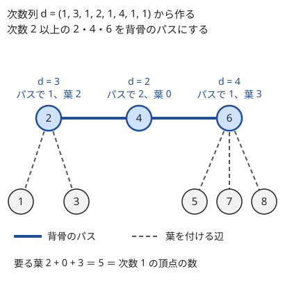
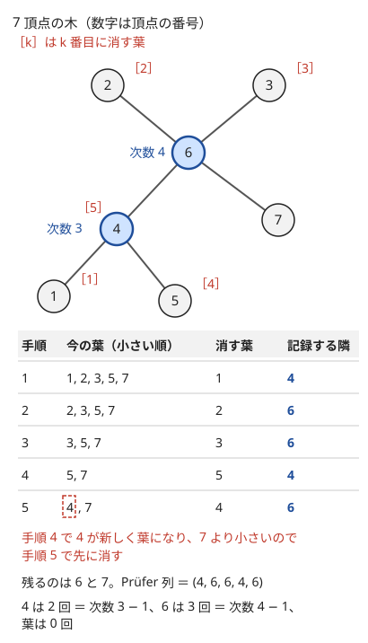

!!! abstract "要点"
    - **何ができるか**：$N \ge 2$ 頂点の木の次数列としてありうるのは、各次数が 1 以上で和が $2N - 2$ の列のちょうどすべてである。条件を満たす列からは $O(N)$ で木が作れる。理由は Prüfer 列（最小番号の葉を消して隣を記録する長さ $N - 2$ の列）にある。この列は木と一対一に対応し、各頂点の出現回数は次数 − 1 になる。
    - **いつ使うか**：
        - 各頂点の次数を決めて木を作る・次数の和が $2N - 2$。
        - 次数が○以下の木・星や雪の結晶など次数で決まる形。
        - 木の選び方を問うが、コストが各頂点の次数だけで決まる。
    - **計算量**：次数列の判定と木の構築は $O(N)$。Prüfer 列の生成・復元は優先度付きキューで $O(N \log N)$。
    - **前提**：[葉から考える](../tree/leaf-first.md)

<!-- textlint-disable -->
別名：次数列・プリューファー列・Prüfer code・Prüfer sequence・握手補題・星・degree sequence
<!-- textlint-enable -->

木の次数列と Prüfer 列は、「次数だけを決めたら木が作れるか」に答える道具である。木の形は膨大にあっても、コストや条件が各頂点の[次数](../guide/glossary.md#degree)だけで決まるなら、木を探す代わりに次数列を探せばよい。以下では頂点に 1〜$N$ の番号が付いた木（[ラベル付き木](../guide/glossary.md#labeled-tree)）を考え、頂点 $v$ の次数を $d_v$ と書く。コード片は入力から 1 を引いて 0-indexed の $0, \dots, N - 1$ で持ち、出力するときに 1 を足す。

## 次数だけで分かること（葉の数・星の中心） {#degree-facts}

木の次数について最初に使うのは、次数の和の式である。どのグラフでも各辺は両端の次数に 1 ずつ数えられるので、次数の和は辺の本数の 2 倍になる（[握手補題](../guide/glossary.md#handshaking-lemma)）。木の辺は $N - 1$ 本なので、次の式が成り立つ。

$$
\sum_{v} d_v = 2N - 2
$$

ここから次の事実がすぐに出る。葉の数の式は[木の基本性質](../tree/tree-basics.md#definitions)で導いている。

- **葉の数**：$N \ge 2$ なら（葉の数）$= 2 + \sum_{d_v \ge 3} (d_v - 2)$。次数 3 以上の頂点がなければ葉は 2 個で、木はパスになる
- **星の中心**：$N \ge 3$ の木が[星](../guide/glossary.md#star-graph)であることと、次数 $N - 1$ の頂点があることは同じである。星をいくつか葉どうしでつないだ木では、次数 3 以上の頂点は元の星の中心である。逆は成り立たず、次数 2 の中心は葉どうしをつないだ頂点と次数では区別できないので、別に数える（[ABC303 E の例題](../tree/tree-basics.md#abc303_e)）
- **次数の大きい頂点は少ない**：次数が $k$ 以上の頂点は $(2N - 2)/k$ 個以下である。たとえば次数 $\sqrt{N}$ 以上の頂点は $2\sqrt{N}$ 個未満しかない
- **全頂点で隣を並べても速い**：各頂点で隣の一覧をソートしても、長さの合計は $2N - 2$ なので全体で $O(N \log N)$ に収まる

最後の事実は「中心を全探索して、隣の頂点の情報を並べる」型で効く（サイン：中心・その隣・さらにその先のように、次数で決まる形を残す）。中心 $c$ を決めたら、その隣の頂点を次数の大きい順に並べ、先頭から何個を使うかを全部試す。中心は $N$ 通りあっても、並べる長さの合計は次数の和 $2N - 2$ なので、全体で $O(N \log N)$ に収まる。隣の先に何個の頂点を残せるかは、隣 $u$ の次数 $d_u$ で決まる（$u$ の先に残せる頂点は $d_u - 1$ 個以下）ので、並べたあとは先頭から順に見るだけで形の大きさが分かる。

## 次数列から木を作れる条件 {#realizable}

$N \ge 2$ のとき、整数の列 $(d_1, \dots, d_N)$ について次の 2 つは同じである。

- 頂点 $v$ の次数がちょうど $d_v$ の木がある
- すべての $v$ で $d_v \ge 1$、かつ $\sum_v d_v = 2N - 2$

$N = 1$ のときは、頂点 1 つの木の次数列 $(0)$ だけが例外である。

上から下は明らかである。木は連結なので $N \ge 2$ なら次数 0 の頂点はなく、和は辺の本数の 2 倍である。下から上（十分性）は、葉を 1 つずつ付け外しする帰納法で示せる。

??? note "証明（帰納法）"
    $N = 2$ なら列は $(1, 1)$ で、2 頂点を結べばよい。$N \ge 3$ とする。和が $2N - 2 < 2N$ なので、どこかに $d_v = 1$ の頂点 $v$ がある（すべて 2 以上なら和は $2N$ 以上）。また和が $2N - 2 > N$ なので、どこかに $d_u \ge 2$ の頂点 $u$ がある（すべて 1 なら和は $N$）。

    $v$ を除き、$d_u$ を 1 減らした $N - 1$ 個の列を考える。どの値も 1 以上で、和は $2N - 4 = 2(N - 1) - 2$ なので、帰納法の仮定から木が作れる。その木の $u$ に葉 $v$ を付ければ、元の次数列の木になる。

帰納法をそのまま実装すると、毎回「次数 1 の頂点」と「次数 2 以上の頂点」を探すことになる。もっと単純に $O(N)$ で作る方法がある。次数 2 以上の頂点を 1 本のパス（背骨）に並べ、各頂点の残りの次数の分だけ葉を付ける。こうしてできる木は毛虫の形（パスに葉だけが付いた木）になる。



葉がちょうど足りる理由を式で確かめる。次数 2 以上の頂点が $k$ 個、次数 1 の頂点が $L = N - k$ 個あるとする。$k \ge 2$ なら、パスの両端は次数を 1、途中の頂点は 2 使うので、パスで使う次数の合計は $2(k - 1)$ である。付けるべき葉の合計は

$$
\sum_{d_v \ge 2} d_v - 2(k - 1) = (2N - 2 - L) - 2k + 2 = 2(N - k) - L = L
$$

で、次数 1 の頂点の数と一致する。両端は $d_v - 1 \ge 1$、途中は $d_v - 2 \ge 0$ 本の葉を付けるので、負になる頂点もない。$k = 1$ なら星（中心に $N - 1$ 本の葉）、$k = 0$ なら $N = 2$ で 2 頂点を結ぶだけである。判定は上の 2 つの条件をそのまま確かめればよい。次のコードは条件を満たす列から辺を作る部分である。

```cpp
--8<-- "tree-degree/from-degrees.cpp:core"
```

和だけをそろえて、次数の大きい頂点どうしを先に結ぶ作り方は誤りである。$(2, 2, 2, 1, 1)$ で次数 2 の 3 頂点を互いに結ぶと、三角形と「次数 1 の 2 頂点を結んだ辺」に分かれる。次数は合っているが、連結でなく閉路もある。木を作るときは、上の構築か帰納法のように、必ず葉をほかの頂点に付ける形で辺を足す。

**応用の型：次数に上限・下限があるとき**（サイン：「各頂点の次数が $c_v$ 以下の木はあるか」）。$N \ge 2$ で、各頂点の次数を $l_v \le d_v \le c_v$（$1 \le l_v \le c_v$）にしたいなら、木がある条件は $\sum_v l_v \le 2N - 2 \le \sum_v c_v$ である。全員を下限 $l_v$ から始め、上限を超えない頂点の次数を 1 ずつ上げれば和は 1 ずつ増えるので、$2N - 2$ でちょうど止められる。止めた列は条件を満たすので、上の構築で木になる。すでにある辺を含めて木を完成させる型は、閉路と成分の扱いが加わる（[次数の条件から作る](../tree/tree-construction.md#from-degrees)）。

## Prüfer 列と木の全単射（出現回数 = 次数 − 1） {#pruefer}

Prüfer 列は、ラベル付き木を長さ $N - 2$ の列に一対一で写す方法である（$N \ge 2$）。作り方は次の操作を $N - 2$ 回繰り返すだけである。

```text
今の木の葉のうち番号が最小のものを ℓ とする
ℓ のただ 1 つの隣を列の末尾に書き、ℓ を木から消す
```

最後に 2 頂点が残り、それらは辺で結ばれている。次の図は 7 頂点の木で列 $(4, 6, 6, 4, 6)$ を作る様子である。



**頂点 $v$ が列にちょうど $d_v - 1$ 回現れる理由**。1 回の操作は辺を 1 本消して、その辺の残る側の端点を書き出す。頂点 $v$ の $d_v$ 本の辺のうち、最後まで残る 1 本を除く $d_v - 1$ 本は、$v$ が残っている間に相手（そのときの葉）が消されて消える。その各回で記録されるのは $v$ である。最後の 1 本は、$v$ 自身が葉として消されるとき（記録されるのは相手）か、最後に残る辺になるかのどちらかで、$v$ は記録されない。$v$ が消されるのは葉のとき、つまり辺が 1 本だけ残ったときなので、この数え方に漏れはない。特に葉は列に現れず、図でも次数 3 の 4 は 2 回、次数 4 の 6 は 3 回現れる。

**列から木を復元できる理由**。各時点で「今の木の頂点 $u$ の今の次数」は「列の残りに $u$ が現れる回数 ＋ 1」に等しい。だから今の葉は「まだ消されておらず、列の残りに現れない頂点」で、その最小のものが次に消される葉 $\ell$ になる。$\ell$ の隣は列の次の値なので、辺が 1 本決まる。これを $N - 2$ 回行い、最後に残った 2 頂点を結べば元の木に戻る。手順のどこにも選択の余地がないので、異なる木から同じ列はできない。

逆に、$1$〜$N$ の値からなる長さ $N - 2$ の任意の列に復元の手順を行うと、必ず木ができ、その木の Prüfer 列は元の列になる。よって木と列は一対一に対応する（[全単射](../guide/glossary.md#bijection)）。

??? note "証明（任意の列から木ができる）"
    復元の $i$ 番目の手順で選ぶ $\ell_i$ は、その後の手順で葉としても列の値としても使われない（列の残りに現れず、選んだ後は候補から外れる）。一方、つなぐ相手 $x_i$ は列の残りに現れるので、この時点では消されておらず、後の手順か最後の 2 頂点のどれかで使われる。

    手順を逆から見ると、最後の 2 頂点を結んだ辺から始めて、$i = N - 2, \dots, 1$ の順に「すでにある頂点 $x_i$ に新しい頂点 $\ell_i$ を葉として付ける」ことを繰り返している。葉を付けても木のままなので、できるのは $N$ 頂点の木である。この木に生成の手順を行うと、各時点の葉の集合が復元のときと同じになるので、同じ $\ell_i$ を消して同じ $x_i$ を記録し、元の列に戻る。

ここから前の節の条件の別証明が出る。$d_v \ge 1$ かつ $\sum_v d_v = 2N - 2$ なら $\sum_v (d_v - 1) = N - 2$ なので、各 $v$ を $d_v - 1$ 個ずつ並べた長さ $N - 2$ の列が作れる。この列を復元した木は、頂点 $v$ の次数が $d_v$ である。

生成と復元は、葉の候補を優先度付きキューで持てば $O(N \log N)$ で書ける。どちらも「隣（または列の値）の次数が 1 まで下がったら新しい葉として候補に入れる」のが要で、これは[次数 1 の頂点をキューで削る](../tree/leaf-first.md#peel-leaves)と同じ形である。

```cpp
--8<-- "tree-degree/pruefer.cpp:encode"
```

```cpp
--8<-- "tree-degree/pruefer.cpp:decode"
```

- **$O(N)$ にするなら**：最小の葉を指す番号を小さい方から進め、葉を消して隣が新しく葉になり、しかもその番号が指している番号より小さいときは、すぐにその隣を次に消す。こうすると優先度付きキューが要らない
- **頂点 $N$ は最後まで残る**：葉は常に 2 個以上あり、最小の葉が $N$ になることはないからである。長さ $N - 1$ で定義して末尾が必ず $N$ になる流儀もあるので、資料を読むときは長さを確かめる

## 次数を配る最適化 {#allocate-degrees}

この節は[増分が単調なら 1 単位ずつ貪欲に配る](../basics/ternary-search.md#marginal-greedy)を前提にする。「木を 1 つ選び、各頂点の次数で決まるコスト $\sum_v f_v(d_v)$ を最小にせよ」という問題は、木を探さずに次数列を探せばよい。次数列の条件は「$d_v \ge 1$ かつ和が $2N - 2$」だけなので、$d_v = 1 + x_v$ とおくと次の配分の問題になる。

$$
\text{minimize } \sum_v f_v(1 + x_v) \quad \text{subject to } \sum_v x_v = N - 2,\ x_v \ge 0 \text{ は整数}
$$

各 $f_v$ が下に凸（増分 $f_v(d + 1) - f_v(d)$ が $d$ について単調に増える）とする。このとき、全員に次数 1 を配ってから、残りの $N - 2$ を「次に 1 増やしたときの増分が最小の頂点」へ 1 つずつ配る貪欲が最適である。優先度付きキューで $O(N \log N)$ になる。たとえば $f_v(d) = A_v d^2$ なら増分は $A_v (2d + 1)$ で、$d$ について増えるので凸である。

```cpp
--8<-- "tree-degree/allocate.cpp:core"
```

上のコードの元のプログラムは、$N \le 7$ のとき長さ $N - 2$ の列をすべて調べた最小値と答えが一致することを assert で確かめている。Prüfer 列で次数が「出現回数 ＋ 1」になることを使えば、すべての木を調べる代わりにすべての列を調べればよい。

- **凸でないとき**：増分が単調でないと貪欲は使えない。頂点を順に見て「配った $x$ の合計」を状態にする DP（ナップサックと同じ形）で解く。状態は（頂点, 配った合計）の $O(N^2)$ 個、各状態で次の頂点に配る数が $O(N)$ 通りなので、全体で $O(N^3)$ になる（$N$ が数百まで）
- **木の形も出力するとき**：最適な次数列が決まったら、[次数列から木を作れる条件](#realizable)の節の構築で木にする
- **次数に上限があるとき**：上限を超える増分を $+\infty$ とみればよい。全員が上限に達して配りきれないなら、[上限・下限の条件](#realizable)を満たしていない

## 木の数え上げ（Cayley の公式・行列木定理）へのつながり {#counting-links}

Prüfer 列の全単射は、ラベル付き木の数え上げをそのまま列の数え上げに直す。数え方の詳細は[ラベル付き木の数え上げ](../comb/cayley-pruefer.md)にあり、ここでは何が数えられるかだけを並べる。

- **ラベル付き木の総数**：長さ $N - 2$ で値が $1$〜$N$ の列の数なので $N^{N-2}$ 個（Cayley の公式）
- **次数列を決めた木の数**：$v$ を $d_v - 1$ 個ずつ並べる列の数なので $\dfrac{(N - 2)!}{\prod_v (d_v - 1)!}$ 個（[多項係数](../comb/multinomial-coefficient.md#meaning)）
- **頂点 $v$ の次数が $k$ の木の数**：列の $N - 2$ か所のうち $v$ を置く $k - 1$ か所を選び、残りに $v$ 以外の $N - 1$ 通りを置くので $\binom{N-2}{k-1} (N - 1)^{N-1-k}$ 個
- **次数が集合に入る木の数**：頂点 $v$ の次数が集合 $S_v$ に入る木の数は多項係数の和になるので、頂点ごとの指数型の級数 $\sum_{k \in S_v} x^{k-1}/(k-1)!$ の積（集合が全頂点で同じなら累乗）の $x^{N-2}$ の係数に $(N - 2)!$ を掛けて数える（[多項式（母関数）と組み合わせる](../comb/cayley-pruefer.md#with-polynomials)）

Prüfer 列が数えるのは、$N$ 頂点の完全グラフの[全域木](../guide/glossary.md#spanning-tree)である。使える辺が決まったグラフの全域木の数は、Prüfer 列では数えられず、[行列木定理](../graph/matrix-tree-theorem.md#laplacian)（ラプラシアン行列の行列式）で求める。また、番号を区別しない木（同型な木を同じとみなす）の数は、Prüfer 列の数とは別物である。

## 落とし穴 {#pitfalls}

**$N = 1$・$N = 2$ の端**。$N = 1$ の木の次数列は $(0)$ で、「各次数が 1 以上」の条件から外れる。$N = 2$ の Prüfer 列は空で、復元は最後の 2 頂点を結ぶだけになる。判定や復元のコードで、空の列やキューの残りが 2 個であることを確かめる。

**和だけを見て「1 以上」を忘れる**。$(3, 3, 0, 0)$ は和が $6 = 2 \cdot 4 - 2$ だが、次数 0 の頂点があるので木にならない。逆に、すべて 1 以上でも和が合わなければならない。2 つの条件を両方確かめる。

**次数の大きい頂点どうしを先に結ぶ**。和と次数がそろっていても、閉路のあるグラフと孤立した辺に分かれることがある（[$(2, 2, 2, 1, 1)$ の例](#realizable)）。辺を足すときは、片方が葉になる組だけを結ぶ。

**新しくできた葉を候補に入れ忘れる**。Prüfer 列の生成で、最初の葉の一覧だけを番号順に見ていくと、途中で葉になった頂点を飛ばす。図の 7 頂点の木では、手順 4 の後で 4 が葉になり、7 より先に消す必要がある。隣の次数が 1 まで下がったら、その時点で候補に入れる。

**消した頂点を隣として数える**。生成で葉の隣を探すとき、隣接リストには消した頂点も残っている。消した印を付け、印のない隣だけを見る。

**番号の区別を取り違える**。Prüfer 列が対応するのは、頂点に番号の付いた木である。形だけで区別する木の数を問われたら、Prüfer 列の数をそのまま答えにできない。

**コストのオーバーフロー**。次数は最大 $N - 1$ なので、$N = 2 \times 10^5$ なら $d_v^2$ は $4 \times 10^{10}$ に達する。係数を掛けた合計が `long long` に収まるかを、制約から見積もる。

## 例題 {#examples}

### ABC359 F. Tree Degree Optimization {#abc359_f}

<div class="kp-problems" data-role="example" markdown>

- [ABC359 F. Tree Degree Optimization](https://atcoder.jp/contests/abc359/tasks/abc359_f)（diff 1792）：各頂点 i の次数を d_i とした木のコスト Σ d_i^2 A_i の最小値を求める。

</div>

コストは各頂点の次数だけで決まるので、木を探さずに次数列を探す。次数列は「各 $d_i \ge 1$ かつ和が $2N - 2$」なら必ず木にできるので、制約はこれだけになる。$A_i d^2$ は $d$ について下に凸なので、全員に 1 を配ってから、増分 $A_i (2 d_i + 1)$ の最も小さい頂点に残りの $N - 2$ を 1 つずつ配る。

??? note "解法の詳細"
    - 初期値：すべて $d_i = 1$（葉）。和は $N$ で、あと $N - 2$ 足りない。
    - 優先度付きキューに $(A_i \cdot 3, i)$ を入れる（$d_i = 1$ から 2 にする増分）。
    - $N - 2$ 回、最小の増分の頂点を取り出して $d_i$ を 1 増やし、新しい増分 $A_i (2 d_i + 1)$ で入れ直す。
    - 答えは $\sum_i A_i d_i^2$。全体で $O(N \log N)$。コードは[次数を配る最適化](#allocate-degrees)の節のものと同じ形である。
    - 貪欲が最適な理由：増分の列が頂点ごとに小さい順に並んでいるので、配る $N - 2$ 単位は「全頂点の増分を合わせた中で小さい方の $N - 2$ 個」を取るのと同じになる（[増分が単調なら 1 単位ずつ貪欲に配る](../basics/ternary-search.md#marginal-greedy)）。

## 練習問題 {#practice}

<div class="kp-problems" data-role="practice" markdown>

- [ABC303 E. A Gift From the Stars](https://atcoder.jp/contests/abc303/tasks/abc303_e)（diff 1113）：いくつかの星（中心と葉からなる木）をつないで作った木が与えられ、元の星の大きさをすべて求める。
- [ABC385 E. Snowflake Tree](https://atcoder.jp/contests/abc385/tasks/abc385_e)（diff 1406）：木から頂点を消して、中心・その隣・さらにその先の頂点からなる「雪の結晶」の形を残すとき、消す頂点の数の最小値を求める。
- [ABC239 F. Construct Highway](https://atcoder.jp/contests/abc239/tasks/abc239_f)（diff 1959）：各頂点の次数と一部の辺が与えられたとき、残りの辺を足して条件を満たす木を作れるかを判定し、作れれば辺を出力する。

</div>

??? note "練習の方針"
    - **ABC303 E**：次数 3 以上の頂点は元の星の中心で、その次数が星の大きさになる。残りの星は大きさ 2 で、頂点数の式から個数を逆算する（[次数だけで分かること](#degree-facts)）。解法の詳細は [木の基本性質の例題](../tree/tree-basics.md#abc303_e)にある。
    - **ABC385 E**：中心を全探索する。中心の隣を次数の大きい順に並べ、先頭から $L$ 個を選ぶと、残せる頂点数は $1 + L \cdot (L \text{ 番目の次数})$ になる（各隣の先に残せる数は、選んだ隣の次数のうち最小のもの − 1 になる）。$L$ 番目の次数が 1 で先に残せる頂点がない選び方も式に入るが、そのときは葉の隣を中心とみた形が同じ数以上を残すので、最大を取るだけなら除かなくてよい。最大を $N$ から引く。ソートの長さの合計は次数の和なので $O(N \log N)$（[次数だけで分かること](#degree-facts)）。
    - **ABC239 F**：次数の和が $2N - 2$ か、すでにある辺に閉路がないか、すでに次数を超えた頂点がないかを先に確かめる。残りの次数を成分ごとにまとめ、残りが 1 の成分と 2 以上の成分を結んでいく（[次数の条件から作る](../tree/tree-construction.md#from-degrees)）。最後に、足した辺の数と次数を確かめる。

## 確認問題 {#quiz}

??? question "確認問題：毛虫で作る"
    6 頂点の次数列 $(3, 3, 1, 1, 1, 1)$ は木の次数列になりうるか。なりうるなら、背骨のパスに葉を付ける構築でどんな木ができるか。

    ??? success "答え"
        なりうる。すべて 1 以上で、和は $10 = 2 \times 6 - 2$ である。次数 2 以上は頂点 1・2 の 2 つなので、背骨は 1−2 で、両端なので葉を $3 - 1 = 2$ 本ずつ付ける。たとえば 1 に 3・4、2 に 5・6 を付けた木になる。

??? question "確認問題：パスと星の Prüfer 列"
    $1 - 2 - \dots - N$ のパスと、中心が $c$ の星の Prüfer 列はそれぞれ何か（$N \ge 3$）。

    ??? success "答え"
        パスは $(2, 3, \dots, N - 1)$ である。最小の葉は常に左端で、その隣を記録していく。星は $(c, c, \dots, c)$（$N - 2$ 個）である。中心の次数は $N - 1$ なので $N - 2$ 回現れ、葉は 1 回も現れない。

??? question "確認問題：列から復元する"
    $N = 5$ の Prüfer 列 $(3, 3, 1)$ から木を復元せよ。各頂点の次数も答えよ。

    ??? success "答え"
        列に現れない 2・4・5 が最初の葉の候補である。2 を 3 に、4 を 3 に結ぶと 3 が列から消えて葉になり、3 を 1 に結ぶ。最後に残る 1 と 5 を結ぶ。辺は 2−3・4−3・3−1・1−5 で、次数は 3 が 3、1 が 2、ほかは 1 である。出現回数 ＋ 1 と一致する。

??? question "確認問題：葉である木を数える"
    4 頂点のラベル付き木のうち、頂点 1 が葉であるものは何個か。

    ??? success "答え"
        9 個である。頂点 1 が葉なのは、1 が Prüfer 列に現れないときなので、長さ 2 の列を $\{2, 3, 4\}$ から作る $3^2 = 9$ 通りになる。式 $\binom{N-2}{k-1} (N - 1)^{N-1-k}$ に $N = 4$、$k = 1$ を入れても $1 \cdot 3^2 = 9$ である。全体の $4^2 = 16$ 個のうち 9 個にあたる。

## 使い分け {#comparison}

- 次数だけが決まっていて木を 1 つ作る：[次数列から木を作れる条件](#realizable)の構築を使う
- 次数に加えて一部の辺が決まっている：成分ごとに残りの次数をまとめて結ぶ（[木の構築・復元](../tree/tree-construction.md#from-degrees)）
- 距離や訪問順から木を作る・復元する：[木の構築・復元](../tree/tree-construction.md)
- 木の個数を数える：番号付きなら Prüfer 列と [Cayley の公式](../comb/cayley-pruefer.md#cayley)、使える辺が決まったグラフなら[行列木定理](../graph/matrix-tree-theorem.md#laplacian)
- 与えられた木を葉から削りながら決める：[葉から考える](../tree/leaf-first.md)

## 参考 {#references}

- [Wikipedia「Prüfer sequence」](https://en.wikipedia.org/wiki/Pr%C3%BCfer_sequence)：Prüfer 列の生成と復元の手順、木との全単射、出現回数と次数の関係
- [drken「AtCoder ABC 359 F - Tree Degree Optimization (2D, 青色, 550 点)」](https://drken1215.hatenablog.com/entry/2024/06/23/032101)：例題の方針（次数列の条件への帰着と、増分の小さい順に配る貪欲）
- [drken「AtCoder ABC 385 E - Snowflake Tree (1D, 水色, 450 点)」](https://drken1215.hatenablog.com/entry/2024/12/26/010927)：練習の方針（中心の全探索と隣の次数のソート、計算量の評価）
- [Kazun「AtCoder Beginner Contest 239 F問題 Construct Highway」](https://kazun-kyopro.hatenablog.com/entry/ABC/239/F)：練習の方針（次数の和と閉路の確認、次数の足りない成分どうしをつなぐ）
