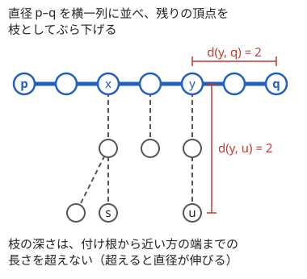

!!! abstract "要点"
    - **何ができるか**：直径（最も遠い 2 点を結ぶパス）は、任意の点から最も遠い点 $a$ を求め、$a$ から最も遠い点 $b$ を求めれば $a$–$b$ になる（辺の重みが非負のとき）。各点の最遠点は直径の端点のどちらかになるので、全頂点の「最も遠い点までの距離」も直径の両端からの距離で求まる。
    - **いつ使うか**：
        - 最も遠い 2 頂点・最長のパス
        - 全頂点を訪れる最短の移動（戻らなくてよい）
        - 各頂点から最も遠い頂点・2 つの木をつないだときの直径
        - K 個の頂点を選んで通る辺の総長を最大化する（K = 1, 2, … のすべてについて）
    - **計算量**：直径は 1 点からの距離を 2 回求めて $O(N)$。全頂点の離心数はもう 1 回足して $O(N)$。
    - **前提**：[木の上の距離](../tree/tree-distance.md)

<!-- textlint-disable -->
別名：直径・最遠点・離心数・double sweep・2 回の BFS・木の中心・半径・長鎖分解・long-path decomposition・tree diameter
<!-- textlint-enable -->

木の直径は、木の中で最も遠い 2 点の距離と、その 2 点を結ぶパスのことである。全点対の距離を調べると $O(N^2)$ かかるが、木では「適当な点から最も遠い点は直径の端になる」という性質があり、1 点からの距離を 2 回求めるだけで $O(N)$ で済む。同じ性質から、各点の最遠点・全頂点を回る最短の移動・2 つの木をつないだ直径などが直径の両端だけで表せる。

このページでは、辺の重みを $w$、2 点 $u, v$ の距離を $d(u, v)$、直径の長さを $D$ と書く。特に断らない限り重みは非負とし、頂点は 0-indexed で書く。

## 2 回の最遠点探索が正しい理由 {#double-sweep}

直径は次の 3 手で求まる。この手順は double sweep とも呼ばれる。

1. 適当な点 $s$ から全頂点への距離を求め、最も遠い点 $a$ を選ぶ
2. $a$ から全頂点への距離を求め、最も遠い点 $b$ を選ぶ
3. $d(a, b)$ が直径の長さで、$a$–$b$ のパスが直径である

次の動く図は、1 回目の探索で見つかった最も遠い点が直径の端になり、そこからの 2 回目の探索で直径が決まる様子をステップ送りで見せる。最後に直径を横一列に並べ直し、残りの頂点を枝としてぶら下げた形にする。

<div class="kp-viz" data-viz="tree-diameter" data-config='{"n": 9, "edges": [[0, 1], [1, 2], [2, 3], [3, 4], [4, 5], [2, 6], [6, 7], [3, 8]], "start": 7}'></div>

図の木では、頂点 7 から最も遠いのは距離 5 の頂点 5 で、頂点 5 から最も遠いのは距離 5 の頂点 0 と頂点 7 である。どちらを選んでも長さ 5 の直径になる。

正しさの鍵は、直径 $p$–$q$ を横一列に並べたときの次の性質である。直径の上の頂点 $y$ からぶら下がる枝の中の頂点 $u$ は、$y$ から近い方の端までの長さより深くならない。

$$
d(y, u) \le \min(d(y, p),\ d(y, q))
$$

もし $d(y, u) > d(y, p)$ なら、直径の $p$ 側の部分を $u$ への枝に取り替えたパス $u$–$q$ の長さは $d(u, y) + d(y, q) > d(p, y) + d(y, q) = D$ になり、$D$ が最大であることに反する。$q$ 側も同じである。



この性質から、どの点 $s$ から見ても、最も遠い点までの距離は直径の端点 $p$ か $q$ までの距離に等しい。$s$ の付け根を $x$、$u$ の付け根を $y$ とし、$y$ が $x$ から見て $q$ の側にあるとする。$x \ne y$ なら $s$ から $u$ へのパスは $x$・$y$ を通るので $d(s, u) = d(s, x) + d(x, y) + d(y, u)$ であり、枝の深さの性質 $d(y, u) \le d(y, q)$ を使うと次のようになる。

$$
d(s, u) \le d(s, x) + d(x, y) + d(y, q) = d(s, q)
$$

だから $s$ から最も遠い点 $a$ について $d(s, a) = \max(d(s, p), d(s, q))$ である。さらに、この不等式が等号になるには $d(y, a) = d(y, q)$ が要る。すると $p$ から $a$ への距離は $d(p, y) + d(y, a) = d(p, y) + d(y, q) = D$ になり、$a$ はある直径の端点である。端点 $a$ から最も遠い点 $b$ までの距離は $D$ なので、2 回目の探索で直径が求まる。

??? note "証明の細部（付け根が同じとき・最遠点が複数あるとき）"
    - $x = y$ のとき（$s$ と $u$ が同じ付け根の枝にあるか、$s$ が直径の上にあるとき）：$s$ から $u$ へのパスは付け根を通るとは限らない。通らなければ近道になるだけで、重みが非負なので $d(s, u) \le d(s, x) + d(x, u)$ がそのまま成り立ち、同じ議論が通る。等号の場合は $d(s, x) + d(x, q) = d(s, a) \le d(s, x) + d(x, a)$ である。これと枝の深さの性質 $d(x, a) \le d(x, q)$ から $d(x, a) = d(x, q)$ が出て、$d(p, a) = d(p, x) + d(x, a) = D$ になる
    - $y$ が $x$ から見て $p$ の側にあるときは、$p$ と $q$ を入れ替えればよい
    - 最も遠い点が複数あるとき：上の議論は「最も遠い点ならどれでも直径の端点」を示しているので、どれを $a$ に選んでもよい。2 回目も同じである

処理の流れは次のとおりである。木では 2 点間のパスが 1 本しかないので、1 点からの距離は親へ戻らないように辺をたどるだけで求まり、ダイクストラ法はいらない（[木の上の距離](../tree/tree-distance.md)）。訪れる順は DFS でも BFS でもよい。

- 1 点からの探索の関数は、距離の配列と親の配列を作り、距離が最大の頂点を返す
- 直径の頂点列が要るなら、2 回目の探索（$a$ を根にした探索）の親を $b$ からたどる
- 各頂点の離心数（最も遠い点までの距離）が要るなら、$b$ からもう 1 回探索する（[次の節](#eccentricity)）

```cpp
--8<-- "tree-diameter/double-sweep.cpp:core"
```

探索 1 回は各辺を 2 回ずつ見るだけなので $O(N)$ で、それを 2〜3 回するので全体も $O(N)$ である。Library Checker の Tree Diameter は、直径の長さと頂点列を出力させるので、自作の確かめに使える。

## 各点の最遠点は直径の端点（離心数） {#eccentricity}

頂点 $v$ から最も遠い点までの距離を $v$ の離心数と呼び、$\mathrm{ecc}(v)$ と書く。[前の節](#double-sweep)で示したとおり、どの点から見ても最も遠い点は直径の端点のどちらかなので、直径の端点を $a, b$ として次が成り立つ（重みが非負のとき）。

$$
\mathrm{ecc}(v) = \max(d(v, a),\ d(v, b))
$$

$a$ からの距離は直径を求める 2 回目の探索ですでに持っているので、$b$ からもう 1 回探索すれば全頂点の離心数が $O(N)$ で求まる。各頂点から探索すると $O(N^2)$ かかるところを、探索 3 回で済ませるのがこの節の要点である。

最も遠い点そのもの（頂点の番号）を答える問題では、距離が等しいときの選び方に気を配る。「最も遠い点のうち番号が最大のもの」を答えるなら、直径の端点を選ぶときから番号の大きい方を優先しておく必要がある（[例題の ABC428 E](#abc428_e)）。

??? question "確認問題：離心数が最小の頂点"
    重みのない木で直径の長さが $D$ のとき、$\mathrm{ecc}(v)$ の最小値はいくつか。

    ??? success "答え"
        $\lceil D / 2 \rceil$ である。$d(v, a) + d(v, b) \ge d(a, b) = D$ なので、2 つの大きい方は $D / 2$ 以上で、整数だから $\lceil D / 2 \rceil$ 以上になる。直径の中央の頂点で等号になる。この頂点を木の中心と呼ぶ（[中心と半径](#center)）。

## 全頂点を回る最短 = 2 × 辺の総和 − 直径 {#visit-all}

「好きな頂点から出発して全頂点を訪れる移動の最短距離」は、辺の重みの総和を $W$ として $2W - D$ になる。

出発点に戻る場合を先に考える。木の辺を 1 本取り除くと 2 つに分かれるので、両側に訪れる頂点がある限り、その辺は行きと帰りで 2 回以上通る。DFS の順に回ればどの辺もちょうど 2 回で済むので、戻る場合の最短は $2W$ である。

戻らなくてよく、$s$ から出発して $t$ で終わるなら、$s$–$t$ のパス上の辺だけは 1 回で済む。パスから外れた枝を先に往復で回り、パスを $t$ へ進めばよいので、最短は $2W - d(s, t)$ である。$s$ と $t$ は自由に選べるので、$d(s, t)$ を最大にする直径の両端を選んで $2W - D$ になる（[例題の ABC361 E](#abc361_e)）。

同じ「パスに 1 本足す」見方で、辺を 1 本足してできる閉路の長さの最大も求まる。重みのない木で $u$ と $v$ を結ぶ辺を足すと、閉路は $u$–$v$ のパスと足した辺からなるので、辺の数は $d(u, v) + 1$ である。最大は $D + 1$ になる。

??? question "確認問題：戻る場合と戻らない場合の差"
    全頂点を回って出発点に戻る最短と、戻らなくてよい最短の差はいくつか。

    ??? success "答え"
        直径の長さ $D$ である。戻る場合は $2W$、戻らない場合は $2W - D$ になる。戻らない場合の最短を作るには、出発点と終点を直径の両端にする。

## 負の重みなら木 DP（DP の章） {#negative-weights}

辺に負の重みがあると、2 回の最遠点探索は正しくない。[2 回の探索の節](#double-sweep)の証明では、付け根が同じとき $d(s, u) \le d(s, x) + d(x, u)$ を使った。重みが負だと、遠回りした方が「遠く」なるので、この不等式が崩れる。

次の木で確かめる。頂点 0 と 1 を重み 1 の辺で、頂点 0 と 2 を重み $-100$ の辺で結び、頂点 2 から重み 50 の辺を 2 本出して頂点 3・4 につなぐ。直径は $3$–$2$–$4$ の 100 である。ところが頂点 0 から探索すると、距離は頂点 1 が 1、頂点 3・4 が $-50$ なので最も遠い点は頂点 1 になる。頂点 1 から最も遠いのは距離 1 の頂点 0 で、答えは 1 と誤る。

負の重みがあるときは、パスを最も浅い頂点で分類する[木 DP](../dp/tree-dp.md#path-at-top) を使う。根を決め、$\mathrm{up}[v]$ を「$v$ から下へ伸びるパスの重みの最大」とする。子 $c$ への辺の重みを $w_c$ として、$\mathrm{up}[v] = \max(0, \max_c (\mathrm{up}[c] + w_c))$ と求める。$v$ を最も浅い頂点とするパスの最大は、$\max(0, \mathrm{up}[c] + w_c)$ の上位 2 つ（足りなければ 0）の和である。すべての $v$ での最大が答えで、計算量は $O(N)$ である。2 か所の $\max$ の中の 0 は「その方向へは伸ばさない」を表し、長さ 0 のパス（1 頂点）も認める場合に使う。候補 $\mathrm{up}[c] + w_c$ が負のまま上位 2 つを足すと、片側だけへ伸ばすパスより小さくなり、答えを取りこぼす。

木 DP は重みが非負でも使え、直径の長さだけが要るならこちらでもよい。ただし直径の端点や各点の離心数を求めるには、2 回の探索の方が素直である。

??? question "確認問題：重み 0 の辺"
    重みが 0 の辺があるとき、2 回の最遠点探索は正しいか。

    ??? success "答え"
        正しい。証明で使ったのは重みが非負であることだけである。最も遠い点が増えることはあるが、どれを選んでもよい。

## 直径の端点を根にして距離 K の頂点を探す {#root-at-end}

この節は[最小共通祖先（LCA）](../tree/lca.md)のダブリング（K 個上の祖先を求める方法）を前提にする。重みのない木で、「頂点 $u$ から距離がちょうど $K$ の頂点を 1 つ答えよ（なければ $-1$）」という質問にたくさん答える型を考える。

距離が $K$ の頂点があるのは $K \le \mathrm{ecc}(u)$ のときだけである。$u$ から $\mathrm{ecc}(u)$ 離れた頂点 $z$ があれば、$u$–$z$ のパスの途中に距離 $0, 1, \dots, \mathrm{ecc}(u)$ の頂点が 1 つずつあるからである。そして最も遠い点は直径の端点 $a$ か $b$ のどちらかで選べる。

そこで、$a$ を根にした木と $b$ を根にした木の 2 つを用意する。$d(u, a) \ge K$ なら、$a$ を根にした木で $u$ の $K$ 個上の祖先が答えである。根へ向かうパスは $u$–$a$ のパスそのものだからである。そうでなく $d(u, b) \ge K$ なら $b$ を根にした木で同じことをし、どちらも $K$ 未満なら $-1$ を答える。

K 個上の祖先はダブリングで前計算 $O(N \log N)$、1 回 $O(\log N)$ で求まる。質問をまとめて読めるなら、DFS で根からのパスをスタックに持ち、スタックの後ろから $K$ 番目を読む方法でもよい。この型の問題に ABC267 F（Exactly K Steps）がある。

## 2 つの木をつないだ直径 {#join-trees}

重みのない 2 つの木 $T_1, T_2$ の直径を $D_1, D_2$ とする。$T_1$ の頂点 $i$ と $T_2$ の頂点 $j$ を辺で結んでできる木の直径は次のようになる。

$$
\max\bigl(D_1,\ D_2,\ \mathrm{ecc}_1(i) + 1 + \mathrm{ecc}_2(j)\bigr)
$$

新しい木のパスは、どちらかの木の中に収まるか、足した辺を通るかのどちらかである。収まるパスの最大は $D_1$ か $D_2$ である。足した辺を通るパスは「$T_1$ の中で $i$ から伸ばす部分」と「$T_2$ の中で $j$ から伸ばす部分」に分かれ、2 つは独立に最大にできる。だからその最大は $\mathrm{ecc}_1(i) + 1 + \mathrm{ecc}_2(j)$ である。離心数は[前の節](#eccentricity)の方法で、各木について探索 3 回で求まる。

すべての組 $(i, j)$ についての直径の和を問われたら、$M = \max(D_1, D_2)$ として、$\mathrm{ecc}_1(i) + 1 + \mathrm{ecc}_2(j) > M$ となる $j$ だけが $M$ と違う値を出すことを使う。$\mathrm{ecc}_2$ をソートして累積和を持てば、各 $i$ について境目を二分探索して、境目より大きい $j$ の個数と $\mathrm{ecc}_2$ の和から $O(\log N_2)$ で足せる。全体は $O((N_1 + N_2) \log N_2)$ である。$i$ も離心数の順に並べれば境目は単調に動くので、尺取り法にもできる。答えは $N_1 N_2 \times M$ 程度になるので `long long` で持つ。

逆に、つないだ直径を最小にしたいなら、両方の木の中心（離心数が最小の頂点）どうしを結ぶ。結果は $\max(D_1, D_2, r_1 + 1 + r_2)$ で、$r_k = \lceil D_k / 2 \rceil$ は半径である（[中心と半径](#center)）。

## 中心と半径・直径の個数 {#center}

この節は重みのない木で考える。離心数が最小の頂点を木の中心、その最小値を半径と呼ぶ。中心は直径の真ん中にある。

$d(v, a) + d(v, b) \ge D$ で、等号は $v$ が $a$–$b$ のパス上にあるときだけ成り立つ。だから $\mathrm{ecc}(v) = \max(d(v, a), d(v, b)) \ge \lceil D / 2 \rceil$ で、等号になるのは直径の上の真ん中の頂点だけである。

| 直径 $D$ | 中心 | 半径 |
| --- | --- | --- |
| 偶数 | 直径の真ん中の 1 頂点 | $D / 2$ |
| 奇数 | 直径の真ん中の隣り合う 2 頂点（真ん中の辺） | $(D + 1) / 2$ |

すべての直径は中心を通り、中心がその真ん中になる。どの直径についても、その真ん中の頂点（または辺）から全頂点への距離は、枝の深さの性質（[2 回の探索の節](#double-sweep)）から $\lceil D / 2 \rceil$ 以下になる。だから直径の真ん中は中心であり、中心は 1 頂点か隣り合う 2 頂点しかないので、すべての直径の真ん中は同じ中心である。その例として、2 本の直径が共通の頂点を持たないとすると、2 本を結ぶ長さ 1 以上のパスと、それぞれの直径の長い方の半分（$D / 2$ 以上）をつないだパスの長さが $D$ を超えてしまう。重心（取り除くと各成分の大きさが $N / 2$ 以下になる頂点）とは別物なので混同しない（[木の重心](../tree/tree-centroid.md)）。

この性質を使うと、直径の端点の組を中心で分けて数えられる。$D$ が偶数で中心が $c$ のとき、直径の端点になれるのは $c$ から距離 $D / 2$ の頂点だけである。そのような 2 頂点の距離が $D$ になるのは、$c$ から見て別の枝（$c$ の別の子の部分木）にあるときだけである。$D$ が奇数なら、真ん中の辺で 2 つに分け、両側の距離 $(D - 1) / 2$ の頂点どうしが直径の端点の組になる。

たとえば「どの 2 つの距離も $D$ になる頂点の集合（2 頂点以上）」の数は、$D$ が偶数なら各枝の距離 $D / 2$ の頂点の数を $c_k$ として次のようになる。各枝から高々 1 つずつ選ぶ方法から、空の集合と 1 頂点の集合を引いた数である。

$$
\prod_k (c_k + 1) - 1 - \sum_k c_k
$$

$D$ が奇数なら、両側の個数を $\alpha, \beta$ として $\alpha \beta$ である（[力試しの ABC221 F](#challenge)）。

??? question "確認問題：2 本の直径"
    重みのない木に直径が 2 本あるとき、それらは必ず共通の頂点を持つか。

    ??? success "答え"
        持つ。どの直径も中心を通るからである。共通の頂点がないと仮定すると、2 本を結ぶパスを使って長さ $D$ を超えるパスが作れてしまう。

## 長鎖分解（最も深い子へつなぐ分解と、最も遠い葉を順に選ぶ貪欲） {#long-path-decomposition}

この節は [HL 分解](../tree/hld.md)の考え方（子を 1 つ選び、その子への辺で鎖を作る）を知っているとよい。長鎖分解は、根付き木の各頂点で「最も深い葉に至る子」を 1 つ選び、その辺でつないだ鎖に木を分ける方法である。HL 分解の「部分木の大きさ」を「下への長さ（高さ）」に置き換えたものにあたる。

重み付きの根付き木で、$h[v]$ を $v$ から部分木の葉までの距離の最大とする。$v$ の子のうち $w_c + h[c]$ が最大の子 $c$ を長い子と呼び、長い子への辺をつなぐと、木は葉で終わる鎖に分かれる。どの葉もちょうど 1 本の鎖の下端になる。各鎖の値を「鎖の辺の重みの和に、鎖の上端から親への辺の重みを足したもの」とすると、値の合計は辺の重みの総和 $W$ に等しい。

この分解が効くのは、「根から出発して、選んだ $K$ 個の頂点をすべて通って戻る最短」の最大を、$K = 1, 2, \dots$ のすべてについて求める型である。選んだ頂点と根を結ぶ最小の部分木の辺の重みの和を $L$ とすると、戻る最短は $2L$ になる（[全頂点を回る最短](#visit-all)と同じ理由）。$L$ を最大にするには葉だけを選べばよく、次の貪欲が正しい。

1. 根から最も遠い葉を選ぶ
2. 選んだ葉と根を結ぶパスを 1 点に縮めて新しい根とし、そこから最も遠い葉を選ぶ。これをくり返す

縮めた後に最も遠い葉までの距離は、ちょうど長鎖分解の鎖の値になる。最初に選ぶ葉は根から長い子をたどった先なので、増える長さは根を含む鎖の値 $h[\text{根}]$ である。その鎖を縮めると、鎖からぶら下がる各部分木は、上端の辺の重み + 高さの距離に現れる。これは次の鎖の値そのものである。だから、鎖の値を大きい順に並べ、上から $K$ 個の和の 2 倍が $K$ の答えになる。葉の数より $K$ が大きければ、答えは $2W$ のままである。

??? note "貪欲が正しい理由の筋"
    最適な選び方が 1 回目の葉 $v_1$（根から最も遠い葉）を含まないとする。選んだ葉のうち、根から $v_1$ へのパスと分かれる点が最も深いものを 1 つ取り、$v_1$ に取り替える。分かれた点より下の部分は、$v_1$ 側の方が長い（$v_1$ が最も遠い）ので、部分木の辺の重みの和は減らない。失う辺は分かれた点 $z$ より下の取り除いた葉 $u$ の側だけで、その長さは $d(z, u)$ 以下である。$z$ より下の $v_1$ 側の辺はどの選んだ葉にも覆われていないので、$d(z, v_1) \ge d(z, u)$ だけ増える。この交換を縮約後の木でくり返せば、貪欲の選び方でも最適値が出る。参考の解説も概略だけを示している。

計算は、帰りがけ順に $h[v]$ と長い子を求め、各鎖の値を集めてソートするだけなので $O(N \log N)$ である。長鎖分解には、深さを添字にする木 DP の併合を全体 $O(N)$ にするなどの発展の使い方もあるが、ABC で出るのはこの貪欲の形がほとんどである。

## 落とし穴 {#pitfalls}

**負の重みで 2 回の探索を使う**。証明は重みが非負であることに頼っている。負の重みがあれば[木 DP](#negative-weights) にする。頂点に重みがある場合も、探索の距離に頂点の重みを含めるなら同じ注意が要る。

**再帰の深さ**。パス状の木（$N = 2 \times 10^5$ の一直線）では、再帰の DFS の深さが $N$ になり、手元の環境ではスタックがあふれることがある。明示的なスタックか BFS で書くと安全である（[C++ の環境](../cpp/cpp-environment.md)）。

**距離のオーバーフロー**。重みが $10^9$ まであり $N = 2 \times 10^5$ なら、距離は $2 \times 10^{14}$ 程度になる。これは `int` に収まらない。距離・総和・$2W - D$ はすべて `long long` で持つ。

**BFS の距離の順に頼る**。BFS で頂点が「距離の小さい順」に出てくるのは重みがないときだけである。重み付きの木でも探索は BFS で書いてよいが、最も遠い点はキューから最後に出た頂点ではなく、距離の配列の最大で選ぶ。

**直径の頂点列を 1 回目の探索の親でたどる**。頂点列は、$a$ を根にした 2 回目の探索の親を $b$ からたどって作る。1 回目（$s$ を根にした探索）の親をたどっても $a$–$b$ のパスになるとは限らない。

**長さの単位の取り違え**。直径の長さを「辺の数」で求めたのか「頂点の数」で求めたのかを問題に合わせる。辺の数が $D$ なら、パス上の頂点は $D + 1$ 個である。

**森で使う**。入力が森（複数の木）なら、連結成分ごとに 2 回の探索をする。別の成分の頂点は距離が未定義のまま残る。

## 例題 {#examples}

### ABC428 E. Farthest Vertex {#abc428_e}

<div class="kp-problems" data-role="example" markdown>

- [ABC428 E. Farthest Vertex](https://atcoder.jp/contests/abc428/tasks/abc428_e)（diff 1167）：木の各頂点について、最も遠い頂点（複数あれば番号が最大のもの）を求める。

</div>

方針：最も遠い点は直径の端点のどちらかなので、直径の両端 $s, t$ からの距離を求めて各頂点で比べる。距離が等しいときに番号の大きい方を答えるため、直径の端点を選ぶ 2 回の探索でも、最も遠い点が複数あれば番号の大きい方を選ぶ。

??? note "解法の詳細"
    - 頂点 1 から探索し、最も遠い点のうち番号が最大のものを $s$ とする。$s$ から探索し、同じく番号が最大の最も遠い点を $t$ とする。$t$ からも探索する
    - 各頂点 $v$ について、$d(v, s)$ と $d(v, t)$ の大きい方の端点を答える。等しければ $s$ と $t$ のうち番号の大きい方を答える
    - 2 回とも番号の大きい方を選ぶ理由：重みのない木の最も遠い点の集まりは、直径の端点になれる頂点（$D$ が偶数なら[中心](#center)から距離 $D / 2$、奇数なら真ん中の辺の各側でその側の中心から距離 $(D - 1) / 2$）のうち、$v$ を含まない枝（奇数なら $v$ と反対の側）にあるもの全体である。1 回目で「頂点 1 を含まない枝の中の番号最大」、2 回目で「$s$ を含まない枝の中の番号最大」が選ばれるので、全体で番号が最大の端点と、それを含まない枝での番号最大の端点が $s, t$ に入る。どの $v$ の答えもこの 2 つのどちらかになる
    - 探索 3 回で $O(N)$

### ABC361 E. Tree and Hamilton Path 2 {#abc361_e}

<div class="kp-problems" data-role="example" markdown>

- [ABC361 E. Tree and Hamilton Path 2](https://atcoder.jp/contests/abc361/tasks/abc361_e)（diff 1213）：重み付きの木で、好きな都市から出発して全都市を訪れる移動の最短距離を求める。

</div>

方針：出発点に戻るならどの辺も 2 回通り、戻らないなら出発点と終点を結ぶパスの辺だけ 1 回で済む。答えは辺の重みの総和の 2 倍から直径を引いた値である（[全頂点を回る最短](#visit-all)）。

??? note "解法の詳細"
    - 辺の重みの総和 $W$ を求める
    - 2 回の最遠点探索で直径 $D$ を求める。重みは非負なのでそのまま使える
    - $2W - D$ を出力する。$W$ は $2 \times 10^{14}$ 程度になりうるので `long long` で持つ
    - 再帰の DFS は一直線の木で深くなるので、明示的なスタックで探索する。全体で $O(N)$

## 練習問題 {#practice}

<div class="kp-problems" data-role="practice" markdown>

- [典型90 003. Longest Circular Road（★4）](https://atcoder.jp/contests/typical90/tasks/typical90_c)（diff —）：木に辺を 1 本足してできる閉路の長さの最大値を求める。
- [ABC019 D. 高橋くんと木の直径](https://atcoder.jp/contests/abc019/tasks/abc019_4)（diff 1378）：2 頂点間の距離を質問できる対話形式で、木の直径を求める。
- [ABC447 F. Centipede Graph](https://atcoder.jp/contests/abc447/tasks/abc447_f)（diff 1480）：木の部分グラフとして、背骨のパスの各頂点に葉が 2 つずつ付いた形（ムカデ）を取り出すとき、背骨の長さの最大を求める。
- [ABC401 F. Add One Edge 3](https://atcoder.jp/contests/abc401/tasks/abc401_f)（diff 1666）：2 つの木の頂点を 1 組選んで辺で結んだときの直径を、すべての組について足し合わせる。
- [ABC460 F. Farthest Pair Query](https://atcoder.jp/contests/abc460/tasks/abc460_f)（diff 1987）：木の頂点の白と黒を切り替えるクエリのたびに、黒い頂点どうしの距離の最大を答える。

</div>

??? note "練習の方針"
    - **典型90 003**：$u$ と $v$ を結ぶ辺を足すと、閉路の辺の数は $d(u, v) + 1$ になる。直径の長さ（辺の数）に 1 を足す
    - **ABC019 D**：頂点 1 から他の全頂点への距離を質問して最も遠い点 $a$ を見つけ、$a$ から全頂点への距離を質問して最大を答える。2 回の最遠点探索を、探索の代わりに質問で行い、質問は合わせて $2(N - 1)$ 回になる
    - **ABC447 F**：背骨の端は次数 3 以上、途中は次数 4 以上の頂点でなければならない。パスを最も浅い頂点で分類する[木 DP](../dp/tree-dp.md#path-at-top) で、上へ伸ばせる長さと、子の上位 2 つから折り返す長さを求める。直径の木 DP と同じ形で、端と途中で次数の条件が違う。長さ 1 は次数 2 の頂点でも作れることと、根の次数の数え方に気を付ける
    - **ABC401 F**：各木で直径の両端から探索して離心数を求める。つないだ直径は $\max(D_1, D_2, \mathrm{ecc}_1(i) + 1 + \mathrm{ecc}_2(j))$ なので、離心数をソートし、累積和と二分探索で全組の和を数える（[2 つの木をつないだ直径](#join-trees)）
    - **ABC460 F**：頂点集合 $S, T$ の最も遠い 2 点を $(a, b), (c, d)$ とすると、$S \cup T$ の最も遠い 2 点は $\{a, b, c, d\}$ の中から選べる。この合成を頂点番号の順に並べたセグメント木に載せ、黒い頂点だけの最も遠い 2 点を区間ごとに持つ。合成では 6 組（新しく LCA で距離を求めるのは 4 組）を比べる。黒い頂点がない区間は単位元として扱う

## 力試し {#challenge}

<div class="kp-problems" data-role="challenge" markdown>

- [ABC369 G. As far as possible](https://atcoder.jp/contests/abc369/tasks/abc369_g)（diff 2055）：木で、相手が K 個の頂点を指定し、自分が頂点 1 から出発して指定の頂点をすべて通って戻るとき、相手が最大化する最短の歩行距離を K = 1, …, N について求める。
- [ABC221 F. Diameter set](https://atcoder.jp/contests/abc221/tasks/abc221_f)（diff 2093）：木の頂点を 2 つ以上選ぶとき、選んだどの 2 頂点の距離も直径に等しくなる選び方の数を求める。

</div>

??? note "力試しの方針"
    - **ABC369 G**：戻る最短は「指定の頂点と根を結ぶ最小の部分木の辺の重みの和」の 2 倍である。頂点 1 を根に長鎖分解し、各鎖の値（上端の辺を含む長さ）を大きい順に並べて、上から $K$ 個の和の 2 倍を答える（[長鎖分解](#long-path-decomposition)）
    - **ABC221 F**：直径の長さ $D$ の偶奇で中心が頂点か辺かが決まる。偶数なら中心の各枝で距離 $D / 2$ の頂点数 $c_k$ を数え、$\prod (c_k + 1) - 1 - \sum c_k$ を答える。奇数なら真ん中の辺の両側で距離 $(D - 1) / 2$ の頂点数の積を答える（[中心と半径](#center)）

## 使い分け {#comparison}

- **各頂点の最も遠い点までの距離**：重みが非負なら、直径の両端からの探索で済む。行き先の頂点にも費用がつく、負の重みがあるなど直径の性質が崩れるときは[全方位木 DP](../dp/rerooting.md#when-to-use) を使う
- **直径の長さだけ**：重みが非負なら 2 回の探索、負の重みがあるなら[木 DP](../dp/tree-dp.md#path-at-top)
- **中心と重心**：中心は「最も遠い点までの距離」を最小にする頂点、重心は「取り除いた後の成分の大きさ」を最小にする頂点で、別物である（[木の重心](../tree/tree-centroid.md)）
- **最も遠い点から木を作る**：各頂点の離心数から木を作る・復元する問題は、直径の長さを最大の離心数として決め、直径の上の位置ごとの個数を確かめる（[木の構築](../tree/tree-construction.md)）

## 参考 {#references}

- [omakasessan「ABC428 E」の解説記事](https://qiita.com/omakasessan/items/7856cb8120beeb205ff3)：例題 ABC428 E の方針（番号の大きい方を優先する端点の選び方）
- [drken「AtCoder ABC 361 E - Tree and Hamilton Path 2」](https://drken1215.hatenablog.com/entry/2024/07/07/153129)：例題 ABC361 E の方針と、$2W - D$ になる理由
- [drken「競プロ典型 90 問 003 - Longest Circular Road（2Q, ★4）」](https://drken1215.hatenablog.com/entry/2021/06/12/181400)：練習 典型90 003 の方針
- [drken「AtCoder ABC 019 D - 高橋くんと木の直径 (1Q, 試験管水色)」](https://drken1215.hatenablog.com/entry/2021/06/14/001500)：練習 ABC019 D の方針
- [merom686「ABC447」の参加記](https://merom686.hatenablog.com/entry/2026/03/01/013149)：練習 ABC447 F の木 DP と、次数の条件の場合分け
- [torus711「Haskell で AtCoder ABC447 A-F」](https://torus711.hatenablog.com/entry/2026/03/01/213520)：練習 ABC447 F の問いと DP の 2 つの値
- [gotoki_no_joe「ABC401」の解説記事](https://qiita.com/gotoki_no_joe/items/36c02a9cff7cf61b3106)：練習 ABC401 F の、つないだ直径の式と和の数え方
- [ikatakos「AtCoder Beginner Contest 460 E,F,G問題メモ」](https://ikatakos.com/pot/programming_algorithm/contest_history/atcoder/2026/0530_abc460)：練習 ABC460 F の、最も遠い 2 点の合成とセグメント木（解法の節だけを読んだ）
- [kazun「ABC221 F - Diameter set」](https://kazun-kyopro.hatenablog.com/entry/ABC/221/F)：力試し ABC221 F の、中心で分けて数える式
- [drken「AtCoder ABC 369 G - As far as possible」](https://drken1215.hatenablog.com/entry/2024/09/03/035714)：力試し ABC369 G の貪欲と、鎖の長さを大きい順に足す方法
- [yosupo「Library Checker の問題（tree_diameter）」](https://github.com/yosupo06/library-checker-problems/tree/master/tree/tree_diameter)：自作の確かめ先
