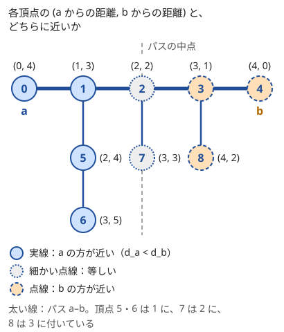

!!! abstract "要点"
    - **何ができるか**：木では 2 点間のパスが 1 本しかないので、重み付きでも 1 回の走査で 1 点から全頂点への距離が求まる。2 点からの距離を両方求めて比べると「どちらに近いか」「どちらが先に着くか」が分かり、根からの累積値を使うと 2 点間の値が 2 つの累積値で表せる（XOR なら LCA がいらない）。
    - **いつ使うか**：
        - 頂点 K を経由する最短距離。
        - 2 人の追いかけっこ・どちらが先に着くか。
        - パス上の辺の重みの XOR。
    - **計算量**：1 点からの距離は $O(N)$。根からの累積値も $O(N)$ で前計算でき、2 点間の値は XOR なら $O(1)$、和なら LCA を求める分だけかかる。
    - **前提**：[根付き木と走査順](../tree/tree-traversal.md)

<!-- textlint-disable -->
別名：木の距離・根からの累積・XOR 距離・追いかけっこ・2 点からの距離・distance on a tree
<!-- textlint-enable -->

木の上の距離は、一般のグラフの最短路より単純に求まる。木では 2 点を結ぶパスがただ 1 本なので、「最短」を選ぶ必要がなく、パスに沿って辺の重みを足すだけで距離になる。この性質を使う型は、1 点から求める距離・2 点からの距離の比較・根からの累積値の 3 つである。頂点は 0-indexed で書き、2 点 $u, v$ の距離を $d(u, v)$、根からの累積を $S[v]$ と書く。

## 1 点からの距離（ダイクストラ法はいらない） {#from-one}

始点 $s$ を根とみなして木をたどると、頂点 $v$ からその子 $c$ へ進むときに $\mathrm{dist}[c] = \mathrm{dist}[v] + w(v, c)$ と決めてよい。$s$ から $c$ へのパスは「$s$ から $v$ へのパス」に辺 $(v, c)$ を足したもの 1 本だけで、ほかに比べる道がないからである。

[ダイクストラ法](../graph/dijkstra.md)が優先度付きキューを使うのは、ある頂点へ届く道が何本もあり、短い方から確定させる必要があるからである。木ではその比較がいらないので、親が子より先に処理される順（DFS でも BFS でも、スタックに積む順でもよい）なら何でもよい。同じ理由で、**負の重みがあっても正しく求まる**（ダイクストラ法が負辺で壊れる理由は[負辺で壊れる例](../graph/dijkstra.md#negative-edges)）。

```cpp
--8<-- "tree-distance/from-one.cpp:core"
```

完全なプログラム：[`from-one.cpp`](https://github.com/yuukougun/kyopro-atlas/blob/main/snippets/tree-distance/from-one.cpp)（GitHub）
{ .kp-code-src }

親へ戻らないことだけを確かめれば、各頂点を 1 回ずつ訪れ、各辺を 2 回ずつ見るので $O(N)$ である。未訪問の印を $\mathrm{dist} = -1$ にすると、負の重みで距離が $-1$ になった頂点を未訪問と取り違える。上のコードのように親を一緒に持てば、印はいらない。

1 点からの距離をそのまま使う典型は「頂点 $K$ を経由して $x$ から $y$ へ行く最短距離」である。木では $x$ から $K$ へのパスと $K$ から $y$ へのパスがどちらも 1 本に決まるので、答えは $d(x, K) + d(K, y)$ になる。$K$ からの距離を 1 回求めておけば、各質問は $O(1)$ で答えられる（[例題](#abc070_d)）。

??? question "確認問題：BFS の取り出し順"
    重み付きの木で、根から BFS をして頂点を取り出した順は、根からの距離の小さい順になっているか。それでも BFS で距離が正しく求まるのはなぜか。

    ??? success "答え"
        距離の小さい順とは限らない。BFS の取り出し順は辺の本数の小さい順で、重みが大きい 1 本の辺の先は、重みの小さい 2 本の辺の先より遠いことがある。それでも距離が正しいのは、木では親から子へ重みを足すだけで値が確定し、どの順に処理しても親が子より先でありさえすればよいからである。「取り出した順に距離が確定する」という BFS の性質は使っていない。

## 2 点からの距離を比べる {#from-two}

2 点 $a, b$ からの距離 $d_a(x) = d(a, x)$ と $d_b(x) = d(b, x)$ を、1 点からの距離を 2 回求めて用意する。$d_a(x)$ と $d_b(x)$ を比べると、頂点 $x$ が $a$ と $b$ のどちらに近いかが分かる。この比較の結果には、次の図のような決まった形がある。



各頂点 $x$ から、パス $a$–$b$ の上で最も近い頂点を $p(x)$ とする（図の頂点 6 なら頂点 1）。$x$ から $a$ へ行くにも $b$ へ行くにも、まず $p(x)$ を通るので、次の式が成り立つ。

$$
d_a(x) - d_b(x) = \bigl(d_a(p(x)) + d(p(x), x)\bigr) - \bigl(d_b(p(x)) + d(p(x), x)\bigr) = d_a(p(x)) - d_b(p(x))
$$

つまり、どちらに近いかは $x$ が付いているパスの頂点 $p(x)$ だけで決まる。パスの上を $a$ から $b$ へ進むと $d_a - d_b$ は増え続けるので（重みが正のとき）、$a$ の方が近い頂点は「パスの中点より $a$ 側に付いている頂点」として 1 つにつながっている。

この形から、次の型が出てくる。

- **追いかけっこ**：2 人が 1 手ずつ隣へ動くとき、逃げる側が鬼より先に着ける頂点は、$d_{\text{逃}}(x) < d_{\text{鬼}}(x)$ を満たす頂点である。等号の扱い（同時に着いたら捕まるか）は手番の順で変わるので、問題の規則から決める。逃げる側はその中で鬼から最も遠い頂点へ向かうのがよい（[練習の ABC148 F](#practice)）
- **パスの上にあるか**：重みが正なら、$x$ がパス $a$–$b$ の上にあることと $d_a(x) + d_b(x) = d(a, b)$ は同じである。パスから外れた頂点は、$p(x)$ との間を往復する分だけ和が大きくなる
- **出会う位置と偶奇**：重みがない木で 2 人が同時に 1 歩ずつ近づくと、出会うのはパスの中点である。$d(a, b)$ が奇数なら中点は辺の途中にあり、頂点では出会えない（偶奇の考え方は[木の 2 色塗り分けと距離の偶奇](../tree/tree-bipartite.md)）

??? question "確認問題：等しい頂点がない木"
    重みのない木で $d(a, b)$ が奇数のとき、$d_a(x) = d_b(x)$ となる頂点 $x$ はあるか。

    ??? success "答え"
        ない。$d_a(x) - d_b(x) = d_a(p(x)) - d_b(p(x))$ で、パスの頂点 $p$ では $d_a(p) + d_b(p) = d(a, b)$ だから、差は $2 d_a(p) - d(a, b)$ になる。$d(a, b)$ が奇数なら差は奇数で、0 にならない。図の木は $d(a, b) = 4$ で偶数なので、中点の頂点 2 と、2 に付く頂点 7 で等しくなっている。

## 根からの累積値で 2 点間を表す（XOR は LCA が不要、和は LCA が要る） {#root-prefix}

根 $r$ を決め、$S[v]$ を「$r$ から $v$ へのパス上の辺の重みの累積」とする。累積は和でも XOR でもよく、親から子へ $S[c] = S[v] + w$（XOR なら $S[c] = S[v] \oplus w$）と配れば $O(N)$ で求まる。

2 点 $u, v$ の最小共通祖先を $l = \mathrm{lca}(u, v)$ とすると、$u$–$v$ のパスは「$l$ から $u$」と「$l$ から $v$」をつないだものである。$S[u]$ と $S[v]$ はどちらも「$r$ から $l$」の部分を余分に含んでいる。

- **和**：余分な部分を取り除くには、それが何かを知る必要がある。$d(u, v) = S[u] + S[v] - 2 S[l]$ なので、[LCA](../tree/lca.md#distance) を求めなければならない
- **XOR**：同じ値を 2 回 XOR すると消える（$y \oplus y = 0$）。$S[u] \oplus S[v]$ の中で「$r$ から $l$」の部分は 2 回現れて打ち消し合うので、パス上の XOR はそのまま $S[u] \oplus S[v]$ になる。LCA はいらない
- **偶奇**：和の偶奇は 1 ビットの XOR と同じなので、距離の偶奇も $S[u] + S[v]$ の偶奇で決まり、LCA はいらない

XOR の形に直せると、木の上の頂点の組の問題が、列 $S$ の 2 要素の組の問題になる。木の形を忘れて、配列の上の数え方がそのまま使える。

- **XOR がちょうど $X$ になる組の数**：$S[u] \oplus S[v] = X$ は $S[u] = S[v] \oplus X$ と同じなので、値ごとの個数を連想配列で数える（下のコード）。配列で同じ形の数え方をするのが[累積和と連想配列で区間を数える](../basics/prefix-sum-counting.md)である
- **全組の XOR の和**：bit ごとに分け、そのビットが 0 の頂点数と 1 の頂点数の積に $2^k$ を掛けて足す（[bit ごとの寄与](../basics/bitwise-independence.md#per-bit-contribution)）

```cpp
--8<-- "tree-distance/xor-count.cpp:core"
```

完全なプログラム：[`xor-count.cpp`](https://github.com/yuukougun/kyopro-atlas/blob/main/snippets/tree-distance/xor-count.cpp)（GitHub）
{ .kp-code-src }

頂点を 1 つずつ見て、それより前に見た頂点とだけ組にしている。こうすると、$X = 0$ のときに自分自身と組にすることも、同じ組を 2 回数えることも起きない。連想配列に `map` を使うので $O(N \log N)$ である。

??? question "確認問題：最大値の場合"
    パス上の辺の重みの最大値も、根からの累積の最大値 $S[v]$ を 2 つ使って表せるか。

    ??? success "答え"
        表せない。XOR が LCA なしで済むのは、余分な部分が 2 回現れて打ち消し合うからである。和は余分な部分を引けば戻せるが、それには LCA が要る。最大値は「取った最大を取り消す」ことができず、$\max(S[u], S[v])$ には根から LCA の部分の大きな重みが混ざってしまう。パス上の最大値は、ダブリングの表に最大値を一緒に持つ（[パス上の最大値・和](../tree/lca.md#path-aggregate)）。

## 落とし穴 {#pitfalls}

**距離が `int` に収まらない**。距離はパス上の重みの和なので、頂点数 × 重みの上限まで大きくなる。$N = 2 \times 10^5$ で重みが $10^9$ なら $2 \times 10^{14}$ になるので、距離の配列は `long long` にする。

**パス状の木で再帰が深くなる**。木が一直線だと、再帰の DFS の深さは $N$ になる。手元の環境では、スタックの上限を超えて落ちることもある。[1 点からの距離](#from-one)のコードのように明示的なスタックで書くか、BFS 順で書けば起きない（[再帰の深さ](../tree/tree-traversal.md#recursion-depth)）。

**すべての点から探索してしまう**。全点対の距離を 1 点ずつ求めると $O(N^2)$ で、$N = 2 \times 10^5$ では間に合わない。2 点間の距離を何度も聞かれるなら LCA を使い、「全組の距離の和」のような集計なら、組ではなく辺ごとの寄与で数える（[つながりの節](#next-steps)）。

**パスの上にあるかの判定で、重み 0 の辺を見落とす**。$d_a(x) + d_b(x) = d(a, b)$ による判定は、重みが正のときに限る。重み 0 の辺でパスから外れた頂点は、往復しても和が増えないので、パスの上にあると誤って判定される。

**組を数えるときに自分自身と 2 重の数えを忘れる**。値ごとの個数を先に全部数えてから $S[v] \oplus X$ の個数を足すと、$X = 0$ のとき自分自身も数え、さらにどの組も両方の端から 2 回数える。前に見た頂点とだけ組にするか、自分の分を引いてから 2 で割る。

## 上位の手法へのつながり {#next-steps}

1 点からの距離と根からの累積は、木の上の多くの手法の部品になる。

- **2 点間の距離のクエリ**：和の距離は $S[u] + S[v] - 2 S[\mathrm{lca}(u, v)]$ で、[LCA](../tree/lca.md#distance) を求めれば 1 回 $O(\log N)$ で答えられる。パスを分けたり、パスどうしの交わりを調べたりする型は[木のパスの扱い](../tree/tree-path.md)にある
- **各頂点から最も遠い点**：重みが非負なら、すべての点から探索しなくても、[木の直径](../tree/tree-diameter.md)の両端からの距離 2 回分で全頂点の最遠距離が求まる
- **各頂点からの距離の和**：根を隣へ移したときの差分を使う[全方位木 DP](../dp/rerooting.md) で求まる。全組の距離の和は、各辺が何組のパスに使われるかを数える（[辺の寄与で数える](../tree/tree-edge-contribution.md)）
- **パス上の最大値・最小値**：打ち消せない演算なので、ダブリングの表と一緒に持つか、[HL 分解](../tree/hld.md)とセグメント木を使う

## 例題 {#examples}

### ABC070 D. Transit Tree Path {#abc070_d}

<div class="kp-problems" data-role="example" markdown>

- [ABC070 D. Transit Tree Path](https://atcoder.jp/contests/abc070/tasks/abc070_d)（diff 1182）：重み付きの木で、頂点 K を経由して x_j から y_j へ行く最短距離を Q 個の質問に答える。

</div>

経由する頂点 $K$ がすべての質問で同じなので、$K$ から全頂点への距離を 1 回だけ求めておく。木では $x$–$K$ と $K$–$y$ のパスがどちらも 1 本に決まるので、答えは $\mathrm{dist}[x] + \mathrm{dist}[y]$ である。

??? note "解法の詳細"
    - $K$ を始点にして、[1 点からの距離](#from-one)のコードで $\mathrm{dist}$ を求める。ダイクストラ法と LCA はいらない。全体で $O(N + Q)$。
    - 距離は重みの和なので `long long` で持つ。
    - 質問ごとに `dist[x] + dist[y]` を出力する（入力の頂点番号は 1 を引いて 0-indexed に直す）。

## 練習問題 {#practice}

<div class="kp-problems" data-role="practice" markdown>

- [ABC148 F. Playing Tag on Tree](https://atcoder.jp/contests/abc148/tasks/abc148_f)（diff 1457）：木の上の鬼ごっこで、逃げる側は捕まるまでを長く、鬼は短くしようとするとき、捕まるまでの鬼の手数を求める。
- [ABC201 E. Xor Distances](https://atcoder.jp/contests/abc201/tasks/abc201_e)（diff 1694）：重み付きの木で、すべての頂点の組についてパス上の辺の重みの XOR を足した値を求める。

</div>

??? note "練習の方針"
    - **ABC148 F**：逃げる側と鬼のそれぞれから全頂点への距離を求める。逃げる側が先に動くので、逃げる側の距離が鬼の距離より真に小さい頂点にだけ先回りできる。その中で鬼から最も遠い頂点 $x$ へ逃げ込むと、鬼は $x$ の 1 つ手前で捕まえる。答えは（鬼から $x$ までの距離）$- 1$ である
    - **ABC201 E**：根からの XOR $S$ を求めると、組の XOR は $S[u] \oplus S[v]$ になる。bit ごとに、そのビットが 0 の頂点数と 1 の頂点数の積に $2^k$ を掛けて足す。答えは大きくなるので、問題の指定どおりに余りを取る

## 力試し {#challenge}

<div class="kp-problems" data-role="challenge" markdown>

- [ARC045 C. エックスオア多橋君](https://atcoder.jp/contests/arc045/tasks/arc045_c)（diff 2022）：重み付きの木で、パス上の辺の重みの XOR がちょうど X になる頂点の組の数を求める。

</div>

??? note "力試しの方針"
    - **ARC045 C**：根からの XOR $S$ を求め、$S[u] = S[v] \oplus X$ となる組を値ごとの個数で数える（[根からの累積値](#root-prefix)のコードそのもの）。$X = 0$ のときの自分自身と、同じ組の 2 重の数えに気をつける

## 参考 {#references}

- [drken「AtCoder ABC 070 D - Transit Tree Path (ARC 083 D) (緑色, 400 点)」](https://drken1215.hatenablog.com/entry/2019/02/17/114200)：例題の方針（経由点からの距離を 1 回の探索で前計算する）
- [zk_phi「[日記] AtCoder ABC148 に参加した」](https://qiita.com/zk_phi/items/66de865261c9c9b38145)：練習の方針（逃げる側が真に先に着ける頂点と、答えが距離 − 1 になる理由）
- [hamayan「Playing Tag on Tree [AtCoder Beginner Contest 148 F]」](https://blog.hamayanhamayan.com/entry/2019/12/23/220247)：練習の方針（鬼の動きが決まっていて、逃げる側の行き先だけを探せばよいこと）
- [hamayan「Xor Distances [マイナビプログラミングコンテスト2021（AtCoder Beginner Contest 201） E]」](https://blog.hamayanhamayan.com/entry/2021/05/15/235842)：根からの XOR で 2 点間を表すことと、bit ごとの数え方
- [kanpurin「ABC201 E - Xor Distances」](https://kanpurin.hatenablog.com/entry/2021/05/15/224226)：練習の方針（bit ごとに分けて 0 と 1 の個数の積で数える）
- [drken「AtCoder ARC 045 C - エックスオア多橋君 (黄色, 500 点)」](https://drken1215.hatenablog.com/entry/2019/03/10/195800)：力試しの方針（値ごとの個数で数えることと、X = 0 と 2 重の数えの扱い）
