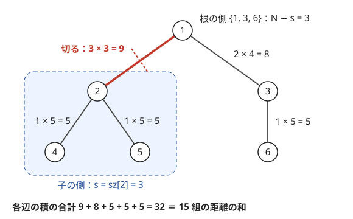

!!! abstract "要点"
    - **何ができるか**：木の全ペアのパスについての量の和を、各辺（頂点）が何組のパスに含まれるかで数え直して求める。辺で切った両側の頂点数が $s$ と $N - s$ なら、その辺を通る組は $s(N - s)$ 個である。
    - **いつ使うか**：
        - すべての $i < j$ について $f(i, j)$ の総和を求める。
        - 全ペアのパス上の最大値（最小値）の和を求める。
        - $N \le 2 \times 10^5$ の木で、全ペア（$N^2/2$ 組）についての和を求める。
    - **計算量**：部分木サイズを 1 回求めて $O(N)$。重みの順に辺を併合する型はソートが入って $O(N \log N)$
    - **前提**：[根付き木と走査順](../tree/tree-traversal.md)、[主客転倒・寄与](../thinking/contribution.md)

<!-- textlint-disable -->
別名：辺の寄与・木の主客転倒・全点対の距離の和・全ペアのパスの寄与・contribution of edges
<!-- textlint-enable -->

「辺で切って数える」は、木の上の「全ペアについての和」を、組の側からではなく辺（または頂点）の側から数える方法である。木では 2 頂点を結ぶパスが 1 本に決まり、辺を 1 本取り除くと必ず 2 つに分かれる。この 2 つの性質から、ある辺を通る組の数が両側の頂点数の積で決まる。[主客転倒](../thinking/contribution.md)を木の形に当てはめたものと言える。

## 辺を通るペアは s(N−s) 個 {#edge-pairs}

木のすべての頂点の組 $\{u, v\}$ について距離 $d(u, v)$ の総和を求めたいとする。組は $N(N - 1)/2$ 個あり、$N = 2 \times 10^5$ ならおよそ $2 \times 10^{10}$ 組になる。組ごとに距離を求めていては間に合わない。

そこで和の順序を入れ替える。距離はパス上の辺の本数なので、組ごとに「パス上の辺について 1 を足す」と書ける。足す順序を入れ替えると、辺ごとに「その辺を通る組の数」を足すことになる。

$$
\sum_{u < v} d(u, v) = \sum_{u < v} \sum_{e \in \text{パス}(u, v)} 1 = \sum_{e} (\text{辺 } e \text{ を通る組の数})
$$

辺 $e$ を通る組の数は次のように決まる。木から辺 $e$ を取り除くと、頂点はちょうど 2 つの側に分かれる（[辺を 1 本取り除くと 2 つの成分](../tree/tree-basics.md#remove-add-edge)）。$u$ と $v$ が同じ側にあれば、その側の中だけでパスができるので $e$ は通らない。違う側にあれば、2 つの側をつなぐ辺は $e$ しかないので必ず $e$ を通る。木のパスは 1 本に決まるので、ほかの道を通ることはない。片側の頂点数を $s$ とすると、$e$ を通る組は「片側から 1 つと反対側から 1 つ」を選ぶ組で、ちょうど $s(N - s)$ 個である。



図の木では、各辺の積の合計 $9 + 8 + 5 + 5 + 5 = 32$ が、15 組の距離をすべて足した値に等しい。組 $\{4, 6\}$ の距離 4 は、パス上の 4 本の辺 4−2・2−1・1−3・3−6 でそれぞれ 1 回ずつ数えられている。

根を決めると、$s$ は部分木サイズで求まる。頂点 $c$ とその親 $\mathrm{par}[c]$ を結ぶ辺を切ると、子の側はちょうど $c$ の部分木になるので $s = \mathrm{sz}[c]$ である。根以外の全頂点について $\mathrm{sz}[c](N - \mathrm{sz}[c])$ を足せばよい。部分木サイズは[根付き木と走査順](../tree/tree-traversal.md#parent-depth-size)の方法で求まり、全体の計算量は $O(N)$ である。

```cpp
--8<-- "tree-edge-contribution/distance-sum.cpp:core"
```

このコードは根から BFS した順を逆から読んで部分木サイズを確定させ、確定した瞬間にその頂点と親の間の辺の寄与を足している。再帰を使わないので、パス状の木でもスタックが溢れない（[再帰の深さ](../tree/tree-traversal.md#recursion-depth)）。

同じ数え方は、辺ごとに足せる量なら何にでも使える。

- **重み付きの距離**：辺の重みが $w_e$ なら $\sum_e w_e \, s(N - s)$ になる
- **順序付きの組・同じ頂点の組**：$(u, v)$ と $(v, u)$ を別に数えるなら 2 倍する。$u = v$ の組は距離 0 なので足しても変わらない

辺ごとに足せない量では、別の分け方をする。たとえばパスの XOR の和は、辺の寄与の和にはならない。XOR は bit ごとに分ければ「その bit が 1 になる組の数」の問題になる。木では根からの累積 XOR $S[v]$ を使うと、パスの XOR は $S[u] \oplus S[v]$ になる。そこで辺ではなく bit で分け、bit ごとに $S[v]$ の 0 と 1 の個数の積を足す（[bit ごとの寄与](../basics/bitwise-independence.md#per-bit-contribution)）。

辺の代わりに頂点で数えることもできる。頂点 $v$ を通る組 $\{u, w\}$（$u \ne w$。$v$ が端点の組を含む）を数える。全体の $\binom{N}{2}$ から、$v$ を取り除いてできる各成分の中で閉じた組を引けばよい。$v$ の各子 $c$ の部分木と、親の側（大きさ $N - \mathrm{sz}[v]$）を成分として、大きさを $b_1, b_2, \dots$ とすると $\binom{N}{2} - \sum_i \binom{b_i}{2}$ になる。

??? question "確認問題：星とパスの距離の和"
    $N$ 頂点の星（頂点 1 にほかのすべての頂点がつながった木）と、$N$ 頂点のパス（$1 - 2 - \cdots - N$）について、全ペアの距離の和を辺の寄与で求めよ。

    ??? success "答え"
        星はどの辺も葉 1 個と残り $N - 1$ 個に分けるので、$N - 1$ 本の辺がそれぞれ $1 \times (N - 1)$ を寄与し、和は $(N - 1)^2$ である。パスは辺 $(i, i + 1)$ が $i$ 個と $N - i$ 個に分けるので、和は $\sum_{i=1}^{N-1} i(N - i) = \frac{(N - 1)N(N + 1)}{6}$ になる。$N = 2 \times 10^5$ ではおよそ $1.3 \times 10^{15}$ で、`long long` が要る。

## 森の成分数 = 頂点数 − 辺数 に分けて数える {#forest-count}

木から頂点をいくつか選んで、両端とも選ばれた辺だけを残すと、[森](../guide/glossary.md#forest)（閉路のないグラフ）ができる。森では次の式が成り立つ（理由は[森の式](../tree/tree-basics.md#forest)）。

$$
(\text{連結成分の数}) = (\text{頂点数}) - (\text{辺数})
$$

この式を使うと、「たくさんの頂点集合について、それぞれの連結成分の数を足す」問題が、頂点の寄与から辺の寄与を引く問題になる。連結成分そのものは数えにくいが、頂点と辺はそれぞれ独立に「何個の集合に含まれるか」を数えればよい。

頂点の番号の区間 $[L, R]$（閉区間、1-indexed）を選ぶ場合で確かめる。頂点 $v$ を含む区間は $L \le v \le R$ を満たすもので $v(N - v + 1)$ 個ある。辺 $(u, v)$（$u < v$）の両端を含む区間は $L \le u$ かつ $v \le R$ を満たすもので $u(N - v + 1)$ 個ある。

| 区間 | 頂点 | 残る辺 | 成分 |
| --- | --- | --- | --- |
| $[1, 1]$・$[2, 2]$・$[3, 3]$ | 1 個ずつ | なし | 1 ずつ |
| $[1, 2]$ | 1・2 | なし | 2 |
| $[2, 3]$ | 2・3 | 2−3 | 1 |
| $[1, 3]$ | 1・2・3 | 1−3・2−3 | 1 |

表は辺が 1−3 と 3−2 の 3 頂点の木で、成分の合計は 7 である。式で数えると、頂点の寄与は $1 \cdot 3 + 2 \cdot 2 + 3 \cdot 1 = 10$ である。辺 $(1, 3)$ の寄与は $1 \cdot 1 = 1$、辺 $(2, 3)$ の寄与は $2 \cdot 1 = 2$ なので、$10 - 1 - 2 = 7$ と一致する。

この分け方は、選び方が区間でなくても使える。頂点をランダムに選ぶなら、成分の数の期待値は「各頂点が選ばれる確率の和 − 各辺の両端が選ばれる確率の和」になる。ただし、式が成り立つのは残るグラフが森のときだけである。一般のグラフから頂点を選ぶと閉路が残りうるので、この式は使えない。

## パス上の最大値の和（重みの小さい順に併合して数える型は Union-Find の応用へ） {#max-on-path}

「全ペアのパス上の辺の重みの最大値の和」は、距離と違って辺ごとに足せる量ではない。そこで、辺ごとに「この辺がパス上の最大になる組の数」を数え、重みを掛けて足す。各組に「最大の辺」をちょうど 1 本ずつ割り当てれば、数え漏れと重複は起きない。

最大になる組の数は、木全体を切った $s(N - s)$ ではない。まず辺の重みがすべて異なるとする。重み $w$ の辺 $e$ が最大になるのは、パスが $e$ を通り、ほかには $w$ より軽い辺しか通らない組である。$e$ を除いた、重みが $w$ 未満の辺だけを残した森を考える。$e$ の両端が属する成分の大きさを $a$ と $b$ とすると、その組の数は $a \times b$ になる。

同じ重みの辺があると、この数え方では 1 つの組を 2 本の辺で重ねて数えてしまう。そこで辺を重みの小さい順（同じ重みは決めた順）に並べ、$e$ より前の辺だけを残した森で $a$ と $b$ を数える。こうすると、最大の重みの辺が複数あるパスは、その中で最後に並ぶ辺にだけ割り当てられる。掛ける重みは同じなので答えは変わらない。

全部の辺について求めるには、辺をこの順に [Union-Find](../ds/union-find.md) で併合する。併合する直前の 2 つの成分のサイズの積に重みを掛けて足す。手順の正しさとコードは [Union-Find の応用の「併合の瞬間に寄与を数える」](../ds/union-find-applications.md#count-on-merge)で扱う。

- **最小値の和**：重みの大きい順に併合する
- **頂点の重みの最大値**：$u \ne v$ の組なら、辺 $(u, v)$ の重みを $\max(A_u, A_v)$ にすると辺の問題に直せる。パス上の頂点はどれかの辺の端点なので、頂点の最大と辺の重みの最大が一致する。$u = v$ の組も数えるなら $\sum_v A_v$ を足す

??? question "確認問題：なぜ重みの小さい順に併合するのか"
    パス上の最大値の和で、辺を重みの小さい順に併合し、併合の直前のサイズの積を数える。小さい順でなければならない理由を説明せよ。

    ??? success "答え"
        重み $w$ の辺を併合する直前、2 つの成分は $w$ 以下の辺だけでできている。だから、この辺で初めてつながる組のパスは、$w$ 以下の辺と、この辺だけを通る。パス上の最大はちょうど $w$ に決まる。順序を崩すと、成分の中に $w$ より重い辺が入り、その組の最大は $w$ ではなくなる。各組は初めてつながった瞬間に 1 回だけ数えられ、その後は同じ成分にいるので二度と数えられない。

## 期待値・特定の色を通らないパスへの応用 {#expectation}

この節は[期待値の線形性](../comb/linearity-of-expectation.md)と[指示確率変数](../comb/linearity-of-expectation.md#indicator)を前提にする。

**期待値は辺ごとの確率の和になる**。「ランダムに選んだ頂点を結ぶ最小の木の辺の数」の期待値は、各辺がその木に入る確率の和である。たとえば各頂点を独立に確率 $1/2$ で黒に塗り、黒い頂点をすべて含む最小の連結な部分（[指定頂点を結ぶ最小の部分木](../tree/steiner-subtree.md)。以下「黒を結ぶ木」と呼ぶ）を考える。辺 $e$ が黒を結ぶ木に入るのは、$e$ で切った両側にどちらも黒い頂点があるときに限る。片側の頂点数を $s$ とすると、その確率は次の式になる。

$$
P(e \text{ が入る}) = \left(1 - 2^{-s}\right)\left(1 - 2^{-(N - s)}\right)
$$

黒を結ぶ木の頂点数は、黒が 1 つ以上あれば辺数 $+ 1$ である。だから頂点数の期待値も、辺の確率の和から出せる（[力試しの ABC149 F](#challenge) の解き方の 1 つ）。頂点で数えるなら、頂点 $v$ が入るのは「$v$ が黒」か「$v$ を取り除いた成分のうち 2 つ以上に黒がある」ときで、成分の大きさ $b_1, b_2, \dots$ から確率が計算できる。全ペアの距離の和を $\binom{N}{2}$ で割れば、ランダムな 2 頂点の距離の期待値になる。

**特定の色を通らないパス**。各頂点に色があり、色 $c$ ごとに「色 $c$ の頂点を 1 つ以上通るパスの数」を求める型がある。余事象を取り、色 $c$ の頂点をすべて取り除いた森の各成分の大きさを $k$ とすると、色 $c$ を通らない組は各成分の中の組である。

$$
(\text{色 } c \text{ を通る組}) = \binom{N}{2} - \sum_{\text{成分}} \binom{k}{2}
$$

（$u = v$ の組も数えるなら $\binom{\cdot}{2}$ を $\frac{k(k+1)}{2}$ に変える。）全色についてこの成分の大きさを求めるには、DFS の間に色ごとの配列 $\mathrm{cut}[c]$ を持つ。$\mathrm{cut}[c]$ は、帰りがけを済ませた色 $c$ の頂点のうち、ほかの済んだ色 $c$ の頂点の下にないものについて、部分木の大きさを足した値である。色 $c$ の頂点 $v$ の子 $u$ の下にできる成分は、$u$ の部分木から、その中で最も浅い色 $c$ の頂点の部分木を除いたものになる。

```text
dfs(v):
    c = color[v]
    before = cut[c]
    for 子 u:
        x = cut[c]
        dfs(u)
        k = sz[u] - (cut[c] - x)    // v の真下、u 側の成分の大きさ
        色 c の成分として k を記録する
    cut[c] = before + sz[v]          // v より下の色 c の頂点は v の部分木にまとめて含まれる
最後に、色 c ごとに根の側の成分 N - cut[c] を記録する
```

各頂点で子の数だけ処理するので、部分木サイズを先に求めておけば全体で $O(N)$ である。DFS を再帰で書くなら、パス状の木で深くなることに注意する。距離ごと・色の組ごとに数えるなど、辺の寄与だけで分けられない数え上げは[重心分解](../tree/centroid-decomposition.md#count-through)や[マージテク](../tree/small-to-large.md)の出番になる。

## 落とし穴 {#pitfalls}

**s(N−s) を int で計算する**。$N = 2 \times 10^5$ なら $s(N - s)$ は最大 $10^{10}$ で、`int` に収まらない。`int` どうしの積は掛けた時点であふれるので、和の変数だけを `long long` にしても間に合わない。部分木サイズを `long long` で持つか、`(long long)sz[c] * (n - sz[c])` と片方を広げてから掛ける。重みが $10^9$ まであると和は `long long` も超えうるので、問題が mod を指定していれば各項で余りを取る。

**子の側の大きさを取り違える**。辺 $(\mathrm{par}[c], c)$ の片側は $\mathrm{sz}[c]$ で、$\mathrm{sz}[\mathrm{par}[c]]$ ではない。入力の辺 $(a, b)$ のまま数えるときは、どちらが子かを $\mathrm{par}$ で判定するか、$\min(\mathrm{sz}[a], \mathrm{sz}[b])$ を使う。子の部分木は親の部分木に真に含まれるので、小さい方が子の側である。

**組の数え方が問題と合わない**。$i < j$ の組か、順序付きの組か、$i = j$ を含むかで、答えが 2 倍や $+ N$ だけずれる。2 頂点の木で手計算し、1 本の辺の寄与が 1 になるか（順序付きなら 2）を確かめる。

**併合した後のサイズで数える**。パス上の最大値の和で、`merge` の後に `size` を呼ぶと、併合後の成分のサイズになって積が合わない。積は併合の前に計算する。

**森でないのに成分数の式を使う**。「成分数 = 頂点数 − 辺数」は閉路がないときだけ成り立つ。木から頂点を選ぶ場合は常に森だが、元のグラフに閉路があれば使えない。

## 使い分け {#comparison}

- **総和だけ**を求めるなら、辺の寄与で $O(N)$ で済む。**各頂点からほかの全頂点への距離の和**のように頂点ごとの値が要るなら、根を隣へ移したときの差分を使う（[根を動かした差分](../dp/tree-dp.md#reroot-difference)・[全方位木 DP](../dp/rerooting.md#when-to-use)）
- パス上の量が辺ごとに足せないとき（最大値・最小値）は、辺を重みの順に足して併合の瞬間に数える（[パス上の最大値の和](#max-on-path)）
- 距離がちょうど $K$ の組の数や、色ごとの距離の和のように、組を性質で分けて数えるなら[重心分解](../tree/centroid-decomposition.md#count-through)・[マージテク](../tree/small-to-large.md)を使う
- 木でないグラフでは 2 頂点を結ぶパスが 1 本に決まらない。そのため、この数え方はそのままでは使えない

## 例題 {#examples}

### 典型90 039. Tree Distance（★5） {#typical90_am}

<div class="kp-problems" data-role="example" markdown>

- [典型90 039. Tree Distance（★5）](https://atcoder.jp/contests/typical90/tasks/typical90_am)（diff —）：木のすべての頂点の組について、距離を足し合わせた値を求める

</div>

組ごとに距離を求めると $O(N^2)$ 組を調べることになる。距離をパス上の辺の数と見て、辺ごとに「その辺を通る組の数」を足す。辺で切った両側の頂点数が $s$ と $N - s$ なら、その辺を通る組は $s(N - s)$ 個である。

??? note "解法の詳細"
    - 頂点 1 を根にして、各頂点の部分木サイズ $\mathrm{sz}[v]$ を求める。
    - 根以外の各頂点 $c$ について、親との間の辺の寄与 $\mathrm{sz}[c](N - \mathrm{sz}[c])$ を足す。入力の辺のまま数えるなら、両端の部分木サイズの小さい方が子の側である。
    - 答えはパスの木でおよそ $1.3 \times 10^{15}$ になるので `long long` で持つ。全体で $O(N)$。
    - コードは[辺を通るペアは s(N−s) 個](#edge-pairs)の節のものと同じ形である。

## 練習問題 {#practice}

<div class="kp-problems" data-role="practice" markdown>

- [ABC214 D. Sum of Maximum Weights](https://atcoder.jp/contests/abc214/tasks/abc214_d)（diff 1341）：重み付きの木の全頂点対について、パス上の最大の辺の重みの総和を求める。
- [ABC173 F. Intervals on Tree](https://atcoder.jp/contests/abc173/tasks/abc173_f)（diff 1892）：木の頂点の区間 [L, R] ごとに、その頂点だけで作る森の連結成分の数を求め、すべての区間について足し合わせる

</div>

??? note "練習の方針"
    - **ABC214 D**：辺を重みの小さい順に Union-Find で併合し、併合の直前に「重み × 両側の成分のサイズの積」を足す（[パス上の最大値の和](#max-on-path)）
    - **ABC173 F**：成分の数を「頂点数 − 辺数」に分ける。頂点 $v$ を含む区間は $v(N - v + 1)$ 個ある。辺 $(u, v)$（$u < v$）の両端を含む区間は $u(N - v + 1)$ 個ある。頂点の和から辺の和を引く（[森の成分数](#forest-count)）

## 力試し {#challenge}

<div class="kp-problems" data-role="challenge" markdown>

- [ABC149 F. Surrounded Nodes](https://atcoder.jp/contests/abc149/tasks/abc149_f)（diff 2208）：木の各頂点を確率 1/2 で黒に塗り、黒い頂点をすべて含む最小の部分木に含まれる白い頂点の数の期待値を求める。

</div>

??? note "力試しの方針"
    - **ABC149 F**：期待値の線形性で、頂点ごとに「白で、かつ黒を結ぶ木に入る」確率を足す。頂点 $v$ を取り除いてできる成分（子の部分木と親の側）の大きさを $b_1, b_2, \dots$ とする。白い $v$ が入るのは、黒を含む成分が 2 つ以上あるときである。黒を含む成分が 0 個の確率は $2^{-(N-1)}$、ちょうど 1 個の確率は $\sum_i (1 - 2^{-b_i}) 2^{-(N - 1 - b_i)}$ である。これらを 1 から引き、$v$ が白である確率 $1/2$ を掛ける。別解：辺が入る確率 $(1 - 2^{-s})(1 - 2^{-(N-s)})$ の和に、黒が 1 つ以上ある確率 $1 - 2^{-N}$ を足すと、黒を結ぶ木の頂点数の期待値になる。そこから黒い頂点の数の期待値 $N/2$ を引いてもよい（[期待値への応用](#expectation)）

## 参考 {#references}

- [E869120「競プロ典型 90 問 039 の解答例（kyopro_educational_90）」](https://github.com/E869120/kyopro_educational_90/blob/main/sol/039.cpp)：例題の方針（部分木サイズの小さい方で s(N−s) を数える）
- [hamayan「Sum of Maximum Weights [AtCoder Beginner Contest 214 D]」](https://blog.hamayanhamayan.com/entry/2021/08/15/034729)：練習の方針（重みの小さい順の併合と、併合時の積）
- [hamayan「Intervals on Tree [AtCoder Beginner Contest 173 F]」](https://blog.hamayanhamayan.com/entry/2020/07/05/235609)：森の成分数を頂点数 − 辺数に分ける考え方と、頂点・辺を含む区間の数
- [kmjp「AtCoder ABC #149 : F - Surrounded Nodes」](https://kmjp.hatenablog.jp/entry/2019/12/30/0930)：力試しの方針（頂点を取り除いた各方向の大きさから確率を求める）
- [hamayan「Xor Distances [マイナビプログラミングコンテスト2021（AtCoder Beginner Contest 201） E]」](https://blog.hamayanhamayan.com/entry/2021/05/15/235842)：XOR の和を bit ごとに分け、根からの累積 XOR の 0 と 1 の個数の積で数える型
- [kmjp「AtCoder ABC #163 : F - path pass i」](https://kmjp.hatenablog.jp/entry/2020/04/20/0930)：色ごとに、その色の頂点を通るパスを数える型（節の DFS の方法はこのページで別に組み立てたもの）
