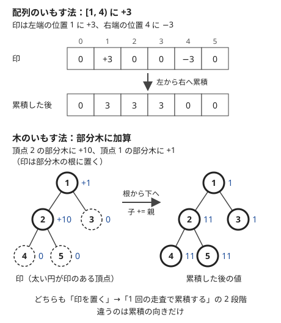

!!! abstract "要点"
    - **何ができるか**：部分木への加算をまとめて受けてから値を出力するなら、部分木の根に印を置いて根から下へ累積する。パスへの加算は端点と LCA に印を置いて葉から上へ累積し、途中で値を聞かれるならオイラーツアーを使う。
    - **いつ使うか**：
        - 部分木の全頂点に $x$ を加算するクエリがたくさん来て、最後に全頂点の値を出力する。
        - 辺のどちら側かの頂点すべてに加算する。
        - 多数のパスに沿って $+1$ し、各辺・各頂点を通った回数を求める。
    - **計算量**：部分木・辺の片側への加算は $O(N + Q)$。パスへの加算は LCA の計算が加わり、ダブリングなら前計算 $O(N \log N)$・1 本 $O(\log N)$。
    - **前提**：[根付き木と走査順](../tree/tree-traversal.md)、[いもす法](../basics/imos.md)

<!-- textlint-disable -->
別名：木上のいもす法・部分木加算・パス加算・木上の累積和・prefix sums on a tree
<!-- textlint-enable -->

木の上のいもす法は、加算のクエリを「印」として 1 頂点か数頂点に置くだけにしておき、最後に木を 1 回走査して印を累積し、全頂点の値を一度に求める方法である。配列の[いもす法](../basics/imos.md)の「左から右へ累積」を、木では「根から葉へ」か「葉から根へ」に置き換える。どちらの向きで累積するかは、加算する範囲が部分木かパスかで決まる。

このページの実装は 0-indexed で、頂点 $0$（問題文の頂点 1）を根にする。走査は BFS 順を使い、前から読めば親が子より先、逆から読めば子が親より先になる（[BFS 順の逆で集約する](../tree/tree-traversal.md#bfs-order)）。

## 部分木への加算（根から下へ累積する） {#subtree-add}

「$p$ の部分木の全頂点に $x$ を足す」クエリが $Q$ 個来て、最後に全頂点の値を答える。毎回部分木をたどると 1 回 $O(N)$、全体で $O(NQ)$ になり、$N, Q \le 2 \times 10^5$ では間に合わない。

そこで各クエリでは $\mathrm{mark}[p] \mathrel{+}= x$ とするだけにする。すべてのクエリの後で、根から下へ $\mathrm{mark}[v] \mathrel{+}= \mathrm{mark}[\mathrm{par}[v]]$ と累積する。累積の後の $\mathrm{mark}[v]$ は、根から $v$ までのパス上にある頂点の印の和になる。

$$
\mathrm{val}[v] = \sum_{u \text{ は } v \text{ の祖先（} v \text{ 自身を含む）}} \mathrm{mark}[u]
$$

$p$ の印 $x$ が $v$ まで届くのは、$p$ が $v$ の祖先のとき、すなわち $v$ が $p$ の部分木にあるときだけである。だから累積した値は、部分木への加算をすべて行った結果に等しい。



配列のいもす法では区間の右端に $-x$ を置いて打ち消したが、部分木への加算では打ち消しの印が要らない。部分木は「$p$ から下すべて」で、下側に終わりがないからである。配列でいえば「$[l, N)$ に加算」と同じ形である。

コードでは、親が子より前に並ぶ BFS 順を前から読めば、親の値が確定してから子に足せる（次の節のクエリ 2 も含む）。

```cpp
--8<-- "tree-imos/subtree-add.cpp:core"
```

## 辺の片側への加算を子の部分木への加算に直す {#edge-side}

「辺 $(a, b)$ を切ったとき、$a$ の側に残る頂点すべてに $x$ を足す」形は、根を決めると部分木への加算に直せる。辺 $(a, b)$ を取り除くと、木は子の側の部分木と残りの 2 つに分かれる（[辺を 1 本取り除くと 2 つの成分](../tree/tree-basics.md#remove-add-edge)）。

- **$a$ が子（$\mathrm{par}[a] = b$）**：$a$ の側は $a$ の部分木そのものなので、$\mathrm{mark}[a] \mathrel{+}= x$
- **$b$ が子（$\mathrm{par}[b] = a$）**：$a$ の側は $b$ の部分木の補集合である。全体に $x$ を足してから $b$ の部分木で $x$ を引けばよいので、$\mathrm{mark}[\mathrm{root}] \mathrel{+}= x$、$\mathrm{mark}[b] \mathrel{-}= x$

補集合への加算は「全体に足して部分木から引く」に直すのが要点である。こうすれば、どのクエリも部分木への加算の組になり、前の節の累積 1 回で済む。全体への加算は根の印に足せばよく、別の変数で持って最後に足してもよい。

どちらが子かは、根を決めて BFS か DFS で $\mathrm{par}$ を求めてから、$\mathrm{par}[a] = b$ かどうかで判定する。深さを持っているなら $\mathrm{dep}[a] > \mathrm{dep}[b]$ でもよい。入力の辺の向き（$a_i$ と $b_i$ の順）は親子と関係がない。

## 根から y 世代までに及ぶ値を伝える {#depth-limited}

「頂点 $u$ から $y$ 世代下までの子孫すべてに効果が及ぶ。効果を受けた頂点はいくつか」という形では、累積の演算を和から最大値に替える。各頂点に「あと何世代まで効果が及ぶか」$r[v]$ を持たせ、根から下へ次のように決める。

$$
r[v] = \max\left(r[\mathrm{par}[v]] - 1,\ y_v\right)
$$

ここで $y_v$ は $v$ を起点とするクエリの $y$ の最大で、$v$ を起点とするクエリがなければ $-1$ とする（根の $r[\mathrm{par}]$ も $-1$ と見なす）。$r[v] \ge 0$ の頂点が効果を受けた頂点である。$p_i < i$ の形で木が与えられれば、BFS 順の代わりに番号の順（親から子へ）で読めばよい（[p_i < i の木](../tree/tree-traversal.md#parent-index)）。

この式で正しいのは、祖先 $u$ の効果が $v$ に届く条件が $y_u - (\mathrm{dep}[v] - \mathrm{dep}[u]) \ge 0$ だからである。1 世代下るごとに左辺は 1 ずつ減るので、祖先ごとの残りの最大を親から受け継いで 1 引けば、$r[v]$ は全祖先についての残りの最大になる。和のときと同じく「親から受け継いで自分の印を合わせる」形で、合わせ方が $+$ から $\max$ に変わっただけである。

$\max$ には打ち消しの $-x$ がないので、この形で答えられるのは「1 つでも届くか」「届く中で最大の値は何か」までである。「何個のクエリが届くか」を数えるなら、根からのパス上の「届く深さ $\mathrm{dep}[u] + y_u$」をデータ構造に入れながら DFS する（[根からのパスを DFS で持ち回る](../tree/root-path-dfs.md#path-statistics)）。

## 途中で値を聞かれるならオイラーツアーと BIT {#online-queries}

木の上のいもす法は、すべての加算を受けてから最後に 1 回累積する[オフライン](../guide/glossary.md#offline)の方法である。加算と「頂点 $v$ の今の値は？」が交互に来るなら、毎回累積し直すと $O(NQ)$ になる。この場合は部分木を行きがけ順の区間 $[\mathrm{in}[v], \mathrm{out}[v])$ に直す（[オイラーツアー](../tree/euler-tour.md#in-out)）。

- **部分木への加算・一点の取得**：区間加算と一点の取得なので、差分の BIT（[BIT の変種](../ds/fenwick-tree.md#variants)）で $\mathrm{in}[p]$ に $+x$、$\mathrm{out}[p]$ に $-x$ を足し、$v$ の値は位置 $\mathrm{in}[v]$ までの和で求める。どちらも $O(\log N)$。位置 $\mathrm{in}[v]$ までの和は、$v$ の祖先（根から $v$ までのパス）に置いた印の和である。$\mathrm{out}[p] = N$ のときは $-x$ を置かないか、BIT の長さを $N + 1$ にする
- **部分木への加算・部分木の和**：区間加算と区間の和なので、遅延セグメント木か BIT 2 本を使う

パスへの加算と一点の取得が交互に来る形は、LCA を使うので[パスへの加算](#path-add)の節の末尾で扱う。

パスの最大値は引き算で打ち消せない。パスへの加算とパスの和が交互に来る形も、このページの印だけでは扱えない。どちらも [HL 分解](../tree/hld.md)に進む。

## パスへの加算（LCA に印を置いて葉から上へ累積する） {#path-add}

この節は [LCA](../tree/lca.md) を前提にする。「$u$ と $v$ を結ぶパス上の全頂点に $x$ を足す」クエリを、4 か所の印に直す。$l = \mathrm{lca}(u, v)$ とする。

- **頂点に足す**：$u$ と $v$ に $+x$、$l$ に $-x$、$\mathrm{par}[l]$ に $-x$（$l$ が根なら $\mathrm{par}[l]$ の印は置かない）
- **辺に足す**（辺の値は子の頂点に置く。[辺の値を子の頂点に寄せる](../tree/tree-basics.md#edge-to-child)）：$u$ と $v$ に $+x$、$l$ に $-2x$

すべての印を置いたら、葉から上へ $\mathrm{val}[\mathrm{par}[w]] \mathrel{+}= \mathrm{val}[w]$ と累積する。累積の後の $\mathrm{val}[w]$ は、$w$ の部分木にある印の和である。

なぜこれで正しいかは、1 本のパスの印が各頂点 $w$ にいくつ届くかで確かめる。$w$ の部分木にある印だけが $w$ に届く。

| $w$ の位置 | 部分木に入る印 | 頂点版の和 | 辺版の和 |
| --- | --- | --- | --- |
| $u$ から $l$ の手前まで | $u$ | $x$ | $x$ |
| $l$ | $u, v, l$ | $x + x - x = x$ | $x + x - 2x = 0$ |
| $l$ より上（$\mathrm{par}[l]$ と祖先） | $u, v, l, \mathrm{par}[l]$ | $0$ | $0$ |
| パスから外れた頂点 | なし | $0$ | $0$ |

$v$ の側も同じである。頂点版では $l$ がパスに含まれるので、$l$ には $x$ が残り、その上で 0 に戻す必要がある。そのため $l$ で 1 回、$\mathrm{par}[l]$ でもう 1 回打ち消す。辺版では $l$ に置いた値は辺 $(\mathrm{par}[l], l)$ を表し、この辺はパスに含まれないので、$l$ で 2 回分を一度に打ち消す。

部分木への加算とは累積の向きが逆である。部分木への加算は「祖先の印の和」なので根から下へ、パスへの加算は「子孫の印の和」なので葉から上へ累積する。コードでは BFS 順を逆から読む。

```cpp
--8<-- "tree-imos/path-add.cpp:core"
```

計算量は、LCA をダブリングで求めるなら前計算 $O(N \log N)$、クエリ 1 本 $O(\log N)$、累積 $O(N)$ である。「決まった順に頂点を訪ねる移動で各辺を何回通るか」は、移動 1 回をパスへの $+1$ と見れば辺版で数えられる（練習の [ABC222 E](#practice)）。

途中で一点の値を聞かれるなら、この 4 つ（$l$ が根なら 3 つ）の印を $\mathrm{in}[\cdot]$ の位置への一点加算として BIT に置き、$v$ の値を区間 $[\mathrm{in}[v], \mathrm{out}[v])$ の和で読む。累積の後の値が「$v$ の部分木にある印の和」だったので、葉から上への累積を部分木の和のクエリに置き換えたことになる。どちらも $O(\log N)$ である（LCA は別）。累積の向きと、途中で値を聞くときのクエリの種類は対応している。下へ累積する形（部分木への加算）は「根からのパスの和」、上へ累積する形（パスへの加算）は「部分木の和」で値を読む。

## 落とし穴 {#pitfalls}

**累積の向きを取り違える**。部分木への加算は根から下へ（BFS 順を前から）、パスへの加算は葉から上へ（BFS 順を逆から）である。たとえば部分木への加算の印を葉から上へ累積すると、印 $p$ は $p$ の部分木ではなく根から $p$ までのパスに届いてしまう（逆も同じ）。印の和が「祖先の印」か「子孫の印」かを考えれば、向きは決まる。

**頂点版と辺版の印を混ぜる**。頂点版は $l$ と $\mathrm{par}[l]$ に $-x$ ずつ、辺版は $l$ に $-2x$ である。頂点版で $\mathrm{par}[l]$ を忘れると、$l$ より上の祖先すべてに $x$ が残る。$l$ が根なら $\mathrm{par}[l] = -1$ なので、そのまま書き込むと範囲外になる。根の場合は印を置かない。

**辺の両端のどちらが子かを決めつける**。辺の片側への加算で、入力の $a_i$ を親だと思い込むと、半分のクエリで部分木と補集合が入れ替わる。$\mathrm{par}$ か $\mathrm{dep}$ で判定する。

**同じ頂点に何度も足すことを忘れる**。印は上書きではなく加算である（`mark[p] = x` ではなく `mark[p] += x`）。値は最大で $Q \times \max x$ になるので、$Q = 2 \times 10^5$・$x = 10^9$ なら `long long` が要る。

**再帰で累積する**。パス状の木では再帰の DFS が深くなり、手元でスタックがあふれることがある。BFS 順を作ってループで累積すれば起きない（[再帰の深さ](../tree/tree-traversal.md#recursion-depth)）。

## 例題 {#examples}

### ABC187 E. Through Path {#abc187_e}

<div class="kp-problems" data-role="example" markdown>

- [ABC187 E. Through Path](https://atcoder.jp/contests/abc187/tasks/abc187_e)（diff 1358）：木の辺 i = (a_i, b_i) について「a_i から b_i を通らずに行ける頂点すべてに x を足す」型のクエリを処理した後の、各頂点の値を求める

</div>

「$a_i$ から $b_i$ を通らずに行ける頂点」は、辺 $(a_i, b_i)$ を切ったときの $a_i$ の側である。根を決め、[辺の片側への加算](#edge-side)の 2 つの場合に分けて部分木の印に直し、最後に根から下へ累積する。

??? note "解法の詳細"
    頂点 $0$ を根にして BFS で $\mathrm{par}$ と BFS 順を求める。$b_i$ の側に足すクエリは、$a_i$ と $b_i$ を入れ替えれば $a_i$ の側に足すクエリと同じになる。

    $a$ の側に $x$ を足すとき、$\mathrm{par}[a] = b$ なら $\mathrm{mark}[a] \mathrel{+}= x$、そうでなければ（$\mathrm{par}[b] = a$）$\mathrm{mark}[0] \mathrel{+}= x$・$\mathrm{mark}[b] \mathrel{-}= x$ とする。すべてのクエリの後で BFS 順に $\mathrm{mark}[v] \mathrel{+}= \mathrm{mark}[\mathrm{par}[v]]$ とすれば、$\mathrm{mark}[v]$ が答えになる。計算量は $O(N + Q)$ で、値は `long long` で持つ。[部分木への加算](#subtree-add)のコードがそのままこの形である。

## 練習問題 {#practice}

<div class="kp-problems" data-role="practice" markdown>

- [ABC222 E. Red and Blue Tree](https://atcoder.jp/contests/abc222/tasks/abc222_e)（diff 1491）：木の上を決まった順に移動するとき、辺を赤と青に塗り分けて、赤の辺を通った回数と青の辺を通った回数の差がちょうど K になる塗り方の数を求める

</div>

??? note "練習の方針"
    - **ABC222 E**：まず各辺を通る回数 $D_i$ を求める。移動 1 回をパスへの $+1$ と見て、[パスへの加算](#path-add)の辺版で数えられる。この問題は $N$ と移動回数が小さいので、移動ごとにパスをたどって数えても間に合う。$D_i$ が決まれば、辺 $i$ を赤にすると差に $+D_i$、青にすると $-D_i$ が加わるので、和が $K$ になる選び方を[部分和](../dp/subset-sum.md)の DP で数える。差は負にもなるので、添字をずらして持つ

## 確認問題 {#quiz}

??? question "確認問題：lca の親にも −x を置く理由"
    頂点版のパスへの加算で、$l = \mathrm{lca}(u, v)$ に $-x$ を置くだけで $\mathrm{par}[l]$ に印を置かないと、どの頂点の値が誤るか。

    ??? success "答え"
        $l$ より上の祖先すべてで、値が $x$ だけ大きくなる。祖先の部分木には $u, v, l$ の印が入り、和は $x + x - x = x$ になるからである。$\mathrm{par}[l]$ に $-x$ を置けば、そこから上は 0 に戻る。$l$ 自身はパスに含まれるので、$l$ の値は $x$ のままでよい。

??? question "確認問題：辺版で par[l] に印を置かない理由"
    辺版のパスへの加算では $l$ に $-2x$ を置き、$\mathrm{par}[l]$ には何も置かない。これで $l$ より上の辺が 0 になるのはなぜか。

    ??? success "答え"
        辺版では頂点 $w$ の値が辺 $(\mathrm{par}[w], w)$ を表す。$l$ の部分木には $u, v, l$ の印が入り、和は $x + x - 2x = 0$ なので、辺 $(\mathrm{par}[l], l)$ は 0 になる。$l$ より上の頂点の部分木にも同じ 3 つの印しか入らないので、そこから上もすべて 0 である。

??? question "確認問題：途中で値を聞かれる"
    部分木への加算と「頂点 $v$ の今の値は？」が交互に $Q$ 回来る。このページの累積をクエリごとにやり直すと何が困るか。どう直せばよいか。

    ??? success "答え"
        累積 1 回が $O(N)$ なので、全体で $O(NQ)$ になる。部分木を行きがけ順の区間 $[\mathrm{in}[p], \mathrm{out}[p])$ に直し、差分の BIT で $\mathrm{in}[p]$ に $+x$、$\mathrm{out}[p]$ に $-x$ を足す。$v$ の値は位置 $\mathrm{in}[v]$ までの和で、どちらも $O(\log N)$ になる（[途中で値を聞かれるなら](#online-queries)）。

## 使い分け {#comparison}

| 加算の範囲 | 値を聞く時機 | 使うもの |
| --- | --- | --- |
| 部分木・辺の片側 | 最後に 1 回 | このページ（根から下へ累積） |
| パス（和・回数） | 最後に 1 回 | このページ（LCA に印、葉から上へ累積） |
| 部分木 | 途中で何度も | [オイラーツアー](../tree/euler-tour.md)と BIT・遅延セグメント木 |
| パス | 途中で何度も（一点の値） | [パスへの加算](#path-add)の印を BIT に置き、部分木の和で読む |
| パス | 途中で何度も（パスの最大値・パスの和） | [HL 分解](../tree/hld.md) |

## 参考 {#references}

- [drken「AtCoder ABC 187 E - Through Path (水色, 500 点)」](https://drken1215.hatenablog.com/entry/2021/01/03/162800)：辺の片側への加算を、部分木への加算と「全体に足して部分木から引く」に直す方針
- [drken「AtCoder ABC 138 D - Ki (緑色, 400 点)」](https://drken1215.hatenablog.com/entry/2020/05/18/174000)：部分木の根に印を置き、根から下へ累積する基本形
- [hamayan「ABC222 E - Red and Blue Tree」](https://blog.hamayanhamayan.com/entry/2021/10/10/142820)：各辺を通る回数を先に数えて部分和 DP に直す方針と、制約が小さいので素朴に数えてよいこと
