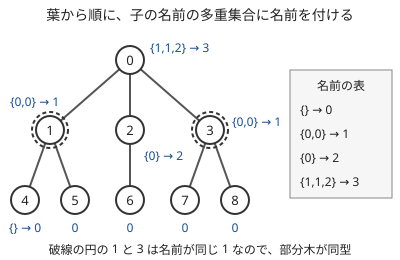

!!! abstract "要点"
    - **何ができるか**：根付き木の同型は、葉から順に「子の部分木の名前の多重集合」に名前を付ける AHU 法か、多重集合のハッシュで判定する。根のない木は中心（1〜2 個）を根にして比べる。
    - **いつ使うか**：
        - 形が同じ部分木の種類数
        - 2 つの木が同じ形か（根あり・根なし）
    - **計算量**：AHU 法は子の名前を整列して $O(N \log N)$（深さごとの基数ソートなら $O(N)$）。木のハッシュは値の計算が $O(N)$（種類数を数えるなら整列の $O(N \log N)$ か期待 $O(N)$ の unordered_set が加わる）で、誤る確率は 1 組あたり $N / (2^{61} - 1)$ 以下。根のない木は中心を求める $O(N)$ が加わる
    - **前提**：[木の直径と最遠点](../tree/tree-diameter.md)

<!-- textlint-disable -->
別名：木の同型・木のハッシュ・AHU・rooted tree hash・tree isomorphism
<!-- textlint-enable -->

木の[同型](../guide/glossary.md#graph-isomorphism)判定は、頂点の番号を付け替えれば 2 つの木が一致するかを調べる方法である。根付き木では根どうしを対応させ、子の並び順は区別しない。一般のグラフの同型を多項式時間で判定する方法は知られていないが（小さいグラフなら[頂点の対応の全探索](../graph/small-graph-brute-force.md#isomorphism)）、木なら部分木の形に葉から順に名前を付けていくだけで速く判定できる。ABC で本質的に使う問題は見つかっておらず、練習は Library Checker と CSES で行う。

問題のサインは「形が同じ部分木は何種類あるか」「2 つの木は同じ形か」「部分木を形で分類して数える」である。根付き木なら [AHU 法](#ahu)か[木のハッシュ](#tree-hash)をそのまま使い、根のない木なら[中心を根にして](#unrooted)根付き木の問題に直す。

## AHU 法（子の名前の多重集合に名前を付ける） {#ahu}

AHU 法（Aho・Hopcroft・Ullman による）は、各頂点 $v$ の部分木に整数の「名前」を付け、形が同じ部分木にだけ同じ名前が付くようにする方法である。名前は葉から根へ向かって次の規則で決める。

1. 子の名前を集めた[多重集合](../guide/glossary.md#multiset)を作る。葉では空の多重集合になる。
2. その多重集合をこれまでに見たことがあれば、そのときの名前を使う。初めてなら新しい番号を名前にする。

子の並び順は同型かどうかに関係しないので、多重集合として扱う。実装では子の名前を整列した列にすれば、同じ多重集合はいつも同じ列になる。2 つの根付き木を比べるときは名前の表を共有し、根の名前が等しいかを見る。

次の図は、頂点 0 を根とする 9 頂点の木に名前を付けた結果である。名前はコード片と同じく番号の大きい頂点から付け、新しい多重集合へは、表へ入った順で 0, 1, 2, … を振った。名前の値そのものに意味はなく、等しいかどうかだけが意味を持つ。葉の名前はどれも空の多重集合の名前 0 になる。頂点 1 と 3 はどちらも子の名前が $\{0, 0\}$ なので、同じ名前 1 が付き、部分木が同型だと分かる。



**なぜ正しいか**。部分木の高さについての帰納法で示す。根付き木 $S$ と $T$ が同型であることは、「$S$ の根の子の部分木たち」と「$T$ の根の子の部分木たち」を、同型なものどうしで 1 対 1 に組めることと同じである。帰納法の仮定から、子の部分木が同型であることは名前が等しいことと同じなので、これは子の名前の多重集合が等しいことと同じになる。名前の表は多重集合と名前を 1 対 1 に対応させるので、$S$ と $T$ の名前が等しいことと同型であることが一致する。

**計算量**。子の名前の列の長さの合計は辺の数 $N - 1$ である。各列を整列し、`map` で名前を引けば全体で $O(N \log N)$ になる。名前の代わりに部分木を表す文字列（括弧の列など）を連結していくと、一直線の木で列の長さの合計が $O(N^2)$ になるので、必ず整数の名前に置き換える。元の AHU 法は深さごとに頂点を処理し、その深さの列を基数ソートで整列して名前を振り直すことで $O(N)$ にしている。$N = 5 \times 10^5$ 程度までなら、整列と `map` の $O(N \log N)$ で足りる。

**自作するときの要点**。子を親より先に処理する順で回す。親の番号が自分より小さく与えられるなら、番号の大きい順に回せばよい（[親の番号が自分より小さいとき](../tree/tree-traversal.md#parent-index)）。一般の木では BFS の順の逆で回せば、再帰を使わずに済む（[BFS 順の逆で集約する](../tree/tree-traversal.md#bfs-order)）。次のコード片は Library Checker の Rooted Tree Isomorphism Classification と同じ入出力で、各頂点の部分木の名前と、名前の種類数を求める。

```cpp
--8<-- "tree-isomorphism/ahu.cpp:core"
```

完全なプログラム：[`ahu.cpp`](https://github.com/yuukougun/kyopro-atlas/blob/main/snippets/tree-isomorphism/ahu.cpp)（GitHub）
{ .kp-code-src }

名前の種類数 `dict.size()` が「形が違う部分木の種類数」で、頂点 $u$ と $v$ の部分木が同型かは `name[u] == name[v]` で判定できる。

## 木のハッシュと衝突しにくい設計 {#tree-hash}

木のハッシュは、名前の表を引く代わりに、子のハッシュの多重集合から計算式で値を作る方法である。2 つの木を比べるだけなら $O(N)$ で済み、名前の表を共有しにくい場面（別々に計算した木を後で比べる、部分木の値を更新する（[Static Top Tree](../tree/static-top-tree.md)）など）でも使える。その代わり、形の違う木に同じ値が付く（[衝突する](../guide/glossary.md#hash-collision)）確率が 0 ではない。

式の作り方を誤ると、衝突させるのはやさしい。たとえば「子のハッシュの和 + 1」では、和が等しい別の多重集合が同じ値になる（[確認問題](#quiz)。多重集合のハッシュで値をそのまま足すと衝突する理由は[値ごとに乱数を割り当てる理由](../string/hashing-for-sets.md#random-values)と同じ）。子のハッシュを整列して固定の基数の多項式で混ぜる形も、基数と法が実行前に分かっていれば衝突する組を作られうる。

よく使われる設計は次の形である。頂点 $v$ の高さ（$v$ から最も深い葉までの辺の数）を $h(v)$ とし、高さごとに乱数 $x_0, x_1, \dots$ を実行時に選ぶ。法 $p = 2^{61} - 1$ で

$$
H(v) = \prod_{c \text{ は } v \text{ の子}} \bigl(x_{h(v)} + H(c)\bigr) \bmod p
$$

とする。葉は空の積で $H = 1$ である。子の並び順を変えても積は変わらないので、同型な木には同じ値が付く。

??? note "形の違う木に違う値が付く理由と、誤る確率"
    $x_0, x_1, \dots$ を変数とみると、$H(v)$ は、係数を $p$ で割った余りとして扱う多項式（法 $p$ の多項式）である。高さ $h \ge 1$ の頂点の多項式は $x_h$ を含み（葉は定数 1）、$x_{h+1}$ 以降を含まない。子の多項式は $x_{h-1}$ までしか含まないので、$H(v)$ を $x_h$ の多項式とみると、根が $-H(c)$（$c$ は子）の 1 次式の積になる。法 $p$ の多項式も、$x_h$ について先頭の係数が 1 の 1 次式の積への分け方は 1 通りなので、高さが等しい 2 つの頂点の多項式が等しいことは、子の多項式の多重集合が等しいことと同じになる。高さが違えば含む変数の最大の添字が違うので、多項式は等しくない。よって高さについての帰納法で、形の違う木の多項式は違う。

    多項式の次数は部分木の頂点数から 1 を引いた値以下である。Schwartz-Zippel の補題から、法 $p$ で違う多項式の差に乱数を代入して $\bmod p$ で 0 になる確率は、次数を $p$ で割った値以下である。だから 1 組の木を比べて誤る確率は $N / p$ 以下で、$N = 10^5$ なら $5 \times 10^{-14}$ 程度である。

誤る確率は比べる組の数に比例する（[組の数で見積もる](../string/hash-safety.md#birthday-bound)）。2 つの木を 1 回比べるだけなら心配はいらない。$N = 5 \times 10^5$ 個の部分木をすべて分類すると組はおよそ $1.25 \times 10^{11}$ 個で、上の上限を掛けると $3 \times 10^{-2}$ 程度という粗い見積もりになる。この上限は甘く見積もった値だが、多くの部分木を分類するときは AHU 法の名前を使うと安心である。法 $2^{61} - 1$ の掛け算を除算なしで書く方法は[推奨する設計](../string/hash-safety.md#recommended-design)にある。

別の設計として、OI Wiki は「定数 + 子のハッシュを整数の写像（xorshift など）で写した値の和」の形を紹介している。写す前後に実行時の乱数を XOR しておくと、写像に合わせて衝突する木を作られにくい。

## 根のない木は中心を根にする {#unrooted}

根のない 2 つの木の同型は、両方に「同型な写し方で必ず対応する頂点」を根として選べば、根付き木の同型に直せる。その頂点には[中心](../tree/tree-diameter.md#center)（最も遠い頂点までの距離が最小の頂点）を使う。同型な写し方は距離を変えないので、中心を中心に写す。中心は 1 個か隣り合う 2 個なので、試す根の候補は少ない。

中心は葉を外側から 1 層ずつ取り除いていき、最後に残った 1 個か 2 個の頂点として $O(N)$ で求まる。直径の真ん中の頂点（直径の長さが奇数なら真ん中の辺の両端）として求めてもよい。

中心が 2 個あるときの扱いは次の 2 通りである。

- **両方を試す**：木 $A$ の中心を $a_1, a_2$、木 $B$ の中心を $b_1, b_2$ とする。$a_1$ を根にした $A$ と、$b_1$ か $b_2$ を根にした $B$ のどちらかが同型なら、$A$ と $B$ は同型である。逆に $A$ と $B$ が同型なら、写し方は中心を中心に写すので、$a_1$ は $b_1$ か $b_2$ に写る。だから $a_1$ を固定して 2 通り試せば足りる。両方の根での名前（またはハッシュ）を小さい順に並べた組を木の名前にすれば、組が等しいかを見るだけで済む。
- **辺に仮の頂点を足す**：2 つの中心を結ぶ辺の真ん中に頂点を 1 個足すと、中心がその頂点 1 個になる。両方の木に同じ操作をしてから比べる。

中心の個数が違う 2 つの木は同型ではない。中心の代わりに[重心](../tree/tree-centroid.md#one-or-two)を使ってもよい。重心も同型な写し方で重心に写り、1 個か隣り合う 2 個なので、扱いは同じである。

次のコード片は、中心を根にした木のハッシュで、根のない木の名前を作る（中心を求める関数と入出力は省いた）。

```cpp
--8<-- "tree-isomorphism/unrooted-hash.cpp:core"
```

完全なプログラム：[`unrooted-hash.cpp`](https://github.com/yuukougun/kyopro-atlas/blob/main/snippets/tree-isomorphism/unrooted-hash.cpp)（GitHub）
{ .kp-code-src }

## 公開ライブラリと自作するときの要点 {#library}

ACL には木の同型判定も木のハッシュもない。公開ライブラリには次のものがある。

- **Nyaan 氏のライブラリの `RootedTreeHash`**：隣接リスト `g` と根 `root`（既定は 0）を渡して作ると、メンバ `hash[v]` に頂点 $v$ の部分木のハッシュが入る。[木のハッシュ](#tree-hash)の式と同じく、高さごとの乱数と法 $2^{61} - 1$ の積で作り、`depth[v]` には $v$ の高さが入る。根付き木の部分木を比べるなら `hash[u] == hash[v]` を見る。
- **ei1333 氏のライブラリの `tree_isomorphism(a, b)`**：根のない 2 つの木 `a`・`b` を渡すと、同型かを `bool` で返す。重心を根にし、2 個なら両方を試して、深さごとに子の名前の列を整列して比べる（AHU 法の形）。

自作するときは、次の点を押さえる。

- 根付き木の部分木を分類するなら [AHU 法](#ahu)の名前を使う。名前の表は比べる木すべてで 1 つにし、子の名前の列を整列してから引く。
- 根のない木は[中心か重心を根にする](#unrooted)。2 個のときの扱いを決めておく。
- 子を親より先に処理する順で回し、再帰を使わない（一直線の木で深さが $N$ になる）。

Library Checker の [Rooted Tree Isomorphism Classification](https://judge.yosupo.jp/problem/rooted_tree_isomorphism_classification) で根付き木の分類を確かめられる。根のない木の同型は Library Checker に専用の問題がないので、CSES の Tree Isomorphism II（[練習問題](#practice)）で確かめる。

## 学ぶための資料 {#resources}

- [OI Wiki「AHU 算法」](https://oi-wiki.org/graph/tree-ahu/)（中国語）：深さごとの基数ソートで $O(N)$ にする方法と、文字列を連結すると $O(N^2)$ になることの説明がある（文章と図の利用条件は CC BY-SA）。
- [OI Wiki「树哈希」](https://oi-wiki.org/graph/tree-hash/)（中国語）：整数の写像で写してから和を取る設計と、根のない木を重心か全方位の計算で扱う方法がある（同じく CC BY-SA）。
- [Nyaan「Rooted Tree Hash」](https://nyaannyaan.github.io/library/tree/rooted-tree-hash.hpp)：高さごとの乱数と法 $2^{61} - 1$ の積で作る木のハッシュの実装。

## 落とし穴 {#pitfalls}

**子の名前を整列しない**。子を入力の順に並べたまま名前を引くと、子の順番だけが違う同型な部分木に別の名前が付く。名前の列は必ず整列してから表を引く。

**名前の表を木ごとに作る**。2 つの木を別々の表で名前付けすると、同じ番号が別の形を指す。比べる木の名前はすべて 1 つの表で付ける。

**中心が 2 個のときに片方だけを根にする**。木 $A$ の $a_1$ と木 $B$ の $b_1$ だけを比べると、正しい対応が $a_1 \leftrightarrow b_2$ のときに同型を見落とす。両方を試すか、辺に仮の頂点を足す。

**固定の式のハッシュ**。和や固定の基数の多項式は衝突させられやすい。乱数は実行時に選び、比べる組の数で誤る確率を見積もる。

**再帰が深くなる**。一直線の木は深さ $N$ になり、再帰の DFS ではスタックがあふれうる。Library Checker のテストにも一直線の大きな木がある。BFS の順の逆で回すなど、再帰を使わない書き方にする（[再帰の深さと非再帰の書き方](../tree/tree-traversal.md#recursion-depth)）。

## 練習問題 {#practice}

ABC で必須になる問題は確認できなかった。

### Library Checker

- [Rooted Tree Isomorphism Classification](https://judge.yosupo.jp/problem/rooted_tree_isomorphism_classification)：頂点 0 を根とする木（$N \le 5 \times 10^5$）の各頂点の部分木を同型で分類し、種類数と各頂点の分類の番号を答える。[AHU 法](#ahu)のコード片がそのまま解答の中心になる。

### CSES

- [Tree Isomorphism I](https://cses.fi/problemset/task/1700)：根付き木 2 つ（根は頂点 1）が同型かを答える。複数のテストの頂点数の合計は $10^5$ 以下である。名前の表を 2 つの木で共有する。
- [Tree Isomorphism II](https://cses.fi/problemset/task/1701)：根のない木 2 つが同型かを答える。[中心を根にする](#unrooted)と、中心が 2 個の場合の扱いを確かめられる。

## 確認問題 {#quiz}

??? question "確認問題：部分木の名前を「子の名前の和 + 1」にすると、どんな 2 つの木を同じと誤るか"
    子の名前の和が等しければ、子の個数や形が違っても同じ名前になる。葉の名前は空の和に 1 を足した 1 である。葉を子に 2 つ持つ頂点は $1 + 1 + 1 = 3$ になる。一方、3 頂点の一直線の根は、子（葉を 1 つ持つ頂点で、名前 $1 + 1 = 2$）から $2 + 1 = 3$ になる。子が 2 つの木と一直線の木が同じ名前 3 になり、同型と誤る。多重集合の情報を失わないよう、整列した列を表で引くか、乱数を使ったハッシュにする。

??? question "確認問題：根のない木で、中心の代わりに直径の端点を根にして比べないのはなぜか"
    同型な写し方は距離を変えないので、直径の端点は直径の端点に写る。だから端点を根にしても誤りではない。しかし直径の端点は 1 個か 2 個に決まらない。たとえば星では葉のすべてが直径の端点になる。一方の木の端点を 1 つ固定しても、もう一方の木の端点を $O(N)$ 個試すことになり、全体で $O(N^2)$ かかる。中心は 1 個か隣り合う 2 個に決まるので、試す根が 2 通りで済む。

## 参考 {#references}

- [OI Wiki「树哈希」](https://oi-wiki.org/graph/tree-hash/)：整数の写像で写してから和を取る設計、写す前後に乱数を XOR する工夫、根のない木を重心か全方位の計算で扱う方法。文章と図は使っていない
- [OI Wiki「AHU 算法」](https://oi-wiki.org/graph/tree-ahu/)：AHU 法の名前付け、深さごとの基数ソートで $O(N)$ にする方法、文字列を連結すると $O(N^2)$ になること、中心による根のない木の扱い。文章と図は使っていない
- [Florian Ingels「Revisiting Tree Isomorphism: An Algorithmic Bric-à-Brac」](https://arxiv.org/abs/2309.14441)：AHU 法が根付き木の同型を線形時間で判定すること
- [Nyaan「Rooted Tree Hash」](https://nyaannyaan.github.io/library/tree/rooted-tree-hash.hpp)：高さごとの乱数と mod $2^{61} - 1$ の積で作る木のハッシュの実装例と、`RootedTreeHash` の使い方（ソースの GitHub で確かめた）
- [ei1333「Tree-Isomorphism（木の同型性判定）」](https://ei1333.github.io/library/graph/tree/tree-isomorphism.hpp)：重心を根にし、2 個なら両方を試す根のない木の同型判定の実装例と、`tree_isomorphism` の引数と返り値（ソースの GitHub で確かめた）
- [Library Checker「Rooted Tree Isomorphism Classification」](https://judge.yosupo.jp/problem/rooted_tree_isomorphism_classification)：練習の問題の内容と制約（問題文と制約は library-checker-problems のリポジトリで確かめた）
- [CSES「Tree Isomorphism I」](https://cses.fi/problemset/task/1700)・[「Tree Isomorphism II」](https://cses.fi/problemset/task/1701)：練習の問題の内容と制約
