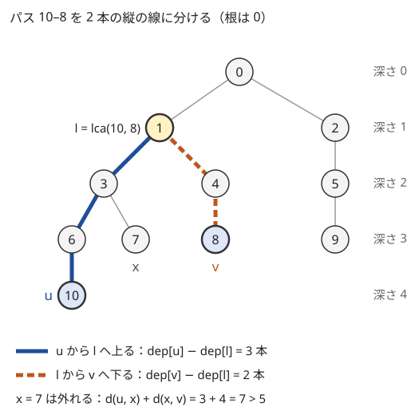
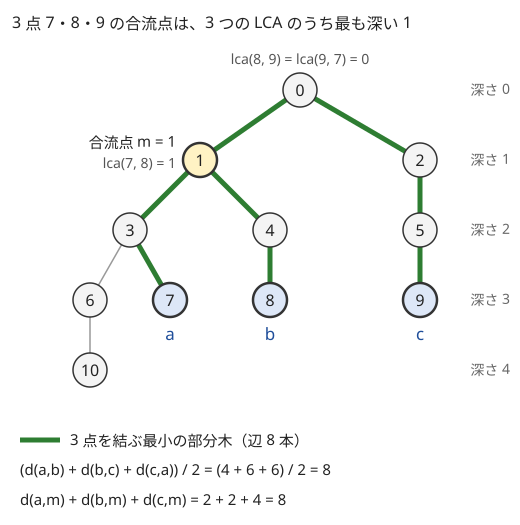
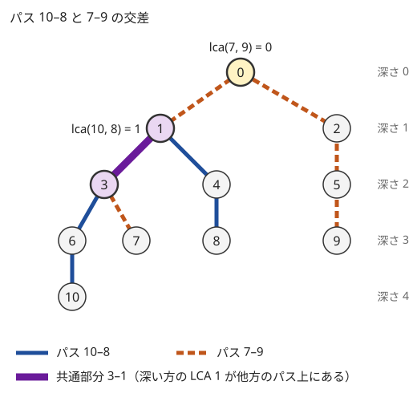

!!! abstract "要点"
    - **何ができるか**：パス $u$–$v$ を「$u$ から LCA へ上る」と「LCA から $v$ へ下る」の 2 本に分け、点がパス上にあるか・3 点の合流点・2 本のパスの交差・パス上の K 番目の頂点を、LCA と距離の式だけで判定する。
    - **いつ使うか**：
        - u から v へのパス上の…・パスに含まれる辺。
        - 2 本のパスが交わるか・共通部分。
        - どちらの端点に近いか（パスの中点）。
    - **計算量**：LCA の前処理 $O(N \log N)$。どの判定も LCA を定数回求めるだけなので、1 回 $O(\log N)$
    - **前提**：[最小共通祖先（LCA）](../tree/lca.md)、[木の上の距離](../tree/tree-distance.md)

<!-- textlint-disable -->
別名：パスクエリ・2 頂点間のパス・パスの分解・合流点・パスの交差・path queries on a tree
<!-- textlint-enable -->

木の上のパスの判定と分解は、2 頂点を結ぶパスについての問いを、[LCA](../tree/lca.md) と距離の式に置き換える道具の集まりである。木では 2 頂点を結ぶパスがただ 1 本なので、パスは両端と LCA の 3 点で決まる。パスを 1 頂点ずつたどると 1 回 $O(N)$ かかるが、LCA と深さの式で判定すれば、クエリが $2 \times 10^5$ 個あっても 1 回 $O(\log N)$ で済む。

このページでは頂点を 0-indexed とし、根を $0$ とする。$l = \mathrm{lca}(u, v)$、$d(u, v)$ は重みのない距離（辺の本数）で、$d(u, v) = \mathrm{dep}[u] + \mathrm{dep}[v] - 2\,\mathrm{dep}[l]$ である（[距離の式](../tree/lca.md#distance)）。

## 点 x がパス上にあるか（d(u,x) + d(x,v) = d(u,v)） {#on-path}

パス $u$–$v$ は、$u$ から $l$ へ根の方向に上る線と、$l$ から $v$ へ下る線の 2 本に分かれる。どちらの線も「ある頂点からその[祖先](../guide/glossary.md#ancestor)まで」の縦の線なので、パスについての問いは、祖先と子孫の関係の問いに直せる。



頂点 $x$ がパス $u$–$v$ の上にあるかは、次の式で判定できる。

$$
x \text{ がパス } u\text{–}v \text{ の上にある} \iff d(u, x) + d(x, v) = d(u, v)
$$

**なぜ正しいか**：$x$ がパスの上にあれば、パスは $x$ で $u$–$x$ と $x$–$v$ に切れるので等号が成り立つ。$x$ がパスから外れていれば、パスの上で $x$ に最も近い頂点を $p$ とすると、$x$ から $u$ へ行くにも $v$ へ行くにも、まず $p$ を通る。そのため $d(u, x) + d(x, v) = d(u, v) + 2\,d(p, x)$ となり、$d(p, x) \ge 1$ の分だけ左辺が大きい（[2 点からの距離を比べる](../tree/tree-distance.md#from-two)）。図の $x = 7$ では $p = 3$ で、$2\,d(3, 7) = 2$ だけ大きい。

```cpp
--8<-- "tree-path/path-tools.cpp:on-path"
```

完全なプログラム：[`path-tools.cpp`](https://github.com/yuukougun/kyopro-atlas/blob/main/snippets/tree-path/path-tools.cpp)（GitHub）
{ .kp-code-src }

LCA を 3 回求めるので 1 回 $O(\log N)$ である。同じ判定は祖先の関係でも書ける。$x$ がパスの上にあるのは、「$x$ が $u$ か $v$ の祖先（自分自身を含む）」かつ「$x$ が $l$ の子孫」のときである。[オイラーツアー](../tree/euler-tour.md#ancestor-depth)の $\mathrm{in}$・$\mathrm{out}$ があれば、祖先かどうかは $O(1)$ で判定できる。そのため、$l$ を求めた後の判定は $O(1)$ になる。

辺 $(c, \mathrm{par}[c])$ がパスの上にあるかは、子の側の頂点で判定する。$c$ がパスの上にあり、かつ $c \ne l$ のときだけ、その辺はパスに含まれる。$l$ から親へ向かう辺はパスに含まれない（[頂点の値と辺の値](#vertex-vs-edge)）。

**応用の型**：「$x$ を通るか」「頂点 $x$（$u, v$ 以外）を取り除くと $u$ と $v$ が分かれるか」は、どちらもこの判定である。辺 $e$ を取り除いて $u$ と $v$ が分かれるかも、$e$ がパスに含まれるかで決まる。

## 3 点の合流点と根の付け替え {#meeting-point}

3 頂点 $a, b, c$ について、3 本のパス $a$–$b$・$b$–$c$・$c$–$a$ に共通する頂点はただ 1 つである。これを合流点（メディアン）と呼び、$m$ と書く。$m$ は次のように求まる。

- 3 つの LCA $\mathrm{lca}(a, b)$・$\mathrm{lca}(b, c)$・$\mathrm{lca}(c, a)$ のうち、少なくとも 2 つは等しい
- 合流点 $m$ は、3 つのうち最も深いもの（等しい 2 つではない残りの 1 つ。3 つとも等しければそれ）である



**なぜ正しいか**：3 点すべての共通の祖先のうち最も深いものを $r$ とする。3 点が $r$ の同じ子の部分木にすべて入ることはない（入るなら、その子が $r$ より深い共通の祖先になる）。そのため、3 点を「$r$ 自身」と「$r$ の子の部分木」に分けると 2 か所以上に分かれ、別の所にある 2 点の組が 2 組以上できる。その 2 組の LCA は $r$ である。残りの 1 組（図では $a, b$）の LCA $y$ は $r$ と等しいか、より深い。$y$ はパス $a$–$b$ の上にある。さらに $y$ は $a$ の祖先で、$r$ と同じか $r$ より下にあるので、$a$ から $r$ へ上る線、すなわちパス $a$–$c$ の上にもある。同じ理由でパス $b$–$c$ の上にもある。

```cpp
--8<-- "tree-path/path-tools.cpp:meet"
```

完全なプログラム：[`path-tools.cpp`](https://github.com/yuukougun/kyopro-atlas/blob/main/snippets/tree-path/path-tools.cpp)（GitHub）
{ .kp-code-src }

合流点から 3 点への距離の和は、3 点を結ぶ最小の部分木の辺の数に等しい。3 本のパスを合わせると、この部分木の各辺をちょうど 2 回ずつ通るので、次の式が成り立つ。

$$
d(a, m) + d(b, m) + d(c, m) = \frac{d(a, b) + d(b, c) + d(c, a)}{2}
$$

**根の付け替え**：根を $r$ に変えたときの $u, v$ の LCA は、元の根のままで求めた 3 点 $u, v, r$ の合流点である。根を $r$ にした木での $\mathrm{lca}(u, v)$ は、パス $u$–$v$ の上で $r$ に最も近い頂点だからである。根ごとに LCA の表を作り直す必要はない。

**応用の型**：「3 人が 1 か所に集まるときの移動距離の和の最小」は合流点に集まるのが最適で、答えは上の式の値である。「根が毎回変わる LCA のクエリ」も、上の付け替えの式で答えられる。

## 2 本のパスの交差 {#intersection}

2 本のパス $a$–$b$ と $c$–$d$ が共通の頂点を持つかは、2 つの LCA $l_1 = \mathrm{lca}(a, b)$、$l_2 = \mathrm{lca}(c, d)$ のうち深い方で判定できる。

$$
\text{共通の頂点がある} \iff \text{深い方の LCA が、もう一方のパスの上にある}
$$



**なぜ正しいか**：$\mathrm{dep}[l_1] \ge \mathrm{dep}[l_2]$ とする。共通の頂点 $x$ があれば、$x$ はパス $a$–$b$ の上にあるので $l_1$ の子孫である。また $x$ はパス $c$–$d$ の上にあるので、$c$（または $d$）から $l_2$ へ上る縦の線の上にある。$l_1$ は $x$ の祖先で、深さは $l_2$ 以上なので、同じ縦の線の上の $x$ と $l_2$ の間にある。だから $l_1$ はパス $c$–$d$ の上にある。逆に $l_1$ がパス $c$–$d$ の上にあれば、$l_1$ そのものが共通の頂点である。

交わるときは、共通部分も 1 本のパスになる（木の連結な部分どうしの共通部分は連結なため）。その両端は、4 つの LCA $\mathrm{lca}(a, c)$・$\mathrm{lca}(a, d)$・$\mathrm{lca}(b, c)$・$\mathrm{lca}(b, d)$ のうち深い 2 つである。図では $a = 10, b = 8, c = 7, d = 9$ で、4 つは順に $3$・$0$・$1$・$0$ である。深い 2 つの $3$ と $1$ が共通部分の両端である。

直感的には、パス $a$–$b$ のうちパス $c$–$d$ に乗る部分は、$c$–$d$ の上で $a$ に最も近い頂点から $b$ に最も近い頂点までである。前者は 3 点 $a, c, d$ の[合流点](#meeting-point)なので、$\mathrm{lca}(a, c)$ と $\mathrm{lca}(a, d)$ のうち深い方である。後者も同じく、$\mathrm{lca}(b, c)$ と $\mathrm{lca}(b, d)$ のうち深い方である。2 本が交わるときは、まとめると 4 つのうち深い 2 つになる。

```cpp
--8<-- "tree-path/path-tools.cpp:intersect"
```

完全なプログラム：[`path-tools.cpp`](https://github.com/yuukougun/kyopro-atlas/blob/main/snippets/tree-path/path-tools.cpp)（GitHub）
{ .kp-code-src }

このコード片は、9 頂点以下のランダムな木 300 個で、すべての 4 点の組について全探索と比べて確かめている。

**応用の型**：共通部分の頂点の数は $d(p, q) + 1$、辺の数は $d(p, q)$ である（$p, q$ は両端）。「辺を共有するか」を問われたら、交わることに加えて $p \ne q$ かを見る。1 点だけで交わるパスは辺を共有しない。

## パス上の K 番目の頂点 {#kth-on-path}

パス $u$–$v$ の上で $u$ から K 番目の頂点（$K = 0$ なら $u$）は、[K 個上の祖先](../tree/lca.md#kth-ancestor)で求まる。$u$ から $l$ までの辺の数を $d_u = \mathrm{dep}[u] - \mathrm{dep}[l]$、$v$ から $l$ までを $d_v$ とする。

- $K \le d_u$ なら、$u$ から上る線の上にあるので、$u$ の K 個上の祖先である
- $d_u < K \le d_u + d_v$ なら、$l$ から $v$ へ下る線の上にある。下る向きには表で跳べないので、$v$ から $d_u + d_v - K$ 個上の祖先として求める
- $K > d_u + d_v$ なら、そのような頂点はない

```cpp
--8<-- "tree-path/path-tools.cpp:kth"
```

完全なプログラム：[`path-tools.cpp`](https://github.com/yuukougun/kyopro-atlas/blob/main/snippets/tree-path/path-tools.cpp)（GitHub）
{ .kp-code-src }

**どちらの端点に近いかの境目**：$u$ と $v$ のどちらに近いかは、各頂点がパスのどこに付いているかで決まる（[2 点からの距離を比べる](../tree/tree-distance.md#from-two)）。この境目は、K 番目の頂点を使うと部分木の形で書ける。$\mathrm{dep}[u] \ge \mathrm{dep}[v]$、$D = d(u, v) \ge 1$ とし、$m$ をパスの上で $u$ から $\lfloor (D - 1)/2 \rfloor$ 番目の頂点とする。

- このとき $d_u \ge D/2$ なので、$m$ は $u$ から上る線の上にあり、$l$ より真に深い
- $m$ の部分木の頂点は $u$ の方が真に近く、それ以外の頂点は $v$ の方が近いか等しい

前者は $d_u \ge d_v$ と $\lfloor (D - 1)/2 \rfloor < D/2$ から分かる。後者は、各頂点 $x$ が付いているパスの頂点を $p$ として、$d(u, x) - d(v, x) = 2\,d(u, p) - D$ の符号を見れば分かる。境目が部分木になるので、「各頂点から近い方の端点までの距離の和」が部分木の大きさと根からの累積で計算できる（[力試しの ABC298 Ex](#challenge)）。

## 頂点の値と辺の値で LCA の扱いが違う {#vertex-vs-edge}

パスの上の値を数えるとき、LCA $l$ の扱いは、値が頂点にあるか辺にあるかで変わる。辺の値は、根を決めて子の頂点に置く（[辺の値を子の頂点に寄せる](../tree/tree-basics.md#edge-to-child)）。すると、子 $c$ に置いた値は辺 $(c, \mathrm{par}[c])$ のものになる。パスの辺は、$l$ 以外のパスの頂点の親への辺である。$l$ に置いた値は $l$ の親への辺のもので、パスに含まれない。

| 求めるもの | 頂点の値 | 辺の値（子に置く） |
| --- | --- | --- |
| パスの要素の数 | $d(u, v) + 1$ | $d(u, v)$ |
| 根からの和 $S$ でのパスの和 | $S[u] + S[v] - 2S[l] + a_l$ | $S[u] + S[v] - 2S[l]$ |
| パスへの加算の印 | $u, v$ に $+1$、$l, \mathrm{par}[l]$ に $-1$ | $u, v$ に $+1$、$l$ に $-2$ |
| 子 $c$ に置いた値がパスに入るか | $c$ がパスの上にある | $c$ がパスの上にあり $c \ne l$ |

頂点の値の加算の印は、$l$ が根なら $\mathrm{par}[l]$ には置かない。和の式の理由は[距離の式](../tree/lca.md#distance)に、加算の印の理由は[パスへの加算](../tree/tree-imos.md#path-add)にある。どの行も「$l$ は両側に共通する 1 点で、$l$ の上の辺はパスの外」という同じ事実から出てくる。

$u = v$ のときも同じ式でよい。頂点の値なら $a_u$ が 1 つ、辺の値なら 0 本になる。

**応用の型**：辺に色と長さがあり、「色 $x$ の辺の長さをすべて $y$ に変えたときの $u$–$v$ の距離」を問われたら、根から各頂点までの「長さの和」「色 $x$ の辺の数」「色 $x$ の辺の長さの和」を辺の値の式で組み合わせる（[練習の ABC133 F](#practice)）。

## パスを辺の集合として扱う（包除原理） {#edge-set}

パスが 20 本程度までで、木も小さい（頂点が 64 個以下、すなわち辺が 63 本以下）ときは、パスを辺の集合として 1 つの整数の bit で持てる。辺 $(c, \mathrm{par}[c])$ を子の番号 $c$ の bit で表すと、パスの辺の集合は「$u$ と $v$ のうち深い方を 1 つ上げ、通った辺の bit を立てる」を $u = v$ になるまで繰り返せば求まる。2 つが一致した所が LCA である。

```cpp
--8<-- "tree-path/edge-set.cpp:mask"
```

完全なプログラム：[`edge-set.cpp`](https://github.com/yuukougun/kyopro-atlas/blob/main/snippets/tree-path/edge-set.cpp)（GitHub）
{ .kp-code-src }

bit で持つと、複数のパスの辺の和集合は OR、共通部分は AND、辺の数は [popcount](../guide/glossary.md#popcount) で求まる。そのため、「指定のパスのどれにも〇〇な辺がある」という条件を[包除原理](../comb/inclusion-exclusion.md#bit-enumeration)で数えやすくなる。条件を破る（パスの辺がすべて白い）パスの組 $S$ ごとに、和集合の辺を白に固定し、残りを自由に塗った数を数えて符号付きで足す（[例題の ABC152 F](#abc152_f)）。

```cpp
--8<-- "tree-path/edge-set.cpp:count"
```

完全なプログラム：[`edge-set.cpp`](https://github.com/yuukougun/kyopro-atlas/blob/main/snippets/tree-path/edge-set.cpp)（GitHub）
{ .kp-code-src }

`popcount` は C++20 の [`<bit>` の関数](../cpp/cpp-math-functions.md#bit-functions)で、符号なしの型しか受け取らない。そのため、`int` の `S` は `unsigned` に変換して渡す。

パスが $M$ 本で、組 $S$ ごとに OR を $M$ 回とるので、全体は $O(2^M M)$ である。$M \le 20$ なら約 $2 \times 10^7$ 回で間に合う。

頂点が 64 個を超えるときは `bitset` を使うか、別の見方をする。「何本のパスに覆われているか」を辺ごとに数えるだけなら、包除は要らない。[パスへの加算](../tree/tree-imos.md#path-add)の印で、パスの本数に比例する時間で数えられる。

## パスへの一括更新があるなら HL 分解 {#to-hld}

この節は [HL 分解](../tree/hld.md)を前提にする。このページの判定は、どれも LCA と距離の式だけを使う。値の書き換えがあっても、判定そのものは変わらない。値の集約に引き算が使えるなら（和・XOR）、オイラーツアーと BIT に載せれば 1 点の更新にも対応できる（[根からのパスを区間で扱う](../tree/euler-tour.md#root-path)）。

次のどちらかがあると、LCA と根からの累積では足りない。

- **パスへの一括の更新**：「パス $u$–$v$ の全頂点に $x$ を足す（$x$ に変える）」が、パスの和や最大値の取得と交互に来る
- **引き算の使えない集約と更新**：最大値・最小値・アフィン変換の合成などを、値の更新を挟みながら求める

HL 分解は、パスを $O(\log N)$ 個の列の区間に分けるので、列に[遅延セグメント木](../ds/lazy-segment-tree.md)を載せれば 1 回 $O(\log^2 N)$ で扱える。どの方法を選ぶかの表は [HL 分解の使い分け](../tree/hld.md#when-to-use)にある。

## 落とし穴 {#pitfalls}

- **重み 0 の辺があるのに、重み付きの距離で判定する**：$d(u, x) + d(x, v) = d(u, v)$ は、重みが正のときだけパス上の判定になる。重み 0 の辺の先にある頂点は、パスから外れていても等号が成り立つ。判定には重みのない距離（深さ）を使い、重み付きの距離は値を求めるときだけに使う
- **下る線の K 番目を、$l$ から下って求めようとする**：ダブリングの表は親の向きにしか跳べない。$K > d_u$ のときは、$v$ から $d_u + d_v - K$ 個上として求める。$d_u$ と $d_v$ を取り違える（$u$ 側と $v$ 側の逆）誤りもよく起きる。$K = 0$ で $u$ が、$K = d(u, v)$ で $v$ が返るかを確かめる
- **辺の値で $l$ を数える**：辺の値を子に置いたとき、$l$ に置いた値はパスの外の辺のものである。辺のパスの和に $a_l$ を足したり、辺の bit 集合に $l$ の bit を入れたりすると、1 本多く数える
- **交差の判定で浅い方の LCA を使う**：浅い方の LCA がもう一方のパスの上になくても、2 本は交わることがある（図の例で、浅い方の LCA $0$ はパス 10–8 の上にない）。深い方の LCA で判定する
- **頂点を共有することと辺を共有することを混同する**：1 点だけで交わるパスは辺を共有しない。問題が辺を問うなら、共通部分の両端 $p \ne q$ まで確かめる
- **パスを毎回たどる**：パスの頂点を 1 つずつ列挙すると 1 回 $O(N)$ になり、パス状の木では $Q$ 回で $O(NQ)$ になる。列挙してよいのは、[例題](#abc152_f)のように $N$ が小さいときだけである

## 例題 {#examples}

### ABC152 F. Tree and Constraints {#abc152_f}

<div class="kp-problems" data-role="example" markdown>

- [ABC152 F. Tree and Constraints](https://atcoder.jp/contests/abc152/tasks/abc152_f)（diff 1965）：木の各辺を白か黒に塗り、M 個（20 以下）の指定のパスのどれにも黒い辺が 1 本以上含まれる塗り方の数を求める。

</div>

「どのパスにも黒い辺がある」は、パスごとの条件の「かつ」で、そのままでは数えにくい。否定の「パスの辺がすべて白い」なら、白に固定する辺が決まるので数えやすい。そこで、条件を破るパスの組ごとに[包除原理](../comb/inclusion-exclusion.md)で数える。木は小さい（頂点が 50 個以下）ので、パスを辺の bit 集合にして、組ごとの和集合を OR で求める（[パスを辺の集合として扱う](#edge-set)）。

??? note "解法の詳細"
    根を決めて、辺を子の頂点の番号で表す。各パス $i$ について、深い方の端点を親へ上げながら通った辺の bit を立て、辺の集合 $E_i$ を作る。

    破るパスの組 $S$ を bit 全探索する。$S$ のパスの辺をすべて白にした塗り方は、和集合 $\bigcup_{i \in S} E_i$ の辺の数を $p$ として $2^{N - 1 - p}$ 通りである。包除原理により、答えは $\sum_S (-1)^{\lvert S \rvert} 2^{N - 1 - p_S}$ になる。

    $S$ は $2^M$ 通り、各 $S$ で OR を $M$ 回とるので、全体は $O(2^M M)$ である。答えは $2^{N-1}$ 以下で、`long long` に収まる。

## 練習問題 {#practice}

<div class="kp-problems" data-role="practice" markdown>

- [ARC142 C. Tree Queries](https://atcoder.jp/contests/arc142/tasks/arc142_c)（diff 1347）：形の分からない木で、2 頂点の距離を尋ねる質問を繰り返して、頂点 1 と頂点 2 の距離を当てるインタラクティブの問題である。
- [ABC133 F. Colorful Tree](https://atcoder.jp/contests/abc133/tasks/abc133_f)（diff 2330）：辺に色と長さがある木で、色 x の辺の長さをすべて y に変えたときの 2 頂点間の距離を、Q 個の質問に答える。

</div>

??? note "方針"
    - **ARC142 C**：1・2 以外の各頂点 $x$ について $d(1, x)$ と $d(2, x)$ を尋ねる。$x$ がパス 1–2 の上にあるとき和は $d(1, 2)$ になり、外れると大きくなるので、和の最小が答えになる。ただしパス上にほかの頂点がない（$d(1,2) = 1$）場合と区別が付かないとき（最小の和が 3 のとき）だけ、和が最小の 2 頂点の距離を 1 回尋ねて分ける
    - **ABC133 F**：変更後の距離は「元の距離 − パス上の色 $x$ の辺の長さの和 ＋ パス上の色 $x$ の辺の数 × $y$」である。3 つとも辺の値なので、根から頂点 $w$ までの値 $f(w)$ を使って $f(u) + f(v) - 2f(l)$ と書ける（[頂点の値と辺の値](#vertex-vs-edge)）。色ごとの和と本数を全頂点で持つと大きすぎるので、質問を先に読み、各質問を頂点 $u$・$v$・$l$ の 3 か所に係数 $+1$・$+1$・$-2$ で登録する。根から DFS し、色ごとの長さの和と本数を、入るときに足して出るときに戻す（[根からのパスを DFS で持ち回る](../tree/root-path-dfs.md)）。各頂点に着いた時点の値で、登録された質問に足し込む

## 力試し {#challenge}

<div class="kp-problems" data-role="challenge" markdown>

- [ABC298 Ex. Sum of Min of Length](https://atcoder.jp/contests/abc298/tasks/abc298_h)（diff 2792）：木の 2 頂点 L・R について、各頂点から L と R の近い方までの距離の総和を Q 個の質問に答える。

</div>

??? note "力試しの方針"
    - **ABC298 Ex**：$\mathrm{dep}[L] \ge \mathrm{dep}[R]$ とし、パス $L$–$R$ の上で $L$ から $\lfloor (d(L, R) - 1)/2 \rfloor$ 番目の頂点 $m$ を求める。$m$ の部分木の頂点は $L$ に、それ以外は $R$ に近い（[どちらの端点に近いかの境目](#kth-on-path)）。1 点 $s$ から頂点の集合への距離の和は、「根からの深さの和」＋「$s$ の深さ × 個数」から、$s$ の根以外の祖先 $w$（$s$ 自身を含む）ごとに「$w$ の部分木に入る頂点の数」の 2 倍を引いて求まる。$m$ の部分木とその補集合のそれぞれで、この量を部分木の大きさと根からの累積で計算する。質問をまとめて DFS で処理すれば、全体 $O((N + Q) \log N)$ である

## 確認問題 {#quiz}

??? question "確認問題：パスの上の K 番目の頂点"
    [点 x がパス上にあるか](#on-path)の図の木で、パス 10–8 の上で 10 から 4 番目の頂点を求めたい。K 個上の祖先をどの頂点から何個上として使うか。

    ??? success "答え"
        $l = \mathrm{lca}(10, 8) = 1$ で、$d_u = 3$、$d_v = 2$ である。$K = 4 > d_u$ なので、4 番目の頂点は $l$ から 8 へ下る線の上にある。8 から $d_u + d_v - K = 1$ 個上の祖先として求め、頂点 4 になる。パスは 10・6・3・1・4・8 の順なので、確かに 10 から 4 番目は 4 である。

??? question "確認問題：根を変えた LCA"
    根を $0$ にした木で、根を $r$ に変えたときの $u, v$ の LCA を求めたい。新しい根で表を作り直さずに求めるにはどうするか。

    ??? success "答え"
        3 点 $u, v, r$ の合流点を、根 $0$ のままの LCA で求める。$\mathrm{lca}(u, v)$・$\mathrm{lca}(v, r)$・$\mathrm{lca}(r, u)$ のうち最も深いものである。根を $r$ にした木の LCA は、パス $u$–$v$ の上で $r$ に最も近い頂点であり、それは 3 本のパスが合流する点だからである。

??? question "確認問題：辺を共有するか"
    パス $a$–$b$ と $c$–$d$ が少なくとも 1 本の辺を共有するかを判定するには、何を確かめればよいか。

    ??? success "答え"
        深い方の LCA がもう一方のパスの上にあること（交わること）と、共通部分の両端 $p, q$（4 つの LCA のうち深い 2 つ）が $p \ne q$ であることである。$p = q$ なら、2 本は 1 頂点だけで交わり、辺は共有しない。

??? question "確認問題：どちらの端点に近いか"
    同じ木で、各頂点が頂点 7 と頂点 8 のどちらに真に近いかを、ある頂点 $m$ の部分木で表したい。$m$ はどの頂点で、その部分木には何が入るか。

    ??? success "答え"
        $\mathrm{dep}[7] = \mathrm{dep}[8] = 3$ なので、$u = 7$、$v = 8$ としてよい。$D = d(7, 8) = 4$ で、$m$ はパス 7–3–1–4–8 の上で 7 から $\lfloor 3/2 \rfloor = 1$ 番目の頂点 3 である。3 の部分木の 3・6・7・10 は 7 の方が真に近く、それ以外は 8 の方が近いか等しい。たとえば頂点 1 は両方から距離 2 で等しく、部分木の外に入る。

## 使い分け {#comparison}

パスについての問いは、何を求めるかで道具が変わる。

| 問いの形 | 使う方法 |
| --- | --- |
| 点・辺がパス上にあるか、合流点、交差、K 番目 | このページの判定（LCA を定数回） |
| パスの和・XOR（逆元がある） | 根からの累積と[距離の式](../tree/lca.md#distance) |
| パスの最大値（更新なし） | [LCA の表に集約を持つ](../tree/lca.md#path-aggregate) |
| 多数のパスへの加算を最後にまとめて読む | [パスへの加算](../tree/tree-imos.md#path-add) |
| パスへの一括更新と取得が交互 | [HL 分解](../tree/hld.md) |

パスの判定を多数のクエリで行うなら、1 回 $O(1)$ で LCA を求める[オイラーツアーと Sparse Table](../tree/lca.md#comparison) の方式にすると速い。

## 参考 {#references}

- [はまやんはまやんはまやん「競技プログラミングにおけるLCA問題まとめ [auxiliary tree]」](https://blog.hamayanhamayan.com/entry/2017/05/03/131624)：LCA と根からの情報を組み合わせる型、根が変わる場合の LCA という項目の立て方
- [drken「AtCoder ABC 152 F - Tree and Constraints (2D, 青色, 600 点)」](https://drken1215.hatenablog.com/entry/2020/01/26/164200)：例題 abc152_f の包除原理の組み立てと、パスの辺を整数の bit 集合で持つこと
- [hamayan「Colorful Tree [AtCoder Beginner Contest 133 F]」](https://blog.hamayanhamayan.com/entry/2019/07/08/213009)：練習 abc133_f の距離の書き換えと、質問を先読みして DFS で色ごとの和と本数を持つこと
- [kmjp「AtCoder ABC #298 (トヨタ自動車プログラミングコンテスト2023#1) : Ex - Sum of Min of Length」](https://kmjp.hatenablog.jp/entry/2023/04/16/0930)：力試し abc298_h の境目の頂点を K 個上の祖先で求めることと、部分木の大きさの累積で距離の和を計算すること
- [merom686「ARC142」](https://merom686.hatenablog.com/entry/2022/06/20/000753)：練習 ARC142 C の距離の和の最小と距離 1 の場合の区別
