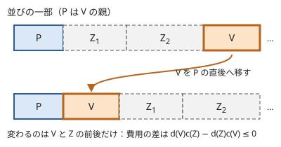

!!! abstract "要点"
    - **何ができるか**：「親を子より先に選ぶ」制約つきで、順番に依存する重み付きの和を最適化する。比が最大の塊は親の塊の直後に訪れてよい（交換論法）ので、優先度付きキューと Union-Find で親の塊へ併合していく。
    - **いつ使うか**：親を子より先に選ぶ制約つきで、順番による重み付きの和を最適化する。
    - **計算量**：$O(N \log N)$
    - **前提**：[Union-Find](../ds/union-find.md)、[交換論法と比較関数の設計](../basics/exchange-argument.md)

<!-- textlint-disable -->
別名：01 on Tree・木の上の順序最適化・比による併合・親を先に選ぶ制約つきの並べ方
<!-- textlint-enable -->

比で親に併合する貪欲は、根付き木の頂点を「親が子より先」の順に並べるとき、前後の組ごとに掛かる費用の和を最小にする方法である。制約がなければ比の順にソートするだけの[交換論法](../basics/exchange-argument.md#ratios)の問題だが、木の制約があると単純にはソートできない。そこで「比が最大の頂点は、親の直後に置いてよい」ことを使い、その頂点を親と 1 つの塊にまとめる（[縮約](../guide/glossary.md#contraction)する）操作を繰り返す。

名前の 01 on Tree は、この型を問うた過去の AGC の問題名から来ている。ABC では difficulty 2800 を超える G で出た程度で、頻度は低い。証明の細部は[学ぶための資料](#resources)に任せ、ここでは費用の形・貪欲が正しい理由の筋・自作するときの要点をまとめる。

## 何を最小にするか（3 つの言い換え） {#formulation}

頂点 $0, 1, \dots, N - 1$ の根付き木（根は 0）で、各頂点 $v$ に 0 以上の重み $c_v$・$d_v$ がある。頂点の並べ方のうち、祖先が子孫より先に来るもの（木のトポロジカル順）を考え、次の費用を最小にする。

$$
X = \sum_{u \text{ が } v \text{ より前}} d_u \, c_v
$$

前にある頂点の $d$ と、後ろにある頂点の $c$ の積を、すべての組について足したものである。この形は、問題文では次のような姿で現れる。

- **01 列の転倒数**：頂点 $v$ に、1 が $d_v$ 個・0 が $c_v$ 個の 01 列が書かれている。並べた順に連結した列の転倒数（1 が 0 より前にある組の数）は、列の中の転倒数（並べ方によらない定数）と $X$ の和になる。名前の由来はこの形である。
- **期待値**：宝が頂点 $v$ にある確率を $c_v$（根は 0）、どの頂点も $d_v = 1$ とする。根を調べ終えた状態から 1 回に 1 頂点ずつ調べると、$v$ を調べ終えるのは「$v$ より前の頂点の数（根を含む）」回目である。よって、宝のある頂点を調べるまでの回数の期待値は $X$ そのものになる（[例題](#abc376_g)）。
- **重み付きの完了時刻**：仕事 $v$ の処理時間を $d_v$、重みを $c_v$ とする。完了時刻の重み付きの和 $\sum c_v C_v$ は、$X$ に定数 $\sum c_v d_v$ を足したものになる。制約がなければ[隣接交換で比較を導く](../basics/exchange-argument.md#adjacent-swap)の例そのもので、そこに「親の仕事を先に終える」制約を足した形である。

2 つの頂点（または塊）$A$・$B$ が隣り合うとき、$A$ を先にすると $d_A c_B$、$B$ を先にすると $d_B c_A$ が掛かる。よって $c_A d_B > c_B d_A$、すなわち比 $c / d$ が大きい方を先に置くと得である。制約がなければ、この比の大きい順に並べれば最適になる。

## 比が最大の塊は親の直後に来てよい理由 {#why-ratio}

木の制約があると、比の最大の頂点 $V$ を先頭に置くことはできない。親がまだ並んでいないからである。代わりに次が言える。

> 根以外の頂点のうち比 $c / d$ が最大の頂点を $V$、その親を $P$ とする。$P$ の直後に $V$ を置く最適な並べ方がある。

最適な並べ方で、$P$ と $V$ の間に頂点の列 $Z$ があるとする。$V$ を $P$ の直後へ移しても、制約は崩れない。$Z$ の頂点は $V$ の子孫ではない（子孫は $V$ より後ろにある）し、$V$ の親 $P$ は $V$ より前のままだからである。



移したことで前後が入れ替わるのは、$V$ と $Z$ の各頂点の組だけである。$Z$ の重みの合計を $c_Z$・$d_Z$ と書くと、費用は $d_Z c_V$ から $d_V c_Z$ に変わる。$V$ の比が最大なので、$Z$ のどの頂点 $z$ でも $c_z d_V \le c_V d_z$ で、足し合わせると $c_Z d_V \le c_V d_Z$ になる。よって費用は増えず、移した並べ方も最適である。

$P$ の直後に $V$ を置いてよいなら、2 つを 1 つの頂点にまとめた木で同じ問題を解けばよい。まとめた頂点の重みは $(c_P + c_V, d_P + d_V)$ で、塊の中の費用 $d_P c_V$ は答えに足しておく。まとめた頂点も「1 つの頂点」として上の議論がそのまま使えるので、これを根だけになるまで繰り返せば最適な並べ方が得られる。

比の比較は割り算にせず、$c_A d_B$ と $c_B d_A$ の掛け算の形で行う（[比は掛け算で比べる・分母 0](../basics/exchange-argument.md#ratios)）。$d = 0$ の頂点は比が $+\infty$ として扱われる。$(c, d) = (0, 0)$ の頂点はどの頂点とも比が等しくなり、比較が推移しなくなる。ただし上の議論で $V$ に $(0, 0)$ の頂点を選ぶと、$c_z \cdot 0 \le 0 \cdot d_z$ がどの $z$ でも成り立つので、$(0, 0)$ の頂点は最優先で親にまとめてよい。

??? question "確認問題：比が最大でない頂点を先にまとめると"
    根 0 の子が頂点 1・2 の木で、$(c, d)$ は根が $(0, 1)$、頂点 1 が $(1, 1)$、頂点 2 が $(2, 1)$ とする。頂点 1 を先に根へまとめると最適になるか。

    ??? success "答え"
        ならない。頂点 1 を先にまとめると並びは 0, 1, 2 で、定義どおり $X = d_0 c_1 + (d_0 + d_1) c_2 = 1 + 4 = 5$ である。比が最大の頂点 2 を先にまとめた 0, 2, 1 は $X = d_0 c_2 + (d_0 + d_2) c_1 = 2 + 2 = 4$ で、こちらが最適である。

## Union-Find と優先度付きキューで併合する {#merge-with-heap}

まとめる操作を速く行うには、次の 2 つが要る。

- **比が最大の塊を取り出す**：根の塊以外の塊を、比の大きい順に[優先度付きキュー](../ds/priority-queue.md)か `std::set` で持つ。まとめるたびに親の塊の重みが変わるので、その塊を入れ直す。`priority_queue` なら古い要素を残して取り出したときに捨てる（[遅延削除](../ds/priority-queue.md#lazy-deletion)）。`set` なら重みを変える前に消し、変えた後に入れる。
- **親の頂点が今どの塊にいるか**：塊ごとに先頭の頂点（塊の中で最も根に近い頂点）を代表にし、[Union-Find](../ds/union-find.md) でまとめる。塊 $V$ の先頭の頂点の親を $\mathrm{par}[v]$ とすると、$\mathrm{par}[v]$ を含む塊が親の塊 $P$ である。

手順は次のとおりである。

```text
各頂点を 1 つの塊にし、根以外の塊を比の大きい順に入れる
X ← 0
キューが空でない間：
    比が最大の塊 v を取り出す（(0, 0) の塊を最優先）
    p ← par[v] を含む塊
    p をキューから外す（p が根の塊でなければ）
    X ← X + d[p] × c[v]
    c[p] ← c[p] + c[v]、d[p] ← d[p] + d[v]
    塊 p の頂点の並びの後ろに、塊 v の並びをつなぐ
    Union-Find で p と v をまとめ、新しい代表に先頭の頂点 p を対応させる
    p をキューに入れる（p が根の塊でなければ）
根の塊の頂点の並びが最適な順、X が最小の費用
```

頂点の並びは、塊ごとに先頭と末尾を持つ連結リストにすれば $O(1)$ でつなげる。費用は毎回の $d_P c_V$ を足すだけで求まり、最後に並びから計算し直す必要はない。

次のコード片は、Library Checker の [Rooted Tree Topological Order with Minimum Inversions](https://judge.yosupo.jp/problem/rooted_tree_topological_order_with_minimum_inversions) と同じ入出力で、$X$ の最小値と並べ方を返す。完全なプログラムは `snippets/tree-ratio-greedy/merge.cpp` で、小さい木の全順列の最小値と一致することを確かめた。

```cpp
--8<-- "tree-ratio-greedy/merge.cpp:core"
```

!!! info "ACL では"
    `dsu uf(n);`。`uf.merge(a, b)` は新しい代表を返すので、その代表に「塊の先頭の頂点」を対応させる配列を別に持つ。`uf.leader(a)` はならし $O(\alpha(N))$。比の順のキューは ACL になく、`std::set` か `std::priority_queue` を使う。

## 計算量と自作するときの要点 {#library}

まとめる操作は $N - 1$ 回で、それぞれキューの出し入れが $O(\log N)$、Union-Find がならし $O(\alpha(N))$ なので、全体で $O(N \log N)$ である。自作するときの要点は次のとおりである。

- **積の大きさ**：比較の $c_A d_B$ は、塊の重みの合計どうしの積である。$\sum c_v$ と $\sum d_v$ がどちらも $10^9$ なら積は $10^{18}$ で `long long` に収まるが、余裕がなければ `__int128` で比べる。答えの $X$ も同じ大きさになる。
- **比較を狭義の弱順序にする**：`set` で持つなら、比が等しいときは塊の番号で順を決める。$(0, 0)$ の塊を先に別扱いしないと、比較が推移しない（[比較が狭義の弱順序になっているか](../basics/exchange-argument.md#strict-weak-ordering)）。
- **根の塊はキューに入れない**：根の塊は常に先頭にあり、まとめる先になるだけである。期待値の問題では根の $d$ を 1、$c$ を 0 にしておくと、根を数えるかどうかの調整が要らない。
- **mod の答え**：期待値を mod で出す問題でも、比の比較は元の整数（確率なら分子の整数）で行う。mod の値は大小を比べられない。
- **一般化**：比較と `+=`（塊をつなぐ演算）を差し替えると、01 列の転倒数とは違う問題にも同じ手順が使える。資料の hitonanode 氏のライブラリはその形になっていて、例も載っている。どんな演算なら正しいかは資料に任せる。

自作した関数は、[上のコード片](#merge-with-heap)と同じ Library Checker の問題で確かめる。$c_v = d_v = 0$ の頂点を含む入力もある。

## 学ぶための資料 {#resources}

- hitonanode 氏のライブラリの「Tree pop order optimization / "01 on Tree"」：01 on Tree を解く関数と使い方がある。比較と結合を差し替えた一般化と、この型の問題の一覧（Library Checker・AGC・ABC・yukicoder など）も載っている。
- maspy 氏の「01 on Tree / 京都観光 / Train Seats」：見た目の違う問題が 01 列の転倒数の最小化に帰着する様子を、複数の問題でたどっている。解法そのものは省かれているので、帰着の練習に読む。
- Library Checker の問題案（GitHub の issue #1263「[問題案] 01 on Tree」）：Library Checker の問題が 01 on Tree そのものとして提案された経緯と、問題の定義。

## 例題 {#examples}

### ABC376 G. Treasure Hunting {#abc376_g}

<div class="kp-problems" data-role="example" markdown>

- [ABC376 G. Treasure Hunting](https://atcoder.jp/contests/abc376/tasks/abc376_g)（diff 2858）：根付き木のどこか 1 頂点に宝があり、各頂点にある確率が与えられる。根から始めて、親を調べ終えた頂点を 1 つずつ調べるとき、宝のある頂点を調べるまでの回数の期待値の最小値を求める。

</div>

方針：頂点 $v$ を調べる回数目は「$v$ より前に調べた頂点の数（根を含む）」に等しい。根の重みを $(c, d) = (0, 1)$、ほかの頂点を（宝がある確率の分子, 1）とすると、期待値は $X$ を確率の分母で割ったものになる。（確率の和）/（頂点数）が最大の塊を親の塊にまとめていく。

??? note "解法の詳細"
    - 頂点 $v$ の重みを $c_v = a_v$（確率の分子）、$d_v = 1$ とする。根は $c = 0$、$d = 1$ とする。まとめるたびに $d_P c_V$（親の塊の頂点数 × 子の塊の確率の分子の和）を足す。
    - 比の比較は分子の和と頂点数の掛け算で、元の整数のまま行う。
    - 最後に、足した和に分子の総和の逆元を掛けて、mod 998244353 で出力する。
    - まとめる操作は根以外の頂点の数だけ行うので、頂点数を $N$ として全体は $O(N \log N)$ である。

## 参考 {#references}

- [kmjp「AtCoder ABC #376 : G - Treasure Hunting」](https://kmjp.hatenablog.jp/entry/2024/10/23/0930)：例題の方針。（確率の和）/（頂点数）が最大の塊を親の塊へまとめること、Union-Find と `set` を使うこと、まとめるときに足す値
- [Nyaan「解説一覧」](https://nyaannyaan.github.io/docs/problems/editorials/)：ABC376 G の手法が 01 on Tree であること
- [hitonanode「Tree pop order optimization / "01 on Tree"」（GitHub）](https://github.com/hitonanode/cplib-cpp/blob/master/other_algorithms/tree_pop_order_optimization.md)：学ぶための資料。一般化の形と、$(0, 0)$ を最優先にする比較、この型の問題の一覧
- [maspy「01 on Tree / 京都観光 / Train Seats」](https://maspypy.com/01-on-tree-%e4%ba%ac%e9%83%bd%e8%a6%b3%e5%85%89-train-seats)：学ぶための資料。01 列の転倒数への帰着
- [yosupo06/library-checker-problems issue #1263「[問題案] 01 on Tree」（GitHub）](https://github.com/yosupo06/library-checker-problems/issues/1263)：学ぶための資料。Library Checker の問題が 01 on Tree として提案された経緯
- [Library Checker「Rooted Tree Topological Order with Minimum Inversions」の問題定義（GitHub）](https://github.com/yosupo06/library-checker-problems/tree/master/tree/rooted_tree_topological_order_with_minimum_inversions)：問題の内容と制約（$N \le 2 \times 10^5$、$c$・$d$ の和がそれぞれ $10^9$ 以下）
