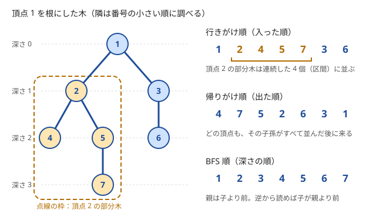

!!! abstract "要点"
    - **何ができるか**：根を決めて DFS か BFS をすると、親・深さ・部分木サイズ・行きがけ順・帰りがけ順が $O(N)$ で求まる。親から子へは行きがけ順（または BFS 順）で値を配り、子から親へは帰りがけ順（または BFS 順の逆）で結果を集める。この集め方が木 DP の土台になる。
    - **いつ使うか**：
        - 頂点 1 を根とする根付き木で、部分木の頂点数・和・最大を求める。
        - 子孫・祖先・訪問順を答える。
        - $p_i < i$（親の番号が自分より小さい）形で木が与えられる。
    - **計算量**：$O(N)$。DFS・BFS・番号順のどれでも、各頂点と各辺を定数回ずつ見る。
    - **前提**：[木の基本性質と表現](../tree/tree-basics.md)、[幅優先探索（BFS）と無重み最短路](../graph/bfs.md)

<!-- textlint-disable -->
別名：木の探索・行きがけ順・帰りがけ順・DFS 順・BFS 順・部分木サイズ・深さ・preorder・postorder
<!-- textlint-enable -->

根付き木の走査は、根を 1 つ決めて木を上から下へたどり、頂点ごとの親・深さ・部分木の情報を求めることである。木には閉路がないので、親へ戻る辺だけを避ければ訪問済みの印なしに全頂点を 1 度ずつ訪れる。大事なのはどの順に頂点を処理するかで、「親が子より先」か「子が親より先」かを選べば、上から配る計算も下から集める計算も 1 回の走査で済む。

## 親・深さ・部分木サイズを求める {#parent-depth-size}

根 $r$ を決めると、各頂点 $v$ に次の 3 つの値が決まる。頂点は実装に合わせて 0-indexed で書き、問題文の頂点 1 を根 0 にする。

- $\mathrm{par}[v]$：$v$ から根へ向かう最初の隣（根では $-1$）
- $\mathrm{dep}[v]$：根から $v$ までの辺の数（根は 0）
- $\mathrm{sz}[v]$：$v$ の部分木（$v$ と、その子孫すべて）の頂点数

この 3 つは、求まる向きが違う。$\mathrm{dep}[c] = \mathrm{dep}[v] + 1$ は親 $v$ の値から子 $c$ の値を決める（上から下）。$\mathrm{sz}[v] = 1 + \sum_{c} \mathrm{sz}[c]$ は子の値から親の値を決める（下から上）。DFS なら 1 回の再帰で両方を書ける。子を呼ぶ前に子の深さを決め、子から戻った後に子の部分木サイズを足せばよい。

```cpp
--8<-- "tree-traversal/dfs-order.cpp:core"
```

完全なプログラム：[`dfs-order.cpp`](https://github.com/yuukougun/kyopro-atlas/blob/main/snippets/tree-traversal/dfs-order.cpp)（GitHub）
{ .kp-code-src }

`in`・`pre`・`post` は、次の節で扱う行きがけ番号・行きがけ順・帰りがけ順の記録である。無向の隣接リストには親も入っているので、親を引数 `p` で渡して `c == p` を飛ばす。木では親以外の隣はすべて未訪問の子なので、`visited` の配列は要らない（[木の基本性質と表現](../tree/tree-basics.md)）。各頂点で隣を 1 回ずつ見るので、全体は隣接リストの長さの和 $2(N - 1)$ に比例し、$O(N)$ である。

次の図は、7 頂点の木を頂点 1 から、隣を番号の小さい順に調べて DFS した結果である（図の頂点は問題文に合わせて 1 から番号を振る）。



| 頂点 | 親 | 深さ | 部分木サイズ | 行きがけ番号 |
| --- | --- | --- | --- | --- |
| 1 | — | 0 | 7 | 0 |
| 2 | 1 | 1 | 4 | 1 |
| 3 | 1 | 1 | 2 | 5 |
| 4 | 2 | 2 | 1 | 2 |
| 5 | 2 | 2 | 2 | 3 |
| 6 | 3 | 2 | 1 | 6 |
| 7 | 5 | 3 | 1 | 4 |

行きがけ番号は、行きがけ順で何番目に入ったか（0-indexed）である。部分木サイズは、子の部分木サイズの和に 1 を足したものになっている。たとえば頂点 2 は $1 + \mathrm{sz}[4] + \mathrm{sz}[5] = 1 + 1 + 2 = 4$ である（表の頂点番号のまま書く）。

部分木の頂点数のほかにも、部分木の値の和・最大・葉の数などは、同じ形の「子の値を親にまとめる」で求まる。まとめる演算は、子をどの順に足しても同じ結果になるもの（和・最大・積など）なら何でもよい。

## 行きがけ順と帰りがけ順（子から親へ集約する） {#pre-post-order}

DFS で頂点に入った順を行きがけ順（preorder）、頂点から出た順を帰りがけ順（postorder）という。定義と一般のグラフでの性質は[深さ優先探索](../graph/dfs.md#pre-post-order)にあり、ここでは木で使う 3 つの性質に絞る。

- **行きがけ順では親が子より前**：子に入るのは親に入った後である。だから行きがけ順に処理すれば、親の値を使って子の値を決められる。深さ・根との距離・根からの累積 $S[v]$ はこの向きで求める
- **帰りがけ順では子が親より前**：$v$ から出るのは、$v$ の子孫すべてから出た後である。だから帰りがけ順に処理すれば、子の結果がすべて確定してから親を計算できる。部分木サイズ・部分木の和、そして[木 DP](../dp/tree-dp.md) はこの向きで求める
- **行きがけ順で部分木は区間になる**：$v$ へ入ってから $v$ を出るまでの間で訪れる頂点は、ちょうど $v$ の子孫である。行きがけ番号を $\mathrm{in}[v]$ とすると、$v$ の部分木は行きがけ順の区間 $[\mathrm{in}[v], \mathrm{in}[v] + \mathrm{sz}[v])$ に並ぶ。[親・深さ・部分木サイズを求める](#parent-depth-size)の図の木では、頂点 2 は $\mathrm{in} = 1$・$\mathrm{sz} = 4$ なので、部分木は行きがけ番号が $1$ 以上 $5$ 未満（番号 1〜4 の 4 個）の所に並ぶ

3 つ目の性質から、「$u$ は $v$ の子孫か」が $\mathrm{in}[v] \le \mathrm{in}[u] < \mathrm{in}[v] + \mathrm{sz}[v]$ の比較だけで $O(1)$ で判定できる。部分木への加算や部分木の和を、行きがけ順の列の区間に対する操作に直すのが[オイラーツアー](../tree/euler-tour.md)である。

行きがけ順と帰りがけ順は、隣を調べる順で変わる。隣接リストは入力の辺の順に並ぶので、「番号の小さい隣から訪れる」などの指定があれば、DFS の前に各頂点の隣接リストをソートする（例題の [ABC213 D](#abc213_d)）。部分木サイズや深さのように順によらない値なら、ソートは要らない。

??? question "確認問題：訪問順を出力する"
    DFS で頂点に入ったときと、子から戻ってきたときの両方で頂点の番号を出力すると、出力の長さはいくつになるか。[親・深さ・部分木サイズを求める](#parent-depth-size)の図の木で確かめよ。

    ??? success "答え"
        $2N - 1$ 個である。入ったときに各頂点を 1 回ずつで $N$ 個、子から戻るたびに親を 1 回ずつで、子から親へ戻る回数は辺の数 $N - 1$ に等しい。図の木では 1 2 4 2 5 7 5 2 1 3 6 3 1 の 13 個で、$2 \times 7 - 1 = 13$ に合う。

## BFS 順の逆で再帰を使わずに集約する {#bfs-order}

根から [BFS](../graph/bfs.md) して頂点を取り出した順（BFS 順）は、深さの小さい順に並ぶ。親の深さは子より 1 小さいので、BFS 順でも親は必ず子より前にある。したがって、帰りがけ順の代わりに BFS 順を逆から読めば、子が親より先に来る。行きがけ順の代わりには BFS 順を前から読めばよい。

```cpp
--8<-- "tree-traversal/bfs-order.cpp:core"
```

完全なプログラム：[`bfs-order.cpp`](https://github.com/yuukougun/kyopro-atlas/blob/main/snippets/tree-traversal/bfs-order.cpp)（GitHub）
{ .kp-code-src }

- **配列をキューとして使う**：`order` に頂点を追加しながら、添字 `i` で前から読む。読み終えた `order` がそのまま BFS 順になり、`queue` から取り出した順を別に記録する必要がない
- **逆順のループは `i >= 1` まで**：`order[0]` は根で、親がない。根まで回すと `par[0] = -1` に足して範囲外を書く
- **使える計算**：子をまとめる演算が子の順によらないものなら、帰りがけ順と BFS 順の逆は同じ結果になる。子を訪れた順そのものが要る計算（訪問順の出力や行きがけ番号）には使えず、DFS が要る

BFS 順の逆は、再帰を使わないので、パス状の木でもスタックがあふれない（[再帰の深さ](#recursion-depth)）。深さごとにまとめて処理したいときも、BFS 順なら同じ深さの頂点が連続して並ぶ。

??? question "確認問題：BFS 順の逆で部分木サイズが正しく求まる理由"
    BFS 順の逆にたどって `sz[par[v]] += sz[v]` をすると、`sz[v]` を親に足す時点で `sz[v]` が確定しているのはなぜか。

    ??? success "答え"
        `sz[v]` に足し込まれるのは $v$ の子 $c$ の `sz[c]` だけで、子は $v$ より深いので BFS 順で $v$ より後ろにある。逆からたどると、$v$ に来る前に子はすべて処理済みで、`sz[v]` は完成している。子の `sz[c]` も同じ理由で、さらに深い頂点から順に確定している。

## 親の番号が自分より小さいなら、番号の逆順で足りる {#parent-index}

問題文で「頂点 $i$（$2 \le i \le N$）の親は $p_i$ で、$p_i < i$」の形で木が与えられる問題を考える。この形では親の番号は必ず子より小さく、番号の小さい順はすでに「親の後に子が来る」順になっている。隣接リストを作らず、DFS や BFS もせずに、番号の順と番号の逆順のループで済む。

```cpp
--8<-- "tree-traversal/parent-index.cpp:core"
```

完全なプログラム：[`parent-index.cpp`](https://github.com/yuukougun/kyopro-atlas/blob/main/snippets/tree-traversal/parent-index.cpp)（GitHub）
{ .kp-code-src }

番号の順は BFS 順と同じ役割をする。番号の順に読めば深さや「親から受け継ぐ値」が求まり、番号の逆順に読めば部分木サイズや「子から集める値」が求まる。練習の ABC309 E は、番号の順に「あと何世代まで及ぶか」を子へ配るだけで解ける。

$p_i < i$ が保証されていない親の配列（$p_i$ が任意の頂点）では、この方法は使えない。番号の大きい親を先に処理してしまい、まだ確定していない値を読むからである。その場合は親の配列から子のリストを作り、根から BFS して BFS 順を作る。

??? question "確認問題：p_i < i で DFS が要らない理由"
    $p_i < i$ の木で、番号の逆順に `sz[p[v]] += sz[v]` をすれば部分木サイズが求まる。DFS を使わずに済むのはなぜか。

    ??? success "答え"
        $v$ の子 $c$ はどれも $p_c = v < c$ を満たすので、$v$ より番号が大きい。番号の逆順に処理すると、$v$ に来た時点で子はすべて処理済みで、`sz[v]` は完成している。DFS が帰りがけ順で保証する「子が親より前」が、番号の付け方で最初から保証されている。

## 再帰の深さ（パス状の木）と非再帰の書き方 {#recursion-depth}

再帰の DFS の深さは、根から最も深い頂点までの頂点数である。木が一直線（パス状）で根が端にあると、深さは $N$ になる。$N = 2 \times 10^5$ 程度のパス状の木は、テストケースによく入っている。

スタックの上限は環境で違う。AtCoder ではスタックの上限が大きく、再帰の DFS のままで通ることが多い。一方、手元の Linux はスタックが 8 MiB のことが多い。この上限では、このページの再帰の DFS（g++-15・`-O2`）は $N = 10^5$ のパス状の木でもスタックがあふれて落ちた。手元だけで落ちるならスタックの上限を広げるか（[AtCoder と手元の C++ 環境](../cpp/cpp-environment.md#stack-depth)）、再帰を使わない形に書き直す。

再帰を使わない書き方は 2 つある。

- **BFS 順を使う**：[BFS 順の逆で再帰を使わずに集約する](#bfs-order)のとおり、BFS 順を前から読んで上から配り、逆から読んで下から集める。子の順によらない計算ならこれで足りて、最も短く書ける
- **明示的なスタックを使う**：行きがけ番号や訪問順の出力など、DFS の順そのものが要るときは、スタックに「入る予定」と「出る予定」を積む（[非再帰の DFS](../graph/dfs.md#iterative)）

DFS をラムダ式で書くときは、ラムダがそのままでは自分を呼べないので、`auto dfs = [&](auto&& self, int v, int p) -> void { … };` の形で自分を引数に渡す（[再帰ラムダ](../cpp/cpp-lambda.md#recursive-lambda)）。

## 一般の木 DP は DP の章へ {#to-tree-dp}

このページの「子の値を親にまとめる」は、頂点ごとに値を 1 つだけ持つ最も単純な木 DP である。値を複数の状態に分けたり、子の値を組み合わせ方の数として掛け合わせたりする一般の形は[木 DP](../dp/tree-dp.md) で扱う。計算順序は、子から集めるときは帰りがけ順か BFS 順の逆、親から配るときは行きがけ順か BFS 順で、どれもこのページの順のどれかである。

- **状態を持つ**：「$v$ を選んだか」などで値を分けると、独立集合や塗り分けの数え上げになる（[木 DP](../dp/tree-dp.md#vertex-states)）
- **すべての頂点を根にする**：部分木の値を各頂点を根にして求めたいときは、根を 1 歩動かしたときの差分を BFS 順で配る（[全方位木 DP](../dp/rerooting.md)）
- **部分木への更新とクエリ**：部分木が行きがけ順の区間になることを使い、区間のデータ構造に載せる（[オイラーツアー](../tree/euler-tour.md)）

## 落とし穴 {#pitfalls}

**親を飛ばし忘れる**。無向の隣接リストで `c == p` を飛ばさないと、親と子を往復して再帰が止まらない。BFS 順を作るときも `c == par[v]` で飛ばす。根の親を $-1$ にしておけば、根で誤って飛ばす頂点はない。

**番号の振り方を混ぜる**。問題文は 1-indexed、実装は 0-indexed なので、入力の直後に 1 を引く。$p_i < i$ の形で $p$ を 0-indexed に直すと、頂点 $i$（1-indexed）の親は `p[i - 1] = p_i - 1` になる。出力の前に 1 を足し忘れない。

**深さの基準を取り違える**。根の深さを 0 にするか 1 にするかは問題で決まる。深さの差 $\mathrm{dep}[u] - \mathrm{dep}[v]$ はどちらの基準でも変わらないが、「深さ $D$ の頂点を数える」のように深さの値そのものを使うときは、基準を取り違えると答えが 1 段ずれる。また「$y$ 世代先まで」は差が $y$ 以下で、$y$ 世代先の頂点も含む。

**$N = 1$ を忘れる**。辺がないので、辺を読むループは 0 回で、BFS 順は根だけになる。「根の子のうち最大の部分木」のように子の存在を前提にした式は、子がない場合を分けて書く。

**マルチテストケースで配列を使い回す**。隣接リスト・`par`・`sz` をグローバルに置くと、前のテストケースの値が残る。テストケースごとに作り直すか、使う範囲を初期化し直す。

## 上位の手法へのつながり {#next-steps}

走査順が決まると、木の問題の多くは「どの順で値を集めるか・配るか」に直せる。次のページは、このページの走査を前提にしている。

- **子から親へ値を集めて最適化・数え上げをする**：帰りがけ順の集約を一般にしたものが[木 DP](../dp/tree-dp.md#postorder)である。
- **すべての頂点を根にしたときの値が要る**：根を隣へ移したときの差分だけを計算する[全方位木 DP](../dp/rerooting.md#what-changes)を使う。
- **部分木への加算・部分木の和を何度も聞かれる**：行きがけ順の番号で部分木が区間になることを使う（[オイラーツアー](../tree/euler-tour.md#in-out)）。
- **2 頂点の距離・パス上の値を聞かれる**：深さと親の表から [LCA](../tree/lca.md#distance) を求める。

## 使い分け {#comparison}

- 親の値を配る・子の値を集めるだけなら、DFS と BFS のどちらでもよい。パス状の木で再帰が心配なら BFS 順を使う
- 行きがけ番号・訪問順の出力・部分木の区間が要るなら DFS（再帰か明示的なスタック）を使う
- 同じ深さの頂点をまとめて扱うなら BFS 順を使う
- $p_i < i$ の形で与えられたら、番号の順と逆順のループで済ませる

## 例題 {#examples}

### ABC213 D. Takahashi Tour {#abc213_d}

<div class="kp-problems" data-role="example" markdown>

- [ABC213 D. Takahashi Tour](https://atcoder.jp/contests/abc213/tasks/abc213_d)（diff 710）：都市 1 から出発し、未訪問の隣の都市のうち番号最小の所へ進み、なければ来た道を戻る旅で、訪れる都市を順に出力する。

</div>

移動の規則は、頂点 1 を根にして隣を番号の小さい順に調べる DFS そのものである。「来た道を戻る」は子から親へ戻ることにあたるので、頂点に入ったときと、子から戻ってきたときの両方で、いる頂点の番号を出力する。出力は $2N - 1$ 個になる（[行きがけ順と帰りがけ順](#pre-post-order)の確認問題）。

??? note "解法の詳細"
    - 隣接リストを作り、各頂点の隣を昇順にソートする。入力の順のままだと、訪れる順が問題の指定と変わる。
    - 頂点 1 から再帰の DFS をする。頂点に入ったら番号を出力し、子の DFS から戻るたびに自分の番号をもう一度出力する。親は引数で渡して飛ばす。
    - 各辺を行きと帰りで 2 回ずつたどるので、ソートを含めて $O(N \log N)$。$N$ は $2 \times 10^5$ まで来るので、手元で試すならパス状の木でスタックが足りるかを確かめる（[再帰の深さ](#recursion-depth)）。

## 練習問題 {#practice}

<div class="kp-problems" data-role="practice" markdown>

- [ABC270 C. Simple path](https://atcoder.jp/contests/abc270/tasks/abc270_c)（diff 625）：木の 2 頂点 X・Y を結ぶパスの頂点を順に出力する。
- [ABC333 D. Erase Leaves](https://atcoder.jp/contests/abc333/tasks/abc333_d)（diff 704）：葉を 1 つずつ消す操作で頂点 1 を消すまでの最小の操作回数を求める。
- [ABC309 E. Family and Insurance](https://atcoder.jp/contests/abc309/tasks/abc309_e)（diff 957）：家系図で、人 x_i から y_i 世代先までの子孫に保険が及ぶとき、保険に入っている人の数を求める。
- [ABC146 D. Coloring Edges on Tree](https://atcoder.jp/contests/abc146/tasks/abc146_d)（diff 1192）：木の辺を、各頂点に接する辺の色がすべて異なるように塗るとき、最小の色数と塗り方を出力する。

</div>

??? note "練習の方針"
    - **ABC270 C**：X を根にして走査し、親 $\mathrm{par}$ を記録する。Y から親をたどると Y から X へのパスになるので、逆にして出力する
    - **ABC333 D**：頂点 1 を根にして部分木サイズを求める。頂点 1 を葉にするには、子の部分木を 1 つだけ残して残りをすべて消す必要がある。最大の子の部分木を残すのが最善で、答えは $N$ からその部分木サイズを引いた値である
    - **ABC309 E**：$p_i < i$ の形なので、番号の順に「あと何世代まで保険が及ぶか」を求める。各人の値は、親の値から 1 引いたものと、自分が買った保険の $y$ の大きい方である。保険を買っていなければ自分の分を $-1$ とし、根は親の分を $-1$ とする。値が 0 以上の人を数える
    - **ABC146 D**：最小の色数は最大次数である。根から BFS 順に頂点を見て、親へ向かう辺の色だけを避けながら、子への辺に色を小さい順に振る。木では各頂点で塗り済みの辺が親への 1 本だけなので、最大次数色で足りる

## 力試し {#challenge}

<div class="kp-problems" data-role="challenge" markdown>

- [ABC133 E. Virus Tree 2](https://atcoder.jp/contests/abc133/tasks/abc133_e)（diff 1505）：N 頂点の木の各頂点を K 色で塗るとき、距離 2 以下の 2 頂点がすべて異なる色になる塗り方の数を求める。

</div>

??? note "力試しの方針"
    - **ABC133 E**：根から行きがけ順（BFS 順でもよい）に色を決めると、各頂点で避けるべき塗り済みの頂点の数が、それまでの塗り方によらず決まる。根は $K$ 通りで、根の子は根と先に塗った兄弟を避けて $K - 1, K - 2, \dots$ 通りである。それ以外の頂点の子は親・祖父・先に塗った兄弟を避けて $K - 2, K - 3, \dots$ 通りである。これらを積の法則で掛け合わせる。途中で 0 以下になれば答えは 0 である

## 参考 {#references}

- [drken「AtCoder ABC 213 D - Takahashi Tour (2Q, 茶色, 400 点)」](https://drken1215.hatenablog.com/entry/2021/08/11/025100)：例題の方針（隣をソートした DFS と、戻るときの出力）
- [gotoki_no_joe「ABC270 A～F をHaskellで」](https://qiita.com/gotoki_no_joe/items/126eaba4f553c9ef13be)：練習の問い（2 頂点を結ぶパスの出力）と、親を引数で渡して戻らないようにする DFS でパスを探す別の解き方
- [drken「AtCoder ABC 333 D - Erase Leaves (2Q, 茶色, 400 点)」](https://drken1215.hatenablog.com/entry/2024/11/02/192645)：練習の方針（頂点 1 の子の部分木サイズ）
- [ZOI_dayo「【AtCoder】黒〜緑のためのABC解説 | ABC309 A~F」](https://qiita.com/ZOI_dayo/items/a55cc4342832efdc23ba)：練習の方針（$p_i < i$ を使って番号の順に処理する）
- [drken「AtCoder ABC 146 D - Coloring Edges on Tree (2Q, 緑色, 400 点)」](https://drken1215.hatenablog.com/entry/2020/04/26/172200)：練習の方針（最大次数色で塗れる理由と塗り方）
- [kmjp「AtCoder ABC #133 : E - Virus Tree 2」](https://kmjp.hatenablog.jp/entry/2019/07/07/1000)：力試しの方針（DFS 順に色の選択肢を掛ける）
