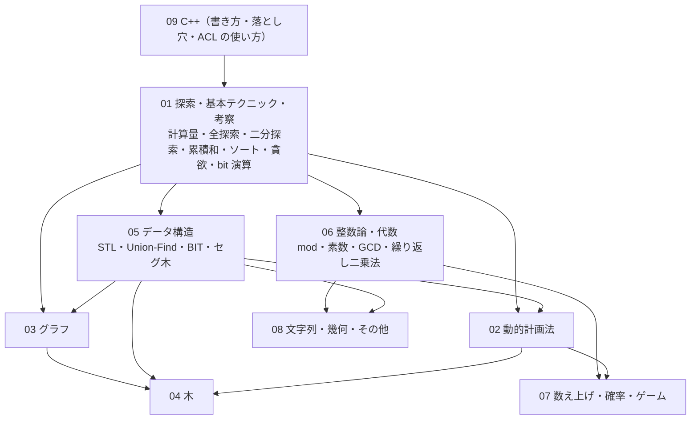

# 00 全体構成・横断（curriculum）調査レポート

調査日：2026-10-21。担当：全体構成・横断（手引き §6 の 00）。

この担当は特定の手法ではなく、(1) 既存の体系（サイト・書籍・問題集・ガイドライン）の構成の比較、(2) 最近の ABC の出題傾向のデータ分析、(3) 横断ページ（逆引き辞典・使い分け・早見表・戦い方・精進の仕方・用語集・ロードマップなど）の材料、(4) 担当表（01〜09）から抜けている項目の洗い出し、を扱う。項目一覧は [00-curriculum.topics.yaml](00-curriculum.topics.yaml)（横断ページは `kind: cross`、担当表から抜けている項目は `kind: gap`、その候補は `kind: gap-candidate`）。

**調査の条件と制約**

- atcoder.jp とそのサブドメインのページは一切開いていない。問題の実在・タイトル・difficulty は `tools/ap.py`（AtCoder Problems の 2026-10-21 のキャッシュ）で確かめた
- 例題の内容の裏付けには、主に ikatakos 氏のコンテスト記録（[いかたこのたこつぼ](https://ikatakos.com/)、CC BY 4.0、`noai` 指定なし）の「解法」の節を使った。同サイトには問題文を引用した節もあるが、その節は読んでいない
- **Codeforces（codeforces.com）は `<meta name="robots" content="noai">` と `noimageai` を指定している**（`https://codeforces.com/edu/courses` で確認）。手引き §3.8 に従い、Codeforces のブログ・EDU・Catalog は資料にしていない
- USACO Guide は書面の許可のない使用・複製・再配布を禁じる規約（[Using This Guide](https://usaco.guide/general/using-this-guide)）なので、構成の参考にとどめた。OI Wiki（CC BY-SA 4.0＋SATA）・cp-algorithms（CC BY-SA 4.0）も文章は転載していない
- 調査の途中で、セッション全体で共有の WebSearch の予算が尽きた。後半は既知の URL を直接開いて調べたので、検索で広げられなかった部分は「未確認」と書いた
- 調査の一部（英語・中国語圏の体系、日本語の書籍・ガイドライン、色変記事と ABC の傾向、横断ページの材料）は、同じ指示を受けた分岐のエージェントに並行して調べさせ、結果を統合した

## 1. 調べた資料

### 1.1 データ・一次資料

| 資料 | URL | 何の参考にしたか |
| --- | --- | --- |
| `tools/ap.py`（AtCoder Problems の公開データ、2026-10-21 取得） | （リポジトリ内） | 問題の実在・difficulty、ABC の問題数・時間・Rated 範囲の変遷、位置ごとの difficulty の分布、練習用コンテストの一覧 |
| AtCoder Problems の difficulty・解答時間の推定スクリプト | https://github.com/kenkoooo/AtCoderProblems/blob/master/lambda-functions/time-estimator/function.py | difficulty の定義（解ける確率50%のレート、傾き ln6/400）と、予測解答時間の定義（直前の AC からの時間＋ペナルティの対数回帰） |
| AtCoder Problems のフロントエンド（ProblemModelUtil.ts） | https://github.com/kenkoooo/AtCoderProblems/blob/master/atcoder-problems-frontend/src/utils/ProblemModelUtil.ts | 解ける確率・予測解答時間の式（秒単位） |
| 日本語版 Wikipedia「AtCoder」 | https://ja.wikipedia.org/wiki/AtCoder | ABC の問題数・配点・Rated 範囲の変遷の確認 |
| ACL のドキュメント（手元、CC0） | `~/lib/ac-library-master/document_ja/` | 早見表の ACL 機能一覧 |

### 1.2 英語・中国語圏の体系

| 資料 | URL | 何の参考にしたか |
| --- | --- | --- |
| USACO Guide（構成） | https://usaco.guide/ 、https://github.com/cpinitiative/usaco-guide/blob/master/content/ordering.ts | 段階×分野の構成、prerequisites・frequency のメタデータ、Focus Problem、問題の難度ラベル、進捗の状態 |
| USACO Guide のガイド類 | https://usaco.guide/general/modules 、https://usaco.guide/general/usaco-faq 、https://usaco.guide/general/practicing 、https://usaco.guide/general/debugging-checklist | モジュールの構成、段階と Codeforces レートの対応、練習法、デバッグのチェックリスト |
| OI Wiki | https://oi-wiki.org/ 、https://github.com/OI-wiki/OI-wiki/blob/master/mkdocs.yml | 章立て、专题ページ、よくある誤り・对拍 |
| NOI 大綱 | https://www.noi.cn/upload/resources/file/2023/03/15/1fa58eac9c412e01ce3c89c761058a43.pdf 、https://lailai.one/zh-Hans/docs/contest/contest/noi-syllabus | 知識点ごとの難度係数と、級の重なりの設計 |
| 洛谷の問題難度 | https://help.luogu.com.cn/manual/luogu/problem/difficulty | 色付きの難度表示と「安定して解ければ」の目安 |
| cp-algorithms | https://cp-algorithms.com/navigation.html | 章立て、Tasks（問題の型）の記事 |
| Competitive Programmer's Handbook | https://cses.fi/book/book.pdf | 章立て（償却解析・平方根・平面走査の独立章） |
| Guide to Competitive Programming（第2版・第3版） | https://link.springer.com/book/10.1007/978-3-030-39357-1 、https://link.springer.com/book/10.1007/978-3-031-61794-2 | 章立て |
| Competitive Programming 4 | https://cpbook.net/details?cp=4 、https://cpbook.net/methodstosolve | 章立て、Rare Topics、問題ごとの一言ヒント |
| CSES Problem Set | https://cses.fi/problemset/ | カテゴリと問題数 |
| A2OJ Ladders（ミラー） | https://earthshakira.github.io/a2oj-clientside/server/Ladders.html | レート別・問題位置別の問題リストの発想 |
| KACTL | https://github.com/kth-competitive-programming/kactl | 早見表の構成、techniques.txt（手法名の総覧）、troubleshoot.txt（WA/TLE/RE のチェックリスト） |
| Library Checker | https://github.com/yosupo06/library-checker-problems/blob/master/categories.toml | カテゴリと問題数、動作確認用の問題 ID |

### 1.3 日本語の書籍・ガイドライン・問題集

| 資料 | URL | 何の参考にしたか |
| --- | --- | --- |
| 『プログラミングコンテストチャレンジブック 第2版』（蟻本） | https://tatsu-zine.com/books/procon-challenge 、https://kumonosu.cloudsquare.jp/program/table-of-contents/post-1615/ | 目次・段階分け |
| drken「AtCoder 版！蟻本」（初級・中級・上級・発展的トピック） | https://qiita.com/drken/items/e77685614f3c6bf86f44 、https://qiita.com/drken/items/2f56925972c1d34e05d8 、https://qiita.com/drken/items/9b311d553aa434bb26e4 、https://qiita.com/drken/items/0de3d205690d92307b7c | 本の節と AtCoder の問題の対応のさせ方 |
| 『競技プログラミングの鉄則』 | https://book.mynavi.jp/ec/products/detail/id=131288 、https://github.com/E869120/kyopro-tessoku | 章立て、考察の10項目、例題・応用・力試しの3段 |
| 『問題解決のための「アルゴリズム×数学」が基礎からしっかり身につく本』 | https://gihyo.jp/book/2022/978-4-297-12521-9 、https://kumonosu.cloudsquare.jp/program/table-of-contents/post-6047/ | 章立て、考察の型 |
| 『問題解決力を鍛える！アルゴリズムとデータ構造』 | https://www.kspub.co.jp/book/detail/5128442.html | 章立て、「なぜ正しいか」の書き方 |
| 『プログラミングコンテスト攻略のためのアルゴリズムとデータ構造』（と新版） | https://book.mynavi.jp/ec/products/detail/id=35408 、https://book.mynavi.jp/ec/products/detail/id=151348 | 章立て |
| 『アルゴリズム実技検定 公式テキスト』 | https://book.mynavi.jp/ec/products/detail/id=120229 、https://book.mynavi.jp/ec/products/detail/id=135840 | 上級・エキスパートの範囲 |
| 競プロ典型 90 問 | https://github.com/E869120/kyopro_educational_90 、https://qiita.com/e869120/items/1b2a5f0f07fd927e44e9 | ★と difficulty の対応、考察・実装の典型15項目 |
| E869120「レッドコーダーが教える、競プロ・AtCoder上達のガイドライン」 | https://qiita.com/e869120/items/f1c6f98364d1443148b3 、https://qiita.com/e869120/items/eb50fdaece12be418faa 、https://qiita.com/e869120/items/acba3dd8649d913102b5 | 色ごとの条件・時間の目安・解説を読むまでの時間 |
| chokudai「AtCoder（競技プログラミング）の色・ランクと実力評価、問題例」 | https://chokudai.hatenablog.com/entry/2019/02/11/155904 | 色ごとの実力の説明 |
| hotman78「atcoder黄色になるために必要になるかもしれないし、ならないかもしれないライブラリ一覧」 | https://hotman78.hatenablog.com/entry/2020/07/10/173053 | 黄色に向けたライブラリの優先度 |
| nabata「AtCoderの水色(以上)がどれだけのレベルなのかを可能な限り客観的に全力で可視化してみた」 | https://qiita.com/nabata/items/c63f00e32be63416a7db | 色ごとの人数の割合 |
| drken「AtCodeer 本を書きました！」 | https://drken1215.hatenablog.com/entry/atcodeer | 入門書の構成（ランレングス圧縮などの体系化） |
| はまやん「競技プログラミングにおける動的計画法更新最適化まとめ」 | https://blog.hamayanhamayan.com/entry/2017/03/20/234711 | drken の記事からの参照の例（DP の高速化の分類） |
| アルゴリズムロジック | https://algo-logic.info/ | 分野別の解説サイトの例 |

### 1.4 例題の裏付け（抜けている項目）

| 資料 | URL | 何の参考にしたか |
| --- | --- | --- |
| ikatakos 氏のコンテスト記録（CC BY 4.0） | https://ikatakos.com/pot/programming_algorithm/contest_history/atcoder/ 以下（各問題の行に個別の URL） | abc436_e・abc371_g・abc470_f・abc296_f・abc190_f・abc452_f・abc407_e・abc223_f・abc167_f・abc194_e・abc438_f・abc469_e・abc236_e・abc321_f・abc260_f・abc174_f・abc209_e・abc147_d・abc281_f・abc192_d・abc364_g・abc477_f・abc457_g・abc476_g・abc454_f・abc459_f・abc466_e の解法 |
| hibit「配列をソートしたときに先頭からK番目までの和を求めるやつ」 | https://qiita.com/hibit/items/fff6c11e9f17fb435c69 | abc306_e（上位 K 個の和の管理） |
| traP「集合をハッシュする (Zobrist hashing)」 | https://trap.jp/post/1594/ | abc250_e・abc238_g（集合のハッシュ） |
| drken「ABC 324 F - Beautiful Path」 | https://drken1215.hatenablog.com/entry/2023/10/21/012800 | abc324_f（分数計画） |
| fjnkt98「ABC266 F」 | https://zenn.dev/fjnkt98/articles/98c9dfbd0702a4 | abc266_f（なもりグラフ） |
| drken「Educational DP Contest の F 〜 J 問題の解説と類題集」 | https://qiita.com/drken/items/03c7db44ccd27820ea0d | dp_f（DP の復元） |
| comet725 氏の ABC 解説（Qiita） | https://qiita.com/comet725/items/b8d667d45fc386392f6f 、https://qiita.com/comet725/items/53e6c3b9804e2f235a01 、https://qiita.com/comet725/items/15e9951d2076493fcbe6 、https://qiita.com/comet725/items/4e3a310ec19ed32e12f6 | abc455_d（連結リスト）・abc478_d（イベントソート）・abc463_e（超頂点）・abc458_d（2つのヒープ） |
| hitonanode の cplib-cpp（Slope trick） | https://hitonanode.github.io/cplib-cpp/other_algorithms/slope_trick.hpp.html | Slope trick の位置づけ（優先度 B） |

### 1.5 色変記事・パフォーマンスの分析・ABC の傾向

| 資料 | URL | 何の参考にしたか |
| --- | --- | --- |
| 色変記事（水8本・青9本・黄13本） | §2.2.2 の各行 | 色ごとに学んだ分野・精進の方法・戦い方 |
| drken「AtCoder コンテストについての tips」 | https://qiita.com/drken/items/8a6f139158cde8a61dce | 完答数とパフォーマンスの目安、順位の決まり方 |
| sirsoldano「生成AIはAtCoderBeginnerContestのインフレを加速させたか」 | https://qiita.com/sirsoldano/items/ad3d05e4a37759850445 | 2025 年前半の difficulty の低下についての分析 |
| chokudai「競技プログラミングと生成AIの今 2025/07/02版」 | https://chokudai.hatenablog.com/entry/2025/07/02/151841 | 生成AIのルールと AI の実力についての第三者の言及 |
| ac-predictor | https://github.com/key-moon/ac-predictor | パフォーマンスの予測ツール |
| NoviSteps | https://atcoder-novisteps.vercel.app/about | 問題のグレード（11Q〜6D）と ABC の位置の対応 |
| AtCoder Clans | https://kato-hiro.github.io/AtCoderClans/ | ツール・記事の一覧（公式のお知らせへのリンクの所在） |
| drken 氏のブログの月別一覧 | https://drken1215.hatenablog.com/archive/2024/09 など | 最近の配点の例 |
| 位置ごとの頻出分野の裏付け（abc451〜480 の D〜G） | §2.3.8 の表の各行（ikatakos 氏の記録、Qiita・Zenn・kmjp 氏のブログ） | 位置ごとに使われた手法 |

### 1.6 横断ページの材料

| 資料 | URL | 何の参考にしたか |
| --- | --- | --- |
| drken「計算量オーダーの求め方を総整理！」 | https://qiita.com/drken/items/872ebc3a2b5caaa4a0d0 | 1秒あたりの演算回数、log が出る場面 |
| drken「特集！知らないと損をする計算量の話」 | https://qiita.com/drken/items/18b3b3db5735241465ef | STL の計算量、値域と配列 |
| drken「k 番目の値を高速に取り出せるデータ構造のまとめ」 | https://qiita.com/drken/items/1b7e6e459c24a83bb7fd | K 番目の使い分け |
| drken「「998244353 で割ったあまり」の求め方を総特集！」 | https://qiita.com/drken/items/3b4fdf0a78e7a138cd9a | mod の性質 |
| drken「「写像12相」を総整理！」 | https://qiita.com/drken/items/f2ea4b58b0d21621bd51 | 公式 |
| drken「ビット演算 (bit 演算) の使い方を総特集！」 | https://qiita.com/drken/items/7c6ff2aa4d8fce1c9361 | bit 演算の小技 |
| drken「エラトステネスの篩の活用法を総特集！」 | https://qiita.com/drken/items/3beb679e54266f20ab63 | 最小素因数の篩 |
| algo-logic「競技プログラミングで解法を思いつくための典型的な考え方」 | https://algo-logic.info/how-to-think-cp/ | 制約と計算量、サインと手法 |
| Motsu_xe「解法キーアイデア集」「バグった原因集」 | https://motsu-xe.hatenablog.com/entry/2019/12/17/173222 、https://motsu-xe.hatenablog.com/entry/2019/11/15/173514 | 制約と計算量、詰まったときの手順、WA の原因 |
| irinote「競技プログラミング 〜計算量（オーダー）から解法を逆算する〜」 | https://note.com/irinote/n/nd8bd7693d9c8 | 制約と計算量 |
| alldirections「競技プログラミング：考察の種」 | https://zenn.dev/alldirections/articles/0b9ef77d6e3678 | サインと手法、定数倍 |
| kanpurin「競技プログラミング 典型問題メモ」 | https://kanpurin.hatenablog.com/entry/2020/04/07/182948 | サインと手法、使い分け |
| kmyk「競技プログラミングの問題の解き方、そのマニュアル」 | https://kmyk.github.io/blog/blog/2016/06/21/how-to-solve-problems-in-competitive-programming/ | 詰まったときの手順、原因の切り分け |
| kmyk「競技プログラミングにおける様々なテスト」 | https://kmyk.github.io/blog/blog/2020/11/12/various-tests-in-competitive-programming/ | テストの種類 |
| chokudai「競技プログラミングの強みと「典型力」について」 | https://chokudai.hatenablog.com/entry/2018/04/23/165232 | 拡張グラフなどのサイン、振り返り方 |
| E869120「デバッグ力を高める！」「アルゴリズム・AtCoder のための数学【前編】」「実装力で戦える！ ～競プロにおける実装テクニック14選～」 | https://qiita.com/e869120/items/8be6521e72025d7b2a13 、https://qiita.com/e869120/items/b4a0493aac567c6a7240 、https://qiita.com/e869120/items/920a6e63435bf6efe539 | チェックリスト、用語の区別、f(R)−f(L−1) |
| hamko「競技プログラミングでRuntime Errorを防ぐためのvalgrindとfsanitizeオプション」 | https://qiita.com/hamko/items/fe17e6ec290df2466246 | サニタイザなどの道具 |
| betrue12「競プロでWAが出たときのランダム入力データ生成入門」 | https://betrue12.hateblo.jp/entry/2019/09/07/171628 | ストレステストの手順と生成器のコツ |
| online-judge-tools の入門 | https://raw.githubusercontent.com/online-judge-tools/oj/master/docs/getting-started.ja.md | ストレステストのコマンド |
| USACO Guide の General（Time Complexity・Contest Strategy・Debugging Checklist・Basic Debugging・Fast IO・Practicing・Shortest Paths・PURS・Hashmaps） | https://github.com/cpinitiative/usaco-guide/tree/master/content | 各横断ページの比較材料 |
| cp-algorithms（0-1 BFS・Sparse Table・Fenwick・Prim・Z-function） | https://cp-algorithms.com/ | 使い分けの観点 |
| cppreference | https://en.cppreference.com/w/cpp/language/types 、https://en.cppreference.com/w/cpp/algorithm/lower_bound | 型の範囲、lower_bound の計算量 |
| OEIS（A066150・A006880・A000041・A000108） | https://oeis.org/ | 早見表の数の確認 |
| ToastUz「AtCoderで生成AIをフル活用！2025年の競技プログラミング術」（2025-10-04 更新） | https://qiita.com/ToastUz/items/98a4ff7fd63a061ef18d | ルールの変遷の第三者の整理 |
| AtCoder Problems の FAQ・ガイド | https://github.com/kenkoooo/AtCoderProblems/blob/master/doc/faq_ja.md 、https://github.com/kenkoooo/AtCoderProblems/tree/master/guide/src/ja | difficulty の意味、おすすめ問題、バーチャルコンテスト |

### 1.7 使わなかった資料

- **Codeforces**（ブログ・EDU・Catalog）：`noai`・`noimageai` の指定があるため（冒頭の注記）。検索結果に出た制約の表のブログ、USACO Guide が引用している Codeforces のブログも使っていない
- **atcoder.jp・info.atcoder.jp**：一切開いていない。公式のお知らせ（ARC の区分の変更、生成AI対策ルール、初参加者の内部レートの変更など）は、第三者のページにリンクがあることだけを記録した
- **アルゴ式（algo-method.com）**：開けなかった。**AOJ のコース**：API が応答しなかった。**TLE Eliminators の CP シート**：JavaScript で描画されるため中身を確認できなかった
- 未読の候補（検索結果に出たが本文は読んでいない）：WA の原因の記事（osrehun・lanevok・sano192・H20）、ランダムテストの記事（seekworser・harurunppp）、kyopro_friends「精進について」、hitoare「競技プログラミングの練習法」、AIris_Solid（知識量・考察力・実装力への分解）、darake（ABC200〜225 の A〜C の傾向）

## 2. 分野の全体像

### 2.1 既存の体系の比較

#### 2.1.1 英語・中国語圏の体系

**利用上の注意**：Codeforces（codeforces.com）のページには `<meta name="robots" content="noai">` と `noimageai` がある（2026-10-21 に `https://codeforces.com/edu/courses` で確認）。手引き §3.8 に従い、Codeforces のブログ・EDU・Catalog は資料にしていない。USACO Guide は書面の許可のない使用・複製・再配布を禁じる規約（[Using This Guide](https://usaco.guide/general/using-this-guide)）なので、構成の参考にとどめる。OI Wiki（CC BY-SA 4.0＋SATA）と cp-algorithms（CC BY-SA 4.0）も文章は転載しない。

##### USACO Guide（[usaco.guide](https://usaco.guide/)、構成は [content/ordering.ts](https://github.com/cpinitiative/usaco-guide/blob/master/content/ordering.ts)）

- **段階**：General／Bronze／Silver／Gold／Platinum／Advanced。段階→章→モジュールの3層で、モジュール数は Bronze 13・Silver 14・Gold 29・Platinum 23・Advanced 41
- **段階ごとの中身（要約）**
  - Bronze：計算量、基本データ構造、シミュレーション、全探索（再帰を含む）、ソート、set/map、場合分け、貪欲の入門、グラフの入門、長方形の幾何、アドホック
  - Silver：累積和（2次元・差分）、尺取り、二分探索（答えの二分探索を含む）、比較関数付きソート、ソート＋貪欲、優先度付きキュー、グラフ探索・塗りつぶし、木の入門、Functional graph、bit 演算の入門
  - Gold：約数・mod・組合せ、DP（ナップサック・グリッド・LIS・bitDP・区間DP・桁DP）、BFS・DSU・トポロジカルソート・最短路・MST、順序付き集合・スタック・スライド窓・BIT（PURS）、木 DP・全方位木 DP・オイラーツアー・LCA、三分探索・ハッシュ・半分全列挙
  - Platinum：セグ木の拡張・区間更新・動的/2次元の区間クエリ・平方分割、ダブリング・マージテク・HLD・重心分解・Virtual Tree・Kruskal 再構築木、幾何・平面走査・凸包・CHT、包除原理・行列累乗・bitset・分割統治 DP・SOS DP
  - Advanced：Wavelet・Segment Tree Beats・永続・Treap、Li Chao・ラグランジュ補間・Slope Trick、負辺の最短路・オイラー路・二重連結成分・SCC・オフライン削除・Link-Cut Tree、Broken Profile DP、フロー各種、FFT、Suffix Array、拡張ユークリッド・カタラン数・XOR 基底・ゲーム・マトロイド・乱択・インタラクティブ など
  - General：デバッグのチェックリスト・練習法・コンテストの戦い方・入出力の高速化 などの横断ページ
- **前提の示し方**：各モジュールの frontmatter に `prerequisites`（モジュール ID の配列）を持ち、ページ冒頭にリンクで出す（例：DSU の前提は graph-traversal）
- **出題頻度**：0 Has Not Appeared〜4 Very Frequent の5段階（過去の出題にもとづく）。本文で「このガイドはシラバスではない」と明記
- **モジュールの構成**：Lesson の冒頭に「その手法をそのまま使う問題」（Focus Problem）→ 実装 → 練習問題（推奨順、推奨に星）。必須でない項目は optional と表示（[Modules](https://usaco.guide/general/modules)）
- **問題の難度**：Very Easy〜Insane の6段階。「そのモジュールを読んだ直後の人にとって」の相対値で、モジュールをまたいでは比べられない
- **進捗**：モジュールは Not Started／Reading／Practicing／Complete／Skipped／Reviewing／Ignored、問題は Not Attempted／Solving／Solved／Reviewing／Skipped／Ignored。アカウントで同期
- **段階と Codeforces レートの目安**（[USACO FAQ](https://usaco.guide/general/usaco-faq)）：Bronze は参加者 1300 未満・問題 900〜1500、Silver は 1200〜1500・1200〜1900、Gold は 1500〜1800・1500〜2200、Platinum は 1650 以上・1900 以上
- **練習法**：進展がないとき解説を見るまでの時間の目安（Bronze 15〜20分、Silver 30〜40分）など、複数の筆者の意見を並べる（[Practicing](https://usaco.guide/general/practicing)）
- **良い点**：段階×分野の2軸、前提・頻度・進捗が機械で読める、Focus Problem で使いどころを先に見せる、横断ページがある
- **弱点**：段階が USACO の階級に依存する。問題の難度が相対値で全体比較できない。Platinum 以上は未完成と自ら書いている。外部資料へのリンク集の色が濃い
- **取り入れる点**：prerequisites のメタデータとページ冒頭の表示、出題頻度、「代表問題（Focus Problem）」、推奨の星、optional 表示、「シラバスではない」という注記、進捗の状態（Reviewing＝復習、Skipped＝後回し）

##### OI Wiki（[oi-wiki.org](https://oi-wiki.org/)、構成は [mkdocs.yml](https://github.com/OI-wiki/OI-wiki/blob/master/mkdocs.yml)）

- **章**：简介／比赛相关／工具软件／语言基础／算法基础／搜索／动态规划／字符串／数学／数据结构／图论／计算几何／杂项／专题 の14章。数学が最大（数論だけで約30項目、多項式・線形代数・線形計画・マトロイドまで）
- **特色**：DP 最適化（単調キュー・斜率・四辺形不等式・Slope Trick・WQS 二分）、杂项（座標圧縮・尺取り・オフライン算法（CDQ・整体二分＝並列二分探索・Mo）・分数計画・乱択・表達式求値）、**专题**（RMQ・Union-Find の応用・括弧列・セグ木とオフラインクエリ）＝手法ではなく「問題の型」で束ねたページ
- **前提**：一部のページに「前置知识」の節があるだけ。難度・頻度の表示はない。学習ルートのページは書きかけ（[学习路线](https://oi-wiki.org/contest/roadmap/)）
- **横断ページ**：よくある誤り（[常见错误](https://oi-wiki.org/contest/common-mistakes/)：CE／警告／WA／未定義動作）、よく使う技（[常见技巧](https://oi-wiki.org/contest/common-tricks/)：对拍＝ストレステストなど）
- **関連する中国の体系**：NOI 大綱は知識点ごとに難度係数1〜10を付け、入門級1〜5・提高級5〜8・NOI 級7〜10 と**隣の級との重なりを認める**（例：累積和3、二分探索4、Union-Find・BIT・セグ木・ダイクストラ6、SCC・bitDP・逆元・包除7、フロー・SA・平衡木・HLD 8、FFT 10。[2023年版](https://www.noi.cn/upload/resources/file/2023/03/15/1fa58eac9c412e01ce3c89c761058a43.pdf)、[2025年版のまとめ](https://lailai.one/zh-Hans/docs/contest/contest/noi-syllabus)）。洛谷の問題難度は8段階の色付きで、「思考の難しさと実装の難しさは別」と注記し、「この段階を安定して解ければ〇〇賞」という目安を添える（[洛谷の難度](https://help.luogu.com.cn/manual/luogu/problem/difficulty)）
- **良い点**：網羅性、DP 最適化とオフライン算法の整理、专题ページ、よくある誤りの一覧。Material for MkDocs で作られており、本教材の技術構成と近い
- **弱点**：前提・難度・頻度のメタデータがない。粒度が教科書的（ソートを十数種類並べるなど）
- **取り入れる点**：問題の型で束ねる「专题」ページ（括弧列・区間の種類数・K 番目・mex など）。NOI 大綱の「知識点ごとに帯を付け、隣の帯との重なりを認める」設計（「基本は水・応用は青」の表し方）

##### cp-algorithms（[cp-algorithms.com](https://cp-algorithms.com/navigation.html)）

- **章**：Algebra／Data Structures／Dynamic Programming／String Processing／Linear Algebra／Combinatorics／Numerical Methods／Geometry／Graphs／Miscellaneous の10分類、約160記事。e-maxx の翻訳が起源
- **特色**：1記事＝1手法で、証明と計算量が丁寧。「Tasks」として問題の型の記事（MEX、最大部分和、K 番目の要素、ジョブのスケジューリング、任意のグラフ上のゲーム、データ構造からの削除をオフラインで扱う、部分集合の列挙、括弧列、最小値付きスタック・キュー、Pick の定理など）がある
- **Practice Problems**：記事末尾に外部ジャッジの問題を箇条書きするだけで、難度表示なし
- **良い点**：記事の粒度が本教材と同じ。MkDocs Material＋tags で作られている
- **弱点**：前提・難度・頻度のメタデータがない。問題リストの質がまちまち
- **取り入れる点**：手法の記事と並べて「問題の型」の記事を置く構成、tags による索引

##### Competitive Programmer's Handbook と Guide to Competitive Programming（Laaksonen）

- **CPH**（[PDF](https://cses.fi/book/book.pdf)）：Part I 基本（計算量・ソート・データ構造・全探索・貪欲・DP・**償却解析**・区間クエリ・bit 操作）、Part II グラフ（探索・最短路・木・全域木・有向グラフ・SCC・木のクエリ・パスと回路・フロー）、Part III 発展（整数論・組合せ・行列・確率・ゲーム・文字列・**平方根のアルゴリズム**・セグ木再訪・幾何・**平面走査**）の30章
- **Guide to CP**：第2版（2020）15章、第3版（2024）で Python・IOI 準備・CP の将来の章を追加（[第2版](https://link.springer.com/book/10.1007/978-3-030-39357-1)、[第3版](https://link.springer.com/book/10.1007/978-3-031-61794-2)）
- **良い点**：薄く体系的。償却解析と「√ の考え方（和が N の異なる値は O(√N) 種類など）」を独立の章にしている
- **弱点**：問題・難度・前提とのひも付けがない
- **取り入れる点**：「償却」と「√ で分ける」を考え方としてページにする

##### Competitive Programming 4（Halim、[cpbook.net](https://cpbook.net/details?cp=4)）

- **章**：Introduction、Data Structures and Libraries、Problem Solving Paradigms、Graph、Mathematics、String Processing、Geometry、More Advanced Topics、**Rare Topics**
- **問題**：UVa と Kattis の約3500問を節番号付きのカテゴリに分類し、各カテゴリに入門1問と星付きの代表問題を置く。[Methods to Solve](https://cpbook.net/methodstosolve) で問題ごとに一言ヒントを付け、難易度で絞り込める
- **取り入れる点**：珍しい話題を本編から切り離す設計（本教材の「発展」に相当）、問題ごとの一言ヒント（本教材の例題の要約と同じ発想）、動く図の先例としての VisuAlgo

##### CSES Problem Set（[cses.fi/problemset](https://cses.fi/problemset/)）

- 2026-10-21 時点で400問・18カテゴリ（Introductory 24、Sorting and Searching 35、DP 23、Graph 36、Range Queries 25、Tree 16、Mathematics 37、String 21、Geometry 16、Advanced Techniques 25、Sliding Window 11、Interactive 6、Bitwise Operations 11、Construction 8、Advanced Graph 28、Counting 18、Additional I・II 各30）。難度表示はない
- **取り入れる点**：手法ごとの標準問題集として、自作ライブラリの動作確認や練習に案内できる（AtCoder の問題を優先する方針は変えない）

##### レート別の問題リスト

- **A2OJ Ladders**（[ミラー](https://earthshakira.github.io/a2oj-clientside/server/Ladders.html)）：Codeforces レート別に11段（各100問）と、Div.2 A〜E などの「問題位置別」リスト。本教材のロードマップで「difficulty 帯別」と「ABC の位置（D／E／F／G）別」の2種類の問題リストを出す発想に使える
- TLE Eliminators の CP シートは JavaScript で描画され、中身を確認できなかった（未確認）

##### KACTL と Library Checker

- **KACTL**（[GitHub](https://github.com/kth-competitive-programming/kactl)）：ICPC 用の25ページの資料。各スニペットに説明・出典・計算量のヘッダ。付録の techniques.txt は分野ごとの手法名の総覧（思い出し用）、troubleshoot.txt は提出前／WA／RE／TLE／MLE ごとの確認項目。本教材のチェックリストの骨格になる。USACO の [Debugging Checklist](https://usaco.guide/general/debugging-checklist) もほぼ同じ構成
- **Library Checker**（[categories.toml](https://github.com/yosupo06/library-checker-problems/blob/master/categories.toml)）：14カテゴリ・約235問（Data Structure 43、Graph 36、Polynomial 26、Number Theory 22、Tree 20、Enumerative Combinatorics 17、Linear Algebra 17、Convolution 15、String 11、Geometry 8 など）。各ページのメタデータに「動作確認用の Library Checker の問題 ID」を持たせれば、「自作ライブラリの設計と動作確認」のページを自動で作れる

#### 2.1.2 日本語の書籍・ガイドライン・問題集

##### 書籍

| 書籍 | 構成（要約） | 良い点 | 弱点 | 取り入れる点 |
| --- | --- | --- | --- | --- |
| 『プログラミングコンテストチャレンジブック 第2版』（蟻本、[達人出版会](https://tatsu-zine.com/books/procon-challenge)、初版の目次は[こちら](https://kumonosu.cloudsquare.jp/program/table-of-contents/post-1615/)） | 準備・初級（全探索、貪欲（区間・辞書順最小）、DP、ヒープ・二分探索木・Union-Find、グラフ、数学）・中級（二分探索（最小値の最大化・平均最大化）、しゃくとり・反転・弾性衝突・半分全列挙・座標圧縮、セグ木・BIT・平方分割、bitDP・行列累乗・DP の高速化、フロー・マッチング・最小費用流、計算幾何）・上級（数え上げ、Nim・Grundy、SCC・2-SAT・LCA、スタック・デック・ダブリング、探索（A*）、分割統治、接尾辞配列）＋扱わなかった発展的トピックの一覧 | 段階分け（初級・中級・上級）と、手法を「頻出テクニック」として束ねる見せ方 | 例題が POJ・GCJ の古い問題で、ABC の難度帯と対応しない。前提の明示はない | 「発展的トピックの一覧」＝本教材の「発展」の概要ページの先例 |
| drken「AtCoder 版！蟻本」（[初級](https://qiita.com/drken/items/e77685614f3c6bf86f44)・[中級](https://qiita.com/drken/items/2f56925972c1d34e05d8)・[上級](https://qiita.com/drken/items/9b311d553aa434bb26e4)・[発展的トピック](https://qiita.com/drken/items/0de3d205690d92307b7c)） | 蟻本の例題ごとに【キーワード】【AtCoder 上の類題】【コメント】。初級は例題44・類題約160 | 本の節と AtCoder の問題を対応させる形 | 2018〜2020 年の問題が中心 | 「キーワード／類題／コメント」は本教材の signs・problems・summary とほぼ同じ形 |
| 『競技プログラミングの鉄則』（鉄則本、[マイナビ](https://book.mynavi.jp/ec/products/detail/id=131288)、[GitHub](https://github.com/E869120/kyopro-tessoku)） | 計算量・全探索 → 累積和 → 二分探索・尺取り・半分全列挙 → DP（復元・ナップサック・LCS・区間DP・bitDP・LIS）→ 数学（mod・包除・ゲーム）→ **考察（偶奇、足された回数、上限値、一手先、個数、後ろから考える、固定して全探索、言い換え、データの持ち方、不変量）** → ヒューリスティック → データ構造（ハッシュ・ダブリング・セグ木）→ グラフ（ダイクストラ・木DP・UF・MST・最大流・二部マッチング）→ 総合問題 → 上達法。演習問題は A（例題）・B（応用）・C（力試し）の3段、AtCoder 上の `tessoku-book` は151問 | 1章ずつ積み上がる順序、考察を1章にまとめた点、例題→応用→力試しの3段 | 遅延セグ木・SCC などがなく、水〜青の途中まで | 考察の型の一覧、問題の3段（例題・練習・力試し） |
| 『問題解決のための「アルゴリズム×数学」が基礎からしっかり身につく本』（[技術評論社](https://gihyo.jp/book/2022/978-4-297-12521-9)、[目次](https://kumonosu.cloudsquare.jp/program/table-of-contents/post-6047/)） | 数学の基本（2進法・計算回数の見積もり）、素数・互除法・場合の数・確率期待値・再帰・DP、計算幾何・階差と累積和・ニュートン法・篩・グラフ・余り・行列累乗、**考察（規則性・偶奇・集合・ギリギリ・小問題に分解・足された回数・上界・貪欲）**。演習は `math-and-algorithm`（104問） | 数学を競プロの文脈で積み上げる | ABC の難度帯との対応は弱い | 06・07 の基礎ページの範囲の目安、考察の型 |
| 『問題解決力を鍛える！アルゴリズムとデータ構造』（大槻本、[講談社](https://www.kspub.co.jp/book/detail/5128442.html)） | 全18章。設計技法（全探索→再帰・分割統治→DP→二分探索→貪欲）、データ構造、ソート、グラフ（最短路・MST・フロー）、P と NP | 「なぜ正しいか」を重視（貪欲の2つの型、一般化した二分探索、DAG の最短路を DP として扱う、ポテンシャルと差分制約（牛ゲー）、クラスカル法の正当性、燃やす埋める） | 問題演習との対応は弱い | 「なぜ」を書くときの手本 |
| 『プログラミングコンテスト攻略のためのアルゴリズムとデータ構造』（螺旋本、[マイナビ](https://book.mynavi.jp/ec/products/detail/id=35408)、新版 [2026-09](https://book.mynavi.jp/ec/products/detail/id=151348)） | AOJ の問題で進める19章（反転数、BST の削除、幾何ライブラリ、最大長方形など） | 基礎の網羅 | 情報科学寄りで ABC との対応は弱い | — |
| 『アルゴリズム実技検定 公式テキスト』（[エントリー〜中級](https://book.mynavi.jp/ec/products/detail/id=120229)、[上級〜エキスパート](https://book.mynavi.jp/ec/products/detail/id=135840)） | 上級：平均値・中央値の最大化の二分探索、DP の高速化・木DP、変数の固定・尺取り・償却計算量、UF・LCA、フロー、セグ木・遅延セグ木。エキスパート：セグ木上の DP、平面走査 | 上級＝水〜青、エキスパート＝青〜黄にほぼ当たる | — | 水〜黄の範囲の目安 |

##### 競プロ典型 90 問（[GitHub](https://github.com/E869120/kyopro_educational_90)、[告知記事](https://qiita.com/e869120/items/1b2a5f0f07fd927e44e9)）

- 2021-03-30〜07-12 に日曜を除く毎朝1問。対象はレート約200〜1999
- **★と difficulty の対応**（作者の記事）：★2＝150〜399、★3＝400〜799、★4＝800〜1199、★5＝1200〜1599（水）、★6＝1600〜1999（青）、★7＝2000〜（黄）。「その帯の半分程度が解ける」水準
- **★の分布**（`tools/ap.py` の問題名から集計）：★2＝10、★3＝20、★4＝14、★5＝17、★6＝14、★7＝15。水以上は46問
- AtCoder Problems の difficulty は付いていない（`diff=なし`）ので、典型90問を例題にするときは★をレベルの根拠にする
- 作者は頻出アルゴリズム・データ構造32項目と、考察・実装の典型15項目（N が小さい場合を考える、偶奇、変数を選んで全探索、答えで二分探索、誤差は整数で処理、3つの要素は真ん中を固定、45度回転、余事象、制約から解法を推測、ソートして貪欲、辞書順最小は前から貪欲、マス目の回転 など）を挙げる
- 推奨される取り組み方：一晩考える → 別解でも解説を読む → 必ず AC する → 類題を解く
- リポジトリには分野のタグがなく、第三者による分野別の整理も見つからなかった（未確認）。本教材の「問題集の案内」ページで、各問題と教材のページの対応表を作る価値がある

##### E869120「レッドコーダーが教える、競プロ・AtCoder上達のガイドライン」（2020）

- [初級編](https://qiita.com/e869120/items/f1c6f98364d1443148b3)・[中級編](https://qiita.com/e869120/items/eb50fdaece12be418faa)・[上級編](https://qiita.com/e869120/items/acba3dd8649d913102b5)
- **水色の条件**：ABC で4問を8割以上、5問を3〜4割の確率で解ける。時間の目安は A1・B4・C10・D25分。アルゴリズム12個（全探索・二分探索・DFS・BFS・DP・ダイクストラ・WF・クラスカル・素数判定・べき乗・逆元・累積和）とデータ構造3個（グラフ・木・UF）
- **分野別 初中級者が解くべき過去問精選100問**：22分類。70問解ければ水色の目安
- **黄色の条件**：ABC をほぼ全完。時間の目安は A1・B2・C5・D10・E20分。追加の項目は座圧・半分全列挙・行列累乗・ダブリング・Grundy・RollingHash・平方分割・最大流・最小カット・二部判定・二部マッチング、BIT と遅延セグ木。精選150問の101〜150問目（14分類）
- **解説を見るまでの時間の目安**（上級編。解答にかかる時間ではなく、方針が分からない時間）：目指す色ごとに配点別の表がある。100〜600点で、水色を目指すなら 3・4・10・25・45・90分、青色なら 2・3・6・20・40・80分、黄色なら 1・2・4・15・35・60分
- 練習法：バーチャル参加を週2〜3回して録画で振り返る、ライブラリの整備 など
- **2.3 節の時間モデルとの比較**：E869120 の黄色の目安（A1・B2・C5・D10・E20分）は、AtCoder Problems の時間モデルでのレート2000の人の値（A1・B2・C5・D12・E19分）とほぼ一致し、水色の目安（A1・B4・C10・D25分）もレート1200の人の値（A3・B4・C12・D21分）に近い。2020 年の基準だが、時間の目安は今の ABC でも通用する
- 注意：ABC が6問体制（配点100〜600）の頃の基準。7問体制の位置との対応は 2.3 節のデータで読み替える

##### chokudai「AtCoder（競技プログラミング）の色・ランクと実力評価、問題例」（[2019](https://chokudai.hatenablog.com/entry/2019/02/11/155904)）

- 水：手法の使い分けと典型的な数学。青：最大流やセグ木を適切な場面で使い、計算量改善の典型を知り、紙で考察できる。黄：数学的考察・知識・正確で速い実装の強み
- 各色の「その色の半数が解ける」例題を示す形は、本教材のレベル定義（difficulty 帯）と同じ考え方である

##### そのほか

- hotman78 氏の黄色向けライブラリ一覧の記事（[2020](https://hotman78.hatenablog.com/entry/2020/07/10/173053)）：LCA・全方位木DP・Z-algorithm・行列累乗などを強く推奨。binary trie は XOR 系で頻出
- nabata（[2024-08](https://qiita.com/nabata/items/c63f00e32be63416a7db)）：アクティブユーザーのうち黄 1.10%、青 2.23%、水 4.16%
- アルゴ式（algo-method.com）は開けず、AOJ のコース・APG4b（atcoder.jp）も確認していない（未確認）
- 分野別の解説サイトとして [アルゴリズムロジック](https://algo-logic.info/) がある（AI の利用を禁じる記述はない）

#### 2.1.3 比較のまとめ

| 体系 | 段階分け | 前提の示し方 | 問題の難度 | 出題頻度 | 進捗 | 横断ページ |
| --- | --- | --- | --- | --- | --- | --- |
| USACO Guide | 6段階（USACO の階級） | frontmatter の prerequisites をページ冒頭に表示 | 相対ラベル（モジュール内） | 5段階 | モジュール7状態・問題6状態（同期あり） | デバッグ・練習法・戦い方・入出力 |
| OI Wiki | なし（学習ルートは書きかけ） | 一部のページに前置知识の節 | なし | なし | なし | 常见错误・常见技巧・专题 |
| cp-algorithms | なし | なし | なし | なし | なし | Tasks（問題の型） |
| CPH・Guide to CP | 3部（基本・グラフ・発展） | 章の順序のみ | なし | なし | なし | なし |
| CP4 | 章＋Rare Topics | 章の順序のみ | 問題ごとに Easy〜Hard・星・一言ヒント | 解いた人数 | なし | なし |
| 蟻本 | 初級・中級・上級＋発展の一覧 | 章の順序のみ | なし | なし | なし | なし |
| 鉄則本 | 章の順序（積み上げ） | 章の順序のみ | 例題・応用・力試しの3段 | なし | なし | 考察の章・上達法 |
| 典型90問 | ★2〜★7（difficulty 帯と対応） | なし | ★ | なし | なし | 考察・実装の典型15項目 |
| E869120 のガイドライン | 色ごと | 色ごとの必要知識の列挙 | 色ごとの例題 | なし | 精選100問の解いた数 | 練習法 |
| NOI 大綱 | 3級（重なりあり） | 知識点の一覧 | 知識点ごとの難度係数1〜10 | なし | なし | なし |

**この教材が取り入れるべきもの**

1. **前提のメタデータとページ冒頭の表示**（USACO）：知識マップ・ロードマップ・「次に読むページ」を自動生成する前提になる
2. **出題頻度**（USACO の Frequency）：ロードマップで「必修」と「余裕があれば」を分ける材料。本教材では最近の ABC での出現から付ける
3. **代表問題（Focus Problem）と推奨の星**（USACO）、**例題・応用・力試しの3段**（鉄則本）、**問題ごとの一言ヒント**（CP4、本教材では「何を問う問題か」の要約）
4. **難度は絶対値で示す**：USACO の相対ラベルではなく、AtCoder Problems の difficulty と色（本教材のレベル定義そのもの）。典型90問は★（★5＝水、★6＝青、★7＝黄）
5. **知識点ごとに帯を付け、隣の帯との重なりを認める**（NOI 大綱）：ページの主なレベル＋易しい用例・難しい用例の帯
6. **「問題の型」のページ**（OI Wiki の专题、cp-algorithms の Tasks）：括弧列・mex・置換・K 番目・区間の種類数など。解けなかった問題から引く辞書の用途に合う
7. **横断ページの先例**：USACO General（練習法・戦い方・デバッグ）、OI Wiki の常见错误・对拍、KACTL の troubleshoot.txt と techniques.txt（手法名の総覧）
8. **発展を本編から切り離す**（CP4 の Rare Topics、蟻本の発展的トピックの一覧）：本教材の「発展」の概要ページ
9. **「シラバスではない」の注記**（USACO）：範囲外の知識が出題されることもあると明記する
10. **進捗の状態**：決定済みの「理解した」「解いた」に、USACO の「復習」「後回し」を足すかを設計で判断する

**どの体系にもない、この教材の強み**：レベルが AtCoder の difficulty という客観的な物差しで決まること。USACO の段階は大会の階級、蟻本や鉄則本の段階は著者の判断で、どちらも「その知識が必要な問題の難しさ」とは直接結びついていない。逆に、この物差しは「知識の難しさ」ではなく「その知識を使う問題の難しさ」なので、同じ手法でも易しい使い方と難しい使い方で帯が変わる。各ページで帯の幅を示すことが大事になる（手引き §2）。

### 2.2 色ごとに必要な知識の通説と色変記事

#### 2.2.1 ガイドライン類の通説

| 色 | 実力の像・目安 | 必要とされる知識（代表） | 出典 |
| --- | --- | --- | --- |
| 水（1200〜） | ABC で4問を8割以上・5問を3〜4割。A1・B4・C10・D25分。上位15%程度 | 全探索・二分探索・DFS・BFS・DP・ダイクストラ・WF・クラスカル・素数判定・べき乗・逆元・累積和、グラフ・木・UF。尺取り・貪欲・メモ化 | E869120 中級編、chokudai（2019） |
| 青（1600〜） | 上位7%。手法の使い分け、計算量改善の典型、紙での考察、速い実装 | 水に加えて最大流・セグ木。座圧・半分全列挙・ダブリング・ハッシュ・Grundy・行列累乗 | chokudai、E869120 上級編 |
| 黄（2000〜） | ABC をほぼ全完（6問体制）、A1・B2・C5・D10・E20分。上位3%。数学的考察・知識・正確で速い実装。7問体制では「6完を安定させ、550点程度までの G を解く」（blueberry1001） | 蟻本の大半、BIT・遅延セグ木、最大流・最小カット・二部マッチング、RollingHash・平方分割など。過去問1000問以上 | E869120 上級編、chokudai、[blueberry1001](https://qiita.com/bluebery1001/items/3253399ebf287e197346) |

- 完答数とパフォーマンスの関係（6問体制、drken）：4完 800〜1600、5完 1400〜2200、6完 2000〜2400（§6.5.1）
- アクティブユーザーに占める割合（2024-08、[nabata](https://qiita.com/nabata/items/c63f00e32be63416a7db)）：黄 1.10%、青 2.23%、水 4.16%
- これらは 2019〜2020 年（6問体制）の基準が中心なので、7問体制の位置との対応は §2.3 のデータで読み替える。時間の目安は今も通用する（§2.1.2）

#### 2.2.2 色変記事（2024〜2026 年を中心に30本）

atcoder.jp 以外のブログ（Qiita・Zenn・はてな・note・個人サイト）で、`noai` 指定がないことを確かめたもの。「学んだもの」は記事に挙がった手法の抜粋。

**水色**

| 記事（時期） | 学んだもの | 精進の方法 | 戦い方・振り返り |
| --- | --- | --- | --- |
| [rapca](https://qiita.com/Rapca/items/5aed01877d081cab26d7)（2026-05） | セグ木・BIT、頂点倍化 DP、ダブリング、ゲーム DP、bitDP、ダイクストラ・WF・01-BFS、トポロジカルソート、UF・MST | 緑〜水 diff の D・E を中心に。水 diff は考察してから解説を読む。解いた問題を一言添えて記録 | D まで速ければ、E を遅く通した人と近いパフォーマンス。新しい手法には解説 AC も必要 |
| [TrueRyoB](https://qiita.com/TrueRyoB/items/124d3d9d494b17a7c263)（2026-06） | — | 解く工程を「読解→構造の理解→方針→実装」に分け、弱い工程を特定 | 結果を隠す拡張機能を使い、E から解く |
| [Youteru](https://qiita.com/Youteru/items/074eafe7fc7b693aca39)（2026-04） | 再帰全探索、UF・MST、45度回転、セグ木による DP 高速化、木の直径、全方位木 DP、商の列挙、転倒数（BIT）、Mo、偏角ソート | 鉄則本の後、ABC319 以降を diff 基準で。青 diff を1問1時間で解くのが最も効いた | F を最低3分読んでから E と F を選ぶ。目標は AC 数でなく難度で立てる。AC 数稼ぎ・灰色問題の埋めは不要 |
| [Un_titled](https://qiita.com/Un_titled/items/a7ed6f6da64d6b0d19f1)（2026-02） | 貪欲、BFS、DP の遷移の組み立て、尺取り | NoviSteps 1Q〜1D、JOI 難易度7〜8、典型90 ★5・6、鉄則本、失敗した問題だけのバチャ | 同じ問題を繰り返すだけの復習は不要 |
| [fken_prime_57](https://qiita.com/Gifken/items/12194b9ab5cf765cfd0d)（2026-01） | 茶：二分探索・累積和・ソート・set、緑：グラフ探索・最短路・DP・逆元・セグ木、水：SCC・木 DP・約数包除・高速素因数分解・DP＋セグ木・遅延セグ木。考察の型（クエリを逆順に読む、偶奇、mod の不変量） | ADT で約600AC、D を型ごとに分類して練習、典型90（★5以下）、鉄則本 | **水パフォには「4完の早解き」か「5完」が必要**。4完でも遅いと緑下位以下 |
| [river0525](https://qiita.com/river0525/items/d9e53215a3bc5a84e0ab)（2025-12） | — | 1日5問。ABC212〜318 の C〜F、ARC の易しい A、JOI 5〜9、EDPC・TDPC、自作バチャ | 入水には ABC の F・ARC・JOI 8〜9・EDPC/TDPC の高難度は不要だった（解説 AC で終わり身につかない） |
| [siooisi](https://qiita.com/siooisi/items/e50013e4ee7d615cba37)（2026-07） | — | NoviSteps（同じグレードを7〜8割解けたら次へ）、特訓バチャ、ライブラリ化（テスト必須） | **C を15〜20分、D を40分以内なら4完でも水パフォ**。水 diff を多く解くより緑 diff までを速く安定させる方が下振れしない |
| [shunta](https://qiita.com/NAVYSHUNTA/items/cbd7a9fe4c57a1327737)（2026-09） | — | 分野を絞った演習（E869120 のリスト）、前回 ABC の A〜E の復習、別解と言い換えの振り返り | 「毎日1問」はレート1000以降効かなかった。易しい順に埋めたのは後悔 |

**青色**

| 記事（時期） | 学んだもの | 精進の方法 | 戦い方・振り返り |
| --- | --- | --- | --- |
| [sabacha](https://qiita.com/54b4ch4/items/c62cf9cca6b5a05519c4)（2026-06） | — | ABC 過去問、AtCoder Problems の Recommendation（moderate・difficult） | ペナルティを避けて丁寧に。課題は木 DP などの典型不足と重い実装 |
| [Tehom](https://qiita.com/tehom_math/items/2c2d0b919376d8c10650)（2026-05） | Mo、動的セグ木、Trie、ローリングハッシュ、SA、Wavelet Matrix、CHT、Cartesian tree、lowlink、オイラーツアー、全方位木 DP、挿入 DP、Dilworth、高速メビウス変換、floor sum、牛ゲー、Aho-Corasick、偏角ソート、bitset など | ABC の E・F・一部 G が約7割。30分〜1時間で解説、分からなければ解説放送や記事。EDPC 全問 | レートの上げ幅の半分以上は ARC で得た |
| [tau0529](https://qiita.com/tau0529/items/69141c0ccae8d9c3737f)（2026-05） | ACL（dsu・modint・segtree） | 典型90を完走、E869120 中級編、NoviSteps 1Q〜1D | ARC で得意な構築から解く。典型90の後に次の教材がなく1年停滞した |
| [mkreem](https://qiita.com/mkreem/items/f6941f6bbf932871a3f2)（2026-05） | — | 解法と思考の筋道を自分の言葉でまとめ、復習回数を管理（3回説明できたら卒業） | 解きっぱなしは不要 |
| [katsumata68](https://qiita.com/K__2/items/933d9d9dc458588e6b8c)（2025-12） | — | NoviSteps 1D→2D、Recommendation、ADT、鉄則本・けんちょん本、テンプレート整備 | 400AC→800AC の頃にレートが急伸 |
| [manuo](https://qiita.com/manuo/items/239fe9528fbb9f86c14f)（2025-12） | — | ADT、NoviSteps、Recommendation、JOI、Library Checker、スニペット | 大学数学の体系的な学習は不要だった |
| [atcoder6](https://qiita.com/atcoder6/items/47b022b0924bad61bd10)（2025-07） | — | JOI 難易度7まで、継続的な精進 | 約1300で10か月停滞。復習しなかったことを後悔 |
| [rikimaru2446](https://note.com/rikimarublack/n/nba119ee7776e)（2024-11） | 拡張ダイクストラ、ダブリング、遅延セグ木、平均最大化の二分探索、半分全列挙、最大長方形、Nim・Grundy、ローリングハッシュ、平方分割、Mo、LCA、橋・関節点、全方位木 DP、円環 DP、インライン DP、CRT、Lucas、行列累乗、掃き出し、最大流、Trie、SA、重み付き UF | 典型約150個・約500問を分類して記録し、後日解き直す。ABC 過去問、PAST、典型90（★6まで）、精選100問、EDPC | 蟻本（行間が読めない）・ARC 過去問は合わなかった |
| [mackerel38](https://qiita.com/poe4294967296/items/0fdb4547eee65d9e751a)（2025-05） | DP を重点的に | 水50問・青50問のバチャ、解けなかった問題だけのバチャ | D で詰まったので得意な F（DP）を先に解き、大きく上がった |

**黄色**

| 記事（時期） | 学んだもの | 精進の方法 | 戦い方・振り返り |
| --- | --- | --- | --- |
| [tau1235](https://qiita.com/tau1235/items/b6175745b3593a5df336)（2026-02） | セグ木・遅延セグ木・Beats、UF、SCC、Trie、Aho-Corasick、FPS、重心分解、全方位木 DP、LCA、ローリングハッシュ、CRT、行列累乗 | 青 diff までの縦埋め、EDPC、精選100問、典型90（★7まで）、JOI 5〜9 | A〜E を約20分で解き F は解けずに perf 2400 の回がある。早解き頼みで実力が偏ったのは後悔 |
| [igeee](https://qiita.com/igeeeeee/items/9ef3a96ae19d9c0fe7ba)（2025-12） | — | 約5000問でも届かず、Anki で毎日復習（表に問題・裏に発想の要点）、ADT の直近200回を F まで60分で全完 | データ構造の中身を完全に理解すること・面倒なライブラリの自作・赤 diff は不要だった |
| [Yoyoyo8128](https://qiita.com/Yoyoyo8128/items/57e089cb66f9fdaa864a)（2025-11） | — | 青 diff の未 AC 141問を集めて解く、JOI 8まで | 青 diff までをノーペナルティで速く。ABC を避けた時期を後悔 |
| [Iroha_3856](https://iroha-3856.hatenablog.com/entry/2025/07/06/171457)（2025-07） | — | ABC 過去問を E までほぼ全部・F も大部分、ADT で同じ問題を繰り返す | **E・F 級を10〜20分で解く**。順位表を見ない。解けない難問はすぐ捨てる |
| [blueberry1001](https://qiita.com/bluebery1001/items/3253399ebf287e197346)（2024-09） | Trie（本番で役立った） | 毎日黄 diff、典型90・EDPC、朝のバチャ、前回 ABC の振り返り会 | **7問制で6完を安定させ、550点程度までの G を解く**のが目安。橙 diff の練習は本番に活きなかった |
| [okudeottu](https://blog.tobisatis.com/2024/10/atcoder-yellow.html)（2024-09） | — | 未解決の難問を解説で理解し、数週間〜数か月おきに解説なしで解けるまで再挑戦 | 速さが苦手なので点数を優先（ABCDEG を98分など） |
| [MoSooN](https://mo-sooon.hatenablog.com/entry/2024/12/02/235226)（2024-11） | — | 自作バチャ約670回 | 知らない典型を減らすことが大事 |
| [hiro1729](https://hiro1729.hatenablog.com/entry/2024/08/19/070114)（2024-08） | — | 青〜黄 diff が中心 | 「F が水〜青 diff、G が橙以上」の回は早解きで黄上位〜橙パフォが取れる。ライブラリは不要と感じた |
| [nouka28](https://qiita.com/nouka28/items/a8b06865331838642ff2)（2024-05） | — | F・G 中心、バチャで早解き | **青→黄で新しく覚えた知識は実戦であまり使わず、ほぼ水色時代の知識で足りた** |
| [edon8618](https://qiita.com/edon8618/items/16d23d247c9cad158c2c)（2026-03） | — | ABC300〜399 の diff 1500〜2400 をランダム順のバチャで、解説を読んだ後に見ずに書き直す「自力再現」、ライブラリを Library Checker で検証 | 実力よりずっと難しい問題・解けるまで解説を見ないこと・写して満足することは効果がなかった |
| [jack](https://www.jackapp.jp/blog/d7384dc1-260e-4748-9bb8-bdb648f6f5fa)（2024-11） | — | Recommendation を1日1問、典型90を難易度順（★6・7は青・黄の時期）、EDPC、鉄則本 | 停滞したら自分の色以下を確実に。典型90を最初から順に解く・蟻本は合わなかった |
| [magurofly](https://zenn.dev/magurofly/articles/2ea6c97d272cce)（2023-01） | — | — | 入黄で ABC が Unrated になりモチベーションが落ちた |
| [ks2m](https://ks2m.hatenablog.com/entry/2021/03/08/230503)（2021-02） | — | 約2000問 | ローリングハッシュ・FPS・HLD などをやっていなくても黄色になれた。**青 diff 以下を完璧にすること**、参考書で知識の穴を減らすことが必要 |

#### 2.2.3 色ごとの共通パターン

- **水**：核心は「D を速く確実に」。水パフォは「4完の早解き」か「5完」で取れる（複数の記事が一致）。2025〜2026 年の記事では NoviSteps（1Q〜1D）と ADT が急増し、典型90（★5まで）・鉄則本・精選100問・JOI 5〜8 が続く。分野はグラフの基本、二分探索・累積和・尺取り・貪欲、基本の DP、セグ木・BIT。解説 AC の扱いは意見が割れる。AC 数稼ぎ・高難度の先取りは不要とされる
- **青**：ABC の E・F（水〜青 diff）を埋めるのが中心。ARC でレートを上げた人が多い。復習を仕組みにする人が多い（記録・分類・再挑戦）。分野は遅延セグ木、全方位木 DP、LCA・ダブリング、ローリングハッシュ、Mo・平方分割、lowlink、CRT・Lucas・行列累乗・掃き出し、最大流、Trie・SA、重み付き UF、Grundy、挿入 DP、CHT。蟻本の通読・ARC 過去問は合わないという声が多い
- **黄**：6完を安定させ、時々 G を解く。E・F を10〜20分で。決め手は速さと正確さ（ノーペナルティ）。新しい知識より、典型の穴埋めと復習（Anki・再挑戦・自力再現）。「青→黄で新しい知識はあまり使わなかった」「青 diff 以下を完璧に」という声が複数ある

#### 2.2.4 この教材への含意

1. **黄の段階でも「青までの確実さ」が主**：色変記事の声（nouka28・ks2m・Yoyoyo8128）は、§2.3 のデータ（F の75%が 2000 未満、パフォーマンス2000 は A〜F を約70分）と一致する。ロードマップの黄の段は「黄の知識のページ」だけでなく「青までのページの復習」を含める
2. **復習の仕組みが効く**：Anki・Notion・再挑戦・自力再現など、復習を仕組みにした人が多い。本教材の「理解した」チェック・確認問題（折りたたみ）・記録用スキルはこの用途に合う。USACO の「Reviewing（復習）」の状態を足す価値がある（§2.1.3）
3. **問題集の案内に新しいものを入れる**：NoviSteps（[atcoder-novisteps.vercel.app](https://atcoder-novisteps.vercel.app/about)、11Q〜1Q・1D〜6D の17段階、難易度は投票で決まる）と ADT が 2025〜2026 年の色変記事で頻出。NoviSteps のグレードと ABC の位置の目安（D≈2Q〜1Q、E≈1D〜2D、F≈2D、G≈3D〜4D）も「問題集の案内」に載せる
4. **速さは範囲外だが目標は示す**：実装力は教材の範囲外（requirements.md §3）だが、戦い方のページで時間の目安（§2.3.6）を示すと、精進の目標が具体的になる
5. **ARC の扱い**：青以上では ARC でレートを上げた人が多い。本教材は ABC 中心で「ARC 的な考察は少しだけ」の方針だが、ARC-- が Rated 800〜2399 になった（§6.9）ので、学習者が ARC に出る判断材料として「AtCoder の仕組み」のページで触れる

### 2.3 最近の ABC の傾向（AtCoder Problems のデータによる分析）

#### 2.3.1 方法

- データ：`tools/ap.py` が読む AtCoder Problems のキャッシュ（2026-10-21 取得）。difficulty は AtCoder Problems の表示と同じ補正後の値
- 計算のスクリプトは一時ファイル置き場に置いた（`abc_stats.py`。リポジトリには入れていない）。設計の段階で再計算するときは、`tools/ap.py` の `Data` を読み込んで同じ集計をすればよい
- difficulty と予測解答時間の定義は、AtCoder Problems のソースで確かめた（[time-estimator/function.py](https://github.com/kenkoooo/AtCoderProblems/blob/master/lambda-functions/time-estimator/function.py)、[ProblemModelUtil.ts](https://github.com/kenkoooo/AtCoderProblems/blob/master/atcoder-problems-frontend/src/utils/ProblemModelUtil.ts)）
  - **difficulty**：「その問題を解ける確率が50%になるレート」。少なくとも1回提出した参加者（初参加の人を除く）の正解・不正解に、傾き ln6/400 のロジスティック曲線を当てはめて求める。AtCoder のパフォーマンスの式と同じ形なので、「レート d の人がちょうど半々で解ける」と読める
  - **予測解答時間**：その問題を AC した参加者について「その問題の AC 時刻 − 直前の AC 時刻 ＋ 誤答ペナルティ（1回5分）」の対数をレートで回帰したもの（`exp(slope × レート + intercept)` 秒）。つまり「その問題に使った時間」の近似で、解けた人だけから求めている
- 以下で「レート P の人」と書くのは、このモデルでの典型的な振る舞いである。パフォーマンス P を取る回の振る舞いは、平均的にはレート P の人の振る舞いと同じになる、という読み方をしている（順位表は開けないので、パフォーマンスの実測による検証はしていない）

#### 2.3.2 ABC の形式の変遷

AtCoder Problems のコンテスト一覧（問題数・時間・Rated 範囲）で確かめ、節目は日本語版 Wikipedia の「AtCoder」の記述（[ja.wikipedia.org/wiki/AtCoder](https://ja.wikipedia.org/wiki/AtCoder)）と一致することを確かめた。

| 期間 | 問題数 | 時間 | Rated 範囲 | 備考 |
| --- | --- | --- | --- | --- |
| abc001〜abc041（2013-10〜2016-07） | 4（A〜D） | 120分 | なし | レーティング制度は AGC001（2016-07）から |
| abc042〜abc125（2016-07〜2019-04） | 4（A〜D） | 100分 | 〜1199 | |
| abc126〜abc211（2019-05〜2021-07） | 6（A〜F） | 100分 | 〜1999 | |
| abc212〜abc232（2021-07〜2021-12） | 8（A〜H） | 100分 | 〜1999 | |
| abc233〜abc318（2021-12〜2023-09） | 8（A〜G, Ex） | 100分 | 〜1999 | 8問目の記号が Ex。abc301 は105分、abc304 は120分 |
| abc319〜abc480（2023-09〜2026-10） | 7（A〜G） | 100分 | 〜1999 | 現在の形式 |

- 配点：Wikipedia によると abc300 までは固定配点（8問体制では A から順に 100・200・300・400・500・500・600・600）で、abc301 から25点刻みで問題ごとに変わるようになった。最近の例（drken 氏のブログの記事タイトルによる。[2024-09](https://drken1215.hatenablog.com/archive/2024/09)〜[2025-01](https://drken1215.hatenablog.com/archive/2025/01) の月別一覧）：abc380 は A100・B200・C300・D350・E450・F500・G575、abc385 は C350・D425・E450。配点は作問側の難しさの見込みを表すと考えられるが、実際の解かれ方を反映した difficulty の方がレベルの判定に向くので、本教材では difficulty を使う
- 7問体制への変更（abc319）は、難しい問題の在庫が尽きたためとされる（Wikipedia）
- 誤答のペナルティは、正解した問題の誤答1回につき5分（Wikipedia。AtCoder Problems の推定スクリプトも同じ値で時間を補正している）
- 順位は得点の合計で決まり、同点なら最終 AC の時刻＋ペナルティで決まる（drken「[AtCoder コンテストについての tips](https://qiita.com/drken/items/8a6f139158cde8a61dce)」）

#### 2.3.3 位置ごとの difficulty（abc400〜abc480、81回）

| 位置 | 問題数 | 最小 | 第1四分位 | 中央値 | 第3四分位 | 最大 | 灰 | 茶 | 緑 | 水 | 青 | 黄 | 橙 | 赤 |
| --- | ---: | ---: | ---: | ---: | ---: | ---: | ---: | ---: | ---: | ---: | ---: | ---: | ---: | ---: |
| A | 80 | 4 | 10 | 13 | 16 | 76 | 80 |  |  |  |  |  |  |  |
| B | 80 | 20 | 33 | 48 | 70 | 201 | 80 |  |  |  |  |  |  |  |
| C | 81 | 102 | 243 | 330 | 458 | 1006 | 51 | 28 | 2 |  |  |  |  |  |
| D | 81 | 251 | 677 | 821 | 942 | 1745 | 3 | 36 | 36 | 5 | 1 |  |  |  |
| E | 81 | 790 | 1133 | 1286 | 1424 | 2122 |  | 1 | 24 | 48 | 6 | 2 |  |  |
| F | 81 | 1295 | 1588 | 1744 | 1987 | 2811 |  |  |  | 21 | 40 | 15 | 4 | 1 |
| G | 81 | 1427 | 2167 | 2391 | 2804 | 3645 |  |  |  | 1 | 9 | 31 | 19 | 21 |

（A・B の一部は difficulty の推定値がない。色の列は問題数）

教材のレベルとの対応（abc400〜abc480 での割合）:

- **D**：93% が 〜1199（基礎）。水以上は7%
- **E**：水（1200〜1599）が59%、基礎が31%、青以上が10%
- **F**：水26%・青49%・黄19%・発展6%。2000 未満が75%
- **G**：黄38%・発展（2400〜）49%・青以下12%

つまり、**水 ≒ E（と易しい F）、青 ≒ F（と難しい E）、黄 ≒ 難しい F と易しい G** である。「黄」の内容は G の下半分と F の上位4分の1を解くための知識になる。

#### 2.3.4 時期による変化（中央値）

| 期間 | 回数 | C | D | E | F | G | H/Ex |
| --- | ---: | ---: | ---: | ---: | ---: | ---: | ---: |
| 6問体制 abc126〜211 | 86 | 288 | 904 | 1528 | 2132 | | |
| 8問体制 abc212〜318 | 106 | 380 | 810 | 1308 | 1866 | 2326 | 2912 |
| 7問体制 abc319〜399 | 81 | 288 | 832 | 1295 | 1786 | 2536 | |
| 7問体制 abc400〜480 | 81 | 330 | 821 | 1286 | 1744 | 2391 | |
| 直近50回 abc431〜480 | 50 | 329 | 735 | 1288 | 1797 | 2391 | |

暦年ごとの中央値（E／F／G）：2023 年 1222／1812／2358、2024 年 1358／1876／2474、2025 年 1280／1678／2481、2026 年（10月まで）1300／1864／2388。

半年ごとの中央値（7問体制）：

| 期間 | 回数 | D | E | F | G |
| --- | ---: | ---: | ---: | ---: | ---: |
| 2023 年後半（abc319〜334） | 16 | 829 | 1194 | 1770 | 2556 |
| 2024 年前半（abc335〜360） | 26 | 850 | 1285 | 1923 | 2486 |
| 2024 年後半（abc361〜386） | 26 | 790 | 1401 | 1847 | 2474 |
| 2025 年前半（abc387〜412） | 26 | 873 | 1278 | 1644 | 2431 |
| 2025 年後半（abc413〜438） | 26 | 864 | 1280 | 1751 | 2481 |
| 2026 年前半（abc439〜464） | 26 | 735 | 1305 | 1946 | 2391 |
| 2026 年後半（abc465〜480） | 16 | 759 | 1194 | 1741 | 2373 |

- 7問体制になってからの3年間、D〜G の中央値に一方向の変化（難化・易化）は見えない。回ごとのばらつきの方が大きい（E の四分位範囲は約300、F は約400、G は約640）
- 第三者の分析：[sirsoldano 氏](https://qiita.com/sirsoldano/items/ad3d05e4a37759850445)（2025-06、08 更新）は、abc212〜410 の difficulty を配点で回帰した残差を期間ごとに比べ、abc391〜410 で平均 −127 程度（同じ配点の問題の difficulty が低い）になったとして、推論型の生成 AI が広まった時期に difficulty で約100弱のインフレがあった可能性を指摘している（配点を難度の代わりに使うなど、前提が強いことは本人も認めている）。上の集計でも abc391〜410 の20回は F の中央値が 1569、G が 2300 と低めだが、abc431〜450 の F も 1615 と低く、20〜30回ごとに区切った中央値は F で 1569〜1888 の間を上下する（abc371〜390：1785、391〜410：1569、411〜430：1818、431〜450：1615、451〜480：1888）。**「インフレがあった」と断定はできないが、2025 年前半の F は低めだった**、という程度に読む
- 2026 年の difficulty は 2024 年と同程度に戻っている。本教材のレベル判定に使う difficulty は、時期を気にせずそのまま使ってよい（§7.2）
- difficulty は参加者のレートを物差しにした値なので、「参加者全体が強くなったので同じ順位を取るのが難しくなった」という意味の難化は、この数字には現れない点に注意する

#### 2.3.5 位置の難度の逆転

7問体制の162回で、隣り合う位置の difficulty が逆転した回数：C>D が12回、D>E が12回、E>F が17回（約10%）、F>G が15回（約9%）。abc400〜480 でも E>F が5回、F>G が5回ある（例：abc470 は E 2096・F 1604、abc420 は F 2420・G 1427）。隣の位置との差の中央値は D→E が約460、E→F が約490、F→G が約600〜660。

→ 「E で詰まったら F・G の問題文も読む」判断の根拠になる。10回に1回は後ろの問題の方が易しい。

#### 2.3.6 レート別の「解く確率」と「かかる時間」（abc400〜abc480、モデルによる推定）

各セルは「解く確率の中央値 ／ 解いた人がその問題に使う時間の中央値［分］」。

| P | A | B | C | D | E | F | G | 期待完数 |
| ---: | --- | --- | --- | --- | --- | --- | --- | ---: |
| 1000 | 100% / 3 | 100% / 5 | 95% / 15 | 69% / 24 | 22% / 31 | 3% / 35 | 0% / 38 | 3.87 |
| 1200 | 100% / 3 | 100% / 4 | 98% / 12 | 85% / 21 | 40% / 28 | 8% / 33 | 0% / 36 | 4.28 |
| 1400 | 100% / 2 | 100% / 4 | 99% / 10 | 93% / 18 | 62% / 25 | 18% / 31 | 1% / 34 | 4.69 |
| 1600 | 100% / 2 | 100% / 3 | 100% / 8 | 97% / 15 | 80% / 23 | 34% / 30 | 3% / 34 | 5.07 |
| 1800 | 100% / 1 | 100% / 2 | 100% / 6 | 99% / 13 | 91% / 21 | 56% / 28 | 7% / 33 | 5.43 |
| 2000 | 100% / 1 | 100% / 2 | 100% / 5 | 99% / 12 | 96% / 19 | 76% / 27 | 15% / 32 | 5.76 |
| 2200 | 100% / 1 | 100% / 2 | 100% / 5 | 100% / 10 | 98% / 17 | 89% / 26 | 30% / 30 | 6.05 |
| 2400 | 100% / 1 | 100% / 1 | 100% / 4 | 100% / 9 | 99% / 15 | 95% / 24 | 51% / 29 | 6.30 |

A から順に解いたときに「その位置まで解き終える時刻」の目安（中央値、括弧は四分位範囲）［分］：

| P | A〜C | A〜D | A〜E | A〜F |
| ---: | ---: | ---: | ---: | ---: |
| 1200 | 20（17〜25） | 42（35〜50） | 72（61〜80） | 104（94〜118） |
| 1400 | 16（14〜21） | 35（30〜43） | 64（52〜71） | 93（83〜107） |
| 1600 | 14（11〜18） | 30（25〜38） | 56（45〜63） | 84（74〜96） |
| 1800 | 11（9〜15） | 26（20〜33） | 49（39〜56） | 77（67〜87） |
| 2000 | 9（8〜12） | 22（17〜28） | 43（33〜50） | 70（61〜80） |

（解けた人だけの時間なので、解く確率が低い位置の値は「もし解けたなら」の目安にすぎない。A〜F が 100分を超える行は、その位置まで解き切ること自体がまれという意味）

レート P の人について「解ける確率が50%以上の問題の数」の分布（abc400〜480）:

| P | 4問 | 5問 | 6問 | 7問 |
| ---: | ---: | ---: | ---: | ---: |
| 1200 | 68% | 27% | | |
| 1600 | 11% | 60% | 27% | |
| 2000 | | 20% | 73% | 6% |

#### 2.3.7 パフォーマンス 1200／1600／2000 に必要なこと（考察）

- **1200（水パフォ）**：A〜D を約40分で解き、E は5回に2回。D の確実さ（85%）が土台で、E は「解ければ上振れ」。学習者の現状（D まで安定、E は時々、パフォーマンス1100〜1450）はほぼこの帯にある
- **1600（青パフォ）**：A〜D を約30分、A〜E を約55分で解き、E を8割の回で落とさない。F は3回に1回。必要な知識は「水」の全体と「青」の一部。速さの面では、D を15分程度で通せることが前提になる（P=1200 の人は D に約21分かかる）
- **2000（黄パフォ）**：A〜E を約45分、A〜F を約70分。F を4回に3回解く。F の difficulty は75%が 2000 未満なので、**「青」までの知識を確実にし、速く解くこと**が黄パフォの主条件になる。G は7回に1回程度で、「黄」の知識は G と難しい F で効く
- 黄色（レート2000）に到達するには、パフォーマンス2000前後を安定して出す必要がある（requirements.md §1）。上の表では、P=2000 の人でも F を落とす回が4回に1回あるので、「F を解けなかった回でも E までを速く解いて大崩れしない」ことがレートの安定に効く
- 教材への含意：(1) 水・青のページは「E・F で使う形」を中心に例題を選ぶ。(2) 黄のページは F の上位と G の下位の問題を例題にする。(3) 速さは教材の範囲外（実装力は実戦で積む）だが、「戦い方」のページで時間の目安（上の表）を示すと、精進の目標が具体的になる

#### 2.3.8 位置ごとの頻出分野（abc451〜abc480 の D〜G、120問）

直近30回の D〜G の各問題について、第三者の解説（主に ikatakos 氏の記録、ほかに Qiita・Zenn・kmjp 氏のブログ）で使われた手法を確かめて分類した（担当C の調査。問題 ID・タイトル・difficulty は `tools/ap.py` と機械的に照合して全件一致）。abc465_g だけは解説が見つからず未確認。

**位置ごとの傾向**（1問が複数の分野に入る。キーワードによるおおまかな集計）

| 位置 | diff の範囲 | 多い分野（件数） | 傾向 |
| --- | --- | --- | --- |
| D（30問） | 389〜1216 | BFS・DFS・全探索 8、累積和・いもす 5、データ構造（ヒープ・スタック・リスト）4、二分探索 4、DP 3、文字列 3、考察・構築 3 | 素直な典型の当てはめ。ほぼ全部が基礎の帯 |
| E（30問） | 964〜2096 | 累積和・差分 10、数え上げ（二項係数・包除・寄与）9、考察（言い換え・偶奇・対称性）6、探索 5、整数 4、木 3、二分探索 3 | 数え上げ・式変形の色が濃い |
| F（30問） | 1303〜2811 | 考察（言い換え）10、セグ木・BIT 8（遅延セグ木が多い）、数え上げ 7、累積和 6、木・貪欲・文字列・DP 各4 | 「言い換えてからセグ木に載せる」型が目立つ |
| G（30問） | 1735〜3347 | 高度な手法 11（FPS・畳み込み、フロー・最小カット、行列累乗、Mo、XOR 基底、乱択ハッシュ、Alien DP・Monge、LP）、数え上げ 6、DP 6、セグ木 5、木 4（HLD・DSU on Tree・木上の Mo）、クエリの処理順 3、幾何 3 | 専用の構造や手法が要る |

**教材への含意**

1. E は「数え上げ（二項係数・包除・寄与）」と「累積和・差分」の比重が大きい。水のページでは 07（数え上げ）の基本と 01（累積和・寄与）を厚くする
2. F は「言い換え → 遅延セグ木」が多い。青のページでは遅延セグ木（05）と、言い換えの型（01 の考察、§3.2 の差分列への言い換え）の両方が要る
3. G の半分弱は専用の手法（FPS・フロー・行列累乗・Mo・XOR 基底・ハッシュ・Monge など）。黄と発展の境目にあたり、「発展」の概要ページの選定にこの表が使える
4. この表は各ページの `frequency`（ABC での出題頻度）を付ける材料になる。設計の段階で、表の「使われた手法」を各分野の項目の key に対応させて数えればよい

**全件の表**

| 問題ID | タイトル | difficulty | 使われた手法 | 裏付け |
| --- | --- | ---: | --- | --- |
| abc451_d | D. Concat Power of 2 | 856 | 全列挙（2の冪を桁数別に持ち連結を生成） | https://qiita.com/comet725/items/51e3889f17c1345a193c |
| abc451_e | E. Tree Distance | 1215 | 最小全域木（クラスカル＋UF）＋DFSで距離確認 | https://qiita.com/hyouri/items/2b13ca1b70a5735460ee |
| abc451_f | F. Make Bipartite 3 | 1540 | 重み付きUnion-Find（二部グラフの色を相対値で持ち、少ない色を選ぶ） | https://ikatakos.com/pot/programming_algorithm/contest_history/atcoder/2026/0328_abc451 |
| abc451_g | G. Minimum XOR Walk | 2221 | サイクル基底＋XOR基底＋分割統治 | https://ikatakos.com/pot/programming_algorithm/contest_history/atcoder/2026/0328_abc451 |
| abc452_d | D. No-Subsequence Substring | 903 | 部分列照合のDP | https://qiita.com/comet725/items/f5d92e162ae4cac7f422 |
| abc452_e | E. You WILL Like Sigma Problem | 1318 | 剰余の周期性＋累積和 | https://ikatakos.com/pot/programming_algorithm/contest_history/atcoder/2026/0404_abc452 |
| abc452_f | F. Interval Inversion Count | 1630 | 尺取り（ポインタ2本）＋BITで区間の転倒数 | https://ikatakos.com/pot/programming_algorithm/contest_history/atcoder/2026/0404_abc452 |
| abc452_g | G. 221 Substring | 2255 | 連長圧縮→部分文字列の種類数（Suffix Automaton／SA+LCP） | https://ikatakos.com/pot/programming_algorithm/contest_history/atcoder/2026/0404_abc452 |
| abc453_d | D. Go Straight | 1011 | 状態（座標＋直前の向き）を頂点にしたBFS | https://qiita.com/comet725/items/5f7d010ebd6a79b29996 |
| abc453_e | E. Team Division | 1513 | 人数を固定して分類→二項係数＋累積和 | https://qiita.com/comet725/items/0747fd1209e978e74e66 ／ https://ikatakos.com/pot/programming_algorithm/contest_history/atcoder/2026/0411_abc453 |
| abc453_f | F. Avoid Division | 2811 | 木の「葉の重心」を使う構築 | https://ikatakos.com/pot/programming_algorithm/contest_history/atcoder/2026/0411_abc453 |
| abc453_g | G. Copy Query | 1735 | クエリ先読み＋版の木のオイラーツアー（オンラインなら永続セグ木） | https://ikatakos.com/pot/programming_algorithm/contest_history/atcoder/2026/0411_abc453 |
| abc454_d | D. (xx) | 706 | スタックで括弧表現を正規化 | https://qiita.com/comet725/items/1e168acdfcf992d2170e |
| abc454_e | E. LRUD Moving | 1627 | グリッドの市松模様で可否判定＋構築 | https://ikatakos.com/pot/programming_algorithm/contest_history/atcoder/2026/0418_abc454 |
| abc454_f | F. Make it Palindrome 2 | 2169 | 回文化→差分配列で区間加算を点操作に言い換え＋貪欲 | https://ikatakos.com/pot/programming_algorithm/contest_history/atcoder/2026/0418_abc454 |
| abc454_g | G. Mode in the Subtree | 2253 | マージテク／DSU on Tree（部分木の最頻値） | https://ikatakos.com/pot/programming_algorithm/contest_history/atcoder/2026/0418_abc454 |
| abc455_d | D. Card Pile Query | 796 | 双方向リスト（付け替え） | https://qiita.com/comet725/items/b8d667d45fc386392f6f |
| abc455_e | E. Unbalanced ABC Substrings | 1157 | 余事象＋包除原理＋累積和 | https://qiita.com/comet725/items/ef3bf31a249dcf3e48f3 ／ https://qiita.com/Authns/items/f01569d1cf0daa9dffe1 |
| abc455_f | F. Merge Slimes 2 | 1549 | 寄与（全ペアの積の和）＋遅延セグ木 | https://ikatakos.com/pot/programming_algorithm/contest_history/atcoder/2026/0425_abc455 |
| abc455_g | G. Balanced Subarrays | 3092 | 乱択ハッシュ（Zobrist・和ハッシュ）＋尺取り | https://ikatakos.com/pot/programming_algorithm/contest_history/atcoder/2026/0425_abc455 |
| abc456_d | D. Not Adjacent 2 | 586 | 末尾文字ごとの部分列DP | https://qiita.com/comet725/items/96ce9b1e24f522c6e86f |
| abc456_e | E. Endless Holidays | 1214 | 頂点倍化（都市×曜日）＋閉路検出 | https://ikatakos.com/pot/programming_algorithm/contest_history/atcoder/2026/0502_abc456 |
| abc456_f | F. Plan Holidays | 1888 | (min,+)行列（トロピカル）＋セグ木で区間積 | https://ikatakos.com/pot/programming_algorithm/contest_history/atcoder/2026/0502_abc456 ／ https://zenn.dev/loop0919/articles/f779f54ccdfedf |
| abc456_g | G. Count Holidays | 2488 | 包除＋順序付き分割の数え上げ | https://ikatakos.com/pot/programming_algorithm/contest_history/atcoder/2026/0502_abc456 |
| abc457_d | D. Raise Minimum | 677 | 答えの二分探索 | https://qiita.com/comet725/items/de159972697f73404b8e |
| abc457_e | E. Crossing Table Cloth | 1428 | 端点でソート＋二分探索（左から走査） | https://ikatakos.com/pot/programming_algorithm/contest_history/atcoder/2026/0509_abc457 |
| abc457_f | F. Second Gap | 2167 | 場合分けの数え上げ（区間の交差・包含で矛盾判定） | https://ikatakos.com/pot/programming_algorithm/contest_history/atcoder/2026/0509_abc457 |
| abc457_g | G. Catch All Apples | 1928 | 45度回転＋貪欲（増加部分列への分割＝Dilworth） | https://ikatakos.com/pot/programming_algorithm/contest_history/atcoder/2026/0509_abc457 |
| abc458_d | D. Chalkboard Median | 450 | 2つのヒープで中央値 | https://qiita.com/comet725/items/4e3a310ec19ed32e12f6 |
| abc458_e | E. Count 123 | 1309 | 仕切りを固定して二項係数 | https://qiita.com/comet725/items/3fdcd73125c20e2cc7a2 |
| abc458_f | F. Critical Misread | 1744 | Aho-Corasick＋行列累乗（ダブリング） | https://ikatakos.com/pot/programming_algorithm/contest_history/atcoder/2026/0516_abc458 |
| abc458_g | G. Children Yearn for the Evil Kindergarten | 2831 | 答えの二分探索＋DP（(max,+)畳み込み） | https://ikatakos.com/pot/programming_algorithm/contest_history/atcoder/2026/0516_abc458 |
| abc459_d | D. Adjacent Distinct String | 701 | 出現回数の上限判定＋多い文字から並べる貪欲 | https://qiita.com/comet725/items/097da34b603464d309cd ／ https://zenn.dev/cry999/articles/20260704-atcoder-abc459-d-adjacent-distinct-string |
| abc459_e | E. Select from Subtrees | 1298 | 二項係数＋木のDFS（部分木） | https://qiita.com/alpha0314alpha/items/42353a57131f9fff8f9f |
| abc459_f | F. -1, +1 | 2163 | 狭義→広義単調に変換、差分列で操作を言い換え | https://ikatakos.com/pot/programming_algorithm/contest_history/atcoder/2026/0523_abc459 |
| abc459_g | G. Golf 2 | 3123 | 整数条件の整理（パリティ・市松・式変形） | https://ikatakos.com/pot/programming_algorithm/contest_history/atcoder/2026/0523_abc459 |
| abc460_d | D. Repeatedly Repainting | 1216 | 多始点BFS（8近傍・距離の偶奇） | https://qiita.com/comet725/items/5ebb5d1dec695f2a3df0 |
| abc460_e | E. x + y ≡ x + y | 1362 | 桁数ごとに式変形して数え上げ | https://qiita.com/comet725/items/7ac6436793b6e5d1ee4f ／ https://ikatakos.com/pot/programming_algorithm/contest_history/atcoder/2026/0530_abc460 |
| abc460_f | F. Farthest Pair Query | 1987 | 木の直径（最遠点対）の性質＋頂点番号順のセグ木 | https://ikatakos.com/pot/programming_algorithm/contest_history/atcoder/2026/0530_abc460 |
| abc460_g | G. Vertex Flip Query | 2838 | HL分解＋セグ木（重実装） | https://ikatakos.com/pot/programming_algorithm/contest_history/atcoder/2026/0530_abc460 |
| abc461_d | D. Count Subgrid Sum = K | 914 | 2次元累積和＋尺取り（行の組を固定） | https://qiita.com/comet725/items/26d94dac9716a755877f |
| abc461_e | E. E-liter | 1431 | 行・列の最後の操作を管理＋クエリ番号添字のセグ木で寄与の差分 | https://ikatakos.com/pot/programming_algorithm/contest_history/atcoder/2026/0606_abc461 |
| abc461_f | F. Total Product is N | 1940 | 約数を品物にしたナップサック風DP | https://ikatakos.com/pot/programming_algorithm/contest_history/atcoder/2026/0606_abc461 |
| abc461_g | G. Graph Problem 2026 | 2391 | 最大独立集合のLP緩和（半整数性）→フロー | https://ikatakos.com/pot/programming_algorithm/contest_history/atcoder/2026/0606_abc461 |
| abc462_d | D. Accomplice | 798 | imos法 | https://qiita.com/comet725/items/08fa48c68e736d690de7 |
| abc462_e | E. Alternating Costs | 1226 | 対称性で場合を減らす最小化 | https://qiita.com/comet725/items/2edf7be7b7b4cd846d29 ／ https://ikatakos.com/pot/programming_algorithm/contest_history/atcoder/2026/0613_abc462 |
| abc462_f | F. More ABC | 1952 | 状態を工夫した文字列DP | https://ikatakos.com/pot/programming_algorithm/contest_history/atcoder/2026/0613_abc462 |
| abc462_g | G. Completely Wrong | 2232 | 包除原理＋FPS（攪乱順列の一般化） | https://ikatakos.com/pot/programming_algorithm/contest_history/atcoder/2026/0613_abc462 |
| abc463_d | D. Maximize the Gap | 838 | 答えの二分探索＋貪欲判定 | https://qiita.com/comet725/items/2d2083b5f12537af27a2 |
| abc463_e | E. Roads and Gates | 1055 | 超頂点を足してダイクストラ | https://qiita.com/comet725/items/15e9951d2076493fcbe6 |
| abc463_f | F. Senshuraku | 2127 | 確率の場合分け | https://ikatakos.com/pot/programming_algorithm/contest_history/atcoder/2026/0620_abc463 |
| abc463_g | G. Random Walk Distance | 2452 | 二項係数（ランダムウォーク）＋クエリの先読み | https://ikatakos.com/pot/programming_algorithm/contest_history/atcoder/2026/0620_abc463 |
| abc464_d | D. Celester | 752 | 直前の状態を持つDP | https://qiita.com/comet725/items/79b0587199021cc0f723 |
| abc464_e | E. Fill-Rect Query | 1075 | 2次元の最大値伝播（imos的な後ろからの伝播） | https://qiita.com/comet725/items/94922f79d708c74ca829 |
| abc464_f | F. Random Vault Heist | 2225 | 期待値（ランダム順列に言い換え・寄与）＋半分全列挙＋尺取り | https://ikatakos.com/pot/programming_algorithm/contest_history/atcoder/2026/0627_abc464 |
| abc464_g | G. Celester 2 | 2592 | 隣接しないk個選択：取り消し付きの優先度付きキュー貪欲（Alien DP・Monge系） | https://ikatakos.com/pot/programming_algorithm/contest_history/atcoder/2026/0627_abc464 |
| abc465_d | D. X to Y | 839 | K分木のLCA（割り算で親へ） | https://qiita.com/comet725/items/ed5414a8d8a200ec863b |
| abc465_e | E. Digit Circus | 1417 | 桁DP（使った数字の集合・mod 3） | https://qiita.com/comet725/items/0e337dca7c6eba510868 |
| abc465_f | F. Sjeltzer? | 1754 | 6次元の累積和（いもす）・包除 | https://qiita.com/gotoki_no_joe/items/998768d198065787e9ce |
| abc465_g | G. Sum of Mex of Mod of Linear | 3082 | 未確認 | （未確認） |
| abc466_d | D. Placing Rooks | 494 | 行・列ごとに残る操作を管理 | https://qiita.com/comet725/items/754d920467029090b165 |
| abc466_e | E. Range Flip | 1027 | 区間反転を切り替え点2つに言い換えたDP | https://ikatakos.com/pot/programming_algorithm/contest_history/atcoder/2026/0711_abc466 ／ https://qiita.com/comet725/items/d9928d9fdb242140f987 |
| abc466_f | F. Many Mod Calculation | 1887 | 操作を逆から考え、同じ長さをまとめる | https://ikatakos.com/pot/programming_algorithm/contest_history/atcoder/2026/0711_abc466 |
| abc466_g | G. Segment Sum Constraints | 3347 | 下位bitからの桁DP（2^N状態） | https://kmjp.hatenablog.jp/entry/2026/07/14/0900 |
| abc467_d | D. Concentric Circles | 928 | 幾何（垂直二等分線の交差・直線の正規化） | https://qiita.com/hyouri/items/c2d2344566d215b6cae0 ／ https://qiita.com/Konini64/items/542bf2b2cb9f01a3ae38 |
| abc467_e | E. Adjacent Sums (hard) | 1694 | 偶奇・差分の場合分け（1変数を動かして増分を追う） | https://ikatakos.com/pot/programming_algorithm/contest_history/atcoder/2026/0718_abc467 |
| abc467_f | F. Email Scheduling Optimization | 2052 | 交換論法の貪欲＋セグ木（座圧） | https://ikatakos.com/pot/programming_algorithm/contest_history/atcoder/2026/0718_abc467 |
| abc467_g | G. Many Sweets Problem | 2544 | クエリ先読み＋merge-sort tree＋各段にBIT | https://kmjp.hatenablog.jp/entry/2026/07/25/0900 |
| abc468_d | D. Pre-Palindrome | 683 | 回文の中心から広げる全探索（発展：ローリングハッシュ） | https://ikatakos.com/pot/programming_algorithm/contest_history/atcoder/2026/0725_abc468 ／ https://qiita.com/comet725/items/72f8f924a4bfdb9e13cd |
| abc468_e | E. Sum of Average | 1038 | 主客転倒（寄与）＋前計算 | https://ikatakos.com/pot/programming_algorithm/contest_history/atcoder/2026/0725_abc468 |
| abc468_f | F. Chmax | 1693 | LISの発展・貪欲 | https://ikatakos.com/pot/programming_algorithm/contest_history/atcoder/2026/0725_abc468 |
| abc468_g | G. Restricted Permutation | 1975 | 挿入DP | https://ikatakos.com/pot/programming_algorithm/contest_history/atcoder/2026/0725_abc468 |
| abc469_d | D. The Big Two | 1102 | 候補を2つに絞って数える | https://ikatakos.com/pot/programming_algorithm/contest_history/atcoder/2026/0801_abc469 ／ https://qiita.com/comet725/items/5783b8e77e3ef99c72c6 |
| abc469_e | E. Pro Exam Eligibility | 1566 | 平均最大化の二分探索＋累積和 | https://ikatakos.com/pot/programming_algorithm/contest_history/atcoder/2026/0801_abc469 |
| abc469_f | F. GCD Maximum Spanning Tree | 1567 | 約数で辺を絞ってクラスカル（最大全域木） | https://ikatakos.com/pot/programming_algorithm/contest_history/atcoder/2026/0801_abc469 |
| abc469_g | G. K-nacci Operations | 2804 | 操作をモノイドにして行列累乗 | https://ikatakos.com/pot/programming_algorithm/contest_history/atcoder/2026/0801_abc469 |
| abc470_d | D. Inverse and Swap | 777 | 置換と逆置換を同時に管理 | https://qiita.com/comet725/items/5b5dd4fa2d26f8b73f9a |
| abc470_e | E. Concentration | 2096 | 期待値＋メモ化再帰（場合分け） | https://ikatakos.com/pot/programming_algorithm/contest_history/atcoder/2026/0808_abc470 |
| abc470_f | F. Googol Swaps | 1604 | 置換の偶奇＋連結成分＋多項係数 | https://ikatakos.com/pot/programming_algorithm/contest_history/atcoder/2026/0808_abc470 |
| abc470_g | G. Σex | 2097 | MEXの寄与への言い換え＋尺取り＋遅延セグ木 | https://ikatakos.com/pot/programming_algorithm/contest_history/atcoder/2026/0808_abc470 |
| abc471_d | D. Chargers | 570 | 優先度付きキュー | https://qiita.com/comet725/items/cc08f26bb6f986813248 |
| abc471_e | E. Sum of Square of Sum | 990 | 二項係数＋式変形（Σ_{i≠j}AiAj＝S1²−S2） | https://qiita.com/hyouri/items/941cbb14aaf4c810fa90 ／ https://qiita.com/bit_otter/items/b032b01dcf3ab95a042e |
| abc471_f | F. Concat (maximize) | 1895 | 比較関数（a+b と b+a）でソート＋貪欲 | https://ikatakos.com/pot/programming_algorithm/contest_history/atcoder/2026/0815_abc471 |
| abc471_g | G. Caeser Syllables | 2464 | 主客転倒＋畳み込み | https://ikatakos.com/pot/programming_algorithm/contest_history/atcoder/2026/0815_abc471 |
| abc472_d | D. Bomber Mad | 605 | 多始点BFS | https://qiita.com/comet725/items/630641329b8edc669f8f |
| abc472_e | E. Odd Cycle | 1029 | 二部グラフ判定で奇閉路 | https://qiita.com/bit_otter/items/9c4ef77dbf7d5ba293e2 |
| abc472_f | F. Centroid of a Slice | 1707 | 幾何（多角形の重心）＋累積和 | https://ikatakos.com/pot/programming_algorithm/contest_history/atcoder/2026/0822_abc472 |
| abc472_g | G. Cascading Grid | 2018 | DAG上の選択を最小カットへ | https://ikatakos.com/pot/programming_algorithm/contest_history/atcoder/2026/0822_abc472 |
| abc473_d | D. Coefficient Stair | 838 | DFS（再帰）による全列挙 | https://ikatakos.com/pot/programming_algorithm/contest_history/atcoder/2026/0829_abc473 ／ https://qiita.com/comet725/items/fccbb66706bb14a53b46 |
| abc473_e | E. K-Divisible Subarrays | 966 | 累積和 mod K＋貪欲 | https://ikatakos.com/pot/programming_algorithm/contest_history/atcoder/2026/0829_abc473 |
| abc473_f | F. A/AB Insertion | 1303 | 括弧列型の条件（累積和が非負）＋遅延セグ木 | https://ikatakos.com/pot/programming_algorithm/contest_history/atcoder/2026/0829_abc473 |
| abc473_g | G. Wipeout | 1974 | 確率＋挿入DP→FPSで高速化 | https://ikatakos.com/pot/programming_algorithm/contest_history/atcoder/2026/0829_abc473 |
| abc474_d | D. Outweigh | 389 | 構築 | https://qiita.com/comet725/items/3772fa3312c73be086e3 |
| abc474_e | E. One Time Coupon | 1153 | ソート＋境界の全探索＋累積和・累積min | https://ikatakos.com/pot/programming_algorithm/contest_history/atcoder/2026/0906_abc474 |
| abc474_f | F. Increment All Divisors | 1911 | 約数メビウス変換 | https://ikatakos.com/pot/programming_algorithm/contest_history/atcoder/2026/0906_abc474 |
| abc474_g | G. LRUD Moving 2 | 2280 | 市松模様＋実験による条件推測（構築） | https://ikatakos.com/pot/programming_algorithm/contest_history/atcoder/2026/0906_abc474 |
| abc475_d | D. Alphametic Prime | 741 | DFS全探索＋エラトステネスの篩 | https://qiita.com/comet725/items/777d32f7cf7630a48663 |
| abc475_e | E. Quiz Competition: Qualifiers | 1737 | 2進数に言い換え＋順序付き集合 | https://ikatakos.com/pot/programming_algorithm/contest_history/atcoder/2026/0912_abc475 |
| abc475_f | F. Rectangle Filling | 1916 | 包除原理＋2次元累積和 | https://ikatakos.com/pot/programming_algorithm/contest_history/atcoder/2026/0912_abc475 |
| abc475_g | G. Has Many Divisors | 2360 | 高度合成数の列挙 | https://ikatakos.com/pot/programming_algorithm/contest_history/atcoder/2026/0912_abc475 |
| abc476_d | D. Automat | 860 | 全探索＋累積和＋二分探索 | https://qiita.com/comet725/items/fb0182ba408f04fa3a59 |
| abc476_e | E. Min-Max Swap | 964 | セグ木（区間最大・最小と位置の管理） | https://qiita.com/aruru88/items/ca31e5a1e6f9a753cf33 ／ https://qiita.com/Konini64/items/c53dbd8331ce8358f858 |
| abc476_f | F. Chebyshev Cafe | 1728 | チェビシェフ距離を分解し四隅からDP | https://ikatakos.com/pot/programming_algorithm/contest_history/atcoder/2026/0919_abc476 |
| abc476_g | G. Increasing Popcount | 2477 | Dilworth（最長減少部分列）＋popcountの構造・二項係数 | https://ikatakos.com/pot/programming_algorithm/contest_history/atcoder/2026/0919_abc476 |
| abc477_d | D. Masking Tape | 946 | クエリを逆順に処理 | https://ikatakos.com/pot/programming_algorithm/contest_history/atcoder/2026/0926_abc477 ／ https://qiita.com/comet725/items/a3fca15e86349dadf4b2 |
| abc477_e | E. Wheel Distance | 1235 | ダイクストラ＋円周の累積和 | https://ikatakos.com/pot/programming_algorithm/contest_history/atcoder/2026/0926_abc477 |
| abc477_f | F. Count Cells in a Window | 1629 | クエリ先読み＋平面走査＋遅延セグ木 | https://ikatakos.com/pot/programming_algorithm/contest_history/atcoder/2026/0926_abc477 |
| abc477_g | G. Frequency Query on Tree | 2226 | 木上のMo（オイラーツアー） | https://ikatakos.com/pot/programming_algorithm/contest_history/atcoder/2026/0926_abc477 |
| abc478_d | D. Range Set Insertion Query | 729 | イベントソート | https://qiita.com/comet725/items/53e6c3b9804e2f235a01 |
| abc478_e | E. lt and le | 1376 | SCCで縮約→DAG | https://ikatakos.com/pot/programming_algorithm/contest_history/atcoder/2026/1003_abc478 |
| abc478_f | F. Min-First Search | 1588 | 木の構築の数え上げ＋セグ木上の二分探索 | https://ikatakos.com/pot/programming_algorithm/contest_history/atcoder/2026/1003_abc478 |
| abc478_g | G. Division Point Hull | 2582 | 分割統治＋凸包＋ミンコフスキー和 | https://kmjp.hatenablog.jp/entry/2026/10/08/0900 |
| abc479_d | D. Back and Forth Distance | 563 | 累積min（左右から前計算） | https://qiita.com/comet725/items/0c8bc1e676d535283e84 |
| abc479_e | E. Cut and Add | 1000 | 木のDFS・部分木サイズと辺の寄与 | https://zenn.dev/takechi_s/articles/atcoder-abc479 |
| abc479_f | F. Narrow Passage | 1938 | 隣接swapへの言い換え→転倒数 | https://ikatakos.com/pot/programming_algorithm/contest_history/atcoder/2026/1011_abc479 |
| abc479_g | G. Tuning | 2386 | 偏角ソート＋累積和（直線とのマンハッタン距離和） | https://ikatakos.com/pot/programming_algorithm/contest_history/atcoder/2026/1011_abc479 |
| abc480_d | D. Concatenation of Prefixes | 864 | 累積和の累積和＋二分探索 | https://qiita.com/hyouri/items/8f271e4fc26928387702 |
| abc480_e | E. Product-Bounded Arithmetic Sequences | 1355 | 全探索＋二分探索 | https://ikatakos.com/pot/programming_algorithm/contest_history/atcoder/2026/1017_abc480 |
| abc480_f | F. Cake Cutting | 1840 | 言い換え＋DP | https://ikatakos.com/pot/programming_algorithm/contest_history/atcoder/2026/1017_abc480 |
| abc480_g | G. Zonal Score Minimization | 2100 | DP＋遅延セグ木＋単調スタック | https://kmjp.hatenablog.jp/entry/2026/10/17/0930 |

### 2.4 教材全体の構造（分野どうしの関係）

#### 2.4.1 分野間の前提の流れ

分野（担当表の 01〜09）は、おおむね次の層になる。矢印は「前の層の知識を使う」。

- **最下層**：01（計算量の見積もり・全探索・二分探索・累積和・ソート・貪欲・bit 演算）と 09（言語）。逆引き辞典の「制約→計算量」はこの層のページに集まる
- **中間層**：05（データ構造）と 06（mod 演算・整数論の基本）。02・03・07・08 の多くのページがここを前提にする（例：DP の遷移をセグ木で速くする、数え上げに mod 逆元を使う、ローリングハッシュに mod を使う）
- **応用層**：02・03・04・07・08。04（木）は 03（DFS/BFS）・05（セグ木）・02（木 DP）の合流点で、前提が最も多い
- **考察（01 の後半）**は層をまたぐ：主客転倒・寄与は 07 の数え上げと、決め打ち（答えの二分探索）は 03 の最短路やフローと組み合わさる。知識マップでは考察ページを「横に長い」ノードとして別の色で描くとよい

#### 2.4.2 分野をまたいで混同されやすい組

分野の中の組（BFS/01-BFS/ダイクストラなど）は各担当が拾うので、ここでは**分野をまたぐ**組を挙げる（使い分けページの候補。各担当の範囲の組も含めた比較は §6.3）。

| 組 | 分野 | 区別の軸 |
| --- | --- | --- |
| 累積和 ／ BIT ／ セグ木 | 01／05 | 値が変わらないか（静的）、点更新があるか、区間の演算が和か min などか |
| いもす法 ／ 遅延セグ木 | 01／05 | 更新をまとめて最後に見るか（オフライン）、更新と質問が交互か（オンライン） |
| 答えの二分探索 ／ セグ木上の二分探索 ／ BIT 上の二分探索 | 01／05 | 判定に O(N) かけてよいか、データ構造の中で log 1回で済ませるか |
| ダブリング ／ LCA（ダブリング）／ 行列累乗 | 01／04／06 | 「1歩」が関数（遷移先が1つ）か、木の親か、線形な漸化式か |
| bit 全探索 ／ bitDP ／ 半分全列挙 | 01／02／01 | N≤20 で全部見るか、部分集合を状態にして重複をまとめるか、N≤40 を2つに割るか |
| 部分和 DP ／ 半分全列挙 ／ bitset | 02／01／08 | 値の範囲が小さいか、N が小さいか、定数倍を64分の1にするか |
| 余事象 ／ 包除原理 | 01／07 | 補集合1つで済むか、条件の重なりを足し引きするか |
| 主客転倒 ／ 寄与 ／ 期待値の線形性 | 01／01／07 | 同じ考え方（和の順序の入れ替え）の別名。期待値の線形性はその確率版 |
| 期待値 DP ／ 期待値の線形性 | 02／07 | 状態をたどるか、指示確率変数の和に分けるか |
| ゲーム DP ／ Grundy 数 | 02／07 | 1つのゲームか、独立なゲームの和か |
| Union-Find ／ DFS・BFS（連結判定）／ 最小全域木 | 05／03／03 | 辺を足すだけか（オンライン）、グラフが固定か、重み最小の木が欲しいか |
| トポロジカルソート ／ DAG 上の DP ／ SCC | 03／02／03 | 順序が欲しいか、順序に沿って値を伝えるか、閉路を潰すか |
| 木 DP ／ 全方位木 DP ／ 重心分解 | 02／02／04 | 根が1つか、全頂点を根にするか、全パスを数えるか |
| ローリングハッシュ ／ 集合のハッシュ（Zobrist・和ハッシュ） | 08／08 | 列（順序あり）の一致か、多重集合（順序なし）の一致か |
| 座標圧縮 ／ map ／ 動的セグ木 | 01／05／05 | 値を先に全部知れるか（オフライン）、知れないか |
| priority_queue ／ set（multiset） | 05 | 最小値の取り出しだけか、任意の要素の削除・前後の探索も要るか |
| 尺取り法 ／ 二分探索 | 01 | 区間の端が単調に動くか、各点から独立に境界を探すか |
| DP ／ 貪欲 | 02／01 | 局所の最適が全体の最適になる証明（交換論法）があるか |
| 最短路の拡張グラフ ／ DP | 03／02 | 状態遷移に閉路があるか（ダイクストラ）、DAG か（DP） |
| フロー（最小カット）／ DP ／ 貪欲 | 03／02／01 | 二択の割り当てで「両立しない組」のペナルティがあるか（燃やす埋める） |

## 3. 項目一覧

この担当の項目は、横断ページ（18項目、`kind: cross`）、担当表から抜けている項目（優先度 A の22項目、`kind: gap`）、その候補（優先度 B の38項目、`kind: gap-candidate`）の3種類。詳細は [00-curriculum.topics.yaml](00-curriculum.topics.yaml)。

### 3.1 横断ページ

レベルは持たない（`level: null`）。「自動生成」は各ページのメタデータから作れる部分。

| key | ページ | 主な内容 | 自動生成 | 優先度 | 材料 |
| --- | --- | --- | --- | --- | --- |
| reverse-index-constraints | 逆引き辞典（制約・計算量から） | 制約 → 許される計算量 → 候補の手法 | 候補の手法の列（signs の制約の形から） | 高（requirements.md で重視） | §6.1 |
| reverse-index-signs | 逆引き辞典（言い回し・サインから） | 問題の言い回し → 疑う手法と順序 | 大部分（signs から） | 高 | §6.2 |
| method-comparison | 似た手法の使い分け | 比較の組ごとの表とフローチャート | なし（手で書く） | 中（本文と並行して育てる） | §2.4.2・§6.3 |
| knowledge-map | 知識マップ | 前提関係のグラフ、理解度の色分け | 全部 | 高 | §2.4.1 |
| roadmap | 色別ロードマップ | 水・青・黄の推奨ルートと目標 | ページの列（level・prerequisites・frequency から） | 高 | §6.11 |
| cheatsheet | 早見表 | 計算量・STL・数の目安・mod・公式・bit 演算・ACL 一覧 | なし | 中（本文と並行して育てる） | §6.4 |
| contest-strategy | コンテストの戦い方 | 時間配分・読む順・詰まったときの切り替え・生成AIのルール | なし | 高 | §2.3・§6.5 |
| debugging-checklist | WA・TLE・RE・MLE の原因チェックリスト | 症状 → 疑う原因の順 | なし | 高 | §6.6 |
| stress-testing | ストレステストと実験 | 愚直解との比較の手順、実験・OEIS | なし | 中 | §6.7 |
| practice-method | 精進の仕方 | upsolve・解説の読み方・分からないとき・記録 | なし | 中 | §6.8 |
| problem-sets | 問題集と練習用コンテストの案内 | 各問題集の構成とレベル、問題 → ページの対応表 | 対応表 | 中 | §6.9 |
| glossary | 用語集 | 用語の短い定義、表記の正規形 | なし | 中（本文と並行） | §6.10 |
| atcoder-system | AtCoder の仕組み | レート・パフォーマンス・difficulty・ABC の形式・ARC の区分・練習用コンテスト | なし | 中 | §2.3 |
| library-design | 自作ライブラリの設計と動作確認 | 設計の作法、Library Checker での確認 | 確認用の問題 ID の一覧（verify から） | 中（decisions.md で決定済み） | §2.1.1 |
| thinking-checklist | 詰まったときの発想リスト | 考察の型を問いの形で並べ、01 の考察ページへ | なし | 高 | §4.1・§6.5 |
| how-to-use | この教材の使い方 | 辞書の引き方・レベルの意味・チェックの使い方・claude.ai での頼み方 | なし | 高（骨格の段階で必要） | §4.1 |
| notation | 記法と用語の約束 | 0-indexed・半開区間・log・mod の書き方 | なし | 高（執筆の前に必要） | §4.1 |

※ 「早見表（計算量と制約）」は早見表の1節にし、逆引き辞典（制約から）と相互リンクする。topics.yaml では `cheatsheet-complexity` を `section-of:cheatsheet` として置いた。

### 3.2 担当表（01〜09）から抜けている項目

手引き §6 の担当表の「おもな担当項目」に名前がなく、ABC で黄色を目指すのに必要になる項目。各担当が網羅的に洗い出す過程で拾う可能性はあるが、**手法ではなく「問題の型」で束ねるもの**（括弧列・mex・置換など）と、**分野の境界にあるもの**は拾われにくいので、ここで明示する。「置き場所の案」は担当表の略号。統合のときに、各担当の topics.yaml と key・別名で突き合わせ、重複していれば担当側の項目を優先する。

#### 優先度 A（ABC の基礎〜黄の帯で出ており、第三者の解説で裏付けが取れたもの。22項目）

| 項目（key） | レベル | 根拠の問題（difficulty） | 前提 | ACL | 置き場所の案 | ページ分割の案 |
| --- | --- | --- | --- | --- | --- | --- |
| 置換の巡回分解（permutation-cycles） | 基礎 | abc436_e（958）、応用 abc371_g（2348） | functional-graph | — | 07（03 の Functional graph と相互リンク） | 単独ページ。辞書順最小への応用は黄の節 |
| 置換の偶奇（permutation-parity） | 青 | abc470_f（1604）、abc296_f（1811） | permutation-cycles, parity | — | 07 | 単独ページ（巡回分解と分ける。主に効くのが青のため） |
| 転倒数（inversion-number） | 水 | abc190_f（1321）、abc452_f（1630） | fenwick-tree | fenwicktree | 05 | 単独ページ（BIT の応用の代表） |
| 括弧列（bracket-sequence） | 水 | abc407_e（1531）、abc223_f（1641）、abc167_f（1961） | prefix-sum | lazysegtree | 01（問題の型のページ） | 単独ページ。DP・遅延セグ木・貪欲の応用へリンク |
| mex の扱い（mex） | 水 | abc194_e（1088）、abc438_f（1852） | set-usage | — | 05＋01 | 問題の型の単独ページ |
| 上位 K 個の和の管理（top-k-sum） | 水 | abc306_e（1268）、易しい形 abc458_d（450） | multiset | — | 05 | 単独ページ（中央値の管理も含める） |
| 集合のハッシュ（set-hashing） | 水 | abc250_e（1421）、黄 abc238_g（2254） | randomization | — | 08 | 単独ページ（ローリングハッシュとの使い分け） |
| 平均・比の最大化の二分探索（fractional-programming） | 水 | abc469_e（1566）、abc324_f（1815）、abc236_e（1893） | binary-search-answer | — | 01 | 単独ページ。手法は水の上端から、DP・グラフとの組み合わせは青 |
| 戻す DP（undo-dp） | 青 | abc321_f（1645） | knapsack-dp | — | 02 | 単独ページ |
| 鳩の巣原理（pigeonhole） | 青 | abc260_f（1995） | complexity-estimation | — | 01（考察） | 発想リストの節か考察ページ |
| なもりグラフ（namori-graph） | 水 | abc266_f（1525） | union-find, dfs | dsu | 03 | 単独ページ（Functional graph と対） |
| 区間の種類数（range-distinct-count） | 水 | abc174_f（1495） | fenwick-tree, offline-queries | fenwicktree | 05 | オフライン処理のページの節 |
| 閉路のあるグラフ上のゲーム（game-on-cyclic-graph） | 黄 | abc209_e（2153） | game-dp, bfs | — | 07 | ゲームのページの節か単独ページ |
| bit ごとに独立に考える（bitwise-decomposition） | 水 | abc147_d（1205）、abc281_f（1714） | bit-operations | — | 01（考察） | 単独ページ |
| N 進法（base-conversion） | 水 | abc192_d（1425） | binary-search-answer | — | 06 | 短い単独ページ |
| DP の復元（dp-restoration） | 基礎 | dp_f（EDPC F） | dp-basics | — | 02 | DP の基本のページの節 |
| 最小シュタイナー木（steiner-tree） | 発展 | abc364_g（2455） | bit-dp, dijkstra | — | 02 | 概要ページ |
| 配列で持つ連結リスト（array-linked-list） | 基礎 | abc455_d（796） | — | — | 05 | 短い単独ページ |
| 平面走査・イベントソート（sweep-line） | 青 | abc477_f（1629）、イベントソートだけなら abc478_d（729） | fenwick-tree, lazy-segment-tree, offline-queries | lazysegtree | 05 | 単独ページ |
| 超頂点（super-vertex） | 基礎 | abc463_e（1055） | dijkstra | — | 03 | 状態を頂点にする拡張のページの節 |
| Dilworth の定理（dilworth） | 青 | abc457_g（1928）、abc476_g（2477） | lis | — | 02（LIS の応用）か 03（マッチングの双対） | LIS のページの節 |
| 差分列への言い換え（difference-reformulation） | 黄 | abc454_f（2169）、abc459_f（2163）、易しい形 abc466_e（1027） | imos | — | 01（考察） | 単独ページ（いもす法と相互リンク） |

#### 優先度 B（候補。裏付けが未確認、または頻度が低い・発展寄りのもの。担当分野で確認してほしい）

topics.yaml では `kind: gap-candidate` として置いた。例題があるものは担当C の分類（第三者の解説）で手法を確かめたもの。

| 項目 | 置き場所の案 | 備考 |
| --- | --- | --- |
| セグ木に行列（(min,+)・(max,+)）を載せる | 05 | abc456_f（1888）。セグ木のページの節 |
| 操作の版を木にしてオフラインで処理（永続化の代わり） | 05 | abc453_g（1735）。オンラインなら永続セグ木 |
| 連結の比較によるソート（a+b と b+a） | 01 | abc471_f（1895）。交換論法のページの節 |
| 多次元の累積和 | 01 | abc465_f（1754） |
| グリッドの市松模様（偶奇の不変量） | 01 | abc454_e（1627）、abc474_g（2280） |
| グラフのサイクル基底と XOR の経路 | 03／06 | abc451_g（2221） |
| 高度合成数の列挙 | 06 | abc475_g（2360） |
| 木上の Mo | 05／04 | abc477_g（2226） |
| merge-sort tree | 05 | abc467_g（2544）。発展 |
| Suffix Automaton | 08 | abc452_g（2255）。発展 |
| 取り消し付きの貪欲（Alien DP・Monge との関係） | 02 | abc464_g（2592）。発展 |
| ミンコフスキー和 | 08 | abc478_g（2582）。発展 |
| LP 緩和と半整数性 | 03 | abc461_g（2391）。発展 |
| Slope trick | 02 か 05 | USACO Advanced・OI Wiki・ライブラリに独立項目。ABC では abc217_h（3112）など発展の帯 |
| 並列二分探索（整体二分） | 05 | OI Wiki の離线算法。ABC での例は未確認 |
| SWAG（2つのスタックで作るキュー） | 05 | ライブラリのフォルダ名に多い。発展 |
| Binary Trie（XOR の最小・最大） | 05 | hotman78 の記事で「XOR 系で頻出」（2020）。abc281_f は同じ発想の再帰 |
| 部分列の判定と「次の出現位置」の表 | 08／02 | 典型90問 006（★5） |
| ランレングス圧縮 | 01 | abc019_2（534 参考値）、abc329_c（205）。drken の入門書で体系化 |
| 差分制約（牛ゲー）とポテンシャル | 03 | 大槻本14章。abc216_g（1963）は貪欲＋BIT で解ける（ikatakos）ので例題としての適否は未確認 |
| 二重辺連結成分・二重頂点連結成分（block-cut tree） | 03 | USACO Advanced。発展 |
| マッチングの双対（König・最小パス被覆・Hall の定理） | 03 | abc237_h（2807）は発展 |
| Kruskal 再構築木 | 03／05 | USACO Platinum。発展 |
| 線形漸化式の高速化（きたまさ法・Bostan–Mori・Berlekamp–Massey） | 06 | 発展 |
| XOR 畳み込み（アダマール変換） | 06／07 | 発展 |
| ルジャンドルの公式（n! の素因数の指数） | 06 | |
| 完全順列・ベル数 | 07 | abc462_g（2232）は「包除＋FPS（攪乱順列の一般化）」（担当C の分類） |
| Prüfer 列・Cayley の公式・行列木定理・LGV | 07 | 発展 |
| 多角形の面積・点の内外判定・Pick の定理・最近点対・回転キャリパー・最小包含円 | 08 | abc472_f（1707）は多角形の重心＋累積和（担当C の分類） |
| マトロイド | 01 | 発展 |
| 償却計算量・調和級数の計算量・値の種類は O(√N) | 01 | CPH 8章・27章、PAST 上級 |
| 締め切り付きスケジューリング・K 番目の解の列挙 | 01／05 | USACO（fracturing search）、cp-algorithms |
| 最大部分配列和・部分集合の部分集合の列挙（3^N） | 02 | |
| 整数の平方根・累乗根を誤差なく求める | 06／09 | |
| 辞書順最小の構成（前から貪欲） | 01 | 典型90問の考察・実装の典型、蟻本 2-2 |
| 考察の型の追加（後ろから考える、固定して全探索、足された回数、一手先、上界・ギリギリ、実験、データの持ち方） | 01 | 鉄則本6章・アルゴリズム×数学5章・典型90問の15項目に共通 |
| pb_ds の順序付き集合、strict weak ordering、unordered_map の衝突対策、定数倍高速化 | 09 | |
| 動的セグ木、Cartesian tree | 05 | 発展 |

#### 担当の境界で、どちらに置くか決める必要があるもの

- **置換**（07 か 03 か 01）：巡回分解は Functional graph（03）と同じ構造で、偶奇は代数（07）。問題文では「順列」「swap」として現れるので、07 に置いて 03 と相互リンクする案を推す
- **転倒数**（05 か 01）：計算は BIT（05）、意味（隣接 swap の回数）は 01・07 にまたがる。05 に置く
- **括弧列・mex**（どの分野でもない「問題の型」）：OI Wiki の专题、cp-algorithms の Tasks に当たる。「問題の型」という分類（分野とは別のタグ）を設けるかを設計で決める（§7.1）
- **集合のハッシュ**（08）：ローリングハッシュ（08）と同じ担当にして使い分けを書く
- **Dilworth の定理**（02 か 03）：ABC では LIS（最長減少部分列）として現れる（abc457_g、abc476_g）ので 02 の LIS に置き、03 のマッチングの双対（優先度 B）からリンクする案
- **差分列への言い換え・鳩の巣原理・bit ごとに独立**（01 の考察）：横断ページ「詰まったときの発想リスト」と 01 の考察ページの分担を決める（発想リストは入口、01 は本体）
- **平面走査**（05 か 08）：ABC ではクエリ先読み＋BIT・遅延セグ木の形が多い（abc477_f）ので 05。幾何の走査（線分の交差など）は 08

## 4. 項目ごとのメモ

### 4.1 横断ページごとのメモ

各ページの材料（表・リスト）は §6 にまとめた。ここでは役割・作り方・見せ方・確認問題の案を書く。

#### 逆引き辞典（制約・計算量から）`reverse-index-constraints`

- **役割**：「N ≤ 2×10^5 で、O(N^2) しか思いつかない」ときに、許される計算量のクラスと候補の手法を引く
- **作り方**：表の骨格（制約 → 許される計算量 → 候補の手法）は手で書く（§6.1）。候補の手法の列は、各ページのメタデータ `signs` のうち制約の形をしたもの（「N ≤ 20」など）から自動で集めて補う
- **見せ方**：横軸に N（対数目盛）、縦に計算量のクラス、1秒の線を引いた図。各セルから手法ページへリンク
- **注意**：「1秒あたり何回」は目安で、定数倍・メモリアクセス・言語で大きく変わる。AtCoder の C++（GCC 15.2、-O2）での目安を、検証用の環境で実測して載せるとよい（09 の担当と相談）
- **確認問題の案**：「N ≤ 40 で部分和が K になる選び方の数は？（→ 半分全列挙）」「N ≤ 10^18 で何ができるか？」「Q 個のクエリそれぞれに O(N) かけてよいのはどんなときか？」

#### 逆引き辞典（言い回し・サインから）`reverse-index-signs`

- **役割**：解けなかった問題の言い回しから手法を引く。教材の主な入口
- **作り方**：各ページの `signs` から自動生成し、カテゴリ（最適化・数え上げ・クエリ・グラフ・文字列・ゲーム・構築）で束ねる。1つのサインに複数の手法が当たるときは、どれから疑うかの順序と見分け方を手で書く（例：「最小値の最大化」→ まず答えの二分探索、単調性がなければ DP）
- **注意**：サインは「問題文の表現」と「制約の形」と「求めるものの形（個数・最小値・判定）」の3種類がある。メタデータで区別すると引きやすい（例：`signs` を `phrase` と `constraint` と `output` に分ける）
- **確認問題の案**：問題文の一部（自作の言い換え）を示し、疑うべき手法を選ばせる

#### 似た手法の使い分け `method-comparison`

- **役割**：BFS／01-BFS／ダイクストラなど、混同しやすい手法の選び方
- **作り方**：比較の組ごとに節（大きい組は単独ページ）。観点を固定する：できること（扱える操作）・計算量・実装の重さ・オンライン／オフライン・前提条件（辺の重みが非負など）・ACL の有無。§2.4.2 の分野をまたぐ組と §6.3 の組
- **見せ方**：比較表＋「この条件ならこれ」のフローチャート（Mermaid）
- **確認問題の案**：条件を少しずつ変えた小問（「辺の重みが 0 と 1 だけなら？」「負の辺があったら？」）

#### 知識マップ `knowledge-map`

- **役割**：前提関係の全体像。読んだページ・理解したページを色で示す
- **作り方**：全ページの `prerequisites` から自動生成（10 の担当が描画手段を調べている）。分野で色分け、レベルで段を分ける。考察系のページは分野をまたぐ帯として描く（§2.4.1）
- **注意**：前提を「必須」と「あると良い」に分けると、グラフが密になりすぎず、ロードマップが行き止まりにならない（USACO Guide の prerequisites は1種類だが、本教材は2種類あった方がよい）

#### 色別ロードマップ `roadmap`

- **役割**：「次に何を読むか」。レート961の学習者が水→青→黄と進む順
- **作り方**：§6.11 の方法で半自動生成。色ごとの目標（ABC の位置と時間の目安、§2.3.6）と練習の方法は手で書く
- **見せ方**：色ごとの段（必修・準必修・余裕があれば）に分けたページの列と、「解いた」数の進捗バー（localStorage）

#### 早見表 `cheatsheet`

- **役割**：コンテスト中や解説を読むときに数字や公式をすぐ引く
- **作り方**：節ごとに表（§6.4）。本文を作りながら育てる（requirements.md §5）
- **注意**：数値（約数の個数の最大値・素数の個数など）は計算して確かめてから載せる。検証スクリプトを tools/ に置くとよい

#### コンテストの戦い方 `contest-strategy`

- **役割**：時間配分、問題を読む順、詰まったときの切り替え
- **作り方**：§2.3 のデータ（位置ごとの難度・時間の目安・難度の逆転の頻度）を表と図で示し、§6.5 の手順を書く。AtCoder の生成AIのルール（コンテスト中は禁止、過去問の練習は可）もここに書く
- **見せ方**：100分の時間軸に「目標パフォーマンスごとの A〜D・A〜E・A〜F を解き終える時刻」を描いた帯グラフ

#### WA・TLE・RE・MLE の原因チェックリスト `debugging-checklist`

- **役割**：症状から原因を順に疑う
- **作り方**：KACTL の troubleshoot.txt・USACO の Debugging Checklist・OI Wiki の常见错误を骨格に、AtCoder（C++）固有の項目（09 の落とし穴）を足す（§6.6）
- **見せ方**：症状 → 疑う順の分岐図。各項目から 09 の該当ページへリンク

#### ストレステストと実験 `stress-testing`

- **役割**：WA の原因が見つからないときに、愚直解と比べて反例を探す。規則性を実験で見つける
- **作り方**：手順（生成器・愚直解・本解・比較のループ）と、最小の反例に縮める工夫（小さい N・小さい値から試す）を書く（§6.7）。実装のスクリプトは載せず、処理の流れだけ書く（方針どおり）。実験（小さいケースの全探索で表を作り、規則を予想する）と OEIS もここに置く

#### 精進の仕方 `practice-method`

- **役割**：upsolve・解説の読み方・分からないときの対処・記録の付け方
- **作り方**：§6.8 の材料。本教材の使い方（claude.ai での解説・CLI の記録スキル）とつなげる。「解説を読むまでの時間の目安」には複数の説があるので、諸説を並べて「固定のルールではない」と書く

#### 問題集と練習用コンテストの案内 `problem-sets`

- **役割**：典型90問・EDPC・TDPC・NDPC・鉄則本・アルゴリズムと数学・ACL Practice・AAL・FPS 24・組合せゲーム 24・ADT・AWC などを、レベルとの対応つきで案内する
- **作り方**：各問題集の構成と、各問題 → 教材のページの対応表（ページのメタデータの problems から自動生成）。典型90問は★をレベルに対応させる（★5＝水、★6＝青、★7＝黄）

#### 用語集 `glossary`

- **役割**：本文の用語の短い定義。本文から用語へリンク
- **作り方**：§6.10 の候補から、本文で実際に使う用語を採る。表記ゆれ（セグ木／セグメント木、UF／Union-Find／DSU）の正規形もここで決め、本文の表記チェックに使う

#### AtCoder の仕組み `atcoder-system`

- **役割**：レート・パフォーマンス・difficulty の意味、ABC の形式、ARC の区分、練習用コンテスト、生成AIのルール
- **作り方**：§2.3 のデータと定義。difficulty は「その問題を半々で解けるレート」であることを、教材のレベルの定義と結びつけて説明する

#### 自作ライブラリの設計と動作確認 `library-design`

- **役割**：decisions.md で作ると決めたページ。ライブラリの設計（インターフェース、テンプレート引数でモノイドを渡すなどの ACL の作法）と、Library Checker などでの動作確認
- **作り方**：各ページのメタデータに「動作確認に使える Library Checker の問題 ID」を持たせ、一覧を自動生成する（Library Checker は14カテゴリ・約235問）。09（ACL の使い方・バンドル）と分担を決める

#### 詰まったときの発想リスト `thinking-checklist`

- **役割**：方針が立たないときに順にたどる問いのリスト。01 の考察ページへの入口
- **作り方**：鉄則本6章（偶奇、足された回数、上限値、一手先、個数、後ろから考える、固定して全探索、言い換え、データの持ち方、不変量）、アルゴリズム×数学5章（規則性・偶奇・集合・ギリギリ・小問題に分解・足された回数・上界・貪欲）、典型90問の考察・実装の15項目、01 の考察系の項目を統合し、重複を除いて問いの形にする（例：「N が小さければどう解く？」「答えを決め打ちすると判定は簡単か？」「操作を逆から見るとどうなるか？」）

#### この教材の使い方 `how-to-use`

- **役割**：辞書としての引き方（逆引き→ページ→前提）、レベルの意味（difficulty 帯）、確認問題・チェックの使い方、claude.ai での解説の頼み方
- **注意**：USACO Guide と同じく「この教材はシラバスではない（範囲外の知識が出題されることもある）」と書く

#### 記法と用語の約束 `notation`

- **役割**：0-indexed／1-indexed、半開区間、log の底、mod の書き方、計算量の書き方などの約束を、執筆者と読者の両方に示す

### 4.2 抜けている項目（優先度 A）のメモ

担当分野が決まったら、その担当の執筆者に渡す材料。詳しい内容は置き場所の分野で書く。

#### 置換の巡回分解・置換の偶奇（07 の案）

- **何ができるか**：順列 P を「i → P_i」の矢印で描くと、いくつかのサイクルに分かれる。同じサイクルの2要素を swap するとサイクルが1つ増え、別のサイクルの2要素を swap すると2つが1つにまとまる。全部が長さ1のサイクル（恒等置換）になれば整列済みなので、任意の swap で整列する最小回数は「N − サイクル数」になる
- **偶奇**：どんな swap の列で同じ置換を作っても、swap の回数の偶奇は変わらない（置換の符号）。3要素の巡回は swap 2回に当たるので偶奇を変えない。「ちょうど K 回」「3つの巡回しかできない」問題はこれで可否が決まる。同じ値が2つ以上あると、それらの入れ替えで偶奇を調整できる（abc470_f、abc296_f）
- **つまずき**：隣接 swap（転倒数）と任意 swap（巡回分解）の混同。値の重複があるときの扱い
- **図**：矢印のサイクル図で、swap によってサイクルが割れる・つながる様子をステップ送り
- **確認問題の案**：「隣接 swap に制限したら最小回数は何になる？（→転倒数）」「3要素の巡回を何回か行って、2要素だけが入れ替わった状態は作れるか？」
- **サイン**：順列、swap、ちょうど K 回、操作で作れる列の個数
- **使い分け**：Functional graph（03）は「各頂点から出る辺が1本」の一般形で、置換はその特別な場合（入る辺も1本）

#### 転倒数（05 の案）

- **何ができるか**：i < j かつ a_i > a_j の組の数。隣接 swap で整列する最小回数に等しい（1回の隣接 swap で転倒数はちょうど1増減する）。BIT で左から「既に入れた数のうち自分より大きい数の個数」を数えて O(N log N)
- **つまずき**：値の範囲が大きいときは座標圧縮が要る。同じ値がある場合の不等号の向き。答えが N^2/2 程度になるので 64bit が要る
- **差分の考え方**：先頭を末尾に移す（abc190_f）、区間を伸ばす・縮める（abc452_f）など、1要素の出し入れで転倒数がどう変わるかを考える型が多い
- **図**：BIT に左から値を入れていくステップ送り
- **確認問題の案**：「同じ値を含む列で、隣接 swap で整列する最小回数は？」「巡回シフト1回で転倒数はどう変わる？」
- **使い分け**：任意 swap なら巡回分解、隣接 swap なら転倒数

#### 括弧列（01 の案、問題の型のページ）

- **何ができるか**：'(' を +1、')' を −1 とした累積和が「途中で負にならず、最後に 0」なら正しい括弧列。この1つの言い換えから、数え上げ（DP の状態＝今開いている括弧の数）、区間の判定（累積和の区間 min を遅延セグ木で、abc223_f）、連結順の決定（各列を（最小値, 最終値）に要約してソート、abc167_f）、貪欲（先頭 2i−1 文字に '(' が i 個以上、abc407_e）へ広がる
- **つまずき**：区間 [l, r) の判定では、累積和の「区間内の最小値 ≥ 始点の値」と「始点と終点の値が等しい」の両方が要る
- **図**：折れ線（山脈の図）。0 の線を下回らないことを色で示す
- **確認問題の案**：「(()))( は正しい括弧列か、折れ線で判定せよ」「2つの括弧列を連結して正しくなる条件は？」
- **サイン**：括弧、'(' と ')'、正しい括弧列、カタラン数
- **使い分け**：数え上げはカタラン数（07）と DP（02）、クエリは遅延セグ木（05）

#### mex（05 の案、問題の型のページ）

- **何ができるか**：含まれない最小の非負整数。値の出現回数を持ち、「出現回数 0 の値の集合」を set で持てば、更新 O(log N) で mex を取れる。値の上限は要素数で抑えられる（N 要素の mex は N 以下）
- **主客転倒**：「mex ≥ k+1 ⇔ 0..k をすべて含む」なので、mex の総和は「0..k をすべて含む対象の数」の k についての和に言い換えられる（abc438_f）
- **固定**：値 k を固定して「k を含まない区間があるか」を調べる（abc194_e）
- **つまずき**：答えが要素数 N に等しくなる場合（0..N−1 がすべてある）を忘れる
- **使い分け**：Grundy 数（07）は mex で定義されるので、そこからリンク

#### 上位 K 個の和の管理（05 の案）

- **何ができるか**：要素の追加・削除・更新のたびに「大きい方から K 個の和」を O(log N) で保つ。上位 K 個の集合と残りの集合を2つの multiset で持ち、各操作の後に「上位側の個数が K」「上位側の最小 ≥ 残り側の最大」の2条件を、境界の要素を移して回復する
- **つまずき**：multiset の erase(値) は同じ値をすべて消す（1個だけ消すには find してから erase）。09 の落とし穴と相互リンク
- **使い分け**：値の範囲が狭いなら BIT（＋BIT 上の二分探索）でもできる。削除が要らないなら優先度付きキュー1本でよい

#### 集合のハッシュ（08 の案）

- **何ができるか**：各値にランダムな整数を割り当て、集合のハッシュを要素の XOR（または和）で表す。追加・削除が O(1)、前計算すれば先頭 i 項の集合の比較が O(1)（abc250_e）。多重集合なら和を使う。素因数の指数を扱う問題では（素因数, 指数 mod k）の組に乱数を割り当てる（abc238_g）
- **つまずき**：XOR は同じ要素が2回で打ち消すので、多重集合には向かない。衝突確率の見積もり（64bit の乱数ならクエリ数 10^5 でも十分小さい）
- **使い分け**：ローリングハッシュは順序のある列、集合のハッシュは順序のない集合

#### 平均・比の最大化の二分探索（01 の案）

- **何ができるか**：「Σb/Σc の最大値」は直接最大化しにくいが、「答えが x 以上か」は「Σ(b − x·c) ≥ 0 となる選び方があるか」に言い換えられ、これは和の最大化（累積和・DP・最長路・貪欲）で判定できる。x の単調性で二分探索する。連続部分列の平均なら累積和で判定でき（abc469_e、水の上端）、DAG の経路なら最長路の DP（abc324_f）。中央値は「x 以上を +1、未満を −1 にした和が正か」で判定する（abc236_e）。ikatakos 氏は、知らないと自力では思いつきにくい典型だと書いている
- **つまずき**：実数の二分探索の打ち切り回数、誤差。中央値の定義（偶数個のとき）による境界の違い
- **確認問題の案**：「平均が x 以上 ⇔ 何が 0 以上？」を式で答えさせる

#### 戻す DP（02 の案）

- **何ができるか**：ナップサック型の数え上げ DP は要素の順序に依存しないので、「最後に足したのがその要素だった」とみなして逆の遷移を行えば、要素を1つ取り除いた状態に戻せる。追加は添字の大きい方から足し込み、削除は小さい方から引く（abc321_f）
- **つまずき**：ループの向きを逆にすること。最大値・最小値の DP（min/max）は引き算ができないので戻せない（数え上げ・和の DP だけ）
- **確認問題の案**：「なぜ min を取る DP は戻せないのか？」

#### 鳩の巣原理（01 の考察）

- **何ができるか**：「状態の種類数より多く試行すれば、必ずどこかで重複が起きる」。探索の打ち切り回数の上界を与える（abc260_f は、片側の頂点の組の数 T(T−1)/2 で探索が止まる）。周期性（01）の根拠でもある
- **サイン**：片方の大きさだけが小さい制約、「1つ見つければよい」

#### なもりグラフ（03 の案）

- **何ができるか**：N 頂点 N 辺の連結グラフは閉路をちょうど1つ持ち、閉路の各頂点から木がぶら下がる形になる。次数1の頂点を繰り返し削ると閉路だけが残る（トポロジカルソートと同じ要領）。2頂点の単純パスが一意か、などは「同じ閉路頂点の木に属するか」で判定できる（abc266_f）
- **使い分け**：Functional graph（各頂点から出る辺が1本の有向グラフ）は、連結成分ごとになもりグラフ（の有向版）になる。03 の Functional graph のページと対で書く

#### 区間の種類数（05 の案、オフライン処理の代表例）

- **何ができるか**：クエリを右端でソートし、右端を伸ばしながら「各値の最後の出現位置だけに 1 を立てた BIT」を保つと、[l, r] の種類数は BIT の区間和になる。ikatakos 氏の言い換え（最も近い同じ値の組を区間とみなし、含まれる組の数を引く）も同じ考え方（abc174_f）
- **使い分け**：Mo（05）でも解けるが O(N√Q) で遅い。オンラインが必要なら永続セグ木（発展）

#### 閉路のあるグラフ上のゲーム（07 の案）

- **何ができるか**：ゲームの状態遷移に閉路があると、DP の順序が決まらない。終端（行き止まり）から逆向きに「必勝・必敗」を確定させ、確定しない状態を「引き分け（永遠に続く）」とする（後退解析、abc209_e）。各状態について「まだ確定していない遷移先の数」を数えておき、0 になったら必勝が確定する、という BFS で O(頂点＋辺)
- **使い分け**：DAG ならゲーム DP（02）、独立なゲームの和なら Grundy 数（07）

#### bit ごとに独立に考える（01 の考察）

- **何ができるか**：XOR・AND・OR は桁どうしが干渉しないので、各桁を別々に数えて 2^桁 を掛けて足せる（abc147_d：全ペアの XOR の和は、各桁で 0 の個数 × 1 の個数）。最大・最小化は上位の桁から決める（abc281_f）
- **使い分け**：XOR 基底（06）は「XOR で作れる値の集合」を扱う。Binary Trie（05、優先度 B）は上位ビットから決める処理をデータ構造にしたもの
- **つまずき**：足し算は桁が干渉する（繰り上がり）ので、この考え方は使えない

#### N 進法（06 の案）

- **何ができるか**：基数の変換、基数を変数とみた単調性（abc192_d では値が基数について単調増加なので二分探索）、−2 進数などの変形
- **つまずき**：1桁の数は基数によらず同じ値になる場合分け、途中のオーバーフロー（上限を超えたら打ち切る）

#### DP の復元（02 の案、DP の基本の節）

- **何ができるか**：DP 表の終点から、その値がどの遷移で決まったかを逆にたどって最適解そのものを作る。遷移元を記録しておく方法と、値から逆算する方法がある（EDPC F）
- **使い分け**：最短経路の復元（03）と同じ考え方。相互リンクする

#### 配列で持つ連結リスト（05 の案）

- **何ができるか**：各要素の「前」と「次」を配列で持てば、指定した要素の直後への挿入・削除・付け替えが O(1)。最後に先頭から辿れば列全体が得られる（abc455_d は、カードの上下のつながりを2本の配列で持つ）
- **つまずき**：std::list の反復子を値から引くには別に map が要る。配列で持つ方が単純で速い
- **使い分け**：順序つきの探索（k 番目、値の前後）が要るなら set、位置の付け替えだけなら配列の連結リスト

#### 平面走査・イベントソート（05 の案）

- **何ができるか**：2次元の問題を「一方の座標の順にイベント（区間の始まり・終わり、点、クエリ）を並べ、走査線を動かしながらもう一方の座標をデータ構造で管理する」形にする。長方形内の個数・和のクエリは、上端の行での値から下端の1つ前の行での値を引く形に分解できる（abc477_f）。イベントソートだけなら基礎の帯（abc478_d）
- **図**：走査線を左から右へ動かすステップ送り（動く図の候補）
- **使い分け**：値が変わらないなら2次元累積和、更新を先読みできるなら平面走査、オンラインなら永続セグ木や2次元のデータ構造（発展）

#### 超頂点（03 の案）

- **何ができるか**：「どこからでも出発できる」「グループ内なら同じコストで移動できる」などを、仮想の頂点を足して辺で表し、普通の最短路にする（abc463_e は仮想の頂点を2つ足してダイクストラ）。多始点 BFS も「仮想の始点から距離 0 の辺」と見られる
- **つまずき**：グループの全ペアに辺を張ると O(K²) 本になる。超頂点を経由させれば O(K) 本で済む

#### Dilworth の定理（02 の案、LIS の応用）

- **何ができるか**：数列をいくつかの増加部分列に分けるときの最小の個数は、最長の減少部分列の長さに等しい（狭義・広義の対応に注意）。「何台のロボット・何色で足りるか」が LIS の計算に帰着する（abc457_g は45度回転で「上か右にしか動けない」形にしてから、abc476_g は popcount の列で）
- **つまずき**：狭義増加への分割は広義減少列、広義増加への分割は狭義減少列に対応する
- **使い分け**：一般の半順序ではマッチング（最小パス被覆）になる（03、優先度 B）。ABC では列（2次元の点）の形が多い

#### 差分列への言い換え（01 の考察）

- **何ができるか**：「区間に +1 する」操作は、差分列（隣どうしの差）では「2点の増減」になる。区間操作の最小回数・可否の問題を、点操作の問題に言い換えられる（abc454_f は回文化の操作を左右の差の列の区間 ±1 に、さらに差分列の2点の操作に言い換える。abc459_f は単調にする操作を差分列を非負にする問題に）。区間の反転も「切り替わる2点」で表せる（abc466_e）
- **使い分け**：いもす法（01）は差分列を「計算の道具」として使い、この考察は差分列を「問題の言い換え」に使う。いもす法のページから「応用」としてリンクする
- **確認問題の案**：「列を全部 0 にするのに、区間に −1 する操作は最小何回？」を差分列で答えさせる

## 5. 例題・練習問題の候補

問題 ID・タイトル・difficulty は `tools/ap.py` で確かめ（表を生成するときに機械的に照合した）、内容は裏付けの URL の解説で確かめた。要約は自分の言葉。横断ページは例題を持たない。

### 5.1 優先度 A の項目（37問）

| 項目 | 問題ID | タイトル | difficulty | 役割 | 何を問う問題か | 裏付け |
| --- | --- | --- | ---: | --- | --- | --- |
| 置換の巡回分解（swap でのソート） | abc436_e | E. Minimum Swap | 958 | 例題 | 最小回数でソートする操作列の1手目になりうる swap を数える。サイクルごとに C(サイズ,2) を足す | https://ikatakos.com/pot/programming_algorithm/contest_history/atcoder/2025/1213_abc436 |
| 置換の巡回分解（swap でのソート） | abc371_g | G. Lexicographically Smallest Permutation | 2348 | 練習 | 置換を繰り返し適用して辞書順最小を作る。サイクルごとに最小値の位置を選び、回数の条件を合同式で合わせる | https://ikatakos.com/pot/programming_algorithm/contest_history/atcoder/2024/0914_abc371 |
| 置換の偶奇（swap 回数の偶奇） | abc470_f | F. Googol Swaps | 1604 | 例題 | swap 可能な位置の組で連結成分を作り、各成分の並べ方を数える。ちょうど 10^100 回なので、同じ文字がない成分では偶奇の片方しか作れない | https://ikatakos.com/pot/programming_algorithm/contest_history/atcoder/2026/0808_abc470 |
| 置換の偶奇（swap 回数の偶奇） | abc296_f | F. Simultaneous Swap | 1811 | 練習 | 2つの列への同時 swap を、片方の3要素の巡回に言い換え、swap 回数の偶奇で可否を判定する | https://ikatakos.com/pot/programming_algorithm/contest_history/atcoder/2023/0401_abc296 |
| 転倒数 | abc190_f | F. Shift and Inversions | 1321 | 例題 | 順列を巡回シフトしたときの転倒数をすべて求める。先頭を末尾に移すと、その値より大きい数・小さい数の個数だけ差分が出る | https://ikatakos.com/pot/programming_algorithm/contest_history/atcoder/2021/0130_abc190 |
| 転倒数 | abc452_f | F. Interval Inversion Count | 1630 | 練習 | 転倒数がちょうど K の区間を数える。区間を広げると転倒数が減らない単調性を使い、BIT で末尾追加・先頭削除しながら尺取りする | https://ikatakos.com/pot/programming_algorithm/contest_history/atcoder/2026/0404_abc452 |
| 括弧列 | abc407_e | E. Most Valuable Parentheses | 1531 | 例題 | 価値が最大になるように正しい括弧列の '(' の位置を選ぶ。「先頭 2i−1 文字に '(' が i 個以上」という言い換えと、優先度付きキューで候補から最大を1つずつ取る貪欲 | https://ikatakos.com/pot/programming_algorithm/contest_history/atcoder/2025/0524_abc407 |
| 括弧列 | abc223_f | F. Parenthesis Checking | 1641 | 練習 | 括弧の入れ替えと区間が正しい括弧列かの判定を繰り返す。累積和の区間加算と区間 min を遅延セグ木で扱う | https://ikatakos.com/pot/programming_algorithm/contest_history/atcoder/2021/1017_abc223 |
| 括弧列 | abc167_f | F. Bracket Sequencing | 1961 | 練習 | 複数の括弧列を並べて正しい括弧列にできるか。各列を（最小値, 最終値）に要約し、増えるものと減るもので分けてソートする貪欲 | https://ikatakos.com/pot/programming_algorithm/contest_history/atcoder/2020/0510_abc167 |
| mex の扱い | abc194_e | E. Mex Min | 1088 | 例題 | 長さ M の全区間の mex の最小値。値 k を固定し「k を含まない長さ M の区間があるか」を各値の出現位置の間隔で判定する | https://ikatakos.com/pot/programming_algorithm/contest_history/atcoder/2021/0306_abc194 |
| mex の扱い | abc438_f | F. Sum of Mex | 1852 | 練習 | 木の全パスの mex の総和。mex ≥ k+1 となるパス（0..k を全部含むパス）の数の和に言い換える主客転倒 | https://ikatakos.com/pot/programming_algorithm/contest_history/atcoder/2025/1227_abc438 |
| 上位 K 個の和の管理（multiset 2本） | abc306_e | E. Best Performances | 1268 | 例題 | 1点更新のたびに上位 K 個の和を答える。上位 K 個とそれ以外を2つの multiset で持ち、境界の要素を入れ替える | https://qiita.com/hibit/items/fff6c11e9f17fb435c69 |
| 上位 K 個の和の管理（multiset 2本） | abc458_d | D. Chalkboard Median | 450 | 練習 | 数の追加と中央値の質問。小さい半分と大きい半分を2つのヒープで持ち、境界で釣り合わせる | https://qiita.com/comet725/items/4e3a310ec19ed32e12f6 |
| 集合のハッシュ（Zobrist hashing） | abc250_e | E. Prefix Equality | 1421 | 例題 | 2つの数列の先頭部分を集合として比べるクエリ。値ごとに乱数を割り当て、先頭 i 項の XOR を前計算する | https://trap.jp/post/1594/ |
| 集合のハッシュ（Zobrist hashing） | abc238_g | G. Cubic? | 2254 | 練習 | 数の積が立方数かを多数判定する。（素因数, 指数 mod 3）の組に乱数を割り当てたハッシュで判定する | https://trap.jp/post/1594/ |
| 平均・比の最大化の二分探索（分数計画） | abc469_e | E. Pro Exam Eligibility | 1566 | 例題 | 連続部分列の平均の最大化に帰着。答え a を二分探索し、各要素から a を引いた累積和で「和が 0 以上の区間があるか」を判定する | https://ikatakos.com/pot/programming_algorithm/contest_history/atcoder/2026/0801_abc469 |
| 平均・比の最大化の二分探索（分数計画） | abc324_f | F. Beautiful Path | 1815 | 練習 | DAG 上のパスで（美しさの和）/（コストの和）を最大化。答え x を二分探索し、辺の重みを b − x·c にした最長路が 0 以上かを DP で判定 | https://drken1215.hatenablog.com/entry/2023/10/21/012800 |
| 平均・比の最大化の二分探索（分数計画） | abc236_e | E. Average and Median | 1893 | 練習 | 選び方に条件のある部分集合で平均と中央値を最大化。答え x を二分探索し、平均は「各値から x を引いた和 ≥ 0」、中央値は「x 以上を +1・未満を −1 にした和 > 0」に言い換えて DP で判定 | https://ikatakos.com/pot/programming_algorithm/contest_history/atcoder/2022/0123_abc236 |
| 戻す DP（削除できるナップサック） | abc321_f | F. #(subset sum = K) with Add and Erase  | 1645 | 例題 | 要素の追加・削除のたびに、和が K になる選び方の数を答える。追加の逆操作を添字の小さい方から引くことで O(K) で戻す | https://ikatakos.com/pot/programming_algorithm/contest_history/atcoder/2023/0923_abc321 |
| 鳩の巣原理 | abc260_f | F. Find 4-cycle | 1995 | 例題 | 二部グラフの長さ4の閉路を1つ探す。片側の頂点の組を記録し、同じ組が2回出たら見つかる。組の数が上限になるので O(T^2) | https://ikatakos.com/pot/programming_algorithm/contest_history/atcoder/2022/0717_abc260 |
| なもりグラフ（N 頂点 N 辺の連結グラフ） | abc266_f | F. Well-defined Path Queries on a Namori | 1525 | 例題 | 2頂点間の単純パスが一意かを答えるクエリ。次数1の頂点を削って閉路を見つけ、閉路の各頂点からぶら下がる木を Union-Find でまとめる | https://zenn.dev/fjnkt98/articles/98c9dfbd0702a4 |
| 区間の種類数（オフライン＋BIT） | abc174_f | F. Range Set Query | 1495 | 例題 | 区間の異なる値の個数を多数答える。最も近い同じ値どうしを1つの区間とみなし、クエリ区間に完全に含まれるその区間の数（＝重複の数）を BIT で数える | https://ikatakos.com/pot/programming_algorithm/contest_history/atcoder/2020/0802_abc174 |
| 閉路のあるグラフ上のゲーム（後退解析） | abc209_e | E. Shiritori | 2153 | 例題 | しりとりの勝敗。3文字を頂点・単語を辺にしたグラフで、行き止まりから逆向きに必勝・必敗を確定させ、決まらない頂点は引き分け | https://ikatakos.com/pot/programming_algorithm/contest_history/atcoder/2021/0710_abc209 |
| bit ごとに独立に考える | abc147_d | D. Xor Sum 4 | 1205 | 例題 | すべての組の XOR の和。桁ごとに独立なので、各桁で（0 の個数）×（1 の個数）×2^桁 を足す | https://ikatakos.com/pot/programming_algorithm/contest_history/atcoder/2019/1208_abc147 |
| bit ごとに独立に考える | abc281_f | F. Xor Minimization | 1714 | 練習 | x を選んで max(a_i xor x) を最小化。上位ビットから、0 と 1 が混在する桁でグループを2つに分けて再帰する | https://ikatakos.com/pot/programming_algorithm/contest_history/atcoder/2022/1210_abc281 |
| N 進法 | abc192_d | D. Base n | 1425 | 例題 | 文字列を n 進数とみた値が M 以下になる n の個数。値は n について単調増加なので二分探索。1桁の場合の場合分けとオーバーフローに注意 | https://ikatakos.com/pot/programming_algorithm/contest_history/atcoder/2021/0220_abc192 |
| DP の復元 | dp_f | F. LCS | なし | 例題 | LCS を1つ出力する。DP 表の終点から、値がどの遷移で決まったかを見て逆にたどる | https://qiita.com/drken/items/03c7db44ccd27820ea0d |
| 最小シュタイナー木 | abc364_g | G. Last Major City | 2455 | 例題 | 主要都市の集合を連結にする最小コストを、ターミナルの部分集合と頂点を状態にした DP（部分集合の分割＋ダイクストラ）で求める | https://ikatakos.com/pot/programming_algorithm/contest_history/atcoder/2024/0727_abc364 |
| 配列で持つ連結リスト（双方向リスト） | abc455_d | D. Card Pile Query | 796 | 例題 | カードを別のカードの上へ付け替える操作を繰り返す。上下のつながりを2本の配列（双方向リスト）で持って O(1) で付け替え、最後に各山を土台から辿って数える | https://qiita.com/comet725/items/b8d667d45fc386392f6f |
| 平面走査・イベントソート（クエリ先読み） | abc478_d | D. Range Set Insertion Query | 729 | 例題 | 区間を追加するクエリを開始・終了の2つのイベントに分けて位置順にソートし、値ごとの被覆数を更新しながら種類数を数える | https://qiita.com/comet725/items/53e6c3b9804e2f235a01 |
| 平面走査・イベントソート（クエリ先読み） | abc477_f | F. Count Cells in a Window | 1629 | 練習 | グリッドの長方形内の黒マス数のクエリを先読みし、行を1つずつ進めながら列ごとの累計を遅延セグ木で持つ。答えは（上端の行での和）−（下端の1つ前の行での和） | https://ikatakos.com/pot/programming_algorithm/contest_history/atcoder/2026/0926_abc477 |
| 超頂点（仮想的な頂点を足す） | abc463_e | E. Roads and Gates | 1055 | 例題 | ゲートを使う移動を、仮想の頂点を2つ足して辺で表し、ダイクストラで最短距離を求める | https://qiita.com/comet725/items/15e9951d2076493fcbe6 |
| Dilworth の定理（増加部分列への最小分割） | abc457_g | G. Catch All Apples | 1928 | 例題 | 座標を45度回転して「上か右にしか動けない」移動にし、必要な台数を「増加部分列への最小分割数＝最長減少部分列の長さ」で求める | https://ikatakos.com/pot/programming_algorithm/contest_history/atcoder/2026/0509_abc457 |
| Dilworth の定理（増加部分列への最小分割） | abc476_g | G. Increasing Popcount | 2477 | 練習 | popcount の列を狭義増加部分列に塗り分ける最小色数を、最長広義減少部分列の長さとして求める。列の自己相似な構造と二項係数で高速化する | https://ikatakos.com/pot/programming_algorithm/contest_history/atcoder/2026/0919_abc476 |
| 差分列への言い換え（区間操作を2点の操作に） | abc466_e | E. Range Flip | 1027 | 例題 | 区間の裏表の反転を「切り替えポイントを2つ置く」ことに言い換え、使ったポイントの数を状態にした DP で解く | https://ikatakos.com/pot/programming_algorithm/contest_history/atcoder/2026/0711_abc466 |
| 差分列への言い換え（区間操作を2点の操作に） | abc454_f | F. Make it Palindrome 2 | 2169 | 練習 | 数列を回文にする最小操作を、左右の差の列への区間 ±1 に言い換え、さらに隣接差分を取って2点の操作の問題にする | https://ikatakos.com/pot/programming_algorithm/contest_history/atcoder/2026/0418_abc454 |
| 差分列への言い換え（区間操作を2点の操作に） | abc459_f | F. -1, +1 | 2163 | 練習 | A_i から i を引いて狭義単調を広義単調に直し、差分列をすべて非負にする問題として操作回数を数える | https://ikatakos.com/pot/programming_algorithm/contest_history/atcoder/2026/0523_abc459 |

### 5.2 優先度 B の候補の例題（14問）

担当C の分類（§2.3.8）で手法を確かめた問題。置き場所の担当で、例題として採るかを判断する。

| 項目 | 問題ID | タイトル | difficulty | 役割 | 何を問う問題か | 裏付け |
| --- | --- | --- | ---: | --- | --- | --- |
| グラフのサイクル基底と XOR の経路 | abc451_g | G. Minimum XOR Walk | 2221 | 例題 | 経路の XOR を最小化する。全域木からの閉路の XOR を基底にし、XOR 基底で最小化する（分割統治も使う） | https://ikatakos.com/pot/programming_algorithm/contest_history/atcoder/2026/0328_abc451 |
| 高度合成数の列挙 | abc475_g | G. Has Many Divisors | 2360 | 例題 | 約数の個数が多い数を、小さい素数の指数が単調に減る形に限って列挙する | https://ikatakos.com/pot/programming_algorithm/contest_history/atcoder/2026/0912_abc475 |
| セグ木に行列（(min,+)・(max,+) の半環）を載せる | abc456_f | F. Plan Holidays | 1888 | 例題 | 各日の遷移を (min,+) 行列で表し、区間の行列積をセグ木で求める | https://ikatakos.com/pot/programming_algorithm/contest_history/atcoder/2026/0502_abc456 |
| 操作の版を木にしてオフラインで処理する（永続化の代わり） | abc453_g | G. Copy Query | 1735 | 例題 | コピー操作で版が枝分かれするクエリを先読みし、版の木をオイラーツアーで辿る（オンラインなら永続セグ木） | https://ikatakos.com/pot/programming_algorithm/contest_history/atcoder/2026/0411_abc453 |
| merge-sort tree | abc467_g | G. Many Sweets Problem | 2544 | 例題 | クエリを先読みし、merge-sort tree の各段に BIT を持たせて処理する | https://kmjp.hatenablog.jp/entry/2026/07/25/0900 |
| 木上の Mo | abc477_g | G. Frequency Query on Tree | 2226 | 例題 | 木のクエリをオイラーツアーで列に直し、Mo で頻度を管理する | https://ikatakos.com/pot/programming_algorithm/contest_history/atcoder/2026/0926_abc477 |
| Suffix Automaton | abc452_g | G. 221 Substring | 2255 | 例題 | ランレングス圧縮した上で部分文字列の種類数を数える（Suffix Automaton か SA＋LCP） | https://ikatakos.com/pot/programming_algorithm/contest_history/atcoder/2026/0404_abc452 |
| 連結の比較によるソート（a+b と b+a） | abc471_f | F. Concat (maximize) | 1895 | 例題 | 要素を連結した結果を最大化する。a+b と b+a を比べる順序でソートし、貪欲に選ぶ | https://ikatakos.com/pot/programming_algorithm/contest_history/atcoder/2026/0815_abc471 |
| 取り消し付きの貪欲（Alien DP・Monge との関係） | abc464_g | G. Celester 2 | 2592 | 例題 | 隣接しない k 個の選択を、選択を取り消せる優先度付きキューの貪欲で k ごとに求める | https://ikatakos.com/pot/programming_algorithm/contest_history/atcoder/2026/0627_abc464 |
| ミンコフスキー和（凸包の和） | abc478_g | G. Division Point Hull | 2582 | 例題 | 分割統治で凸包を作り、ミンコフスキー和で合成する | https://kmjp.hatenablog.jp/entry/2026/10/08/0900 |
| 多次元の累積和 | abc465_f | F. Sjeltzer? | 1754 | 例題 | 6次元の累積和（いもす）と包除で領域の和を求める | https://qiita.com/gotoki_no_joe/items/998768d198065787e9ce |
| グリッドの市松模様（偶奇の不変量） | abc454_e | E. LRUD Moving | 1627 | 例題 | グリッドの市松模様の色の偶奇で到達・構築の可否を判定する | https://ikatakos.com/pot/programming_algorithm/contest_history/atcoder/2026/0418_abc454 |
| グリッドの市松模様（偶奇の不変量） | abc474_g | G. LRUD Moving 2 | 2280 | 例題 | 市松模様の条件を実験で推測して構築する | https://ikatakos.com/pot/programming_algorithm/contest_history/atcoder/2026/0906_abc474 |
| LP 緩和と半整数性（最大独立集合をフローで） | abc461_g | G. Graph Problem 2026 | 2391 | 例題 | 最大独立集合の LP 緩和が半整数になる性質を使い、フローに帰着する | https://ikatakos.com/pot/programming_algorithm/contest_history/atcoder/2026/0606_abc461 |

## 6. 横断ページへの材料

表記：「自計算」は Python で計算して確かめた値。「一般・要裏付け」は広く知られているが出典を確かめていない事項（執筆時に裏付けを取る）。「提案」は自分の案。

### 6.1 逆引き：制約・計算量から手法

#### 6.1.1 1秒あたりの演算回数の目安

- 単純なループなら1秒に約 10^8 回が目安で、今の環境ならおそらく間に合う、という整理（drken「[計算量オーダーの求め方を総整理！](https://qiita.com/drken/items/872ebc3a2b5caaa4a0d0)」）
- 控えめに 10^8 回、定数倍が軽ければ 5×10^8 回近くまで（USACO Guide の Time Complexity のページ、[raw](https://raw.githubusercontent.com/cpinitiative/usaco-guide/master/content/2_Bronze/Time_Comp.mdx)）
- 毎秒数億回（CPH 2章）。E869120 初級編は 10^8〜10^9 回
- ABC の実行時間制限が 2 秒の問題が多いかは未確認（atcoder.jp を開かずには確かめにくい）。教材では「制限時間 T 秒なら目安は T×10^8〜10^9 回」と書き、ページごとに実測の例を添えるのがよい（提案）

#### 6.1.2 制約から許される計算量と候補の手法

| N の上限 | 許される計算量 | 候補の手法 | 資料ごとの値 |
| --- | --- | --- | --- |
| 8〜10 | O(N!)、O(N!·N) | 順列全探索 | CPH・USACO は n≤10、algo-logic は N≈8 |
| 12〜15 | O(3^N)、O(N²·2^N) | 部分集合の部分集合の列挙、重い bitDP | Motsu_xe は N≲15 で O(3^N) |
| 16〜20（〜25） | O(2^N·N)〜O(2^N·N²) | bit 全探索、bitDP、包除原理 | CPH・USACO は n≤20 |
| 40 | O(N·2^(N/2)) | 半分全列挙 | algo-logic・Motsu_xe |
| 50〜80 | O(N⁴) | 状態や遷移の多い DP | USACO は n≤80 |
| 300〜500 | O(N³) | 区間 DP、ワーシャルフロイド、行列、フロー | CPH は n≤500、USACO は n≤400 |
| 1000 前後 | O(N² log N) | O(N²) の判定の二分探索 | algo-logic |
| 3000〜5000（〜7500） | O(N²) | 2次元の DP（LCS など）、全点 BFS | CPH は n≤5000、USACO は n≤7500 |
| 10^4〜7×10^4 | O(N√N) | 平方分割、Mo | USACO は n≤7×10^4 |
| 10^5〜2×10^5 | O(N log N)、O(N log² N) | ソート、二分探索、set／map、BIT・セグ木、ダイクストラ | CPH・algo-logic |
| 5×10^5〜10^6 | O(N log N)〜O(N) | 線形の手法 | CPH は n≤10^6 |
| 5×10^6〜10^7 | O(N) | 線形篩、累積和 | USACO・Motsu_xe |
| 10^12〜10^14 | O(√N) | 試し割り、約数列挙、floor(N/i) の値ごとの列挙 | Motsu_xe・irinote |
| 10^18 | O(1)、O(log N)、O(log² N) | 公式、繰り返し二乗法、行列累乗、ダブリング、二分探索、桁 DP、floor sum | CPH・USACO・Motsu_xe |

出典：[algo-logic「競技プログラミングで解法を思いつくための典型的な考え方」](https://algo-logic.info/how-to-think-cp/)、[Motsu_xe](https://motsu-xe.hatenablog.com/entry/2019/12/17/173222)、[irinote](https://note.com/irinote/n/nd8bd7693d9c8)、CPH 2章、USACO Time Complexity。

N = 2×10^5 のときの量（自計算）：log₂N ≈ 17.6、N log N ≈ 3.5×10^6、N log² N ≈ 6.2×10^7、N√N ≈ 8.9×10^7、N·H_N（調和級数）≈ 2.6×10^6、N² = 4×10^10（間に合わない）。

#### 6.1.3 値や複数の制約から読めるサイン

- 値の上限が 10^9 で個数が 2×10^5 → 座標圧縮。値の上限が 10^6 程度 → 値を添字にする（配列・バケット）（drken「[特集！知らないと損をする計算量の話](https://qiita.com/drken/items/18b3b3db5735241465ef)」）
- Q ≤ 2×10^5 のクエリ → 1回を O(log N) にするか、オフラインでまとめて処理する（irinote）
- ΣN ≤ 2×10^5（多重テストケース）→ 計算量は合計で見積もる（一般・要裏付け）。毎回の初期化を O(N の最大値) にしない
- K ≤ 10 などの小さいパラメータ → 状態や超頂点に入れる（[alldirections](https://zenn.dev/alldirections/articles/0b9ef77d6e3678)）
- 小さい mod や意味ありげな定数 → 余りを状態にする、素数・約数の性質を疑う（algo-logic §1）
- 「制約に囚われすぎない」：制約は作問の都合で緩いこともある（Motsu_xe）

#### 6.1.4 見た目より速い・遅いことがあるもの

- 見た目は2重ループでも、内側が N/i 回なら合計 O(N log N)（調和級数）
- 2乗の木 DP（部分木のサイズの積で遷移）は見た目 O(N³) でも O(N²)（[kanpurin](https://kanpurin.hatenablog.com/entry/2020/04/07/182948)）
- 累積 OR／AND の値は高々ビット数＋1 通り（alldirections）
- bitset で 1/64、順序なしの3つ組にすれば 1/6（USACO）
- 鳩の巣原理で探索が早く打ち切れることがある（abc260_f、§3.2）
- 逆に、set に対して `std::lower_bound` を使うと反復子の移動が線形で遅い（[cppreference](https://en.cppreference.com/w/cpp/algorithm/lower_bound)）

#### 6.1.5 計算量から手法の候補（逆向きの表）

| 計算量 | 候補 |
| --- | --- |
| O(1)、O(log N) | 公式、二分探索、繰り返し二乗法、ダブリング、互除法、行列累乗（O(K³ log N)） |
| O(√N) | 試し割り、floor(N/i) の値ごとの列挙 |
| O(N)、O(N+M) | 線形走査、累積和・いもす法、尺取り法、単調スタック、スライド最小値、BFS・DFS、Z・KMP・Manacher、線形篩 |
| O(N log log N) | エラトステネスの篩 |
| O(N α(N)) | Union-Find（ACL の dsu は償却 O(α(n))） |
| O(N log N) | ソート、二分探索、優先度付きキュー・set、BIT・セグ木、ダイクストラ、調和級数の列挙、ダブリング表、FFT・NTT、座標圧縮、マージテク、接尾辞配列 |
| O(N log² N) | 判定に BIT を使う二分探索、並列二分探索、HLD＋セグ木、重心分解、set を使うマージテク |
| O(N√N) | 平方分割、Mo、大小で手法を切り替える |
| O(N²) | 区間の全列挙、LCS、全点 BFS、2乗の木 DP |
| O(N³) | ワーシャルフロイド、区間 DP、行列積、掃き出し法 |
| O(2^N·N)〜O(2^N·N²) | bit 全探索、bitDP |
| O(3^N) | 部分集合の部分集合の列挙 |
| O(N·2^(N/2)) | 半分全列挙 |
| O(N!) | 順列全探索 |

log が現れる典型的な場面（二進展開・二分探索・繰り返し二乗・二分木・互除法・分割統治・ソート・調和級数）の一覧は drken の計算量の記事にある。

### 6.2 逆引き：言い回し・サインから手法

[ ] は担当分野。主な出典は algo-logic、Motsu_xe、alldirections、kanpurin、[kmyk「競技プログラミングの問題の解き方、そのマニュアル」](https://kmyk.github.io/blog/blog/2016/06/21/how-to-solve-problems-in-competitive-programming/)、[chokudai「競技プログラミングの強みと「典型力」について」](https://chokudai.hatenablog.com/entry/2018/04/23/165232)、drken「[k 番目の値を高速に取り出せるデータ構造のまとめ](https://qiita.com/drken/items/1b7e6e459c24a83bb7fd)」。各ページの `signs` から自動生成するときの種として使う。

**最適化・探索**

| サイン | 疑う手法 |
| --- | --- |
| 最小値の最大化／最大値の最小化／条件を満たす最小の X | 答えの二分探索 [01] |
| K 番目／中央値 | 「X 以下が K 個以上か」の二分探索、BIT 上の二分探索、平衡木 [01/05] |
| 平均の最大化、比の最大化 | 各要素から X を引いて二分探索（分数計画）[01] |
| 凸・単峰 | 三分探索、傾きの二分探索 [01] |
| Σ\|x − a_i\| の最小化 | 中央値 [01] |
| マンハッタン距離 | 45度回転 [08] |
| 操作の順番は自由 | 順序に依存しない量を探す、交換論法でソートの基準を決める [01] |
| 辞書順最小 | 前から貪欲に決め、残りで実現できるかを判定する [01] |
| 文字列を連結して辞書順最小 | S+T と T+S を比べてソート [01/08] |
| 区間の選択（重ならない最大個数） | 終点でソート（区間スケジューリング）[01] |
| 毎回最大（最小）を取る | 優先度付きキューの貪欲 [05] |
| −1 を出力する場合がある | 実は常に可能なことがある。最も厳しいケースで構築を考える [01] |

**区間・列**

| サイン | 疑う手法 |
| --- | --- |
| 区間和（値が変わらない） | 累積和 [01] |
| 和が K の連続部分列の個数 | 累積和＋map [01/05] |
| まとめて加算して最後に参照 | いもす法（等差数列の加算は差分を2回）[01] |
| 区間加算と区間和が交互 | BIT 2本、遅延セグ木 [05] |
| 区間 min（静的）／1点更新のモノイド／区間への作用 | Sparse Table／セグ木／遅延セグ木 [05] |
| 右端が進むと左端も進む | 尺取り法 [01] |
| 幅 K の窓の min・max | スライド最小値 [05] |
| 左側で最も近い大きい要素、ヒストグラムの最大長方形 | 単調スタック [05] |
| 1つ除いたときの値 | 前後からの累積 [01] |
| 区間の削除・結合を繰り返す | 区間 DP [02] |
| 区間の種類数 | オフライン＋BIT、Mo [05] |
| L 以上 R 以下の個数 | f(R) − f(L−1)（[E869120](https://qiita.com/e869120/items/920a6e63435bf6efe539)）[01] |
| 括弧列 | ±1 の累積和（最小値 ≥ 0 かつ最後が 0）[01]（§3.2） |
| 転倒数・隣接 swap の回数 | BIT [05]（§3.2） |
| 任意 swap でソート | 置換の巡回分解 [07]（§3.2） |
| mex | set で管理、主客転倒 [05/01]（§3.2） |

**数え上げ・確率**

| サイン | 疑う手法 |
| --- | --- |
| mod 998244353 | 数え上げ（NTT が使える素数）[06/07]（drken「[「998244353 で割ったあまり」の求め方を総特集！](https://qiita.com/drken/items/3b4fdf0a78e7a138cd9a)」） |
| すべての組の和 | 寄与（主客転倒）、ソート＋累積和、bit ごとに独立 [01] |
| 積の和 | 各因子から1つ選ぶ組合せとみる [01] |
| 和の期待値 | 期待値の線形性 [07] |
| 回数の期待値 | E[X] = Σ P(X ≥ k)、後ろからの DP [07/02] |
| 少なくとも1つ | 余事象、包除原理 [01/07] |
| gcd・約数で数える | 約数包除、メビウス [07] |
| 部分集合の和を全部 | 高速ゼータ変換 [07] |
| 多項式の積・添字の和ごとの積の和 | 畳み込み [06] |
| 異なる部分列の数 | 部分列 DP [02] |
| 順列の数え上げ | 挿入 DP、箱根駅伝 DP、小さい方から決める [02] |
| 回転・反転を同一視 | Burnside（発展）[07] |

**グラフ・木**

| サイン | 疑う手法 |
| --- | --- |
| 重みなし／0 と 1／非負／負辺／全点対で N ≤ 400 | BFS／01-BFS／ダイクストラ／ベルマンフォード／ワーシャルフロイド [03] |
| 頂点に状態（残り回数・向き・時刻の余り）が付く | 拡張グラフ [03]（chokudai） |
| x_v − x_u ≤ d | 差分制約（牛ゲー）[03] |
| x_v − x_u = d の整合性 | 重み付き Union-Find [05] |
| 辺の追加 | Union-Find。辺の削除は逆順にして追加にする [05] |
| 依存関係・大小関係 | DAG、トポロジカルソート [03] |
| 互いに行き来できる | SCC [03] |
| 二択の変数と2変数の制約 | 2-SAT [03] |
| 2色に塗る・奇閉路 | 二部グラフ判定 [03] |
| N 頂点 N 辺 | なもりグラフ [03]（§3.2） |
| 移動先が1つ、K 回後 | Functional graph の周期、ダブリング [03/01] |
| 割り当て | 二部マッチング、フロー、最小費用流 [03] |
| 選ぶ・選ばないと依存関係 | 燃やす埋める（最小カット）[03] |
| 点 (x, y) | x と y を頂点にした二部グラフ [03] |
| 一筆書き | 奇数次の頂点が 0 か 2 個（オイラー路）[03] |
| N 頂点 N−1 辺で連結 | 木 [04] |
| 2点間の距離・パスのクエリ | LCA [04] |
| 部分木のクエリ | オイラーツアー＋BIT [04/05] |
| 全頂点を根にしたときの値 | 全方位木 DP [02] |
| パスの更新 | HLD [04] |
| 長さ K のパスの個数 | 重心分解 [04] |
| 集合の併合 | マージテク [04] |
| 木の直径 | BFS（DFS）2回 [04] |

**整数**

| サイン | 疑う手法 |
| --- | --- |
| N ≤ 10^12 程度で約数・素因数 | √N の試し割り [06] |
| 10^6 以下の多数の数の素因数分解 | 最小素因数の篩（drken「[エラトステネスの篩の活用法を総特集！](https://qiita.com/drken/items/3beb679e54266f20ab63)」）[06] |
| Σ floor(N/i) | 商の列挙で O(√N) [06] |
| 10^18 回の操作 | 周期、ダブリング、行列累乗 [01/06] |
| 線形漸化式の第 N 項 | 行列累乗 [06] |
| 連立合同式 | CRT [06] |
| ax + by = c | 拡張ユークリッド [06] |
| XOR の最大・作れる値 | XOR 基底 [06] |
| XOR の和 | bit ごとに独立（a+b = (a xor b) + 2(a and b)）[01] |
| 巨大な数（10^100 桁など） | 桁 DP、mod [02/06] |
| x^k ≡ y | 離散対数（BSGS）[06] |

**文字列**

| サイン | 疑う手法 |
| --- | --- |
| 多数の部分文字列の一致判定 | ローリングハッシュ [08] |
| パターンの出現位置 | Z-algorithm、KMP [08] |
| 回文 | Manacher [08] |
| 異なる部分文字列の個数、辞書順 | 接尾辞配列＋LCP [08] |
| 複数パターン | Aho-Corasick [08] |
| 接頭辞の共有 | Trie [08] |
| 集合（順序なし）の一致 | 集合のハッシュ [08]（§3.2） |
| 同じ文字の連続 | ランレングス圧縮 [01] |

**ゲーム・操作・その他**

| サイン | 疑う手法 |
| --- | --- |
| 2人のゲーム（DAG） | ゲーム DP（後退解析）[02/07] |
| 終わらないことがあるゲーム | 閉路のあるグラフの後退解析 [07]（§3.2） |
| 独立なゲームの組合せ | Grundy 数・Nim [07] |
| 盤面が対称 | 真似る戦略 [07] |
| 操作で何かが変わらない | 不変量・偶奇 [01] |
| 操作が可逆 | 同値類で考える [01] |
| 状態数が少ない | 状態を頂点にした BFS [03] |
| クエリを先読みしてよい | オフライン処理、並列二分探索 [05] |
| パラメータの大小で性質が変わる | 平方分割（閾値で場合分け）[05] |
| 真偽の DP が重い | bitset [08] |
| インタラクティブ | 二分探索、質問回数の上界 [08] |

**誤読のチェック**（Motsu_xe）：N の大きさ、木か DAG か一般のグラフか、最大か最小か、「ちょうど」か「以下」か。

### 6.3 似た手法の使い分け

分野をまたぐ組は §2.4.2。ここでは各担当の範囲の組も含めて、比較の観点を集めた。

| 組 | 選び方の要点 | 出典 |
| --- | --- | --- |
| BFS／01-BFS／ダイクストラ／ベルマンフォード／ワーシャルフロイド | 重みなしは BFS。重みが 0 と 1 なら deque の前（重み 0）と後ろ（重み 1）に積む 01-BFS で O(E)。非負ならダイクストラ O(E log V)（取り出した値が古ければ飛ばさないと TLE）。負辺はベルマンフォード。全点対で N が小さければ WF（ループの順は k, i, j） | [cp-algorithms 0-1 BFS](https://cp-algorithms.com/graph/01_bfs.html)、[USACO Shortest Paths](https://raw.githubusercontent.com/cpinitiative/usaco-guide/master/content/4_Gold/Shortest_Paths.mdx) |
| 累積和／Sparse Table／BIT／セグ木／遅延セグ木／平方分割 | 値が変わらない和なら累積和。静的で冪等な演算（min・gcd）なら Sparse Table で質問 O(1)。BIT は逆元が要る（min は接頭辞だけ）。任意のモノイドの1点更新・区間取得はセグ木（max_right も O(log n)）。区間への作用は遅延セグ木 | [cp-algorithms Sparse Table](https://cp-algorithms.com/data_structures/sparse-table.html)、[Fenwick](https://cp-algorithms.com/data_structures/fenwick.html)、ACL |
| 累積和／いもす法 | 取得を O(1) にしたいか、加算を貯めて最後に累積するか。更新と取得が交互なら BIT | algo-logic |
| K 番目を取るデータ構造 | 値域が小さい→BIT。先読みできる→座圧＋BIT。K が固定→優先度付きキュー2本。オンライン→平衡木・pb_ds | drken（k 番目の記事） |
| Union-Find／DFS（連結判定） | 辺を足していくなら UF（償却 O(α)）。辺の削除は逆順にして追加に。静的なら DFS で O(N+M)、経路も得られる | ACL dsu、alldirections |
| Kruskal／Prim | Kruskal は O(M log M)。完全グラフ（ユークリッド距離など）は Prim の O(N²) | [cp-algorithms Prim](https://cp-algorithms.com/graph/mst_prim.html) |
| set／priority_queue | 最大（最小）を取り出すだけなら優先度付きキュー。任意の要素の削除・lower_bound が要るなら set。multiset の erase(値) は同じ値を全部消す | 一般・要裏付け |
| map／unordered_map／配列 | 基本は map。unordered_map は衝突を狙った入力で遅くなりうる。値域が小さければ配列 | [USACO Hashmaps](https://raw.githubusercontent.com/cpinitiative/usaco-guide/master/content/4_Gold/Hashmaps.mdx) |
| 二分探索／尺取り法 | 区間の情報を足し引きできれば尺取り O(N)、できなければ各点から二分探索 O(N log N) | algo-logic |
| 二分探索／三分探索 | 判定が単調か、関数が単峰か（整数の三分探索は平らな部分に注意） | algo-logic |
| DP／貪欲 | 貪欲は証明（交換論法）がないと最大の WA 原因。小さいケースで DP と突き合わせる | [E869120「デバッグ力を高める！」](https://qiita.com/e869120/items/8be6521e72025d7b2a13) |
| bit 全探索／bitDP／半分全列挙 | N ≤ 20 で全部見るか、部分集合を状態にするか、N ≤ 40 を半分に割るか | algo-logic |
| ローリングハッシュ／Z／KMP／接尾辞配列／Manacher／Trie／Aho-Corasick | 一致判定を多数（RH）、パターンの出現（Z・KMP）、辞書順・種類数（SA）、回文（Manacher）、接頭辞（Trie）、複数パターン（AC） | [cp-algorithms Z-function](https://cp-algorithms.com/string/z-function.html)、ACL string |
| ローリングハッシュ／集合のハッシュ | 順序のある列か、順序のない集合か | §3.2 |
| LCA：ダブリング／オイラーツアー＋RMQ | 質問 O(log N) か O(1) か | 04 の担当 |
| オイラーツアー／HLD | 部分木のクエリか、パスのクエリか | kanpurin |
| 重心分解／マージテク | パスの数え上げか、部分木の情報の併合か | alldirections |
| 周期検出／ダブリング／行列累乗 | 状態数が少ないか、関数の合成か、線形の遷移か | alldirections |
| 素数判定・素因数分解 | 試し割り O(√N)／篩（多数）／Miller-Rabin（10^18 を多数） | drken |
| mod の逆元 | フェルマー（mod が素数）か拡張ユークリッド。gcd = 1 のときだけ存在 | drken（998244353 の記事） |
| 畳み込み | NTT（998244353）、convolution_ll、素朴な O(NM) | ACL convolution |
| 2-SAT／二部グラフ判定 | 「同じ色・違う色」だけなら二部判定、一般の含意なら 2-SAT | kanpurin |
| 単調スタック／セグ木の max_right | オフラインならスタック、更新があるならセグ木 | 一般 |
| Mo／セグ木 | 追加・削除が簡単でオフラインなら Mo、モノイドならセグ木 | kanpurin |
| 置換の巡回分解／転倒数 | 任意 swap か、隣接 swap か | §3.2 |
| なもりグラフ／Functional graph | 無向で N 頂点 N 辺か、各頂点から出る辺が1本か | §3.2 |
| 部分列／部分文字列 | 飛び飛びでよいか、連続か（用語の混同に注意） | [E869120「アルゴリズム・AtCoder のための数学【前編】」](https://qiita.com/e869120/items/b4a0493aac567c6a7240) |
| オイラーツアー（木）／オイラー路（グラフ） | 名前が似ているが別物 | 提案 |
| double／long double／整数のまま | double は仮数 53bit（約16桁）、x86 の long double は 64bit（約19桁）。幾何の比較は外積で整数のまま | [cppreference](https://en.cppreference.com/w/cpp/language/types)、自計算 |

### 6.4 早見表に載せる内容

数値はすべて自計算で確かめた（素数の個数は 10^7 まで自計算、10^8・10^9 は OEIS）。

**型の範囲**（[cppreference](https://en.cppreference.com/w/cpp/language/types)、自計算）

| 型 | 範囲・精度 |
| --- | --- |
| int | 2^31−1 ≈ 2.1×10^9 |
| long long | 2^63−1 ≈ 9.22×10^18 |
| unsigned long long | 2^64−1 ≈ 1.8×10^19 |
| __int128 | 2^127−1 ≈ 1.7×10^38 |
| double | 仮数 53bit（約16桁）。2^53 ≈ 9.0×10^15 までの整数は正確 |
| long double（x86 の GCC） | 仮数 64bit（約19桁） |

**オーバーフローの境目**（自計算）：12! は int に収まり 13! で溢れる。20! は long long に収まり 21! で溢れる。C(66,33) は収まり C(67,33) で溢れる。フィボナッチ数 F_92 は収まり F_93 で溢れる。

**数の目安**（自計算、[OEIS A066150](https://oeis.org/A066150)、[A006880](https://oeis.org/A006880)、[A000041](https://oeis.org/A000041)、[A000108](https://oeis.org/A000108)）

| 量 | 値 |
| --- | --- |
| 約数の個数の最大（10^9 以下） | 1344（735134400） |
| 約数の個数の最大（10^18 以下） | 103680（897612484786617600） |
| 異なる素因数の個数の最大 | 10^9 以下で 9 個、10^18 以下で 15 個 |
| 素数の個数 π(10^k)（k=1..9） | 4, 25, 168, 1229, 9592, 78498, 664579, 5761455, 50847534 |
| 分割数 | p(50) = 204226、p(100) = 190569292 |
| カタラン数 | C_10 = 16796、C_20 = 6564120420 |
| 2 と 3 の累乗 | 2^20 ≈ 1.05×10^6、3^15 ≈ 1.43×10^7 |
| log₂(2×10^5) | 約 17.6 |

**STL の計算量**（drken「特集！知らないと損をする計算量の話」、cppreference）：vector の添字・末尾の操作 O(1)、途中への挿入 O(n)。deque の両端 O(1)。set／map O(log n)。unordered 系は平均 O(1)。priority_queue の top O(1)、push／pop O(log n)。sort O(n log n)。

**mod の性質**：998244353 = 119·2^23 + 1 は素数で原始根は 3（自計算）。10^9+7 も素数。C++ の % は負の数に負の値を返す。逆元は gcd = 1 のときだけ存在する。二項係数は階乗とその逆元を前計算して O(1)。mod が小さい素数のときは階乗が 0 になり割れない（Lucas の定理へ）。ACL の modint は四則が O(1)、割り算は O(log mod)。

**公式**：等差・等比数列の和、二乗和、Σ_k C(n,k) = 2^n、偶数番目の二項係数の和 = 2^(n−1)、写像12相（drken「[「写像12相」を総整理！](https://qiita.com/drken/items/f2ea4b58b0d21621bd51)」）、gcd·lcm = ab、次数の和 = 2×辺数、E[X] = Σ P(X ≥ k)、内積・外積、調和級数 Σ N/i = O(N log N)。

**bit 演算の小技**（drken「[ビット演算 (bit 演算) の使い方を総特集！](https://qiita.com/drken/items/7c6ff2aa4d8fce1c9361)」）：全体集合 (1<<n)−1、部分集合の列挙 s = (s−1)&A、最下位ビット x&−x、最下位ビットを消す x&(x−1)、popcount、k 要素の部分集合の列挙。

**ACL の機能と計算量**（手元のドキュメント、CC0）

| 機能 | 計算量 |
| --- | --- |
| fenwick_tree | O(log n) |
| segtree：prod・max_right・min_left | O(log n)（get・all_prod は O(1)） |
| lazy_segtree：apply・prod | O(log n) |
| suffix_array | O(n log n) |
| lcp_array・z_algorithm | O(n) |
| pow_mod・inv_mod・crt・floor_sum | floor_sum は O(log m) |
| convolution | O(n log n + log mod) |
| dsu | 償却 O(α(n)) |
| mf_graph（maxflow） | O(n²m)、容量がすべて 1 なら O((n+m)√m)、流量 F に対して O(F(n+m)) |
| mcf_graph（mincostflow） | O(F(n+m) log(n+m)) |
| scc_graph・two_sat | O(n+m) |

### 6.5 コンテストの戦い方

#### 6.5.1 時間の目安

- **7問体制のデータ**（§2.3.6、AtCoder Problems の時間モデル）：A から順に解き終える時刻の中央値は、レート1600の人で A〜D 30分・A〜E 56分、レート2000の人で A〜D 22分・A〜E 43分・A〜F 70分
- **E869120 の目標**（6問体制の頃）：水色は ABC で4問を8割以上・5問を3〜4割、時間は A1・B4・C10・D25分（[中級編](https://qiita.com/e869120/items/eb50fdaece12be418faa)）。黄色は5問をほぼ確実・6問を5割、A1・B2・C5・D10・E20分（[上級編](https://qiita.com/e869120/items/acba3dd8649d913102b5)）。上級編には ABC148 での全完の時間とパフォーマンスの例（30分で約2400、40分で約2150、50分で約1970、60分で約1810）もある
- **両者の一致**：E869120 の時間の目安は、時間モデルのレート1200・2000 の人の値とほぼ一致する（§2.1.2）。2020 年の目安が今も通用すると言える
- **drken の完答数とパフォーマンスの目安**（「[AtCoder コンテストについての tips](https://qiita.com/drken/items/8a6f139158cde8a61dce)」、2023-06 改訂）：4完で 800〜1600、5完で 1400〜2200、6完で 2000〜2400。同じ完答数でも速さで大きく変わる
- 誤答のペナルティは1回5分（AtCoder Problems の推定スクリプトも同じ扱い）。どの誤答が数えられるかの細則は atcoder.jp を開かずには確かめられなかった（未確認）

#### 6.5.2 問題を読む順と切り替え（提案、データにもとづく）

1. A〜C は目標時間内に解く（レート1600の人で A〜C 14分）
2. D を解いたら、E・F・G の問題文を一通り読む。7問体制では E と F の difficulty が逆転する回が約1割、F と G が約1割ある（§2.3.5）
3. どれに取り組むかは、(a) 順位表の解いた人数、(b) 知っている手法か、(c) 実装の軽さ、で選ぶ
4. E で20〜30分進まず、F の方が多く解かれていれば F に移る
5. 最後の10〜15分は、詰めの実装か、裏でランダムテストを回すことに使う
6. USACO Guide の一般論：全問を読む、1問に時間をかけすぎない、解法が浮かんだら先に書いて点を確保するか他を見てから書くかを決める（[Contest Strategy](https://raw.githubusercontent.com/cpinitiative/usaco-guide/master/content/1_General/Contest_Strategy.mdx)）

※ 3〜5 は出典のない提案。第三者による「E と F の選び方」の分析は、検索予算の都合で集められなかった。

#### 6.5.3 詰まったときの手順（統合案）

1. 誤読を疑う（Motsu_xe）：N の大きさ、木か一般のグラフか、最大か最小か、「ちょうど」か「以下」か
2. 制約から許される計算量を逆算する（§6.1）。ただし制約に囚われすぎない
3. 小さいケース・極端なケースを手で試す。愚直解を書いて実験する（Motsu_xe、kmyk）
4. 言い換える：決め打ち（二分探索）、逆から考える、1つを固定する、対称性、偶奇・不変量、寄与（algo-logic、kmyk、鉄則本6章）
5. 強い仮定を足して解き、仮定を外していく。必要条件を並べると十分条件になっていることがある（Motsu_xe）
6. 有名な手法を順に当てはめてみる（kmyk）。逆引き辞典（§6.2）を使う
7. 図にする。数列が出たら OEIS で調べる（Motsu_xe）
8. 一度離れて別の問題を見る
9. 終了後、解けなかった原因を「誤読／知識不足／考察不足／実装ミス／時間不足」に切り分ける（kmyk、requirements.md §7 の記録の分類と同じ）。どの条件から手法を連想できたはずかを振り返る（chokudai）

この手順は横断ページ「詰まったときの発想リスト」（`thinking-checklist`）の骨格になる。

#### 6.5.4 生成AIのルール

- decisions.md の記録どおり、AtCoder生成AI対策ルール（20261014版）は ABC・ARC・AGC の開催中に、問題文やその要約を生成 AI に入力して解法やコードを出力させることを禁じ、過去問の練習には適用されない
- 第三者の言及：[Qiita の記事（2025-10-04 更新）](https://qiita.com/ToastUz/items/98a4ff7fd63a061ef18d) は、20241206 版では ABC と ARC Div.2 で原則禁止（翻訳・コード補完などは例外）、20251003 版では ABC／ARC／AGC の開催中は全面禁止と整理している。[chokudai 氏の 2025-07 の記事](https://chokudai.hatenablog.com/entry/2025/07/02/151841) は当時の状況として、ABC・ARC では AI の利用が禁止（コーディング補助は可）、AGC は制限なしと書き、AI の実力を AtCoder のレートで 1900〜2600 程度と見積もっている
- AtCoder Weekday Contest（Beta）はレート変動なしの練習用で、Beta の間は AI の利用を許している、という記述が検索結果に出た（atcoder.jp のページなので開いておらず、未確認）
- 教材では「claude.ai での解説はコンテスト終了後の問題にだけ使う」と戦い方のページと使い方のページに明記する

### 6.6 WA・TLE・RE・MLE の原因チェックリスト

出典：[KACTL troubleshoot.txt](https://raw.githubusercontent.com/kth-competitive-programming/kactl/master/content/contest/troubleshoot.txt)、[USACO Debugging Checklist](https://raw.githubusercontent.com/cpinitiative/usaco-guide/master/content/1_General/Debugging_Checklist.mdx)、[E869120「デバッグ力を高める！」](https://qiita.com/e869120/items/8be6521e72025d7b2a13)、[Motsu_xe](https://motsu-xe.hatenablog.com/entry/2019/11/15/173514)、[hamko「競技プログラミングでRuntime Errorを防ぐためのvalgrindとfsanitizeオプション」](https://qiita.com/hamko/items/fe17e6ec290df2466246)、[USACO Fast IO](https://raw.githubusercontent.com/cpinitiative/usaco-guide/master/content/1_General/Fast_IO.mdx)、OI Wiki の常见错误。

**提出前**：サンプルを全部試す。自作の小さいケース（N=1、全部同じ値、境界の値、最大の値）を試す。最大ケースの実行時間・メモリ・オーバーフローを確かめる。提出するファイル・言語を取り違えていないか。

**WA**
- 出力形式（改行・空白・Yes/No の大文字小文字・小数の桁数）、デバッグ出力の消し忘れ、問題文の読み直し
- 端のケース：N=1、H=1 や W=1、0 を含む、全部同じ値
- 多重テストケースの初期化漏れ（大きいケースの後に小さいケースが来ると出る）、未初期化の変数
- オーバーフロー、mod の取り忘れ、負の数を考えていない最大値の初期値、浮動小数点の ==
- 添字の取り違え（N と M、i と j）、±1 のずれ、0-indexed と 1-indexed の混在、植木算、頂点番号と辺番号の混同
- && と ||、return・break の位置、処理の順序、入力を読む順序、無向グラフで片方向にしか辺を張っていない
- 単調性・貪欲の誤った仮定（証明していない貪欲は最多の原因、E869120）
- STL の仕様の誤解（multiset の erase(値) が同じ値をすべて消す、など）、ライブラリのバグ
- 一部のケースだけ落ちるならコーナーケース、多くが落ちるなら解法そのものを疑う（E869120）

**RE**：配列外参照、0 除算（mod 0 も）、深すぎる再帰（スタックオーバーフロー）、無効になった反復子、assert、メモリ。手元では `-fsanitize=undefined,address`、`-D_GLIBCXX_DEBUG`、`.at()` で見つけやすい（hamko）。

**TLE**：無限ループ、計算量の見積もり違い、不要なコピー（引数を参照で渡す）、入出力（`ios::sync_with_stdio(false)` と `cin.tie(nullptr)`、`endl` をやめて `"\n"`。USACO の例では 10^6 行で 5.8 秒が 0.41 秒になった）、デバッグ出力、ダイクストラで古い値を飛ばしていない、set への std::lower_bound、ハッシュの衝突。

**MLE**：メモリの見積もり（int の配列 10^8 は約 400MB）、大きすぎる配列、テストケースごとの解放、再帰の深さ。

**最終手段**：元のコードを残して書き直す（USACO、KACTL）。手元とジャッジの違い（未定義動作）を疑い、コードテストで確かめる。誤読していると愚直解とも一致してしまう点に注意（E869120）。

09（C++）の担当の「落とし穴」と重なるので、チェックリストは横断ページに置き、各項目から 09 の詳しいページへリンクする。

### 6.7 ストレステストと実験

**手順**（E869120、[betrue12「競プロでWAが出たときのランダム入力データ生成入門」](https://betrue12.hateblo.jp/entry/2019/09/07/171628)、[USACO Basic Debugging](https://raw.githubusercontent.com/cpinitiative/usaco-guide/master/content/1_General/Basic_Debugging.mdx)）

1. 明らかに正しい愚直解を書く
2. 小さい入力の生成器を書く（N は 5〜10、値は 20 程度まで）
3. 生成 → 両方を実行 → 比較 を繰り返し、不一致で止める
4. 不一致の入力を手で追って原因を探す

**形**：(a) 本解と愚直解を1つのプログラムに入れて比べる、(b) 3つのプログラムをシェルのループで回し `diff` で比べる、(c) online-judge-tools の `oj g/i`（入力生成）・`oj g/o`（愚直解で出力生成）・`oj t`（テスト）、撃墜ケース探しの `--hack`（[oj の入門](https://raw.githubusercontent.com/online-judge-tools/oj/master/docs/getting-started.ja.md)）。方針どおり、教材にはスクリプト全体は載せず、処理の流れだけ書く。

**生成器のコツ**（betrue12）：互いに異なる値は既出を除いて作る。木は Union-Find で、つながっていない2点の間にだけ辺を張って作る（直線のような形は出にくいので別に作る）。Yes／No が偏る問題では、必ず Yes になる入力を作る。答えが複数・誤差のある問題はチェッカーで判定する。

**注意**：完全なランダムでは 0 や 2 の冪などのコーナーケースを逃すことがある。小さい範囲なら全数テストにする（[kmyk「競技プログラミングにおける様々なテスト」](https://kmyk.github.io/blog/blog/2020/11/12/various-tests-in-competitive-programming/)）。愚直解の方が誤っていることもある。本番で使えるよう事前に練習しておく（betrue12）。

**実験**：小さいケースを全探索で解いて答えの表を作り、規則（周期・単調性・公式）を予想する。数列が出たら OEIS（[oeis.org](https://oeis.org/)）で調べる。予想は証明するか、ストレステストで十分に確かめてから使う。

### 6.8 精進の仕方

**解説を見るまでの時間（諸説）**

| 出典 | 目安 |
| --- | --- |
| E869120 中級編 | 点数別（分）：茶色は100点5・200点7・300点30・400点45、緑色は100点5・200点5・300点20・400点35・500点50・600点120。易しい問題で手が止まるのは典型の知識不足なので早めに見る |
| E869120 上級編 | 目指す色ごとの配点別（分、100〜600点）：水色 3・4・10・25・45・90、青色 2・3・6・20・40・80、黄色 1・2・4・15・35・60。解答にかかった時間ではなく、方針が分からなかった時間の目安。難問は120分で打ち切り、2週間〜数か月後に再挑戦 |
| USACO Guide（Practicing） | Bronze 15〜20分・Silver 30〜40分（Darren Yao）、15〜20分（Nathan Wang）、1〜5時間（Nathan Chen）、本番と同じ時間（William Lin）、新しい案が出るうちは続ける（Benjamin Qi） |

→ 固定の正解はない。教材では「方針が出ない時間」と「実装に詰まっている時間」を分け、前者は短めに区切る、と諸説を並べて書く。

**解説の読み方**：一度に全部読まず、詰まりが取れたところで止めて自分で続ける（USACO の Darren Yao）。どうすれば自力で辿り着けたかを考え、読んだ問題は必ず実装する（Michael Cao）。決め手になった条件・言い換えを書き出す。問題文の一部を伏せて解法の候補を挙げる練習（chokudai）。

**解説を読んでも分からないとき**：解説放送を見る。ほかの人の提出を時刻順に読む。「問題名＋解説」で第三者の記事を複数探す（drken の tips）。前提の知識が足りないなら、その知識のページ（本教材の前提リンク）に戻る。疑問を具体的な質問の形にする（USACO）。本教材では claude.ai での解説（requirements.md §7）につなげる。

**upsolve**：終了後に解説を読み、実装して AC するまでやる（kmyk、Benjamin Qi）。

**演習量の目安**（E869120）：水色は精選100問のうち70問。上級編には AC 数の帯ごとの「黄色を達成した割合」の表がある（2019-12-09 時点の集計、母集団は明記されていない）：1000〜1199問で 35.4%、1200〜1499問で 58.8%、1500〜1999問で 87.1%。USACO は量より「自分に合った難しさ」を重視する。

**速さの訓練**：易しい問題をまとめて時間を計って解く（E869120 中級編）、バーチャル参加を週2〜3回して録画で振り返る（上級編）。

**AtCoder Problems の使い方**（[FAQ](https://github.com/kenkoooo/AtCoderProblems/blob/master/doc/faq_ja.md)、[おすすめ](https://github.com/kenkoooo/AtCoderProblems/blob/master/guide/src/ja/recommend.md)、[バーチャルコンテスト](https://github.com/kenkoooo/AtCoderProblems/blob/master/guide/src/ja/virtual_contest.md)）：difficulty は解ける確率50%のレート。おすすめ問題の Easy／Moderate／Difficult は解ける確率 80%／50%／20%。バーチャルコンテストを作れ、Bacha Gacha は difficulty の範囲からランダムに出題する。

**記録**：requirements.md §7 の記録用スキルで、原因（知識不足／気づけなかった／実装ミス／時間不足）と決め手を残す。chokudai の振り返り方・kmyk の原因の切り分けと合う。

### 6.9 問題集と練習用コンテスト

`tools/ap.py` で確かめた問題集（difficulty は付かない）。

| 問題集 | contest ID（問題 ID の例） | 問題数 | 時期 | 使いどころ |
| --- | --- | ---: | --- | --- |
| AtCoder Beginners Selection | abs | 11 | — | 入門（範囲外） |
| AtCoder Typical Contest 001・002 | atc001・atc002 | 3・3 | 2015・2016 | DFS・Union-Find・FFT などの基本 |
| Educational DP Contest | dp（dp_a〜dp_z） | 26 | 2019-01 | DP の典型（難度は付かない。水〜青が中心と推定） |
| Typical DP Contest | tdpc | 20 | 2013-08 | DP（難度は付かない。青〜黄と推定） |
| Next DP Contest | ndpc（ndpc2026_a〜） | 20 | 2026-05-05 | DP の新しい問題集（題名に Polyomino・DAG・Knapsack・LIS・Union of Intervals・Independent Set など）。青〜発展と推定（未確認） |
| 競プロ典型 90 問 | typical90（typical90_a〜cl） | 90 | 2021 | ★5＝水・★6＝青・★7＝黄。水以上46問 |
| 競技プログラミングの鉄則 演習問題集 | tessoku-book | 151 | — | A（例題）・B（応用）・C（力試し）。基礎〜青の途中 |
| アルゴリズムと数学 演習問題集 | math-and-algorithm | 104 | — | 数学の基礎 |
| AtCoder Library Practice Contest | practice2 | 12 | — | ACL の各機能の使い方 |
| ACL Beginner Contest | abl | 6 | 2020-09 | ACL を使う ABC |
| AAL Contest 001: Let's use segtree! | aalc001 | 24 | 2026-10-12 | セグ木の問題集（題名に Segment Tree・Lazy Segment Tree・Binary Search on a Segment Tree・Inversion Count など） |
| FPS 24 題 | fps-24（fps_24_a〜） | 24 | 2025-11-03 | 形式的冪級数。発展 |
| 組合せゲーム 24 題 | game-24（game_a〜） | 24 | 2026-10-04 | ゲーム（Nim・Grundy など）。青〜発展と推定（未確認） |
| AtCoder Daily Training | adt_*（adt_all_20231017_1 など） | 約4900回分 | 2023-10〜（AtCoder Problems のデータで最初の日付） | 過去問の再出題による練習 |
| AtCoder Weekday Contest（Beta） | awc0001〜awc0182 | ほとんどが各5問 | 2026-02-09〜 | 平日の練習用（レート変動なし）。主に水色以下が対象とされる（第三者の資料での確認は未） |
| アルゴリズム実技検定（過去問） | past*-open など | 各15問 | — | 実装力・典型の確認 |

- 各問題集の問題を本教材のページに対応させた表を、ページのメタデータ（problems）から自動生成する（提案）
- **AtCoder 以外の練習の道具**：NoviSteps（[atcoder-novisteps.vercel.app](https://atcoder-novisteps.vercel.app/about)）は AtCoder の過去問に 11Q〜1Q・1D〜6D の17段階のグレードを投票で付けたサイトで、2025〜2026 年の色変記事で頻出（§2.2.2）。ABC の位置との目安は D≈2Q〜1Q、E≈1D〜2D、F≈2D、G≈3D〜4D（drken 氏の記事タイトルにある目安、担当C の調査）。AtCoder Problems のおすすめ問題・バーチャルコンテスト（§6.8）、[AtCoder Clans](https://kato-hiro.github.io/AtCoderClans/)（ツール・記事の一覧）も案内する
- **ARC の区分**：AtCoder Problems のデータでは、2026 年の ARC に「ARC--」（Rated 800〜2399）、「ARC」（1200〜2799）、「ARC++」（1600〜2999）の3つの区分がある（例：arc219・arc224・arc229 が ARC--）。2025 年は Div. 1（1600〜2999）・Div. 2（1200〜2399）だった。学習者（レート961）は ARC-- が Rated になる。区分の変更（ARC215 以降に3種類）の公式のお知らせは、AtCoder Clans の一覧にリンクがあることだけ確かめた（atcoder.jp なので本文は開いていない）。区分ごとの問題数などは未確認

### 6.10 用語集の候補

約150語。定義は自分の言葉の案（担当D の調査をもとに整理）。本文で使う用語を採り、表記の正規形（セグ木／セグメント木、UF／Union-Find／DSU など）もここで決める。

| 分類 | 用語（定義案） |
| --- | --- |
| ジャッジ | AC（全テストで正解）、WA（誤答）、TLE（時間超過）、MLE（メモリ超過）、RE（実行時の異常終了）、CE（コンパイル失敗）、OLE（出力過多）、WJ（ジャッジ待ち）、IE（ジャッジの内部エラー）、サンプル（問題文の入出力例）、テストケース（ジャッジが使う非公開の入力）、コーナーケース（見落としやすい端の入力）、撃墜ケース・反例（自分の解が誤る具体的な入力）、制約（入力の範囲）、実行時間制限、多重テストケース（T 個のケースを1つの入力で与える形式）、インタラクティブ（ジャッジと対話する形式）、スペシャルジャッジ（検査プログラムで判定）、誤差ジャッジ（許容誤差内なら正解）、ペナルティ（誤答1回で加算される時間）、全完・N 完、早解き、部分点 |
| AtCoder | ABC／ARC／AGC／AHC、ARC++／ARC／ARC--、Rated／Unrated、レーティング、パフォーマンス（1回分の成績をレートの尺度にした値）、色（400刻みの帯）、色変・入水・入青・入黄、内部レートと表示レートの補正（参加回数が少ないと低く出る）、difficulty（解ける確率50%のレート）、解説放送、公式解説／ユーザ解説、バーチャル参加、AtCoder Problems、ACL、Library Checker、verify（実際の問題でライブラリを検証すること）、ADT・AWC、典型90・EDPC・TDPC・NDPC、蟻本・鉄則本・螺旋本 |
| 慣用句 | 精進（継続的な練習）、upsolve（解けなかった問題を後から解き直すこと）、典型（よく出る型）、想定解（作問者が意図した解法）、嘘解法（正しさの保証がない解法）、愚直解（遅いが確実な解）、考察、実装・重実装、やるだけ（方針が明らかで書くだけ）、エスパー（根拠の薄い推測）、埋め込み（前計算した答えをソースに書く）、にぶたん（二分探索）、ロリハ、座圧、セグ木、遅延セグ木、BIT、UF、全方位、主客転倒、寄与、冷える（成績が悪い）、コドフォ |
| 計算量 | オーダー・O 記法、最悪計算量・平均計算量、償却計算量（一連の操作をならした1回あたりの量）、空間計算量、擬多項式時間（値の大きさに比例する時間）、定数倍、調和級数（Σ N/i = O(N log N)）、前計算、オンライン／オフライン（1つずつ答えるか、まとめて答えるか）、枝刈り |
| 手法一般 | 全探索・bit 全探索・順列全探索、貪欲、交換論法、二分探索、めぐる式二分探索（ok と ng を持つ書き方）、判定問題、単調性、三分探索、半開区間 [l, r)、0-indexed／1-indexed、番兵、座標圧縮、累積和、いもす法、尺取り法、半分全列挙、ダブリング、分割統治、DP、状態・遷移、配る DP／貰う DP、メモ化再帰、余事象、包除原理、不変量、偶奇、決め打ち、言い換え、構築、対称性、乱択、平方分割、Mo、クエリ先読み、並列二分探索 |
| データ構造・代数 | モノイド（結合則と単位元をもつ演算）、半群、群、結合則、単位元、逆元、可換、冪等（x∘x = x。Sparse Table の条件）、作用・作用素、遅延評価、永続、ロールバック、平衡二分探索木、ヒープ、スタック／キュー／deque、ハッシュ・衝突、経路圧縮・union by size |
| 数学 | 剰余・合同式、mod の逆元、素数・素因数分解・約数、gcd・lcm・互いに素、二項係数、重複組合せ、写像12相、期待値・期待値の線形性、独立、畳み込み、母関数・形式的冪級数（発展）、行列累乗、XOR・popcount、床関数・天井関数、原始根、置換・巡回置換・偶置換／奇置換、転倒数、mex |
| グラフ・木 | 頂点・辺・次数、有向・無向・重み、隣接リスト／隣接行列、連結成分、パス・単純パス・閉路、DAG、トポロジカル順序、二部グラフ、木・根付き木・部分木・葉・深さ、森、なもりグラフ、Functional graph、全域木・最小全域木、LCA、オイラーツアー（木）、オイラー路（グラフ。前者とは別物）、SCC、最大流・最小カット・残余グラフ、重心・直径 |
| 文字列・幾何 | 部分文字列（連続）／部分列（飛び飛び）、接頭辞・接尾辞、回文、辞書順、括弧列、内積・外積、偏角、凸包、誤差・eps |
| 実装 | オーバーフロー、未定義動作、配列外参照、スタックオーバーフロー、高速入出力、テンプレート、マクロ、バンドル（ライブラリを1ファイルに展開すること）、サニタイザ |

### 6.11 色別ロードマップの組み立て方

**既存のロードマップの比較**

| 資料 | 段階の軸 | 前提の示し方 | 良い点 | 弱点 |
| --- | --- | --- | --- | --- |
| E869120 のガイドライン | 色ごとの到達条件（成績・速さ・知識の一覧・演習量） | 前の色の一覧に積み上げ | 数値の目標がある | 2020 年の6問体制の数値。前提関係は粗い |
| chokudai の色の説明 | 色ごとに解ける問題の例 | なし | 色の実力像が分かりやすい | 学習の順序にならない |
| drken「AtCoder 版！蟻本」 | 書籍の章 | 書籍の順序 | 類題が多い | 数値の難易度がない |
| USACO Guide | 段階 → 章 → モジュール | モジュール冒頭に前提を表示 | 頻度・Focus Problem・進捗の状態 | 難度が相対的。USACO 向け |
| AtCoder Problems のおすすめ | 解ける確率 80／50／20% | なし | 自分に合った難しさを自動で選べる | 知識の体系がない |
| A2OJ Ladders | レート帯・問題位置 | なし | 「位置別」のリスト | 知識の体系がない |

**この教材での組み立て方（提案）**

1. **メタデータから半自動で作る**：色（水・青・黄）ごとに、`level` がその色のページを `prerequisites` のトポロジカル順に並べる。1本道にせず、分野ごとの複数の列にする
2. **段を3つに分ける**：必修（`frequency` が高い）・準必修・余裕があれば（`frequency` が低い、または発展寄り）。`frequency` は最近の ABC での出現から付ける（§7.1）
3. **色ごとのページに載せるもの**：到達の目安（7問体制で何問を何分で、§2.3.6）、ページの列、練習の方法（位置別：水は E、青は F、黄は難しい F と易しい G。問題集：典型90問の★5／★6／★7、EDPC・NDPC、AAL、鉄則本の B・C）、速さの訓練（バーチャル参加）、進捗（「解いた」数、localStorage）
4. **学習者（レート961、パフォーマンス1100〜1450）に合わせた重点**：まず水パフォを安定させる（A〜D を約40分で確実に、E を5回に2回以上）。次に青パフォ（A〜E を約55分、E を8割）。黄パフォ（A〜F を約70分、F を4回に3回）は「青までの知識を速く確実に」と「黄の知識で G の下半分」の両方が要る
5. **逆引き辞典・使い分けとつなぐ**：ロードマップの各行から、そのページのサイン・使い分けへ行けるようにし、逆向きにも戻れるようにする
6. **「シラバスではない」と書く**：ロードマップにないことも出題される

## 7. 設計への提言

### 7.1 メタデータ

1. **レベルは「主な帯＋幅」で持つ**：各ページの `level` は1つにし、例題の difficulty の最小・最大（または易しい用例と難しい用例の帯）を別に持つ。NOI 大綱の「隣の帯との重なりを認める」設計と同じ。「基本は水、応用は青」を、ページ分割せずに節のレベルとして表せる
2. **出題頻度 `frequency` を足す**（USACO Guide の Frequency に当たる）：最近の ABC での出現の多さを3〜5段階で。ロードマップの「必修・準必修」の判定に使う。値は §2.3.8 の分類（abc451〜480 の D〜G、120問）の「使われた手法」を各項目の key に対応させて数えて付け、根拠の問題を残す。30回分では少ない手法もあるので、各担当の例題の出現も足し合わせる
3. **代表問題 `focus` と推奨の星**：USACO の Focus Problem に当たる「そのページの手法をそのまま使う1問」をページ冒頭に置く。練習問題は易しい順に並べ、推奨に印を付ける。役割は鉄則本の3段（例題・練習・力試し）に合わせて `example`／`practice`／`challenge` の3種類にする案
4. **問題の型のタグ**：分野とは別の軸として「括弧列」「mex」「置換」「K 番目」「区間クエリ」「最小値の最大化」などのタグを持つ。OI Wiki の专题、cp-algorithms の Tasks に当たり、解けなかった問題から引く用途に合う。逆引き辞典（言い回し）の生成元にもなる
5. **前提を2種類に分ける**：`prerequisites`（必須）と `related`（あると良い）。知識マップが密になりすぎるのを防ぎ、ロードマップの行き止まりを避ける
6. **サインを3種類に分ける**：問題文の言い回し・制約の形・求めるものの形。逆引き辞典を2種類（制約から／言い回しから）作るときに振り分けられる
7. **動作確認用の問題 ID `verify`**：Library Checker（と ACL Practice・AAL）の問題 ID を持たせ、「自作ライブラリの設計と動作確認」のページを自動生成する
8. **書籍の対応 `book_refs`（任意）**：蟻本・鉄則本・大槻本・アルゴリズム×数学の該当節。「本で読み直す」導線になる
9. **典型90問のレベルは★で決める**：difficulty がないので、作者の対応（★5＝水、★6＝青、★7＝黄）をレベルの根拠にする

### 7.2 レベルの割り当てで迷う点

1. **黄の内容は「難しい F と易しい G」**：F の75%は 2000 未満なので、青までの知識を確実に速く使えることが黄パフォの主条件で、黄の知識は G と難しい F で効く（§2.3.7）。黄のページの例題は F の上位・G の下位から選ぶ
2. **例題の位置の目安**：水＝E（と易しい F）、青＝F（と難しい E）、黄＝難しい F と易しい G。ABC の D は93%が基礎の帯
3. **ARC の問題を例題にするとき**：ARC は考察寄りの問題が多く、知識のページの例題には向かないことがある（色変記事でも「ARC 過去問は合わなかった」という声がある、§2.2.2）。ABC を優先する方針（手引き §5.1）を守る
4. **difficulty の時期による差**：7問体制の3年間で位置ごとの中央値に一方向の変化はない（§2.3.4）ので、2023-09 以降の ABC なら時期を気にせず例題にしてよい。6問体制（〜abc211）の E・F は今の E・F より難しい（E の中央値 1528 対 1286）ので、位置ではなく difficulty で選ぶ

### 7.3 ページの分け方

1. **手法のページと「問題の型」のページを分ける**：括弧列・mex・置換・転倒数・区間の種類数・上位 K 個の和などは、手法ではなく問題の型で束ねたページにする（§3.2）
2. **横断ページは §3.1 の18項目**：特に重視されている逆引き辞典（2種類）・知識マップ・戦い方を先に作る。早見表と使い分けは本文と並行して育てる（requirements.md §5）
3. **戦い方・デバッグ・ストレステストは別ページ**：戦い方は「コンテスト中の判断」、デバッグは「症状からの原因探し」、ストレステストは「手順」で、引く場面が違う
4. **発展の概要ページの候補**：Slope trick、SWAG、Kruskal 再構築木、きたまさ法・Bostan–Mori・BM、行列木定理・Prüfer、LP、マトロイド、最小シュタイナー木 など（§3.2。シュタイナー木は優先度 A、ほかは優先度 B）

### 7.4 見落としやすい項目

1. §3.2 の優先度 A の22項目（置換の巡回分解・置換の偶奇・転倒数・括弧列・mex・上位 K 個の和・集合のハッシュ・分数計画・戻す DP・鳩の巣原理・なもりグラフ・区間の種類数・後退解析・bit ごとに独立・N 進法・DP の復元・シュタイナー木・配列の連結リスト・平面走査・超頂点・Dilworth・差分列への言い換え）。特に「問題の型」で束ねるもの（括弧列・mex・置換・転倒数）はどの担当表にも名前がない
2. 考察の型のうち、01 の担当表にないもの（後ろから考える、固定して全探索、足された回数、一手先、上界・ギリギリ、実験、データの持ち方）
3. 新しい練習用セット（NDPC・FPS 24 題・組合せゲーム 24 題・AAL Contest・AtCoder Weekday Contest）。2025〜2026 年に出たもので、既存の記事にはまだ少ない（§6.9）

### 7.5 資料の扱い

1. **Codeforces は使えない**：`noai`・`noimageai` の指定がある。ほかの担当の資料に Codeforces のブログが入っていないか、統合のときに確かめる
2. **USACO Guide は構成の参考にとどめる**：書面の許可のない複製を禁じる規約
3. **ikatakos 氏のコンテスト記録**（CC BY 4.0、`https://ikatakos.com/pot/programming_algorithm/contest_history/atcoder/YYYY/MMDD_abcNNN`）は、URL が開催日から決まり、問題ごとの「解法」の節があるので、例題の内容の裏付けに使いやすい。ただし問題文を引用した節もあるので、その節は読まない・使わない
4. **検索の予算**：調査の途中で WebSearch の共有予算が尽きた。工程3以降で裏付けを追加するときは、URL が予測できる資料（ikatakos 氏の記録、kmjp 氏のはてなブログの日付別一覧、drken 氏のブログ）を優先すると予算を節約できる
