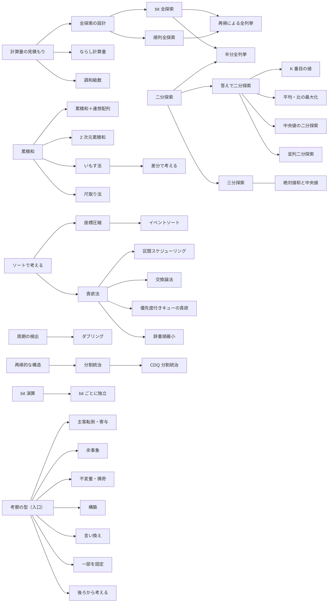

# 01 探索・基本テクニック・考察（basics）調査レポート

- 調査日：2026-10-21
- 担当：01 basics（探索・基本テクニック・考察）
- 成果物：本ファイルと [01-basics.topics.yaml](01-basics.topics.yaml)
- 規模：64 項目（単独ページ案 42・他ページの節 19・概要 3）、例題・練習問題の候補 233 件（重複を除き 222 問、根拠 URL 202 件）

## 0. 要点

- **レベルの内訳**：基礎 36・水 19・青 6・発展 3（黄に当たる項目はなかった）。この分野は「基礎レベルの手法を、水〜青の問題でどう応用するか」が中心で、項目のレベルが低くても例題の difficulty は水〜青に多い。そのため YAML の各項目に「易しい形の問題」と「応用の問題」の両方を入れた。
- **レベルの根拠**：(1) 各問題の difficulty（`tools/ap.py`）と、(2) drken の精進記録ブログの手法タグ付き記事（AtCoder の 1805 記事、1605 問）を問題IDに対応づけて集計した「手法ごとの difficulty 分布」（付録 A）の 2 つを使った。後者は記事の選び方に偏りがある（易しい ABC と難しい AGC が多い）ので、ABC に絞った値を主に見た。
- **計算量の見積もり**：§6.1 に「制約 → 許される計算量 → 疑う手法」の表を、CPH・USACO Guide・drken・algo-logic の表と、計算で確かめた数値（8! = 40320、ベル数 B12 = 4213597、10^12 以下の約数の個数の最大 6720 など）から作った。逆引き辞典の中核に使える。
- **考察系**：drken タグの ABC での件数から、ABC でよく出る型（言い換え・一部を固定・偶奇・余事象・独立・主客転倒）と ARC 寄りの型（不変量の深い使い方・構築・対称戦略）を分けた。「入口ページ 1 本＋短いページ 8 本＋節 6 つ」を提案する（§7.3）。
- **調査の制約**：途中で WebSearch の上限（セッション全体で共有）に達した。以後は、把握済みのサイトの一覧ページと規則的な URL だけをたどった。そのため 2023 年以降の一部の問題は第三者の解説を確認できず、YAML には入れていない（§7.6 に「未確認の候補」として列挙）。Codeforces のページ（noai 指定あり）は開いておらず、根拠に使っていない。

## 1. 調べた資料

### 1.1 日本語

| 資料 | URL | 何の参考にしたか |
| --- | --- | --- |
| E869120「レッドコーダーが教える、競プロ・AtCoder上達のガイドライン【中級編】」 | https://qiita.com/e869120/items/eb50fdaece12be418faa | 水色に必要な 12 のアルゴリズムと分野別 100 問の分類（全探索の 4 区分、二分探索、累積和（いもす法を含む）、圧縮など）。問題の手法分類の裏付けにも使った |
| 同【上級編】 | https://qiita.com/e869120/items/acba3dd8649d913102b5 | 黄色に必要な追加の項目（座標圧縮・半分全列挙・ダブリングなど） |
| E869120「アルゴリズム・AtCoder のための数学【後編：数学的考察編】」 | https://qiita.com/e869120/items/1ccb2bdf16890637e767 | 考察テクニックの一覧（周期性・余事象・パリティ・対称性・答えへの貢献度・上界など）と例題 |
| 競プロ典型 90 問のリポジトリ（作問者） | https://github.com/E869120/kyopro_educational_90 | ★と AtCoder Problems の difficulty の対応（★2 = 150〜399、★3 = 400〜799、★4 = 800〜1199、★5 = 1200〜1599、★6 = 1600〜1999、★7 = 2000〜）。問題文のテキスト（要約を書く前の内容確認） |
| Reputeless/tenkei_90 | https://github.com/Reputeless/tenkei_90 | 典型 90 問の各問のキーワード（公式解説からの引用）。典型 90 問の手法の裏付け |
| dvoraker3「競プロ典型 90 問の類題+＠ リンク集」 | https://qiita.com/dvoraker3/items/8388ab6e1dc3af55070e | 典型 90 問のキーワードと ABC の類題。類題の手法分類の裏付け |
| drken「二分探索アルゴリズムを一般化 〜 めぐる式二分探索法のススメ 〜」 | https://qiita.com/drken/items/97e37dd6143e33a64c8c | めぐる式の考え方（ok / ng の不変条件） |
| drken「計算量オーダーの求め方を総整理！ 〜 どこから log が出て来るか 〜」 | https://qiita.com/drken/items/872ebc3a2b5caaa4a0d0 | N と計算量の対応表（約 10 → n!、約 20 → 2^n、約 30 → 2^(n/2) など）、ループ回数の判定（10^7 は余裕、10^8 はおそらく間に合う、10^9 は厳しい）、「log はどこから出てくるか」 |
| drken「累積和を何も考えずに書けるようにする！」 | https://qiita.com/drken/items/56a6b68edef8fc605821 | 半開区間と S[0] = 0、2 次元累積和の式、例題 |
| drken「しゃくとり法 (尺取り法) の解説と、それを用いる問題のまとめ」 | https://qiita.com/drken/items/ecd1a472d3a0e7db8dce | 尺取りが使える単調性の 2 つの型、空区間の扱い、0 を含む積、二分探索との関係、例題 |
| drken「bit 全探索」 | https://qiita.com/drken/items/7c6ff2aa4d8fce1c9361 | bit 全探索の書き方、部分集合の部分集合の列挙（3^n） |
| drken「けんちょんの競プロ精進記録」 | https://drken1215.hatenablog.com/ | 各問題の解説（裏付けの主な出典）。手法タグを集計して difficulty 分布を作った（付録 A） |
| はまやんはまやん（hamayanhamayan's blog） | https://blog.hamayanhamayan.com/ | 2018〜2022 年の ABC の解説（裏付け） |
| oraclesqlpuzzle「競技プログラミングの問題（AtCoder ABC）」 | https://oraclesqlpuzzle.ninja-web.net/kyoupro/05-atcoder-02-abc/ | 各問題の短い解説（2021〜2024 年の ABC の裏付け）。問題ごとに URL が規則的 |
| recuraki「AtCoder ABC241 E - Putting Candies をフロイドの循環検出やダブリングで解く」 | https://qiita.com/recuraki/items/e26c220f2bc01f58e185 | 周期の検出とダブリングの両方の解き方 |
| betrue12「「答えを決め打つ」タイプの二分探索を使いこなそう」 | https://betrue12.hateblo.jp/entry/2019/05/11/013403 | 答えの二分探索の型（最大値の最小化・最小値の最大化・K 番目）、「ちょうど」の条件は単調にならないという注意 |
| algo-logic「競技プログラミングで解法を思いつくための典型的な考え方」 | https://algo-logic.info/how-to-think-cp/ | 制約から考える（N ごとの目安）、考察の型の一覧と例題 |
| algo-logic「ダブリング」 | https://algo-logic.info/doubling/ | ダブリングの表の定義と計算量 |
| 『競技プログラミングの鉄則』の目次（マイナビ出版） | https://book.mynavi.jp/ec/products/detail/id=131288 | 章立て（二分探索の章に尺取り法と半分全列挙を含む。考察テクニックの章は偶奇・足された回数・上限値・一手先・個数・後ろから・固定して全探索・言い換え・データの持ち方・不変量の 10 節） |
| imos「いもす法」 | https://imoz.jp/algorithms/imos_method.html | いもす法の原典。2 次元・高次元・特殊な座標系・高次（多項式）への拡張と例題 |

### 1.2 英語・中国語

| 資料 | URL | 何の参考にしたか |
| --- | --- | --- |
| Competitive Programmer's Handbook（2018-07 draft） | https://cses.fi/book/book.pdf | 計算量の見積もり表（1 秒で数億回、n ≤ 10 → n!、n ≤ 20 → 2^n、n ≤ 500 → n^3、n ≤ 5000 → n^2、n ≤ 10^6 → n log n、大きい n → 1 または log n）。全探索（部分集合・順列・バックトラック・枝刈り・半分全列挙）、貪欲（スケジューリング・締め切り）、ならし計算量（尺取り）、bit 演算の章立て |
| USACO Guide（Bronze〜Advanced の目次） | https://usaco.guide/ | 各手法の位置づけと出題頻度の表示（Silver：累積和・二分探索・尺取り・比較関数と座標圧縮・ソートと貪欲・bit 演算、Gold：単峰関数の最適化（三分探索）・半分全列挙、Plat：Binary Jumping・平方分割・分割統治、Adv：Fracturing Search など） |
| USACO Guide「Time Complexity」 | https://usaco.guide/bronze/time-comp | n と計算量の対応表（保守的に 10^8 回/秒、定数が良ければ 5×10^8 回/秒） |
| USACO Guide「Meet In The Middle」 | https://usaco.guide/gold/meet-in-the-middle | 半分全列挙の型と練習問題 |
| cp-algorithms「Binary search」 | https://cp-algorithms.com/num_methods/binary_search.html | 半開区間での実装と不変条件、述語の二分探索、連続値の二分探索、(l + r) / 2 のあふれ、並列二分探索（AtCoder agc002_d を練習問題に挙げる） |
| cp-algorithms「Ternary Search」 | https://cp-algorithms.com/num_methods/ternary_search.html | 単峰性の条件、整数版の停止条件、黄金分割、反復回数 |
| OI Wiki「二分」 | https://oi-wiki.org/basic/binary/ | 二分答案の条件と落とし穴（eps ループで止まらない、負数の除算の丸め）、実数の二分探索は回数固定、三分法と黄金分割の評価回数 |
| OI Wiki「倍增」「贪心」「构造」 | https://oi-wiki.org/basic/binary-lifting/ ほか | ダブリングの表と和の持ち方、貪欲の証明法（隣接交換・帰納法）と反悔贪心（後悔付き貪欲）、構築の例 |
| OI Wiki「整体二分」「CDQ 分治」「分数规划」 | https://oi-wiki.org/misc/parallel-binsearch/ ほか | 並列二分探索と CDQ 分割統治の適用条件、分数計画の二分探索と Dinkelbach 法（ABC324 F を練習問題に挙げる） |
| cppreference「C++ named requirements: Compare」 | https://en.cppreference.com/w/cpp/named_req/Compare | ソートの比較関数が満たすべき性質（狭義の弱順序：非反射・非対称・推移・比較不能の推移） |

Codeforces のブログにも関連する解説（不変量と単調量、交換論法、寄与の数え方）があることを検索結果で見たが、noai 指定があるため開いておらず、根拠には使っていない。

### 1.3 データと手順

- **AtCoder Problems の公開データ**（`tools/ap.py` のキャッシュ、2026-10-21 取得）：本レポートと YAML のすべての問題ID・タイトル・difficulty を確認した。典型 90 問は difficulty がないので、作問者の対応表に従って★を difficulty の帯として扱った。
- **drken のブログの手法タグ**：アーカイブページ（robots.txt で許可されている）から、関連する 116 カテゴリ（延べ 3169 記事）と「AtCoder」カテゴリの全 1805 記事のタグを取得し、1605 問の問題IDに対応づけた。付録 A の分布と、§5 の例題選びに使った。
- **根拠 URL の確認**：§5 と YAML の根拠 URL 202 件すべてについて、`<meta name="robots">` に noai / noimageai がないことを確かめた。問題の内容は記事の本文（問題概要の部分）を取得して読み、要約は自分の言葉で書いた。
- **atcoder.jp と codeforces.com のページは一度も開いていない。**

## 2. 分野の全体像

### 2.1 サブ分野の構造

この分野は 12 のまとまりに分かれる。矢印は「前提 → 発展」を表す。

- **A. 方針を立てる**：計算量の見積もり（制約から逆算）、ならし計算量、調和級数、候補が少ないことに気づく。すべての項目の前提になる。
- **B. 全探索**：全探索の設計（何を全探索するか）→ bit 全探索・順列全探索 → 再帰による全列挙（組分け・バックトラック）→ 半分全列挙。DP（02）の前段階でもある（全探索の重複をまとめると DP になる）。
- **C. 二分探索**：二分探索 → 答えで二分探索 → K 番目・平均（分数計画）・中央値・実数・並列。
- **D. 凸と三分探索**：三分探索・凸関数の性質・絶対値和と中央値。C の「答えの二分探索」と混同されやすい。
- **E. 累積和系**：累積和 → 累積和＋連想配列（区間を数える）・2 次元累積和・いもす法 → 差分で考える。データ構造（05）の BIT・セグ木の手前にある。
- **F. 尺取り法**：単調性を見抜いて O(N) にする。二分探索・累積和＋連想配列と並ぶ「区間を数える」3 手法の 1 つ。
- **G. 並べる・圧縮する**：ソートで考える → 座標圧縮 → イベントソート（平面走査の基本）、ランレングス圧縮、転倒数。
- **H. 貪欲**：考え方と正当性 → 区間スケジューリング・交換論法・優先度付きキュー・辞書順最小・後悔付き貪欲。
- **I. 繰り返し**：周期の検出（シミュレーションの打ち切り）→ ダブリング。行列累乗（06）・LCA（04）と並ぶ「巨大な K 回」の手法。
- **J. 分割統治**：再帰的な構造 → 分割統治 → CDQ（発展）。分割統治 DP（02）・分割統治 FFT（06）は他分野。
- **K. bit**：bit 演算と XOR の性質 → bit ごとに独立に考える。XOR 基底（06）・Binary Trie（05/08）の手前。
- **L. 考察**：入口ページから、主客転倒・余事象・不変量・偶奇・構築・言い換え・固定・後ろから・鳩の巣・対称性・実験へ。

### 2.2 前提関係の要点

- 二分探索の 3 段階：「ソート済み配列の lower_bound」→「単調な述語の境界（めぐる式）」→「答えを決めて判定する」。3 段目で初めて「判定関数の中身（貪欲・DP・BFS）」が本体になる。K 番目・平均・中央値はどれも 3 段目の判定の作り方の型である。
- 累積和の 3 方向：「区間和を O(1)」（前計算）、「区間加算をまとめる」（いもす法＝差分）、「区間の条件を S_r と S_l の関係に言い換えて数える」（連想配列）。3 つ目は考察の「言い換え」と一体で、ここが緑から水への壁になりやすい。
- 周期の検出とダブリングは同じ問題（状態がただ 1 つに決まる遷移を K 回）を解く 2 つの道具。1 回の問い合わせなら周期の検出、多数の始点・クエリや途中の和・「条件を満たす最大回数」ならダブリングが向く。
- 交換論法は「ソートの比較関数を作る」ための証明法で、貪欲（H）とソート（G）と DP（02）をつなぐ。
- 主客転倒は「bit ごとに独立」「余事象」「期待値の線形性（07）」と同じく「数える順序・単位を変える」考え方の仲間である。

### 2.3 混同されやすい組

| 組 | 違い |
| --- | --- |
| 二分探索と尺取り法 | 二分探索は 1 つの端を固定してもう 1 つを log で探す（O(N log N)）。尺取りは両端が単調に動くことを使って O(N)。尺取りできる問題は二分探索でもたいてい解ける（drken） |
| 尺取り法と累積和＋連想配列 | 値に負があると「区間を広げると単調」が崩れ、尺取りは使えない（abc233_d）。そのときは累積和の値を連想配列で数える |
| 答えの二分探索と三分探索 | 二分探索は判定（可／不可）が単調なとき。三分探索は値そのものが谷形（凸）のとき。凸関数なら差分 f(x+1) − f(x) の符号で二分探索してもよい |
| 累積和といもす法 | 累積和は「値が固定で、区間の和を何度も聞く」。いもす法は「区間加算をまとめて行い、最後に値を読む」。途中で読むなら BIT・遅延セグ木（05） |
| 周期の検出とダブリング | 上の §2.2 のとおり。遷移が線形なら行列累乗（06） |
| bit 全探索・半分全列挙・bitDP | bit 全探索は N ≤ 20 程度で各要素が独立な 2 択。半分全列挙は N ≤ 40 で、2 つの半分の組合せを高速に突き合わせられるとき。bitDP（02）は「部分集合＋α」を状態にすると重複がまとまるとき |
| 区間スケジューリングと締め切りの貪欲 | 区間スケジューリングは右端の順に選ぶだけ。処理時刻を 1 ずつ使う・締め切りがある場合は時刻順に候補を入れて優先度付きキューで選ぶ（abc325_d） |
| 余事象と包除原理 | 余事象は「全体 − 補集合」。条件が 2 つ以上重なると包除原理（07）になる（abc178_c） |
| 主客転倒と期待値の線形性 | 同じ「和の順序の入れ替え」。期待値の場合は 07 で扱う |
| 不変量・偶奇・単調量 | 偶奇は不変量の最も多い例。単調量（操作で必ず減る量）は回数の上界・停止性に使う |
| 座標圧縮と連想配列 | 値を添字にしたいだけなら map でよい。配列・BIT・いもすで扱う、または順位が必要なら座標圧縮 |

## 3. 項目一覧

詳細（別名・サイン・比べる手法・図の案・例題）は YAML にある。「根拠の問題」は YAML に入れた問題のうち先頭の 4 問。典型 90 問は ★ で示す。

| 項目名 | key | レベル | 根拠の問題（difficulty） | 前提 | ACL / STL | ページ案 |
| --- | --- | --- | --- | --- | --- | --- |
| 計算量の見積もり（制約から手法を逆算する） | complexity-estimation | 基礎 | typical90_bc（★2）, typical90_bt（★4）, abc196_d（1277） | — | — | own |
| ならし計算量（全体で何回動くかで数える） | amortized-analysis | 基礎 | hhkb2020_c（352）, abc278_d（559） | complexity-estimation | — | section-of:complexity-estimation |
| 調和級数の計算量（倍数を列挙する全探索） | harmonic-series | 水 | abc170_d（1033）, abc177_e（1057）, abc356_e（1506）, abc206_e（1745） | complexity-estimation, bucket-counting | — | own |
| 候補が少ないことに気づく（探索の対象を選び直す） | small-search-space | 基礎 | sumitb2019_d（838）, typical90_bk（★4）, typical90_cg（★4）, abc153_d（129） | brute-force, complexity-estimation | — | section-of:brute-force |
| 全探索の設計（何を全探索するか・固定して残りを決める） | brute-force | 基礎 | arc096_a（291）, abc085_c（584）, abc051_b（784）, abc089_c（642） | complexity-estimation | — | own |
| 盤面を動かして全部試す（平行移動・回転の全探索） | grid-brute-force | 水 | abc307_c（1307）, abc322_d（1310） | brute-force | — | section-of:brute-force |
| bit 全探索（k 進の全探索を含む） | bit-full-search | 基礎 | abc182_c（292）, abc128_c（805）, abc147_c（977）, abc197_c（809） | brute-force, bit-operations | — | own |
| 順列全探索 | permutation-search | 基礎 | abc145_c（340）, abc150_c（422）, abc183_c（335）, abc232_c（685） | brute-force | — | own |
| 再帰による全列挙（バックトラック・組分け・枝刈り） | recursive-enumeration | 水 | abc114_c（1045）, abc161_d（991）, abc236_d（1190）, abc310_d（1368） | bit-full-search, permutation-search | — | own |
| 半分全列挙 | meet-in-the-middle | 水 | abc184_f（1423）, typical90_ay（★5）, abc271_f（1669）, agc026_c（1836） | bit-full-search, binary-search, two-pointers, sorting-techniques | — | own |
| 二分探索（めぐる式・lower_bound・境界の扱い） | binary-search | 基礎 | abc205_d（713）, abc143_d（686）, abc302_d（682）, arc084_a（1096） | sorting-techniques | なし（STL の std::lower_bound / upper_bound / partition_point、std::ranges 版）。セグ木上の二分探索は atcoder::segtree::max_right / min_left（05 の担当） | own |
| 質問回数が log の二分探索（インタラクティブ） | interactive-binary-search | 基礎 | abc299_d（684）, abc269_e（1030） | binary-search | — | section-of:binary-search |
| 答えで二分探索（判定問題への帰着） | binary-search-answer | 基礎 | typical90_a（★4）, abc146_c（741）, abc174_e（1227）, abc257_d（1203） | binary-search, greedy-basics | — | own |
| 実数の二分探索（反復回数を固定する） | real-binary-search | 水 | abc026_d（1406）, abc034_d（1549） | binary-search-answer | — | section-of:binary-search-answer |
| K 番目の値を求める（個数を数えて二分探索） | kth-value | 青 | abc341_d（829）, abc155_d（1845）, arc037_c（1824）, abc149_e（1905） | binary-search-answer, two-pointers | — | own |
| 優先度付きキューで小さい順に列挙する（K 番目までを取り出す） | k-best-enumeration | 基礎 | abc234_d（503）, abc297_e（1176） | priority-queue | — | section-of:kth-value |
| 平均・比の最大化（分数計画） | fractional-binary-search | 青 | abc034_d（1549）, abc324_f（1815）, abc236_e（1893）, abc294_f（1891） | binary-search-answer, real-binary-search | — | own |
| 中央値の二分探索（x 以上を +1、未満を −1 にする） | median-binary-search | 青 | abc203_d（1622）, abc236_e（1893）, arc101_b（2073） | binary-search-answer, prefix-sum | — | own |
| 並列二分探索 | parallel-binary-search | 発展 | agc002_d（2514） | binary-search-answer, union-find | — | overview |
| 三分探索（凸関数の最小化） | ternary-search | 水 | abc279_d（766）, arc054_b（1269）, abc151_f（1671）, abc130_f（2240） | binary-search, real-binary-search | — | own |
| 凸関数の性質（和・最大値の凸性と増分の単調性） | convex-function-basics | 青 | abc359_f（1792） | ternary-search | — | section-of:ternary-search |
| 絶対値の和の最小化と中央値 | median-absolute | 基礎 | arc100_a（1089）, typical90_br（★4）, abc330_f（1718）, abc127_f（2003） | sorting-techniques | — | own |
| 累積和（1 次元・左右からの累積） | prefix-sum | 基礎 | arc098_a（635）, abc122_c（700）, abc265_d（727）, abc172_c（930） | complexity-estimation | — | own |
| 累積和と連想配列で区間を数える | prefix-sum-counting | 基礎 | abc233_d（726）, agc023_a（1038）, abc367_d（1037）, abc164_d（1232） | prefix-sum | — | own |
| 2 次元累積和（3 次元以上も） | prefix-sum-2d | 水 | arc025_2（1369）, abc311_e（1293）, abc331_d（1361）, abc075_d（1470） | prefix-sum | — | own |
| いもす法（区間加算をまとめて行う） | imos | 基礎 | abc183_d（662）, abc014_3（1276）, abc221_d（832）, abc188_d（933） | prefix-sum | — | own |
| 2 次元いもす法 | imos-2d | 基礎 | typical90_ab（★4） | imos, prefix-sum-2d | — | section-of:imos |
| 差分で考える（隣接差・階差・等差数列の区間加算） | difference-sequence | 水 | abc369_c（323）, typical90_bl（★3）, agc010_b（1892） | imos | — | section-of:imos |
| 尺取り法（単調性の見抜き方） | two-pointers | 基礎 | abc130_d（865）, typical90_ah（★4）, abc032_c（1244）, arc022_2（1395） | prefix-sum, amortized-analysis | — | own |
| 固定長の窓をずらす | sliding-window | 基礎 | abc326_c（292）, abc153_f（1393） | two-pointers | — | section-of:two-pointers |
| ソートで考える（並べてから貪欲・比較関数の注意） | sorting-techniques | 基礎 | abc121_c（360）, typical90_n（★3）, abc308_c（605）, abc187_d（650） | — | — | own |
| 座標圧縮 | coordinate-compression | 基礎 | abc213_c（481）, abc036_c（956）, abc113_c（878）, typical90_ac（★5） | sorting-techniques, binary-search | — | own |
| イベントソートと平面走査の基本 | event-sort | 水 | abc309_c（348）, arc092_a（1268）, abc106_d（1319）, abc245_e（1571） | sorting-techniques, imos | — | own |
| ランレングス圧縮（同じものの塊で考える） | run-length-encoding | 基礎 | abc380_c（223）, abc136_d（794）, abc140_d（1074）, abc124_d（1138） | — | — | own |
| 転倒数（隣接交換の回数） | inversion-count | 水 | abc264_d（414）, abc190_f（1321）, abc378_e（1406）, abc261_f（1587） | fenwick-tree, coordinate-compression | atcoder::fenwick_tree（05 の担当） | section-of:fenwick-tree |
| 貪欲法の考え方と正当性の示し方 | greedy-basics | 基礎 | abc085_d（954）, abc216_e（1084） | sorting-techniques | — | own |
| 区間スケジューリング・区間の串刺し | interval-scheduling | 基礎 | abc230_d（963）, abc103_d（1278）, arc106_c（1225）, abc325_d（1367） | greedy-basics, sorting-techniques | — | own |
| 交換論法と比較関数の設計 | exchange-argument | 青 | abc131_d（588）, abc116_d（1712）, abc163_e（2037） | greedy-basics, sorting-techniques | — | own |
| 優先度付きキューを使う貪欲（締め切り・後ろから） | greedy-priority-queue | 水 | abc141_d（823）, abc137_d（1313）, abc325_d（1367）, abc376_e（1063） | greedy-basics, priority-queue | — | own |
| 辞書順最小を前から決める貪欲 | lexicographic-greedy | 水 | abc076_c（846）, typical90_f（★5）, abc223_d（1069）, abc009_3（1915） | greedy-basics | — | own |
| 取り消し可能な貪欲（後悔付き貪欲） | regret-greedy | 発展 |  | greedy-priority-queue | — | overview |
| ダブリング | doubling | 水 | abc167_d（754）, abc241_e（1248）, abc013_4（1730）, abc258_e（1545） | cycle-detection, bit-operations | — | own |
| 周期性の検出（シミュレーションの打ち切り） | cycle-detection | 基礎 | abc179_e（1175）, typical90_bf（★4）, abc106_c（441）, abc354_d（1259） | complexity-estimation | — | own |
| シミュレーションの高速化（まとめて進める・見かけの変化を記録する） | simulation-speedup | 基礎 | typical90_ar（★3）, abc199_c（436）, abc189_e（1526） | complexity-estimation | — | section-of:cycle-detection |
| 分割統治（半分に分けて、またぐものを数える） | divide-and-conquer | 青 | arc189_d（2006） | recursion-structure, complexity-estimation | — | own |
| 再帰的な構造（フラクタル・レベル N の構造） | recursion-structure | 基礎 | abc357_c（371）, abc115_d（1088）, abc153_d（129）, typical90_b（★3） | — | — | section-of:divide-and-conquer |
| CDQ 分割統治・オフラインの分割統治 | cdq-divide-and-conquer | 発展 |  | divide-and-conquer, fenwick-tree | — | overview |
| bit 演算の基本と XOR の性質 | bit-operations | 基礎 | abc213_a（33）, abc269_c（384）, abc121_d（1164）, abc356_d（886） | — | — | own |
| 桁（bit）ごとに独立に考える | bitwise-independence | 水 | abc147_d（1205）, abc365_e（1102）, abc117_d（1423）, abc129_e（1547） | bit-operations, contribution | — | own |
| 考察の型の一覧（入口ページ） | observation-hub | 基礎 |  | — | — | own |
| 主客転倒・寄与（和の順序を入れ替える） | contribution | 水 | abc186_d（436）, abc172_d（963）, abc379_e（1246）, abc151_e（1344） | prefix-sum, sorting-techniques | — | own |
| 余事象（数えやすい側を数えて引く） | complement | 基礎 | abc193_c（379）, abc178_c（653）, abc162_d（757）, abc156_d（1014） | — | — | own |
| 不変量・単調に変わる量 | invariant | 基礎 | abc125_d（833）, abc323_d（852）, abc140_d（1074）, arc068_b（1084） | — | — | own |
| 偶奇に着目する | parity | 基礎 | arc089_a（397）, typical90_x（★2）, abc126_e（1340）, abc313_d（1630） | — | — | own |
| 構築問題の考え方 | construction | 水 | abc350_c（394）, keyence2020_c（625）, arc115_c（706）, abc131_e（1433） | observation-hub | — | own |
| 上界・下界を示して、達成する例を作る | bound-and-construct | 基礎 | abc139_d（357）, typical90_av（★3）, abc112_d（1025）, abc146_d（1192） | — | — | section-of:construction |
| 対称性を使う | symmetry | 基礎 | abc177_c（386）, abc171_e（778） | — | — | section-of:observation-hub |
| 言い換えの典型（条件・目的関数を書き直す） | reformulation | 水 | abc324_e（1153）, abc105_d（1458）, abc146_e（1762） | observation-hub | — | own |
| 一部を固定して数える（決め打ち・真ん中を固定） | fix-variable | 基礎 | abc330_d（569）, arc102_a（966）, abc318_e（1004）, abc254_d（1191） | brute-force | — | own |
| 後ろから・逆順に考える | reverse-thinking | 水 | arc065_a（930）, abc134_d（926）, abc120_d（1355）, agc032_a（738） | observation-hub | — | own |
| 鳩の巣原理 | pigeonhole | 水 | abc200_d（1217）, abc174_c（902）, abc179_e（1175） | observation-hub | — | section-of:observation-hub |
| 独立に分解する（x と y・桁ごと・成分ごと） | independence | 基礎 | agc003_a（436）, typical90_br（★4） | — | — | section-of:reformulation |
| 小さいケースで実験する（愚直解で規則を見つける） | experiment | 基礎 | abc165_d（600）, abc380_d（849） | observation-hub | — | section-of:observation-hub |
| 場合分け・操作の順序を入れ替える | casework | 基礎 | arc091_a（514） | — | — | section-of:observation-hub |

**ページ数の見込み**：単独ページ 42、節 19、概要ページ 3。考察系（L）は単独ページ 10（入口を含む）と節 6。§7.1 で統合案も示す。

## 4. 項目ごとのメモ

記号：〔図〕図・動く図の案、〔確認〕確認問題の案、〔使い分け〕似た手法との違い。問題のサインは YAML の `signs` にまとめた。

### A. 方針を立てる

#### 計算量の見積もり（`complexity-estimation`）— 基礎

- **できること**：制約から許される計算量を逆算し、候補の手法を絞る。C++ の単純な処理なら 1 秒に 10^8〜数×10^8 回が目安（drken：10^8 回は「おそらく間に合う」、USACO Guide：保守的に 10^8 回・定数が良ければ 5×10^8 回、CPH：数億回）。ABC の多くは 2 秒。
- **見積もりの手順**：(1) ループの回数を掛ける、(2) log は N = 2×10^5 で約 18、10^18 で約 60、(3) 定数倍（set / map は配列より数倍〜十数倍遅い、確保と再帰が多いと遅い）、(4) メモリ（1024 MiB なら int で約 2.6×10^8 個、long long で約 1.3×10^8 個）。
- **つまずき**：最悪ケースで見積もらない／log の数を数え忘れる（二分探索の判定の中で set を使うと log^2）／複数テストケースの合計（ΣN）を見ない／長い実行時間制限（typical90_bc の 5 秒）が「重い全探索でよい」という合図だと気づかない。
- 〔図〕制約の帯図と、N = 2×10^5 での各計算量の演算回数の棒グラフ（N log N ≈ 3.5×10^6、N log² N ≈ 6.2×10^7、N√N ≈ 8.9×10^7）。
- 〔確認〕「N = 40 で 2^N は無理。何なら間に合うか」「Q = 2×10^5 回のクエリに毎回 O(N) は？」「set の lower_bound を二分探索の判定に使ったら計算量は？」
- 〔使い分け〕ループの形だけでは見積もれない計算量の代表として、ならし計算量と調和級数を節または別ページで扱う。

#### ならし計算量（`amortized-analysis`）— 基礎・節

- 戻らないポインタ（尺取りの右端、mex の候補、スタック）は全体で O(N)。各要素が一度入って一度出るだけなら、while の中に for があっても合計は線形（hhkb2020_c、abc278_d の一括代入を時刻で管理する方法）。
- **つまずき**：入れ子のループを見て O(N^2) と誤判断する／逆に、ポインタが戻るのに O(N) と思い込む。〔図〕要素の入出を時間軸に並べ、合計が 2N を超えない図。

#### 調和級数の計算量（`harmonic-series`）— 水

- **できること**：Σ_{d=1}^{M} M/d ≈ M ln M（M = 10^6 で約 1.4×10^7）。値を添字にできるとき（A_i ≤ 10^6）、各 d について倍数を全部たどる処理が全体で O(M log M) になる。
- **型**：割り切る組を数える（abc170_d）、各値の倍数の個数（abc177_e）、⌊A_j / A_i⌋ の総和で商が同じ範囲をまとめる（abc356_e：商が q になるのは [q·x, (q+1)·x) で、x ごとに M/x 個の区間）、gcd を固定して倍数から数える（abc206_e、07 の約数包除と境界）。
- **つまずき**：同じ値が複数あると「自分自身で割り切れる」扱いになる（abc170_d）／ループの上限を N ではなく値の最大にする。
- 〔図〕d = 1, 2, 3, … ごとに倍数に印を付けるステップ送り。〔確認〕「1〜M の約数の個数をすべて求める計算量は？」〔使い分け〕素数だけたどる篩（06）は Σ M/p = O(M log log M)。

#### 候補が少ないことに気づく（`small-search-space`）— 基礎・節（全探索）

- 入力の大きさではなく「答えの候補」「小さい方の次元」「約数の個数」「値の種類」「log 回で収束する操作」で全探索する。暗証番号の候補 1000 通り（sumitb2019_d）、H ≤ 8 の行の選び方（typical90_bk）、10^12 以下の数の約数の個数は最大 6720（typical90_cg。10^9 以下なら 1344、10^18 以下なら 103680。計算で確認した）、体力が半分になる分裂は深さ log H（abc153_d）。
- **つまずき**：「N が大きいから全探索は無理」と決めつける。〔図〕探索の対象を入れ替えたときの通り数を並べた表。

### B. 全探索

#### 全探索の設計（`brute-force`）— 基礎

- **できること**：「何を全探索するか」を選ぶことで計算量を下げる。変数を k − 1 個決めれば最後の 1 個が決まる（abc085_c、abc051_b、typical90_p）、答えの候補を全探索して整合性を確かめる（abc112_c）、同じ種類をまとめてから組合せを全探索する（abc089_c）、片方を全探索して残りを別の手法で速く求める（→ bit 全探索＋貪欲、固定＋二分探索）。
- **上位の手法とのつながり**：「全探索の残りの部分を貪欲・二分探索・累積和で速くする」のが水への入口。全探索の重複をまとめると DP（02）になる。
- **つまずき**：決めた変数から求めた最後の変数の範囲チェック（0 ≤ Z ≤ K）を忘れる／ループの端（0 を含むか）／見積もりの過大・過小。
- 〔図〕3 重ループと「2 つ決めて 3 つ目を計算」の回数比較。〔確認〕「X + Y + Z = S で Z を計算したとき、何を確かめる必要があるか」
- **盤面の全探索（節 `grid-brute-force`、水）**：回転・平行移動・重ね合わせの全組合せを試す（abc307_c、abc322_d）。平行移動は負の位置も含めて範囲を取る。座標変換を関数にまとめると実装の誤りが減る。

#### bit 全探索（`bit-full-search`）— 基礎

- **できること**：0〜2^N − 1 の整数 mask の i ビット目で「要素 i を選ぶか」を表し、部分集合をすべて調べる。N ≤ 20 なら 2^20 × 20 ≈ 2×10^7。各要素が 3 択なら 3 進数（3^12 ≈ 5.3×10^5）。
- **型**：(1) 選ぶ／選ばない（abc182_c）、(2) 区切る／区切らない（abc197_c）、(3) 全員の状態を仮定して矛盾がないか確かめる（abc147_c）、(4) 片側を bit で決めて残りは貪欲（abc159_e の横の切れ目、abc104_c の全問正解する配点、abc100_d の符号の向き）。(4) は水レベルで頻出の型で、強調したい。
- **つまずき**：`1 << i` の int あふれ（i ≥ 31 は `1LL << i`）／`mask >> i & 1 == 1` の優先順位（`==` が `&` より先に結合する）／`(mask & (1 << i)) == 1` は i ≥ 1 で常に偽／2^N 回の中で重い処理をする。
- 〔図〕0〜2^N − 1 を 2 進表記で縦に並べた表。〔確認〕「`(mask & (1 << i)) == 1` と書くと何が起きるか」〔使い分け〕N ≤ 40 なら半分全列挙、部分集合を状態にして重複がまとまるなら bitDP（02）。

#### 順列全探索（`permutation-search`）— 基礎

- **できること**：N ≤ 8〜10 の並び・割り当て・頂点の対応を全部試す。8! = 40320、10! ≈ 3.6×10^6、11! ≈ 4.0×10^7、12! ≈ 4.8×10^8。
- **型**：訪問順（abc145_c、abc183_c）、辞書順の番号（abc150_c）、グラフの同型判定（abc232_c、abc371_c）、文字への数字の割り当て（abc198_d の覆面算、DFS で使った数字を管理）。
- **つまずき**：`next_permutation` は昇順から始めないと全部は列挙しない（終わると false を返して昇順に戻る。重複要素は同じ並びを 1 回だけ出す）／11! 以上で処理が重いと間に合わない。
- 〔図〕`next_permutation` の手順（右から下降が始まる位置を探し、入れ替えて残りを反転）のステップ送り。〔使い分け〕N が 16〜20 で「訪問済みの集合と最後の位置」が状態になるなら bitDP（02）。

#### 再帰による全列挙（`recursive-enumeration`）— 水

- **できること**：部分的に決めた状態から 1 つずつ決めていく。生成型（7, 5, 3 だけの数 abc114_c、ルンルン数 abc161_d）、組分け型（「まだ組のない最小番号の人をどの組に入れるか」で決めると同じ分け方を二度数えない。分け方はベル数 B_N 通りで B10 = 115975、B12 = 4213597。abc310_d、abc390_d）、ペア分け（2N 人を 2 人組にする方法は (2N − 1)!! 通りで N = 8 なら 2027025。abc236_d）、敷き詰め（左上の空きマスから置く。abc345_d、typical90_bt）。
- **枝刈り**：途中で条件に反したら戻る。計算量は「葉の数 × 1 本あたり」で見積もる。
- **つまずき**：組の番号を入れ替えただけの分け方を重複して数える／バックトラックで状態（使用済みの印）を戻し忘れる／再帰が深すぎる（09）。
- 〔図〕再帰木のステップ送り（組分けで「最小番号から決める」ことで重複が消える様子）。〔確認〕「4 人を 2 人ずつの組に分ける方法は何通りか。番号付きで列挙すると何通り出てしまうか」〔使い分け〕各要素が独立な 2 択なら bit 全探索、並びなら順列全探索。

#### 半分全列挙（`meet-in-the-middle`）— 水

- **できること**：N ≤ 40 程度の部分集合の問題を、前半と後半に分けて 2^(N/2) ずつ列挙し、組み合わせる。後半をソートして各前半の値に対して二分探索（または 2 ポインタ）で相手を探す（abc184_f）。個数の制約（ちょうど K 個）があれば個数ごとに分けて持つ（typical90_ay）。グリッドの経路は対角線で分けて両側から列挙し、(マス, 値) で突き合わせる（abc271_f）。素数を 2 組に分けて積を列挙し尺取りで組む型もある（abc300_g、黄）。
- **計算量**：O(2^(N/2) · N)（ソート込み）。2^20 個の long long は約 8 MB で問題ない。
- **つまずき**：列挙した側をソートし忘れる／完全一致の個数を数えるときの重複（equal_range や連想配列）／「片側を全探索して残りは貪欲」（bit 全探索の型 (4)）と混同する。
- 〔図〕2 つのリストの突き合わせのステップ送り。〔確認〕「N = 40 で bit 全探索の何倍速いか」〔使い分け〕重さ（値）の範囲が小さければナップサック DP（02）、N が小さく値が大きければ半分全列挙。

### C. 二分探索

#### 二分探索（`binary-search`）— 基礎

- **できること**：単調な述語の境界を O(log) で見つける。めぐる式では「ok は条件を満たす、ng は満たさない」を不変条件にし、|ok − ng| > 1 の間 mid で片方を更新する。`lower_bound` は x 以上の最初、`upper_bound` は x より大きい最初。x の個数は差、x 未満の個数は lower_bound の位置。
- **型**：片方を固定してもう片方を二分探索（arc084_a の中段を固定、abc143_d の 2 本を固定、abc302_d）、ソートと累積和を組み合わせて全ペアをまとめる（abc321_d）、左右の最寄りを lower_bound で取って比べる（abc119_d、番兵を置くと楽）、欠けた数の個数のように「作った配列」の上で二分探索（abc205_d）。
- **つまずき**：初期値（ok / ng は判定しない「番兵」の位置に置く）／(ok + ng) / 2 のあふれ（ok + (ng − ok) / 2 や C++20 の `std::midpoint`）／負の数での `/ 2` の丸め（OI Wiki）／`std::set` に `std::lower_bound` を使うと O(N)（メンバ関数を使う）／ソートし忘れ。
- 〔図〕ok と ng の 2 本の指が近づくステップ送り（不変条件を常に表示）。〔確認〕「x 以下の要素の個数は lower_bound と upper_bound のどちらで求めるか」〔使い分け〕両端が単調に動くなら尺取りで O(N)。値の更新を伴うならセグ木上の二分探索（05、ACL の `max_right` / `min_left`）。
- **インタラクティブの二分探索（節 `interactive-binary-search`、基礎）**：質問回数が ⌈log2 N⌉ 程度なら二分探索（abc299_d、abc269_e）。出力のフラッシュなどの作法は 08 で扱う。

#### 答えで二分探索（`binary-search-answer`）— 基礎（応用は水〜青）

- **できること**：「答えを x 以下（以上）にできるか」という判定が x について単調なら、x を二分探索する。判定関数の中身（貪欲・DP・BFS など）が本体で、計算量は O(判定 × log 範囲)（範囲 10^18 で約 60 回）。
- **型**：最大値の最小化（すべて x 以下にできるか：abc174_e、abc144_e、abc023_d）、最小値の最大化（すべて x 以上にできるか：typical90_a）、条件を満たす最大の N（abc146_c）、x を決めて探索で到達判定（abc257_d、03 の BFS / DFS と組み合わせ）、「x 個作れるか」を min(A_i, x) の和で判定（abc227_d）。
- **つまずき**：判定が単調か確かめない（「ちょうど K」は単調にならないので「K 以上」「K 以下」に直す。betrue12）／上限の ng が答えの最大を超えていない／判定中のオーバーフロー（x × N が 10^18 を超える。途中で打ち切るか __int128）／ok と ng のどちらを答えるかの取り違え。
- 〔図〕横軸に x、可／不可を色で塗った階段図。判定関数の貪欲を別枠でステップ送り。〔確認〕「判定が単調でない例を 1 つ挙げよ」〔使い分け〕値そのものが谷形なら三分探索、判定が「個数 ≥ K」なら K 番目。
- **実数の二分探索（節 `real-binary-search`、水）**：反復回数を 100 回などに固定する（`while (r − l > eps)` は値が大きいと誤差で止まらないことがある。OI Wiki）。出力の桁数指定を忘れない。整数に直せるなら整数で比べる（abc026_d、abc034_d）。

#### K 番目の値を求める（`kth-value`）— 青

- **できること**：「K 番目 ≤ x ⇔ x 以下の個数 ≥ K」なので、count(x) が速く数えられれば x を二分探索できる。全部を列挙できない N^2 個の積・和・比の K 番目に使う。
- **数え方の型**：ソート＋二分探索・尺取り（arc037_c の a_i × b_j）、符号で場合分け（abc155_d、負 × 負が正になる）、包除（abc341_d、易しい形）、上位 M 個の和（abc149_e：M 番目の値を求め、それより大きい組は累積和で足し、同じ値の分を調整）。
- **つまずき**：同じ値が複数あるときの K 番目／負の数／count の不等号（≤ か <）／K の 0 始まり・1 始まり。
- 〔図〕count(x) の階段グラフと、count(x) ≥ K となる最小の x。〔確認〕「なぜ count(x) ≥ K となる最小の x が答えになるのか」
- **優先度付きキューで小さい順に列挙（節 `k-best-enumeration`、基礎）**：K が 2×10^5 程度なら、最小を取り出してそこから次の候補を作る（Dijkstra に似た流れ）。重複は set で除く（abc297_e）。値を 1 つずつ加えながら K 番目を保つ（abc234_d）。

#### 平均・比の最大化（`fractional-binary-search`）— 青

- **できること**：「平均 ≥ x ⇔ Σ(a_i − x) ≥ 0」「Σa / Σb ≥ x ⇔ Σ(a_i − x·b_i) ≥ 0（b_i > 0）」と言い換え、x を二分探索する。判定は「a_i − x·b_i の和の最大」を、上位 K 個の貪欲（abc034_d）、DP（abc236_e）、DAG の最長路（abc324_f）、全域木（arc026_4）などで求める。K 番目と組み合わせる型もある（abc294_f）。Dinkelbach 法（反復で収束させる方法）は発展として紹介にとどめる（OI Wiki）。
- **つまずき**：「濃度の高い順に K 個」は重さが違うので誤り／実数の二分探索の精度／分母が 0。
- 〔図〕x を動かすと、選ぶべきものの組が入れ替わる様子。〔確認〕「濃度の高い順に選ぶと失敗する例を作れ」〔使い分け〕中央値は +1 / −1 の変換（次項）。

#### 中央値の二分探索（`median-binary-search`）— 青

- **できること**：「中央値 ≥ x ⇔ x 以上の要素が半分以上」なので、x 以上を +1、未満を −1 に置き換えて和の符号で判定する。領域なら 2 次元累積和（abc203_d）、選び方の制約があれば DP（abc236_e）、全区間の中央値の中央値なら「和が正の区間の数＝累積和の大小の組（転倒数）」（arc101_b、05 の BIT）。
- **つまずき**：偶数個のときの中央値の定義（上側か下側か）で不等号が変わる。問題の定義を必ず確かめる。

#### 並列二分探索（`parallel-binary-search`）— 発展・概要

- 多数のクエリの二分探索を段ごとにまとめ、各段で「操作を時系列に 1 回流しながら全クエリの mid を判定する」。O((N + Q) log V × 判定の更新コスト)（OI Wiki、cp-algorithms）。例は agc002_d（2514）。部分永続 Union-Find でも解ける（drken の解法 1）。ABC での必要例は今回見つからなかった。

### D. 凸と三分探索

#### 三分探索（`ternary-search`）— 水

- **できること**：下に凸（単峰）な関数の最小を、2 点 m1 < m2 の値を比べて大きい側の外側を捨てながら求める。1 回で幅が 2/3 になるので、幅 10^9 を 10^−9 まで縮めるのに約 100 回。整数版は r − l < 3 になったら残りを全部調べる。凸関数なら「f(x + 1) − f(x) ≥ 0 となる最小の x」を二分探索する方が安全なことが多い。黄金分割探索は評価を 1 回ずつ使い回せる（OI Wiki によると評価回数は約 1.44 log2 回）。
- **型**：時間 Bx + A/√(1 + x)（abc279_d、凸関数の和）、P / 2^(x/1.5) + x（arc054_b）、最小包含円の中心を入れ子の三分探索（abc151_f、08 の幾何と境界）、区分線形な関数の候補点を絞る（abc130_f）。
- **つまずき**：凸でない関数に使う（平らな部分がある「単峰でない」関数では誤った側を捨てる）／整数で m1 = m2 になって止まらない／凸性を確かめない。凸の確かめ方：凸関数の和・最大は凸、|x − a|・x² は凸。
- 〔図〕谷形のグラフで 2 点を取り外側 1/3 を捨てるステップ送り。整数版の差分の符号の図も並べる。〔確認〕「f(m1) = f(m2) のとき、どちらを捨ててよいか」〔使い分け〕判定が単調なら答えの二分探索。
- **凸関数の性質（節 `convex-function-basics`、青）**：増分 f(x + 1) − f(x) が単調に増えるなら、1 単位ずつ「いちばん増分の小さいところ」に配る貪欲が最適（資源配分問題。abc359_f を優先度付きキューで）。凸関数の和の最小の追跡はスロープトリック（02 / 05、abc127_f が入口）。

#### 絶対値の和の最小化と中央値（`median-absolute`）— 基礎

- **できること**：Σ|x − a_i| は、x を右へ動かすと傾きが（左の点の数 − 右の点の数）で変わるので、中央値で最小になる（偶数個なら中央の 2 つの間ならどこでもよい）。変数変換 a_i − i で帰着する型（arc100_a）、マンハッタン距離の和は x と y に分ける（typical90_br）、二分探索と組む型（abc330_f）、更新しながら中央値を 2 つの優先度付きキューで保つ型（abc127_f）。
- **つまずき**：二乗和の最小（平均）と混同する。〔確認〕「Σ(x − a_i)² を最小にする x は？」〔図〕数直線と傾きの折れ線。

### E. 累積和系

#### 累積和（`prefix-sum`）— 基礎

- **できること**：S[0] = 0、S[i + 1] = S[i] + a[i] とすると、[l, r) の和が S[r] − S[l]。逆演算のない演算（gcd・max）は左右からの累積で「1 つ除いた値」を作る（abc125_c、arc098_a）。累積和は単調なら二分探索できる（abc265_d、abc172_c は尺取りでも）。
- **つまずき**：閉区間と半開区間の混同（abc122_c は境界の扱いが要点）／int のあふれ／円環は 2 周分に伸ばす（typical90_bx）。
- 〔図〕棒グラフと累積和の折れ線、[l, r) の網掛け。〔確認〕「1 つ除いた最大値を左右の累積で求めるのはなぜか（引き算できないから）」〔使い分け〕値が更新されるなら BIT（05）、静的な区間 min / max は Sparse Table（05）。

#### 累積和と連想配列で区間を数える（`prefix-sum-counting`）— 基礎（応用は水〜青）

- **できること**：「区間の条件」を「S_r と S_l の関係」に言い換え、左から S_l を連想配列に数えながら足す。和が K（abc233_d）、和が 0（agc023_a）、和が M の倍数 ⇔ 余りが等しい（abc105_d）、数字列の倍数は後ろからの累積（abc164_d、10 と 2019 が互いに素だから成り立つ）、長さの制限付き（abc146_e、長さ K 未満の窓で数える）、円環（abc367_d）。
- **つまずき**：S_0 を入れ忘れる／負の余りを正規化しない／負の値があるのに尺取りを使う。
- 〔図〕連想配列の中身が増えていくステップ送り。〔確認〕「区間和が M の倍数の区間を、なぜ余りが等しい組で数えられるのか」

#### 2 次元累積和（`prefix-sum-2d`）— 水

- **できること**：S[i + 1][j + 1] = S[i][j + 1] + S[i + 1][j] − S[i][j] + a[i][j]。長方形 [x1, x2) × [y1, y2) の和は 4 項の足し引き。全長方形を O(1) で調べる（arc025_2）、各左上から辺の長さを二分探索（abc311_e）、周期的に敷き詰めた盤面（abc331_d）、点の数（abc075_d）、区間を点 (l, r) と見て数える（abc106_d）。3 次元は 8 項。
- **つまずき**：添字のずれ（1 始まりにそろえる）／包除の符号。〔図〕4 つの長方形の足し引き。〔確認〕「3 次元の式は何項になるか、符号はどう決まるか」

#### いもす法（`imos`）— 基礎

- **できること**：区間 [l, r) に x を足すとき D[l] += x、D[r] −= x とし、最後に累積する。Q 回の区間加算が O(N + Q)。座標が大きいときは座標圧縮かイベントのソート（abc188_d、abc221_d）。区間長ごとの加算に使う型（abc260_e）。
- **つまずき**：閉区間の右端に +1 を忘れる／座標圧縮で端点を入れ忘れる／途中で値を読む必要がある（オンライン）なら BIT・遅延セグ木（05）。
- 〔図〕+1 / −1 の印と左からの累積のステップ送り。〔確認〕「区間加算の途中で値のクエリが来るならどうするか」
- **2 次元いもす法（節 `imos-2d`）**：四隅に +1, −1, −1, +1 を置き、横・縦の順に累積する（typical90_ab）。O(HW + N)。
- **差分で考える（節 `difference-sequence`、水）**：隣接差 d_i = a_{i+1} − a_i を見ると、区間への一律加算は両端の 2 か所だけを変える（typical90_bl）。等差数列になっている区間は差が一定の塊（abc369_c）。区間に 1, 2, 3, … を足す操作は 2 階の差分で、いもす法を 2 回（いもす法の原典の「高次」）。円環での一斉操作（agc010_b）。

### F. 尺取り法

#### 尺取り法（`two-pointers`）— 基礎（応用は水）

- **できること**：区間 [l, r) について、各 l に対する最大（最小）の r が l とともに単調に増えるなら、r を戻さずに済むので O(N)。drken の 2 つの型：「部分区間も条件を満たす」型（和 ≤ K、種類 ≤ K、重複なし：最大長・個数）と「より大きい区間も満たす」型（和 ≥ K：個数）。
- **単調性の見抜き方**：「区間を 1 つ縮めても条件が保たれるか」を確かめる。XOR 和と和が等しい ⇔ どの bit も重ならない、は縮めても保たれる（arc098_b）。値に負があると和の条件は単調にならない。
- **つまずき**：空区間（l = r なら r も進める）／取り除く処理（カウンタを減らし、0 になったら種類数を減らす）／積の 0（abc032_c）／負の値（→ 累積和＋連想配列）。
- 〔図〕窓が右へ進むステップ送りと、r(l) の単調な折れ線。〔確認〕「和が K 以上の区間を数えるとき、なぜ r(l) は単調か」〔使い分け〕二分探索でも O(N log N) で解けることが多い。区間の最大・最小を保つならスライド最小値（05）。
- **固定長の窓（節 `sliding-window`）**：長さ固定の窓をずらし、入る要素と出る要素だけ更新する（abc326_c。左端を点に合わせる場合だけ考えればよいという考察も要る）。範囲攻撃の効果の切れ目をキューで管理する型（abc153_f）。

### G. 並べる・圧縮する

#### ソートで考える（`sorting-techniques`）— 基礎

- **できること**：ソートすると (1) 貪欲の順番が決まる（安い順 abc121_c、効果の大きい順 abc187_d）、(2) 二分探索・尺取りが使える、(3) 2 つの列を 1 対 1 に対応させるとき、両方ソートして順に組むのが最適（交差を解消できる。typical90_n）。
- **つまずき**：比較関数は狭義の弱順序にする（非反射・非対称・推移など。`<=` を書かない。cppreference、09）／比率は掛け算で比べて誤差を避ける（abc308_c）／同点の順序は `stable_sort` かキーを足す／ペアは辞書順で比べられる。
- 〔図〕2 列の対応を線で結び、ソートすると交差が消える図。〔確認〕「比較関数に `<=` を書くと、どの性質が崩れるか」

#### 座標圧縮（`coordinate-compression`）— 基礎

- **できること**：sort → unique → lower_bound で値を 0〜K − 1 の番号にする。大小関係（順位）だけが重要なときに、値を配列の添字にできる（abc036_c、abc113_c、行と列を独立に圧縮する abc213_c）。データ構造と組む（typical90_ac、05 のセグ木）。
- **つまずき**：圧縮後の番号で長さを測る（元の値を残しておく）／区間を扱うとき両端点を入れる／値の隙間に意味がある場合。〔図〕元の値と番号の対応表。〔使い分け〕値を添字にしたいだけなら `std::map` で足りる。

#### イベントソートと平面走査の基本（`event-sort`）— 水

- **できること**：開始・終了・クエリを (座標, 種類) で並べて左から処理し、集合や合計を更新する。2 次元の点を一方の座標の順に処理し、もう一方を集合で管理するのが平面走査（arc092_a は x の順に見て y 最大の赤点を選ぶ貪欲、abc245_e は multiset、abc128_e は set）。
- **つまずき**：同じ座標での処理順（終了を先にするか開始を先にするか）が答えを左右する／オフラインでしか使えない。BIT やセグ木と組む本格的な平面走査は 05。
- 〔図〕時間軸上のイベントを左から処理するステップ送り。〔確認〕「同時刻の開始と終了の順を逆にすると何が変わるか」

#### ランレングス圧縮（`run-length-encoding`）— 基礎

- (値, 長さ) の列にすると、塊単位で考えられる。塊の境界の数で操作を数える（abc140_d：1 回の反転で境界は高々 2 減る）、塊の列で尺取り（abc124_d）、境界ごとに偶奇で振り分ける（abc136_d）、塊ごとに数える（typical90_cf）、塊の並べ替え（abc380_c）。**つまずき**：最後の塊の処理を忘れる。08（文字列）と重なるが、数列でも使うので 01 に置く。

#### 転倒数（`inversion-count`）— 水・節（05 の BIT のページに置く案）

- i < j かつ A_i > A_j の組の数で、隣接交換でソートする最小回数に等しい（abc264_d）。BIT で O(N log N)（05）、マージソートの分割統治でも数えられる。先頭を末尾に移すときの増減（abc190_f）、同色の転倒を引く（abc261_f）、累積和の mod の補正回数として数える（abc378_e）。**つまずき**：同じ値の扱い（< か ≤ か）、値の圧縮。

### H. 貪欲

#### 貪欲法の考え方と正当性（`greedy-basics`）— 基礎

- **正当性の示し方**：交換論法（最適解を貪欲解に近づける入れ替えで悪くならない）、帰納法（OI Wiki）、「貪欲が常に先行している」ことを示す。怪しい貪欲は小さいケースの全探索と比べて確かめる（ストレステスト、00）。CPH の貪欲の章（硬貨・スケジューリング・締め切り）が典型の一覧になる。
- **型**：基準を決めて強い順に使う（abc085_d）、毎回最大を選ぶが同じ値をまとめて処理する（abc216_e）。
- 〔図〕最適解と貪欲解を並べ、最初に違う所を入れ替えても悪くならない図。〔確認〕「硬貨の枚数を最小にする貪欲が失敗する硬貨の組を作れ」〔使い分け〕反例が見つかる・状態が小さいなら DP（02）。

#### 区間スケジューリング・区間の串刺し（`interval-scheduling`）— 基礎

- **できること**：右端の小さい順に、選んだ区間と重ならないものを選ぶと、重ならない区間の最大個数になる。すべての区間を最少の点で突くのも、右端でソートして右端に点を置く（abc103_d、abc230_d）。左端の順や長さの順は誤り（arc106_c はまさに「誤った貪欲との差」を作る構築問題）。処理に時間がかかり締め切りがある場合は、時刻順に候補を入れて締め切りの早いものから処理する（abc325_d、優先度付きキュー）。
- 〔図〕右端の順に並べたガントチャートで、選ぶ区間を塗るステップ送り。〔確認〕「左端の早い順に選ぶと失敗する例」

#### 交換論法と比較関数の設計（`exchange-argument`）— 青

- **できること**：隣り合う i, j を入れ替えたとき、変わるのは i と j に関わる項だけ。そこから「i を先にすべき条件」を式で導き、比較関数にする（OI Wiki の「邻项交换」＝隣接交換の考え方）。締め切り順（abc131_d）は易しい例。その順に並べてから DP する型（abc163_e は「活発な順に左右の端へ」＋区間 DP）。入れ替えで改善できるかを考える型（abc116_d）。
- **つまずき**：導いた比較が狭義の弱順序（推移的など。cppreference の Compare の要件）になっているか確かめない／比を割り算で比べて誤差が出る／分母 0。
- 〔図〕隣接交換で変わる項だけを強調した図。〔確認〕「a_i / b_i の順に並べてよい問題とそうでない問題の違いは何か」

#### 優先度付きキューを使う貪欲（`greedy-priority-queue`）— 水

- **型**：毎回最大を取り出して半額にする（abc141_d）、日を後ろから進めて使えるようになった仕事をキューに入れ、最高報酬を 1 つ選ぶ（abc137_d）、時刻順に入ってくる候補から締め切りの早いものを選ぶ（abc325_d）、最大値を固定して残りの上位 K 個を保つ（abc376_e）。
- **つまずき**：時刻を 1 ずつ進めると間に合わない（次のイベントまで飛ばす）／同じ値をまとめて処理しないと遅い（abc216_e）。〔図〕日を後ろから進めながらヒープを操作するステップ送り。

#### 辞書順最小を前から決める（`lexicographic-greedy`）— 水

- **できること**：先頭から 1 文字ずつ、置ける最小の値を選ぶ。要点は「残りで条件を満たせるか」の判定（typical90_f は残りの文字数が足りるか。次の出現位置の表を作る）。順序の制約は入次数 0 の頂点を小さい順に取り出す（abc223_d、03 のトポロジカルソート）。T を含める条件は、置ける最も後ろに置き残りを a にする（abc076_c）。並べ替えの制約付き（abc009_3）。
- 〔図〕1 文字ずつ候補を試して判定するステップ送り。

#### 後悔付き貪欲（`regret-greedy`）— 発展・概要

- 選んだ集合をヒープで持ち、新しい候補が最も弱いものより良ければ入れ替える（OI Wiki の反悔贪心）。ABC での出題例は今回確認できなかった。スロープトリック（02 / 05）と考え方が近い。レベルは要確認。

### I. 繰り返し

#### 周期性の検出（`cycle-detection`）— 基礎（応用は水）

- **できること**：状態が S 種類なら、S + 1 回以内に必ず同じ状態に戻る（鳩の巣）。初めて訪れた時刻を記録し、再訪したら尾の長さ μ と周期 λ が分かる。K < μ ならそのまま、そうでなければ μ + (K − μ) mod λ 番目の状態。和は「尾の和＋周期の和 × 回数＋余り」（abc179_e、typical90_bf、abc167_d）。
- **型**：収束に気づく（abc106_c、1 以外の文字はすぐ十分に長くなる）、盤面の周期を割り算でまとめる（abc354_d）、各始点のサイクルの和の符号で場合分け（abc175_d）、周期構造を 1 周期分だけ試す（abc300_f）。
- **つまずき**：状態に未来を決める情報がすべて入っていない（位置だけでなく向きなども必要）／「K 回目」と「K 回後」の取り違え。
- 〔図〕ρ 字の図（尾と周期）。〔確認〕「状態が 10^5 通りなら、最大何回で周期が見つかるか」〔使い分け〕多数の始点・クエリ、途中の和、「条件を満たす最大回数」ならダブリング。Functional graph の構造（03）とつなぐ。
- **シミュレーションの高速化（節 `simulation-speedup`）**：全体のシフト・反転は実際に動かさず、ずれとフラグを記録する（typical90_ar、abc199_c）。繰り返す操作は合成して 1 つの変換にする（abc189_e はアフィン変換を 3×3 行列で。06 の行列と境界）。同じ操作の繰り返しは割り算でまとめる。変化が起きる時点だけを処理する（イベント）。

#### ダブリング（`doubling`）— 水

- **できること**：nxt[0][v] = f(v)、nxt[k + 1][v] = nxt[k][nxt[k][v]] の表を作り、K を 2 進展開して跳ぶ。途中の和・最小値など結合的な値も同じ表に持てる（半開で持つと端の重複を避けられる。OI Wiki）。「条件を満たす最大の回数」は、上の段から「跳んでも条件を満たすなら跳ぶ」（ダブリング上の二分探索）。
- **型**：K 回後の位置（abc167_d、abc241_e）、置換の K 回合成（abc013_4、abc367_e）、箱詰めの開始位置の遷移（abc258_e）。
- **つまずき**：段数（K の最大の bit 数、10^18 なら 60）／メモリ（60 × 2×10^5 の long long で約 96 MB）／和の表で端を二重に数える。
- 〔図〕表を下の段から作り、K の 1 の bit だけ跳ぶステップ送り。〔確認〕「周期の検出ではなくダブリングを使うべき場面は？」〔使い分け〕遷移が線形なら行列累乗（06）、木の祖先なら LCA（04）。

### J. 分割統治

#### 分割統治（`divide-and-conquer`）— 青（要確認）

- **できること**：区間を半分に分けて左右を再帰で解き、「またぐもの」だけを O(長さ) で数えれば T(N) = 2T(N/2) + O(N) = O(N log N)。例：マージソートで転倒数、最大値の位置で区間を分ける（arc189_d）、最近点対（08）。
- **ABC での位置**：分割統治そのものが鍵になる ABC の問題は少なく、G / H の分割統治 FFT・オンライン畳み込み（06）、分割統治 DP（02）、CDQ（05）が主。drken「分割統治法」の ABC 4 問はすべて 2400 以上。単独ページにするなら「仕組み（漸化式と計算量）」と「またぐ部分の数え方」に絞り、応用は各分野へリンクする。
- **つまずき**：またぐ部分で O(N^2) をかける／再帰の深さ。〔図〕再帰木の各段でまたぐ組を数えるステップ送り（マージソート）。
- **再帰的な構造（節 `recursion-structure`、基礎）**：レベル N のものがレベル N − 1 のものの組合せで定義される構造。長さを前計算して K 番目を再帰で探す（abc115_d）、描く（abc357_c）、長さが指数的に増えるので必要な深さは log K（abc153_d、abc380_d）。括弧列の列挙（typical90_b）。

#### CDQ 分割統治（`cdq-divide-and-conquer`）— 発展・概要

- 操作の時系列を半分に分け、左半分の更新が右半分のクエリに与える影響を BIT などでまとめて処理する（OI Wiki）。3 次元の大小関係の数え上げなど。ABC での出題例は今回確認できなかった。05（オフライン処理）に置く案もある。

### K. bit

#### bit 演算の基本と XOR の性質（`bit-operations`）— 基礎

- **できること**：AND / OR / XOR / シフト。x xor x = 0 で打ち消せる（abc213_a、abc171_e）、a + b = (a xor b) + 2(a and b)、0〜n の XOR は n mod 4 で決まる（abc121_d）、popcount、最下位ビット x & −x、部分集合の列挙 `for (s = m; ; s = (s − 1) & m)`（abc269_c。全マスクについて回すと 3^N）。bit ごとの個数を数える（abc356_d）。
- **つまずき**：`1 << 31` のあふれ／演算子の優先順位／符号付きの右シフト。C++20 の `<bit>`（`std::popcount`、`std::countr_zero`、`std::bit_width`）は 09 と連携。
- 〔図〕2 進表記を桁ごとにそろえた AND / OR / XOR の表、submask の列挙のステップ送り。

#### 桁（bit）ごとに独立に考える（`bitwise-independence`）— 水

- **できること**：XOR・AND・OR の結果は bit ごとに独立に決まるので、bit ごとに数えて 2^k を掛けて足す。全ペアの XOR の和は、bit k の 1 の個数 c について c × (N − c) × 2^k（abc147_d）。区間の XOR の和は累積 XOR の 0 / 1 の個数で（abc365_e）。上の bit から決める貪欲（abc117_d、上限の制約は桁 DP の考え方）。和 = XOR ⇔ 繰り上がりがない（abc129_e、02 の桁 DP と境界）。
- 〔図〕bit ごとの 0 / 1 の個数表と寄与の足し合わせ。〔使い分け〕線形代数的な XOR（XOR 基底）は 06、Binary Trie は 05 / 08。

### L. 考察

#### 考察の型の一覧（`observation-hub`）— 基礎・入口

- 手法名が思いつかないときに引く入口ページ。「問題の形 → 試す考え方」のフローチャート：総和を求める → 寄与・bit ごと・対称性／条件を満たすものを数える → 余事象・固定・言い換え／操作を繰り返す → 不変量・偶奇・後ろから・周期／最大・最小 → 上界と構築・二分探索・貪欲／出力を 1 つ作る → 構築・小さいケースの実験。
- ABC での頻度（drken タグの ABC 件数、付録 A）：言い換え 72、一部を固定 55、偶奇 38、余事象 29、独立 23、主客転倒 16、構築 13、後ろから 6、不変量 5、鳩の巣 3。

#### 主客転倒・寄与（`contribution`）— 水

- **できること**：Σ_{対象} Σ_{要素} を Σ_{要素}（要素の値 × その要素が数えられる回数）に入れ替える。全ペアの差（ソートで符号が決まる abc186_d）、各桁が何回どの位で現れるか（abc379_e）、約数の個数の和を倍数の和に（abc172_d）、各要素が最大・最小になる回数（abc151_e、07 の二項係数）、前にある小さい値の個数と和（abc351_f、05 の BIT）、2 番目に大きくなる区間の数（abc140_e、左右の大きい値の位置。単調スタックは 05）。期待値の線形性（07）と同じ発想（E869120 の数学的考察編「答えへの貢献度を考える」、典型 90 問 039 のキーワード）。
- **つまずき**：同じ値のときの重複（左右どちらに含めるか決める）／mod。
- 〔図〕（対象 × 要素）の表で、行ごとに足すか列ごとに足すかを入れ替える図。〔確認〕「全区間の最小値の和を、各要素が最小になる区間の数で数えるとき、同じ値はどう扱うか」

#### 余事象（`complement`）— 基礎

- 「少なくとも 1 つ」「〜でない」は全体 − 補集合（abc193_c、abc162_d、abc156_d）。条件が 2 つなら包除原理（abc178_c は 10^N − 2·9^N + 8^N。07）。**つまずき**：mod の引き算が負になる／空集合の扱い（abc156_d の −1）。〔図〕全体から切り抜くベン図。

#### 不変量・単調量（`invariant`）— 基礎（ARC では青以上）

- **できること**：操作で変わらない量（和の余り、負の数の個数の偶奇、XOR、個数の偶奇）を見つけると必要条件が得られ、十分性は構築で示す（abc125_d、arc068_b）。単調量（操作で必ず減る量）は操作回数の上界になる（abc140_d：境界の数は 1 回で高々 2 減る）。大きさを奇数部分ごとに分けると独立になる（abc323_d）。操作の順序によらないなら都合のよい順で考える（typical90_ca）。
- **ABC での位置**：ABC では緑までの問題が中心（drken の ABC 5 問の中央値 833）。ARC / AGC では青以上が多い。深追いせず、型の紹介にとどめる。
- 〔図〕状態の横に不変量を表示しながら進めるステップ送り。〔確認〕「この操作で変わらない量は何か」を 3 問ほど。

#### 偶奇に着目する（`parity`）— 基礎

- 1 歩ごとに (x + y) の偶奇が入れ替わる（arc089_a）、±1 をちょうど K 回なら差と K の偶奇（typical90_x）、偶奇の条件でつながった成分ごとに 1 つ決めればよい（abc126_e、05 の Union-Find）、和の偶奇だけを聞く質問（abc313_d、08）。二部グラフ（03）とつながる。〔図〕市松模様。

#### 構築問題の考え方（`construction`）— 水

- **手順**：小さい N で手で作る → 規則を見つける → 一般化する。不可能な場合の必要条件を先に挙げる。上界を示して達成する（次項）。出力を検査するプログラム（チェッカー）を書いて確かめる。
- **ABC の型**：手順を出力（abc350_c）、条件をちょうど満たす数列（keyence2020_c）、上界を達成する割り当て（arc115_c）、グラフの構築（abc131_e）、区間の事前選択（abc282_f、Sparse Table の考え方）、XOR の対称な並べ方（abc126_f）。ARC の構築は青以上が多いので、ABC 型に絞る。
- **上界・下界と達成例（節 `bound-and-construct`、基礎）**：「答え ≤ U」を示し、「= U」の例を作る（abc139_d：各項 i mod P_i ≤ i − 1、abc112_d：gcd は M / N 以下の M の約数、abc146_d：色数は最大次数、typical90_av）。

#### 言い換えの典型（`reformulation`）— 水

- 条件や目的関数を、数えやすい・判定しやすい形に書き直す。代表例は §6.2 の表に集めた（平均 ≥ x ⇔ Σ(a − x) ≥ 0、区間和の倍数 ⇔ 余りが等しい、S_i + S_j が T を部分列に含む ⇔ 前からの一致長 + 後ろからの一致長 ≥ |T|（abc324_e）、a + b = a xor b ⇔ bit が重ならない、など）。
- **独立に分解する（節 `independence`、基礎）**：x と y・bit・連結成分に分けて独立に解く（agc003_a、typical90_br、abc330_f）。マンハッタン距離の 45 度回転は 08。

#### 一部を固定して数える（`fix-variable`）— 基礎

- 3 つ組は真ん中を固定し、左右を独立に数える（arc084_a、abc318_e）。角を固定（abc330_d）、余りを固定（arc102_a）、最大値を固定（abc376_e）、平方因子を除いた部分を固定（abc254_d）。固定したあとは二分探索・累積和・連想配列で残りを数える。〔図〕真ん中 j を固定して左右を数える図。

#### 後ろから・逆順に考える（`reverse-thinking`）— 水

- 後ろから決めると一意（abc134_d、arc065_a）、削除を逆にすると追加（abc120_d、05 の Union-Find）、最後の操作を特定して逆再生（agc032_a）、締め切りを後ろから（abc137_d）。〔図〕時間を逆に再生する図。

#### 鳩の巣原理（節 `pigeonhole`）・対称性（節 `symmetry`）・実験（節 `experiment`）・場合分け（節 `casework`）

- **鳩の巣**：M 種類の箱に M + 1 個入れると必ず一致する。200 通りの余りに 2^8 − 1 = 255 個の部分集合（abc200_d）、余りが K 種類しかない（abc174_c、abc179_e）。
- **対称性**：i < j の和は（全体 − 対角）/ 2（abc177_c）、全体の XOR を作って打ち消す（abc171_e）。ゲームの対称戦略は 07。
- **実験**：小さい N を全探索して表を作り、規則を見つける（abc165_d、abc380_d、abc121_d）。00 のストレステストと連携。
- **場合分け・操作の順序**：端の場合（N = 1 など）を分ける、対称性で場合を減らす（N ≤ M に入れ替える。arc091_a）、操作の順序によらないことを使う。

## 5. 例題・練習問題の候補

YAML と同じ内容を項目ごとに並べた。「diff」の `?` は AtCoder Problems の参考値、典型 90 問は★。「裏付け」は内容と手法を確認した第三者の解説（典型 90 問は第三者のキーワード表・類題表）。

#### 計算量の見積もり（制約から手法を逆算する）（`complexity-estimation`）

| 問題ID | タイトル | diff | 何を問う問題か | 裏付け | 備考 |
| --- | --- | --- | --- | --- | --- |
| typical90_bc | 055. Select 5（★2） | なし（★2） | 100 個から 5 個選ぶ組合せ（約 7.5×10^7 通り）を全部調べて積の余りを数える。定数倍まで見積もって全探索で間に合うと判断する | https://github.com/Reputeless/tenkei_90 |  |
| typical90_bt | 072. Loop Railway Plan（★4） | なし（★4） | 小さいグリッドで山を避ける最長の閉路を探す。経路の通り数を見積もったうえでバックトラックで全部試す | https://github.com/Reputeless/tenkei_90 |  |
| abc196_d | D. Hanjo | 1277 | H×W ≤ 16 のマス目を 1×2 と 1×1 の畳で敷き詰める方法を数える。置き方を DFS で全部試しても間に合う規模だと見積もる | https://blog.hamayanhamayan.com/entry/2021/03/21/124541 |  |

#### ならし計算量（全体で何回動くかで数える）（`amortized-analysis`）

| 問題ID | タイトル | diff | 何を問う問題か | 裏付け | 備考 |
| --- | --- | --- | --- | --- | --- |
| hhkb2020_c | C. Neq Min | 352 | 数を 1 つずつ追加するたびに、まだ現れていない最小の非負整数を出力する。答えのポインタは戻らないので全体で O(N + 値の上限) | https://drken1215.hatenablog.com/entry/2020/10/11/200000 |  |
| abc278_d | D. All Assign Point Add | 559 | 全体への一括代入と一点加算・一点取得のクエリ。一括代入の時刻を覚えて、触った要素だけ遅れて更新する | https://drken1215.hatenablog.com/entry/2023/05/05/002000 |  |

#### 調和級数の計算量（倍数を列挙する全探索）（`harmonic-series`）

| 問題ID | タイトル | diff | 何を問う問題か | 裏付け | 備考 |
| --- | --- | --- | --- | --- | --- |
| abc170_d | D. Not Divisible | 1033 | 他のどの要素でも割り切れない要素の個数。値の上限までの各値の倍数に印を付ける（全体で値の上限 × log） | https://drken1215.hatenablog.com/entry/2020/12/30/081500 |  |
| abc177_e | E. Coprime | 1057 | N 個の数が互いに素か・全体の gcd が 1 か を判定する。各値の倍数が何個あるかを調和級数の計算量で数える | https://drken1215.hatenablog.com/entry/2020/10/31/203300 | 06 の篩とも関係 |
| abc356_e | E. Max/Min | 1506 | 全ペアの ⌊max/min⌋ の総和。値ごとの個数の累積和を使い、商が同じになる範囲を倍数ごとにまとめて数える | https://drken1215.hatenablog.com/entry/2024/06/08/032313 |  |
| abc206_e | E. Divide Both | 1745 | L 以上 R 以下で gcd(x, y) が 1 でも x, y 自身でもない組の数。gcd を固定して倍数の個数から数え、包除する | https://drken1215.hatenablog.com/entry/2021/06/25/121800 | 07 の約数包除と境界 |

#### 候補が少ないことに気づく（探索の対象を選び直す）（`small-search-space`）

| 問題ID | タイトル | diff | 何を問う問題か | 裏付け | 備考 |
| --- | --- | --- | --- | --- | --- |
| sumitb2019_d | D. Lucky PIN | 838 | 長さ N の数字列から 3 桁の暗証番号が何種類作れるか。番号の候補 1000 通りの側を全探索して作れるか判定する | https://qiita.com/dvoraker3/items/8388ab6e1dc3af55070e | 典型90 063 の類題として分類 |
| typical90_bk | 063. Monochromatic Subgrid（★4） | なし（★4） | グリッドから行と列を選ぶ。行数 H ≤ 8 の側の選び方 2^H 通りを全探索し、列はまとめて数える | https://github.com/Reputeless/tenkei_90 |  |
| typical90_cg | 085. Multiplication 085（★4） | なし（★4） | abc = K（K ≤ 10^12）となる組を数える。約数の個数が少ないので約数の組を全探索する | https://github.com/Reputeless/tenkei_90 | 10^12 以下の約数の個数の最大は 6720 |
| abc153_d | D. Caracal vs Monster | 129 | 体力が半分になって分裂するモンスターをすべて倒す攻撃回数。分裂の深さは log H なので再帰で数えられる | https://drken1215.hatenablog.com/entry/2020/01/26/224500 |  |

#### 全探索の設計（何を全探索するか・固定して残りを決める）（`brute-force`）

| 問題ID | タイトル | diff | 何を問う問題か | 裏付け | 備考 |
| --- | --- | --- | --- | --- | --- |
| arc096_a | C. Half and Half | 291 | A・B・AB ピザの買い方で費用を最小化する。AB ピザの枚数だけを全探索すれば残りの枚数は決まる | https://qiita.com/e869120/items/eb50fdaece12be418faa | ABC 095 C。工夫した全探索として分類 |
| abc085_c | C. Otoshidama | 584 | 1 万円・5 千円・千円札が合計 N 枚で Y 円になるか。2 種類の枚数を決めれば 3 種類目が決まる | https://drken1215.hatenablog.com/entry/2024/05/15/005149 |  |
| abc051_b | B. Sum of Three Integers | 784 | 0 以上 K 以下の X, Y, Z で X+Y+Z = S となる組を数える。2 つを決めて残りを計算する | https://drken1215.hatenablog.com/entry/2019/07/06/221600 |  |
| abc089_c | C. March | 642 | 名前の頭文字ごとに人数を数え、MARCH から 3 文字を選ぶ 10 通りを全探索して人数の積を足す | https://blog.hamayanhamayan.com/entry/2018/03/05/003346 | 同じ種類をまとめて数える |
| abc112_c | C. Pyramid | 1147 | ピラミッドの中心座標 101×101 通りを全探索し、情報から高さを決めて矛盾がないか確かめる | https://drken1215.hatenablog.com/entry/2018/11/06/120500 | 決めてから整合性を確認する |
| typical90_p | 016. Minimum Coins（★3） | なし（★3） | 3 種類の硬貨でちょうど N 円払う最小枚数。2 種類の枚数を全探索し、3 種類目は割り算で決める | https://github.com/Reputeless/tenkei_90 |  |

#### 盤面を動かして全部試す（平行移動・回転の全探索）（`grid-brute-force`）

| 問題ID | タイトル | diff | 何を問う問題か | 裏付け | 備考 |
| --- | --- | --- | --- | --- | --- |
| abc307_c | C. Ideal Sheet | 1307 | 2 枚のシートを平行移動の全組合せで重ね、切り出した結果が目標と一致するかを調べる | https://drken1215.hatenablog.com/entry/2024/06/10/001849 |  |
| abc322_d | D. Polyomino | 1310 | 3 つのポリオミノを回転と平行移動の全組合せで置き、4×4 をちょうど埋められるか判定する | https://drken1215.hatenablog.com/entry/2023/10/02/230400 |  |

#### bit 全探索（k 進の全探索を含む）（`bit-full-search`）

| 問題ID | タイトル | diff | 何を問う問題か | 裏付け | 備考 |
| --- | --- | --- | --- | --- | --- |
| abc182_c | C. To 3 | 292 | 各桁を残すか消すかを bit で全探索し、3 の倍数にできる最小の消去数を求める | https://drken1215.hatenablog.com/entry/2020/11/30/014517 |  |
| abc128_c | C. Switches | 805 | スイッチの on/off 2^N 通りを試し、すべての電球が点く組合せを数える | https://drken1215.hatenablog.com/entry/2019/06/15/135300 |  |
| abc147_c | C. HonestOrUnkind2 | 977 | 誰が正直者かを 2^N 通り仮定し、証言と矛盾しない場合の正直者の最大人数を求める | https://drken1215.hatenablog.com/entry/2019/12/14/180200 | 決めてから整合性を確認する |
| abc197_c | C. ORXOR | 809 | 数列を区間に区切り、各区間の OR の XOR を最小化する。区切り方 2^(N−1) 通りを全部試す | https://oraclesqlpuzzle.ninja-web.net/kyoupro/05-atcoder-02-abc/kyoupro-abc197-c.html | 典型90 002 の類題 |
| abc100_d | D. Patisserie ABC | 1331 | x, y, z の符号の向き 8 通りを全探索し、各向きで評価値の大きい順に M 個取る | https://drken1215.hatenablog.com/entry/2018/06/16/234000 | 片側を全探索して残りは貪欲 |
| abc159_e | E. Dividing Chocolate | 1450 | 横の切れ目 2^(H−1) 通りを全探索し、縦の切れ目は左から貪欲に入れて最小回数を求める | https://drken1215.hatenablog.com/entry/2020/03/23/002300 | 片側を全探索して残りは貪欲 |

#### 順列全探索（`permutation-search`）

| 問題ID | タイトル | diff | 何を問う問題か | 裏付け | 備考 |
| --- | --- | --- | --- | --- | --- |
| abc145_c | C. Average Length | 340 | N ≤ 8 個の町を回る全順序について経路長の平均を求める | https://blog.hamayanhamayan.com/entry/2019/11/16/233917 |  |
| abc150_c | C. Count Order | 422 | 2 つの順列が辞書順で何番目かを、全順列を列挙して求める | https://drken1215.hatenablog.com/entry/2020/01/12/122100 |  |
| abc183_c | C. Travel | 335 | 都市 1 から出発して全都市を回り戻る経路のうち、所要時間がちょうど K のものを数える | https://oraclesqlpuzzle.ninja-web.net/kyoupro/05-atcoder-02-abc/kyoupro-abc183-c.html | 典型90 032 の類題 |
| abc232_c | C. Graph Isomorphism | 685 | 2 つのグラフが頂点の付け替えで一致するかを、8! 通りの対応を全部試して判定する | https://oraclesqlpuzzle.ninja-web.net/kyoupro/05-atcoder-02-abc/kyoupro-abc232-c.html |  |
| abc371_c | C. Make Isomorphic | 849 | 辺の追加・削除にコストを払って G を H と同型にする最小費用。頂点の対応 8! 通りを全部試す | https://oraclesqlpuzzle.ninja-web.net/kyoupro/05-atcoder-02-abc/kyoupro-abc371-c.html |  |
| abc198_d | D. Send More Money | 1224 | 覆面算を解く。文字に数字を割り当てる方法を順列のように DFS で全部試す | https://blog.hamayanhamayan.com/entry/2021/04/11/225553 |  |

#### 再帰による全列挙（バックトラック・組分け・枝刈り）（`recursive-enumeration`）

| 問題ID | タイトル | diff | 何を問う問題か | 裏付け | 備考 |
| --- | --- | --- | --- | --- | --- |
| abc114_c | C. 755 | 1045 | 7, 5, 3 だけからなり 3 種類すべてを含む N 以下の数を、桁を 1 つずつ足す再帰で数える | https://drken1215.hatenablog.com/entry/2019/04/03/125400 |  |
| abc161_d | D. Lunlun Number | 991 | 隣り合う桁の差が 1 以下の数のうち K 番目を、小さい桁数から生成して求める | https://drken1215.hatenablog.com/entry/2020/04/05/150900 |  |
| abc236_d | D. Dance | 1190 | 2N 人を 2 人組に分ける全通りを再帰で列挙し、組ごとの値の XOR の最大を求める | https://oraclesqlpuzzle.ninja-web.net/kyoupro/05-atcoder-02-abc/kyoupro-abc236-d.html |  |
| abc310_d | D. Peaceful Teams | 1368 | N ≤ 10 人を T チームに分ける方法で、仲の悪い組が同じチームにならないものを数える | https://drken1215.hatenablog.com/entry/2023/07/17/213800 | 最小番号から決めて重複を防ぐ |
| abc345_d | D. Tiling | 1419 | N 枚のタイルで H×W を覆えるか。左上の空きマスから置き方を試すバックトラック | https://oraclesqlpuzzle.ninja-web.net/kyoupro/05-atcoder-02-abc/kyoupro-abc345-d.html |  |
| abc390_d | D. Stone XOR | 1607 | N ≤ 12 個の袋をグループにまとめる方法（ベル数 B12 ≈ 4.2×10^6 通り）を全列挙し、グループごとの石の数の和の XOR が何種類あるか数える | https://oraclesqlpuzzle.ninja-web.net/kyoupro/05-atcoder-02-abc/kyoupro-abc390-d.html |  |

#### 半分全列挙（`meet-in-the-middle`）

| 問題ID | タイトル | diff | 何を問う問題か | 裏付け | 備考 |
| --- | --- | --- | --- | --- | --- |
| abc184_f | F. Programming Contest | 1423 | N ≤ 40 個から選ぶ和で T 以下の最大値。半分ずつ部分和を列挙し、ソートと二分探索で組み合わせる | https://drken1215.hatenablog.com/entry/2020/11/22/224100 |  |
| typical90_ay | 051. Typical Shop（★5） | なし（★5） | N ≤ 40 個からちょうど K 個、合計 P 以下となる選び方を数える。半分ずつ個数別に列挙して二分探索で数える | https://qiita.com/dvoraker3/items/8388ab6e1dc3af55070e |  |
| abc271_f | F. XOR on Grid Path | 1669 | グリッドの左上から右下への経路で XOR が 0 になる数。対角線で半分に分け、両側から列挙して突き合わせる | https://oraclesqlpuzzle.ninja-web.net/kyoupro/05-atcoder-02-abc/kyoupro-abc271-f.html |  |
| agc026_c | C. String Coloring | 1836 | 2N 文字を赤青に塗り、赤を左から読んだ列と青を右から読んだ列が一致する塗り方を数える。前半の塗り方を列挙して後半と突き合わせる | https://drken1215.hatenablog.com/entry/2018/07/18/210000 |  |
| abc300_g | G. P-smooth number | 2343 | p 以下の素数だけを素因数にもつ N 以下の数を数える。素数を 2 組に分けて積を列挙し、尺取りで組み合わせる | https://drken1215.hatenablog.com/entry/2023/05/02/234200 | 黄 |

#### 二分探索（めぐる式・lower_bound・境界の扱い）（`binary-search`）

| 問題ID | タイトル | diff | 何を問う問題か | 裏付け | 備考 |
| --- | --- | --- | --- | --- | --- |
| abc205_d | D. Kth Excluded | 713 | 昇順の数列に含まれない正整数のうち K 番目を、「x 以下で欠けている個数」の単調性を使って二分探索する | https://drken1215.hatenablog.com/entry/2024/05/20/004045 |  |
| abc143_d | D. Triangles | 686 | 三角形を作れる 3 本の組を数える。2 本を固定し、3 本目の長さの上限を二分探索して個数を数える | https://drken1215.hatenablog.com/entry/2019/10/20/032700 |  |
| abc302_d | D. Impartial Gift | 682 | 2 つの数列から差が D 以下の組を選び和を最大化。片方を固定し、もう片方で x+D 以下の最大を探す | https://drken1215.hatenablog.com/entry/2023/05/30/024900 | 2 ポインタでも解ける |
| arc084_a | C. Snuke Festival | 1096 | 上段・中段・下段の組合せ数。中段を固定し、上段と下段で条件を満たす個数を二分探索で求める | https://drken1215.hatenablog.com/entry/2021/02/25/223800 | ABC 077 C |
| abc321_d | D. Set Menu | 806 | 全ペアの min(A+B, P) の総和。B をソートし、A ごとに境界を二分探索して累積和でまとめる | https://drken1215.hatenablog.com/entry/2023/09/30/123700 |  |
| abc119_d | D. Lazy Faith | 1346 | 各クエリ位置から神社と寺を 1 つずつ訪れる最短距離。左右の最寄りを lower_bound で求めて 4 通りを比べる | https://drken1215.hatenablog.com/entry/2019/02/24/230900 | 番兵を置くと楽 |

#### 質問回数が log の二分探索（インタラクティブ）（`interactive-binary-search`）

| 問題ID | タイトル | diff | 何を問う問題か | 裏付け | 備考 |
| --- | --- | --- | --- | --- | --- |
| abc299_d | D. Find by Query | 684 | 先頭が 0・末尾が 1 の隠れた 01 列で、0 の直後が 1 になる位置を 20 回の質問で見つける | https://oraclesqlpuzzle.ninja-web.net/kyoupro/05-atcoder-02-abc/kyoupro-abc299-d.html | 08 のインタラクティブと境界 |
| abc269_e | E. Last Rook | 1030 | ルークの置かれていない行と列を、範囲内の個数を聞く質問で行・列それぞれ二分探索して特定する | https://oraclesqlpuzzle.ninja-web.net/kyoupro/05-atcoder-02-abc/kyoupro-abc269-e.html |  |

#### 答えで二分探索（判定問題への帰着）（`binary-search-answer`）

| 問題ID | タイトル | diff | 何を問う問題か | 裏付け | 備考 |
| --- | --- | --- | --- | --- | --- |
| typical90_a | 001. Yokan Party（★4） | なし（★4） | 切れ目を選んでようかんを分け、最短ピースを最大化。「長さ x 以上で K+1 個に切れるか」を貪欲に判定して x を二分探索 | https://drken1215.hatenablog.com/entry/2021/06/12/020300 | 最小値の最大化 |
| abc146_c | C. Buy an Integer | 741 | A×N + B×(N の桁数) ≤ X となる最大の N を、値が N について単調なことを使って二分探索する | https://drken1215.hatenablog.com/entry/2020/01/05/154700 |  |
| abc174_e | E. Logs | 1227 | 丸太を合計 K 回以下切って最長の長さを最小化。「すべて長さ x 以下にする回数」で判定して二分探索 | https://oraclesqlpuzzle.ninja-web.net/kyoupro/05-atcoder-02-abc/kyoupro-abc174-e.html | 最大値の最小化 |
| abc257_d | D. Jumping Takahashi 2 | 1203 | ジャンプ台を行き来できる最小の訓練回数。回数 x を決め、ある始点から全部に到達できるかを探索で判定する | https://oraclesqlpuzzle.ninja-web.net/kyoupro/05-atcoder-02-abc/kyoupro-abc257-d.html | 03 のグラフ探索と組み合わせ |
| abc144_e | E. Gluttony | 1449 | 修行でメンバーの消化コストを下げ、チームの所要時間の最大を最小化。対応付けはソートで決め、上限 x を二分探索 | https://blog.hamayanhamayan.com/entry/2019/10/27/233431_2 |  |
| abc023_d | D. 射撃王 | 1843? | 風船を割る順を選んでペナルティの最大を最小化。上限 x から各風船の締め切りが決まり、締め切り順の貪欲で判定 | https://drken1215.hatenablog.com/entry/2021/06/12/113100 |  |

#### 実数の二分探索（反復回数を固定する）（`real-binary-search`）

| 問題ID | タイトル | diff | 何を問う問題か | 裏付け | 備考 |
| --- | --- | --- | --- | --- | --- |
| abc026_d | D. 高橋君ボール1号 | 1406? | f(t) = At + B sin(Ctπ) が 100 になる t を誤差の範囲で求める（f が単調増加なので実数で二分探索） | https://drken1215.hatenablog.com/entry/2021/07/03/173400 |  |
| abc034_d | D. 食塩水 | 1549? | 食塩水を K 個選んで混ぜた濃度の最大（実数の答えで二分探索） | https://drken1215.hatenablog.com/entry/2023/10/21/021300 | fractional-binary-search と共通 |

#### K 番目の値を求める（個数を数えて二分探索）（`kth-value`）

| 問題ID | タイトル | diff | 何を問う問題か | 裏付け | 備考 |
| --- | --- | --- | --- | --- | --- |
| abc341_d | D. Only one of two | 829 | N か M のちょうど一方で割り切れる数の K 番目。x 以下の個数を包除で数えて二分探索する | https://oraclesqlpuzzle.ninja-web.net/kyoupro/05-atcoder-02-abc/kyoupro-abc341-d.html |  |
| abc155_d | D. Pairs | 1845 | N 個から 2 つ選んだ積の K 番目。x 以下の積の個数を符号で場合分けして数え、二分探索する | https://drken1215.hatenablog.com/entry/2020/04/23/142200 |  |
| arc037_c | C. 億マス計算 | 1824? | a_i × b_j（N^2 個）の K 番目。片方をソートして x 以下の個数を数え、二分探索する | https://drken1215.hatenablog.com/entry/2021/07/03/041500 |  |
| abc149_e | E. Handshake | 1905 | 2 人の握手の組のうち値の大きい M 組の和。M 番目の値を二分探索で求め、それ以上の和を累積和でまとめる | https://blog.hamayanhamayan.com/entry/2020/01/01/024415 |  |

#### 優先度付きキューで小さい順に列挙する（K 番目までを取り出す）（`k-best-enumeration`）

| 問題ID | タイトル | diff | 何を問う問題か | 裏付け | 備考 |
| --- | --- | --- | --- | --- | --- |
| abc234_d | D. Prefix K-th Max | 503 | 順列の先頭 i 個の中で K 番目に大きい値を i ごとに求める。値を 1 つずつ加えながら K 番目を保つ | https://drken1215.hatenablog.com/entry/2023/10/15/003821 | 記事は Wavelet Matrix で解く。上位 K 個を優先度付きキューで保つ方法もある |
| abc297_e | E. Kth Takoyaki Set | 1176 | 品物を重複ありで選んだ合計のうち小さい方から K 番目。最小を取り出して品物を足した値を入れ、重複は set で除く | https://drken1215.hatenablog.com/entry/2025/02/07/012850 |  |

#### 平均・比の最大化（分数計画）（`fractional-binary-search`）

| 問題ID | タイトル | diff | 何を問う問題か | 裏付け | 備考 |
| --- | --- | --- | --- | --- | --- |
| abc034_d | D. 食塩水 | 1549? | N 個の食塩水から K 個選んで混ぜた濃度の最大。濃度 x を決め、「食塩 − x × 重さ」の大きい順に K 個取って判定 | https://drken1215.hatenablog.com/entry/2023/10/21/021300 |  |
| abc324_f | F. Beautiful Path | 1815 | DAG の経路で Σ美しさ / Σコスト を最大化。x を決めて辺の重みを b − x·c にし、最長路が 0 以上かで判定 | https://drken1215.hatenablog.com/entry/2023/10/21/012800 |  |
| abc236_e | E. Average and Median | 1893 | 隣り合う 2 つの少なくとも一方を選ぶとき、平均の最大と中央値の最大をそれぞれ求める。x を引いた値で DP して判定 | https://oraclesqlpuzzle.ninja-web.net/kyoupro/05-atcoder-02-abc/kyoupro-abc236-e.html | median-binary-search と共通 |
| abc294_f | F. Sugar Water 2 | 1891 | 砂糖水を 1 つずつ選んで混ぜた濃度の K 番目。濃度 x 以上の組の数を式変形とソートで数えて二分探索 | https://oraclesqlpuzzle.ninja-web.net/kyoupro/05-atcoder-02-abc/kyoupro-abc294-f.html | kth-value と組み合わせ |
| arc026_4 | D. 道を直すお仕事 | 2297? | 連結を保つ辺集合の（コストの和）/（長さの和）の最小。x を決めて重み c − x·l で全域木的に判定する | https://drken1215.hatenablog.com/entry/2023/10/21/032420 | 03 の最小全域木と組み合わせ |

#### 中央値の二分探索（x 以上を +1、未満を −1 にする）（`median-binary-search`）

| 問題ID | タイトル | diff | 何を問う問題か | 裏付け | 備考 |
| --- | --- | --- | --- | --- | --- |
| abc203_d | D. Pond | 1622 | N×N の池の K×K 区画の中央値の最小。「中央値 ≤ x ⇔ x 以下が一定数以上」と言い換え、2 次元累積和で判定 | https://oraclesqlpuzzle.ninja-web.net/kyoupro/05-atcoder-02-abc/kyoupro-abc203-d.html |  |
| abc236_e | E. Average and Median | 1893 | 選び方の制約付きで中央値を最大化。x 以上を +1・未満を −1 にした値の DP で判定する | https://oraclesqlpuzzle.ninja-web.net/kyoupro/05-atcoder-02-abc/kyoupro-abc236-e.html |  |
| arc101_b | D. Median of Medians | 2073 | 全区間の中央値を集めた中央値。+1/−1 に変換し、和が正の区間の個数（転倒数）で判定する | https://drken1215.hatenablog.com/entry/2018/09/08/011500 | 05 の BIT |

#### 並列二分探索（`parallel-binary-search`）

| 問題ID | タイトル | diff | 何を問う問題か | 裏付け | 備考 |
| --- | --- | --- | --- | --- | --- |
| agc002_d | D. Stamp Rally | 2514 | グラフで 2 人が合計 z 頂点を訪れるときに使う辺番号の最大の最小値を、全クエリまとめて二分探索し Union-Find で判定する | https://drken1215.hatenablog.com/entry/2018/09/15/193722 | 部分永続 Union-Find の別解あり |

#### 三分探索（凸関数の最小化）（`ternary-search`）

| 問題ID | タイトル | diff | 何を問う問題か | 裏付け | 備考 |
| --- | --- | --- | --- | --- | --- |
| abc279_d | D. Freefall | 766 | 重力を強くする回数 x を選び、総時間 Bx + A/√(1+x) を最小化する（下に凸なので三分探索） | https://oraclesqlpuzzle.ninja-web.net/kyoupro/05-atcoder-02-abc/kyoupro-abc279-d.html |  |
| arc054_b | B. ムーアの法則 | 1269? | x 年後に計算を始めると P/2^(x/1.5) + x 年かかる。下に凸なので x を三分探索する | https://oraclesqlpuzzle.ninja-web.net/kyoupro/05-atcoder-03-arc/kyoupro-arc054-b.html | E869120 中級編では二分探索の節に分類 |
| abc151_f | F. Enclose All | 1671 | N 点をすべて含む円の半径の最小。中心の x と y を入れ子の三分探索で求める（凸性を使う） | https://drken1215.hatenablog.com/entry/2020/01/12/224200 | 08 の幾何と境界 |
| abc130_f | F. Minimum Bounding Box | 2240 | 上下左右に動く点群を囲む長方形の面積の最小。端の動きが区分線形なので候補時刻を絞る（三分探索でも解ける） | https://drken1215.hatenablog.com/entry/2019/06/22/022600 |  |

#### 凸関数の性質（和・最大値の凸性と増分の単調性）（`convex-function-basics`）

| 問題ID | タイトル | diff | 何を問う問題か | 裏付け | 備考 |
| --- | --- | --- | --- | --- | --- |
| abc359_f | F. Tree Degree Optimization | 1792 | 木の次数 d_i に対する Σ d_i^2 A_i を最小化。増分が単調なので、次数を 1 ずつ増やす候補を優先度付きキューで選ぶ | https://drken1215.hatenablog.com/entry/2024/06/23/032101 | greedy-priority-queue と共通 |

#### 絶対値の和の最小化と中央値（`median-absolute`）

| 問題ID | タイトル | diff | 何を問う問題か | 裏付け | 備考 |
| --- | --- | --- | --- | --- | --- |
| arc100_a | C. Linear Approximation | 1089 | Σ\|A_i − (b + i)\| を最小化。B_i = A_i − i に変換すると中央値を選べばよい | https://drken1215.hatenablog.com/entry/2019/12/22/122300 | ABC 102 C |
| typical90_br | 070. Plant Planning（★4） | なし（★4） | マンハッタン距離の和が最小になる点。x と y を独立に考え、それぞれ中央値を取る | https://github.com/Reputeless/tenkei_90 | independence と共通 |
| abc330_f | F. Minimize Bounding  Square | 1718 | 点を合計 K 回以下動かして辺 d の正方形に収める最小の d。x, y 独立に、d を二分探索し区間への距離の和で判定 | https://drken1215.hatenablog.com/entry/2023/11/27/154100 |  |
| abc127_f | F. Absolute Minima | 2003 | \|x − a\| + b を足し込む更新と最小値の問い合わせ。中央値を 2 つの優先度付きキューで保つ | https://drken1215.hatenablog.com/entry/2019/06/15/114700 | slope trick（02/05）の入口 |

#### 累積和（1 次元・左右からの累積）（`prefix-sum`）

| 問題ID | タイトル | diff | 何を問う問題か | 裏付け | 備考 |
| --- | --- | --- | --- | --- | --- |
| arc098_a | C. Attention | 635 | リーダーを選んだとき向きを変える人数の最小。左側の W の数と右側の E の数を左右からの累積で求める | https://drken1215.hatenablog.com/entry/2018/05/30/233311 | ABC 098 C |
| abc122_c | C. GeT AC | 700 | 文字列の区間ごとに "AC" の出現数を答えるクエリ。位置ごとの累積和で O(1) | https://drken1215.hatenablog.com/entry/2019/03/28/181705 | 半開区間の取り方が要点 |
| abc265_d | D. Iroha and Haiku (New ABC Edition) | 727 | 区間和が P, Q, R と続く位置があるか。累積和の値を集合で持ち、x+P, x+P+Q, … があるか調べる | https://oraclesqlpuzzle.ninja-web.net/kyoupro/05-atcoder-02-abc/kyoupro-abc265-d.html |  |
| abc172_c | C. Tsundoku | 930 | 2 つの机の本を上から読み K 分以内に読める最大冊数。累積和と尺取り（または二分探索） | https://blog.hamayanhamayan.com/entry/2020/06/27/230511 |  |
| abc125_c | C. GCD on Blackboard | 1197 | 1 つだけ書き換えたときの gcd の最大。左右からの累積 gcd で「1 つ除いた gcd」を求める | https://drken1215.hatenablog.com/entry/2019/04/27/224100_1 |  |

#### 累積和と連想配列で区間を数える（`prefix-sum-counting`）

| 問題ID | タイトル | diff | 何を問う問題か | 裏付け | 備考 |
| --- | --- | --- | --- | --- | --- |
| abc233_d | D. Count Interval | 726 | 区間和がちょうど K の区間を数える。S_r − S_l = K となる l の個数を連想配列で数える | https://drken1215.hatenablog.com/entry/2024/11/23/150237 | 負の値があるので尺取りは使えない |
| agc023_a | A. Zero-Sum Ranges | 1038 | 区間和が 0 の区間を数える。累積和が等しい組の数を数える | https://drken1215.hatenablog.com/entry/2019/12/25/123932 |  |
| abc367_d | D. Pedometer | 1037 | 円周上の 2 地点間の移動時間が M の倍数になる組を数える。累積和の余りが等しい組を、円環を伸ばして数える | https://drken1215.hatenablog.com/entry/2024/08/21/084614 |  |
| abc164_d | D. Multiple of 2019 | 1232 | 数字列の区間で 2019 の倍数になるものを数える。後ろからの累積の余りが等しい組を数える | https://drken1215.hatenablog.com/entry/2020/04/29/171300 | 10 と 2019 が互いに素であることを使う |
| abc105_d | D. Candy Distribution | 1458 | 区間和が M の倍数の区間を数える。累積和の余りごとに個数を数えて組を足す | https://drken1215.hatenablog.com/entry/2018/08/13/125300 |  |
| abc146_e | E. Rem of Sum is Num | 1762 | 区間和を K で割った余りが区間長に等しい区間を数える。a_i − 1 に変換し、長さが K 未満の範囲で余りの一致を数える | https://drken1215.hatenablog.com/entry/2024/11/23/183549 | 長さの制限が窓になる |

#### 2 次元累積和（3 次元以上も）（`prefix-sum-2d`）

| 問題ID | タイトル | diff | 何を問う問題か | 裏付け | 備考 |
| --- | --- | --- | --- | --- | --- |
| arc025_2 | B. チョコレート | 1369? | 市松模様の黒と白の和が等しい最大の長方形。白を負にして 2 次元累積和で全長方形の和を O(1) で調べる | https://drken1215.hatenablog.com/entry/2020/11/14/073400 |  |
| abc311_e | E. Defect-free Squares | 1293 | 穴のない正方形の個数。2 次元累積和で穴の数を数え、各左上から辺の長さを二分探索する | https://drken1215.hatenablog.com/entry/2023/07/24/231100 | DP でも解ける |
| abc331_d | D. Tile Pattern | 1361 | N×N の模様を無限に敷き詰めた盤面で長方形内の黒マスを数える。周期で分割して 2 次元累積和 | https://oraclesqlpuzzle.ninja-web.net/kyoupro/05-atcoder-02-abc/kyoupro-abc331-d.html | cycle-detection と共通 |
| abc075_d | D. Axis-Parallel Rectangle | 1470 | K 個以上の点を含む軸平行な長方形の最小面積。座標の候補を全探索し、点の数を 2 次元累積和で数える | https://drken1215.hatenablog.com/entry/2021/07/27/175600 |  |
| abc106_d | D. AtCoder Express 2 | 1319 | 区間 [p, q] に完全に含まれる列車の数。(L, R) の 2 次元表の累積和で答える | https://qiita.com/e869120/items/eb50fdaece12be418faa | E869120 中級編で累積和に分類。drken はイベントソート＋BIT で解説 |

#### いもす法（区間加算をまとめて行う）（`imos`）

| 問題ID | タイトル | diff | 何を問う問題か | 裏付け | 備考 |
| --- | --- | --- | --- | --- | --- |
| abc183_d | D. Water Heater | 662 | 各人が時間区間で毎分一定量のお湯を使う。区間の加算をいもす法でまとめ、どの時刻も上限以下か判定する | https://drken1215.hatenablog.com/entry/2020/11/15/225100 |  |
| abc014_3 | C. AtColor | 1276? | 区間に 1 を足す操作を n 回した後の最大値を求める | https://drken1215.hatenablog.com/entry/2021/06/19/184000 | E869120 中級編でも累積和に分類 |
| abc221_d | D. Online games | 832 | 各プレイヤーのログイン区間から、ちょうど k 人がログインしていた日数を k ごとに求める（座標圧縮と組み合わせ） | https://oraclesqlpuzzle.ninja-web.net/kyoupro/05-atcoder-02-abc/kyoupro-abc221-d.html |  |
| abc188_d | D. Snuke Prime | 933 | サービスの利用期間と料金から総費用を最小化。日ごとの料金をイベントでまとめ、各区間で min(和, C) を払う | https://oraclesqlpuzzle.ninja-web.net/kyoupro/05-atcoder-02-abc/kyoupro-abc188-d.html | event-sort / coordinate-compression と共通 |
| abc260_e | E. At Least One | 1692 | 各長さ k について条件を満たす連続区間の数。左端ごとに必要な右端を求め、区間長の加算をいもす法でまとめる | https://oraclesqlpuzzle.ninja-web.net/kyoupro/05-atcoder-02-abc/kyoupro-abc260-e.html |  |

#### 2 次元いもす法（`imos-2d`）

| 問題ID | タイトル | diff | 何を問う問題か | 裏付け | 備考 |
| --- | --- | --- | --- | --- | --- |
| typical90_ab | 028. Cluttered Paper（★4） | なし（★4） | 長方形の紙を N 枚置き、ちょうど k 枚重なる部分の面積を k ごとに求める | https://github.com/Reputeless/tenkei_90 |  |

#### 差分で考える（隣接差・階差・等差数列の区間加算）（`difference-sequence`）

| 問題ID | タイトル | diff | 何を問う問題か | 裏付け | 備考 |
| --- | --- | --- | --- | --- | --- |
| abc369_c | C. Count Arithmetic Subarrays | 323 | 等差数列になっている区間の個数。隣接差が同じ値で続く塊ごとにまとめて数える | https://drken1215.hatenablog.com/entry/2024/09/01/153129 | run-length-encoding と共通 |
| typical90_bl | 064. Uplift（★3） | なし（★3） | 区間に一律の加算をするたびに、隣接差の絶対値の和を答える。変わるのは両端の差だけ | https://github.com/Reputeless/tenkei_90 |  |
| agc010_b | B. Boxes | 1892 | 円形の箱から 1, 2, …, N 個を一斉に取り除く操作で全部空にできるか。隣接差を取ると操作が単純な変化になる | https://drken1215.hatenablog.com/entry/2019/04/04/165100 |  |

#### 尺取り法（単調性の見抜き方）（`two-pointers`）

| 問題ID | タイトル | diff | 何を問う問題か | 裏付け | 備考 |
| --- | --- | --- | --- | --- | --- |
| abc130_d | D. Enough Array | 865 | 和が K 以上の連続区間の数。左端ごとの最小の右端は左端とともに右へ動くので尺取り | https://drken1215.hatenablog.com/entry/2019/06/17/004300 | 二分探索でも解ける |
| typical90_ah | 034. There are few types of elements（★4） | なし（★4） | K 種類以下の値からなる最長の連続区間。種類数を連想配列で数えながら尺取り | https://github.com/Reputeless/tenkei_90 |  |
| abc032_c | C. 列 | 1244? | 積が K 以下の最長の連続区間。0 を含む場合は全体が答えになる | https://oraclesqlpuzzle.ninja-web.net/kyoupro/05-atcoder-02-abc/kyoupro-abc032-c.html | 0 の扱いが落とし穴 |
| arc022_2 | B. 細長いお菓子 | 1395? | 同じ値を 2 つ含まない最長の連続区間。出現回数を管理しながら尺取り | https://drken1215.hatenablog.com/entry/2020/11/14/132258 |  |
| arc098_b | D. Xor Sum 2 | 1404 | XOR 和と和が等しい区間の数。「どの bit も重ならない」が区間を縮めても保たれるので尺取り | https://drken1215.hatenablog.com/entry/2018/06/26/125054 | ABC 098 D。bitwise-independence と共通 |

#### 固定長の窓をずらす（`sliding-window`）

| 問題ID | タイトル | diff | 何を問う問題か | 裏付け | 備考 |
| --- | --- | --- | --- | --- | --- |
| abc326_c | C. Peak | 292 | 数直線上の贈り物を長さ M の区間で最大何個取れるか。ソートして窓をずらす | https://drken1215.hatenablog.com/entry/2023/11/11/204912 |  |
| abc153_f | F. Silver Fox vs Monster | 1393 | 範囲攻撃でモンスターを倒す最小回数。左から貪欲に打ち、攻撃の効果が切れる位置をキュー（またはいもす）で管理 | https://drken1215.hatenablog.com/entry/2020/01/26/234000 |  |

#### ソートで考える（並べてから貪欲・比較関数の注意）（`sorting-techniques`）

| 問題ID | タイトル | diff | 何を問う問題か | 裏付け | 備考 |
| --- | --- | --- | --- | --- | --- |
| abc121_c | C. Energy Drink Collector | 360 | 安い店から順に必要な本数を買う最小費用（ソートして貪欲） | https://drken1215.hatenablog.com/entry/2019/05/15/012700 |  |
| typical90_n | 014. We Used to Sing a Song Together（★3） | なし（★3） | 小学生と学校を 1 対 1 に割り当てて距離の和を最小化。両方ソートして順に対応させる | https://github.com/Reputeless/tenkei_90 |  |
| abc308_c | C. Standings | 605 | 成功率の降順・番号の昇順に並べる。比率は掛け算で比べて誤差を避け、安定ソートを使う | https://drken1215.hatenablog.com/entry/2023/10/22/124200 | 誤差は 09 と境界 |
| abc187_d | D. Choose Me | 650 | 演説で票を取り返す町の最小数。各町の効果 2A+B が独立に決まるので大きい順に選ぶ | https://drken1215.hatenablog.com/entry/2021/01/03/182300 |  |

#### 座標圧縮（`coordinate-compression`）

| 問題ID | タイトル | diff | 何を問う問題か | 裏付け | 備考 |
| --- | --- | --- | --- | --- | --- |
| abc213_c | C. Reorder Cards | 481 | カードのない行・列を消した後の座標。行と列を独立に座標圧縮する | https://drken1215.hatenablog.com/entry/2021/08/11/023013 |  |
| abc036_c | C. 座圧 | 956? | 各値が何番目に小さい値かを出力する（座標圧縮そのもの） | https://drken1215.hatenablog.com/entry/2021/08/10/003714 |  |
| abc113_c | C. ID | 878 | 市に、県ごとの誕生順を付けた ID を作る。県ごとにソートして順位を付ける | https://drken1215.hatenablog.com/entry/2019/03/21/234900 |  |
| typical90_ac | 029. Long Bricks（★5） | なし（★5） | 区間に積むレンガの上面の高さ。座標を圧縮してから区間の最大値を管理する | https://github.com/Reputeless/tenkei_90 | 05 のセグ木と組み合わせ |

#### イベントソートと平面走査の基本（`event-sort`）

| 問題ID | タイトル | diff | 何を問う問題か | 裏付け | 備考 |
| --- | --- | --- | --- | --- | --- |
| abc309_c | C. Medicine | 348 | 薬が日ごとに減っていくとき、初めて K 錠以下になる日。飲み終わる日でソートして順に引く | https://drken1215.hatenablog.com/entry/2024/06/01/030100 |  |
| arc092_a | C. 2D Plane 2N Points | 1268 | 赤点と青点を x も y も青が大きい組にする最大数。青点を x の小さい順に見て、使える赤点のうち y 最大を選ぶ | https://drken1215.hatenablog.com/entry/2021/07/05/183800 | ABC 091 C。貪欲の正当性も要る |
| abc106_d | D. AtCoder Express 2 | 1319 | M 本の区間のうちクエリ区間に含まれるものの数。端点とクエリを並べて順に処理する | https://drken1215.hatenablog.com/entry/2018/09/06/020200 | 2 次元累積和でも解ける |
| abc245_e | E. Wrapping Chocolate | 1571 | チョコを箱に入れられるか。大きい順に並べ、条件を満たす箱を multiset で管理して最小のものを使う | https://drken1215.hatenablog.com/entry/2022/03/30/003800 |  |
| abc128_e | E. Roadwork | 1840 | 工事で通れない時刻・場所があるとき各人が止まる位置。時刻をずらしてイベントにし、set で管理する | https://drken1215.hatenablog.com/entry/2019/06/15/174200 | 05 の set と組み合わせ |

#### ランレングス圧縮（同じものの塊で考える）（`run-length-encoding`）

| 問題ID | タイトル | diff | 何を問う問題か | 裏付け | 備考 |
| --- | --- | --- | --- | --- | --- |
| abc380_c | C. Move Segment | 223 | 0/1 文字列の K 番目の 1 の塊を K−1 番目の塊の直後に移す。塊に分けて並べ替える | https://drken1215.hatenablog.com/entry/2024/11/17/012903 |  |
| abc136_d | D. Gathering Children | 794 | L/R に従って子どもが 10^100 回動いた後の人数。RL の境界ごとに、塊の長さの偶奇で振り分ける | https://drken1215.hatenablog.com/entry/2020/12/29/190100 | parity / cycle-detection と共通 |
| abc140_d | D. Face Produces Unhappiness | 1074 | 区間の L/R 反転を K 回まで行い幸福な人数を最大化。塊の数が 1 回で 2 減ることに着目する | https://drken1215.hatenablog.com/entry/2020/05/16/005300 | invariant と共通 |
| abc124_d | D. Handstand | 1138 | 区間反転を K 回まで行い 1 の連続長を最大化。0 の塊 K 個をまとめて反転すると考え、塊の列で尺取り | https://drken1215.hatenablog.com/entry/2019/04/14/222900 |  |
| typical90_cf | 084. There are two types of characters（★3） | なし（★3） | o と x の両方を含む区間を数える。同じ文字の塊ごとにまとめて数える（余事象でもよい） | https://github.com/Reputeless/tenkei_90 |  |

#### 転倒数（隣接交換の回数）（`inversion-count`）

| 問題ID | タイトル | diff | 何を問う問題か | 裏付け | 備考 |
| --- | --- | --- | --- | --- | --- |
| abc264_d | D. "redocta".swap(i,i+1) | 414 | 隣接交換で文字列を "atcoder" にする最小回数。転倒数そのもの | https://drken1215.hatenablog.com/entry/2023/06/08/002600 | 記事は並べ替えた文字列を頂点とする BFS も紹介 |
| abc190_f | F. Shift and Inversions | 1321 | 順列を左にずらした各状態の転倒数。最初の転倒数を求め、先頭を末尾に移すときの増減を足していく | https://oraclesqlpuzzle.ninja-web.net/kyoupro/05-atcoder-02-abc/kyoupro-abc190-f.html |  |
| abc378_e | E. Mod Sigma Problem | 1406 | 区間和の mod M の総和。累積和の差の余りで、M を足し戻す必要がある組の数を転倒数として数える | https://drken1215.hatenablog.com/entry/2024/11/04/001044 | prefix-sum-counting と共通 |
| abc261_f | F. Sorting Color Balls | 1587 | 色付きボールの並べ替えで、色が違う隣接交換だけにコストがかかる。全体の転倒数から同色の転倒数を引く | https://oraclesqlpuzzle.ninja-web.net/kyoupro/05-atcoder-02-abc/kyoupro-abc261-f.html |  |

#### 貪欲法の考え方と正当性の示し方（`greedy-basics`）

| 問題ID | タイトル | diff | 何を問う問題か | 裏付け | 備考 |
| --- | --- | --- | --- | --- | --- |
| abc085_d | D. Katana Thrower | 954 | 刀を振る・投げるで合計 H のダメージを与える最小回数。振る最大値を基準に、それより強い投げを大きい順に使う | https://drken1215.hatenablog.com/entry/2024/05/15/012834 |  |
| abc216_e | E. Amusement Park | 1084 | 乗るたびに楽しさが 1 減るアトラクションに K 回乗る。毎回最大を選ぶ貪欲を、同じ値をまとめて処理する | https://blog.hamayanhamayan.com/entry/2021/08/29/231101 | 答えの二分探索による別解もある |

#### 区間スケジューリング・区間の串刺し（`interval-scheduling`）

| 問題ID | タイトル | diff | 何を問う問題か | 裏付け | 備考 |
| --- | --- | --- | --- | --- | --- |
| abc230_d | D. Destroyer Takahashi | 963 | 幅 D のパンチですべての壁を壊す最小回数。右端の小さい順に、まだ壊れていない壁の右端から打つ | https://oraclesqlpuzzle.ninja-web.net/kyoupro/05-atcoder-02-abc/kyoupro-abc230-d.html |  |
| abc103_d | D. Islands War | 1278 | 要望の区間すべてで橋を 1 本以上取り除く最小本数（区間の串刺し）。右端でソートして貪欲 | https://drken1215.hatenablog.com/entry/2018/07/21/224200 |  |
| arc106_c | C. Solutions | 1225 | 区間スケジューリングの正しい貪欲と誤った貪欲の答えの差がちょうど M になる区間の集合を作る | https://drken1215.hatenablog.com/entry/2020/10/25/002400 | construction と共通 |
| abc325_d | D. Printing Machine | 1367 | コンベア上の商品に 1 秒 1 個ずつ印字する最大数。時刻順に入る商品のうち締め切りの早いものから処理する | https://drken1215.hatenablog.com/entry/2023/10/22/184800 | greedy-priority-queue と共通 |

#### 交換論法と比較関数の設計（`exchange-argument`）

| 問題ID | タイトル | diff | 何を問う問題か | 裏付け | 備考 |
| --- | --- | --- | --- | --- | --- |
| abc131_d | D. Megalomania | 588 | 締め切り付きの仕事をすべて終えられるか。締め切りの早い順が最適であることを隣接交換で示せる | https://drken1215.hatenablog.com/entry/2019/06/22/224800 |  |
| abc116_d | D. Various Sushi | 1712 | 寿司 K 個の美味しさの和＋種類数の 2 乗を最大化。美味しい順に取り、種類を増やす入れ替えを順に試す | https://drken1215.hatenablog.com/entry/2019/05/15/002400 |  |
| abc163_e | E. Active Infants | 2037 | 幼児を並べ替えて活発度×移動距離の和を最大化。活発な順に左右の端へ置くのが最適で、その上で区間 DP | https://drken1215.hatenablog.com/entry/2020/04/21/153400 | 02 の区間 DP と組み合わせ |

#### 優先度付きキューを使う貪欲（締め切り・後ろから）（`greedy-priority-queue`）

| 問題ID | タイトル | diff | 何を問う問題か | 裏付け | 備考 |
| --- | --- | --- | --- | --- | --- |
| abc141_d | D. Powerful Discount Tickets | 823 | 割引券を毎回いちばん高い商品に 1 枚ずつ使う。優先度付きキューで最大を取り出す | https://drken1215.hatenablog.com/entry/2019/09/16/032000 |  |
| abc137_d | D. Summer Vacation | 1313 | 日雇いバイトで期限内に得る報酬の最大。後ろの日から、その日に間に合う仕事の中で最高報酬を選ぶ | https://drken1215.hatenablog.com/entry/2020/12/29/195900 | reverse-thinking と共通 |
| abc325_d | D. Printing Machine | 1367 | 入ってくる商品のうち締め切りの早いものから処理する（時刻を飛ばす処理に注意） | https://drken1215.hatenablog.com/entry/2023/10/22/184800 |  |
| abc376_e | E. Max × Sum | 1063 | A の最大値を固定し、それ以下の中から B の小さい K 個の和を優先度付きキューで保って最小化する | https://oraclesqlpuzzle.ninja-web.net/kyoupro/05-atcoder-02-abc/kyoupro-abc376-e.html | fix-variable と共通 |

#### 辞書順最小を前から決める貪欲（`lexicographic-greedy`）

| 問題ID | タイトル | diff | 何を問う問題か | 裏付け | 備考 |
| --- | --- | --- | --- | --- | --- |
| abc076_c | C. Dubious Document 2 | 846 | ? を埋めて T を含む辞書順最小の文字列。T を置ける最も後ろの位置を選び、残りの ? は a にする | https://drken1215.hatenablog.com/entry/2025/01/22/125627 |  |
| typical90_f | 006. Smallest Subsequence（★5） | なし（★5） | 長さ K の部分列で辞書順最小。前から、残りの文字数が足りる範囲で最小の文字を選ぶ | https://github.com/Reputeless/tenkei_90 |  |
| abc223_d | D. Restricted Permutation | 1069 | 順序の制約を満たす辞書順最小の順列。入次数 0 の頂点を小さい順に優先度付きキューから取り出す | https://drken1215.hatenablog.com/entry/2025/02/07/003505 | 03 のトポロジカルソート |
| abc009_3 | C. 辞書式順序ふたたび | 1915? | 文字を並べ替えて元と違う位置が K 個以下の辞書順最小。前から小さい文字を試し、残りで条件を満たせるか判定 | https://drken1215.hatenablog.com/entry/2023/05/06/013800 |  |

#### ダブリング（`doubling`）

| 問題ID | タイトル | diff | 何を問う問題か | 裏付け | 備考 |
| --- | --- | --- | --- | --- | --- |
| abc167_d | D. Teleporter | 754 | 各町から決まった町へ移動する。K ≤ 10^18 回後の町を、周期の検出またはダブリングで求める | https://drken1215.hatenablog.com/entry/2020/06/20/190700 |  |
| abc241_e | E. Putting Candies | 1248 | 皿の飴の個数で次の位置が決まる操作を K ≤ 10^12 回。周期の検出でもダブリングでも解ける | https://qiita.com/recuraki/items/e26c220f2bc01f58e185 | osp の解説は周期の検出 |
| abc013_4 | D. 阿弥陀 | 1730? | あみだくじを D 回つなげた結果。1 回分の置換をダブリングで D 回分に合成する | https://oraclesqlpuzzle.ninja-web.net/kyoupro/05-atcoder-02-abc/kyoupro-abc013-d.html |  |
| abc258_e | E. Packing Potatoes | 1545 | じゃがいもを箱に詰めるとき、箱ごとの開始位置の遷移を K 個目まで進める（周期の検出でもダブリングでもよい） | https://oraclesqlpuzzle.ninja-web.net/kyoupro/05-atcoder-02-abc/kyoupro-abc258-e.html | osp の解説は周期の検出＋累積和＋二分探索 |
| abc367_e | E. Permute K times | 1370 | 数列に置換 X を K ≤ 10^18 回適用した結果。置換をダブリングで合成する | https://oraclesqlpuzzle.ninja-web.net/kyoupro/05-atcoder-02-abc/kyoupro-abc367-e.html | osp の解説は逆向きにたどる方法 |

#### 周期性の検出（シミュレーションの打ち切り）（`cycle-detection`）

| 問題ID | タイトル | diff | 何を問う問題か | 裏付け | 備考 |
| --- | --- | --- | --- | --- | --- |
| abc179_e | E. Sequence Sum | 1175 | x^2 mod M の漸化式の最初の N 項の和。値は M 種類しかないので周期を見つけ、残りをまとめて足す | https://drken1215.hatenablog.com/entry/2020/09/20/091500 |  |
| typical90_bf | 058. Original Calculator（★4） | なし（★4） | 桁の和を足す電卓のボタンを K 回押した結果。状態は 10^5 通りなので周期を見つける | https://github.com/Reputeless/tenkei_90 |  |
| abc106_c | C. To Infinity | 441 | 5000 兆回の置換後の K 文字目。1 以外の文字はすぐに十分長くなるので、先頭の 1 の個数だけ見ればよい | https://drken1215.hatenablog.com/entry/2018/09/03/224200 | 収束に気づく |
| abc354_d | D. AtCoder Wallpaper | 1259 | 無限に続く白黒模様の長方形内の黒の面積。周期で割り算してまとめ、端だけ数える | https://drken1215.hatenablog.com/entry/2024/05/19/013556 |  |
| abc175_d | D. Moving Piece | 1491 | 順列に従ってコマを動かし K 回以内でスコア最大。各始点のサイクルを求め、1 周の和の符号で場合分けする | https://drken1215.hatenablog.com/entry/2020/08/17/182700 |  |
| abc300_f | F. More Holidays | 1846 | 文字列を M 回繰り返した中で x を K 個まで o に変える最長の o の連続。周期構造で開始位置を 1 周期分だけ試す | https://drken1215.hatenablog.com/entry/2023/05/03/002258 |  |

#### シミュレーションの高速化（まとめて進める・見かけの変化を記録する）（`simulation-speedup`）

| 問題ID | タイトル | diff | 何を問う問題か | 裏付け | 備考 |
| --- | --- | --- | --- | --- | --- |
| typical90_ar | 044. Shift and Swapping（★3） | なし（★3） | 数列の交換・右シフト・参照のクエリ。実際には動かさず、ずれの量だけを記録する | https://github.com/Reputeless/tenkei_90 |  |
| abc199_c | C. IPFL | 436 | 文字列の前半と後半を入れ替える操作を、反転フラグで管理して O(1) にする | https://qiita.com/dvoraker3/items/8388ab6e1dc3af55070e | 典型90 044 の類題 |
| abc189_e | E. Rotate and Flip | 1526 | 点の回転・反転を繰り返した後の座標を答える。操作をアフィン変換の行列として合成しておく | https://oraclesqlpuzzle.ninja-web.net/kyoupro/05-atcoder-02-abc/kyoupro-abc189-e.html | 06 の行列と境界 |

#### 分割統治（半分に分けて、またぐものを数える）（`divide-and-conquer`）

| 問題ID | タイトル | diff | 何を問う問題か | 裏付け | 備考 |
| --- | --- | --- | --- | --- | --- |
| arc189_d | D. Takahashi is Slime | 2006 | 各スライムが隣の真に小さいスライムを吸収し続けたときの最大サイズを全員分求める。区間内の最大値の位置で左右に分ける分割統治 | https://drken1215.hatenablog.com/entry/2025/01/04/101100 | ARC |

#### 再帰的な構造（フラクタル・レベル N の構造）（`recursion-structure`）

| 問題ID | タイトル | diff | 何を問う問題か | 裏付け | 備考 |
| --- | --- | --- | --- | --- | --- |
| abc357_c | C. Sierpinski carpet | 371 | レベル N のシェルピンスキーのカーペットを、9 分割の再帰で描く | https://drken1215.hatenablog.com/entry/2024/06/09/233433 |  |
| abc115_d | D. Christmas | 1088 | レベル L バーガーの下から X 枚に含まれるパティの数を、層の長さを前計算して再帰で数える | https://drken1215.hatenablog.com/entry/2019/05/13/114600 |  |
| abc153_d | D. Caracal vs Monster | 129 | 半分に分裂するモンスターを倒す攻撃回数を、分裂の再帰構造から数える | https://drken1215.hatenablog.com/entry/2020/01/26/224500 | small-search-space と共通 |
| typical90_b | 002. Encyclopedia of Parentheses（★3） | なし（★3） | 長さ N の正しい括弧列を辞書順にすべて出力する。再帰（または bit 全探索）で作って判定 | https://drken1215.hatenablog.com/entry/2021/06/12/151200 |  |

#### bit 演算の基本と XOR の性質（`bit-operations`）

| 問題ID | タイトル | diff | 何を問う問題か | 裏付け | 備考 |
| --- | --- | --- | --- | --- | --- |
| abc213_a | A. Bitwise Exclusive Or | 33 | A xor C = B となる C を求める（XOR は同じ値で打ち消せるので C = A xor B） | https://drken1215.hatenablog.com/entry/2021/08/09/011200 |  |
| abc269_c | C. Submask | 384 | N の 1 の bit の部分集合をすべて昇順に出力する（部分集合の列挙） | https://drken1215.hatenablog.com/entry/2024/07/07/222412 |  |
| abc121_d | D. XOR World | 1164 | A 以上 B 以下の整数の XOR。0 から n までの XOR が 4 周期で決まることを使う | https://drken1215.hatenablog.com/entry/2019/03/09/224100 | experiment と共通 |
| abc356_d | D. Masked Popcount | 886 | 0 から N までの k について popcount(k AND M) の和。bit ごとに 1 が立つ k の個数を数える | https://drken1215.hatenablog.com/entry/2024/06/08/041849 | bitwise-independence と共通 |

#### 桁（bit）ごとに独立に考える（`bitwise-independence`）

| 問題ID | タイトル | diff | 何を問う問題か | 裏付け | 備考 |
| --- | --- | --- | --- | --- | --- |
| abc147_d | D. Xor Sum 4 | 1205 | 全ペアの XOR の総和。bit ごとに 0 と 1 の個数の積で寄与を数える | https://drken1215.hatenablog.com/entry/2020/04/25/032000 |  |
| abc365_e | E. Xor Sigma Problem | 1102 | 長さ 2 以上の全区間の XOR の総和。bit ごとに累積 XOR の 0/1 の個数で数える | https://oraclesqlpuzzle.ninja-web.net/kyoupro/05-atcoder-02-abc/kyoupro-abc365-e.html |  |
| abc117_d | D. XXOR | 1423 | K 以下の X で Σ(X xor A_i) を最大化。上の bit から、K を超えない範囲で 1 にするかを決める | https://drken1215.hatenablog.com/entry/2019/02/03/224200 | digit-dp（02）でも解ける |
| abc129_e | E. Sum Equals Xor | 1547 | a + b ≤ L かつ a + b = a xor b となる組を数える。後者は「同じ bit に 1 が重ならない」と言い換え、上の桁から数える | https://drken1215.hatenablog.com/entry/2019/06/10/150000 | 02 の桁 DP と境界 |

#### 主客転倒・寄与（和の順序を入れ替える）（`contribution`）

| 問題ID | タイトル | diff | 何を問う問題か | 裏付け | 備考 |
| --- | --- | --- | --- | --- | --- |
| abc186_d | D. Sum of difference | 436 | 全ペアの差の絶対値の和。ソートすると各要素が足される回数と引かれる回数が決まる | https://drken1215.hatenablog.com/entry/2020/12/19/231000 |  |
| abc172_d | D. Sum of Divisors | 963 | Σ k × (k の約数の個数)。約数 d ごとに、d の倍数の和として数え直す | https://qiita.com/dvoraker3/items/8388ab6e1dc3af55070e | 典型90 039（答えへの貢献度）の類題 |
| abc379_e | E. Sum of All Substrings | 1246 | 数字列の全部分文字列が表す整数の和。各桁が何回どの位で現れるかを数える | https://drken1215.hatenablog.com/entry/2024/11/10/181617 |  |
| abc151_e | E. Max-Min Sums | 1344 | K 個選んだときの max − min の総和。ソートし、各要素が最大・最小になる回数を二項係数で数える | https://drken1215.hatenablog.com/entry/2020/01/12/224100 | 07 の二項係数 |
| abc351_f | F. Double Sum | 1253 | i < j の max(A_j − A_i, 0) の和。各 j について、前にある小さい値の個数と和を BIT で数える | https://oraclesqlpuzzle.ninja-web.net/kyoupro/05-atcoder-02-abc/kyoupro-abc351-f.html | 05 の BIT と組み合わせ |
| abc140_e | E. Second Sum | 1873 | 全区間の 2 番目に大きい値の和。各値が 2 番目になる区間の数を、左右の大きい値の位置から数える | https://blog.hamayanhamayan.com/entry/2019/09/11/203310_3 | 青 |

#### 余事象（数えやすい側を数えて引く）（`complement`）

| 問題ID | タイトル | diff | 何を問う問題か | 裏付け | 備考 |
| --- | --- | --- | --- | --- | --- |
| abc193_c | C. Unexpressed | 379 | N 以下で a^b と表せない数。表せる数を列挙して全体から引く | https://drken1215.hatenablog.com/entry/2021/03/02/140000 |  |
| abc178_c | C. Ubiquity | 653 | 0 と 9 を両方含む長さ N の数列の数。全体から含まないものを引く（包除） | https://drken1215.hatenablog.com/entry/2020/10/09/162600 | 07 の包除原理 |
| abc162_d | D. RGB Triplets | 757 | R, G, B がすべて異なる 3 つ組から、等間隔の組を引く | https://drken1215.hatenablog.com/entry/2020/04/12/225900 | fix-variable と共通 |
| abc156_d | D. Bouquet | 1014 | a 本でも b 本でもない花束の作り方。2^n − 1 から nCa と nCb を引く | https://drken1215.hatenablog.com/entry/2020/04/22/013400 | 06/07 の二項係数 |

#### 不変量・単調に変わる量（`invariant`）

| 問題ID | タイトル | diff | 何を問う問題か | 裏付け | 備考 |
| --- | --- | --- | --- | --- | --- |
| abc125_d | D. Flipping Signs | 833 | 隣の 2 つの符号を反転する操作を何度でも。負の数の個数の偶奇が変わらないことから最大和が決まる | https://drken1215.hatenablog.com/entry/2019/04/27/224100 | parity と共通 |
| abc323_d | D. Merge Slimes | 852 | 同じ大きさのスライム 2 体を合体させる。大きさを奇数部分ごとに分けると独立に最小体数が決まる | https://drken1215.hatenablog.com/entry/2023/10/12/020919 |  |
| abc140_d | D. Face Produces Unhappiness | 1074 | 区間反転 K 回で幸福な人数を最大化。境界の数が 1 回で高々 2 しか減らない | https://drken1215.hatenablog.com/entry/2020/05/16/005300 |  |
| arc068_b | D. Card Eater | 1084 | 3 枚取って真ん中を戻す操作で残せる最大枚数。1 回で 2 枚減ることから偶奇で決まる | https://drken1215.hatenablog.com/entry/2024/09/21/200934 | ABC 053 D |
| typical90_ca | 079. Two by Two（★3） | なし（★3） | 2×2 に同じ値を足し引きする操作で A を B にできるか。操作の順番によらないので左上から決めていける | https://github.com/Reputeless/tenkei_90 |  |

#### 偶奇に着目する（`parity`）

| 問題ID | タイトル | diff | 何を問う問題か | 裏付け | 備考 |
| --- | --- | --- | --- | --- | --- |
| arc089_a | C. Traveling | 397 | 時刻と位置の計画が実行可能か。距離が時間以下で、その差が偶数であることが必要十分 | https://blog.hamayanhamayan.com/entry/2018/01/21/225430 | ABC 086 C |
| typical90_x | 024. Select +／- One（★2） | なし（★2） | ±1 をちょうど K 回で A を B にできるか。差の合計が K 以下で偶奇が一致すること | https://github.com/Reputeless/tenkei_90 |  |
| abc126_e | E. 1 or 2 | 1340 | A_x + A_y + Z が偶数という条件から全カードを当てる最小枚数。条件でつながった成分ごとに 1 枚見ればよい | https://drken1215.hatenablog.com/entry/2019/05/19/224500_1 | 05 の Union-Find |
| abc313_d | D. Odd or Even | 1630 | K 個の和の偶奇だけを聞けるインタラクティブで 01 列を特定する。差を取って 1 つずつ決める | https://drken1215.hatenablog.com/entry/2023/08/06/010000 | 08 のインタラクティブ |

#### 構築問題の考え方（`construction`）

| 問題ID | タイトル | diff | 何を問う問題か | 裏付け | 備考 |
| --- | --- | --- | --- | --- | --- |
| abc350_c | C. Sort | 394 | 順列を N−1 回以下の swap でソートする手順を出力する。各値を正しい位置へ送る | https://drken1215.hatenablog.com/entry/2024/04/22/130300 |  |
| keyence2020_c | C. Subarray Sum | 625 | 和が S の区間がちょうど K 個ある数列を作る。S を K 個並べ、残りは S と干渉しない値で埋める | https://drken1215.hatenablog.com/entry/2020/01/19/012600 |  |
| arc115_c | C. ℕ Coloring | 706 | i が j の約数なら A_i ≠ A_j で最大値を最小化。素因数の個数 + 1 を割り当てる | https://drken1215.hatenablog.com/entry/2021/03/22/172600 | bound-and-construct と共通 |
| abc131_e | E. Friendships | 1433 | 距離 2 の頂点対がちょうど K 個の連結グラフを作る。スターから辺を足して 1 つずつ減らす | https://drken1215.hatenablog.com/entry/2019/06/22/232000 |  |
| abc282_f | F. Union of Two Sets | 1734 | 区間を先に選んでおき、どのクエリ区間も選んだ区間 2 つの和集合で表す。2 冪の長さの区間を用意する | https://drken1215.hatenablog.com/entry/2022/12/29/112939 | doubling / sparse-table の考え方 |
| abc126_f | F. XOR Matching | 1770 | 同じ値の 2 つの間の XOR が K になる長さ 2^(M+1) の数列を作る。対称な並べ方を工夫する | https://drken1215.hatenablog.com/entry/2019/05/19/230600 |  |

#### 上界・下界を示して、達成する例を作る（`bound-and-construct`）

| 問題ID | タイトル | diff | 何を問う問題か | 裏付け | 備考 |
| --- | --- | --- | --- | --- | --- |
| abc139_d | D. ModSum | 357 | 1..N の並べ替えで Σ (i mod P_i) の最大。各項 ≤ i − 1 の上界を達成する並べ方を示す | https://drken1215.hatenablog.com/entry/2020/05/16/154500 |  |
| typical90_av | 048. I will not drop out（★3） | なし（★3） | 部分点と満点の得点を K 分で最大化。追加分が部分点以下になることから、候補を分けて大きい順に取る | https://github.com/Reputeless/tenkei_90 |  |
| abc112_d | D. Partition | 1025 | 和が M の N 項の数列の gcd の最大。gcd は M の約数で M/N 以下という上界と、その達成 | https://drken1215.hatenablog.com/entry/2018/11/06/120600 |  |
| abc146_d | D. Coloring Edges on Tree | 1192 | 木の辺の彩色の最小色数は最大次数で、それを達成する塗り方を探索で作る | https://drken1215.hatenablog.com/entry/2020/04/26/172200 | 04 の木 |

#### 対称性を使う（`symmetry`）

| 問題ID | タイトル | diff | 何を問う問題か | 裏付け | 備考 |
| --- | --- | --- | --- | --- | --- |
| abc177_c | C. Sum of product of pairs | 386 | i < j の A_i A_j の和。（和の 2 乗 − 2 乗の和）/ 2 や累積和で求める | https://qiita.com/e869120/items/1ccb2bdf16890637e767 | E869120 の数学的考察編で対称性の例 |
| abc171_e | E. Red Scarf | 778 | 自分以外の XOR から元の値を復元する。全員分の XOR を取ると全体の XOR になることを使う | https://drken1215.hatenablog.com/entry/2020/06/22/122500 |  |

#### 言い換えの典型（条件・目的関数を書き直す）（`reformulation`）

| 問題ID | タイトル | diff | 何を問う問題か | 裏付け | 備考 |
| --- | --- | --- | --- | --- | --- |
| abc324_e | E. Joint Two Strings | 1153 | S_i + S_j が T を部分列に含む組の数。各 S_i で T の先頭・末尾から何文字一致するかに言い換え、ソートと二分探索で数える | https://drken1215.hatenablog.com/entry/2023/10/21/181937 |  |
| abc105_d | D. Candy Distribution | 1458 | 区間和が M の倍数 ⇔ 累積和の余りが等しい、と言い換えて数える | https://drken1215.hatenablog.com/entry/2018/08/13/125300 | prefix-sum-counting と共通 |
| abc146_e | E. Rem of Sum is Num | 1762 | 余りが区間長に等しい ⇔ a_i − 1 の区間和の余りが 0、と言い換える | https://drken1215.hatenablog.com/entry/2024/11/23/183549 |  |

#### 一部を固定して数える（決め打ち・真ん中を固定）（`fix-variable`）

| 問題ID | タイトル | diff | 何を問う問題か | 裏付け | 備考 |
| --- | --- | --- | --- | --- | --- |
| abc330_d | D. Counting Ls | 569 | o のマス 3 つで L 字を作る組の数。角のマスを固定し、同じ行・列の o の数の積を足す | https://drken1215.hatenablog.com/entry/2023/11/26/204900 |  |
| arc102_a | C. Triangular Relationship | 966 | a+b, b+c, c+a がすべて K の倍数となる組。a の余りを固定すると b, c の余りも決まる | https://drken1215.hatenablog.com/entry/2018/09/02/011000 | ABC 108 C |
| abc318_e | E. Sandwiches | 1004 | A_i = A_k ≠ A_j となる i < j < k の数。値ごとに出現位置の列を見て、間の個数をまとめて数える | https://drken1215.hatenablog.com/entry/2023/09/03/192823 |  |
| abc254_d | D. Together Square | 1191 | i × j が平方数となる組。i の平方因子を除いた部分を固定すると j の形が決まる | https://drken1215.hatenablog.com/entry/2023/05/17/024900 |  |
| abc376_e | E. Max × Sum | 1063 | A の最大値を固定し、それ以下の中から B の小さい K 個を選ぶ | https://oraclesqlpuzzle.ninja-web.net/kyoupro/05-atcoder-02-abc/kyoupro-abc376-e.html | greedy-priority-queue と共通 |

#### 後ろから・逆順に考える（`reverse-thinking`）

| 問題ID | タイトル | diff | 何を問う問題か | 裏付け | 備考 |
| --- | --- | --- | --- | --- | --- |
| arc065_a | C. Daydream | 930 | 4 つの単語の連結で S を作れるか。後ろから照合すると切り方が一意に決まる | https://drken1215.hatenablog.com/entry/2021/07/28/003500 | ABC 049 C |
| abc134_d | D. Preparing Boxes | 926 | i の倍数番目の箱の和の偶奇が指定どおりになる入れ方。大きい i から決めると一意に決まる | https://drken1215.hatenablog.com/entry/2020/12/25/175400 | harmonic-series と共通 |
| abc120_d | D. Decayed Bridges | 1355 | 橋が順に壊れていくときの不便さ。逆順に橋を架け、Union-Find で連結成分を併合する | https://drken1215.hatenablog.com/entry/2019/03/03/224600 | 05 の Union-Find |
| agc032_a | A. Limited Insertion | 738 | 操作列を復元する。最後の操作は「位置と値が一致する最も右の要素」と決まるので、逆再生で取り除く | https://drken1215.hatenablog.com/entry/2019/03/24/091900 |  |

#### 鳩の巣原理（`pigeonhole`）

| 問題ID | タイトル | diff | 何を問う問題か | 裏付け | 備考 |
| --- | --- | --- | --- | --- | --- |
| abc200_d | D. Happy Birthday! 2 | 1217 | 200 で割った余りが等しい異なる 2 つの部分列を探す。候補が 201 個あれば必ず一致するので、少数の要素だけ全探索すればよい | https://oraclesqlpuzzle.ninja-web.net/kyoupro/05-atcoder-02-abc/kyoupro-abc200-d.html |  |
| abc174_c | C. Repsept | 902 | 7, 77, 777, … で最初に K の倍数になる項。余りは K 種類しかないので K 回以内に決着する | https://oraclesqlpuzzle.ninja-web.net/kyoupro/05-atcoder-02-abc/kyoupro-abc174-c.html | cycle-detection と共通 |
| abc179_e | E. Sequence Sum | 1175 | 漸化式の値が M 種類しかないので、M+1 項以内に必ず同じ値が現れる | https://drken1215.hatenablog.com/entry/2020/09/20/091500 |  |

#### 独立に分解する（x と y・桁ごと・成分ごと）（`independence`）

| 問題ID | タイトル | diff | 何を問う問題か | 裏付け | 備考 |
| --- | --- | --- | --- | --- | --- |
| agc003_a | A. Wanna go back home | 436 | N/S/E/W の移動距離を自由に選んで家に戻れるか。x 方向と y 方向を独立に判定する | https://drken1215.hatenablog.com/entry/2019/03/26/175200 |  |
| typical90_br | 070. Plant Planning（★4） | なし（★4） | マンハッタン距離の和の最小を、x と y に分けてそれぞれ解く | https://github.com/Reputeless/tenkei_90 | median-absolute と共通 |

#### 小さいケースで実験する（愚直解で規則を見つける）（`experiment`）

| 問題ID | タイトル | diff | 何を問う問題か | 裏付け | 備考 |
| --- | --- | --- | --- | --- | --- |
| abc165_d | D. Floor Function | 600 | ⌊Ax/B⌋ − A⌊x/B⌋ の最大。小さい値で試すと x mod B だけで決まり単調に増えることが分かる | https://drken1215.hatenablog.com/entry/2020/05/02/225600 |  |
| abc380_d | D. Strange Mirroring | 849 | 大文字小文字を反転して連結する操作を繰り返した文字列の K 文字目。位置の 2 進表記の 1 の個数で決まる | https://drken1215.hatenablog.com/entry/2024/11/17/030500 |  |

#### 場合分け・操作の順序を入れ替える（`casework`）

| 問題ID | タイトル | diff | 何を問う問題か | 裏付け | 備考 |
| --- | --- | --- | --- | --- | --- |
| arc091_a | C. Flip,Flip, and Flip...... | 514 | N×M 枚のカードそれぞれについて周り 9 枚を反転したとき、裏向きになる枚数。各カードが何回反転されるかを場合分けで数える | https://blog.hamayanhamayan.com/entry/2018/03/12/091553 | ABC 090 C。操作の順序によらない |

## 6. 横断ページへの材料

### 6.1 逆引き辞典：制約 → 許される計算量 → 疑う手法

ABC の多くは実行時間 2 秒・メモリ 1024 MiB（問題ごとに確認が必要）。C++ の単純な処理で 1 秒に 10^8〜数×10^8 回を目安にした。数値はすべて計算で確かめた。

| 制約の目安 | 許される計算量 | 演算回数の目安 | 疑う手法 | 根拠（資料・例題） |
| --- | --- | --- | --- | --- |
| N ≤ 8〜10 | O(N!·N) | 8!·8 ≈ 3.2×10^5、10! ≈ 3.6×10^6 | 順列全探索、ペア分けの全列挙 | CPH（n ≤ 10 → n!）、drken（約 10 → n!）。abc145_c、abc232_c、abc371_c |
| N ≤ 10〜12 で組分け | ベル数 B_N | B10 ≈ 1.2×10^5、B12 ≈ 4.2×10^6 | 集合分割の全列挙（再帰） | abc310_d、abc390_d |
| N ≤ 15〜16 | O(3^N)、O(2^N·N^2) | 3^15 ≈ 1.4×10^7、2^16·16^2 ≈ 1.7×10^7 | 部分集合の部分集合の列挙、bitDP（02） | drken「bit 全探索」（3^n）。abc269_c |
| N ≤ 18〜20 | O(2^N·N) | 2^20·20 ≈ 2.1×10^7 | bit 全探索、bitDP（02） | CPH（n ≤ 20 → 2^n）、drken（約 20 → 2^n）。abc128_c、abc182_c |
| N ≤ 30〜40 | O(2^(N/2)·N) | 2^20 ≈ 1.0×10^6 | 半分全列挙 | drken（約 30 → 2^(n/2)）、algo-logic（30〜40）。abc184_f、typical90_ay |
| N ≤ 50〜100 | O(N^4)〜O(N^3) | 100^4 = 10^8 | 多重ループ、区間 DP（02） | drken（約 100 → n^4）、algo-logic（50 → N^4） |
| N ≤ 300〜500 | O(N^3) | 500^3 ≈ 1.25×10^8 | ワーシャルフロイド（03）、区間 DP（02） | CPH（n ≤ 500 → n^3）、drken（約 300 → n^3） |
| N ≤ 2000〜5000 | O(N^2)（log 付きなら 2000 程度まで） | 5000^2 = 2.5×10^7 | 二重ループ、2 次元 DP、全ペアの全探索 | CPH（n ≤ 5000 → n^2）、algo-logic（1000 → N^2 log N、3000 → N^2） |
| N ≤ 10^5〜2×10^5 | O(N log N)、O(N log^2 N)、O(N√N) | 2×10^5 で N log N ≈ 3.5×10^6、N log² N ≈ 6.2×10^7、N√N ≈ 8.9×10^7 | ソート、二分探索、尺取り、累積和、BIT・セグ木（05）、平方分割・Mo（05） | CPH（n ≤ 10^6 → n log n）、drken（10^5〜10^6 → n log n、n√n） |
| N ≤ 10^6〜10^7 | O(N)、O(N log log N) | 10^7 | 線形走査、篩（06）、いもす法 | drken（10^7〜10^8 → n）、USACO（5×10^6 → n） |
| 値 A_i ≤ 10^6（N とは別） | O(A log A) | 10^6·ln 10^6 ≈ 1.4×10^7 | 値を添字にする、調和級数、篩（06） | abc170_d、abc177_e |
| N ≤ 10^9〜10^12 | O(√N)、O(log N) | √10^12 = 10^6 | 約数列挙・素因数分解・商の列挙（06）、二分探索 | drken（10^9〜10^12 → log n、√n） |
| N ≤ 10^18（値・回数） | O(log N)、O(log^2 N)、O(桁数) | log2 10^18 ≈ 60 | 二分探索、ダブリング、周期の検出、繰り返し二乗法・行列累乗（06）、桁 DP（02） | CPH（大きい n → 1、log n）、USACO（10^18 → log^2 n） |
| K ≤ 10^18 回の操作 | O(状態数) または O(状態数·log K) | — | 周期の検出、ダブリング、行列累乗（06） | abc167_d、abc241_e |
| Q ≤ 2×10^5 のクエリ | 1 回あたり O(log N) か O(1) | — | 前計算（累積和）、BIT・セグ木（05）、オフライン（イベントソート） | abc122_c、abc106_d |
| H, W ≤ 2000 のグリッド | O(HW)〜O(HW log) | 4×10^6 | 2 次元累積和、グリッド BFS（03） | — |
| 実行時間制限が長い（5 秒など） | 重めの全探索が想定 | — | 定数倍まで見積もって全探索 | typical90_bc |
| 一方の次元だけ極端に小さい（H ≤ 8 など） | 小さい側で 2^H 通り | — | 小さい側を全探索し、残りを貪欲・まとめて数える | typical90_bk、abc159_e |

### 6.2 逆引き辞典：問題の言い回し → 手法

| 言い回し・状況 | 疑う手法（key） | 例 |
| --- | --- | --- |
| 最小値を最大化／最大値を最小化 | `binary-search-answer` | typical90_a、abc174_e |
| 〜を満たす最大（最小）の X、X を決めれば可否が分かる | `binary-search-answer` | abc146_c、abc257_d |
| N^2 個の値（積・和・比）の K 番目、上位 M 個の和 | `kth-value` | abc155_d、abc149_e |
| K 番目までを小さい順に（K が 2×10^5 程度） | `k-best-enumeration` | abc297_e |
| 平均・濃度・割合を最大化 | `fractional-binary-search` | abc034_d、abc324_f |
| 中央値を最大化、中央値の中央値 | `median-binary-search` | abc203_d、arc101_b |
| 答えを実数で、誤差 10^−6 まで許容 | `real-binary-search`、`ternary-search` | abc026_d、abc279_d |
| ある量を 1 つ選んで時間やコストを最小化（谷形） | `ternary-search` | abc279_d、arc054_b |
| Σ\|x − a_i\| の最小、全員を 1 か所に集める | `median-absolute` | arc100_a、typical90_br |
| 区間の和を何度も聞かれる | `prefix-sum` | abc122_c |
| 1 つだけ除いた（変えた）ときの値 | `prefix-sum`（左右からの累積） | abc125_c、arc098_a |
| 和がちょうど K／K の倍数になる区間の個数 | `prefix-sum-counting` | abc233_d、abc105_d |
| 長方形領域の和・個数 | `prefix-sum-2d` | arc025_2、abc311_e |
| 区間にまとめて加算し、最後に各点の値を知りたい | `imos` | abc183_d |
| 長方形にまとめて加算 | `imos-2d` | typical90_ab |
| 区間に 1, 2, 3, … を足す、隣接差の和 | `difference-sequence` | typical90_bl |
| 連続する区間で条件を満たす最長（最短）・個数（単調） | `two-pointers` | abc130_d、typical90_ah |
| 長さ M の範囲に入る最大個数 | `sliding-window` | abc326_c |
| 値は 10^9 だが種類は少ない、順位が知りたい | `coordinate-compression` | abc213_c |
| 開始・終了がある区間とクエリが混ざる | `event-sort` | abc309_c、abc106_d |
| 同じ文字・値が続く部分、区間反転を K 回 | `run-length-encoding` | abc124_d、abc140_d |
| 隣接交換でソートする最小回数 | `inversion-count` | abc264_d |
| 重ならない区間を最多に／全区間を最少の点で突く | `interval-scheduling` | abc103_d、abc230_d |
| 並べる順で結果が変わる、2 つを入れ替えて比べられる | `exchange-argument` | abc131_d、abc163_e |
| 日が進むと選択肢が増える、締め切り | `greedy-priority-queue` | abc137_d、abc325_d |
| 辞書順最小の文字列・列を出力 | `lexicographic-greedy` | typical90_f、abc076_c |
| K ≤ 10^18 回の移動・置換・操作 | `cycle-detection`、`doubling` | abc167_d、abc367_e |
| 全体のシフト・反転を何度も | `simulation-speedup` | typical90_ar、abc199_c |
| レベル N の構造、フラクタル | `recursion-structure` | abc357_c、abc115_d |
| XOR の総和、AND / OR の最大 | `bitwise-independence` | abc147_d、abc365_e |
| すべての組・区間・部分集合についての総和 | `contribution` | abc186_d、abc379_e |
| 〜でないもの、少なくとも 1 つ | `complement` | abc193_c、abc178_c |
| 操作を好きなだけ行える、到達できるか | `invariant`、`parity` | abc125_d、arc089_a |
| 条件を満たすものを 1 つ出力せよ | `construction` | keyence2020_c、abc131_e |
| 最大値を求めるが答えに自然な上限がありそう | `bound-and-construct` | abc139_d |
| 3 つ組 (i < j < k) を数える | `fix-variable`（真ん中を固定） | arc084_a、abc318_e |
| 削除のクエリ、最後の操作が分かる | `reverse-thinking` | abc120_d、agc032_a |
| 余りが M 種類、N + 1 個以上の候補 | `pigeonhole` | abc200_d |
| N ≤ 40 で部分集合 | `meet-in-the-middle` | abc184_f |
| N ≤ 10 人を組に分ける | `recursive-enumeration` | abc310_d |
| 値の上限 10^6 で倍数・約数の関係 | `harmonic-series` | abc170_d |

### 6.3 似た手法の使い分け

| 場面 | 選択肢と選び方 |
| --- | --- |
| 区間の数え上げ | 区間を縮めても条件が保たれる（単調）→ 尺取り O(N)。条件が S_r と S_l の等式・余りに書ける → 累積和＋連想配列。1 端を固定して境界を探せる → 二分探索 O(N log N) |
| 最適な値を探す | 判定が単調 → 答えの二分探索。値が谷形 → 三分探索（凸なら差分の符号で二分探索）。判定が「x 以下の個数 ≥ K」→ K 番目 |
| 区間の和・加算 | 値が固定で和を何度も → 累積和。加算をまとめて最後に読む → いもす法。更新と読み出しが混ざる → BIT・遅延セグ木（05） |
| 巨大な K 回 | 1 つの始点で 1 回だけ → 周期の検出。多数の始点・クエリ、途中の和、最大回数 → ダブリング。遷移が線形（和・個数の漸化式）→ 行列累乗（06） |
| 小さい N の全探索 | 独立な 2 択 → bit 全探索。並び → 順列全探索。組分け・敷き詰め・途中で打ち切れる → 再帰。N ≤ 40 で 2 つの半分を突き合わせられる → 半分全列挙。部分集合を状態にして重複がまとまる → bitDP（02） |
| 貪欲か DP か | 交換論法で「この順が最適」と言える → 貪欲。小さいケースの全探索と比べて反例が出る、状態が小さい → DP（02）。順序だけ貪欲で決め、選び方は DP という組合せもある（exchange-argument） |
| 区間の選択 | 区間を選ぶだけ → 右端でソートして貪欲。処理に時間と締め切り → 時刻順に入れて優先度付きキュー。区間に重み → DP（02） |
| 数えにくい条件 | 補集合が数えやすい → 余事象。条件が複数重なる → 包除原理（07）。総和 → 寄与（主客転倒）。期待値 → 期待値の線形性（07） |
| 操作の問題 | 変わらない量 → 不変量（偶奇が最多）。必ず減る量 → 単調量（回数の上界）。最後の操作が特定できる・削除 → 後ろから |
| 値の範囲が広い | 値を添字にしたいだけ → map。順位や配列の添字が必要 → 座標圧縮 |

### 6.4 早見表に入れる数値

| 項目 | 値 |
| --- | --- |
| 階乗 | 8! = 40320、9! = 362880、10! = 3628800、11! = 39916800、12! = 479001600 |
| ベル数 | B8 = 4140、B9 = 21147、B10 = 115975、B11 = 678570、B12 = 4213597、B13 = 27644437 |
| 2 人組への分け方 (2N − 1)!! | N = 8（16 人）で 2027025 |
| 2 と 3 の冪 | 2^20 = 1048576、2^25 ≈ 3.4×10^7、3^15 = 14348907、3^16 ≈ 4.3×10^7 |
| 二項係数 | C(30, 15) ≈ 1.6×10^8、C(40, 20) ≈ 1.4×10^11 |
| log2 | 2×10^5 で約 17.6、10^6 で約 19.9、10^18 で約 59.8 |
| 約数の個数の最大 | 10^5 以下 128（83160）、10^6 以下 240（720720）、10^9 以下 1344（735134400）、10^12 以下 6720、10^18 以下 103680 |
| 調和級数 | Σ_{d=1}^{M} M/d ≈ M ln M（M = 10^6 で約 1.4×10^7） |
| メモリ（1024 MiB） | int で約 2.68×10^8 個、long long で約 1.34×10^8 個 |
| STL の二分探索 | `lower_bound`（x 以上の最初）、`upper_bound`（x より大きい最初）、`equal_range`、`partition_point`（述語の境界）、`binary_search`。`std::set` / `std::map` はメンバ関数の `lower_bound` を使う |
| 順列 | `next_permutation` は昇順から始めると全順列を辞書順に列挙し、最後に false を返す |
| bit | `__builtin_popcountll`、C++20 `std::popcount` / `std::countr_zero` / `std::bit_width`、最下位ビット `x & -x`、submask `s = (s - 1) & m` |

### 6.5 用語集に入れるべき語

半開区間、番兵、めぐる式二分探索、判定問題（決定問題）、単調性、単峰・凸関数、黄金分割探索、累積和、差分配列（いもす法）、尺取り法、ならし計算量、調和級数、座標圧縮、イベントソート、平面走査、ランレングス圧縮、転倒数、貪欲法、交換論法、狭義の弱順序（比較関数の要件）、区間スケジューリング、ダブリング、周期（尾と周期・ρ 型）、分割統治、CDQ 分割統治、並列二分探索、分数計画、bit 全探索、部分集合の列挙（submask）、ベル数、半分全列挙、バックトラック、枝刈り、主客転倒（寄与）、余事象、不変量・単調量、偶奇（パリティ）、構築、上界と下界、鳩の巣原理、言い換え。

## 7. 設計への提言

### 7.1 ページの分け方

- 基礎レベルの項目は「短いページ」の方針なので、YAML では 1 手法 1 ページを基本にした（単独 42）。統合するなら次の 4 つが候補：
  1. `bit-full-search`・`permutation-search` を「小さい N の全探索（bit・順列）」1 ページに（`recursive-enumeration` は水なので分ける）
  2. `imos`・`imos-2d`・`difference-sequence` を「いもす法と差分」1 ページに（YAML ではすでに節にしてある）
  3. `cycle-detection`・`simulation-speedup` を「シミュレーションと周期性」1 ページに（節にしてある）
  4. `median-binary-search` を `kth-value` か `fractional-binary-search` の節に（どちらも青で、判定の作り方の型が近い）。ただし「中央値」は逆引きの入口として独立した語なので、単独ページを推す
- 二分探索系は「基本（基礎）→ 答えの二分探索（基礎）→ K 番目・平均・中央値（青）」の 3 層にし、前のページから「次に読む」でつなぐ。
- `inversion-count` は 05 の BIT のページの節を推す（ACL の fenwick_tree の使い方の例にもなる）。01 の分割統治のページからはマージソート版としてリンクする。

### 7.2 レベル割り当てで迷う点

1. **K 番目の値（`kth-value`）を水にするか青にするか**：易しい形（abc205_d 713、abc341_d 829）は緑だが、「x 以下の個数」を数えるのが難しい本格的な形が 1800〜1900 に集まる（arc037_c、abc155_d、abc149_e）。規則どおり青にしたが、考え方自体は `binary-search-answer`（基礎）のページで先に紹介するのがよい。
2. **区間スケジューリング・尺取り・2 次元累積和**：純粋な形は緑（abc230_d 963、abc130_d 865）だが、古い ABC の同型問題は水の difficulty が付いている（abc103_d 1278、abc032_c 1244 参考値）。同じ手法でも「知っている人が増えた」近年の方が difficulty が低い傾向がある。近年の値を重く見て、尺取りと区間スケジューリングは基礎、2 次元累積和は応用の多さから水とした。
3. **分割統治**：ABC で分割統治そのものが鍵になる問題が少なく、根拠が ARC（arc189_d 2006）しかない。青としたが要確認。ABC の G / H の分割統治は 06（FFT）・02（DP）が担当なので、01 のページは仕組みに絞るのがよい。
4. **交換論法**：締め切り順（abc131_d 588）は易しいが、比較を自分で導く問題は青以上（abc116_d 1712、abc163_e 2037）。青とした。
5. **不変量・構築**：ABC では緑〜水だが、ARC / AGC では青〜橙が中心。ABC 中心の教材なので ABC の値で決め、不変量は基礎、構築は水とした。
6. **典型 90 問の★**：difficulty の代わりに作問者の対応表（★4 = 800〜1199 など）を使った。作問者自身が「±1 段階ずれることがある」と書いているので、レベルの根拠には ABC の問題を優先した。

### 7.3 考察系の扱い（どのページにどこまで書くか）

- **構成案**：入口ページ `observation-hub`（フローチャートと型の一覧）＋短いページ 8 本（`contribution`・`complement`・`invariant`・`parity`・`construction`・`reformulation`・`fix-variable`・`reverse-thinking`）＋節 6 つ（`bound-and-construct`・`symmetry`・`pigeonhole`・`independence`・`experiment`・`casework`）。
- **優先度**（drken タグの ABC 件数から）：
  - ABC で頻出（必ず書く）：言い換え（72）、一部を固定（55）、偶奇（38）、余事象（29）、独立（23）、主客転倒（16）
  - ABC で時々（短く書く）：構築（13）、後ろから（6）、不変量（5）、鳩の巣（3）
  - ARC 寄り（概要と ABC の例だけ）：不変量の深い使い方、対称戦略（ゲームは 07）、数学的帰納法による考察
- **書く範囲**：各ページは「その型が使える合図」「最小の例 1 つ」「ABC の例題 2〜4 問」に絞る。証明の技法を体系的に教えることはしない。主客転倒は和の順序の入れ替えまで（期待値は 07）、余事象は補集合まで（包除原理は 07）、偶奇・不変量は必要条件の見つけ方まで（ゲームの必勝法は 07）。
- **手法ページとの関係**：言い換えの典型（§6.2）は手法ページに散らばるので、`reformulation` を「言い換えの一覧表」のページにして、各手法ページへリンクする形がよい。
- 鉄則本の考察テクニックの章（偶奇・足された回数・上限値・一手先・個数・後ろから・固定して全探索・言い換え・データの持ち方・不変量）と、E869120 の数学的考察編の項目がほぼ網羅しているので、項目の漏れはないと考える。「一手先を考える」（ゲーム）は 07 の担当。

### 7.4 他分野との境界

| 項目 | 01 に置く部分 | 他分野に置く部分 |
| --- | --- | --- |
| 計算量の見積もり | 表と見積もりの手順（逆引きの中核） | 00：コンテストの戦い方・TLE の原因チェックリスト。09：定数倍の大きい書き方・入出力の速さ |
| 実験・ストレステスト | 考察のための小さいケースの実験 | 00：ストレステストの手順（愚直解とのランダム比較） |
| bit 全探索と bitDP | 部分集合の全列挙、submask の列挙 | 02：bitDP、O(3^N) の DP |
| 累積和と DP の高速化 | 累積和そのもの | 02：累積和による DP 遷移の高速化 |
| 二分探索とデータ構造 | 二分探索、答えの二分探索 | 05：セグ木・BIT 上の二分探索（ACL の max_right / min_left）、std::set の lower_bound |
| 尺取りとスライド最小値 | 尺取り、固定長の窓 | 05：単調キュー（スライド最小値）、単調スタック |
| 転倒数 | 定義と応用例 | 05：BIT による計算（ページは 05 を推す） |
| イベントソート | イベントを並べて走査する基本 | 05：BIT・セグ木と組む平面走査、オフラインクエリ |
| 周期の検出 | シミュレーションの周期 | 03：Functional graph の構造（サイクルと木の部分） |
| ダブリング | 一般のダブリング、ダブリング上の二分探索 | 04：LCA。06：行列累乗 |
| 調和級数 | 計算量としての調和級数、倍数の列挙 | 06：エラトステネスの篩、約数の列挙、商の列挙 |
| 分割統治 | 仕組みと「またぐもの」の数え方 | 02：分割統治 DP（Monotone minima）。06：分割統治 FFT・オンライン畳み込み。05：CDQ（置き場所は要相談）。08：最近点対 |
| 主客転倒・余事象 | 和の順序の入れ替え、補集合 | 07：期待値の線形性、包除原理、二項係数 |
| 偶奇・不変量 | 必要条件の見つけ方 | 07：ゲーム（必勝・必敗、対称戦略）。03：二部グラフ |
| 中央値・凸関数 | 絶対値和と中央値、三分探索 | 02 / 05：スロープトリック |
| 独立に分解 | x と y・bit ごと | 08：45 度回転（マンハッタン距離） |
| インタラクティブの二分探索 | 二分探索としての考え方 | 08：インタラクティブ問題の作法 |
| ランレングス圧縮 | 数列・文字列の塊で考える | 08：文字列アルゴリズム |
| 比較関数・ソート | 比較関数の設計、交換論法 | 09：狭義の弱順序でない比較関数の扱い、stable_sort、ラムダ |
| 後悔付き貪欲 | 概要 | 02 / 05：スロープトリック |

### 7.5 見落としやすい項目

- **「片側を全探索して残りは貪欲」**（abc159_e、abc104_c、abc100_d）：bit 全探索の応用の型として水で頻出。半分全列挙と混同されやすい。
- **「答えの候補が少ない」**（`small-search-space`）：約数の個数の最大（§6.4）や log 回の収束を知らないと、全探索を最初から捨ててしまう。
- **ならし計算量と調和級数**：ループの形からは見積もれない計算量で、逆引き辞典に入れないと引けない。
- **K 番目を優先度付きキューで列挙する方法**（`k-best-enumeration`）：二分探索の K 番目とは別の道具。
- **差分で考える**（隣接差・階差）：いもす法の逆向きの見方で、区間加算のクエリや等差数列の問題に効く。
- **組分けの全列挙で重複を防ぐ方法**（最小番号から決める）：ABC の D で繰り返し出ている（abc310_d、abc390_d）。
- **比較関数の要件と誤差**（abc308_c）：09 と 01 の境界にあり、どちらにも書かれない恐れがある。

### 7.6 未確認の候補と注意点

次の問題は手法の見当がついているが、第三者の解説で確認できなかった、または確認できた解説が別の解き方だった。YAML には入れていない。設計や執筆で使う前に裏付けを取ること。

| 問題ID | タイトル（ap.py） | diff | 想定した項目 | 状況 |
| --- | --- | --- | --- | --- |
| abc366_d | Cuboid Sum Query | 586 | 3 次元累積和 | 解説を見つけられず（検索の上限） |
| abc319_d | Minimum Width | 631 | 答えの二分探索 | 同上 |
| abc389_e | Square Price | 1897 | 答えの二分探索（しきい値） | 同上 |
| abc366_f | Maximum Composition | 1819 | 交換論法＋DP | 同上 |
| abc326_f | Robot Rotation | 1870 | 半分全列挙 | 同上 |
| abc377_e | Permute K times 2 | 1685 | 置換のサイクル（周期） | 同上 |
| keyence2020_b | Robot Arms | 889 | 区間スケジューリング | 同上 |
| abc030_d | へんてこ辞書 | 1586（参考値） | 周期の検出 | 同上 |
| abc035_c | オセロ | 1096（参考値） | いもす法 | 同上 |
| abc038_c | 単調増加 | 894（参考値） | 尺取り法 | drken の尺取りの記事に例として載るが、問題ごとの解説は未確認 |
| abc337_d | Cheating Gomoku Narabe | 760 | 固定長の窓 | 解説を見つけられず |
| arc060_c | Tak and Hotels | 2154 | ダブリング上の二分探索 | 同上（黄の例として有力） |
| abc229_d | Longest X | 745 | 尺取り法 | 見つけた解説は BIT＋二分探索で解いていた |
| abc278_e | Grid Filling | 996 | 2 次元累積和 | 見つけた解説は値ごとの範囲で判定していた |
| abc371_e | I Hate Sigma Problems | 981 | 主客転倒・寄与 | 見つけた解説は遅延セグ木で解いていた |
| abc353_c | Sigma Problem | 795 | ソート＋二分探索・尺取り | 見つけた解説は個数の補正で解いていた |

そのほかの注意点：

- 根拠に使った drken のブログは易しい ABC（A〜C）と難しい ARC / AGC の記事が多く、手法別の分布（付録 A）はその偏りを含む。レベルの判断は個々の ABC の問題の difficulty を主にした。
- 2019 年以前の ABC は、同じ手法でも近年より difficulty が高く出る傾向がある（参加者の知識が広まったため）。例題を選ぶときは近年の問題を優先するとよい。
- oraclesqlpuzzle の解説は 1〜3 行と短い。手法の裏付けには十分だが、執筆時に解き方の詳細を確かめる必要がある。
- `regret-greedy`・`cdq-divide-and-conquer`・`observation-hub` は例題がない（YAML の problems が空）。`divide-and-conquer`・`parallel-binary-search`・`imos-2d`・`convex-function-basics`・`casework` は 1 問だけ。
- YAML の問題には、手引きの形式に加えて `stars`（典型 90 問の★）、`experimental`（difficulty が参考値）、`note`（別解・組み合わせ）を付けた。

## 付録 A：drken のブログの手法タグと difficulty（ABC のみ）

drken の精進記録ブログの記事を問題IDに対応づけ、タグごとに ABC の問題の difficulty を集計した（AtCoder Problems の値。参考値も含む）。Q1・中央値・Q3 は四分位。記事の選び方に偏りがあるので、目安として使う。

| カテゴリ | ABC件数 | Q1 | 中央値 | Q3 | 〜1199 | 1200-1599 | 1600-1999 | 2000-2399 | 2400〜 |
| --- | --- | --- | --- | --- | --- | --- | --- | --- | --- |
| 全探索:bit全探索 | 16 | 372 | 642 | 1180 | 12 | 4 | 0 | 0 | 0 |
| 全探索:再帰関数 | 14 | 543 | 898 | 1272 | 10 | 4 | 0 | 0 | 0 |
| 全探索:再帰関数(ビット全探索困難) | 10 | 588 | 1018 | 1272 | 7 | 3 | 0 | 0 | 0 |
| 半分全列挙 | 7 | 722 | 1423 | 1572 | 3 | 2 | 1 | 1 | 0 |
| 二分探索 | 47 | 802 | 1293 | 1829 | 23 | 10 | 5 | 5 | 4 |
| 二分探索:lower_bound | 26 | 683 | 917 | 1188 | 20 | 5 | 0 | 1 | 0 |
| 最大値の最小化 | 9 | 948 | 1502 | 1843 | 4 | 1 | 2 | 1 | 1 |
| K番目を求める | 13 | 441 | 808 | 1334 | 9 | 2 | 1 | 0 | 1 |
| 二分探索:平均値の最適化 | 2 | 1616 | 1682 | 1748 | 0 | 1 | 1 | 0 | 0 |
| 中央値(メディアン)に関する問題 | 7 | 32 | 115 | 1536 | 4 | 1 | 1 | 1 | 0 |
| 三分探索 | 3 | 1956 | 2240 | 2589 | 0 | 0 | 1 | 1 | 1 |
| 凸関数 | 4 | 1762 | 1898 | 2237 | 0 | 0 | 2 | 1 | 1 |
| 累積和 | 45 | 700 | 1037 | 1458 | 27 | 10 | 5 | 3 | 0 |
| 二次元累積和 | 4 | 1426 | 1573 | 1802 | 0 | 2 | 1 | 1 | 0 |
| いもす法 | 8 | 856 | 1264 | 1367 | 3 | 4 | 1 | 0 | 0 |
| しゃくとり法 | 19 | 710 | 1138 | 1568 | 11 | 3 | 2 | 2 | 1 |
| 座標圧縮 | 13 | 956 | 1421 | 1840 | 5 | 2 | 3 | 1 | 2 |
| イベントソート | 5 | 1319 | 1393 | 1840 | 1 | 2 | 1 | 0 | 1 |
| 平面走査 | 9 | 1571 | 1833 | 2009 | 0 | 3 | 3 | 1 | 2 |
| ランレングス圧縮 | 16 | 170 | 406 | 817 | 15 | 0 | 0 | 1 | 0 |
| 区間スケジューリング | 3 | 1322 | 1367 | 1794 | 0 | 2 | 0 | 1 | 0 |
| 非自明な比較関数でソートする | 6 | 616 | 1008 | 1626 | 3 | 1 | 1 | 1 | 0 |
| Greedy:交換しても悪化しない | 8 | 658 | 886 | 1300 | 5 | 3 | 0 | 0 | 0 |
| Greedy:辞書順最小を求める | 7 | 731 | 885 | 1392 | 5 | 0 | 2 | 0 | 0 |
| Greedyなマッチング | 2 | 1418 | 1469 | 1520 | 0 | 2 | 0 | 0 | 0 |
| ダブリング | 8 | 1080 | 1674 | 2343 | 3 | 1 | 1 | 1 | 2 |
| 周期性に着目する | 15 | 250 | 754 | 1217 | 11 | 2 | 2 | 0 | 0 |
| 分割統治法 | 4 | 2692 | 2796 | 2900 | 0 | 0 | 0 | 0 | 4 |
| 再帰的構造に着目する | 7 | 730 | 1298 | 2039 | 3 | 2 | 0 | 0 | 2 |
| XOR | 15 | 1151 | 1547 | 1992 | 5 | 3 | 3 | 3 | 1 |
| 各桁ごとに見る | 11 | 1025 | 1423 | 2028 | 4 | 3 | 1 | 1 | 2 |
| 考察：主客転倒・寄与分解 | 16 | 1320 | 1907 | 2462 | 3 | 2 | 5 | 1 | 5 |
| 考察：補集合を考える | 29 | 135 | 833 | 1240 | 18 | 7 | 2 | 0 | 2 |
| 考察：不変量に着目する | 5 | 28 | 833 | 852 | 5 | 0 | 0 | 0 | 0 |
| 考察：パリティに着目する | 38 | 29 | 514 | 1170 | 29 | 4 | 4 | 1 | 0 |
| 構築 | 13 | 804 | 1192 | 1734 | 7 | 2 | 2 | 1 | 1 |
| 考察：一部の変数を固定して考える | 55 | 710 | 1004 | 1610 | 31 | 10 | 7 | 5 | 2 |
| 順序の工夫：後ろから見る | 6 | 907 | 1120 | 1344 | 3 | 2 | 1 | 0 | 0 |
| 操作を逆順に見る | 2 | 1527 | 1698 | 1870 | 0 | 1 | 0 | 1 | 0 |
| 鳩の巣原理 | 3 | 616 | 1175 | 1677 | 2 | 0 | 0 | 1 | 0 |
| 考察：独立に考える | 23 | 464 | 880 | 1102 | 18 | 1 | 3 | 1 | 0 |
| 調和級数 | 10 | 953 | 1282 | 2144 | 5 | 1 | 1 | 1 | 2 |
| ならし計算量解析 | 6 | 686 | 1076 | 1636 | 3 | 1 | 1 | 1 | 0 |
| 考察：操作・条件・目的関数を言い換える | 72 | 68 | 617 | 1318 | 53 | 6 | 5 | 2 | 6 |

## 付録 B：調査の手順

1. 手引き（research/README.md）・decisions.md・requirements.md を読んだ。
2. 日本語・英語・中国語の資料（§1）で項目の構造と内容を調べた。
3. drken のブログのアーカイブページ（カテゴリごと、1 ページ 30 記事）を 1.5 秒間隔で取得し、記事タイトルから問題IDを求めて AtCoder Problems の difficulty と結び付けた。同じ方法で、はまやんはまやん氏のブログの 2272 記事も索引にした。
4. 項目ごとに、根拠のある問題から易しいものと難しいものを選び、記事の本文（問題概要）を取得して内容を確かめ、要約を自分の言葉で書いた。根拠の見つからない問題は oraclesqlpuzzle 氏の問題ごとのページ（URL が規則的）で探した。
5. 項目と例題のデータをスクリプトにまとめ、`tools/ap.py` のデータで全 ID・difficulty を確かめてから YAML と §3・§5 の表を生成した。根拠 URL 202 件の noai 指定の有無を機械的に確かめた。
