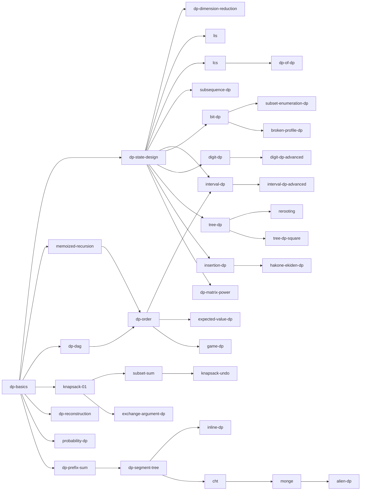

# 調査レポート 02：動的計画法（dp）

- 担当：動的計画法（DP の考え方、ナップサック系、列・文字列の DP、区間 DP、bitDP、桁 DP、木 DP・全方位木 DP、順列の DP、確率・期待値・ゲームの DP（DP の側面）、DP の高速化、EDPC・TDPC の対応）
- 調査日：2026-10-21。difficulty は `tools/ap.py` の表示値（補正後。「（参考値）」はそのまま。典型90問・EDPC・TDPC は difficulty がないので ★ か「なし」）
- 成果物：このファイルと [02-dp.topics.yaml](02-dp.topics.yaml)（72 項目・問題 296 行・重複を除く問題 ID 252 個。全 ID を ap.py で確認済み）
- DP の基礎と考え方・ナップサック系の19項目は、下請けのサブエージェントの調査結果（問題 141 行、全 ID 確認済み）を統合し、問題は 3〜7 問に絞った。絞って外した候補のうち、ほかの項目にも出てこないもの（29 問）は §5.3 に残した
- 調査の方法と制約：atcoder.jp のページは開いていない。Codeforces のページ（noai 指定）も開いていない。Web 検索はセッション共有の上限に何度も達したため、URL の規則が分かる第三者のブログのカテゴリ・月別一覧を直接読んで、手法別の問題を集めた（§1）。問題の内容は第三者の解説で確かめ、裏付けの URL を §5 と topics.yaml に残した

## 0. 要約

- **粒度の提案**：72 項目を、単独ページ 46・ほかのページの節 21・発展の概要 5 に分けた（§3、§7.1）。DP の考え方（状態の設計・計算順序・配る/貰う・メモ化再帰・状態の削減・復元）を独立したページ群にし、型（列・区間・集合・桁・木・順列・確率/期待値/ゲーム）と高速化を別の章に分ける。区間 DP・桁 DP・bitDP は ABC での難度帯が「基本」と「応用」で分かれるので、基本と応用を別ページにする（§2.4 の根拠）
- **レベルの分布**：基礎 9・水 21・青 16・黄 13・発展 13
- **DP の高速化の ABC での出現**：累積和（水）・セグ木（青）・インライン DP（青）・行列累乗（黄）は ABC の E〜G に繰り返し出る。CHT は 2019〜2026 年の ABC で想定解・主要解だったのが abc289_g (2109)・abc228_h (2729) の2問だけ、Monge・monotone minima は abc348_g (2559)・abc355_g (2991) など G/Ex のみ、Alien DP は abc218_h (2805)・abc355_g (2991)・abc305_h (3344)、slope trick は abc217_h (3112)、Knuth-Yao・SMAWK・LARSCH・Li Chao Tree が必須の ABC は見つからなかった（§2.5）。これらは「発展」が妥当
- **期待値 DP・ゲーム DP の境界**：理論（期待値の線形性・Grundy 数など）は 07、状態・遷移・計算順序・自己ループの処理は 02 に置く案（§7.5）

## 1. 調べた資料

### 1.1 日本語の資料

| 資料 | URL | 何の参考にしたか |
| --- | --- | --- |
| drken「動的計画法超入門！ Educational DP Contest の A ～ E 問題の解説と類題集」 | https://qiita.com/drken/items/dc53c683d6de8aeacf5a | DP の基本、配る DP・貰う DP・メモ化再帰の関係（どれも各辺を1回ずつ緩和する）、EDPC A〜E と類題（abc040_c・abc129_c・abc099_c・abc032_d など） |
| drken「Educational DP Contest の F ～ J 問題の解説と類題集」 | https://qiita.com/drken/items/03c7db44ccd27820ea0d | LCS と復元、DAG 上の DP（トポロジカル順とメモ化再帰）、確率・期待値 DP（EDPC I・J）、類題 abc037_d |
| drken「ゲームを解く！Educational DP Contest K, L 問題の解説」 | https://qiita.com/drken/items/4e1bcf8413af16cb62da | ゲーム DP（勝敗・得点差・minimax） |
| drken「典型的な DP (動的計画法) のパターンを整理 Part 1 ～ ナップサック DP 編 ～」 | https://qiita.com/drken/items/a5e6fe22863b7992efdb | ナップサック型の DP と区間分割（仕切りを入れる DP）の位置づけ |
| drken「貰う DP と配る DP、メモ化再帰、個数制限なしナップサック問題」 | https://qiita.com/drken/items/ace3142967c4f01d42e9 | 配る・貰う・メモ化再帰の対比（タイトルと要旨を確認） |
| drken「LIS でも大活躍！ DP の配列使いまわしテクニックを特集」 | https://qiita.com/drken/items/68b8503ad4ffb469624c | 配列の使い回し・in-place の DP と LIS の関係（タイトルと要旨を確認） |
| drken「部分列 DP --- 文字列の部分文字列を重複なく走査する DP の特集」 | https://qiita.com/drken/items/a207e5ae3ea2cf17f4bd | 部分列 DP の原理（最も左を取る取り出し方だけを数える）、TDPC G・ARC 081 E |
| けんちょんの競プロ精進記録（drken のブログ）のカテゴリ | https://drken1215.hatenablog.com/archive/category/（カテゴリ名） | 手法別の問題の発見と裏付け。約1000 のカテゴリのうち DP 関係の 101 カテゴリ（「DP状態:〜」「DP高速化:〜」「区間DP」「挿入DP」「部分列DP」「全方位木DP」「二乗の木DP」「箱根駅伝DP」「戻すDP」「ゲームDP」「期待値DP」「ConvexHullTrick」「Monge性」など）の記事一覧 1406 件を取得し、739 件を問題 ID に対応づけた |
| Series_205「Educational DP Contest (EDPC) K ~ O / P ~ S / T ~ W / X ~ Z 問題 解説」（Qiita） | https://qiita.com/Series_205/items/618b6ad1a22e7401a606 ほか3本 | EDPC K〜Z の状態・遷移・高速化（累積和・セグ木・行列累乗・全方位木 DP・遅延セグ木・包除・CHT）の裏付け |
| kyopro_friends「EDPC解説」（A〜E・F〜L・U〜Z） | https://kyopro-friends.hatenablog.com/entry/2019/01/12/230931 ほか | EDPC E（添字と値を逆にする）・X（s+w の順に並べてから DP）の裏付け（sub 調査） |
| mathenachia「DP の俗称」 | https://www.mathenachia.blog/dp/ | DP の型の呼び名の一覧と例題（耳 DP・箱根駅伝 DP・連結性 DP・Alien DP・座布団 DP など）。分類の網羅性の確認 |
| かんプリン「競技プログラミング 典型問題メモ」 | https://kanpurin.hatenablog.com/entry/2020/04/07/182948 | 手法別の問題一覧（桁 DP・部分列 DP・全方位木 DP・bitDP・箱根駅伝 DP・挿入 DP・区間 DP・Alien DP・2乗の木 DP・インライン DP・bitset・Slope Trick・CHT・後退解析・個数制限付きナップサック）。ABC の G/Ex を含む |
| maspy「slope trick (1) 解説編」「(2) 問題編」「(3) 凸共役」 | https://maspypy.com/slope-trick-1-%e8%a7%a3%e8%aa%ac%e7%b7%a8 ／ https://maspypy.com/slope-trick-2-%e5%95%8f%e9%a1%8c%e7%b7%a8 | Slope Trick の仕組みと AtCoder の例題（abc127_f・abc217_h・arc123_d・arc070_c など） |
| kmjp's blog | https://kmjp.hatenablog.jp/archive/（年）/（月） | 2019-04〜2026-10 の月別一覧から ABC の F（ABC126〜211）と G・Ex（ABC212〜480）の解説 425 本を取得し、手法のキーワード（Convex Hull Trick・monotone minima・Alien・slope trick・行列累乗・全方位・bitDP など）で分類した。高度な高速化の ABC での出現頻度の主な根拠（§2.5） |
| いかたこのたこつぼ（ikatakos）の ABC 問題メモ | https://ikatakos.com/pot/programming_algorithm/contest_history/atcoder/（年）/（月日）_abcNNN | ABC の D〜G の解法の裏付け（sub 調査と本調査。abc190_e・abc333_f など）。ページ内の問題文の引用は読まず「解法」節だけを使った |
| Kazun の競プロ記録 | https://kazun-kyopro.hatenablog.com/entry/ABC/NNN/X | ABC236〜291 前後の解法の裏付け（abc239_e・abc263_e・abc266_e など） |
| プロひろ（programming-hiroba.com） | https://programming-hiroba.com/abcNNN-x/ | ABC2xx 後半〜3xx の解法の裏付け（sub 調査。noai 指定なしを確認） |
| torus711 のアレ（カテゴリ「動的計画法」） | https://torus711.hatenablog.com/archive/category/動的計画法 | ABC3xx の DP 問題の発見と裏付け（sub 調査） |
| sigma425「Typical DP Contest (TDPC)」 | https://sigma425.hatenablog.com/entry/2016/08/02/214547 | TDPC 全20問の状態と解法の要点（対応表の裏付け） |
| navel_tos「Typical DP Contest 感想・解法メモ」（Qiita） | https://qiita.com/navel_tos/items/4dd0b6dbc88db08a9d57 | TDPC の難しさの感触（F から難しくなる・G が突出して難しい）と別解（R を最小費用流、S を行列で） |
| 競プロ典型 90 問（E869120/kyopro_educational_90） | https://github.com/E869120/kyopro_educational_90 | 解答コード（sol/）を全件取得して DP を使う問題を洗い出し、解説画像（editorial/）の URL を裏付けに使った |
| inamori's diary「AtCoder Beginner Contest 350 E」 | https://inamori.hateblo.jp/entry/2024/04/22/082456 | abc350_e（期待値のメモ化再帰と自己ループ）の裏付け |
| shinonome81「AtCoder Beginner Contest 301~350 / 351~400 D or E までの要点」（Zenn） | https://zenn.dev/shinonome81/articles/3e1c0c8a9c00fc | abc312_d・abc307_e・abc359_d などの解法の型の裏付け |
| AtCoder Tags（DP のサブタグ） | https://atcoder-tags.herokuapp.com/tags/Dynamic-Programming/Simple-DP など19タグ | 投票による問題の分類。DP の型ごとに ABC の問題が difficulty のどの帯に集まるかの集計（§2.4）。投票ベースでノイズがあり、最近の問題ほどタグが少ない |
| AtCoder Library のドキュメント（手元の document_ja） | ~/lib/ac-library-master/document_ja/ | segtree・lazy_segtree・fenwick_tree・convolution のテンプレート引数（ACL での対応の欄） |
| 北大 HCPC の勉強会資料（全方位木 DP・CHT） | https://hcpc-hokudai.github.io/archive/dynamic_programming_rerooting.pdf ／ https://hcpc-hokudai.github.io/archive/algorithm_convex_hull_trick_001.pdf | 検索結果で存在を確認（本文は読んでいない）。執筆時の参考候補 |
| satanic0258「Convex-Hull Trick」・ageprocpp「Convex Hull Trickを知っていますか？僕は知っています。」 | https://satanic0258.hatenablog.com/entry/2016/08/16/181331 ／ https://qiita.com/ageprocpp/items/3533b8f5678f9d4a5515 | 検索結果で存在を確認（本文は読んでいない）。CHT の執筆時の参考候補 |

### 1.2 英語・中国語の資料

| 資料 | URL | 何の参考にしたか |
| --- | --- | --- |
| USACO Guide（Gold: Introduction to DP / Knapsack DP / Paths on Grids / LIS / Bitmask DP / Range DP / Digit DP / DP on Trees / Solving For All Roots、Plat: Convex Hull Trick / Divide & Conquer - DP / Sum over Subsets DP / Matrix Exponentiation / Bitsets、Advanced: DP on Trees - Combining Subtrees / DP on Broken Profile / Additional DP Optimizations and Techniques / Lagrangian Relaxation / Slope Trick / LineContainer） | https://usaco.guide/gold/ ／ https://usaco.guide/plat/ ／ https://usaco.guide/adv/ | 英語圏のカリキュラムでの DP の分け方と難度の段階（Gold → Platinum → Advanced）。各モジュールの問題表から AtCoder の問題（abc321_f・abc227_e・abc360_g・abc439_e・abc187_f・abc259_f・abc207_f・arc067_d・arc066_d など）を拾った。Additional DP Optimizations は Knuth's Optimization と Connected-Component DP を扱う |
| cp-algorithms（Dynamic Programming の章、Convex hull trick and Li Chao tree） | https://cp-algorithms.com/ ／ https://cp-algorithms.com/dynamic_programming/knapsack.html ／ https://cp-algorithms.com/dynamic_programming/knuth-optimization.html | 章立て（Introduction・Knapsack・LIS・Divide and Conquer DP・Knuth's Optimization・Broken Profile・Largest zero submatrix）、個数制限付きナップサックの3段階（素朴・二進分解・単調キュー） |
| OI Wiki（动态规划の章、四边形不等式优化） | https://oi-wiki.org/dp/ ／ https://oi-wiki.org/dp/opt/quadrangle/ | 中国語圏の分類（背包・区间・DAG・树形・状压・数位・插头・计数・动态 DP・概率・DP 套 DP・优化（单调队列・斜率・四边形不等式・Slope Trick・WQS 二分・状态设计））。網羅性の確認と、四辺形不等式による高速化の整理（分割統治・二分队列・簡略版 LARSCH・区間分割・Knuth-Yao・WQS 二分の条件と計算量） |

- Competitive Programmer's Handbook は PDF を取得したが本文を抽出できず、構成の確認はしていない。Codeforces のブログ（DP の最適化のまとめ・Slope Trick・Aliens trick など）は noai 指定があるため開いていない（「Codeforces に該当記事がある（未読）」）

## 2. 分野の全体像

### 2.1 4つの層

DP の項目は、次の4層に分けると前提関係と使い分けが整理しやすい。

1. **考え方の層**（すべての型の前提）：DP の基本（状態・遷移・初期値・答え）→ 状態の設計（何を覚えれば十分か）→ 遷移の書き方（配る・貰う）と計算順序（依存関係の順・後ろから・メモ化再帰）→ 状態の削減（不要な次元・値と添字の入れ替え・配列の使い回し）→ 出力（復元・辞書順 K 番目）。「DP は DAG 上の最短路・数え上げ」という見方（dp-dag）がこの層の背骨になる
2. **型の層**（状態の形で分かれる）：
   - 列の先頭から決める（シーケンシャル DP）：ナップサック系・部分和・LIS・LCS・部分列 DP・区間分割 DP・照合状態の DP・フェーズの DP・括弧列・余りを持つ DP・グリッド DP
   - 区間を状態にする：区間 DP（基本・応用）
   - 集合を状態にする：bitDP・TSP・3^N の部分集合 DP・グリッドの境界（プロファイル DP）
   - 桁を状態にする：桁 DP（基本・応用）
   - 部分木を状態にする：木 DP・二乗の木 DP・全方位木 DP
   - 相対順序を状態にする：挿入 DP・箱根駅伝 DP・連結成分 DP
   - 値の意味が違う：確率 DP（前向きに配る）・期待値 DP（後ろから）・ゲーム DP（勝敗・得点差）
3. **高速化の層**（遷移の式の形で道具が決まる）：累積和・いもす法 → セグ木・BIT → スライド最小値 → インライン DP（遅延セグ木） → bitset → 行列累乗・ダブリング → 畳み込み → CHT・Li Chao Tree → Monge（monotone minima・SMAWK・Knuth-Yao）→ 凸性（Alien DP・Slope Trick・凸な列のマージ）
4. **組み合わせの層**：決め打ち二分探索＋DP、包除原理＋DP、交換論法（ソート）＋DP、数え上げの重複除去（代表元・最小添字規則）、DP の DP

### 2.2 前提関係（主なもの）

### 2.3 混同されやすいもの

| 組 | 違い |
| --- | --- |
| 配る DP ／ 貰う DP ／ メモ化再帰 | どれも各遷移を1回ずつ使う。配るは遷移先を列挙、貰うは遷移元を列挙（区間なら累積和で速くしやすい）、メモ化再帰は順序を自動で決める |
| 0-1 ナップサック ／ 個数制限なし | 1次元の配列で書くとループの向きだけが違う（大きい方から ／ 小さい方から） |
| 部分列 ／ 部分文字列 | 飛び飛び ／ 連続。LCS と最長共通部分文字列で遷移が違う |
| 部分列 DP ／ 部分列の個数の数え上げ | 「異なる文字列」を数える（代表を決める）か、「位置の組」を数える（重複を気にしない） |
| 区間 DP ／ 区間分割 DP | `dp[l][r]` で区間の内側を割る ／ `dp[i]` で最後の区間を決める |
| bit 全探索 ／ bitDP ／ 高速ゼータ変換 | 集合を列挙するだけ ／ 集合を状態にして順列などをまとめる ／ 部分集合の和を全部求める（07） |
| bitDP ／ 3^N の部分集合 DP | 要素を1つずつ足す（2^N·N） ／ 部分集合ごと分ける（3^N） |
| 桁 DP ／ ビットごとの寄与 | 上限 N との大小を持つ ／ 各ビットが独立に数えられる（01 の寄与） |
| 木 DP ／ 全方位木 DP ／ 直径 | 根を1つ固定 ／ 全頂点を根に ／ 最遠点だけなら直径の両端（04） |
| 普通の木 DP ／ 二乗の木 DP | 状態が定数個 ／ 状態に部分木のサイズが入る（マージが O(N^2) で済む理由が要る） |
| 挿入 DP ／ 箱根駅伝 DP | 相対順位を持つ ／ 相手が未定の要素の数を持つ |
| 確率 DP ／ 期待値 DP ／ 期待値の線形性 | 前から配る ／ 後ろから求める ／ 状態を持たずに寄与の和で求める（07） |
| ゲーム DP ／ Grundy 数 ／ 後退解析 | 1つのゲームの勝敗・得点差 ／ 独立なゲームの和（07） ／ 閉路のある状態グラフ（03） |
| 累積和 ／ セグ木 ／ スライド最小値 ／ インライン DP | 区間の和 ／ 任意の区間の min/max ／ 単調に動く窓の min/max ／ 配列を使い回して一括更新 |
| 行列累乗 ／ ダブリング ／ きたまさ法 | 状態ベクトルに行列を掛ける ／ 遷移の合成を前計算 ／ 線形漸化式の N 項目だけ（06） |
| CHT ／ Li Chao Tree ／ monotone minima | 直線の最小（単調なら deque） ／ 直線（線分）の追加と任意の点のクエリ ／ 最適な遷移元が単調（Monge） |
| Alien DP ／ 答えの二分探索 | 「ちょうど K 個」の制約を罰金に置き換えて罰金を探す ／ 答えの値そのものを探す |
| インライン DP ／ 配列の使い回し | どちらも配列1本だが、インライン DP は「行ごとに変わる部分だけ」をデータ構造で一括更新する |

### 2.4 ABC での DP の型の出現帯（AtCoder Tags による集計）

AtCoder Tags の DP のサブタグ（投票ベース）が付いた ABC の問題を、ap.py の difficulty で帯に分けた。投票による分類なのでノイズを含み（abc208_a のような明らかな誤りもある）、最近の問題ほどタグが少ない。それでも、どの型が水に集まり、どの型が黄に集まるかの目安になる。

| AtCoder Tags のタグ | ABC の問題数 | 基礎 | 水 | 青 | 黄 | 発展 | ABC の例（diff） |
| --- | --- | --- | --- | --- | --- | --- | --- |
| 基礎DP（Simple-DP） | 108 | 52 | 31 | 15 | 6 | 4 | （108問。灰〜緑が中心） |
| 戻すDP（Restore-DP） | 1 | 0 | 0 | 1 | 0 | 0 | abc321_f (1645) |
| 文字列DP（String-DP） | 6 | 2 | 1 | 3 | 0 | 0 | abc312_d (964)、abc253_e (1073)、abc185_e (1468)、abc118_d (1657)、abc130_e (1676)、abc214_f (1973) |
| 区間DP（Section-DP） | 3 | 0 | 0 | 2 | 1 | 0 | abc159_f (1876)、abc217_f (1954)、abc273_f (2277) |
| 桁DP（Digit-DP） | 15 | 2 | 7 | 1 | 5 | 0 | abc208_a (28)、abc121_d (1164)、abc154_e (1298)、abc135_d (1334)、abc242_e (1365)、abc029_d (1393)、abc117_d (1423)、abc336_e (1538)、abc129_e (1547)、abc007_4 (1718)、abc208_e (2024)、abc317_f (2072)、abc182_f (2121)、abc235_f (2129)、abc194_f (2197) |
| 木DP（Tree-DP） | 8 | 0 | 1 | 2 | 4 | 1 | abc220_f (1304)、abc036_d (1602)、abc387_f (1760)、abc287_f (2034)、abc158_f (2067)、abc149_f (2208)、abc207_f (2398)、abc163_f (2470) |
| 全方位木DP（Every-Direction-DP） | 5 | 0 | 1 | 2 | 2 | 0 | abc220_f (1304)、abc387_f (1760)、abc222_f (1934)、abc160_f (2048)、abc223_g (2351) |
| bitDP（Bit-DP） | 15 | 1 | 6 | 5 | 2 | 1 | abc318_d (1017)、abc180_e (1256)、abc142_e (1397)、abc215_e (1413)、abc278_f (1452)、abc251_d (1463)、abc274_e (1520)、abc190_e (1645)、abc041_d (1670)、abc199_d (1804)、abc199_e (1814)、abc332_e (1883)、abc352_f (2052)、abc195_f (2068)、abc025_d (3006) |
| 確率DP（Probability-DP） | 5 | 0 | 3 | 1 | 1 | 0 | abc360_e (1249)、abc275_e (1264)、abc323_e (1279)、abc310_f (1938)、abc243_f (2125) |
| 期待値DP（Expected-Value-DP） | 11 | 1 | 5 | 2 | 3 | 0 | abc194_d (1078)、abc266_e (1227)、abc280_e (1251)、abc184_d (1276)、abc300_e (1354)、abc326_e (1363)、abc263_e (1659)、abc314_e (1722)、abc342_f (2141)、abc189_f (2154)、abc144_f (2189) |
| 挿入DP（Insert-DP） | 2 | 0 | 0 | 0 | 1 | 1 | abc209_f (2307)、abc282_g (2412) |
| インラインDP（Inline-DP） | 8 | 0 | 1 | 3 | 2 | 2 | abc164_d (1232)、abc038_d (1804)、abc334_f (1813)、abc360_g (1982)、abc145_f (2116)、abc132_f (2143)、abc201_f (2484)、abc176_f (2912) |
| 行列累乗（Matrix-Power） | 7 | 0 | 0 | 1 | 4 | 2 | abc305_g (1989)、abc204_f (2044)、abc199_f (2065)、abc009_4 (2213)、abc256_g (2250)、abc129_f (2621)、abc212_h (2741) |
| CHT（CHT） | 1 | 0 | 0 | 0 | 1 | 0 | abc289_g (2109) |
| その他（Other） | 3 | 0 | 1 | 1 | 1 | 0 | abc291_f (1449)、abc334_f (1813)、abc243_g (2032) |

- 桁 DP は水（7問）と黄（5問）に分かれ、青が1問しかない → 基本と応用の2ページに分ける根拠
- bitDP は水 6・青 5・黄 2 → 基本は水。3^N（abc187_f 1895・典型90 045 ★6）やプロファイル DP は別ページ
- 区間 DP は青の上端〜黄に集まる（かんプリンの一覧の ABC はすべて 1954 以上。基本形の練習は典型90 019 ★6・EDPC N・L）。挿入 DP・行列累乗は黄以上
- 確率 DP・期待値 DP は水に集中し、閉路の処理や最適化が加わると青〜黄
- 木 DP・全方位木 DP は水〜黄に散らばる（単純な集計・距離の和は水、一般形は青以上）

### 2.5 DP の高速化の ABC での出現頻度とレベル

kmjp の解説 425 本（ABC126〜211 の F、ABC212〜480 の G・Ex。2019-05〜2026-10）を手法のキーワードで分類し、drken・かんプリン・maspy・AtCoder Tags の分類と照合した。「想定解・主要な解法としてその手法を使う ABC の問題」を数えている（別解で使えるだけのものは括弧に入れた）。

| 手法 | ABC での確認できた出現（diff、年月） | 頻度の目安 | 判定 |
| --- | --- | --- | --- |
| 累積和・いもす法による遷移 | abc222_d (865)・abc178_d (875)・abc253_e (1073)・abc179_d (1251)・abc183_e (1288)・abc130_e (1676)・abc207_e (1820)・abc311_f (1984)・abc132_f (2143)・abc265_f (2290) ほか多数 | 毎年何度も（ABC の D〜F） | 水 |
| セグ木・BIT による遷移 | abc353_g (1765)・abc410_g (2242) ほか（EDPC Q・典型90 037） | 年に数回（F〜G） | 青 |
| インライン DP（配列の使い回し＋一括更新） | abc271_e (1402)・abc372_f (1722)・abc203_e (1750)・abc353_g (1765)・abc038_d (1804 参考値)・abc145_f (2116)・abc262_h (2957) | 年に1〜2回 | 青 |
| スライド最小値・単調スタック | abc359_e (1275、スタック)・abc325_f (1769)・abc334_f (1813) | 少ない | 青（セグ木の節） |
| bitset | abc147_e (1713、普通の DP でも通る)・abc221_g (2914)（ARC・AGC に arc070_b 2015・agc020_c 2259） | 少ない | 黄（部分和の節） |
| 行列累乗 | abc305_g (1989)・abc204_f (2044)・abc199_f (2065)・abc009_4 (2213 参考値)・abc256_g (2250)・abc129_f (2621)・abc212_h (2741) | 年に1回程度 | 黄 |
| 動的 DP（セグ木に遷移行列） | abc246_h (2677、2022-04) | 1問 | 発展 |
| 畳み込み（FFT・分割統治 FFT）を使う DP | abc212_h (2741)・abc318_h (2785)・abc213_h (2806)・abc281_h (3180)・abc300_h (3209) | Ex/G でときどき | 発展（06 との境界） |
| CHT | abc289_g (2109、2023-02)・abc228_h (2729、2021-11)（abc353_g 1765 にも CHT の別解記事がある） | 7年で2問 | 発展（黄に1問） |
| Li Chao Tree | 必須の問題は見つからなかった（abc244_h 2878 は Li Chao Tree でも解けるが、kmjp は区間ごとの凸包で解いている） | 0 | 発展 |
| Monge・monotone minima | abc348_g (2559、2024-04)・abc355_g (2991、2024-05)（abc373_f 2018 を monotone minima で解く解説がある） | 2〜3問、すべて 2024 年 | 発展 |
| 凸な列の (max,+) 合成 | abc348_g (2559)・abc383_g (3026、2024-12) | 2問 | 発展 |
| Alien DP（Lagrange 緩和・WQS 二分） | abc218_h (2805、2021-09、貪欲でも解ける)・abc355_g (2991)・abc305_h (3344、2023-06) | 3問 | 発展 |
| Slope Trick | abc217_h (3112、2021-09)（入口の abc127_f 2003 は2つのヒープで中央値。ARC に arc123_d 2143） | 1〜2問 | 発展 |
| Knuth-Yao・SMAWK・LARSCH | 見つからなかった（Knuth-Yao は EDPC N と同型の問題で使える） | 0 | 発展 |

- 判定の理由：累積和・セグ木・インライン DP・行列累乗は「知らないと解けない問題」が水〜黄の帯に繰り返し出る。CHT 以降は ABC での出現が数年に1〜2問で、そのほとんどが 2400 以上。黄に1問ずつある CHT（abc289_g）と Monge 系（abc373_f）は、どちらも別の考え方（二分探索・貪欲）でも解ける範囲なので、ページは「発展」の概要＋ライブラリの使い方で足りる
- ACL にはこれらの高度な高速化の機能はない。自作ライブラリにするときの検証には Library Checker の問題が使える（問題の一覧は https://github.com/yosupo06/library-checker-problems で確認）：`line_add_get_min`（CHT・Li Chao Tree）、`segment_add_get_min`（線分版の Li Chao Tree）、`min_plus_convolution_convex_arbitrary`・`min_plus_convolution_convex_convex`（凸な列の (min,+) 畳み込み・monotone minima）、`longest_increasing_subsequence`（LIS）、`point_set_range_composite`（動的 DP の土台になる「区間の合成」のセグ木）、`kth_term_of_linearly_recurrent_sequence`（きたまさ法・Bostan-Mori、06 との境界）

## 3. 項目一覧

詳細（別名・問題のサイン・使い分け・図の案・例題）は [02-dp.topics.yaml](02-dp.topics.yaml) にある。「ページ分割の案」の `own` は単独ページ、`section-of:<key>` はそのページの節、`overview` は発展の概要ページ。前提に書いた key のうち、このファイルにないもの（`prefix-sum`・`segment-tree`・`topological-sort`・`binomial-coefficient`・`grundy-number` など）はほかの担当の項目の推測の key である。

| 項目（key） | レベル | 根拠の問題と difficulty | 前提 | ACL での対応 | ページ分割の案 |
| --- | --- | --- | --- | --- | --- |
| DP の基本（状態・遷移・初期値・答え）（`dp-basics`） | 基礎 | 状態1次元・遷移が定数個の DP をそのまま問う問題は abc245_c (403)・abc240_c (464)・abc211_c (559)・abc129_c (796)・abc099_c (1101) と灰〜緑に集中。水以上では状態設計や高速化と組み合わさって出る | complexity-estimation, full-search | — | own |
| 配る DP と貰う DP（`dp-push-pull`） | 基礎 | 考え方は基礎。使い分けが効くのは水：貰う形にすると遷移元が区間になって累積和でまとめられる問題が abc178_d (875)・abc253_e (1073)・abc179_d (1251) | dp-basics | — | section-of:dp-basics |
| メモ化再帰（`memoized-recursion`） | 基礎 | 素直なメモ化の abc340_c (528)・abc275_d (606) が基礎。計算順が自明でない・状態がまばらでメモ化が楽な問題は abc184_d (1276)・abc357_e (1295)・abc201_d (1317)・abc300_e (1354)・abc350_e (1385) と水 | dp-basics, recursion | — | own |
| 計算順序（依存関係の順に回す・後ろから解く）（`dp-order`） | 水 | 後ろから・値の順・トポロジカル順に計算しないと解けない問題が abc188_e (1170)・abc266_e (1227)・abc184_d (1276)・abc197_e (1379)・abc146_f (1545)・abc341_f (1604)・abc195_e (1609) と水〜青に集まる | dp-basics, dp-dag | — | own |
| DAG 上の DP（`dp-dag`） | 基礎 | DAG 上の DP そのものは基礎（abc232_d 539・abc211_d 755）。DAG だと気づく・作る型は水（abc188_e 1170・abc357_e 1295・abc335_e 1540）。二分探索と組み合わせると青（abc324_f 1815） | dp-basics, topological-sort | — | own |
| 状態の設計（何を覚えれば十分か）（`dp-state-design`） | 水 | 直前の選択・on/off・個数を1次元足す型は abc306_d (596)・abc303_d (778)・abc312_d (964) と基礎。何を覚えれば十分かを見抜く・情報を圧縮する型が abc322_e (1193)・abc307_e (1240)・abc232_e (1380)・abc359_d (1381)・abc265_e (1531)・abc175_e (1554) と水に集まる | dp-basics | — | own |
| 余り・総和・個数を状態に持つ DP（`dp-mod-state`） | 水 | abc220_d (664)・abc281_d (1031) の基礎から、abc262_d (1213)・abc135_d (1334)・arc060_a (1583) と水に集まり、abc207_e (1820) が青 | dp-state-design, mod-arithmetic | — | own |
| 状態の削減（不要な次元・値と添字の入れ替え・上限での打ち切り）（`dp-dimension-reduction`） | 青 | drken は abc325_f の解説で、DP の値を使って状態を表すこの手法を青色 diff あたりの典型と書いている。該当は abc219_d (1085)・abc410_e (1077) の緑から abc364_e (1496)・abc315_f (1674)・abc325_f (1769)・abc376_f (2089)・abc203_f (2252) と広がる | dp-state-design | — | own |
| 値と添字の入れ替え（`dp-swap-key-value`） | 青 | EDPC E が入口。abc317_d (929)・abc364_e (1496)・abc032_d (1731 参考値)・abc325_f (1769)・abc203_f (2252) | knapsack-01, dp-state-design | — | section-of:dp-dimension-reduction |
| 配列の使い回しとループの向き（in-place 更新）（`dp-rolling-array`） | 基礎 | abc153_e (1015)・abc219_d (1085) で必要。dp_d の1次元化が典型 | knapsack-01 | — | section-of:knapsack-01 |
| DP の復元（選んだものを出力する）（`dp-reconstruction`） | 水 | 選び方を1つ出力させる問題は abc271_d (886)・典型90 056 (★5) から。辞書順最小の復元は abc146_f (1545)・abc369_f (1618)・arc081_c (2072) | dp-basics | — | own |
| 辞書順 K 番目を数え上げで決める（`dp-kth-lexicographic`） | 水 | ABC では少ない。二項係数で数える abc202_d (966)・桁数ごとに数える abc363_d (975) が緑、数え上げに DP が要るものは TDPC G | dp-reconstruction, binomial-coefficient | — | section-of:dp-reconstruction |
| グリッド上の DP（`dp-grid`） | 水 | 基本の経路数・最長路は基礎（EDPC H・abc232_d 539）。状態や累積和などの工夫が入る問題が abc183_e (1288)・abc311_e (1293)・abc201_d (1317)・abc210_d (1507)・abc175_e (1554) と水に集まる。青に abc369_f (1618)・abc147_e (1713)・abc344_f (1922)、黄に abc227_f (2323) | dp-basics | — | own |
| 答えを決め打ちして DP で判定する（`dp-decision-binary-search`） | 青 | abc415_e (1212) の水から、abc324_f (1815)・abc236_e (1893) と青。黄に abc227_f (2323)（全探索で固定する近縁の型） | binary-search-on-answer, dp-basics | — | own |
| 0-1 ナップサック（`knapsack-01`） | 基礎 | 基本形は abc344_d (854)・abc317_d (929)・abc219_d (1085) と緑。応用は arc073_b (1477)・abc364_e (1496)・abc145_e (1528)・abc341_f (1604)・abc054_d (1655)・abc169_f (1698)・abc159_f (1876) と水〜青、abc426_g (2119) が黄 | dp-basics | — | own |
| 個数制限なしナップサック（`knapsack-unbounded`） | 基礎 | abc289_d (551)・abc153_e (1015)・abc099_c (1101)。大きな答えを作る abc118_d (1657) は青、価値が減っていく変形の abc373_f (2018) は黄 | knapsack-01 | — | section-of:knapsack-01 |
| 個数制限付きナップサック（二進分解・スライド最小値）（`knapsack-bounded`） | 青 | ABC では二進分解やスライド最小値が必須の問題は見つからなかった。個数が小さく素朴に展開して済む abc286_d (607)、数え上げを余りごとの累積和で速くする arc104_d (2251)、個数の種類が √M しかないことを使う abc269_g (2440) | knapsack-01, dp-sliding-window | — | section-of:knapsack-01 |
| 部分和問題と部分和の数え上げ（`subset-sum`） | 基礎 | abc240_c (464)・abc204_d (832)・abc271_d (886)・abc274_d (916)・TDPC A が基礎。数え上げの応用は abc222_e (1491)・abc216_f (1541)・arc060_a (1583) が水、abc169_f (1698) が青。bitset の高速化は黄（agc020_c 2259） | dp-basics | — | own |
| 戻す DP（数え上げのナップサックから要素を取り除く）（`knapsack-undo`） | 青 | abc321_f (1645) が本命。各要素を除いた場合を全部求める arc070_b (2015) は黄。max のナップサックは戻せないので、前後からの DP（abc441_f 1455）や分割統治（abc426_g 2119）を使う | subset-sum, knapsack-01 | — | own |
| 交換論法で順序を決めてから DP する（`exchange-argument-dp`） | 青 | abc145_e (1528)・abc216_f (1541) の水から、abc366_f (1819) と青、abc163_e (2037) が黄。EDPC X・典型90 011 (★6) | exchange-argument, knapsack-01 | — | own |
| 最長増加部分列（LIS）（`lis`） | 水 | 基本形（二分探索で O(N log N)）が必要な問題は abc134_e (1320)・典型90 060 (★5) から現れ、応用（各要素が LIS に入るか・木の上・1回の変更）は abc354_f (1639)・abc006_4 (1696)・abc165_f (1843)・abc360_g (1982) と青に集まる | dp-basics, binary-search, dp-dimension-reduction | atcoder::segtree（セグ木版・重み付き） | own |
| 最長共通部分列（LCS）と編集距離（`lcs`） | 水 | EDPC F が基本。LCS 型の2次元 DP が必要な ABC は abc141_e (1459)・abc185_e (1468)・abc130_e (1676) に集まる | dp-basics, dp-reconstruction | — | own |
| 編集距離（`edit-distance`） | 水 | abc185_e (1468) | lcs | — | section-of:lcs |
| 部分列 DP（重複のない部分列の数え上げ）（`subsequence-dp`） | 黄 | 重複を除いて部分列を数える問題は abc214_f (1973)・arc081_c (2072)・abc230_f (2113)・abc299_f (2349) と黄に集まる。前提の nxt テーブルと部分列判定は典型90 006 (★5)・008 (★4) で水 | dp-state-design, dp-counting-dedup | — | own |
| 区間分割 DP（列を区切る DP）（`dp-sequence-partition`） | 水 | 区切れるかの可否は arc065_a (930) から。条件を満たす区切り方を数える型は agc031_b (1315) の水から、条件が複雑なもの（abc207_e (1820)・典型90 089 (★7)・arc104_c (2009)）が青〜黄に続く | dp-basics, dp-prefix-sum | atcoder::fenwick_tree（区間の条件判定に使う場合） | own |
| 照合状態を持つ DP（文字列のオートマトン上の DP）（`string-automaton-dp`） | 水 | 直近の数文字やパターンの何文字目まで一致したかを状態にする問題が abc122_d (1533)・abc104_d (1739)・典型90 008 (★4) に出る。KMP・Aho-Corasick の遷移表を作る一般形は ABC では稀（発展の節） | dp-state-design | — | own |
| DP の DP（`dp-of-dp`） | 黄 | abc391_g (2247)：内側の LCS の DP の1行（差分が 0/1）を外側の DP の状態にする | lcs, bit-dp, dp-state-design | — | own |
| 括弧列の DP（`bracket-dp`） | 基礎 | abc312_d (964)：'?' を埋めて正しい括弧列になる数を、開き括弧の残り数を状態にして数える | dp-basics | — | own |
| 数え上げ DP で重複を避ける（代表元を決める）（`dp-counting-dedup`） | 青 | 同じ対象を1回だけ数えるために「代表の作り方」を決める必要がある問題が abc130_e (1676)・abc311_f (1984)・abc214_f (1973) など青に多い | dp-state-design | — | own |
| フェーズを状態に持つ DP（耳 DP）（`dp-phase`） | 青 | 「区間の外・中・後」などの段階を状態にする問題が abc211_c (559) の基本形から、abc210_d (1507)・abc104_d (1739)・abc159_f (1876)・abc360_g (1982)・yahoo_procon2019_qual_d (1998) と青に多い | dp-state-design | — | own |
| 区間 DP（`interval-dp`） | 青 | 基本形（分割点・両端から取る・区間を消す）が必要な問題は典型90 019 (★6)・abc217_f (1954) から。ABC の区間 DP は大半が黄以上（abc163_e 2037・abc252_g 2153・abc206_f 2221・abc273_f 2277・abc292_g 2340・abc325_g 2388） | dp-basics, dp-order, memoized-recursion | — | own |
| 区間 DP の応用（区間の数え上げ・木構造・座標上の区間）（`interval-dp-advanced`） | 黄 | abc252_g (2153)・abc206_f (2221)・abc273_f (2277)・abc292_g (2340)・abc325_g (2388)。発展は abc261_g (2803)・abc262_g (3114) | interval-dp, binomial-coefficient | — | own |
| bitDP（集合を状態に持つ DP）（`bit-dp`） | 水 | abc322_e (1193)・abc354_e (1223)・abc180_e (1256)・abc142_e (1397)・abc215_e (1413)・abc278_f (1452) と水に集中。組み合わせの応用（abc190_e 1645・abc301_e 1673・abc199_e 1814・abc338_f 1835）は青 | dp-state-design, bit-operations, bit-full-search | — | own |
| 巡回セールスマン問題（TSP）（`tsp`） | 水 | abc180_e (1256)・abc274_e (1520)。最短路と組み合わせると abc190_e (1645)・abc301_e (1673)・abc338_f (1835) | bit-dp, dijkstra, bfs | — | section-of:bit-dp |
| 部分集合を列挙する DP（O(3^N)）（`subset-enumeration-dp`） | 青 | abc187_f (1895)・典型90 045 (★6)・EDPC U。abc310_d (1368) は 3^N でも全探索でも解ける。発展は abc321_g (2439)・abc213_g (2663) | bit-dp, dp-counting-dedup | — | own |
| グリッドの境界を状態に持つ DP（プロファイル DP・連結性 DP）（`broken-profile-dp`） | 黄 | 行ごとの配置パターンを状態にする基本形は abc113_d (1597) にあるが、マス単位の境界状態や圧縮が必要なのは典型90 023 (★7)・abc204_f (2044、行列累乗と併用)。連結性を持つものは tdpc_grid・abc296_h (2822) で発展 | bit-dp, dp-state-design | — | own |
| 桁 DP（`digit-dp`） | 水 | abc154_e (1298)・abc135_d (1334)・abc117_d (1423)・abc336_e (1538)・abc129_e (1547)・abc155_e (1569) と水に集中 | dp-state-design, mod-arithmetic | — | own |
| 桁 DP の応用（複数の数・繰り上がり・状態の圧縮）（`digit-dp-advanced`） | 黄 | abc208_e (2024)・abc317_f (2072)・abc182_f (2121)・abc235_f (2129)・abc194_f (2197)・abc172_f (2216)。青では abc231_e (1740)・arc123_c (1827) | digit-dp | — | own |
| 木 DP（`tree-dp`） | 水 | 水と青の境目。部分木の値を子から集める基本形は典型90 073 (★5)・abc239_e (1084)・abc133_e (1505)。状態に選択を持つ独立集合型は EDPC P と同じ abc036_d (1602 参考値)・abc387_f (1760)、応用は abc259_f (1961)・abc369_g (2055)・abc246_g (2313) | dp-basics, tree-basics, dfs | — | own |
| 二乗の木 DP（サイズで抑える木 DP）（`tree-dp-square`） | 黄 | abc287_f (2034)・arc171_c (2244)・abc207_f (2398)。発展は arc130_d (2437)・arc121_e (2645)・arc101_c (2913) | tree-dp, knapsack-01 | — | own |
| 全方位木 DP（`rerooting`） | 青 | 根の移動による差分で済む距離和の問題は abc220_f (1304)・abc348_e (1347) と水にあるが、一般の全方位木 DP が必要な問題は abc222_f (1934)・abc160_f (2048)・abc337_g (2080)・abc223_g (2351) | tree-dp, prefix-sum | — | own |
| データ構造をマージする木 DP（マージテク）（`tree-dp-merge`） | 黄 | abc359_g (2099)・abc183_f (1586、Union-Find 上)。木の構造の手法としては 04 の担当 | tree-dp, small-to-large | — | section-of:tree-dp |
| 挿入 DP（相対順序を持つ順列の DP）（`insertion-dp`） | 黄 | EDPC T と同型の abc209_f (2307)。発展は abc282_g (2412)・abc267_g (2561)・abc313_h (3008) | dp-state-design, dp-prefix-sum | — | own |
| 箱根駅伝 DP（未確定の数を持つ順列・マッチングの DP）（`hakone-ekiden-dp`） | 黄 | abc309_g (2372)・abc134_f (2532)。ABC での出現は2問で、黄の上端〜発展 | insertion-dp, dp-state-design | — | own |
| 連結成分 DP（`connected-component-dp`） | 発展 | ABC での出題は確認できなかった。USACO Guide の Additional DP Optimizations and Techniques（CSES Permutations II など）で扱われる | insertion-dp | — | overview |
| 確率 DP（`probability-dp`） | 水 | abc360_e (1249)・abc323_e (1279)・abc298_e (1300)・abc300_e (1354) と水に集中 | dp-push-pull, probability-basics, modint-rational | atcoder::modint998244353（確率を mod で表す場合） | own |
| 期待値 DP（`expected-value-dp`） | 水 | abc266_e (1227)・abc280_e (1251)・abc184_d (1276)・abc326_e (1363)・abc350_e (1385) と水に集中。自己ループや閉路の処理が要るものは abc263_e (1659)・abc314_e (1722)・abc333_f (1770) と青、abc342_f (2141)・abc189_f (2154) は黄 | probability-dp, dp-order, modint-rational | atcoder::modint998244353 | own |
| 依存関係に閉路がある DP（自己ループ・連立方程式・二分探索）（`dp-with-cycles`） | 青 | 自己ループの移項は abc350_e (1385)・abc263_e (1659)・abc314_e (1722)、閉路を一次式や二分探索で解くのは abc333_f (1770)・abc189_f (2154) | expected-value-dp | — | section-of:expected-value-dp |
| ゲーム DP（勝敗・得点差の DP）（`game-dp`） | 水 | abc354_e (1223)・abc270_d (1300)・abc201_d (1317)・abc278_f (1452)・abc349_e (1464)・arc085_b (1550) と水に集中。閉路のあるグラフの後退解析は abc209_e (2153)・abc261_h (2531) | dp-order, memoized-recursion | — | own |
| DP の高速化の全体像（遷移の形から道具を選ぶ）（`dp-speedup-overview`） | 水 | 累積和での高速化が abc179_d (1251)・abc183_e (1288) から必要になり、以後の高速化はすべて「遷移の形を見て道具を当てる」同じ考え方で整理できる（横断の入口ページ） | dp-state-design, dp-push-pull | — | own |
| 累積和・いもす法による遷移の高速化（`dp-prefix-sum`） | 水 | abc222_d (865)・abc178_d (875)・abc253_e (1073) の緑から現れ、abc179_d (1251)・abc183_e (1288) で典型化。応用は abc130_e (1676)・abc207_e (1820)・abc311_f (1984)・abc132_f (2143)・abc265_f (2290) | dp-push-pull, prefix-sum, imos | — | own |
| セグ木・BIT による遷移の高速化（`dp-segment-tree`） | 青 | abc353_g (1765)・arc026_3 (1930)・典型90 037 (★5)・EDPC Q。kmjp の ABC G の解説でもセグ木を使う DP は 2000 前後に多い（abc410_g 2242 など） | dp-prefix-sum, segment-tree, coordinate-compression | atcoder::segtree / atcoder::fenwick_tree | own |
| インライン DP（DP 配列を使い回して一括更新する）（`inline-dp`） | 青 | abc271_e (1402)・abc372_f (1722)・abc203_e (1750)・abc353_g (1765)・abc038_d (1804)。EDPC W は遅延セグ木で一括更新する典型 | dp-rolling-array, dp-segment-tree, lazy-segment-tree | atcoder::lazy_segtree | own |
| スライド最小値・単調スタックによる遷移の高速化（`dp-sliding-window`） | 青 | abc359_e (1275、スタック)・abc334_f (1813)・abc325_f (1769)。個数制限付きナップサックへの応用は発展側（abc269_g 2440 など） | dp-segment-tree, sliding-window-minimum, monotonic-stack | — | section-of:dp-segment-tree |
| bitset による DP の高速化（`dp-bitset`） | 黄 | arc070_b (2015)・agc020_c (2259)・abc221_g (2914)。abc147_e (1713) は bitset で書けるが普通の bool の DP でも通る | subset-sum, bit-operations | — | section-of:subset-sum |
| 行列累乗による DP の高速化（`dp-matrix-power`） | 黄 | abc305_g (1989)・abc204_f (2044)・abc199_f (2065)・abc009_4 (2213)・abc256_g (2250)。発展は abc129_f (2621) | dp-state-design, matrix-power | — | own |
| ダブリングによる DP の高速化（`dp-doubling`） | 黄 | 典型90 005 (★7)：桁を倍々に伸ばす遷移の合成で 10^18 桁を扱う | dp-matrix-power, doubling | — | section-of:dp-matrix-power |
| 動的 DP（セグ木に遷移を載せる）（`dynamic-dp`） | 発展 | abc246_h (2677)：部分列の数え上げ DP の遷移を行列にしてセグ木に載せ、1文字の書き換えクエリに答える | dp-matrix-power, segment-tree | atcoder::segtree（S に行列を載せる） | overview |
| 包除原理と DP（最初に違反する場所で分ける）（`inclusion-exclusion-dp`） | 黄 | EDPC Y が典型。ABC では abc309_g (2372) など黄の上端、arc115_e (2363)・arc101_c (2913) | dp-basics, inclusion-exclusion, binomial-coefficient | — | own |
| 環状の列の DP（最初の状態を固定する）（`dp-cyclic`） | 水 | abc251_e (1227)・abc307_e (1240) | dp-state-design | — | section-of:dp-state-design |
| 到達する状態だけを持つ DP（map・メモ化）（`dp-map-sparse`） | 青 | abc300_e (1354)・abc350_e (1385) はメモ化で到達する値だけを計算し、abc208_e (2024) は桁の積を map に持つ | memoized-recursion, dp-state-design | — | section-of:memoized-recursion |
| 畳み込み（FFT・NTT）で DP を高速化する（`dp-convolution`） | 発展 | abc212_h (2741)・abc318_h (2785)・abc213_h (2806)・abc281_h (3180)。畳み込みそのものは 06 の担当 | convolution | atcoder::convolution | overview |
| Convex Hull Trick（CHT）（`cht`） | 発展 | ABC で CHT が想定解・主要解の問題は 2019〜2026 年の ABC F/G/Ex で abc289_g (2109)・abc228_h (2729) の2問（kmjp の解説 425 本と AtCoder Tags で確認）。黄に1問あるが頻度が低く、EDPC Z が定番の練習 | dp-speedup-overview, dp-segment-tree, convex-hull | — | own |
| Li Chao Tree（`li-chao-tree`） | 発展 | ABC で Li Chao Tree が必須の問題は確認できなかった。abc244_h (2878) は直線（点）の追加と最大値クエリで、Li Chao Tree・動的 CHT でも、kmjp のように区間ごとの凸包でも解ける | cht, segment-tree | — | section-of:cht |
| Monge 性と DP（`monge`） | 発展 | Monge 性（最適な遷移元の単調性）を使う ABC は abc348_g (2559)・abc355_g (2991) など G/Ex のみ（kmjp の解説で monotone minima を使用） | dp-sequence-partition, dp-speedup-overview | — | own |
| 分割統治 DP（monotone minima）（`monotone-minima`） | 発展 | abc348_g (2559)：凸な列どうしの合成を分割統治で行う。arc067_d (2729) は USACO Guide の Divide & Conquer DP の問題 | monge, divide-and-conquer | — | section-of:monge |
| SMAWK・LARSCH（`smawk-larsch`） | 発展 | ABC で必須の問題は確認できなかった（OI Wiki の四辺形不等式の頁は LARSCH の簡略版を扱う） | monotone-minima | — | section-of:monge |
| Knuth-Yao speedup（区間 DP の高速化）（`knuth-yao`） | 発展 | ABC で必須の問題は確認できなかった。EDPC N（スライムの合体）は O(N^3) で通るが Knuth-Yao で O(N^2) にできる同型の問題 | interval-dp, monge | — | section-of:monge |
| Alien DP（Lagrange 緩和・WQS 二分）（`alien-dp`） | 発展 | abc218_h (2805)・abc355_g (2991)・abc305_h (3344)。abc218_h は優先度付きキューの貪欲でも解ける（kmjp） | monge, binary-search, dp-sequence-partition | — | overview |
| Slope Trick（`slope-trick`） | 発展 | abc127_f (2003) は2つのヒープで中央値を管理する入口。DP として slope trick を使う ABC は abc217_h (3112)。ARC では arc123_d (2143)・arc070_c (3365) | dp-state-design, priority-queue, dp-convexity | — | overview |
| 凸な列どうしの (max,+) 畳み込み（`convex-max-plus-convolution`） | 発展 | abc348_g (2559)・abc383_g (3026)：k 個選ぶ最大値が k について凹であることを使い、分割統治で列をマージソートのように合成する | dp-convexity, divide-and-conquer | — | section-of:monge |
| DP の値の凸性（限界効用の単調性）を使う（`dp-convexity`） | 発展 | Alien DP・slope trick・凸な列のマージの前提となる見方。ABC では abc218_h (2805)・abc348_g (2559)・abc383_g (3026) など G/Ex | dp-state-design | — | section-of:monge |

## 4. 項目ごとのメモ

関係の深い項目はまとめて書いた（見出しの key が topics.yaml の key に対応する）。各項目の「問題のサイン」「似た手法」「図の案」は topics.yaml にも短く入れてある。

### 4.A DP の考え方

#### `dp-basics` DP の基本（基礎）と `dp-push-pull` 配る DP・貰う DP（基礎、節）

- **何ができるか・なぜ**：全探索の木では同じ「途中の状況」に何度もたどり着く。将来の選択と評価が「途中の状況（状態）」だけで決まるなら、状態ごとに最良値（や個数）を1回だけ求めればよい。DP は「状態・遷移・初期値・答えの取り出し方」の4つを決めれば書ける。
- **3種類を同じ骨組みで**：最適化（min/max と ±∞）、数え上げ（+ と 0）、可否判定（OR と false、bitset にできる）。違うのは演算と単位元、初期値、到達できない状態の表し方、答えの取り出し方（`dp[N]` か、`dp[N][*]` の max か和か）。
- **配る・貰う**：配る＝確定した `dp[i]` から遷移先へ足し込む、貰う＝`dp[i]` を遷移元から集める。どちらも各辺を1回ずつ使うだけで、正しさと計算量は同じ（drken「EDPC A〜E」）。違いは列挙しやすさとまとめやすさ。遷移先が操作から決まる（すごろく・確率）なら配る形が自然、遷移元が区間・余りのクラスなら貰う形にすると累積和でまとめられる（`dp-prefix-sum` への入口）。遷移先が区間なら配る形＋いもす法（abc179_d）。
- **つまずき**：到達できない状態の INF に足して溢れる、mod の取り忘れ、1-indexed と 0-indexed のずれ、配る形で未確定の値を配る。
- **図**：全探索の木と DP の表を並べ、同じ状態が合流する様子。配る（矢印を出す）と貰う（矢印を集める）を色違いで同じ表に描く。
- **確認問題**：Frog 1 を配る形と貰う形で書くと、各辺は何回使われるか／数え上げで初期値 `dp[0] = 1` とするのはなぜか（空の選び方が1通り）。
- **サイン**：「最小値・最大値」「方法の数を 998244353 で割った余り」「〜できるか」、前から順に決める構造で全探索だと 2^N や K^N。
- **使い分け**：まず貪欲を疑い、反例があれば DP にする（abc099_c・abc365_d は貪欲では解けない例）。

#### `memoized-recursion` メモ化再帰（基礎）と `dp-map-sparse` 到達する状態だけを持つ（青、節）

- **何ができるか・なぜ**：漸化式をそのまま再帰で書き、計算済みの値を覚えて再利用する。依存関係に沿って自動的に「先に必要なもの」から計算されるので、計算順序が自明でないとき（DAG・値の大小・ゲームの局面）に強い。drken は「トポロジカルソートしながら DP している」と説明している。
- **まばらな状態**：N ≤ 10^18 でも ⌊N/2⌋, ⌊N/3⌋, ⌊N/k⌋ の形の値しか現れないなら、map でメモ化すると訪れる状態だけ計算できる（abc340_c・abc275_d・abc350_e・abc300_e、桁の積の abc208_e）。
- **つまずき**：再帰が深いとスタックが溢れる（10^5 段以上）、閉路があると止まらない（関数グラフはサイクルを先に処理：abc357_e）、自己ループ（自分自身に依存）は移項してから書く、「未計算」の印と答えの値が衝突する。
- **図**：再帰の呼び出し木で、メモに当たった呼び出しが灰色になって枝が刈られる様子。
- **確認問題**：f(N) = f(⌊N/2⌋) + f(⌊N/3⌋) で N = 10^18 のとき、現れる値はおよそ何個か（⌊N/(2^a·3^b)⌋ の形だけなので約千個。実際に数えると 1012 個）。
- **使い分け**：for ループ（ボトムアップ）は速くスタックの心配がなく、累積和などの高速化を載せやすい。メモ化再帰は順序を考えなくてよく、まばらな状態に強い。

#### `dp-order` 計算順序（水）

- **原則**：`dp[x]` を計算するときに、依存する値がすべて確定している順に回す。状態を頂点・遷移を辺とした依存グラフが DAG であることが前提（閉路があれば最短路や連立方程式へ）。
- **典型の順序**：添字の昇順、逆順（終わりから：期待値・ゲーム・残り回数）、値でソートした順（abc037_d・abc341_f）、区間の長さ順（区間 DP）、集合の昇順（bitDP：S ⊂ T なら S < T）、木の帰りがけ順（木 DP）、一般のトポロジカル順（`dp-dag`）。
- **「後ろから解く」のサイン**：終わりの値が分かっている（期待値は 0、ゲームは終局の勝敗）、辞書順最小の復元（後ろから可否を求めて前から貪欲）、「i 番目以降で最適に行動したとき」と言い換えられる部分問題。
- **つまずき**：2重ループの内外の順の誤り、逆順の境界、配る形での未確定の値。
- **図**：依存グラフを描き、6種類の順序（添字・逆・値・長さ・集合・木）を同じ図式で並べる。
- **確認問題**：区間 DP で l を昇順に回すと何が困るか／bitDP で集合を整数の昇順に回してよいのはなぜか。

#### `dp-dag` DAG 上の DP（基礎）

- **位置づけ**：DP の表を頂点、遷移を辺とみるとどの DP も DAG 上の最短路・最長路・経路の数え上げになる。列の DP もグリッドの DP もその特別な場合。最長路は一般のグラフでは難しいが DAG なら DP で解ける。
- **順序の作り方**：入次数 0 から取り出す（Kahn 法）、DFS の帰りがけ順の逆、メモ化再帰、問題の性質（番号順・値の順・距離の順）。最短路の本数は「距離が確定した順」（BFS の層順）に配る（abc211_d）。
- **サイン**：「u < v の辺だけ」「右か下にしか動けない」「値が増えるように移動」「最短経路の本数」。
- **つまずき**：閉路があるのに DP をする（SCC で縮約するか最短路に切り替える）。
- **図**：DP の表と同じ構造のグラフを並べる。

#### `dp-state-design` 状態の設計（水）、`dp-mod-state` 余りを状態に（水）、`dp-cyclic` 環状（水、節）

- **何ができるか・なぜ**：過去の選び方そのものではなく、「残りの決定の制約と評価に影響する要約」だけを状態に持つ。典型の要約は、直前の値・on/off・偶奇・個数・余り・照合位置・上限で打ち切った値・末尾の数文字。要約が同じなら将来の最適な選び方も同じなので、まとめても答えは変わらない。
- **余り**：条件が「和（積）が M の倍数」「平均が整数」なら、和そのものではなく和 mod M を持てば十分（足し算・掛け算と mod の取り方が両立する）。平均は個数 k を外側で固定して和 ≡ 0 (mod k)（abc262_d）か、値から平均を引いて和 = 0 に（arc060_a）。
- **環状**：円形の列は1か所で切って列にし、「最初の要素と同じか」「最初に何を選んだか」を状態に足して最後に整合を取る（abc307_e・abc251_e）。
- **つまずき**：最適値だけを持てば十分と誤って状態を潰しすぎる（abc147_e は差の集合が要る）、状態数の見積もり忘れ（(P+1)^K、2^K）、C++ の % が負になる、答えの mod と状態の mod の混同。
- **図**：過去の選び方の木と、要約で合流させた状態の表を並べる。和の数直線を M ごとに折り返して円にする図。
- **確認問題**：「同じ活動を2日続けない」で前日の活動を持たないと何が起きるか／平均が整数になる選び方を数えるとき、k を固定せずに和 mod ? を持てない理由は？
- **サイン**：「隣り合う〜が異なる」「連続して〜しない」「直前でコストが変わる」「モードの切り替え」「〜の倍数」「平均」「円形」。

#### `dp-dimension-reduction` 状態の削減（青）、`dp-swap-key-value` 値と添字の入れ替え（青、節）、`dp-rolling-array` 配列の使い回し（基礎、knapsack-01 の節）

- **3つの型**：(a) 段（品物番号・時刻）の次元を2本や1本で使い回す（ローリング・in-place）、(b) 添字の範囲を制約から見積もって打ち切る（上限での頭打ち、log 回で十分：abc315_f）、(c) ほかの添字から決まる量・支配される量を値に回す（値と添字の入れ替え：EDPC E・abc364_e・abc325_f）。
- **入れ替えが成り立つ条件**：同じ添字なら値が良い方が常に良い（支配関係）。どれを添字に残すかは範囲が小さい量で決める。drken は abc325_f の解説で、この手法を青 diff あたりでよく見る典型と書いている。
- **in-place のループの向き**：0-1 は大きい方から、個数無制限は小さい方から。判断の基準は「同じ段で書き換えた値を、同じ段の別の更新で読むか」。
- **つまずき**：ローリングで前の段の初期化を忘れる、打ち切りの遷移（min(X, x+a)）を忘れる、復元が要るのに表を捨てる、入れ替え後の答えの取り出し（`dp[v] ≤ W` となる最大の v）。
- **図**：(a, b, c) の立方体の表から c を値に回して平面の表にする図。1次元配列の更新の矢印。
- **確認問題**：0-1 ナップサックを1次元で小さい方から更新すると何が起きるか（同じ品物を何度も使う）。

#### `dp-reconstruction` 復元（水）と `dp-kth-lexicographic` 辞書順 K 番目（水、節）

- **2つのやり方**：(1) 表を残し、終端から「どの遷移で最適値になったか」を値の一致で判定して辿る、(2) 遷移元を別の配列に記録しておく。
- **辞書順最小**：先頭から貪欲に「この文字を置いても残りで最適値を達成できるか」を判定したいので、後ろからの DP（i 以降で達成できる最適値）を作る（abc146_f・arc081_c）。前からの DP を後ろから辿ると、決まる順が逆になり辞書順の比較に使えない。
- **K 番目**：先頭の候補を小さい順に見て、「先頭をそれにしたときの残りの数」が K 以上ならそれに決め、未満なら K から引いて次へ。数え上げの値は K を超えたら打ち切る（溢れ防止）。
- **つまずき**：ローリングした表では辿れない、最適な遷移が複数あるときの選び方、辿った順の逆転を忘れる、数え上げのオーバーフロー。
- **確認問題**：LCS の表を左上から辿って復元できないのはなぜか。

#### `dp-grid` グリッド DP（水）

- **基本**：右・下にしか動かないなら (i, j) の昇順が DAG の順。上下左右に動けるなら閉路があるので BFS・ダイクストラ（03）。
- **応用の型**：状態の追加（行内で拾った個数：abc175_e、差の集合：abc147_e）、方向ごとの累積和（abc183_e）、ゲーム（右下から：abc201_d）、正方形（左・上・左上の min+1：abc311_e）、向きを反転してもう一度（abc210_d）、決め打ちとの組み合わせ（abc415_e・abc227_f）、包除（EDPC Y）。
- **つまずき**：1行目・1列目の初期化、壁を到達不能にし忘れる、H×W×状態数のメモリ。
- **確認問題**：H×W のグリッドで右と下だけに進む経路の数を、DP と二項係数の両方で求めよ。

#### `dp-decision-binary-search` 決め打ち＋DP（青）

- **型**：「最小値の最大化」「平均・比・中央値の最大化」は、答え X を決め打つと「X 以上を達成できるか」の判定問題になる。判定が X について単調なら二分探索し、判定を DP で作る。
- **変換**：平均 ≥ X ⇔ Σ(a_i − X) ≥ 0（個数を状態に持たなくて済む）、比 ≥ X ⇔ Σ(b − X·c) ≥ 0（分数計画、abc324_f）、中央値 ≥ X ⇔ X 以上を +1・未満を −1 とした和が正（abc236_e）。
- **つまずき**：実数の二分探索の回数、境界の ≥ と >、判定 DP の初期化を毎回やり直す、中央値の定義（偶数個のとき）。
- **使い分け**：二分探索・分数計画の一般論は 01。DP 側は「判定を DP で作る」部分に絞る。

### 4.B ナップサック系

#### `knapsack-01` 0-1 ナップサック（基礎）、`knapsack-unbounded` 個数制限なし（基礎、節）、`knapsack-bounded` 個数制限付き（青、節）

- **何ができるか・なぜ**：`dp[i][w]`＝i 番目までの品物で重さが w 以下（ちょうど w）のときの価値の最大。品物 i を選ぶか選ばないかで分ける。「以下」と「ちょうど」で初期値と答えが変わる。
- **計算量で解法を切り替える**：O(NW) が基本。W が大きく価値が小さい → 値と添字の入れ替え、N ≤ 40 程度 → 半分全列挙（01）、重さの種類が少ない → 個数の全探索（arc073_b）。abc032_d がこの3分岐を1問で問う。
- **変形**：多次元の重さ（abc219_d・abc054_d）、「以上にする」型は上限で打ち切る、グループから1つ（abc344_d）、数え上げ（abc169_f・abc159_f）、品物を除く（→ 戻す DP）、順序が効く（→ 交換論法＋DP）、区間クエリ（abc426_g は分割統治でマージ）。
- **個数制限なし**：1次元で小さい方から更新すると同じ品物を何度でも使える。数え上げでは「組合せ（順序なし）なら品物のループを外側、列（順序あり）なら和のループを外側」（USACO Guide の Coin Combinations I/II が対）。
- **個数制限付き**：素朴 O(W·Σk)、二進分解（1, 2, 4, …, 残り）で O(W·Σlog k)、重さの余りごとの列で窓の最大を取ってスライド最小値 O(NW)（cp-algorithms）。数え上げなら窓の和なので累積和（arc104_d）。ABC で二進分解・スライド最小値が必須の問題は見つからなかった（sub 調査）。
- **つまずき**：1次元化のループの向き、上限を超えた量の扱い、価値の和の int 溢れ、「ちょうど」と「以下」の取り違え。
- **図**：品物×重さの表を1行ずつ埋める。選ぶ（斜め）・選ばない（真下）の矢印。1次元化の向き。
- **確認問題**：1次元配列で重さを小さい方から更新すると、0-1 ではなく何の問題になるか／W = 10^9・価値 ≤ 1000・N ≤ 100 ならどう解くか。
- **サイン**：「重さの合計が W 以下で価値の最大」「選ぶか選ばないか」「同じものを何度でも」「B_i 個まで」。

#### `subset-sum` 部分和（基礎）と `dp-bitset` bitset による高速化（黄、節）

- **何ができるか**：作れる和の集合（可否）や、和が S になる選び方の数。可否は bool の DP なので bitset で `dp |= dp << a`（O(NS/64)）。
- **典型の言い換え**：2グループに分ける＝一方の部分和（abc204_d）、x と y が独立なら別々に（abc274_d）、45 度回転で独立化（abc221_g、発展）、平均＝値から引いて和 0（arc060_a）、最大値を固定するためにソートしてから処理（abc216_f）、±の和は (S + 総和)/2 の部分和に直す。
- **つまずき**：bitset のサイズはコンパイル時の定数、負の和のオフセット、空集合を数えるか、復元が要るなら表を残す。
- **確認問題**：±a_i の和が K になる符号の付け方の数を、普通の部分和の数え上げに直せ。
- **使い分け**：N ≤ 40 で和が大きいなら半分全列挙（01）。bitset そのものは 08 の担当。

#### `knapsack-undo` 戻す DP（青）

- **仕組み**：数え上げの更新 `dp'[s] = dp[s] + dp[s − a]` は逆に解ける（s の小さい方から `dp[s] = dp'[s] − dp[s − a]`）。足し算には引き算があるから戻せる。max/min や OR には逆演算がないので戻せない。
- **戻せないとき**：前後からの DP をマージ（abc441_f）、分割統治でオフラインに処理（abc426_g）。
- **サイン**：「追加と削除のクエリ」「〜を除いたとき」「各 i について i を使わない場合」。
- **確認問題**：max のナップサックで品物を1つ取り除けないのはなぜか。

#### `exchange-argument-dp` 交換論法で順序を決めてから DP（青）

- **構造**：選ぶ集合が決まれば最適な順序がソートで決まるとき、先にその順に並べておけば「選ぶ／選ばない」の DP にできる（EDPC X の s+w、典型90 011 の締切、abc366_f の比）。
- **比較の作り方**：隣り合う i, j を入れ替えたときの差を式にし、i だけの量と j だけの量の比較に分離する。分離できれば全体のソートに使える。比は割り算せず掛け算で比べる。
- **サイン**：「好きな順番で」「いくつか選んで順に」「締切」「積み重ねる」「関数の合成」「最後の1つだけ特別」。
- **使い分け**：交換論法そのものと貪欲は 01。ここは「並べてから DP」に絞る。

### 4.C 列・文字列の DP

#### `lis` 最長増加部分列（水）

- **何ができるか・なぜ**：列から順序を保って選ぶ増加列の最長を O(N log N) で求める。配列 `L[k]`＝「長さ k の増加部分列の末尾として取り得る最小値」を持つ。末尾が小さい列ほど後で延ばしやすい（末尾が大きい同じ長さの列に勝つ）ので、各長さについて最小の末尾だけ覚えれば足りる。`L` は単調増加になる（長さ k+1 の列から最後を除くと長さ k の列ができ、その末尾は元の末尾より小さい）ので、新しい値 x の行き先は二分探索で決まる（狭義なら `lower_bound`、広義なら `upper_bound` の位置を x で置き換える）。
- **セグ木版**：`dp[v]`＝「末尾の値が v の増加列の最長」を値の座標圧縮の上でセグ木に載せ、`dp[x] = max(dp[0..x−1]) + 1`。重み付き（EDPC Q）・各要素を含む LIS・数え上げ（長さと個数の組）に拡張しやすい。二分探索版は速いが拡張しにくい、と対比して教える。
- **つまずき**：`L` の中身は LIS そのものではない（復元には各要素の「直前」を別に記録する）。狭義・広義で lower/upper を取り違える。2次元（箱の入れ子：abc038_d）では「一方の昇順、もう一方は降順」で並べる理由（同じ幅の箱どうしを鎖にしないため）。各要素が LIS に入るかは前後から2回求めて和で判定する（abc354_f）。
- **図**：値を1つずつ入れ、`L` のどこが置き換わるかをハイライトするステップ送り。O(N^2) の表との対比。
- **確認問題**：なぜ `L` は単調か？／「1 1 1」の狭義 LIS を二分探索版で求めると、lower と upper でどう変わるか？／「何本の非増加列に分ければよいか」が LIS の長さになるのはなぜか（Dilworth の言い換え、abc134_e）。
- **サイン**：N ≤ 2×10^5、「部分列」「単調」「入れ子」「何本の列に分けるか」「挿入・移動の最小回数（N − LIS）」。
- **使い分け**：O(N^2) の素朴な DP → 二分探索版（長さだけ）→ セグ木版（重み・条件付き・数え上げ）。木の上の LIS（abc165_f）は DFS しながら `L` の変更を巻き戻す（kmjp の解説）。

#### `lcs` LCS と `edit-distance` 編集距離（水）

- **何ができるか・なぜ**：`dp[i][j]`＝S の先頭 i 文字と T の先頭 j 文字の LCS 長。末尾が一致すれば両方使う（`dp[i−1][j−1]+1`）、一致しなければどちらかの末尾を捨てる（`max(dp[i−1][j], dp[i][j−1])`）。一致したのに捨てる選択を考えなくてよいのは、一致する末尾を使って損をしないから（交換で説明できる）。編集距離は同じ表で「挿入・削除・置換」の3方向のコストを取る。
- **つまずき**：部分列（飛び飛び）と部分文字列（連続）の混同。最長共通部分文字列は `dp[i][j] = dp[i−1][j−1]+1 or 0`（abc141_e 型）。共通部分列の「組の数」は単純に足すと重複するので包除で引く（abc130_e）。復元は表を右下から逆にたどる。
- **図**：2次元の表を埋める矢印（斜め＝一致、上・左＝捨てる）と、復元経路のハイライト。
- **確認問題**：置換が使えない編集距離（挿入と削除だけ）は LCS で表せるか？（|S|+|T|−2·LCS）／S と S の反転の LCS は何を表すか（最長回文部分列）。
- **サイン**：2つの列・文字列、長さ 3000〜5000、「共通」「一致させる最小の操作」。
- **使い分け**：短い片方の LCS の値ごとに数える問題は「DP の DP」（abc391_g）。

#### `subsequence-dp` 部分列 DP（黄。前提の nxt テーブルは水）

- **何ができるか・なぜ**：同じ文字列を作る取り出し方は複数あるので、取り出し方を数えると重複する。そこで「各文字を、まだ使っていない位置のうち最も左から取る」取り出し方だけを数える。この貪欲な取り出し方は部分列ごとにちょうど1つなので、部分列と一対一に対応する。`nxt[i][c]`＝位置 i 以降で文字 c が最初に現れる位置、を前計算し、`dp[i]`（位置 i を最後に使った部分列の数）から各文字 c について `nxt[i+1][c]` へ配る。
- **応用**：部分列判定（貪欲マッチ）、「部分列として現れない最短の文字列」（後ろから DP して辞書順最小に復元：arc081_c）、辞書順 K 番目の部分列（後ろからの個数を使って先頭から決める：TDPC G）、条件付きの数え上げ（隣り合う位置を選ばない：abc214_f）、言い換えてから使う（abc230_f、abc299_f）。
- **つまずき**：空文字列を含めるか。nxt の「無い」を N で表す番兵。個数が 10^18 を超える場合の上限での打ち切り（K 番目を求めるとき）。
- **図**：文字列の上に nxt の矢印を描き、ある部分列に対応する「最も左を取る道」を1本だけ光らせる。
- **確認問題**："aba" の空でない異なる部分列はいくつか（a, b, ab, aa, ba, aba の6つ）／最も左を取る取り出し方が一意なのはなぜか。
- **サイン**：「異なる部分列の個数」「部分列として含まれない」「辞書順 K 番目の部分列」、文字種 26。
- **使い分け**：部分列として 'ABC' が何個含まれるか（位置の組の数）は重複を気にしない数え上げなので `string-automaton-dp`／`dp-phase` の範囲。

#### `dp-sequence-partition` 区間分割 DP（水〜青）

- **何ができるか・なぜ**：`dp[i]`＝先頭 i 要素を条件を満たす区間に区切る方法の数（または最小コスト）。最後の区間の左端 j で分けると `dp[i] = Σ_{(j,i] が条件を満たす} dp[j]`。最後の区間を決めれば残りは独立な小問題になる。
- **高速化の型**：条件が「j が i に対して単調に動く範囲」なら尺取り＋累積和（典型90 089）、「区間和が K でない」なら全体から和が K になる j の分を連想配列で引く（abc370_e）、区間の番号に依存する条件は番号を状態に足して余りごとの累積（abc207_e）、cost(j, i) が Monge なら monotone minima・Alien DP（発展）。
- **つまずき**：`dp[0] = 1`（空の区切り）。区間の端の off-by-one。区間 DP（`dp[l][r]`）との混同。
- **図**：列に仕切りを入れる図と、`dp[i]` に足し込まれる `dp[j]` の範囲を帯で示す図。
- **確認問題**：区間分割 DP と区間 DP の違いは？（最後の区間で切る vs 区間の内部を分割）
- **サイン**：「連続部分に分ける」「区切り方の数」「各区間のコストの和の最小」。

#### `string-automaton-dp` 照合状態を持つ DP（水。KMP・Aho-Corasick の一般形は発展）

- **何ができるか・なぜ**：パターンを「何文字目まで一致したか」の状態機械（オートマトン）とみて、文字列を1文字ずつ決める DP の状態に持つ。禁止パターンが短ければ「直近の数文字」を状態にすれば十分（abc122_d は直近3文字。1回の隣接交換で現れる場合も含めて判定する）。部分列のパターンなら「何文字目まで集めたか」（典型90 008、abc104_d）。任意のパターンには KMP の失敗関数から遷移表を作り、複数パターンなら Aho-Corasick。長さが巨大なら遷移を行列にして累乗する（abc305_g）。
- **つまずき**：直近の文字だけでは判定に足りない場合（パターンの接頭辞と接尾辞が重なる）。KMP の遷移表を前計算せずに毎回たどると遅い。
- **図**：パターンの状態遷移図を描き、文字を読むごとに状態が移るステップ送り。
- **確認問題**：パターン "ABA" で状態「AB まで一致」から 'A' を読むと次は？ 'B' なら？
- **サイン**：「〜を含まない文字列の数」「部分列として 'ABC' が何個」「長さ N（巨大）の文字列でパターン（短い）を含まない」。
- **使い分け**：文字列アルゴリズムそのもの（KMP・Aho-Corasick）は 08 の担当。DP 側は「状態として持つ」部分に絞る。

#### `dp-of-dp` DP の DP（黄）

- **何ができるか・なぜ**：内側の DP の状態全体（例：LCS の表の1行）を外側の DP の状態にする。LCS の表の1行は隣どうしの差が 0 か 1 なので、短い側の長さを n として 2^n 通りしかない（abc391_g）。「ある DP の値が k になる入力の数」を数えるときの定石。
- **つまずき**：内側の状態数の見積もり（単調性や差の制約で減ることに気づく）。外側の遷移で内側の1行を毎回計算し直すので、遷移を前計算する。
- **図**：内側の表の1行を bit 列にし、1文字足すと別の行に移る遷移図。
- **サイン**：「LCS（など DP で求まる値）がちょうど k になる文字列の数」、片方が 10〜20 文字。

#### `bracket-dp` 括弧列の DP（基礎）

- **何ができるか・なぜ**：括弧列を「開き括弧の残り数（深さ）」の折れ線とみる。正しい括弧列 ⇔ 途中で 0 未満にならず最後に 0。`dp[i][d]`＝i 文字目までで深さ d の数。
- **つまずき**：途中で負になる遷移を捨て忘れる。深さの上限は N/2 でよい。
- **図**：括弧列を山の折れ線として描く。
- **サイン**：'(' と ')' と '?'、「正しい括弧列」。並べ替えて正しくする問題（ソートの貪欲）とは別物。

#### `dp-counting-dedup` 数え上げで重複を避ける（青）

- **何ができるか・なぜ**：同じ対象が複数の作り方で作れるとき、作り方に「代表」を決めて代表だけを数える。代表の決め方の型は (1) 最も左を取る（部分列 DP）、(2) 番号最小の要素を含むグループから決める（グループ分け・3^N：abc310_d）、(3) 包除で重なりを引く（abc130_e）、(4) 「直前と違う」「最初に〜」で場合分け（agc031_b）。
- **つまずき**：グループの順序を区別して数えてしまう（K! 倍の重複）。
- **図**：同じ対象に対応する複数の作り方を並べ、代表だけに印を付ける。
- **確認問題**：3人を2チームに分ける数を「各人がどちらのチームか」で数えるとなぜ重複するか。
- **サイン**：「異なる〜の個数」「区別しないグループ」「操作で得られる結果の種類数」。

#### `dp-phase` フェーズを状態に持つ DP（耳 DP）（青）

- **何ができるか・なぜ**：「区間の前・中・後」「何文字目まで集めたか」のように、各位置で今どの段階にいるかを状態にする。区間を1つ選ぶ問題で左端と右端を全探索する代わりに、段階の切り替わりを遷移にする（O(N^2) → O(N)）。
- **つまずき**：段階の数の数え方（区間の外側にも段階がある）。段階の切り替えを同じ位置で何回許すか。
- **図**：列の下に「段階0→1→2」の帯を描き、状態遷移図にする。
- **確認問題**：「1か所だけ区間を反転してよい」問題を段階で表すと何段階か。
- **サイン**：「区間を1つ選んでその中だけ操作」「1回だけ変更できる」「列の一部分だけ」。

### 4.D 区間 DP

#### `interval-dp` 区間 DP（青）と `interval-dp-advanced` 応用（黄）

- **何ができるか・なぜ**：`dp[l][r]`＝区間 [l, r) について求めた値。区間の内側の部分問題は必ず短いので、長さの短い順に埋めれば依存関係が満たされる（またはメモ化再帰）。
- **型の分類（ページ内の節の案）**：
  1. 分割点型：`dp[l][r] = min_m (dp[l][m] + dp[m][r]) + cost(l, r)`（EDPC N・典型90 019）。「最後に行う操作」で区間を2つに割る。O(N^3)。
  2. 両端型：左端か右端を取る（EDPC L・abc163_e は大きい順に左右の端へ置く）。O(N^2)。
  3. 端の相手で分ける型（数え上げ）：区間の左端と組む相手 m で分け、内側 [l+1, m) と外側 [m+1, r) を独立に数え、二項係数で操作の順序を混ぜる（abc217_f）。分割点を全部足すと重複するので「左端の相手」で一意にする。
  4. 最後に残る・最後に消すものを決める型（TDPC I、abc325_g）。
  5. 区間で木やゲームを表す型（応用）：DFS 順の区間＝部分木（abc252_g）、区間ゲームの Grundy 数（abc206_f）、数直線上で訪れた区間の両端（abc273_f）。
- **つまずき**：l を 0 から昇順に回すと `dp[l][m]`（m < r）は計算済みでも `dp[m][r]` が未計算になることがある → 長さ順か l を降順に回す。半開区間と閉区間の混在。数え上げで分割点ごとに足して重複させる。O(N^3) は N ≤ 400〜500 が目安。
- **図**：上三角の表を対角線（長さ）ごとに埋めるアニメーション。区間を割る木の図。
- **確認問題**：`dp[l][r]` の計算に必要な値がすべて計算済みになるループの順番は？／abc217_f で「左端と組む相手」で分けると重複しないのはなぜ？
- **サイン**：N ≤ 300〜500、「隣り合うものを合体・消去」「両端から取る」「括弧の対応」「回文」。
- **使い分け**：区間分割 DP（`dp[i]`）は「左から区切る」、区間 DP は「区間の内側を割る」。区間 DP の高速化（Knuth-Yao）は発展。
- **レベルの根拠**：ABC で区間 DP が必要な問題は abc217_f (1954) を除くと 2000 以上に集まる（AtCoder Tags の Section-DP の ABC は abc159_f (1876)・abc217_f (1954)・abc273_f (2277) の3問、kanpurin の区間 DP の一覧の ABC はすべて 1954 以上）。基本の型は青（典型90 019 ★6）、応用は黄として2ページに分ける案を推す。

### 4.E bitDP

#### `bit-dp` bitDP（水）・`tsp` 巡回セールスマン（水、bit-dp の節）

- **何ができるか・なぜ**：順列 N! 通りの探索のうち、将来に効くのが「どれを使ったか（集合）」と「最後に何を使ったか」だけなら、状態は 2^N·N に減る。集合 S ⊂ T なら S の整数表現は T より小さいので、S の昇順に回せば依存関係が満たされる。
- **型**：(1) 集合だけ（EDPC O：使った女性の集合。男性は集合の大きさで決まる）、(2) 集合＋最後（TSP・abc215_e）、(3) 集合で表した「開けられる箱」などの和集合（abc142_e）、(4) 他の探索との組み合わせ（BFS で特別な点どうしの距離を求めてから TSP：abc190_e・abc301_e、ワーシャルフロイドの後：abc338_f）、(5) ゲームの状態（abc354_e・abc278_f）、(6) 素数の集合（abc195_f、黄）。
- **つまずき**：`&` と `==` の優先順位、`1 << N` の範囲、初期状態（始点を集合に入れるか）、巡回で最後に始点へ戻る分。メモリ 2^20·20 ≈ 2×10^7。
- **図**：集合の包含関係（ハッセ図）を描き、値が小さい集合から大きい集合へ流れる。N! の順列の木が「集合＋最後」で合流する図。
- **確認問題**：TSP で最後の頂点を状態に持たないと何が困る？／N = 20 で 2^N·N^2 は何回か、間に合うか。
- **サイン**：N ≤ 16〜20、「全部回る」「順番を決める」「集合」、K ≤ 17 個の特別な地点。
- **使い分け**：bit 全探索（01）は集合を列挙するだけ、bitDP は集合を状態にして重複をまとめる。部分集合の和を全部求めるだけなら高速ゼータ変換（07）。

#### `subset-enumeration-dp` O(3^N) の部分集合 DP（青）

- **何ができるか・なぜ**：集合を「部分集合とその残り」に分ける遷移。T を S の部分集合として `T = (T − 1) & S` で列挙すると、全体の計算量は Σ_S 2^|S| = 3^N（各要素が「S に入らない／T に入る／S∖T に入る」の3通り）。
- **重複の除き方**：グループの順序を区別しないため「S の最小要素を含む T」だけを列挙する（最小添字規則）。
- **つまずき**：3^N の見積もり（N = 16 で 4.3×10^7、N = 18 で 3.9×10^8）。空集合の扱い。
- **図**：各要素が3状態を取ることを示す図。部分集合列挙のビット操作の動き。
- **サイン**：N ≤ 16〜18 を「いくつかのグループに分ける」。
- **使い分け**：高速ゼータ変換（2^N·N）は「部分集合の和」を全部求めるもの。グループへの分割そのものを数えるには 3^N が要る。

#### `broken-profile-dp` グリッドの境界を状態に持つ DP（黄。連結性は発展）

- **何ができるか・なぜ**：幅 W が小さいグリッドを1行（または1マス）ずつ進め、未処理の部分に影響する境界の情報だけを bit で持つ。1マスずつ進める形（broken profile）では状態 2^W・遷移 O(1)。隣接条件で取り得る状態が減ることを使って圧縮する（abc379_g は 3 色で 3^W より大幅に少ない状態、典型90 023 はキングを置ける状態だけを列挙）。長さが巨大なら行列累乗と組み合わせる（abc204_f）。連結性まで持つものはフロンティア法・插頭 DP（TDPC S、abc296_h）。
- **つまずき**：境界の bit が「どのマスの情報か」を図にしないと実装が崩れる。状態の圧縮（取り得る状態の列挙と番号付け）。
- **図**：走査線（折れ線の境界）を1マスずつ動かし、境界上の bit が書き換わるステップ送り。
- **サイン**：H×W ≤ 200 などで短い辺 ≤ 10〜14、「敷き詰め」「隣接しないように置く」「隣と異なる色」「連結」。

### 4.F 桁 DP

#### `digit-dp` 桁 DP（水）・`digit-dp-advanced` 応用（黄）

- **何ができるか・なぜ**：N 以下の整数を上の桁から決める。上の桁のどこかで N より小さい数字を選んだら、以降の桁は自由になる。だから「N と一致したままか（smaller フラグ）」の2状態に、問題が求める情報（桁和の余り・0 でない桁の数・使った数字の集合など）を足せば、N の桁数に比例する計算量で数えられる。
- **応用の型**：(1) 2つ以上の数を同時に決める（各数の smaller フラグを並べて持つ：abc129_e の a,b、abc317_f の3つの数）、(2) 上限と下限の両方（f(R) − f(L−1) か、上下2つのフラグ：abc138_f）、(3) 下の桁からの繰り上がりを状態にする（支払いとお釣り：abc155_e・abc231_e・abc182_f）、(4) 状態の種類が少ないことを使う（桁の積を map で持つ：abc208_e、使った数字の集合 2^10：abc235_f・abc194_f）、(5) 割る数を全探索して桁 DP を繰り返す（abc336_e の桁和）。
- **つまずき**：leading zero（数字の集合や 0 の個数を数えるとき、先頭の 0 を数字として数えない）。N 自身を含むか。桁和の上限は 9×桁数。個数と総和を同時に持つときの遷移（総和 += 個数×桁の値）。
- **図**：N の桁を並べ、「ここで初めて小さい数字を選ぶ」分岐の木。smaller でない道が1本だけであることを強調するステップ送り。
- **確認問題**：smaller フラグを持たないと何を数えすぎるか／leading zero を区別する必要があるのはどんな条件のときか。
- **サイン**：N ≤ 10^18、N が 10^4 桁の文字列、「N 以下で条件を満たす数の個数・総和」「各桁」「桁和」「0 でない桁」「2進で xor や and」。
- **使い分け**：各ビットを独立に考えられる問題（xor の和をビットごとに数える）は桁 DP でなく寄与の考え方（01）。照合状態を持つ DP とは「状態機械を上の桁から動かす」点で同じ構造（drken は「広義の桁 DP」と分類）。
- **レベルの根拠**：AtCoder Tags の Digit-DP の ABC 15問は水 7（abc154_e 1298 など）と黄 5（abc208_e 2024〜abc194_f 2197）に分かれ、青は1問だけ。基本と応用の2ページに分ける案を推す。

### 4.G 木 DP

#### `tree-dp` 木 DP（水。選択の状態を持つ応用は青）

- **何ができるか・なぜ**：根を1つ決めると、各頂点の部分木は互いに交わらない小問題になる。`dp[v]`＝v の部分木について求めた値を、子の値から帰りがけ順に作る。頂点自身の選択（白黒・選ぶ選ばない・親との辺を使うか）を状態に足すのが基本形（EDPC P、典型90 073 の3状態）。
- **型**：(1) 子の値の積・和（数え上げ）、(2) 「親との辺を使うと得する量」を子ごとに計算して大きい順に取る（abc259_f）、(3) 子の上位 K 個だけ持つ（abc239_e）、(4) 根から下へ配る（abc133_e：根から順に選べる色の数を掛ける）、(5) 二分探索と組み合わせて判定にする（abc246_g）。
- **つまずき**：再帰が深くなり（N = 2×10^5 の一本道）スタックが溢れる → BFS 順を逆にたどる。親への逆流（親を引数で渡す）。数え上げで mod を取り忘れる。根の選び方で答えが変わらないことの確認。
- **図**：葉から根へ値が集まるアニメーション。各頂点に dp の組を表示し、親で掛け合わせる式を見せる。
- **確認問題**：独立集合の数え上げで、v を白にしたとき子は白黒どちらでもよいのはなぜ？／根を変えても答えが同じになるのはなぜ？
- **サイン**：「木」「各頂点を塗る」「辺を選ぶ（次数の制限）」「部分木」。
- **レベルの根拠**：水と青の境目にある。部分木の集計や上位 K 個のマージは abc239_e (1084)・abc133_e (1505)・典型90 073 (★5) と緑〜水、選択の状態を持つ型は abc036_d (1602 参考値)・abc387_f (1760)・abc259_f (1961) と青。AtCoder Tags の Tree-DP の ABC 8問は水1・青2・黄4・発展1（abc220_f 1304〜abc163_f 2470）。教材としては水の1ページにし、青の応用を節に置く案を推す。

#### `tree-dp-square` 二乗の木 DP（黄）

- **何ができるか・なぜ**：子の配列（長さ＝部分木のサイズ+1）を順にマージするとき、1回のマージのコストが「これまでのサイズ × 新しい子のサイズ」なら、全体は O(N^2)。どの頂点の組 (u, w) も、LCA でのマージのときにちょうど1回だけ数えられるから。サイズを K で打ち切ると O(NK)。
- **つまずき**：配列を N の長さで確保してマージすると O(N^3) になる。マージ後のサイズの更新順。
- **図**：2つの部分木の頂点の組を線で結び、どの組も LCA で1回だけ数えられることを示す。
- **確認問題**：なぜ O(N^3) にならない？／各部分木の配列を長さ N で取るとどうなる？
- **サイン**：N ≤ 2000〜5000 の木、「K 個選ぶ」「連結成分の数ごとに」「部分木の中での順位」。

#### `rerooting` 全方位木 DP（青）

- **何ができるか・なぜ**：すべての頂点を根としたときの木 DP の値を O(N) で求める。1回目の DFS で下向きの値、2回目の DFS で「親側の部分木」の値を子へ渡す。子の値をまとめる演算が結合的なら、「自分以外の兄弟の合成」を左右からの累積で作れる（逆元が要らない：EDPC V は mod が素数でない）。
- **つまずき**：親側の値の計算で、自分自身の寄与を除き忘れる。合成（merge）と「根を付ける」操作（add_root）を分けて抽象化すると混乱が減る。
- **図**：根を隣へ移すと、変わるのは「親側の部分木」の値だけであることを色分けで示すステップ送り。
- **確認問題**：abc220_f で根を親から子へ移すと距離の和はいくつ変わる？（N − 2×子の部分木サイズ）
- **サイン**：「すべての頂点について、その頂点を根（起点）として」「各頂点から最も遠い頂点」「各頂点からの距離の総和」。
- **使い分け**：最遠点だけなら直径の両端からの距離で済む（04）。距離の和は根の移動の差分で済む（abc220_f・abc348_e）。一般の合成には全方位木 DP の枠組みが要る（abc222_f・abc160_f・abc223_g）。

#### `tree-dp-merge` データ構造をマージする木 DP（黄、tree-dp の節。04 との境界）

- 子の部分木の集合・map・優先度付きキューを親にまとめるとき、小さい方を大きい方へ移すと各要素の移動は O(log N) 回（abc359_g）。手法そのもの（マージテク）は 04 の担当として、DP 側には「部分木の情報をデータ構造で持つ木 DP がある」ことと例題だけを置く。

### 4.H 順列の DP

#### `insertion-dp` 挿入 DP（黄）

- **何ができるか・なぜ**：順列そのものではなく、決めた部分の「相対順位」だけを状態にする。EDPC T では `dp[i][j]`＝先頭 i 個の相対順位を決め、最後の要素が i 個の中で j 番目。次の要素の相対順位が決まれば既存の要素の順位がずれるだけで、条件（< か >）は最後の要素の順位だけで判定できる。遷移は区間になるので累積和で O(N^2)。別の見方として「値の大きい（小さい）順に、列の好きな位置へ挿入していく」と数えることもある（abc267_g、TDPC O）。
- **つまずき**：値を状態に持とうとして O(N!) や O(N^3) から抜けられない。遷移の範囲（j 以下か j より大きいか）の off-by-one。
- **図**：不等号列 <>< に沿って、相対順位の表を1列ずつ埋め、新しい要素が入れる範囲を帯で示す。
- **サイン**：「順列で隣り合う大小関係が指定される」「N ≤ 3000 の順列の数え上げ」。
- **レベルの根拠**：AtCoder Tags の Insert-DP の ABC は abc209_f (2307)・abc282_g (2412) のみ。EDPC T と ABC の黄〜発展の問題で扱う。

#### `hakone-ekiden-dp` 箱根駅伝 DP（黄の上端〜発展）

- **何ができるか・なぜ**：位置と値を左から同時に見ていき、「まだ相手が決まっていない位置の数」と「まだ使われていない値の数」を状態にする。それぞれの未確定の組が、1つ右へ進むたびに距離の和へ寄与する（abc134_f の |p_i − i| の和）。
- **サイン**：「|p_i − i| の和」「p_i が i の近くにならない」。abc309_g は包除と組み合わせる。

#### `connected-component-dp` 連結成分 DP（発展・概要）

- 値の小さい順に要素を置き、「ブロック（連結成分）の数」を状態にする。新しいブロックを作る・端に付ける・2つをつなぐ、の3遷移。ABC での出題は確認できなかった（USACO Guide の Additional DP Optimizations and Techniques で CSES の問題を扱う）。

### 4.I 確率・期待値・ゲームの DP（DP の側面）

#### `probability-dp` 確率 DP（水）

- **何ができるか・なぜ**：状態ごとに「その状態にいる確率」を持ち、初期状態の 1 を前向きに配る。確率の和が 1 に保たれることが検算になる。
- **型**：(1) 回数と結果の数（EDPC I）、(2) 状態の圧縮（abc360_e は「位置1にいるか否か」の2状態、TDPC D は 2・3・5 の指数を上限で打ち切る）、(3) 時刻ごとに配る（abc323_e は各時刻に曲が始まる確率）、(4) 到達する値だけをメモ化（abc300_e）。
- **つまずき**：有理数を mod で表すこと（07 の担当）と、浮動小数点の誤差。配る向きと計算順。
- **図**：確率を水のように配り、分かれて流れる様子のステップ送り。
- **サイン**：「確率を求めよ」「mod 998244353 で出力」「ランダムに K 回」。

#### `expected-value-dp` 期待値 DP（水）と `dp-with-cycles` 閉路のある DP（青、節）

- **何ができるか・なぜ**：`E[s]`＝状態 s から終わるまでの（費用の）期待値。最初の1手で場合分けすると `E[s] = Σ p(s→t)·(cost + E[t])` が成り立つ（期待値の線形性と条件付き期待値）。終わりの状態から逆向きに計算する。最適な行動を選べるなら各状態で min/max を取る（abc266_e は止めるか振り直すか、abc314_e はどのルーレットを回すか）。
- **閉路の扱い（節の内容）**：(1) 自己ループ `E = c + pE + …` は移項して `E = (c + …)/(1 − p)`（EDPC J、abc350_e、abc263_e、abc314_e）、(2) 振り出しに戻るなど閉路が1か所なら未知数 x を置いて全体を x の一次式で表し最後に解く、または x を二分探索する（abc189_f）、(3) 円環は一次式で回して解く（abc333_f）、(4) 一般には連立一次方程式（06 の掃き出し法）。
- **つまずき**：前向きに期待値を足そうとして条件付きの重みを忘れる。終端の値（0）の置き方。自己ループの見落とし。
- **図**：ゴールから逆向きに表を埋めるステップ送り。自己ループの矢印と移項の式を並べる。
- **確認問題**：成功確率 p の試行を成功するまで繰り返す回数の期待値を、DP の式を移項して求めよ（1/p）。
- **サイン**：「期待値を求めよ」「終わるまでの回数」「最適に行動したときの期待値」。
- **使い分け**：和の期待値を各要素の寄与に分けられるなら期待値の線形性（07）で状態を持たずに済む。状態の遷移として書くしかないときが期待値 DP。

#### `game-dp` ゲーム DP（水）

- **何ができるか・なぜ**：`win[s]`＝手番の人が状態 s から勝てるか。「相手が負ける状態へ動ける ⇔ 勝ち」。得点を競うなら `dp[s]`＝手番の人の（自分の得点 − 相手の得点）の最大で、`dp[s] = max_move (gain − dp[t])`。相手も同じ式で最適に動くので、相手の値を符号反転して使えば minimax を1本の式で書ける。終局から逆に（石の少ない順・区間の短い順・集合の大きい順）計算するか、メモ化再帰。
- **型**：石取り（EDPC K・abc270_d）、区間（EDPC L・TDPC B）、グリッド（abc201_d）、集合（abc354_e・abc278_f）、盤面（abc349_e・abc025_c）、木（abc246_g は二分探索＋木 DP）。
- **閉路のあるゲーム**：状態のグラフに閉路があると計算順が決まらない。負けが確定した状態から逆向きに確定させる後退解析（abc209_e・abc261_h）。これはグラフの BFS の応用なので、DP 側では「閉路があると普通の DP は使えない」ことと例題を置き、手順は 03 または 07 と分担する。
- **つまずき**：得点差と得点そのものの取り違え。相手の手番の値の符号。引き分けの扱い。
- **図**：状態のグラフを終局から塗っていく（勝ち＝緑・負け＝赤）ステップ送り。
- **確認問題**：残り石数 x で取れる個数が {1, 3, 4} のとき、x = 0〜7 の勝敗を埋めよ。
- **サイン**：「2人が交互に最適に」「先手が勝つか」「得点の差」、状態が列挙できる程度に小さい。
- **使い分け**：独立なゲームの和は Grundy 数（07）。Grundy 数を DP で求める部分（典型90 031）は DP 側の例題にもなる。

### 4.J DP の高速化（データ構造・変形による高速化）

#### `dp-speedup-overview` DP の高速化の全体像（水、横断の入口）

- **考え方**：高速化は「状態数を減らす」か「1つの遷移を速くする」かの2つしかない。前者は `dp-state-design`・`dp-dimension-reduction`、後者は遷移の式の形を見て道具を当てる。まず貰う形の式を書き、右辺の形を見るのが共通の手順。
- **早見表（ページの中心）**：

| 遷移の式の形 | 道具 | 代表 |
| --- | --- | --- |
| 遷移元が添字の連続区間の和 | 累積和（配る形ならいもす法） | EDPC M・abc179_d |
| 遷移元が区間の min/max（任意の区間） | セグ木・BIT | EDPC Q・abc353_g |
| 窓が単調に動く区間の min/max | スライド最小値（deque）・単調スタック | abc334_f・abc359_e |
| 前の段を丸ごと写して一部だけ変える・全体に一律の加算 | インライン DP（配列の使い回し＋遅延セグ木） | EDPC W・abc271_e |
| bool の DP で状態が多い | bitset | agc020_c |
| 毎回同じ線形の遷移をとても多く繰り返す | 行列累乗・ダブリング・きたまさ法 | EDPC R・abc204_f |
| 遷移が畳み込み | FFT/NTT（オンラインなら分割統治 FFT） | abc213_h |
| min_j (dp[j] + a_j·x_i + b_j) | CHT・Li Chao Tree | EDPC Z・abc289_g |
| 最適な遷移元が単調（Monge） | 分割統治（monotone minima）・SMAWK・Knuth-Yao | abc348_g |
| 「ちょうど K 個」で答えが K について凸 | Alien DP | abc218_h |
| dp[x] が x について区分線形で凸 | Slope Trick | abc217_h |

- **つまずき**：式を書かずに道具から考える。累積和とセグ木の使い分け（区間が単調に動くか、任意か）。
- **確認問題**：`dp[i] = min_{i−K ≤ j < i} dp[j] + c_i` は何で速くするか（窓が単調なのでスライド最小値。セグ木でもよい）。

#### `dp-prefix-sum` 累積和・いもす法による遷移の高速化（水）

- **何ができるか・なぜ**：貰う形で遷移元が連続区間なら、前の段の累積和を作れば区間の和が O(1)。配る形で遷移先が連続区間なら、差分配列に「始点に +x、終点の次に −x」を書いて後でまとめる（いもす法）。どちらも O(N·K·K) を O(N·K) にする。
- **型**：同じ段の累積和（EDPC M・abc178_d）、区間の和集合（abc179_d）、方向ごとの累積（abc183_e の縦横斜め、abc265_f の斜め）、余りごとの累積（abc207_e）、2次元の累積（abc130_e）。
- **つまずき**：累積和を更新しながら同じ段で使う順番、区間の端の off-by-one、mod の差が負になる。
- **図**：dp の配列の下に累積和の配列を並べ、区間和が2つの値の差になることを示す。
- **サイン**：遷移元・遷移先が「連続した範囲」、素直に書くと計算量がちょうど1つ多い。

#### `dp-segment-tree` セグ木・BIT による高速化（青）と `dp-sliding-window` スライド最小値（青、節）

- **何ができるか・なぜ**：遷移元が「添字や値の任意の範囲」の min/max/和なら、dp の値をセグ木に載せて O(log N) で取る。LIS のセグ木版（EDPC Q）が典型。|x − y|·C のような遷移は x < y と x > y で式が一次になるので、`dp[y] − C·y` と `dp[y] + C·y` を別々のセグ木に載せる（abc353_g）。窓が単調に右へ動くなら deque によるスライド最小値で O(1)（ならし）。
- **つまずき**：座標圧縮の忘れ、セグ木の初期値（−∞）、更新と取得の順番（同じ i の値を使わない）。
- **図**：dp 配列をセグ木の葉に並べ、区間の最大を取って1点更新するステップ送り。deque の出し入れのステップ送り。
- **ACL**：`atcoder::segtree<S, op, e>`（max なら op = max、e = −∞）、`atcoder::fenwick_tree<T>`（和のみ）。

#### `inline-dp` インライン DP（青）

- **何ができるか・なぜ**：`dp[i][*]` から `dp[i+1][*]` へ、ほとんどの値がそのまま写るなら、配列を1本だけ持って変わるところだけ更新する。全体に一律の加算や区間への加算が入るなら遅延セグ木で O(log N)（EDPC W は区間の右端で区間加算）。全体の平行移動は添字のずらしで表す（abc372_f）。
- **つまずき**：2次元の表で考えてから「どの行で何が変わるか」を書き出さないと、更新漏れが起きる。
- **図**：2次元の表で各行の変化したセルだけを色付けし、1本の配列の上書きに置き換えるステップ送り。
- **ACL**：`atcoder::lazy_segtree<S, op, e, F, mapping, composition, id>`。

#### `dp-matrix-power` 行列累乗（黄）と `dp-doubling` ダブリング（黄、節）

- **何ができるか・なぜ**：遷移が毎回同じ線形写像（`dp_{t+1} = A·dp_t`）なら `dp_T = A^T·dp_0` で、繰り返し二乗法により O(S^3 log T)（S は状態数）。足し算の代わりに max、掛け算の代わりに + を使う (max,+) の行列でも同じ（結合法則が成り立つから）。幅の小さいグリッドを長く伸ばす問題（abc204_f）、禁止文字列の照合状態（abc305_g）、ゲームの盤面の色（abc256_g）。ダブリングは「長さ 2^k の遷移」を前計算して合成する一般形で、行列にすると大きすぎるときにも使える（典型90 005）。
- **つまずき**：状態数の見積もり（S^3 log T が間に合うか）、行列の積の向き、mod の乗算の溢れ。
- **図**：ベクトルに行列を掛ける図と、行列を2乗していく図。
- **使い分け**：行列累乗そのもの・きたまさ法は 06 の担当。DP 側は「遷移を行列で書く」部分に絞る。

#### `dynamic-dp` 動的 DP（発展・概要）

- 列の各位置の遷移を行列（(max,+) を含む）にして葉に置き、区間の積をセグ木で持つと、1点更新のたびに全体の DP の答えを O(S^3 log N) で求め直せる（abc246_h）。ACL の segtree の S に行列を載せればよい。

#### `inclusion-exclusion-dp` 包除原理と DP（黄）

- **何ができるか・なぜ**：違反を1つも含まない数え上げで、違反の場所が N 個（≤ 3000）と少ないとき、「最初に通る違反の場所」で場合分けして全体から引く（EDPC Y）。違反の場所をソートしておけば `dp[i] = 全体(i) − Σ_{j が i より前} dp[j]·経路(j→i)`。「ちょうど」より「少なくとも」が数えやすいときの包除と DP の組み合わせ（abc309_g）。
- **使い分け**：包除原理そのものは 07 の担当。

#### `dp-convolution` 畳み込みで DP を高速化（発展・概要、06 との境界）

- 遷移が多項式の積の形なら FFT/NTT で一度に計算する。dp の値が自分より前の値の畳み込みで決まる（オンライン）なら分割統治 FFT（abc213_h）。

### 4.K DP の高速化（凸性・Monge 性による高速化）

#### `cht` Convex Hull Trick（発展）と `li-chao-tree` Li Chao Tree（発展、節）

- **何ができるか・なぜ**：`dp[i] = min_j (dp[j] + a_j·x_i + b_j)` のように、遷移元 j ごとに「x の一次関数」が決まり、i ごとにその最小値を問う形なら、直線の集合の下側の包絡線（凸な折れ線）だけを持てばよい。傾きが単調に追加され、問い合わせる x も単調なら deque で全体 O(N)、x が単調でなければ二分探索で O(log N)。追加の傾きもクエリも単調でないなら Li Chao Tree（区間の真ん中で勝つ直線をノードに置き、負けた直線を半分の区間へ押し下げる）で O(log X)。
- **ABC での出現**：CHT が想定解・主要解だったのは abc289_g (2109、2023-02)・abc228_h (2729、2021-11) の2問（kmjp の解説で確認。2019〜2026 年の ABC の最終問題群 425 本を調べた範囲）。Li Chao Tree が必須の ABC は見つからなかった（abc244_h 2878 は直線の追加と最大値クエリで、Li Chao Tree でも解けるが kmjp は区間ごとの凸包で解いている）。
- **つまずき**：交点の比較で割り算をして誤差・0除算（掛け算で比較し、__int128 を使う）、最小と最大の取り違え、傾きが同じ直線。
- **図**：直線群と下側の包絡線、不要な直線が消える様子のステップ送り。
- **確認問題**：(h_i − h_j)^2 + C の遷移を、j ごとの直線の形に変形せよ（a_j = −2h_j、b_j = dp[j] + h_j^2）。
- **サイン**：O(N^2) の DP で、遷移コストが i と j の積の項を1つだけ含む。

#### `monge` Monge 性（発展）、`monotone-minima`・`smawk-larsch`・`knuth-yao`・`convex-max-plus-convolution`・`dp-convexity`（発展、節）

- **何ができるか**：コスト c(i, j) が Monge（c(a, c) + c(b, d) ≤ c(a, d) + c(b, c)、a ≤ b ≤ c ≤ d）なら、各行の最小値を取る列の位置が単調になる。それを使って、分割統治で O(N log N)（monotone minima）、O(N)（SMAWK）、オンラインに決まる DP でも O(N log N)（LARSCH の簡略版：OI Wiki の四辺形不等式の頁）、区間 DP の分割点の範囲を絞って O(N^2)（Knuth-Yao、EDPC N と同型の区間の合体）。答えが個数 k について凸（凹）なら、k 個選ぶ最適値の列どうしの合成を差分のマージで行える（abc383_g・abc348_g）。
- **ABC での出現**：abc348_g (2559、2024-04、分割統治と凹な列のマージ)・abc355_g (2991、2024-05、monotone minima と Alien DP)・abc383_g (3026、2024-12、凹な列のマージ)。sub 調査では abc373_f (2018) を monotone minima で解く解説（ikatakos）を確認した。Knuth-Yao・SMAWK・LARSCH が必須の ABC は見つからなかった。
- **教え方の案**：「Monge であることの確かめ方（区間のコストが区間を広げるほど増え方が大きい、など）」と「何が速くなるか」の対応表を中心に、各アルゴリズムは概要と Library Checker の検証用問題名（min_plus_convolution_convex_arbitrary など）だけ置く。

#### `alien-dp` Alien DP（発展・概要）

- 「ちょうど K 個選ぶ」制約のついた最適化で、答え f(K) が K について凸なら、1個あたりの罰金 λ を足して個数の制約を外した問題を解き、選ばれる個数が K になる λ を二分探索（または三分探索）する（Lagrange 緩和・WQS 二分）。ABC では abc218_h (2805)・abc355_g (2991)・abc305_h (3344)。abc218_h は優先度付きキューの貪欲でも解ける（kmjp）。

#### `slope-trick` Slope Trick（発展・概要）

- dp[x] が x について区分線形で凸なら、傾きが変わる点（ブレークポイント）を左右2つの優先度付きキューに入れて持ち、「|x − a| を足す」「最小値を左右に広げる（累積 min）」「平行移動」を O(log N) で行う（maspy「slope trick (1) 解説編」）。入口は2つのヒープで中央値を管理する abc127_f (2003)。DP として使う ABC は abc217_h (3112)。ARC では arc123_d (2143)・arc070_c (3365)。

## 5. 例題・練習問題の候補

### 5.1 項目ごとの候補

役割の example は例題、practice は練習問題。difficulty は ap.py の表示値（典型90問は ★、EDPC・TDPC は「なし」）。「何を問う問題か」は解説を読んだうえで自分の言葉で書いた。裏付けは第三者の解説（AtCoder Tags は投票による分類だけの裏付け）。

| 項目 | 問題ID | タイトル | difficulty | 役割 | 何を問う問題か・使う手法 | 裏付け |
| --- | --- | --- | --- | --- | --- | --- |
| `dp-basics` | dp_a | A. Frog 1 | なし | example | 1つ前か2つ前の足場から来る最小コスト（最適化の基本形） | https://qiita.com/drken/items/dc53c683d6de8aeacf5a |
| `dp-basics` | abc129_c | C. Typical Stairs | 796 | example | 壊れた段を避けて1段か2段ずつ上る方法の数（数え上げの基本形） | https://drken1215.hatenablog.com/entry/2019/06/10/140000 |
| `dp-basics` | abc240_c | C. Jumping Takahashi | 464 | example | 毎回 a_i か b_i 進んでちょうど X に着けるか（可否判定の基本形） | https://kazun-kyopro.hatenablog.com/entry/ABC/240/C |
| `dp-basics` | dp_b | B. Frog 2 | なし | practice | Frog 1 の遷移が K 通りに増えた形 | https://qiita.com/drken/items/dc53c683d6de8aeacf5a |
| `dp-basics` | abc245_c | C. Choose Elements | 403 | practice | 各位置で A_i か B_i を選び、隣との差を K 以下にできるか（直前に選んだ方を状態に） | https://drken1215.hatenablog.com/entry/2022/03/29/112500 |
| `dp-basics` | abc211_c | C. chokudai | 559 | practice | 部分列として 'chokudai' を選ぶ方法の数（何文字目まで照合したかを状態に） | https://qiita.com/sano192/items/051207b6607b56cc439e |
| `dp-basics` | abc099_c | C. Strange Bank | 1101 | practice | 1・6^k・9^k 円の引き出しで N 円にする最小回数（貪欲では解けない） | https://qiita.com/drken/items/dc53c683d6de8aeacf5a |
| `dp-push-pull` | dp_a | A. Frog 1 | なし | example | 同じ問題を配る形・貰う形の両方で書く | https://qiita.com/drken/items/dc53c683d6de8aeacf5a |
| `dp-push-pull` | abc179_d | D. Leaping Tak | 1251 | example | 移動量が区間の和集合。貰う形＋累積和、または配る形＋いもす法 | https://drken1215.hatenablog.com/entry/2020/09/20/081800 |
| `dp-push-pull` | abc275_e | E. Sugoroku 4 | 1264 | practice | 各回の移動後に各マスにいる確率を、出目の数だけ先へ配る確率 DP | https://kazun-kyopro.hatenablog.com/entry/ABC/275/E |
| `dp-push-pull` | abc335_f | F. Hop Sugoroku | 1690 | practice | マス i から A_i の倍数先へ配る DP。A_i が小さいときは平方分割でまとめて足す | https://torus711.hatenablog.com/entry/2024/01/07/214116 |
| `memoized-recursion` | abc340_c | C. Divide and Divide | 528 | example | N を半分に割り続けるときの総コスト。現れる値が少ないので map でメモ化 | https://programming-hiroba.com/abc340-c/ |
| `memoized-recursion` | abc275_d | D. Yet Another Recursive Function | 606 | example | f(k) = f(⌊k/2⌋) + f(⌊k/3⌋) を map でメモ化 | https://programming-hiroba.com/abc275-d/ |
| `memoized-recursion` | dp_g | G. Longest Path | なし | practice | DAG の最長路。メモ化再帰なら計算順を考えずに済む | https://qiita.com/drken/items/03c7db44ccd27820ea0d |
| `memoized-recursion` | abc357_e | E. Reachability in Functional Graph | 1295 | practice | 関数グラフで各頂点から到達できる頂点数。サイクルを先に処理し、残りをメモ化再帰で | https://drken1215.hatenablog.com/entry/2024/06/09/231700 |
| `memoized-recursion` | abc350_e | E. Toward 0 | 1385 | practice | 2種の操作で 0 にする費用の期待値の最小。⌊N/b⌋ だけをメモ化し、自己ループは移項 | https://programming-hiroba.com/abc350-e/ |
| `memoized-recursion` | abc380_f | F. Exchange Game | 1769 | practice | カードの所在と手番を状態にした勝敗判定をメモ化 | https://torus711.hatenablog.com/entry/2024/11/17/144754 |
| `dp-order` | dp_g | G. Longest Path | なし | example | DAG の最長路。トポロジカル順に for で回すか、メモ化再帰 | https://qiita.com/drken/items/03c7db44ccd27820ea0d |
| `dp-order` | abc188_e | E. Peddler | 1170 | example | 番号の小さい町から大きい町へだけ道がある。後ろから「そこから行ける町の最高の売値」を埋める | https://ikatakos.com/pot/programming_algorithm/contest_history/atcoder/2021/0110_abc188 |
| `dp-order` | abc266_e | E. Throwing the Die | 1227 | practice | 振り直せるサイコロの期待値。残り回数の少ない方から決める | https://kazun-kyopro.hatenablog.com/entry/ABC/266/E |
| `dp-order` | abc197_e | E. Traveler | 1379 | practice | 色の小さい順にボールを回収。各色を終えた位置（左端か右端）を状態にする | https://ikatakos.com/pot/programming_algorithm/contest_history/atcoder/2021/0327_abc197 |
| `dp-order` | abc146_f | F. Sugoroku | 1545 | practice | 最短で辞書順最小の出目列。ゴールから逆に、届く最も手前のマスを決める | https://ikatakos.com/pot/programming_algorithm/contest_history/atcoder/2019/1124_abc146 |
| `dp-order` | abc341_f | F. Breakdown | 1604 | practice | 駒は値の小さい隣接頂点にしか移らない。値の小さい順に各頂点でナップサックを解く | https://torus711.hatenablog.com/entry/2024/02/18/234324 |
| `dp-dag` | dp_g | G. Longest Path | なし | example | 有向グラフ（閉路なし）の最長路 | https://qiita.com/drken/items/03c7db44ccd27820ea0d |
| `dp-dag` | abc211_d | D. Number of Shortest paths | 755 | example | BFS で距離が1増える辺だけの DAG 上で、最短路の本数を数える | https://ikatakos.com/pot/programming_algorithm/contest_history/atcoder/2021/0724_abc211 |
| `dp-dag` | abc357_e | E. Reachability in Functional Graph | 1295 | practice | 関数グラフ。サイクルを先に処理すると残りは DAG として DP できる | https://drken1215.hatenablog.com/entry/2024/06/09/231700 |
| `dp-dag` | abc335_e | E. Non-Decreasing Colorful Path | 1540 | practice | 非減少のパス。同じ値の隣接頂点をまとめてから値の順に DP | https://torus711.hatenablog.com/entry/2024/01/07/215719 |
| `dp-dag` | abc324_f | F. Beautiful Path | 1815 | practice | 美しさの和÷コストの和の最大を、二分探索と DAG 上の最長路で判定 | https://drken1215.hatenablog.com/entry/2023/10/21/012800 |
| `dp-dag` | typical90_bg | 059. Many Graph Queries（★7） | ★7 | practice | DAG の到達可能性のクエリを 64 個ずつ bit 並列の DP で答える | https://github.com/E869120/kyopro_educational_90/blob/main/editorial/059-01.jpg |
| `dp-state-design` | dp_c | C. Vacation | なし | example | 同じ活動を2日続けない幸福度の最大（前日の活動を状態に足す） | https://qiita.com/drken/items/dc53c683d6de8aeacf5a |
| `dp-state-design` | abc306_d | D. Poisonous Full-Course | 596 | example | 料理を順に食べるか選び、お腹の状態2通りを状態に美味しさを最大化 | https://drken1215.hatenablog.com/entry/2024/07/10/005126 |
| `dp-state-design` | abc322_e | E. Product Development | 1193 | practice | K（≤5）個の能力値を P で打ち切ったベクトルを状態にした最小コスト | https://drken1215.hatenablog.com/entry/2023/10/03/010702 |
| `dp-state-design` | abc232_e | E. Rook Path | 1380 | practice | 行・列が目的地と一致するかの4状態に圧縮して K 手の経路数 | https://ikatakos.com/pot/programming_algorithm/contest_history/atcoder/2021/1219_abc232 |
| `dp-state-design` | abc359_d | D. Avoid K Palindrome | 1381 | practice | 末尾 K−1 文字を bit で状態に持ち、長さ K の回文を含まない埋め方を数える | https://torus711.hatenablog.com/entry/2024/06/23/180513 |
| `dp-state-design` | abc175_e | E. Picking Goods | 1554 | practice | グリッドの経路で「今の行で何個拾ったか」を状態にした価値の最大 | https://drken1215.hatenablog.com/entry/2020/08/17/163200 |
| `dp-state-design` | abc345_e | E. Colorful Subsequence | 2356 | practice | 隣接で色が異なる部分列の価値最大。遷移元の上位2つ（色が異なる）だけを持って遷移を速くする | https://ikatakos.com/pot/programming_algorithm/contest_history/atcoder/2024/0316_abc345 |
| `dp-mod-state` | abc220_d | D. FG operation | 664 | example | 先頭2つを足すか掛けて1桁にする操作の結果が k になる数（下1桁を状態に） | https://ebisuke33.hatenablog.com/entry/abc220d |
| `dp-mod-state` | abc281_d | D. Max Multiple | 1031 | example | K 個選んで和が D の倍数になる最大の和（個数と和 mod D を状態に） | https://kazun-kyopro.hatenablog.com/entry/ABC/281/D |
| `dp-mod-state` | abc262_d | D. I Hate Non-integer Number | 1213 | practice | 平均が整数になる選び方の数。選ぶ個数 k を外側で固定し、個数と和 mod k を状態に | https://kazun-kyopro.hatenablog.com/entry/ABC/262/D |
| `dp-mod-state` | abc135_d | D. Digits Parade | 1334 | practice | '?' を埋めて 13 で割った余りが 5 になる数 | https://drken1215.hatenablog.com/entry/2020/04/23/194600 |
| `dp-mod-state` | arc060_a | C. Tak and Cards | 1583 | practice | 平均がちょうど A になる選び方の数（値から A を引いて和 0 にする） | https://drken1215.hatenablog.com/entry/2020/04/24/025200 |
| `dp-mod-state` | abc195_e | E. Lucky 7 Battle | 1609 | practice | 2人ゲームを後ろから、7 で割った余りごとの勝敗で決める | https://ikatakos.com/pot/programming_algorithm/contest_history/atcoder/2021/0313_abc195 |
| `dp-dimension-reduction` | dp_e | E. Knapsack 2 | なし | example | 重さの上限が大きく価値の総和が小さい → 価値を添字に、最小の重さを値に | https://kyopro-friends.hatenablog.com/entry/2019/01/12/230931 |
| `dp-dimension-reduction` | abc364_e | E. Maximum Glutton | 1496 | example | 甘さとしょっぱさの両方を添字にすると大きい → しょっぱさを値（最小）に回す | https://programming-hiroba.com/abc364-e/ |
| `dp-dimension-reduction` | abc219_d | D. Strange Lunchbox | 1085 | practice | 2種の個数を X, Y で打ち切って状態を (X+1)(Y+1) に抑える | https://qiita.com/sano192/items/c5a4b2b936a7c0e6fd70 |
| `dp-dimension-reduction` | abc315_f | F. Shortcuts | 1674 | practice | スキップのペナルティが指数的に増えるので、スキップ数は数十まで見れば十分 | https://drken1215.hatenablog.com/entry/2023/10/24/040204 |
| `dp-dimension-reduction` | abc325_f | F. Sensor Optimization Dilemma  | 1769 | practice | 2種のセンサーの個数を両方添字にせず、片方の個数を値にする | https://drken1215.hatenablog.com/entry/2023/10/22/195958 |
| `dp-dimension-reduction` | abc203_f | F. Weed | 2252 | practice | 相手の操作回数（log 回まで）を添字、自分が抜く本数の最小を値にする | https://ikatakos.com/pot/programming_algorithm/contest_history/atcoder/2021/0530_abc203 |
| `dp-swap-key-value` | dp_e | E. Knapsack 2 | なし | example | 価値を添字に、その価値を作る最小の重さを値にする | https://kyopro-friends.hatenablog.com/entry/2019/01/12/230931 |
| `dp-swap-key-value` | abc317_d | D. President | 929 | practice | 議席数（総和が小さい）を添字、必要な鞍替え人数の最小を値にした 0-1 ナップサック | https://programming-hiroba.com/abc317-d/ |
| `dp-swap-key-value` | abc032_d | D. ナップサック問題 | 1731（参考値） | practice | 制約が3通りで解法を切り替える。価値が小さいときが入れ替え | https://qiita.com/drken/items/dc53c683d6de8aeacf5a |
| `dp-rolling-array` | dp_d | D. Knapsack 1 | なし | example | 0-1 ナップサックを1次元で行うなら容量の大きい方から更新する | https://cp-algorithms.com/dynamic_programming/knapsack.html |
| `dp-rolling-array` | abc153_e | E. Crested Ibis vs Monster | 1015 | practice | 個数無制限は小さい方から更新すると同じ魔法を何度でも使える | https://ikatakos.com/pot/programming_algorithm/contest_history/atcoder/2020/0126_abc153 |
| `dp-rolling-array` | abc211_c | C. chokudai | 559 | practice | 長さ9の配列1本を文字ごとに使い回して数える | https://zenn.dev/m193h/articles/20210725sun135318m193habc211 |
| `dp-reconstruction` | abc271_d | D. Flip and Adjust | 886 | example | カードの表裏を選んで和を S にし、その選び方を出力（可否 DP の表を後ろから辿る） | https://programming-hiroba.com/abc271-d/ |
| `dp-reconstruction` | typical90_bd | 056. Lucky Bag（★5） | ★5 | example | 毎日 A か B を選んで合計 S にし、選び方を出力 | https://github.com/E869120/kyopro_educational_90/blob/main/editorial/056.jpg |
| `dp-reconstruction` | dp_f | F. LCS | なし | practice | LCS の表を終端から辿って文字列を復元 | https://qiita.com/drken/items/03c7db44ccd27820ea0d |
| `dp-reconstruction` | abc146_f | F. Sugoroku | 1545 | practice | 最短手数で辞書順最小の出目列。ゴールから逆に決める | https://ikatakos.com/pot/programming_algorithm/contest_history/atcoder/2019/1124_abc146 |
| `dp-reconstruction` | abc369_f | F. Gather Coins | 1618 | practice | 右・下移動で集めるコインの最大と経路（LIS 型の DP の復元） | https://torus711.hatenablog.com/entry/2024/09/01/181216 |
| `dp-reconstruction` | arc081_c | E. Don't Be a Subsequence | 2072 | practice | 部分列にならない最短の文字列で辞書順最小。後ろから DP して前から貪欲に復元 | https://drken1215.hatenablog.com/entry/2018/09/22/201000 |
| `dp-kth-lexicographic` | abc202_d | D. aab aba baa | 966 | example | a が A 個・b が B 個の文字列の辞書順 K 番目。先頭を a にした場合の個数と K を比べる | https://ikatakos.com/pot/programming_algorithm/contest_history/atcoder/2021/0522_abc202 |
| `dp-kth-lexicographic` | tdpc_lexicographical | G. 辞書順 | なし | practice | 異なる部分列の辞書順 K 番目。位置から始まる部分列の数を DP で数えて先頭から決める | https://drken1215.hatenablog.com/entry/2021/08/10/193121 |
| `dp-kth-lexicographic` | abc363_d | D. Palindromic Number | 975 | practice | N 番目に小さい回文数。桁数ごとの個数で桁数を決めてから前半を決める | https://programming-hiroba.com/abc363-d/ |
| `dp-grid` | dp_h | H. Grid 1 | なし | example | 壁を避けて右・下に進む経路の数 | https://qiita.com/drken/items/03c7db44ccd27820ea0d |
| `dp-grid` | abc311_e | E. Defect-free Squares | 1293 | example | 穴のない正方形の数。各マスを右下とする最大の正方形の一辺を DP | https://drken1215.hatenablog.com/entry/2023/07/24/231100 |
| `dp-grid` | abc183_e | E. Queen on Grid | 1288 | practice | 何マスでも進める駒の経路数。方向ごとの累積和を持つ | https://drken1215.hatenablog.com/entry/2020/11/16/204900 |
| `dp-grid` | abc210_d | D. National Railway | 1507 | practice | 2駅の建設費の最小。左上側の最小値を DP で伝え、向きを反転してもう一度 | https://drken1215.hatenablog.com/entry/2000/04/01/033000 |
| `dp-grid` | abc147_e | E. Balanced Path | 1713 | practice | 赤青の差の絶対値の最小。各マスで作れる差の集合（bitset）を持つ | https://ikatakos.com/pot/programming_algorithm/contest_history/atcoder/2019/1208_abc147 |
| `dp-grid` | abc344_f | F. Earn to Advance | 1922 | practice | 通過したうち最も効率の良いマスを状態にし、（行動回数, 所持金）の組を比較して持つ | https://ikatakos.com/pot/programming_algorithm/contest_history/atcoder/2024/0309_abc344 |
| `dp-grid` | abc227_f | F. Treasure Hunting | 2323 | practice | 経路上の上位 K 個の和の最小。K 番目の値を全探索で固定し、それ以上の個数を状態に | https://ikatakos.com/pot/programming_algorithm/contest_history/atcoder/2021/1113_abc227 |
| `dp-decision-binary-search` | abc415_e | E. Hungry Takahashi | 1212 | example | 最初の所持コインを二分探索し、所持枚数の最大を持つグリッド DP で可否を判定 | https://ikatakos.com/pot/programming_algorithm/contest_history/atcoder/2025/0719_abc415 |
| `dp-decision-binary-search` | abc324_f | F. Beautiful Path | 1815 | example | 比の最大化。Σ(b − X·c) ≥ 0 の経路があるかを DAG の最長路で判定 | https://drken1215.hatenablog.com/entry/2023/10/21/012800 |
| `dp-decision-binary-search` | abc236_e | E. Average and Median | 1893 | practice | 隣り合う2つを両方は飛ばせない選び方での平均・中央値の最大。値を変換して DP で判定 | https://ikatakos.com/pot/programming_algorithm/contest_history/atcoder/2022/0123_abc236 |
| `dp-decision-binary-search` | abc246_g | G. Game on Tree 3 | 2313 | practice | 木の上のゲーム。答えを決め打ちし、木 DP で達成できるかを判定 | https://drken1215.hatenablog.com/entry/2022/04/04/023800 |
| `knapsack-01` | dp_d | D. Knapsack 1 | なし | example | 重さの合計 W 以下で価値の最大 | https://kyopro-friends.hatenablog.com/entry/2019/01/12/230931 |
| `knapsack-01` | abc317_d | D. President | 929 | example | 選挙区ごとに鞍替えさせて勝つか捨てるかを選び、過半数に必要な人数の最小 | https://programming-hiroba.com/abc317-d/ |
| `knapsack-01` | abc219_d | D. Strange Lunchbox | 1085 | practice | 2種の量をそれぞれ X, Y 以上にする最小の個数（量を上限で打ち切る2次元のナップサック） | https://qiita.com/sano192/items/c5a4b2b936a7c0e6fd70 |
| `knapsack-01` | abc054_d | D. Mixing Experiment | 1655 | practice | 2種の薬品の量を状態にした費用の最小（2次元のナップサック） | https://drken1215.hatenablog.com/entry/2019/02/15/205900 |
| `knapsack-01` | abc145_e | E. All-you-can-eat | 1528 | practice | 最後の1品だけ時間を超えてよい。時間の昇順に処理し、最後に頼む品を途中で試す | https://ikatakos.com/pot/programming_algorithm/contest_history/atcoder/2019/1116_abc145 |
| `knapsack-01` | abc032_d | D. ナップサック問題 | 1731（参考値） | practice | N・重さ・価値のどれが小さいかで解法（半分全列挙・重さの DP・価値の DP）を切り替える | https://qiita.com/drken/items/dc53c683d6de8aeacf5a |
| `knapsack-01` | abc426_g | G. Range Knapsack Query | 2119 | practice | 区間の品物だけのナップサックのクエリ。区間の境界で分けた左右の DP をマージ（分割統治） | https://ikatakos.com/pot/programming_algorithm/contest_history/atcoder/2025/1004_abc426 |
| `knapsack-unbounded` | abc153_e | E. Crested Ibis vs Monster | 1015 | example | 魔法を何度でも使って体力 H 以上を削る最小の魔力（H で打ち切る） | https://ikatakos.com/pot/programming_algorithm/contest_history/atcoder/2020/0126_abc153 |
| `knapsack-unbounded` | abc289_d | D. Step Up Robot | 551 | practice | 決まった歩幅を何度でも使い、罠を避けてちょうど X 段に着けるか | https://kazun-kyopro.hatenablog.com/entry/ABC/289/D |
| `knapsack-unbounded` | abc118_d | D. Match Matching | 1657 | practice | マッチ N 本ちょうどで作れる最大の整数（桁数の DP をしてから上の桁から決める） | https://drken1215.hatenablog.com/entry/2019/02/16/224100 |
| `knapsack-unbounded` | abc373_f | F. Knapsack with Diminishing Values | 2018 | practice | 同じ品物を k 個選ぶと価値が k·v − k^2 になる。重さの余りごとに分けると最適な遷移元が単調になる | https://ikatakos.com/pot/programming_algorithm/contest_history/atcoder/2024/0928_abc373 |
| `knapsack-bounded` | abc286_d | D. Money in Hand | 607 | example | A_i 円硬貨が B_i 枚（≤ 50）でちょうど X 円払えるか（使う枚数を全部試す素朴な DP） | https://programming-hiroba.com/abc286-d/ |
| `knapsack-bounded` | arc104_d | D. Multiset Mean | 2251 | practice | 1〜N を各 K 個まで使う多重集合で平均が x のものの数。個数制限付きの数え上げを余りごとの累積和で速くする | https://drken1215.hatenablog.com/entry/2020/10/04/230900 |
| `knapsack-bounded` | abc269_g | G. Reversible Cards 2 | 2440 | practice | カードの表裏の変化量の種類は √M 程度しかないので、同じ変化量をまとめた個数制限付きナップサックにする | https://kanpurin.hatenablog.com/entry/2020/04/07/182948 |
| `subset-sum` | tdpc_contest | A. コンテスト | なし | example | 配点の部分集合で作れる合計点の種類数 | https://drken1215.hatenablog.com/entry/2020/12/21/153600 |
| `subset-sum` | abc204_d | D. Cooking | 832 | example | 料理を2台のオーブンに分けて遅い方を最小に。一方の合計として作れる和を求める | https://ikatakos.com/pot/programming_algorithm/contest_history/atcoder/2021/0606_abc204 |
| `subset-sum` | abc274_d | D. Robot Arms 2 | 916 | practice | 線分の向きを ±90 度ずつ選ぶ。x と y が独立になるので、それぞれ ± の部分和で判定 | https://kazun-kyopro.hatenablog.com/entry/ABC/274/D |
| `subset-sum` | abc222_e | E. Red and Blue Tree | 1491 | practice | 各辺の使用回数を求め、±D_i の和が K になる塗り方を数える | https://ikatakos.com/pot/programming_algorithm/contest_history/atcoder/2021/1009_abc222 |
| `subset-sum` | abc216_f | F. Max Sum Counting | 1541 | practice | A の昇順に並べて A の最大を固定し、B の和が条件を満たす選び方を数える | https://ikatakos.com/pot/programming_algorithm/contest_history/atcoder/2021/0829_abc216 |
| `subset-sum` | abc169_f | F. Knapsack for All Subsets | 1698 | practice | 全部分集合についての和 S の選び方の総数。その組を含む部分集合の数の重みを掛ける | https://ikatakos.com/pot/programming_algorithm/contest_history/atcoder/2020/0531_abc169 |
| `knapsack-undo` | abc321_f | F. #(subset sum = K) with Add and Erase  | 1645 | example | 箱への追加・削除のたびに和が K になる選び方の数を答える（削除は逆向きの更新） | https://drken1215.hatenablog.com/entry/2023/09/25/070100 |
| `knapsack-undo` | arc070_b | D. No Need | 2015 | practice | 各カードを除いた部分和で不要かを判定する。戻す DP か前後からの DP のマージ | https://drken1215.hatenablog.com/entry/2020/10/06/113600 |
| `knapsack-undo` | abc441_f | F. Must Buy | 1455 | practice | max のナップサックは戻せないので、前後からの DP を保存して i を除いた最適値をマージで求める | https://ikatakos.com/pot/programming_algorithm/contest_history/atcoder/2026/0117_abc441 |
| `exchange-argument-dp` | dp_x | X. Tower | なし | example | ブロックを積む順を s+w の小さい順に決めてから、重さの合計を状態に価値の最大 | https://kyopro-friends.hatenablog.com/entry/2019/01/12/231106 |
| `exchange-argument-dp` | typical90_k | 011. Gravy Jobs（★6） | ★6 | example | 締切の早い順に並べてから、使った日数を状態に報酬の最大 | https://github.com/E869120/kyopro_educational_90/blob/main/editorial/011-01.jpg |
| `exchange-argument-dp` | abc366_f | F. Maximum Composition | 1819 | practice | 2つの一次関数を適用する順は比の大小で決まる。その順に並べてから K 個選ぶ DP | https://ikatakos.com/pot/programming_algorithm/contest_history/atcoder/2024/0810_abc366 |
| `exchange-argument-dp` | abc216_f | F. Max Sum Counting | 1541 | practice | A の昇順に並べると今の要素が最大と決まり、B の和の数え上げ DP にできる | https://ikatakos.com/pot/programming_algorithm/contest_history/atcoder/2021/0829_abc216 |
| `exchange-argument-dp` | abc163_e | E. Active Infants | 2037 | practice | 活発度の大きい順に左端か右端へ置いてよい。左右に何人置いたかを状態にする | https://ikatakos.com/pot/programming_algorithm/contest_history/atcoder/2020/0419_abc163 |
| `lis` | abc134_e | E. Sequence Decomposing | 1320 | example | 同じ色が狭義増加になるよう塗る最小色数＝広義非増加部分列の最長（Dilworth の言い換え） | https://drken1215.hatenablog.com/entry/2020/12/25/184700 |
| `lis` | typical90_bh | 060. Chimera（★5） | ★5 | example | 左からの LIS と右からの LIS を各位置で合わせ、山型の最長部分列を求める | https://github.com/E869120/kyopro_educational_90/blob/main/editorial/060.jpg |
| `lis` | abc354_f | F. Useless for LIS | 1639 | practice | 前後からの LIS 長の和で、各要素がある LIS に含まれうるかを判定する | https://drken1215.hatenablog.com/entry/2024/05/19/005916 |
| `lis` | abc006_4 | D. トランプ挿入ソート | 1696（参考値） | practice | カードを抜いて差し込む操作の最小回数を N − LIS に言い換える | https://drken1215.hatenablog.com/entry/2019/04/17/231900 |
| `lis` | abc360_g | G. Suitable Edit for LIS | 1982 | practice | 1か所だけ値を変えてよいときの LIS。「変更済みか」を状態に足す | https://drken1215.hatenablog.com/entry/2024/07/07/203100 |
| `lis` | dp_q | Q. Flowers | なし | practice | 重み付きの LIS。高さを添字にしたセグ木で prefix max を取る | https://qiita.com/Series_205/items/6bad5c32a1fce8dc2914 |
| `lis` | tdpc_target | K. ターゲット | なし | practice | 円の入れ子を区間の包含に直してソートし、LIS で最長の鎖を求める | https://sigma425.hatenablog.com/entry/2016/08/02/214547 |
| `lcs` | dp_f | F. LCS | なし | example | LCS の長さを表で求め、表を逆にたどって1つ復元する | https://qiita.com/drken/items/03c7db44ccd27820ea0d |
| `lcs` | abc185_e | E. Sequence Matching | 1468 | example | 2つの列を削除と不一致のコストで揃える＝編集距離の変形 | https://drken1215.hatenablog.com/entry/2020/12/14/000300 |
| `lcs` | abc141_e | E. Who Says a Pun? | 1459 | practice | 重ならずに2回現れる最長の部分文字列。末尾からの一致長を LCS 型の表で求める | https://drken1215.hatenablog.com/entry/2019/09/16/014600 |
| `lcs` | abc130_e | E. Common Subsequence | 1676 | practice | 共通部分列（位置の組）の数。包除で重複を除き、2次元累積和で高速化する | https://drken1215.hatenablog.com/entry/2019/06/21/230200 |
| `lcs` | agc021_d | D. Reversed LCS | 2287 | practice | K 文字まで変えてよいときの最長回文部分列。S と反転の LCS を区間 DP で | https://drken1215.hatenablog.com/entry/2019/04/26/183309 |
| `edit-distance` | abc185_e | E. Sequence Matching | 1468 | example | 2つの列を削除と不一致のコストで揃える＝編集距離の変形 | https://drken1215.hatenablog.com/entry/2020/12/14/000300 |
| `subsequence-dp` | typical90_f | 006. Smallest Subsequence（★5） | ★5 | example | 長さ K の部分列で辞書順最小のものを、次の出現位置の表を使って先頭から貪欲に決める（DP の前提となる nxt） | https://github.com/E869120/kyopro_educational_90/blob/main/editorial/006.jpg |
| `subsequence-dp` | abc214_f | F. Substrings | 1973 | example | 隣り合う位置を選ばない部分列のうち、異なる文字列の数を数える | https://kanpurin.hatenablog.com/entry/2020/04/07/182948 |
| `subsequence-dp` | arc081_c | E. Don't Be a Subsequence | 2072 | practice | 部分列として現れない最短の文字列を、後ろからの DP で長さを求め辞書順最小に復元する | https://drken1215.hatenablog.com/entry/2018/09/22/201000 |
| `subsequence-dp` | tdpc_lexicographical | G. 辞書順 | なし | practice | 異なる部分列のうち辞書順 K 番目を、後ろからの個数 DP を使って先頭から決める | https://drken1215.hatenablog.com/entry/2021/08/10/193121 |
| `subsequence-dp` | abc230_f | F. Predilection | 2113 | practice | 累積和の列の異なる部分列の数に言い換えて数える | https://kanpurin.hatenablog.com/entry/2020/04/07/182948 |
| `subsequence-dp` | abc299_f | F. Square Subsequence | 2349 | practice | TT が部分列になる T の数。2つ目の T の開始位置を固定して重複なく数える | https://kanpurin.hatenablog.com/entry/2020/04/07/182948 |
| `dp-sequence-partition` | arc065_a | C. Daydream | 930 | example | 文字列を決まった4つの単語に区切れるかを、先頭からの位置ごとの可否 DP で判定する | https://drken1215.hatenablog.com/entry/2021/07/28/003500 |
| `dp-sequence-partition` | agc031_b | B. Reversi | 1315 | practice | 同じ色の石の間を塗り替える操作で作れる列の数。直前の同色の位置からの遷移で重複を避ける | https://drken1215.hatenablog.com/entry/2019/03/17/130800 |
| `dp-sequence-partition` | abc207_e | E. Mod i | 1820 | practice | k 番目の区間の和が k で割り切れるように区切る方法の数。余りごとの累積で遷移をまとめる | https://drken1215.hatenablog.com/entry/2024/05/21/013749 |
| `dp-sequence-partition` | typical90_ck | 089. Partitions and Inversions（★7） | ★7 | practice | 各区間の転倒数が K 以下になる区切り方の数。尺取りと BIT で左端の範囲を求め、累積和で数える | https://github.com/E869120/kyopro_educational_90/blob/main/editorial/089-01.jpg |
| `dp-sequence-partition` | arc104_c | C. Fair Elevator | 2009 | practice | エレベーターの乗降記録が整合するかを、区間に区切る DP で判定する | https://drken1215.hatenablog.com/entry/2020/10/05/133100 |
| `string-automaton-dp` | typical90_h | 008. AtCounter（★4） | ★4 | example | 文字列中に部分列として現れる 'atcoder' の数を、何文字目まで一致したかを状態にして数える | https://drken1215.hatenablog.com/entry/2022/04/01/121700 |
| `string-automaton-dp` | abc122_d | D. We Like AGC | 1533 | example | 1回の隣接交換で 'AGC' が現れる文字列を除いて数える。直近3文字を状態に持つ | https://drken1215.hatenablog.com/entry/2019/04/23/120400 |
| `string-automaton-dp` | abc104_d | D. We Love ABC | 1739 | practice | '?' を埋めた全通りについて部分列 'ABC' の個数の総和。A・AB・ABC まで一致した数を状態にする | https://drken1215.hatenablog.com/entry/2018/08/05/224100_1 |
| `string-automaton-dp` | tdpc_concatenation | Q. 連結 | なし | practice | 単語の連結で作れる文字列の数。直近の数文字と区切りの状態を bit で持つ | https://sigma425.hatenablog.com/entry/2016/08/02/214547 |
| `dp-of-dp` | abc391_g | G. Many LCS | 2247 | example | 長さ M の文字列のうち、短い文字列 S との LCS が各 k になるものの数 | https://kmjp.hatenablog.jp/entry/2025/02/01/0900 |
| `bracket-dp` | abc312_d | D. Count Bracket Sequences | 964 | example | '?' を '(' か ')' にして正しい括弧列になる置き方の数 | https://zenn.dev/shinonome81/articles/3e1c0c8a9c00fc / https://atcoder-tags.herokuapp.com/tags/Dynamic-Programming/String-DP |
| `dp-counting-dedup` | abc310_d | D. Peaceful Teams | 1368 | example | N 人を T チームに分ける方法の数。番号最小の未所属者を含むチームから決めて順序の重複を除く | https://drken1215.hatenablog.com/entry/2023/07/17/213800 |
| `dp-counting-dedup` | abc130_e | E. Common Subsequence | 1676 | practice | 共通部分列の組の数。包除で重複を除く | https://drken1215.hatenablog.com/entry/2019/06/21/230200 |
| `dp-counting-dedup` | abc311_f | F. Yet Another Grid Task | 1984 | practice | 条件を満たす黒マスの塗り方の数を、列ごとの高さで重複なく数える | https://drken1215.hatenablog.com/entry/2023/07/24/182416 |
| `dp-counting-dedup` | abc180_f | F. Unbranched | 2419 | practice | 次数 2 以下のグラフの数え上げを、最小番号の頂点を含む成分から決めて重複を除く | https://drken1215.hatenablog.com/entry/2020/10/21/145700 |
| `dp-phase` | typical90_h | 008. AtCounter（★4） | ★4 | example | 'atcoder' の何文字目まで進んだかをフェーズとして持つ | https://drken1215.hatenablog.com/entry/2022/04/01/121700 |
| `dp-phase` | abc210_d | D. National Railway | 1507 | practice | 2駅の選び方のコスト最小を、1駅目を選んだ後かどうかの段階で2次元 DP にする | https://drken1215.hatenablog.com/entry/2000/04/01/033000 |
| `dp-phase` | abc159_f | F. Knapsack for All Segments | 1876 | practice | 全区間についての部分和の個数の総和。区間の左端を「まだ始めていない／始めた」で持つ | https://drken1215.hatenablog.com/entry/2020/03/22/224200 |
| `dp-phase` | yahoo_procon2019_qual_d | D. Ears | 1998 | practice | 数直線を歩く経路を、通らない・偶数回・奇数回…の5段階に分けてコスト最小を求める | https://www.mathenachia.blog/dp/ |
| `interval-dp` | dp_l | L. Deque | なし | example | 列の両端から交互に取るゲームで、残った区間ごとに得点差の最大を求める | https://qiita.com/Series_205/items/618b6ad1a22e7401a606 |
| `interval-dp` | dp_n | N. Slimes | なし | example | 隣り合うスライムを合体させるコストの最小を、最後に合体する境目で分けて求める | https://qiita.com/Series_205/items/618b6ad1a22e7401a606 |
| `interval-dp` | tdpc_iwi | I. イウィ | なし | practice | 'iwi' を取り除く操作で区間を全部消せるかを判定し、最大の操作回数を求める | https://sigma425.hatenablog.com/entry/2016/08/02/214547 |
| `interval-dp` | typical90_s | 019. Pick Two（★6） | ★6 | practice | 隣り合う2つを取り除く操作のコスト最小。外側の2つを最後に取る場合と分割する場合に分ける | https://github.com/E869120/kyopro_educational_90/blob/main/editorial/019.jpg |
| `interval-dp` | abc217_f | F. Make Pair | 1954 | practice | 隣り合う仲良しの組を取り除く順番の数。左端と組む相手で分け、二項係数で順番を混ぜる | https://kanpurin.hatenablog.com/entry/2020/04/07/182948 |
| `interval-dp` | abc163_e | E. Active Infants | 2037 | practice | 活発度の大きい順に左端か右端へ並べる。残った区間 [l, r] を状態にする | https://drken1215.hatenablog.com/entry/2020/04/21/153400 |
| `interval-dp` | abc325_g | G. offence | 2388 | practice | 文字列の削除操作で最短にする。区間の先頭の文字を最後にどう消すかで分ける | https://drken1215.hatenablog.com/entry/2023/10/22/202630 |
| `interval-dp-advanced` | abc252_g | G. Pre-Order | 2153 | example | DFS の訪問順が与えられたとき、それを生む根付き木の数を区間 DP で数える | https://kanpurin.hatenablog.com/entry/2020/04/07/182948 |
| `interval-dp-advanced` | abc206_f | F. Interval Game 2 | 2221 | practice | 区間を選び合うゲームの勝敗を、区間ごとの Grundy 数を区間 DP で求めて判定する | https://drken1215.hatenablog.com/entry/2021/06/19/224100 |
| `interval-dp-advanced` | abc273_f | F. Hammer 2 | 2277 | practice | 壁とハンマーのある数直線上の移動。訪れた区間の両端と今いる端を状態にする | https://kanpurin.hatenablog.com/entry/2020/04/07/182948 |
| `interval-dp-advanced` | abc292_g | G. Count Strictly Increasing Sequences | 2340 | practice | '?' を含む数の列を狭義増加にする数え方を、桁と区間で分ける | https://kanpurin.hatenablog.com/entry/2020/04/07/182948 |
| `bit-dp` | dp_o | O. Matching | なし | example | 男女のマッチングの数。使った女性の集合を状態にし、男性は集合の大きさで決まる | https://qiita.com/Series_205/items/618b6ad1a22e7401a606 |
| `bit-dp` | abc180_e | E. Traveling Salesman among Aerial Cities | 1256 | example | 3次元の都市をすべて回る最短距離（巡回セールスマン） | https://drken1215.hatenablog.com/entry/2020/10/21/172509 |
| `bit-dp` | abc142_e | E. Get Everything | 1397 | practice | 鍵の組み合わせで全部の箱を開ける最小費用。開けられる箱の集合を状態にする | https://drken1215.hatenablog.com/entry/2019/09/29/103500 |
| `bit-dp` | abc215_e | E. Chain Contestant | 1413 | practice | 同じ種類が連続するように部分列を選ぶ数。出た種類の集合と最後の種類を状態にする | https://atcoder-tags.herokuapp.com/tags/Dynamic-Programming/Bit-DP |
| `bit-dp` | abc278_f | F. Shiritori | 1452 | practice | しりとりゲームの勝敗を、使った単語の集合と最後の単語で決める | https://kanpurin.hatenablog.com/entry/2020/04/07/182948 |
| `bit-dp` | abc338_f | F. Negative Traveling Salesman | 1835 | practice | 負辺のあるグラフで全頂点を訪れる最短の歩道。全点対の最短距離を求めてから bitDP | https://kanpurin.hatenablog.com/entry/2020/04/07/182948 |
| `bit-dp` | abc195_f | F. Coprime Present | 2068 | practice | 区間 [A, B]（幅 ≤ 72）から互いに素な数を選ぶ方法の数。72 以下の素数 20 個の使用状況を集合で持つ | https://kmjp.hatenablog.jp/entry/2021/03/14/0900 |
| `tsp` | abc180_e | E. Traveling Salesman among Aerial Cities | 1256 | example | 3次元の都市をすべて回る最短距離 | https://drken1215.hatenablog.com/entry/2020/10/21/172509 |
| `tsp` | abc274_e | E. Booster | 1520 | practice | 宝箱を拾うと速くなる移動で、町を全部回って戻る最短時間 | https://kanpurin.hatenablog.com/entry/2020/04/07/182948 |
| `tsp` | abc190_e | E. Magical Ornament | 1645 | practice | 隣り合う石の条件を満たす最短の列。特別な石どうしの BFS 距離を求めてから TSP（始点に戻らない型） | https://ikatakos.com/pot/programming_algorithm/contest_history/atcoder/2021/0130_abc190 |
| `tsp` | abc301_e | E. Pac-Takahashi  | 1673 | practice | グリッド上でお菓子を集めて制限時間内にゴール。BFS で距離を求めてから bitDP | https://drken1215.hatenablog.com/entry/2023/05/14/165900 |
| `tsp` | abc343_g | G. Compress Strings | 2114 | practice | すべての文字列を部分文字列として含む最短の文字列。重なりの長さを前計算して TSP 型の bitDP | https://kmjp.hatenablog.jp/entry/2024/03/02/0930 |
| `subset-enumeration-dp` | dp_u | U. Grouping | なし | example | うさぎをグループに分けて得点の和を最大化。各集合をその部分集合と残りに分ける | https://qiita.com/Series_205/items/7d2c57b45179006d0bc6 |
| `subset-enumeration-dp` | typical90_as | 045. Simple Grouping（★6） | ★6 | practice | 点を K グループに分け、グループ内の最大距離の最大を最小化する | https://github.com/E869120/kyopro_educational_90/blob/main/editorial/045.jpg |
| `subset-enumeration-dp` | abc187_f | F. Close Group | 1895 | practice | 頂点を完全グラフになるグループに分ける最小数 | https://drken1215.hatenablog.com/entry/2021/01/02/224300 |
| `subset-enumeration-dp` | abc310_d | D. Peaceful Teams | 1368 | practice | 仲の悪い組を分けてチーム分けする数。最小番号の人を含むチームから決める | https://drken1215.hatenablog.com/entry/2023/07/17/213800 |
| `subset-enumeration-dp` | abc321_g | G. Electric Circuit | 2439 | practice | 部品を電線でつなぐ連結成分の個数の期待値。連結成分になる部分集合ごとに数える | https://drken1215.hatenablog.com/entry/2023/09/26/105540 |
| `subset-enumeration-dp` | abc332_e | E. Lucky bag | 1883 | practice | N 個の品物を D 個の袋に分けて重さの分散を最小にする。袋ごとに部分集合を選ぶ 3^N の DP | https://atcoder-tags.herokuapp.com/tags/Dynamic-Programming/Bit-DP |
| `broken-profile-dp` | abc113_d | D. Number of Amidakuji | 1597 | example | あみだくじの横線の置き方の数。1段ごとの横線のパターンを状態にして下へ進む | https://drken1215.hatenablog.com/entry/2019/04/23/183916 |
| `broken-profile-dp` | abc379_g | G. Count Grid 3-coloring | 2304 | practice | 隣り合うマスが異なる3色の塗り方の数（短い辺 ≤ 14）。各列の確定済みの最下段を状態にし、取り得る状態だけに圧縮する | https://kmjp.hatenablog.jp/entry/2024/11/11/0930 |
| `broken-profile-dp` | typical90_w | 023. Avoid War（★7） | ★7 | practice | キングが互いに攻撃しないように置く数。1マスずつ進め、直前の W+1 マスの状態を圧縮して持つ | https://github.com/E869120/kyopro_educational_90/blob/main/editorial/023-01.jpg |
| `broken-profile-dp` | tdpc_grid | S. マス目 | なし | practice | 左上と右下が黒マスでつながる塗り方の数。境界上の連結状態を持つ | https://sigma425.hatenablog.com/entry/2016/08/02/214547 |
| `broken-profile-dp` | abc296_h | Ex. Unite | 2822 | practice | 黒マスを全部連結にする最小の追加数。境界上の連結成分を状態にする | https://www.mathenachia.blog/dp/ |
| `digit-dp` | dp_s | S. Digit Sum | なし | example | K 以下で桁和が D の倍数の数。smaller フラグと桁和の余りを状態にする | https://qiita.com/Series_205/items/6bad5c32a1fce8dc2914 |
| `digit-dp` | abc154_e | E. Almost Everywhere Zero | 1298 | example | N 以下で 0 でない桁がちょうど K 個の数 | https://drken1215.hatenablog.com/entry/2020/02/09/225300 |
| `digit-dp` | abc135_d | D. Digits Parade | 1334 | practice | '?' を含む数で 13 で割って 5 余るものの数（余りを状態に持つ桁ごとの DP） | https://drken1215.hatenablog.com/entry/2020/04/23/194600 |
| `digit-dp` | abc117_d | D. XXOR | 1423 | practice | K 以下の X で Σ (X xor A_i) の最大。2進の上位桁から smaller フラグで決める | https://drken1215.hatenablog.com/entry/2019/02/03/224200 |
| `digit-dp` | abc336_e | E. Digit Sum Divisible | 1538 | practice | N 以下で各桁の和で割り切れる数の個数。桁和を固定して桁 DP を繰り返す | https://kanpurin.hatenablog.com/entry/2020/04/07/182948 |
| `digit-dp` | abc129_e | E. Sum Equals Xor | 1547 | practice | a + b ≤ L かつ a + b = a xor b となる組の数。2進の桁ごとに a,b のビットを決める | https://drken1215.hatenablog.com/entry/2019/06/10/150000 |
| `digit-dp` | tdpc_number | E. 数 | なし | practice | 10000 桁の N 以下で桁和が D の倍数の数 | https://sigma425.hatenablog.com/entry/2016/08/02/214547 |
| `digit-dp-advanced` | abc231_e | E. Minimal payments | 1740 | example | 硬貨で払ってお釣りをもらうときの枚数の最小。下の桁から繰り上がりの有無を状態にする | https://kanpurin.hatenablog.com/entry/2020/04/07/182948 |
| `digit-dp-advanced` | abc208_e | E. Digit Products | 2024 | practice | N 以下で桁の積が K 以下の数。積の種類が少ないので map で状態を持つ | https://kanpurin.hatenablog.com/entry/2020/04/07/182948 |
| `digit-dp-advanced` | abc317_f | F. Nim | 2072 | practice | 3つの数の xor が 0 で各数が A_i の倍数になる組。各数の余りと smaller フラグを並べて持つ | https://kanpurin.hatenablog.com/entry/2020/04/07/182948 |
| `digit-dp-advanced` | abc235_f | F. Variety of Digits | 2129 | practice | N 以下で指定の数字を全部含む数の総和。使った数字の集合を状態にし、個数と総和を同時に持つ | https://kanpurin.hatenablog.com/entry/2020/04/07/182948 |
| `digit-dp-advanced` | abc194_f | F. Digits Paradise in Hexadecimal | 2197 | practice | 16進で N 以下、異なる数字がちょうど K 種類の数 | https://kanpurin.hatenablog.com/entry/2020/04/07/182948 |
| `digit-dp-advanced` | abc138_f | F. Coincidence | 2431 | practice | L ≤ x ≤ y ≤ R で y mod x = y xor x の組。上限と下限のフラグを両方持つ | https://kanpurin.hatenablog.com/entry/2020/04/07/182948 |
| `tree-dp` | dp_p | P. Independent Set | なし | example | 隣り合う頂点を両方黒にしない塗り方の数。頂点ごとに白・黒の2状態を持つ | https://qiita.com/Series_205/items/6bad5c32a1fce8dc2914 |
| `tree-dp` | typical90_bu | 073. We Need Both a and b（★5） | ★5 | example | 辺を切って、各成分に a と b の両方が含まれるようにする方法の数。根側の成分の中身を3状態で持つ | https://github.com/E869120/kyopro_educational_90/blob/main/editorial/073.jpg |
| `tree-dp` | abc239_e | E. Subtree K-th Max | 1084 | practice | 部分木に含まれる値の大きい方から K 番目（K ≤ 20）を、子の上位20個をまとめて求める | https://kazun-kyopro.hatenablog.com/entry/ABC/239/E |
| `tree-dp` | abc133_e | E. Virus Tree 2 | 1505 | practice | 隣接・距離2の頂点が異なる色になる塗り方の数。根から順に選べる色の数を掛けていく | https://drken1215.hatenablog.com/entry/2019/07/08/002700 |
| `tree-dp` | abc259_f | F. Select Edges | 1961 | practice | 次数の上限つきで辺を選ぶ重み最大。親との辺を使う・使わないで分け、子の得の大きい順に取る | https://drken1215.hatenablog.com/entry/2023/05/04/015400 |
| `tree-dp` | abc246_g | G. Game on Tree 3 | 2313 | practice | 木の上のゲーム。答えを二分探索で決め打ちし、木 DP で達成できるかを判定する | https://drken1215.hatenablog.com/entry/2022/04/04/023800 |
| `tree-dp` | abc387_f | F. Count Arrays | 1760 | practice | 各 i で x_i と x_{A_i} の間に大小の条件がある数列の数（関数グラフ）。サイクルを1点にまとめ、値ごとの木 DP を累積和で速くする | https://atcoder-tags.herokuapp.com/tags/Dynamic-Programming/Tree-DP |
| `tree-dp-square` | abc287_f | F. Components | 2034 | example | 頂点の部分集合ごとの連結成分の数を、成分数ごとに数える。部分木のサイズまでの配列をマージする | https://kanpurin.hatenablog.com/entry/2020/04/07/182948 |
| `tree-dp-square` | abc207_f | F. Tree Patrolling | 2398 | practice | 見張られる頂点の数ごとに置き方を数える。頂点の3状態と個数を持ち、O(N^2) で合わせる | https://kmjp.hatenablog.jp/entry/2021/06/27/0900 |
| `tree-dp-square` | arc171_c | C. Swap on Tree | 2244 | practice | 辺の交換操作で作れる列の数。子の数と選んだ辺の数を状態にする | https://drken1215.hatenablog.com/entry/2024/02/05/021046 |
| `tree-dp-square` | tdpc_eel | P. うなぎ | なし | practice | 木から K 本の互いに交わらないパスを選ぶ数。本数と上へ伸びる本数を状態にする | https://sigma425.hatenablog.com/entry/2016/08/02/214547 |
| `tree-dp-square` | arc130_d | D. Zigzag Tree | 2437 | practice | ジグザグになる番号の付け方の数。部分木の中での順位を状態にして合わせる | https://www.mathenachia.blog/dp/ |
| `rerooting` | abc220_f | F. Distance Sums 2 | 1304 | example | 各頂点から他の全頂点への距離の総和。根を子へ移すと和が N − 2×(子の部分木サイズ) 変わる | https://kanpurin.hatenablog.com/entry/2020/04/07/182948 |
| `rerooting` | dp_v | V. Subtree | なし | example | 各頂点を含む連結な黒の塗り方の数。mod が素数でないので左右からの累積で1つ除いた積を作る | https://qiita.com/Series_205/items/7d2c57b45179006d0bc6 |
| `rerooting` | abc348_e | E. Minimize Sum of Distances | 1347 | practice | 重み付きの距離の和を最小にする頂点を求める | https://kanpurin.hatenablog.com/entry/2020/04/07/182948 |
| `rerooting` | abc222_f | F. Expensive Expense | 1934 | practice | 各頂点から、観光コストつきで最も遠い頂点までの値 | https://kanpurin.hatenablog.com/entry/2020/04/07/182948 |
| `rerooting` | abc160_f | F. Distributing Integers | 2048 | practice | 各頂点を起点に番号を書き込む順の数（部分木のサイズの多項係数）を全頂点について求める | https://kanpurin.hatenablog.com/entry/2020/04/07/182948 |
| `rerooting` | tdpc_tree | N. 木 | なし | practice | 辺を連結なまま描く順番の数。すべての根について木 DP する（全方位でも書ける） | https://sigma425.hatenablog.com/entry/2016/08/02/214547 |
| `tree-dp-merge` | abc359_g | G. Sum of Tree Distance | 2099 | example | 同じ色の頂点の組の距離の総和。部分木ごとの色の集計を小さい方から大きい方へ合わせる | https://drken1215.hatenablog.com/entry/2024/06/23/025552 |
| `tree-dp-merge` | abc183_f | F. Confluence | 1586 | practice | クラスの合併と、クラス内の生徒の出身の集計。小さい方の map を大きい方へ移す | https://drken1215.hatenablog.com/entry/2020/12/20/192100 |
| `insertion-dp` | dp_t | T. Permutation | なし | example | 隣り合う大小関係が指定された順列の数。最後の要素の相対順位を状態にし、累積和で O(N^2) | https://qiita.com/Series_205/items/7d2c57b45179006d0bc6 |
| `insertion-dp` | abc209_f | F. Deforestation | 2307 | practice | 木を切る順番でコストが最小になる順序の数。隣どうしの大小関係の列に言い換えて EDPC T と同じ形にする | https://kanpurin.hatenablog.com/entry/2020/04/07/182948 |
| `insertion-dp` | tdpc_string | O. 文字列 | なし | practice | 同じ文字が隣り合わない並べ方の数。文字を種類ごとに挿入し、隣り合う同じ文字の組の数を状態にする | https://sigma425.hatenablog.com/entry/2016/08/02/214547 |
| `insertion-dp` | abc282_g | G. Similar Permutation | 2412 | practice | 2つの順列で、隣り合う大小関係が一致する位置の数が K になる組。2つの相対順位を状態にする | https://kanpurin.hatenablog.com/entry/2020/04/07/182948 |
| `insertion-dp` | abc267_g | G. Increasing K Times | 2561 | practice | A_i < A_{i+1} がちょうど K 回の並べ方。値の小さい順に挿入して増える回数を数える | https://drken1215.hatenablog.com/entry/2023/05/04/215500 |
| `hakone-ekiden-dp` | abc134_f | F. Permutation Oddness | 2532 | example | \|p_i − i\| の和がちょうど K の順列の数。左から見て相手が未定の組の数を状態にする | https://drken1215.hatenablog.com/entry/2020/12/25/220600 |
| `hakone-ekiden-dp` | abc309_g | G. Ban Permutation | 2372 | practice | \|p_i − i\| ≥ X の順列の数。包除原理で「違反する位置」を選び、近い位置の使用状況を bit で持つ | https://kanpurin.hatenablog.com/entry/2020/04/07/182948 |
| `probability-dp` | dp_i | I. Coins | なし | example | N 枚のコインを投げて表が多くなる確率。投げた枚数と表の枚数を状態にする | https://qiita.com/drken/items/03c7db44ccd27820ea0d |
| `probability-dp` | abc323_e | E. Playlist | 1279 | example | シャッフル再生で時刻 X+0.5 に曲1が流れている確率。各時刻に曲が始まる確率を配る | https://drken1215.hatenablog.com/entry/2023/10/14/113816 |
| `probability-dp` | abc360_e | E. Random Swaps of Balls | 1249 | practice | ランダムな交換を K 回したあとの黒玉の位置の期待値。位置1にあるかどうかの2状態にまとめる | https://atcoder-tags.herokuapp.com/tags/Dynamic-Programming/Probability-DP |
| `probability-dp` | abc300_e | E. Dice Product 3 | 1354 | practice | サイコロを振って積が N になる確率。到達しうる値（2,3,5 の積）をメモ化して求める | https://drken1215.hatenablog.com/entry/2023/05/03/212600 |
| `probability-dp` | tdpc_dice | D. サイコロ | なし | practice | N 回振った出目の積が D の倍数になる確率。2,3,5 の指数（上限で打ち切る）を状態にする | https://sigma425.hatenablog.com/entry/2016/08/02/214547 |
| `probability-dp` | tdpc_tournament | C. トーナメント | なし | practice | トーナメントで各人が優勝する確率。各ラウンドで勝ち残る確率を山ごとに計算する | https://sigma425.hatenablog.com/entry/2016/08/02/214547 |
| `probability-dp` | abc310_f | F. Make 10 Again | 1938 | practice | N 個のサイコロの出目から和 10 を作れる確率。作れる和（10 以下）の集合を bit で持つ確率 DP | https://atcoder-tags.herokuapp.com/tags/Dynamic-Programming/Probability-DP |
| `expected-value-dp` | dp_j | J. Sushi | なし | example | 皿の寿司がなくなるまでの回数の期待値。残り1個・2個・3個の皿の数を状態にし、自己ループを移項する | https://qiita.com/drken/items/03c7db44ccd27820ea0d |
| `expected-value-dp` | abc280_e | E. Critical Hit | 1251 | example | 体力 N のモンスターを倒すまでの攻撃回数の期待値。残り体力を状態に後ろから計算する | https://drken1215.hatenablog.com/entry/2022/12/07/113800 |
| `expected-value-dp` | abc184_d | D. increment of coins | 1276 | practice | 金銀銅の硬貨がどれか100枚になるまでの回数の期待値。3つの枚数を状態にする | https://drken1215.hatenablog.com/entry/2020/11/23/010500 |
| `expected-value-dp` | abc266_e | E. Throwing the Die | 1227 | practice | サイコロを最大 N 回振り、止めるか振り直すかを選ぶときの出目の期待値の最大 | https://kazun-kyopro.hatenablog.com/entry/ABC/266/E |
| `expected-value-dp` | abc350_e | E. Toward 0 | 1385 | practice | 2種類の操作で N を 0 にする費用の期待値の最小。出目1の自己ループを移項し、メモ化再帰で到達する値だけ計算する | https://inamori.hateblo.jp/entry/2024/04/22/082456 |
| `expected-value-dp` | abc263_e | E. Sugoroku 3 | 1659 | practice | 0 が出ると進まないすごろくのゴールまでの期待値。自己ループを解き、後ろからの累積和で高速化する | https://kazun-kyopro.hatenablog.com/entry/ABC/263/E |
| `expected-value-dp` | abc189_f | F. Sugoroku2 | 2154 | practice | 振り出しに戻るマスがあるすごろく。振り出しの期待値を x と置き、二分探索（または一次式）で解く | https://kmjp.hatenablog.jp/entry/2021/01/23/0900 |
| `dp-with-cycles` | abc314_e | E. Roulettes | 1722 | example | ルーレットを選んで回し M 点に達するまでの費用の期待値の最小。0 点の目の自己ループを移項する | https://atcoder-tags.herokuapp.com/tags/Dynamic-Programming/Expected-Value-DP |
| `dp-with-cycles` | abc333_f | F. Bomb Game 2 | 1770 | practice | 列の先頭が確率 1/2 で抜けるか後ろへ回る。人数と位置の確率 DP を、1巡して戻る自己ループを移項して解く | https://ikatakos.com/pot/programming_algorithm/contest_history/atcoder/2023/1216_abc333 |
| `dp-with-cycles` | abc189_f | F. Sugoroku2 | 2154 | practice | 振り出しに戻るすごろく。振り出しの期待値を未知数として解く | https://kmjp.hatenablog.jp/entry/2021/01/23/0900 |
| `game-dp` | dp_k | K. Stones | なし | example | 山から決まった個数を取るゲームの勝敗。残りの石の数ごとに勝ちか負けかを決める | https://qiita.com/drken/items/4e1bcf8413af16cb62da |
| `game-dp` | dp_l | L. Deque | なし | example | 列の両端から取り合うゲームの得点差。残った区間を状態にする | https://qiita.com/drken/items/4e1bcf8413af16cb62da |
| `game-dp` | abc201_d | D. Game in Momotetsu World | 1317 | practice | グリッドを右か下へ進むゲームの得点差。ゴール側から各マスの最善の差を求める | https://drken1215.hatenablog.com/entry/2023/07/21/235300 |
| `game-dp` | abc270_d | D. Stones | 1300 | practice | 決まった個数から取るゲームで先手が取れる石の最大 | https://drken1215.hatenablog.com/entry/2023/07/22/020725 |
| `game-dp` | abc354_e | E. Remove Pairs | 1223 | practice | カードの組を取り除くゲームの勝敗（残ったカードの集合で bitDP） | https://drken1215.hatenablog.com/entry/2024/05/19/011051 |
| `game-dp` | typical90_ae | 031. VS AtCoder（★6） | ★6 | practice | 2種類の石の山のゲーム。各山の Grundy 数を DP で求めて xor する | https://github.com/E869120/kyopro_educational_90/blob/main/editorial/031.jpg |
| `game-dp` | abc209_e | E. Shiritori | 2153 | practice | しりとりの勝敗。閉路があるので負けが確定した状態から逆向きに確定させる（後退解析） | https://kanpurin.hatenablog.com/entry/2020/04/07/182948 |
| `dp-prefix-sum` | dp_m | M. Candies | なし | example | 子どもに飴を上限つきで配る方法の数。直前の段の累積和で区間からの遷移を O(1) にする | https://qiita.com/Series_205/items/618b6ad1a22e7401a606 |
| `dp-prefix-sum` | abc179_d | D. Leaping Tak | 1251 | example | いくつかの区間に含まれる歩幅でマス N まで進む方法の数。区間ごとに累積和を引く | https://drken1215.hatenablog.com/entry/2020/09/20/081800 |
| `dp-prefix-sum` | typical90_ap | 042. Multiple of 9（★4） | ★4 | practice | 各桁の和が K になる 9 の倍数の数。直前 9 項の和を累積和で取る | https://github.com/E869120/kyopro_educational_90/blob/main/editorial/042.jpg |
| `dp-prefix-sum` | abc178_d | D. Redistribution | 875 | practice | 各項が 3 以上で和が S の数列の数。累積和で遷移をまとめる | https://drken1215.hatenablog.com/entry/2020/10/11/211000 |
| `dp-prefix-sum` | abc183_e | E. Queen on Grid | 1288 | practice | クイーンの動きでゴールまでの経路数。縦・横・斜めの3方向の累積を持つ | https://drken1215.hatenablog.com/entry/2020/11/16/204900 |
| `dp-prefix-sum` | abc207_e | E. Mod i | 1820 | practice | 区切り方の数。区間の番号ごとに余りの累積を持つ | https://drken1215.hatenablog.com/entry/2024/05/21/013749 |
| `dp-prefix-sum` | tdpc_semiexp | F. 準急 | なし | practice | 準急の停車駅の選び方。直近の連続停車の制約を累積和（と余事象）で処理する | https://sigma425.hatenablog.com/entry/2016/08/02/214547 |
| `dp-prefix-sum` | abc265_f | F. Manhattan Cafe | 2290 | practice | 2点からのマンハッタン距離がともに D 以下の点の数。斜め方向の累積和で遷移する | https://drken1215.hatenablog.com/entry/2023/07/15/021500 |
| `dp-segment-tree` | dp_q | Q. Flowers | なし | example | 花の高さを添字にしたセグ木で、低い花からの美しさの最大を取る | https://qiita.com/Series_205/items/6bad5c32a1fce8dc2914 |
| `dp-segment-tree` | typical90_ak | 037. Don't Leave the Spice（★5） | ★5 | example | 材料の量に範囲がある料理の価値の最大。前の段の区間の最大値をセグ木で取る | https://github.com/E869120/kyopro_educational_90/blob/main/editorial/037.jpg |
| `dp-segment-tree` | abc353_g | G. Merchant Takahashi | 1765 | practice | 町を移動しながら市場に参加する利益の最大。\|x−y\| の費用を左右に分けて2本のセグ木で持つ | https://drken1215.hatenablog.com/entry/2024/05/13/234955 |
| `dp-segment-tree` | arc026_3 | C. 蛍光灯 | 1930（参考値） | practice | 区間を照らす蛍光灯を選んで全体を覆う費用の最小。右端までの最小をセグ木で取る | https://drken1215.hatenablog.com/entry/2023/10/21/104733 |
| `dp-segment-tree` | abc410_g | G. Longest Chord Chain | 2242 | practice | 円上の弦を交差しないように最大個数残す。区間の入れ子の深さをセグ木の区間最大値で求める | https://kmjp.hatenablog.jp/entry/2025/06/14/0930 |
| `inline-dp` | dp_w | W. Intervals | なし | example | 区間ごとの得点の最大。最後に 1 を置いた位置を添字にし、区間の右端で遅延セグ木の区間加算をする | https://qiita.com/Series_205/items/7d2c57b45179006d0bc6 |
| `inline-dp` | abc271_e | E. Subsequence Path | 1402 | example | 辺の番号の部分列に沿って進む最短路。辺を列の順に1本ずつ緩和する（配列を作り直さない） | https://kanpurin.hatenablog.com/entry/2020/04/07/182948 |
| `inline-dp` | abc203_e | E. White Pawn | 1750 | practice | 白いポーンが到達できる列の集合。黒いポーンのある行だけ更新する | https://kanpurin.hatenablog.com/entry/2020/04/07/182948 |
| `inline-dp` | abc372_f | F. Teleporting Takahashi 2 | 1722 | practice | 円環と追加の辺を K 回たどる方法の数。全体のシフトを添字のずらしで表し、追加辺の端だけ更新する | https://drken1215.hatenablog.com/entry/2024/09/22/030233 |
| `inline-dp` | tdpc_target | K. ターゲット | なし | practice | LIS の配列を1本だけ持って上書きしていく | https://www.mathenachia.blog/dp/ |
| `dp-sliding-window` | abc334_f | F. Christmas Present 2 | 1813 | example | サンタが袋の容量 K で家を順に回る最短距離。直近 K 軒からの遷移の最小を取る | https://atcoder-tags.herokuapp.com/tags/Dynamic-Programming/Inline-DP |
| `dp-sliding-window` | abc359_e | E. Water Tank | 1275 | practice | 水槽に水が溜まる時刻。手前の高い仕切りまでの値をスタックで求めて遷移する | https://drken1215.hatenablog.com/entry/2024/11/04/011552 |
| `dp-bitset` | abc147_e | E. Balanced Path | 1713 | example | グリッドの各マスで、赤と青の差として取り得る値の集合を持つ（bitset で集合を表せる） | https://kanpurin.hatenablog.com/entry/2020/04/07/182948 |
| `dp-bitset` | agc020_c | C. Median Sum | 2259 | practice | 部分和の中央値。部分和の可否を bitset のシフトで求める | https://drken1215.hatenablog.com/entry/2019/04/03/224800 |
| `dp-bitset` | typical90_bg | 059. Many Graph Queries（★7） | ★7 | practice | DAG の到達可能性のクエリを 64 個ずつまとめて bit 並列の DP で答える | https://github.com/E869120/kyopro_educational_90/blob/main/editorial/059-01.jpg |
| `dp-matrix-power` | dp_r | R. Walk | なし | example | 有向グラフで長さ K の経路の数。隣接行列の K 乗 | https://qiita.com/Series_205/items/6bad5c32a1fce8dc2914 |
| `dp-matrix-power` | abc204_f | F. Hanjo 2 | 2044 | practice | 幅 H ≤ 6・長さ 10^12 の敷き詰め。列のはみ出しを bit で持つ状態を行列にして累乗する | https://kmjp.hatenablog.jp/entry/2021/06/06/1000 |
| `dp-matrix-power` | abc305_g | G. Banned Substrings | 1989 | practice | 禁止文字列を含まない長さ 10^18 の文字列の数。照合状態の遷移を行列累乗する | https://atcoder-tags.herokuapp.com/tags/Dynamic-Programming/Matrix-Power |
| `dp-matrix-power` | abc256_g | G. Black and White Stones | 2250 | practice | 多角形の辺に石を置く塗り方の数。頂点の色を状態にした遷移行列を累乗する | https://drken1215.hatenablog.com/entry/2023/05/04/181400 |
| `dp-matrix-power` | tdpc_house | M. 家 | なし | practice | 各階の移動を bitDP で数え、階をまたぐ遷移を行列累乗する | https://sigma425.hatenablog.com/entry/2016/08/02/214547 |
| `dp-matrix-power` | abc009_4 | D. 漸化式 | 2213（参考値） | practice | AND と XOR で定義された漸化式。AND と XOR の組の上で行列累乗する | https://drken1215.hatenablog.com/entry/2023/05/05/102300 |
| `dp-doubling` | typical90_e | 005. Restricted Digits（★7） | ★7 | example | 使える数字が決まった N 桁の数で B の倍数の個数。桁数を倍にする遷移の合成（ダブリング）で求める | https://drken1215.hatenablog.com/entry/2021/10/08/231200 |
| `dynamic-dp` | abc246_h | Ex. 01? Queries | 2677 | example | 0・1・? の文字列の異なる部分列の数を、1文字更新のたびに答える | https://kmjp.hatenablog.jp/entry/2022/04/04/0930 |
| `inclusion-exclusion-dp` | dp_y | Y. Grid 2 | なし | example | 大きなグリッドで壁を避ける経路の数。壁をソートし、最初に通る壁で分けて引く | https://qiita.com/Series_205/items/05bd22a4e78527cb29dc |
| `inclusion-exclusion-dp` | abc309_g | G. Ban Permutation | 2372 | practice | \|p_i − i\| ≥ X の順列の数。違反する位置の集合で包除し、近くの使用状況を DP で持つ | https://kanpurin.hatenablog.com/entry/2020/04/07/182948 |
| `inclusion-exclusion-dp` | arc115_e | E. LEQ and NEQ | 2363 | practice | 隣り合う値が異なる数列の数。「等しい」を区間にまとめて包除し、スタックで高速化する | https://drken1215.hatenablog.com/entry/2021/03/21/235000_1 |
| `dp-cyclic` | abc307_e | E. Distinct Adjacent | 1240 | example | 円形に並ぶ人に隣と異なる整数を配る方法の数。最初の人と同じ値かどうかを状態にする | https://drken1215.hatenablog.com/entry/2024/06/10/024932 |
| `dp-cyclic` | abc251_e | E. Takahashi and Animals | 1227 | practice | 円形に並ぶ動物に餌を配る費用の最小。最初の行動を選ぶか否かで2回 DP する | https://atcoder-tags.herokuapp.com/tags/Dynamic-Programming/Simple-DP |
| `dp-map-sparse` | abc300_e | E. Dice Product 3 | 1354 | example | 積が N になる確率。到達する値（2,3,5 の積）だけをメモ化する | https://drken1215.hatenablog.com/entry/2023/05/03/212600 |
| `dp-map-sparse` | abc350_e | E. Toward 0 | 1385 | practice | N を 0 にする費用の期待値。⌊N/k⌋ の形の値だけをメモ化再帰で計算する | https://inamori.hateblo.jp/entry/2024/04/22/082456 |
| `dp-map-sparse` | abc208_e | E. Digit Products | 2024 | practice | 桁の積が K 以下の数の個数。桁の積を map で持つ桁 DP | https://kanpurin.hatenablog.com/entry/2020/04/07/182948 |
| `dp-convolution` | abc213_h | H. Stroll | 2806 | example | 辺ごとに時間の分布がある散歩の数。dp が自分より前の値の畳み込みになるので分割統治 FFT で求める | https://drken1215.hatenablog.com/entry/2021/08/14/184730 |
| `cht` | dp_z | Z. Frog 3 | なし | example | 高さの差の2乗＋定数のコストで跳ぶカエルの最小コスト。遷移を直線の最小値として CHT で求める | https://qiita.com/Series_205/items/05bd22a4e78527cb29dc |
| `cht` | abc289_g | G. Shopping in AtCoder store | 2109 | practice | 各商品の価格を決めて売上を最大化。買う人数ごとの売上が価格の一次関数になるので CHT で最大を取る | https://kmjp.hatenablog.jp/entry/2023/02/11/0900 |
| `cht` | abc228_h | H. Histogram | 2729 | practice | 値を揃えるコストと種類数のコストの和の最小。ソート後の DP の遷移が一次関数の最小になる | https://kmjp.hatenablog.jp/entry/2021/11/22/0930 |
| `cht` | colopl2018_final_c | C. スペースエクスプローラー高橋君 | なし | practice | 各地点での (i − j)^2 + a_j の最小値。直線（放物線の差）の最小値として CHT で求める | https://drken1215.hatenablog.com/entry/2018/09/18/014400 |
| `li-chao-tree` | abc244_h | Ex. Linear Maximization | 2878 | example | 点を追加しながら、与えられたベクトルとの内積の最大を答える（直線の追加と最大値クエリ） | https://kmjp.hatenablog.jp/entry/2022/03/22/0930 |
| `monge` | abc355_g | G. Baseball | 2991 | example | K 個の位置を選んで期待されるコストを最小化。区間のコストが Monge なので monotone minima と Alien DP を組み合わせる | https://kmjp.hatenablog.jp/entry/2024/06/05/0900 |
| `monge` | codequeen2023_final_e | E. Good Partition | なし | practice | 列の区切り方の DP で、区間のコストの Monge 性を使って高速化する | https://drken1215.hatenablog.com/entry/2023/09/04/214120 |
| `monotone-minima` | abc348_g | G. Max (Sum - Max) | 2559 | example | B の昇順に並べ、k 個選ぶときの A の和の最大から B を引いた値をすべての k について求める（分割統治） | https://kmjp.hatenablog.jp/entry/2024/04/08/0930 |
| `monotone-minima` | arc067_d | F. Yakiniku Restaurants | 2729 | practice | 焼肉店を巡る最適な区間の選び方。最適な左端の単調性を使う | https://usaco.guide/plat/DC-DP |
| `knuth-yao` | dp_n | N. Slimes | なし | example | 隣り合うスライムの合体コストの最小（Knuth-Yao の条件を満たす典型。N ≤ 400 なので O(N^3) でも通る） | https://cp-algorithms.com/dynamic_programming/knuth-optimization.html |
| `alien-dp` | abc218_h | H. Red and Blue Lamps | 2805 | example | N 個のランプから R 個を赤にするスコアの最大。個数制限を罰金に置き換える（貪欲でも解ける） | https://kanpurin.hatenablog.com/entry/2020/04/07/182948 |
| `alien-dp` | abc355_g | G. Baseball | 2991 | practice | K 個を選ぶコストの最小を、1個あたりの罰金を探索して K 個の制約を外す | https://kmjp.hatenablog.jp/entry/2024/06/05/0900 |
| `alien-dp` | abc305_h | Ex. Shojin | 3344 | practice | 問題を連続する区間（日）に分けるコストの最小を、日数の制約を罰金に置き換えて求める | https://kanpurin.hatenablog.com/entry/2020/04/07/182948 |
| `slope-trick` | abc127_f | F. Absolute Minima | 2003 | example | \|x − a\| と定数を足すクエリと、最小値とそれを取る x を答えるクエリ（2つのヒープで中央値） | https://maspypy.com/slope-trick-2-%e5%95%8f%e9%a1%8c%e7%b7%a8 |
| `slope-trick` | arc123_d | D. Inc, Dec - Decomposition | 2143 | practice | 数列を単調増加と単調減少の和に分け、絶対値の和を最小化する | https://maspypy.com/slope-trick-2-%e5%95%8f%e9%a1%8c%e7%b7%a8 |
| `slope-trick` | abc217_h | H. Snuketoon | 3112 | practice | 時刻ごとに左右へ1ずつ動けるときの被害の最小。凸関数の平行移動と絶対値の加算を slope trick で | https://kmjp.hatenablog.jp/entry/2021/09/05/0930 |
| `convex-max-plus-convolution` | abc383_g | G. Bar Cover | 3026 | example | 長さ K の区間を重ならないように i 個選ぶ和の最大をすべての i について。区間を分割統治で合成する | https://kmjp.hatenablog.jp/entry/2024/12/13/0930 |
| `convex-max-plus-convolution` | abc348_g | G. Max (Sum - Max) | 2559 | practice | k 個選ぶ和の最大（凹）を分割統治で合成する | https://kmjp.hatenablog.jp/entry/2024/04/08/0930 |

### 5.2 EDPC・TDPC・典型90問の対応表

EDPC は 26 問がほぼ1問1型に対応し、各型のページの最初の例題に使える。TDPC は F 以降が難しく（navel_tos）、M・P・Q・R・S・T は黄〜発展の内容を含む。難しさの感触は解説記事の記述からの推定。

#### EDPC（Educational DP Contest、26問）

| id | タイトル | 要点（自分の言葉で） | 型（key） | 計算量 | つまずく点 | 裏付け |
| --- | --- | --- | --- | --- | --- | --- |
| dp_a | A. Frog 1 | 1つ前か2つ前から跳ぶ最小コスト | dp-basics, dp-push-pull | O(N) | 配る形と貰う形の両方で書いてみる | https://qiita.com/drken/items/dc53c683d6de8aeacf5a |
| dp_b | B. Frog 2 | K 個前までから跳ぶ最小コスト | dp-basics | O(NK) | 範囲外の参照 | https://qiita.com/drken/items/dc53c683d6de8aeacf5a |
| dp_c | C. Vacation | 同じ活動を2日続けない幸福度の最大 | dp-state-design | O(N) | 「前日の活動」を状態に足す発想 | https://qiita.com/drken/items/dc53c683d6de8aeacf5a |
| dp_d | D. Knapsack 1 | 重さ W 以下で価値の最大 | knapsack-01, dp-rolling-array | O(NW) | 1次元化するときのループの向き | https://qiita.com/drken/items/dc53c683d6de8aeacf5a |
| dp_e | E. Knapsack 2 | W が巨大・価値の和が小さいナップサック | dp-swap-key-value, knapsack-01 | O(N·Σv) | 答えは dp[v] ≤ W となる最大の v | https://qiita.com/drken/items/dc53c683d6de8aeacf5a |
| dp_f | F. LCS | LCS を1つ復元して出力 | lcs, dp-reconstruction | O(\|s\|\|t\|) | 表を逆にたどる向き | https://qiita.com/drken/items/03c7db44ccd27820ea0d |
| dp_g | G. Longest Path | DAG の最長路 | dp-dag, memoized-recursion, dp-order | O(N+M) | 番号順に回しても正しくない | https://qiita.com/drken/items/03c7db44ccd27820ea0d |
| dp_h | H. Grid 1 | 壁を避けて右・下へ進む経路の数 | dp-grid | O(HW) | 1行目・1列目の初期化 | https://qiita.com/drken/items/03c7db44ccd27820ea0d |
| dp_i | I. Coins | N 枚のコインで表が多くなる確率 | probability-dp | O(N^2) | 浮動小数点の出力精度 | https://qiita.com/drken/items/03c7db44ccd27820ea0d |
| dp_j | J. Sushi | 寿司がなくなるまでの回数の期待値 | expected-value-dp, dp-with-cycles, dp-state-design | O(N^3) | 皿を区別せず個数の組を状態にする・自己ループの移項 | https://qiita.com/drken/items/03c7db44ccd27820ea0d |
| dp_k | K. Stones | 決まった個数を取る石取りゲームの勝敗 | game-dp | O(NK) | 勝ち＝相手を負けの状態へ送れる | https://qiita.com/drken/items/4e1bcf8413af16cb62da |
| dp_l | L. Deque | 両端から取り合う得点差の最大 | game-dp, interval-dp | O(N^2) | 得点差を「自分 − 相手」で持つ符号 | https://qiita.com/drken/items/4e1bcf8413af16cb62da |
| dp_m | M. Candies | 上限つきで飴を配る方法の数 | dp-prefix-sum | O(NK) | 累積和の境界と負の mod | https://qiita.com/Series_205/items/618b6ad1a22e7401a606 |
| dp_n | N. Slimes | 隣り合うスライムを合体させる最小コスト | interval-dp, knuth-yao | O(N^3) | 区間の長さ順に回す | https://qiita.com/Series_205/items/618b6ad1a22e7401a606 |
| dp_o | O. Matching | 男女のマッチングの数 | bit-dp | O(N·2^N) | 男性の番号を集合の大きさから決める | https://qiita.com/Series_205/items/618b6ad1a22e7401a606 |
| dp_p | P. Independent Set | 隣り合う頂点を両方黒にしない塗り方の数 | tree-dp | O(N) | 再帰の深さ | https://qiita.com/Series_205/items/6bad5c32a1fce8dc2914 |
| dp_q | Q. Flowers | 重み付きの LIS（高さが相異なる） | dp-segment-tree, lis, inline-dp | O(N log N) | 高さを添字にしたセグ木の prefix max | https://qiita.com/Series_205/items/6bad5c32a1fce8dc2914 |
| dp_r | R. Walk | 長さ K の経路の数 | dp-matrix-power | O(N^3 log K) | 行列の積の mod とオーバーフロー | https://qiita.com/Series_205/items/6bad5c32a1fce8dc2914 |
| dp_s | S. Digit Sum | K 以下で桁和が D の倍数の数 | digit-dp | O(\|K\|·D·10) | 0 を数えるか（答えから 1 を引く） | https://qiita.com/Series_205/items/6bad5c32a1fce8dc2914 |
| dp_t | T. Permutation | 大小関係が指定された順列の数 | insertion-dp, dp-prefix-sum | O(N^2) | 値でなく相対順位を状態にする | https://qiita.com/Series_205/items/7d2c57b45179006d0bc6 |
| dp_u | U. Grouping | グループ分けの得点の最大 | subset-enumeration-dp | O(3^N) | 部分集合の列挙と 3^N の見積もり | https://qiita.com/Series_205/items/7d2c57b45179006d0bc6 |
| dp_v | V. Subtree | 各頂点を含む連結な黒の塗り方の数 | rerooting | O(N) | mod が素数でないので逆元が使えない | https://qiita.com/Series_205/items/7d2c57b45179006d0bc6 |
| dp_w | W. Intervals | 区間ごとの得点の最大（0/1 列） | inline-dp, dp-segment-tree | O((N+M) log N) | 遅延セグ木で一括加算する発想 | https://qiita.com/Series_205/items/7d2c57b45179006d0bc6 |
| dp_x | X. Tower | ブロックを積む価値の最大 | exchange-argument-dp, knapsack-01 | O(N·(max s + max w)) | s+w の順に並べる理由 | https://qiita.com/Series_205/items/05bd22a4e78527cb29dc |
| dp_y | Y. Grid 2 | 大きなグリッドで壁を避ける経路の数 | inclusion-exclusion-dp, dp-grid | O(N^2) | 最初に通る壁で分ける | https://qiita.com/Series_205/items/05bd22a4e78527cb29dc |
| dp_z | Z. Frog 3 | 高さの差の2乗のコストで跳ぶ最小コスト | cht | O(N)（単調な CHT） | 遷移を直線の最小値に変形する | https://qiita.com/Series_205/items/05bd22a4e78527cb29dc |

#### TDPC（Typical DP Contest、20問）

| id | タイトル | 要点（自分の言葉で） | 型（key） | 計算量の目安 | 難しさの感触 | 裏付け |
| --- | --- | --- | --- | --- | --- | --- |
| tdpc_contest | A. コンテスト | 配点の部分集合で作れる合計点の種類数 | subset-sum | O(N·Σp) | 易（ABC D 相当） | https://drken1215.hatenablog.com/entry/2020/12/21/153600 |
| tdpc_game | B. ゲーム | 2つの山から交互に取るゲームの先手の得点 | game-dp | O(AB) | 易〜中 | https://drken1215.hatenablog.com/entry/2023/07/22/023939 |
| tdpc_tournament | C. トーナメント | トーナメントで各人が優勝する確率 | probability-dp | O(K·4^K) 程度 | 中 | https://sigma425.hatenablog.com/entry/2016/08/02/214547 |
| tdpc_dice | D. サイコロ | 出目の積が D の倍数になる確率（2・3・5 の指数を状態に） | probability-dp, dp-state-design | O(N·e2·e3·e5)（各素数の指数の上限の積） | 中 | https://sigma425.hatenablog.com/entry/2016/08/02/214547 |
| tdpc_number | E. 数 | N 以下で桁和が D の倍数の数（N は 10^4 桁） | digit-dp | O(\|N\|·D·10) | 易〜中 | https://sigma425.hatenablog.com/entry/2016/08/02/214547 |
| tdpc_semiexp | F. 準急 | 連続して止まる駅数に制限がある停車パターンの数 | dp-prefix-sum | O(N) | 中〜難（ここから難しくなる、と navel_tos） | https://sigma425.hatenablog.com/entry/2016/08/02/214547 |
| tdpc_lexicographical | G. 辞書順 | 異なる部分列の辞書順 K 番目 | subsequence-dp, dp-kth-lexicographic | O(26·\|s\|) | 難（突出して難しい、と navel_tos） | https://drken1215.hatenablog.com/entry/2021/08/10/193121 |
| tdpc_knapsack | H. ナップザック | 色の種類数の上限つきナップサック | knapsack-01, dp-state-design | O(N·W·C) | 中 | https://sigma425.hatenablog.com/entry/2016/08/02/214547 |
| tdpc_iwi | I. イウィ | 'iwi' を取り除ける最大回数 | interval-dp | O(\|s\|^3) | 中 | https://sigma425.hatenablog.com/entry/2016/08/02/214547 |
| tdpc_ball | J. ボール | ボールを倒し尽くすまでの回数の期待値（位置の集合と自己ループ） | expected-value-dp, bit-dp, dp-with-cycles | O(2^16·16·3) 程度 | 中〜難 | https://sigma425.hatenablog.com/entry/2016/08/02/214547 |
| tdpc_target | K. ターゲット | 円の入れ子の最長の鎖（LIS） | lis, inline-dp | O(N log N) | 中 | https://sigma425.hatenablog.com/entry/2016/08/02/214547 |
| tdpc_cat | L. 猫 | 猫を置く位置と幸福度の最大（累積和・累積 max） | dp-prefix-sum, dp-state-design | O(N^2) | 中〜難 | https://sigma425.hatenablog.com/entry/2016/08/02/214547 |
| tdpc_house | M. 家 | 各階の移動を bitDP、階をまたぐ遷移を行列累乗 | bit-dp, dp-matrix-power | O(2^R·R^2 + R^3 log H) | 難 | https://sigma425.hatenablog.com/entry/2016/08/02/214547 |
| tdpc_tree | N. 木 | 辺を連結なまま描く順の数（すべての根で木 DP） | tree-dp, rerooting | O(N^2) | 中〜難 | https://sigma425.hatenablog.com/entry/2016/08/02/214547 |
| tdpc_string | O. 文字列 | 同じ文字が隣り合わない並べ方の数（挿入 DP） | insertion-dp | O(Σ·L^2) 程度（L は文字列の長さ） | 難 | https://sigma425.hatenablog.com/entry/2016/08/02/214547 |
| tdpc_eel | P. うなぎ | 互いに交わらない K 本のパスを選ぶ数 | tree-dp-square | O(NK^2) | 難 | https://sigma425.hatenablog.com/entry/2016/08/02/214547 |
| tdpc_concatenation | Q. 連結 | 単語の連結で作れる文字列の数（直近の文字と区切りを bit で） | string-automaton-dp, bit-dp | 状態は直近の文字と区切りの bit（目安は sigma425 の解説） | 難 | https://sigma425.hatenablog.com/entry/2016/08/02/214547 |
| tdpc_graph | R. グラフ | SCC で縮約した DAG 上で2人の経路が覆う頂点数の最大 | dp-dag | — | 難（DAG 上の DP と最小費用流の2通りの解説がある） | https://drken1215.hatenablog.com/entry/2023/11/01/020100 |
| tdpc_grid | S. マス目 | 左上と右下が黒でつながる塗り方の数（連結性 DP） | broken-profile-dp | O(W·H·(境界の連結状態の数)) | 難（発展） | https://sigma425.hatenablog.com/entry/2016/08/02/214547 |
| tdpc_fibonacci | T. フィボナッチ | K 項の線形漸化式の N 項目（きたまさ法） | kitamasa | O(K^2 log N) | 難（06 の範囲） | https://drken1215.hatenablog.com/entry/2023/05/02/160300 |

#### 典型90問のうち DP が主な解法の問題（17問）

| id | タイトル | 要点（自分の言葉で） | 型（key） | つまずく点 | 裏付け |
| --- | --- | --- | --- | --- | --- |
| typical90_e | 005. Restricted Digits（★7） | 使える数字が決まった N 桁（N ≤ 10^18）の数で B の倍数の個数 | dp-mod-state, dp-doubling, digit-dp | 桁数を倍にする遷移の合成 | https://drken1215.hatenablog.com/entry/2021/10/08/231200 |
| typical90_f | 006. Smallest Subsequence（★5） | 長さ K の部分列で辞書順最小（nxt テーブル＋貪欲） | subsequence-dp（前提）, dp-reconstruction | DP ではなく貪欲だが nxt の基本 | https://github.com/E869120/kyopro_educational_90/blob/main/editorial/006.jpg |
| typical90_h | 008. AtCounter（★4） | 部分列としての 'atcoder' の個数 | string-automaton-dp, dp-phase | 照合した文字数を状態に | https://github.com/E869120/kyopro_educational_90/blob/main/editorial/008.jpg |
| typical90_k | 011. Gravy Jobs（★6） | 締切つきの仕事で報酬の最大（締切順に並べてナップサック） | exchange-argument-dp, knapsack-01 | 並べる順の正当化 | https://github.com/E869120/kyopro_educational_90/blob/main/editorial/011-01.jpg |
| typical90_s | 019. Pick Two（★6） | 隣り合う2つを取り除くコストの最小 | interval-dp | 外側の2つを最後に取る場合と分割する場合 | https://github.com/E869120/kyopro_educational_90/blob/main/editorial/019.jpg |
| typical90_w | 023. Avoid War（★7） | キングを互いに攻撃しないように置く数 | broken-profile-dp | 取り得る状態だけを列挙して圧縮 | https://github.com/E869120/kyopro_educational_90/blob/main/editorial/023-01.jpg |
| typical90_ae | 031. VS AtCoder（★6） | 2種類の石の山のゲーム（Grundy 数を DP で求める） | game-dp | Grundy 数そのものは 07 | https://github.com/E869120/kyopro_educational_90/blob/main/editorial/031.jpg |
| typical90_ak | 037. Don't Leave the Spice（★5） | 材料の量に範囲があるナップサック（区間の最大値をセグ木で） | dp-segment-tree, knapsack-01 | 遷移元が区間になる | https://github.com/E869120/kyopro_educational_90/blob/main/editorial/037.jpg |
| typical90_ap | 042. Multiple of 9（★4） | 桁和が K の 9 の倍数の個数（直前9項の和） | dp-prefix-sum | 9 の倍数 ⇔ 桁和が 9 の倍数 | https://github.com/E869120/kyopro_educational_90/blob/main/editorial/042.jpg |
| typical90_as | 045. Simple Grouping（★6） | K グループに分けて最大距離の最大を最小化 | subset-enumeration-dp | 3^N·K の見積もり | https://github.com/E869120/kyopro_educational_90/blob/main/editorial/045.jpg |
| typical90_ax | 050. Stair Jump（★3） | 1段か L 段ずつ上る方法の数 | dp-basics | — | https://github.com/E869120/kyopro_educational_90/blob/main/editorial/050.jpg |
| typical90_bd | 056. Lucky Bag（★5） | 毎日 A か B を選んで合計 S にし、選び方を出力 | knapsack-01, dp-reconstruction | 表を残して後ろから辿る | https://github.com/E869120/kyopro_educational_90/blob/main/editorial/056.jpg |
| typical90_bg | 059. Many Graph Queries（★7） | DAG の到達可能性のクエリ（64 個ずつ bit 並列） | dp-dag, dp-bitset | メモリのために 64 個ずつ処理する | https://github.com/E869120/kyopro_educational_90/blob/main/editorial/059-01.jpg |
| typical90_bh | 060. Chimera（★5） | 山型の最長部分列（左右からの LIS） | lis | 各位置で左右の LIS を足して 1 引く | https://github.com/E869120/kyopro_educational_90/blob/main/editorial/060.jpg |
| typical90_bu | 073. We Need Both a and b（★5） | a と b を両方含むように辺を切る方法の数 | tree-dp | 3状態の意味づけ | https://github.com/E869120/kyopro_educational_90/blob/main/editorial/073.jpg |
| typical90_ck | 089. Partitions and Inversions（★7） | 転倒数が K 以下の区間に区切る方法の数 | dp-sequence-partition, dp-prefix-sum | 尺取りと BIT で左端の範囲を求める | https://github.com/E869120/kyopro_educational_90/blob/main/editorial/089-01.jpg |
| typical90_cl | 090. Tenkei90's Last Problem（★7） | 段階的に高速化していく DP の総合問題（解答コードが7段階ある） | dp-speedup-overview（発展） | 最難関（★7） | https://github.com/E869120/kyopro_educational_90/blob/main/editorial/090-01.jpg |

### 5.3 そのほかの候補（基礎・ナップサック系の下請け調査から）

5.1 に入れなかったが、解説で内容を確かめた問題。練習問題を増やすときに使う。

| 項目（key） | 問題ID | タイトル | difficulty | 何を問う問題か・使う手法 | 裏付け |
| --- | --- | --- | --- | --- | --- |
| `dp-basics` | abc040_c | C. 柱柱柱柱柱 | 896（参考値） | Frog 1 と同じ構造の最小コスト（drken が「まったく同じ問題」と紹介） | https://qiita.com/drken/items/dc53c683d6de8aeacf5a |
| `dp-basics` | typical90_ax | 050. Stair Jump（★3） | ★3 | 1 段か L 段ずつ上る方法の数（数え上げ） | https://github.com/E869120/kyopro_educational_90/blob/main/sol/050.cpp |
| `dp-basics` | abc248_c | C. Dice Sum | 787 | 各項 1〜M・総和 K 以下の長さ N の列の数（和を状態にする数え上げ） | https://kazun-kyopro.hatenablog.com/entry/ABC/248/C |
| `dp-basics` | abc242_c | C. 1111gal password | 512 | 隣り合う桁の差が 1 以下の N 桁の数（末尾の数字を状態にする数え上げ） | https://kazun-kyopro.hatenablog.com/entry/ABC/242/C |
| `dp-state-design` | abc369_d | D. Bonus EXP | 621 | 倒した数の偶奇でボーナスが付く経験値の最大（偶奇を状態に） | https://programming-hiroba.com/abc369-d/ |
| `dp-state-design` | abc291_d | D. Flip Cards | 720 | 隣のカードと見える数が異なる表裏の決め方の数（直前の表裏を状態に） | https://kazun-kyopro.hatenablog.com/entry/ABC/291/D |
| `dp-state-design` | abc365_d | D. AtCoder Janken 3 | 730 | 負けず・同じ手を続けずに勝ち数最大（直前の手を状態に。貪欲では解けない） | https://programming-hiroba.com/abc365-d/ |
| `dp-state-design` | abc303_d | D. Shift vs. CapsLock | 778 | CapsLock の on/off を状態にした入力時間の最小 | https://drken1215.hatenablog.com/entry/2023/05/28/213500 |
| `dp-state-design` | abc261_d | D. Flipping and Bonus | 801 | カウンタの値を状態にした獲得金額の最大 | https://kazun-kyopro.hatenablog.com/entry/ABC/261/D |
| `dp-state-design` | abc267_d | D. Index × A(Not Continuous ver.) | 864 | 部分列を M 個選び Σ k·B_k を最大（選んだ個数を状態に） | https://kazun-kyopro.hatenablog.com/entry/ABC/267/D |
| `dp-state-design` | abc263_d | D. Left Right Operation | 1016 | 「左から置換中／素のまま／右から置換中」の 3 段階を状態にした総和の最小 | https://ikatakos.com/pot/programming_algorithm/contest_history/atcoder/2022/0806_abc263 |
| `dp-state-design` | abc265_e | E. Warp | 1531 | 3 種の移動の回数を状態にする（位置は回数から決まるので持たない） | https://kazun-kyopro.hatenablog.com/entry/ABC/265/E |
| `dp-push-pull` | abc253_e | E. Distance Sequence | 1073 | 隣接差が K 以上の列の数。遷移元が 2 つの区間になり累積和で高速化 | https://kazun-kyopro.hatenablog.com/entry/ABC/253/E |
| `dp-push-pull` | abc362_e | E. Count Arithmetic Subsequences | 1225 | 長さごとの等差部分列の数。貰う DP でもメモ化再帰でも書ける | https://programming-hiroba.com/abc362-e/ |
| `memoized-recursion` | abc037_d | D. 経路 | 1377（参考値） | 隣へ値が増える向きにだけ進む経路の総数（値の大小が DAG を作る）をメモ化再帰で | https://qiita.com/drken/items/03c7db44ccd27820ea0d |
| `dp-order` | abc232_d | D. Weak Takahashi | 539 | 右・下にしか進めないグリッドで通れるマスの最大数。「適切な順番で」更新する | https://kazun-kyopro.hatenablog.com/entry/ABC/232/D |
| `dp-dimension-reduction` | abc410_e | E. Battles in a Row | 1077 | 体力と魔力の両方を添字にせず、残り体力ごとに残せる魔力の最大を値に持つ | https://qiita.com/tototti/items/16834d8a18e17b2366b0 |
| `dp-dimension-reduction` | abc376_f | F. Hands on Ring (Hard)  | 2089 | 指示の直後は指定された手の位置が決まるので、状態はもう一方の手の位置だけでよい。指示の番号の次元は 2 段で使い回す | https://torus711.hatenablog.com/entry/2024/10/24/195522 |
| `dp-kth-lexicographic` | abc161_d | D. Lunlun Number | 991 | K 番目に小さいルンルン数。K ≤ 10^5 なので、末尾に 1 桁ずつ足して小さい順に生成・列挙すれば足りる（数え上げ不要の例） | https://drken1215.hatenablog.com/entry/2020/04/05/150900 |
| `dp-swap-key-value` | arc057_b | B. 高橋君ゲーム | 2220（参考値） | 機嫌の良くなった日数を添字、それに必要な勝ち数の最小を値に（drken が添字を入れ替える類題として紹介） | https://qiita.com/drken/items/dc53c683d6de8aeacf5a |
| `dp-grid` | abc442_f | F. Diagonal Separation 2 | 1295 | 各行の左側の白の個数が下へ行くほど減る形にする最小の塗り替え。1 つ上の行の白の個数を状態にし、累積 min で遷移 | https://ikatakos.com/pot/programming_algorithm/contest_history/atcoder/2026/0124_abc442 |
| `dp-mod-state` | abc244_e | E. King Bombee | 1125 | 長さ K の歩道で頂点 X を通る回数が偶数のものの数（偶奇を状態に） | https://kazun-kyopro.hatenablog.com/entry/ABC/244/E |
| `knapsack-01` | abc344_d | D. String Bags | 854 | 各袋から高々 1 つの文字列を選んで T を作る最小費用（照合した長さを状態にしたグループ型の 0-1） | https://programming-hiroba.com/abc344-d/ |
| `knapsack-01` | arc073_b | D. Simple Knapsack | 1477 | W が大きいが重さは w1〜w1+3 の 4 種だけ → 重さごとに価値の高い順に何個取るかを全探索（DP ではない解法の対比） | https://drken1215.hatenablog.com/entry/2024/10/19/042434 |
| `knapsack-bounded` | abc358_e | E. Alphabet Tiles | 1397 | 文字 i を高々 C_i 個使う長さ 1〜K の文字列の数。文字ごとに使う個数を決め、置く位置の二項係数を掛ける DP | https://torus711.hatenablog.com/entry/2024/06/21/211108 |
| `knapsack-bounded` | abc442_g | G. Lightweight Knapsack | 2347 | 重さ 1〜3・個数付きの品物。DP ではなく、重さの合計の mod 6 を全探索して残りを重さ 6 の束にまとめ、価値の高い順に詰める | https://kmjp.hatenablog.jp/entry/2026/01/24/0930 |
| `knapsack-bounded` | arc028_4 | D. 注文の多い高橋商店 | 2997（参考値） | 個数制限付きの数え上げ（累積和で高速化）から、1 種類だけを取り除いた値を戻す DP で求める | https://drken1215.hatenablog.com/entry/2020/10/04/152700 |
| `subset-sum` | abc221_g | G. Jumping sequence | 2914 | 上下左右の移動を 45 度回転で独立な 2 つの ±D の部分和に分け、bitset で判定・復元 | https://ikatakos.com/pot/programming_algorithm/contest_history/atcoder/2021/1002_abc221 |
| `dp-decision-binary-search` | typical90_a | 001. Yokan Party（★4） | ★4 | 最小ピースの最大化を二分探索し、判定は貪欲（判定を DP にする必要がない例） | https://drken1215.hatenablog.com/entry/2021/06/12/020300 |

## 6. 横断ページへの材料

### 6.1 逆引き辞典（制約・言い回し → 疑う手法）

| 制約・言い回し | 疑う手法（key） |
| --- | --- |
| N ≤ 16〜20 | bitDP（`bit-dp`）、順番を決めるなら TSP（`tsp`）、グループ分けなら O(3^N)（`subset-enumeration-dp`）。N ≤ 40 なら半分全列挙（01） |
| N ≤ 300〜500 で O(N^3) が通る | 区間 DP（`interval-dp`） |
| N ≤ 2000〜5000 | O(N^2) の DP：LCS（`lcs`）、区間分割（`dp-sequence-partition`）、挿入 DP（`insertion-dp`）、二乗の木 DP（`tree-dp-square`） |
| N ≤ 2×10^5 で「部分列」「単調」 | LIS（`lis`）、セグ木 DP（`dp-segment-tree`） |
| N ≤ 10^18 で「N 以下の整数の個数・総和」 | 桁 DP（`digit-dp`） |
| N ≤ 10^18 で ⌊N/2⌋, ⌊N/3⌋ だけが現れる | メモ化再帰＋map（`memoized-recursion`・`dp-map-sparse`） |
| ステップ数 ≤ 10^18・状態数 ≤ 100 | 行列累乗（`dp-matrix-power`）、ダブリング（`dp-doubling`） |
| 重さの上限 10^9・価値の総和 ≤ 10^5 | 値と添字の入れ替え（`dp-swap-key-value`） |
| グリッドの短い辺 ≤ 6〜14 | プロファイル DP（`broken-profile-dp`）、長さが巨大なら行列累乗も |
| 「右か下にしか動けない」 | グリッド DP（`dp-grid`）。上下左右なら BFS（03） |
| 「壁 N ≤ 3000 個、H, W ≤ 10^5」 | 包除＋DP（`inclusion-exclusion-dp`） |
| 「〜の方法の数を 998244353 で割った余り」 | 数え上げ DP。重複に注意（`dp-counting-dedup`） |
| 「異なる部分列の個数」「部分列として現れない」 | 部分列 DP（`subsequence-dp`） |
| 「〜を部分文字列に含まない文字列の数」 | 照合状態の DP（`string-automaton-dp`） |
| 「正しい括弧列」「?」 | 括弧列の DP（`bracket-dp`） |
| 「〜の倍数」「平均が整数」 | 余りを状態に（`dp-mod-state`） |
| 「隣り合う〜が異なる」「直前の選択でコストが変わる」 | 直前を状態に（`dp-state-design`） |
| 「円形に並ぶ」 | 最初の状態を固定（`dp-cyclic`） |
| 「区間を1つ選んでその中だけ操作」「1回だけ変更できる」 | フェーズを状態に（`dp-phase`） |
| 「列を連続部分に分ける方法の数・コストの最小」 | 区間分割 DP（`dp-sequence-partition`） |
| 「隣り合うものを合体・消去」「両端から取る」 | 区間 DP（`interval-dp`） |
| 「好きな順番で選ぶ」「締切」「積み重ね」 | ソートしてから DP（`exchange-argument-dp`） |
| 「追加と削除のクエリ」「各 i を除いたとき」 | 戻す DP（`knapsack-undo`） |
| 「平均・比・中央値の最大化」「最小値の最大化」 | 決め打ち＋DP（`dp-decision-binary-search`） |
| 「選び方を出力せよ」「辞書順最小」 | 復元（`dp-reconstruction`） |
| 「辞書順で K 番目」（K ≤ 10^18） | 数え上げで先頭から決める（`dp-kth-lexicographic`） |
| 「木」「各頂点に色」「辺を選ぶ」 | 木 DP（`tree-dp`） |
| 「すべての頂点について、その頂点を根として」 | 全方位木 DP（`rerooting`） |
| 「木で K 個選ぶ」「連結成分の数ごと」（N ≤ 5000） | 二乗の木 DP（`tree-dp-square`） |
| 「順列で隣り合う大小関係が指定」 | 挿入 DP（`insertion-dp`） |
| 「Σ \|p_i − i\|」 | 箱根駅伝 DP（`hakone-ekiden-dp`） |
| 「確率を求めよ」 | 確率 DP（`probability-dp`） |
| 「期待値を求めよ」「終わるまでの回数」 | 期待値 DP（`expected-value-dp`）、寄与に分けられるなら期待値の線形性（07） |
| 「振り出しに戻る」「何も起きないことがある」 | 自己ループ・閉路の処理（`dp-with-cycles`） |
| 「2人が交互に最適に」 | ゲーム DP（`game-dp`）、独立なゲームの和なら Grundy 数（07） |
| 「LCS（DP の値）がちょうど k になる文字列の数」 | DP の DP（`dp-of-dp`） |
| 遷移元が連続区間（和） | 累積和（`dp-prefix-sum`） |
| 遷移元が区間（min・max） | セグ木（`dp-segment-tree`）、窓が単調ならスライド最小値（`dp-sliding-window`） |
| 遷移で前の段がほぼそのまま写る・全体に加算 | インライン DP（`inline-dp`） |
| 遷移コストに (h_i − h_j)^2・a_i·b_j のような積が1つ | CHT（`cht`） |
| 「ちょうど K 個に分ける・選ぶ」で N, K が大きい | Alien DP（`alien-dp`）、Monge（`monge`） |
| dp[x] に \|x − a\| を足していく・数列を単調にする最小コスト | Slope Trick（`slope-trick`） |
| 「1点更新のたびに DP の答え」 | 動的 DP（`dynamic-dp`） |

### 6.2 似た手法の使い分け（横断ページの候補）

- **DP の書き方**：配る ／ 貰う ／ メモ化再帰 ／ ボトムアップ（§2.3 の表）。決め方は「遷移先と遷移元のどちらを列挙しやすいか」「順序が自明か」「状態がまばらか」
- **DP の高速化の選び方**：§4.J の早見表（遷移の式の形 → 道具）をそのまま横断ページにできる
- **期待値の求め方**：期待値 DP（後ろから）／ 期待値の線形性（寄与の和）／ 「k 回以上の確率の和」（回数の期待値）。07 と共同のページにする
- **ゲームの解き方**：ゲーム DP（勝敗・得点差）／ Grundy 数（独立なゲームの和）／ 後退解析（閉路あり）。07・03 と共同
- **集合の扱い**：bit 全探索（01）／ bitDP ／ 3^N ／ 高速ゼータ変換（07）
- **木の全頂点の答え**：全方位木 DP ／ 根の移動の差分 ／ 直径の性質（04）／ 重心分解（04）
- **ナップサックの解法の切り替え**：N・W・価値の総和のどれが小さいか（O(NW) ／ 値と添字の入れ替え ／ 半分全列挙 ／ 重さの種類の全探索）

### 6.3 早見表の材料

- 計算量の目安：状態数 × 1状態あたりの遷移数。C++ で 10^8〜10^9 の単純な演算が2秒の目安
- 典型の計算量：LIS O(N log N)、LCS・編集距離 O(NM)、区間 DP O(N^3)（Knuth-Yao で O(N^2)）、bitDP O(2^N·N) 〜 O(2^N·N^2)、部分集合の列挙 O(3^N)、桁 DP O(桁数 × 状態数 × 10)、木 DP O(N)、二乗の木 DP O(N^2)・O(NK)、全方位木 DP O(N)、挿入 DP O(N^2)（累積和）、行列累乗 O(S^3 log T)、CHT O(N)（単調）・O(N log N)、monotone minima O(N log N)、Alien DP O(N log N × log 範囲)
- 3^N の値：N = 14 で約 4.8×10^6、N = 16 で約 4.3×10^7、N = 18 で約 3.9×10^8
- 2^N·N^2 の値：N = 16 で約 1.7×10^7、N = 18 で約 8.5×10^7、N = 20 で約 4.2×10^8
- メモリの目安：`long long` の 5000×5000 は 200MB。AtCoder の多くの問題は 1024MiB だが、表を2本使い回せば 1/2500 になる
- 初期値の早見：最適化は ±∞（到達不能）、数え上げは `dp[0] = 1`、可否は `dp[0] = true`

### 6.4 用語集に入れる項目

DP（動的計画法）、状態、遷移、初期値、配る DP、貰う DP、メモ化再帰、計算順序、トポロジカル順、DAG 上の DP、復元、配列の使い回し（ローリング）、in-place DP・インライン DP、値と添字の入れ替え、ナップサック（0-1・個数制限なし・個数制限付き）、部分和、戻す DP、交換論法、LIS、LCS、編集距離、部分列 DP、区間分割 DP、照合状態（オートマトン）、フェーズ（耳 DP）、括弧列、DP の DP、区間 DP、bitDP、巡回セールスマン問題（TSP）、部分集合の列挙（3^N）、プロファイル DP（broken profile）・連結性 DP（插頭 DP・フロンティア法）、桁 DP、smaller フラグ（未満フラグ）、leading zero、木 DP、二乗の木 DP、全方位木 DP（rerooting）、挿入 DP、箱根駅伝 DP、連結成分 DP、確率 DP、期待値 DP、自己ループ、ゲーム DP、minimax（ミニマックス）、後退解析、累積和 DP、セグ木 DP、スライド最小値、行列累乗、ダブリング、動的 DP、CHT（Convex Hull Trick）、Li Chao Tree、Monge 性・四辺形不等式、monotone minima、SMAWK、LARSCH、Knuth-Yao speedup、Alien DP（Lagrange 緩和・WQS 二分）、Slope Trick

## 7. 設計への提言

### 7.1 ページの分け方（粒度）

DP は分野が広いので、「1ページ＝1つの型・考え方」を基本にしつつ、次の方針で粒度をそろえるのを推す。

1. **考え方は独立したページ群にする**：dp-basics（配る・貰うを節に）、memoized-recursion（まばらな状態を節に）、dp-order、dp-dag、dp-state-design（環状を節に）、dp-mod-state、dp-dimension-reduction（値と添字の入れ替えを節に）、dp-reconstruction（K 番目を節に）、dp-counting-dedup、dp-phase、dp-decision-binary-search。型のページはこれらを前提として参照し、同じ説明を繰り返さない
2. **難度帯が分かれる型は基本と応用を別ページにする**：区間 DP（青）と区間 DP の応用（黄）、桁 DP（水）と桁 DP の応用（黄）、bitDP（水）と 3^N（青）とプロファイル DP（黄）。§2.4 のとおり ABC での出現帯がはっきり分かれる。分けないと「水の学習者が読む基本」と「黄で必要な応用」が1ページに混ざる
3. **ナップサックの変種は節にまとめる**：0-1 のページに「配列の使い回しとループの向き」「個数制限なし」「個数制限付き（二進分解・スライド最小値。ABC で必須の問題はなく発展のコラム）」を節として置く。部分和・戻す DP・交換論法＋DP は独立
4. **高速化は「遷移の形 → 道具」の入口ページを置く**（dp-speedup-overview）。累積和・セグ木・インライン DP・行列累乗は単独ページ（水〜黄）。CHT・Monge・Alien DP・Slope Trick などは「発展」の概要ページ。Monge の系統（monotone minima・SMAWK・LARSCH・Knuth-Yao・凸な列の合成・凸性）は1枚の概要ページの節にまとめ、何ができるか・どの問題で使うか・Library Checker の検証用問題名だけを置く
5. **章立ての案**：第1章 DP の考え方／第2章 列の DP（ナップサック系・LIS・LCS・部分列・区間分割・照合状態・グリッド）／第3章 状態の形で分かれる DP（区間・集合・桁・木・順列）／第4章 確率・期待値・ゲームの DP／第5章 DP の高速化（軽い道具 → 凸性・Monge）
6. **EDPC・TDPC・典型90 の対応表**（§5.2）は「問題集から引くページ」として横断ページにするとよい。EDPC は 26 問がほぼ1問1型で、各型のページの最初の例題にちょうどよい

### 7.2 レベル割り当てで迷う点

- **累積和による高速化**（`dp-prefix-sum`）：緑の問題（abc222_d 865・abc178_d 875・abc253_e 1073）にもあるが、水（abc179_d 1251・abc183_e 1288）で典型化し、以後の高速化の入口になるので水を推す
- **木 DP**：水と青の境目。部分木の集計（abc239_e 1084・典型90 073 ★5）は水、選択の状態を持つ型（abc036_d 1602・abc259_f 1961）は青。水の1ページに青の応用を節で置く案
- **全方位木 DP**：距離の和なら根の移動の差分で済む水の問題（abc220_f 1304・abc348_e 1347）がある。一般の枠組みが要るのは青以上（abc222_f 1934・abc160_f 2048）。青に置き、水の例を入口にする
- **LIS**：abc439_e (1071) が USACO Guide の LIS モジュールに載っている（内容は未確認）。確認できれば LIS の入口は緑まで下がる。現状は水
- **CHT**：黄に1問（abc289_g 2109）だが頻度が低く、ほかは 2700 以上。発展の概要（EDPC Z を例題）を推す。黄を目指す学習者向けに「名前と使いどころ」だけは早めに見せる価値がある
- **箱根駅伝 DP**：abc309_g (2372) と abc134_f (2532) の2問で、黄と発展の境目。黄の短いページか、挿入 DP の節にするかは設計で決めてほしい
- **部分列 DP**：1973〜2349 に集まる（青の上端〜黄）。黄を推す。前提の nxt テーブル（典型90 006 ★5）は水なので、部分列判定の節を部分列 DP のページの冒頭に置く
- **個数制限付きナップサック**：ABC で二進分解・スライド最小値が必須の問題がない。節＋発展のコラムを推す（sub 調査と同じ意見）
- **値と添字の入れ替え**：入口の EDPC E と abc317_d (929) は易しいが、drken は青 diff の典型と書いている（abc325_f の解説）。青を推す

### 7.3 見落としやすい項目

- 考え方の項目：計算順序（`dp-order`）、重複の避け方（`dp-counting-dedup`）、フェーズの DP（`dp-phase`、耳 DP）、まばらな状態のメモ化（`dp-map-sparse`）、環状（`dp-cyclic`）、閉路のある DP（`dp-with-cycles`）
- 名前が付いているが教材で扱われにくい型：DP の DP（abc391_g）、照合状態の DP（abc122_d・abc305_g）、戻す DP（abc321_f）、交換論法＋DP（abc366_f）、決め打ち＋DP（abc236_e・abc324_f）、区間で木を表す区間 DP（abc252_g）、繰り上がりを持つ桁 DP（abc155_e・abc231_e・abc182_f）、インライン DP（abc271_e・abc372_f・abc203_e）、動的 DP（abc246_h）、プロファイル DP（abc379_g・abc204_f）
- ABC の G/Ex で使われた高度な手法（§2.5）：凸な列の合成（abc348_g・abc383_g）、monotone minima（abc355_g）

### 7.4 ほかの分野との境界

| 境界の相手 | 02 に置くもの | 相手に置くもの |
| --- | --- | --- |
| 01 探索・基本 | DP の遷移・判定に累積和・二分探索・交換論法を使う部分（`dp-prefix-sum`・`dp-decision-binary-search`・`exchange-argument-dp`） | 累積和・いもす法・二分探索・交換論法・貪欲・半分全列挙・ダブリング・bit 全探索そのもの |
| 03 グラフ | DAG 上の DP（`dp-dag`）、グリッド DP（右・下だけ）、最短路の本数（DAG 上の数え上げ） | トポロジカルソート・SCC、グリッド BFS・ダイクストラ、閉路のあるゲームの後退解析（手順は 03 か 07 に置き、02 から参照） |
| 04 木 | 木 DP・二乗の木 DP・全方位木 DP、マージテクを使う木 DP の例（節） | 木の基本性質・直径・重心・LCA・オイラーツアー・HLD・マージテク（small-to-large）そのもの |
| 05 データ構造 | セグ木・遅延セグ木・BIT・スライド最小値を DP の遷移に使う方法、CHT・Li Chao Tree（指示どおり 02） | セグ木・遅延セグ木・BIT・スライド最小値・単調スタックの実装 |
| 06 整数論・代数 | 遷移を行列・多項式で書くところまで（`dp-matrix-power`・`dp-convolution`） | 行列累乗・きたまさ法・Bostan-Mori・FFT/NTT・掃き出し法（期待値の連立方程式）そのもの |
| 07 数え上げ・確率・ゲーム | 確率・期待値・ゲームの DP の状態・遷移・計算順序（§7.5） | 確率・期待値の理論、期待値の線形性、二項係数、包除原理、Grundy 数、高速ゼータ変換 |
| 08 文字列・その他 | 部分列 DP、照合状態の DP、bitset の DP への使い方（節） | KMP・Aho-Corasick・Z・ローリングハッシュ、bitset そのもの |

### 7.5 期待値 DP・ゲーム DP の境界についての意見

- **07 に置く**：確率・期待値の定義と性質、期待値の線形性（和の期待値を寄与に分けて状態を持たずに済ませる）、条件付き期待値、幾何分布（成功まで繰り返す回数の期待値 1/p）、吸収マルコフ連鎖の一般論、有理数の mod 表現、ゲームの理論（必勝・必敗の定義、Nim、Grundy 数、Sprague-Grundy の定理）
- **02 に置く**：何を状態に持てば確率・期待値が決まるか（EDPC J は皿を区別せず個数の組）、確率は前から配り期待値は後ろから求める理由、自己ループの移項と閉路の処理（未知数を置く・二分探索・連立方程式は 06 を参照）、最適な行動を選ぶ期待値（min/max）、ゲームの勝敗・得点差の DP（minimax を「自分 − 相手」の1本の式で書く）、Grundy 数を DP で計算する部分（遷移先の mex を取る）、メモ化再帰による実装
- **リンクの張り方**：07 の「期待値の線形性」と 02 の「期待値 DP」、07 の「Grundy 数」と 02 の「ゲーム DP」を相互に参照し、それぞれに「どちらで解くか」の使い分けを短く書く。期待値の例題（abc280_e・abc184_d・abc266_e・abc350_e など）は 02 側に、線形性の例題は 07 側に置き分ける

### 7.6 未確認・保留の事項

- abc370_e（区間分割 DP の候補）と abc232_f（bitDP の候補）は、解説で手法を確認できなかったので表から外した
- abc400_g は Alien DP で解く解説が多いと言われるが確認できず、kmjp は「最適から ±2 のずれだけを持つ DP」で解いている。表には入れていない
- abc439_e（USACO Guide で LIS に分類）は問題の内容を確認できていない
- abc353_g の CHT による別解は、検索結果で記事（note.com）の存在を見ただけで本文は読んでいない
- TDPC の「難しさの感触」は navel_tos・sigma425 の記述と推定による（AtCoder Problems の difficulty はない）
- AtCoder Tags の集計（§2.4）は投票ベースで、最近の問題ほどタグが少ない。kmjp の分類（§2.5）は解説の文章のキーワードによるもので、手法名を書いていない解説は拾えていない可能性がある
