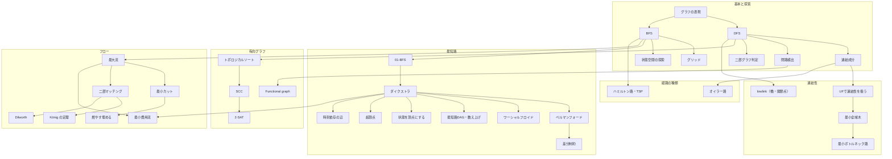

# 03 グラフ（graph）調査レポート

調査日：2026-10-21　担当：03 グラフ

この分野の項目一覧（機械可読）は [03-graph.topics.yaml](03-graph.topics.yaml)。問題IDはすべて `tools/ap.py`（2026-10-21 取得のキャッシュ）で実在を確認した。difficulty は ap.py の表示値（`（参考値）` 付きは推定が不安定なもの）。典型90問は difficulty がないので、作者が README で示した目安（★4＝800〜1199、★5＝1200〜1599、★6＝1600〜1999、★7＝2000以上）を併記する。

> **調査の制約について**：調査の途中でセッション全体の Web 検索の上限に達したため、後半は検索を使わずに、解説ブログのアーカイブ（一覧ページ）を順にたどって問題の解説記事を探した。そのため、2025〜2026年の ABC の D〜F 問題は解説記事で裏付けが取れなかったものが多い。これらは §5.3 に「未確認」として分けて載せた（設計・執筆の段階で裏付けを取り直すこと）。

---

## 1. 調べた資料

### 1.1 体系・目次の比較に使った資料

| 資料 | URL | 何の参考にしたか |
| --- | --- | --- |
| cp-algorithms（Graphs の節） | https://cp-algorithms.com/ | 英語圏の標準的な項目の切り方（探索／連結成分・橋・関節点／単一始点最短路／全点対最短路／全域木／閉路／フロー／マッチング／その他）。個別記事：[BFS](https://cp-algorithms.com/graph/breadth-first-search.html)・[01-BFS](https://cp-algorithms.com/graph/01_bfs.html)・[Dijkstra](https://cp-algorithms.com/graph/dijkstra.html)・[Bellman-Ford](https://cp-algorithms.com/graph/bellman_ford.html)・[Floyd-Warshall](https://cp-algorithms.com/graph/all-pair-shortest-path-floyd-warshall.html)・[負閉路](https://cp-algorithms.com/graph/finding-negative-cycle-in-graph.html)・[SCC](https://cp-algorithms.com/graph/strongly-connected-components.html)・[2-SAT](https://cp-algorithms.com/graph/2SAT.html)・[橋](https://cp-algorithms.com/graph/bridge-searching.html)・[関節点](https://cp-algorithms.com/graph/cutpoints.html)・[オイラー路](https://cp-algorithms.com/graph/euler_path.html)・[Kruskal](https://cp-algorithms.com/graph/mst_kruskal.html)・[Prim](https://cp-algorithms.com/graph/mst_prim.html)・[第2最小全域木](https://cp-algorithms.com/graph/second_best_mst.html)・[Kirchhoff](https://cp-algorithms.com/graph/kirchhoff-theorem.html)・[Dinic](https://cp-algorithms.com/graph/dinic.html)・[下限付きフロー](https://cp-algorithms.com/graph/flow_with_demands.html)・[最小費用流](https://cp-algorithms.com/graph/min_cost_flow.html)・[Kuhn](https://cp-algorithms.com/graph/kuhn_maximum_bipartite_matching.html)・[ハンガリアン法](https://cp-algorithms.com/graph/hungarian-algorithm.html)・[トポロジカルソート](https://cp-algorithms.com/graph/topological-sort.html)・[二部グラフ判定](https://cp-algorithms.com/graph/bipartite-check.html)・[閉路検出](https://cp-algorithms.com/graph/finding-cycle.html)・[固定長の経路](https://cp-algorithms.com/graph/fixed_length_paths.html) |
| USACO Guide | https://usaco.guide/ | 難度段階ごとの配置。Silver に [Graph Traversal](https://usaco.guide/silver/graph-traversal)・[Flood Fill](https://usaco.guide/silver/flood-fill)・[Functional Graphs](https://usaco.guide/silver/func-graphs)、Gold に [無重み最短路](https://usaco.guide/gold/unweighted-shortest-paths)・[DSU](https://usaco.guide/gold/dsu)・[Topological Sort](https://usaco.guide/gold/toposort)・[非負重み最短路](https://usaco.guide/gold/shortest-paths)・[MST](https://usaco.guide/gold/mst)、Platinum に [Kruskal Reconstruction Tree](https://usaco.guide/plat/kruskal-tree)、Advanced に [負辺の最短路](https://usaco.guide/adv/sp-neg)・[Eulerian Tours](https://usaco.guide/adv/eulerian-tours)・[BCC/2CC](https://usaco.guide/adv/BCC-2CC)・[SCC](https://usaco.guide/adv/SCC)・[Offline Deletion](https://usaco.guide/adv/offline-del)・[最大流](https://usaco.guide/adv/max-flow)・[最小カット](https://usaco.guide/adv/min-cut)・[下限付きフロー](https://usaco.guide/adv/flow-lb)・[最小費用流](https://usaco.guide/adv/min-cost-flow)。USACO では SCC・オイラー路・フローが最上位（Advanced）に置かれ、AtCoder より後ろに回っている点が対照的 |
| Competitive Programmer's Handbook（LaTeX ソース） | https://github.com/pllk/cphb | 章構成の確認（11 Basics of graphs、12 Graph traversal、13 Shortest paths（Bellman–Ford・Dijkstra・Floyd–Warshall）、15 Spanning trees（Kruskal・Union-find・Prim）、16 Directed graphs（トポロジカルソート・DP・Successor paths・閉路検出）、17 Strong connectivity（Kosaraju・2SAT）、19 Paths and circuits（オイラー路・ハミルトン路・de Bruijn・Knight's tour）、20 Flows and cuts（Ford–Fulkerson・Disjoint paths・Maximum matchings・Path covers）） |
| OI Wiki（图论） | https://oi-wiki.org/graph/ | 網羅性の確認。とくに「差分约束」「k 短路」「同余最短路」「最小树形图」「斯坦纳树」「拆点（頂点分割）」「双连通分量」「圆方树」「环计数」「最小环」「欧拉图」「哈密顿图」「上下界网络流」「一般图匹配」「矩阵树定理」「LGV 引理」「支配树」など、発展項目の洗い出し |
| Library Checker（問題の一覧を GitHub で確認） | https://github.com/yosupo06/library-checker-problems | 自作ライブラリの動作確認先。graph カテゴリ：shortest_path、scc、cycle_detection（有向・無向）、eulerian_trail（有向・無向）、bipartitematching、general_matching、general_weighted_matching、assignment、min_cost_b_flow、directedmst、minimum_spanning_tree、minimum_steiner_tree、k_shortest_walk、connected_components_of_complement_graph、two_edge_connected_components、biconnected_components、three_edge_connected_components、chromatic_number、maximum_independent_set、enumerate_triangles、counting_c4、counting_spanning_tree（有向・無向）、dominatortree、bipartite_edge_coloring など。two_sat は other カテゴリ |
| ei1333's library（目次） | https://ei1333.github.io/library/ | 競プロのライブラリとして実装される範囲の確認（graph/shortest-path に BFS・Dijkstra・01 の grid-bfs・Bellman-Ford・Warshall-Floyd・SPFA・K Shortest Path・Complement Shortest Path、graph/flow に Dinic・Ford-Fulkerson・Primal Dual・Hungarian・Burn Bury・Max Flow Lower Bound・Gabow Edmonds、graph/connected-components に SCC・二重辺連結・二重頂点連結、graph/others に Low Link・Block Cut Tree・Eulerian Trail・Two Satisfiability・Topological Sort・Namori Graph・Minimum Steiner Tree・Chromatic Number・Maximum Independent Set・Offline DAG Reachability など） |
| Nyaan's Library | https://nyaannyaan.github.io/library/ | 同上（参照のみ） |
| AC Library ドキュメント（手元） | `~/lib/ac-library-master/document_ja/`（[GitHub](https://github.com/atcoder/ac-library)） | dsu・maxflow・mincostflow・scc・twosat の API と計算量、appendix の maxflow の厳密な挙動。実装（`atcoder/*.hpp`）も読み、maxflow は Dinic（BFS で層別＋DFS）、mincostflow はポテンシャル付きダイクストラ（primal-dual）、scc は Tarjan 型の1回の DFS であることを確認した |

### 1.2 日本語の解説記事（体系・典型の把握）

| 資料 | URL | 何の参考にしたか |
| --- | --- | --- |
| E869120「レッドコーダーが教える、競プロ・AtCoder上達のガイドライン【中級編：目指せ水色コーダー！】」 | https://qiita.com/e869120/items/eb50fdaece12be418faa | 水色に必要なグラフの知識として DFS・BFS・ダイクストラ・ワーシャルフロイド・クラスカル・Union-Find を挙げている。「分野別 初中級者が解くべき過去問精選 100 問」のグラフ分野の問題選び（abc007_3、abc088_d、abc012_4、abc079_d、arc083_b、arc076_b、abc075_c、abc120_d、abc138_d など） |
| けんちょん「AtCoder 版！蟻本 (初級編)」 | https://qiita.com/drken/items/e77685614f3c6bf86f44 | 蟻本 2-5「あれもこれも実は"グラフ"」の節立て（二部グラフ判定・最短路・最小全域木・ベルマンフォード・ワーシャルフロイド）と、それぞれに対応する AtCoder の問題（abc126_d、code_festival_2017_qualb_c、soundhound2018_summer_qual_d、abc035_d、arc005_3、arc084_b、arc076_b、abc061_d、abc012_4、abc073_d、abc079_d、agc033_a、arc037_b など） |
| けんちょん「BFS (幅優先探索) 超入門！」 | https://qiita.com/drken/items/996d80bcae64649a6580 | BFS が最短距離を与える理由（背理法による証明の筋道）、dist を -1 で初期化して訪問済みの印を兼ねる、発見したとき（push するとき）に印を付ける、応用（連結成分・二部グラフ判定・トポロジカルソート・閉路検出・後退解析） |
| ageprocpp「最短経路問題総特集！！！～BFSから拡張ダイクストラまで～」 | https://qiita.com/ageprocpp/items/cdf67e828e1b09316f6e | 最短路アルゴリズムの使い分けと計算量、ベルマンフォードの「N 回目に更新があれば始点から到達可能な負閉路がある」、ワーシャルフロイドの負閉路判定（dp[i][i] < 0）と辺1本の変更を O(V²) で反映できること、経路復元（dist(A,C)+dist(C,B)=dist(A,B) なら C は最短路上）、拡張ダイクストラの状態設計 |
| yuu_kyopro「ダイクストラ法の計算量と定数倍改善・負の辺・超頂点・頂点倍加・01BFS」 | https://qiita.com/yuu_kyopro/items/761919d9bccc88521863 | 密グラフでの O(V²) 版、負辺で「取り出した頂点の距離が確定する」性質が壊れること、超頂点で辺数を集合サイズの2乗から1乗に減らす、頂点倍加で頂点のコストを辺のコストに直す。例題として typical90_aq、abc302_f、abc184_e、abc362_d、zone2021_e、arc061_c を挙げる |
| ARMERIA「01-BFSのちょっと丁寧な解説」 | https://betrue12.hateblo.jp/entry/2018/12/08/000020 | 01-BFS の正しさ（deque の中の暫定距離は「すべて同じ」か「d と d+1 の2種類が前後に並ぶ」形を保つ）。例題 arc005_3、arc061_c、abc176_d |
| けんちょん「燃やす埋める問題（最小カット問題）の考え方を総整理！ 前編」 | https://qiita.com/drken/items/52aafd8c073b37749539 | 最小カットのモデル化の規則（x を選ぶとコスト→x→t の辺、選ばないとコスト→s→x の辺、「u を選び v を選ばない」とペナルティ→u→v の辺、制約は容量∞の辺、利得は定数を足してコストに直す、K 個すべて選ぶと利得は補助頂点）、表現できる項とできない項。ABC の例として abc225_g、abc347_g、abc472_g、鉄則本 B68、typical90_an を挙げる |
| けんちょん「2 変数劣モジュラ関数のグラフ表現 〜「燃やす埋める」の早見表 〜」 | https://drken1215.hatenablog.com/entry/2023/11/24/034300 | 1変数・2変数の項を辺に直す早見表（2変数の一般形は B+C ≥ A+D のとき表現できる）、K 変数すべて 1／すべて 0 の利得の補助頂点による表現。関連問題として typical90_an、abc225_g、abc326_g |
| とこはる「『燃やす埋める』と『ProjectSelectionProblem』」 | https://tokoharuland.hateblo.jp/entry/2017/11/12/234636 | 2つの呼び方の関係の整理（参照） |
| ei1333「燃やす埋める問題」 | https://ei1333.github.io/luzhiled/snippets/memo/project-selection.html | 同上（参照） |
| かんプリン「燃やす埋める纏める」 | https://kanpurin.hatenablog.com/entry/moyasu-umeru | 同上（参照） |
| けんちょん「Educational DP Contest の F ～ J 問題の解説と類題集」 | https://qiita.com/drken/items/03c7db44ccd27820ea0d | DAG 上の最長路（dp_g）。DP の側面は 02 の担当 |
| 競プロ典型 90 問（E869120/kyopro_educational_90） | https://github.com/E869120/kyopro_educational_90 | ★と difficulty の対応表（README）。グラフ関連の問題の想定解（`sol/*.cpp`）で手法を確認した（013：始点と終点からのダイクストラ、021：Kosaraju の SCC、040：最大流（燃やす埋める）、043：deque の 01-BFS、049：Union-Find の Kruskal、054：BFS（論文を頂点にする）、059：64 個ずつのクエリをビット並列で DAG 上に流す、062：逆順の BFS、068：Union-Find、071：DFS でトポロジカル順序を列挙、077：Dinic（二部マッチング）、083：次数の平方分割、087：ワーシャルフロイド＋二分探索） |
| 競技プログラミングの鉄則（E869120/kyopro-tessoku） | https://github.com/E869120/kyopro-tessoku | 9章「グラフアルゴリズム」の範囲。演習（AtCoder 上の tessoku_book、タイトルは ap.py で確認）は A61 Adjacent Vertices、A62 Is It Connected?、A63 Shortest Path Problem、A64 Shortest Path 2、A65 Road to Promotion、A66 Connect Query、A67 MST (Minimum Spanning Tree)、A68 Maximum Flow、A69 Bipartite Matching、A70 Lanterns と、B61〜B69（B64 Shortest Path with Restoration、B67 Max MST、B68 ALGO Express など）。B68 はけんちょんの記事が燃やす埋めるの例題に挙げている。**入門書の範囲に最大流（A68）と二部マッチング（A69）が入っている**ことはレベル判断の参考になる |

### 1.3 問題の裏付けに使った解説ブログ（第三者）

問題ごとの裏付けの URL は §5 と topics.yaml に記した。おもな出典は次のとおり（いずれも noai 指定がないことを確認済み）。

| 資料 | URL | 範囲 |
| --- | --- | --- |
| kmjp's blog | https://kmjp.hatenablog.jp/ | ABC の E〜G（とくに G）。問題の要約と解法が毎回書かれている。2026-10 の ABC480 まで |
| けんちょんの競プロ精進記録 | https://drken1215.hatenablog.com/ | ABC の C〜G（抜粋）。記事タイトルに AtCoder NoviSteps の級・段と色が付く |
| はまやんはまやんはまやん | https://blog.hamayanhamayan.com/ | ABC の A〜F（2017〜2022年ごろ） |
| sano192 の Qiita（ABC 解説一覧） | https://qiita.com/sano192/items/54accd04df62242b70f0 | ABC201〜286 の A〜D（一部 E・F） |
| 競プロはじめました | https://kyo-pro.hatenablog.com/archive | ABC の C〜F（2021〜2024年の抜粋） |
| Lanly（cnblogs、中国語） | https://www.cnblogs.com/Lanly/ | ABC335〜384 の全問題 |
| 洛谷（Luogu）の問題ページのタグ | https://www.luogu.com.cn/ | **分類の参考にだけ使った**（利用者が付けたアルゴリズムタグ）。問題文の翻訳は読んでいない。§5.3 の「未確認」候補の発見と、§2.4 の出題分布の集計に使った |

**使わなかった資料**：Codeforces（codeforces.com）のブログ・EDU・Catalog は noai 指定があるため開いていない。kmjp の abc277_h の記事に「Codeforces で既出」とあるが、Codeforces 側は読んでいない。AtCoder 公式の解説（atcoder.jp）も開いていない。

---

## 2. 分野の全体像

### 2.1 サブ分野の構造

グラフ分野は、次の 8 つのかたまりに分けると整理しやすい。矢印は「前提になる」関係を表す。

1. **基本と探索**：表現、DFS、BFS、グリッド、連結成分、閉路検出、二部グラフ判定、小さいグラフの全探索、状態空間の探索。ほぼすべての項目の前提になる
2. **最短路**：BFS／01-BFS／ダイクストラ／ベルマンフォード／ワーシャルフロイドの5つの道具と、その「使い分け」。さらに「グラフをどう作るか」（状態を頂点にする、超頂点、時刻依存、差分制約、ポテンシャル）が水〜青の主戦場になる
3. **有向グラフ・DAG**：トポロジカルソート、DAG 上の DP、SCC、2-SAT、Functional graph、到達可能性
4. **無向グラフの連結性**：Union-Find を道具にした連結性（逆順処理など）、lowlink（橋・関節点）、二重連結成分（発展）
5. **全域木**：Kruskal・Prim、全域木の性質、最小ボトルネック路と Kruskal 再構築木、発展（Borůvka・Manhattan MST・最小有向全域木・行列木定理）
6. **オイラー路・ハミルトン路**：オイラー路（多項式時間）とハミルトン路（bitDP、02 と共有）の対比
7. **フロー・マッチング**：最大流→最小カット→燃やす埋める、二部マッチング→König→Dilworth・Hall、最小費用流。AtCoder では ACL があるので「アルゴリズムの中身」より「モデル化（どういうグラフを作るか）」が問われる
8. **横断的なモデル化**：何を頂点・辺にするか（座標・値・状態・制約）、グラフの縮約、補グラフ、次数の平方分割、グラフの構築

### 2.2 混同されやすいもの・取り違えやすいもの

| 組 | 違い | 教材での扱い |
| --- | --- | --- |
| BFS／01-BFS／ダイクストラ | 辺の重みが「すべて等しい」「0 と 1」「非負」で使い分ける。BFS は「キューの中の距離が単調（差は高々1）」、01-BFS は「deque の中の距離が2種類」、ダイクストラは「ヒープで最小を取り出す」と、同じ「距離の小さい順に確定させる」考え方の特殊化として見せる | 「使い分け」の横断ページの中心に置く |
| ダイクストラ／ベルマンフォード | 負辺の有無。ダイクストラに負辺を入れたときの反例を必ず示す。負辺があっても負閉路がなければ、ポテンシャルで非負に直せることがある（abc237_e） | ダイクストラのページに「負辺で壊れる理由」、ベルマンフォードのページに「到達可能な負閉路だけが問題」 |
| ワーシャルフロイドのループ順 | k（経由してよい頂点）を一番外に置く。i-j-k の順では誤り。k を外にすると「経由してよい頂点を 1 つずつ増やす DP」という意味になる（abc208_d がこの意味そのものを問う） | 動く図で k を増やしていく |
| 「最短路」と「最小全域木」 | 最短路木（ある始点からの最短路を集めた木）と最小全域木は一般に異なる。abc252_e は最短路木、abc218_e は最小全域木 | 確認問題に入れる |
| DFS の訪問済み判定の位置 | 連結成分などでは一度訪れた頂点を二度と訪れない。単純パスの全列挙（バックトラック）では帰りがけで印を外す。混ぜるとバグる | DFS のページで2つの型を並べる |
| 無向グラフと有向グラフの閉路検出 | 無向は「親へ戻る辺を除いた訪問済みへの辺」または Union-Find、有向は「探索中（灰色）の頂点への辺」。有向で単に「訪問済みへの辺」を閉路とすると誤検出する | 閉路検出のページで3色の DFS を図示 |
| SCC と連結成分 | 有向グラフの「互いに行き来できる」と、無向グラフの「つながっている」。有向グラフの弱連結成分は無向にして Union-Find | 用語集 |
| 橋・関節点と SCC | 無向グラフの lowlink（橋・関節点）と、有向グラフの lowlink（Tarjan の SCC）は同じ ord/low の考え方だが判定条件が違う | lowlink のページで対比 |
| 最大流と二部マッチング | 二部マッチングは最大流の特殊な場合（容量1）。ACL では mf_graph で書ける | 二部マッチングのページで帰着を図示 |
| 最小カットと燃やす埋める | 燃やす埋めるは「最小カットにモデル化する技法」。最大流・最小カットの定理が前提 | 最小カット→燃やす埋めるの順に読む |
| 最小頂点被覆・最大独立集合・最大マッチング | 二部グラフでは König の定理で結び付く（最小頂点被覆＝最大マッチング、最大独立集合＝頂点数−最大マッチング）。一般グラフでは NP 困難 | 「二部グラフでだけ使える」ことを強調 |
| 最小パス被覆（頂点素）と Dilworth | 頂点を共有してよい鎖への分割では推移閉包が要る | 発展の概要ページで注意 |
| オイラー路とハミルトン路 | 辺をちょうど1回（多項式時間で判定可）と頂点をちょうど1回（NP 困難、N ≤ 20 程度なら bitDP） | 経路の種類の比較表 |
| Functional graph と木・なもりグラフ | 出次数がすべて 1 の有向グラフは、各連結成分に閉路がちょうど1つある（rho 形）。無向にすると各成分はなもりグラフ | Functional graph のページで図示 |

### 2.3 ABC での出題の傾向（この調査で見えたこと）

- **D〜E（〜1600）**：BFS・DFS・グリッド・連結成分・二部グラフ判定・ダイクストラ・ワーシャルフロイド・Union-Find の逆順処理・最小全域木・トポロジカルソート・Functional graph。最近（2023〜2026年）の ABC では、ダイクストラ（abc340_d 784、abc362_d 634）や状態を頂点にする BFS（abc348_d 1108、abc339_d 1276）が D〜E の低い difficulty で出るようになり、「知っていて当然」の扱いになっている
- **E〜F（1200〜2000）**：状態を頂点にする（abc132_e 1625、abc164_e 1877、abc244_f 1661）、超頂点（abc184_e 1418、abc302_f 1430、abc257_f 1775、abc270_f 1834）、ワーシャルフロイドの応用（abc243_e 1637、abc143_e 1695、abc338_f 1835）、ベルマンフォード（abc137_e 1740、abc061_d 1838）、差分制約（abc404_g 1894、abc216_g 1963）、MST の応用（arc076_b 1615、abc210_e 1618、abc364_f 1878、abc355_f 1924）
- **G（2000〜）**：フロー系がはっきり多い。最大流・二部マッチング・最小カット・燃やす埋める・最小費用流が、2021〜2026年の ABC G にほぼ毎年数問出ている（§4.7）。difficulty は 2000〜2500 に集まり、最近は 2000〜2400（黄）に下がってきている（abc472_g 2018、abc401_g 2022、abc407_g 2190、abc445_g 2250、abc461_g 2391）。ほかに補グラフ BFS（abc319_g 2185）、XOR の閉路基底（abc451_g 2221）、オイラー路（abc286_g 2135）、lowlink 系（abc334_g 2242、abc375_g 2014）
- **2-SAT・Dilworth・Hall・下限付きフロー・一般グラフのマッチング・区間に辺を張る・シュタイナー木**は ABC では 2400 以上（発展）でしか確認できなかった

### 2.4 洛谷のタグから見た ABC の出題分布（参考）

ABC で出題された difficulty 700 以上の問題 1577 問（ABC と同時開催の ARC の問題を含む）について、洛谷の問題ページに利用者が付けたアルゴリズムタグを取り出して集計した（2026-10-21 取得）。**タグが1つでも付いていたのは 936 問だけで、付け方にもばらつきがある**ので、出題の傾向を見る参考にとどめる（個々の問題の裏付けには使っていない）。列はレベルの帯（基礎 〜1199／水 〜1599／青 〜1999／黄 〜2399／発展 2400〜）ごとの件数。

| タグ | 件数 | 基礎 | 水 | 青 | 黄 | 発展 | 例（difficulty） |
| --- | --- | --- | --- | --- | --- | --- | --- |
| BFS | 47 | 17 | 15 | 12 | 3 | 0 | abc168_d（804）、abc213_e（1423）、abc132_e（1625）、abc197_f（1945） |
| DFS | 30 | 15 | 8 | 5 | 2 | 0 | abc371_c（849）、arc090_b（1452）、abc251_f（1703）、abc451_g（2221） |
| 最短路 | 30 | 8 | 7 | 7 | 5 | 3 | abc340_d（784）、abc342_e（1476）、abc061_d（1838）、abc375_g（2014）、abc414_g（3020） |
| 図論建模（グラフへの帰着） | 22 | 2 | 6 | 4 | 6 | 4 | abc302_f（1430）、abc377_e（1685）、abc209_e（2153）、abc232_g（2550） |
| 二部グラフ | 14 | 2 | 1 | 2 | 4 | 5 | abc282_d（1154）、abc401_g（2022）、abc274_g（2340）、abc317_g（2649） |
| 生成木（全域木） | 15 | 3 | 4 | 7 | 1 | 0 | abc352_e（1030）、abc235_e（1304）、arc076_b（1615）、abc364_f（1878） |
| トポロジカルソート | 10 | 2 | 5 | 2 | 1 | 0 | abc315_e（921）、abc223_d（1069）、abc245_f（1451）、abc433_g（2060） |
| 差分制約 | 6 | 0 | 2 | 2 | 1 | 1 | arc090_b（1452）、abc404_g（1894）、abc216_g（1963）、abc368_e（2140） |
| 強連結成分 | 4 | 0 | 3 | 0 | 0 | 1 | abc456_e（1214）、abc357_e（1295）、abc245_f（1451）、abc374_g（2608） |
| Tarjan（lowlink を含む） | 5 | 0 | 2 | 1 | 2 | 0 | abc256_e（1224）、abc387_f（1760）、abc375_g（2014）、abc334_g（2242） |
| ネットワークフロー | 17 | 0 | 0 | 0 | 7 | 10 | abc472_g（2018）、abc401_g（2022）、abc407_g（2190）、abc239_g（2215）、abc461_g（2391） |
| 最小カット | 3 | 0 | 0 | 0 | 2 | 1 | abc472_g（2018）、abc239_g（2215）、abc397_g（2947） |
| 費用流 | 3 | 0 | 0 | 0 | 2 | 1 | abc407_g（2190）、abc373_g（2377）、abc421_g（2410） |
| 2-SAT | 2 | 0 | 0 | 0 | 0 | 2 | abc210_f（2632）、abc277_h（2917） |
| Floyd | 3 | 0 | 1 | 1 | 0 | 1 | abc416_e（1428）、abc243_e（1637）、abc374_g（2608） |
| オイラー路 | 1 | 0 | 0 | 0 | 1 | 0 | abc286_g（2135） |
| 二重連結成分・円方木（ブロックカット木） | 1 | 0 | 0 | 0 | 1 | 0 | abc318_g（2260、kmjp は最大流で解く） |
| Kruskal 再構築木 | 1 | 0 | 0 | 0 | 1 | 0 | abc394_g（2031） |
| 一般グラフのマッチング | 1 | 0 | 0 | 0 | 0 | 1 | abc412_g（3402） |
| 負閉路 | 1 | 0 | 0 | 1 | 0 | 0 | abc137_e（1740） |

読み取れること：

- **ネットワークフローのタグが付いた 17 問はすべて 2018 以上**で、7 問が黄、10 問が発展。フロー系を「黄」に置き、発展の型（Dilworth・Hall・下限付き・一般マッチング）を概要に回す判断を支える
- **2-SAT は 2 問とも 2600 以上**で発展
- 最短路・BFS・全域木・トポロジカルソートは基礎〜青に広く分布する。最短路系は「道具」より「グラフの作り方」で difficulty が決まる
- 強連結成分のタグは 1214〜1451 にも付いている（abc456_e、abc357_e、abc245_f）。SCC を水に置く根拠の一つ

---

## 3. 項目一覧

全 67 項目。レベルの内訳は 基礎 13・水 18・青 6・黄 14・発展 16。「ページ案」の own は単独ページ、section-of:<key> は他ページの節（他分野の key を推測で書いたものを含む）、overview は発展の概要ページ。詳細（別名・問題のサイン・使い分け・図の案・問題）は topics.yaml にある。

#### A. 基本と探索

| 項目名 | key | レベル | 根拠の問題と difficulty | 前提 | ACL | ページ案 |
| --- | --- | --- | --- | --- | --- | --- |
| グラフの表現と用語 | `graph-basics` | 基礎 | typical90_bz（★2）、abc284_c（diff 193）。ABC の C〜D で前提として使われる | complexity-estimation | — | own |
| 深さ優先探索（DFS） | `dfs` | 基礎 | abc138_d（diff 920）、abc315_e（diff 921）、abc284_e（diff 1043） | graph-basics, recursion | — | own |
| 幅優先探索（BFS）と無重み最短路 | `bfs` | 基礎 | abc211_d（diff 755）、abc168_d（diff 804）、abc151_d（diff 959）、abc007_3（diff 1024） | graph-basics, queue | — | own |
| 多始点 BFS | `multi-source-bfs` | 基礎 | abc383_c（diff 750）、agc033_a（diff 1159） | bfs | — | section-of:bfs |
| グリッドグラフ | `grid-graph` | 基礎 | abc325_c（diff 400）、abc351_d（diff 974）、abc088_d（diff 999）。応用は abc413_g（diff 1723） | bfs, dfs | — | own |
| 連結成分 | `connected-components` | 基礎 | abc292_d（diff 579）、abc177_d（diff 732）。座標を頂点にする応用は abc131_f（diff 1937） | dfs, union-find | atcoder::dsu | own |
| 閉路の検出と復元 | `cycle-detection` | 基礎 | abc288_c（diff 436）、abc311_c（diff 448）、abc285_d（diff 663） | dfs, union-find | atcoder::dsu（無向グラフ）、atcoder::scc_graph（有向グラフ：サイズ2以上の成分が閉路） | own |
| 二部グラフ判定 | `bipartite-graph` | 基礎 | abc327_d（diff 709）、abc282_d（diff 1154）、abc126_d（diff 1279）。応用は code_festival_2017_qualb_c（diff 1883） | dfs, bfs | atcoder::dsu（頂点を2倍にした偶奇の Union-Find でも判定できる） | own |
| 小さいグラフの全探索（同型・辺集合・彩色） | `small-graph-brute-force` | 基礎 | abc232_c（diff 685）、abc371_c（diff 849）、abc328_e（diff 1160）。彩色の数え上げは abc199_d（diff 1804） | dfs, permutation-search | — | own |
| 状態空間の探索（盤面・配置・組を頂点にする BFS） | `state-space-search` | 水 | abc361_d（diff 1202）、abc339_d（diff 1276）、abc224_d（diff 1376）、abc197_f（diff 1945） | bfs, hashing-encoding | — | own |

#### B. 最短路

| 項目名 | key | レベル | 根拠の問題と difficulty | 前提 | ACL | ページ案 |
| --- | --- | --- | --- | --- | --- | --- |
| 最短路アルゴリズムの使い分け | `shortest-path-overview` | 水 | 横断ページ。BFS（〜1000）・ダイクストラ（〜1100）・01-BFS（1250〜1500）・ワーシャルフロイド（950〜1700）・ベルマンフォード（1740〜1900）の比較 | bfs, dijkstra, zero-one-bfs, bellman-ford, warshall-floyd | — | own |
| ダイクストラ法 | `dijkstra` | 基礎 | abc362_d（diff 634）、abc340_d（diff 784）、abc325_e（diff 1093）、abc192_e（diff 1135） | bfs, priority-queue | — | own |
| 経路復元 | `path-restoration` | 基礎 | abc168_d（diff 804） | bfs, dijkstra | — | section-of:dijkstra |
| 逆向きのグラフ・始点と終点からの最短路 | `reverse-graph-shortest-path` | 水 | abc369_e（diff 1301）、abc035_d（diff 1591）、soundhound2018_summer_qual_d（diff 1637）、typical90_m（★5） | dijkstra | — | section-of:dijkstra |
| 最短閉路 | `shortest-cycle` | 水 | abc376_d（diff 743）。各頂点を含む最短閉路を求める abc191_e（diff 1323）は裏付け未確認 | bfs, dijkstra | — | section-of:dijkstra |
| 01-BFS | `zero-one-bfs` | 水 | abc176_d（diff 1248）、abc213_e（diff 1423）、abc246_e（diff 1476）、arc005_3（diff 1503） | bfs, dijkstra | — | own |
| ベルマンフォード法と負閉路 | `bellman-ford` | 青 | abc137_e（diff 1740）、abc061_d（diff 1838）、abc404_g（diff 1894） | dijkstra | — | own |
| ポテンシャルで負辺を消す | `potential-reweighting` | 水 | abc237_e（diff 1208）。最小費用流（黄）の内部でも使う | dijkstra, bellman-ford | atcoder::mcf_graph の内部（ポテンシャル付きダイクストラ） | section-of:bellman-ford |
| ワーシャルフロイド法 | `warshall-floyd` | 水 | abc208_d（diff 1190）、abc073_d（diff 1345）、abc375_f（diff 1546）、abc243_e（diff 1637）、abc143_e（diff 1695） | dijkstra, dp-basics | — | own |
| 最短路 DAG（経路の数え上げ・最短路に使われる辺） | `shortest-path-dag` | 水 | abc211_d（diff 755）、abc252_e（diff 1294）、abc051_d（diff 1566）、abc218_f（diff 1753）、abc375_g（diff 2014） | dijkstra, dag-dp | — | own |
| 状態を頂点にする（拡張ダイクストラ・頂点倍化） | `extended-dijkstra` | 水 | abc339_d（diff 1276）、abc246_e（diff 1476）、abc132_e（diff 1625）、abc244_f（diff 1661）、abc164_e（diff 1877）。資源を次元に持つ応用は青 | dijkstra, bfs | — | own |
| 超頂点・補助頂点 | `super-vertex` | 水 | abc264_e（diff 1229）、abc184_e（diff 1418）、abc302_f（diff 1430）、typical90_bb（★6）。辺の圧縮が主題の abc232_g（diff 2550）は発展 | bfs, dijkstra | — | own |
| 時刻で変わる辺（時刻依存の最短路） | `time-dependent-dijkstra` | 水 | abc192_e（diff 1135）、abc342_e（diff 1476）、abc204_e（diff 1710） | dijkstra | — | own |
| 差分制約（牛ゲー） | `difference-constraints` | 青 | arc090_b（diff 1452）、abc404_g（diff 1894）、abc216_g（diff 1963） | bellman-ford, dijkstra, prefix-sum | — | own |
| 剰余を頂点にする最短路（同余最短路） | `modular-shortest-path` | 発展 | arc084_b（diff 2457） | zero-one-bfs, extended-dijkstra | — | overview |
| 補グラフ上の BFS | `complement-graph-bfs` | 黄 | abc319_g（diff 2185） | bfs, set | — | own |
| XOR の経路と閉路の基底 | `xor-path` | 黄 | abc451_g（diff 2221）。値が小さい場合の (頂点, XOR) の BFS は abc410_d（diff 1048、裏付け未確認） | dfs, xor-basis | — | own |
| 区間に辺を張る（セグメント木の形の補助頂点） | `segment-tree-graph` | 発展 | abc414_g（diff 3020） | super-vertex, segment-tree | — | overview |
| k 番目の最短路 | `k-shortest-paths` | 発展 | ABC での出題は確認できなかった（Library Checker に k_shortest_walk がある） | dijkstra | — | overview |
| 最小シュタイナー木 | `steiner-tree` | 発展 | abc364_g（diff 2455）、abc395_g（diff 2561） | dijkstra, bit-dp | — | overview |

#### C. 有向グラフ・DAG

| 項目名 | key | レベル | 根拠の問題と difficulty | 前提 | ACL | ページ案 |
| --- | --- | --- | --- | --- | --- | --- |
| トポロジカルソート | `topological-sort` | 基礎 | abc315_e（diff 921）、abc216_d（diff 1039）、abc223_d（diff 1069）。応用は abc245_f（diff 1451） | dfs, bfs | atcoder::scc_graph（DAG なら各成分が1頂点になり、scc() の順がトポロジカル順） | own |
| DAG 上の DP | `dag-dp` | 基礎 | dp_g（EDPC、diff なし）、abc139_e（diff 1528） | topological-sort, dp-basics | — | section-of:topological-sort |
| 強連結成分分解（SCC） | `scc` | 水 | abc296_e（diff 1285）、abc357_e（diff 1295）、typical90_u（★5）。縮約後の処理が主題のものは発展（abc374_g 2608、abc214_h 3138） | dfs, topological-sort | atcoder::scc_graph（scc() はトポロジカル順の成分のリスト） | own |
| 2-SAT | `two-sat` | 発展 | abc210_f（diff 2632）、abc277_h（diff 2917）。ACL にあるので「モデル化だけ」なら黄の扱いもありうる | scc | atcoder::two_sat（add_clause(i, f, j, g) で (x_i = f) ∨ (x_j = g)、satisfiable()、answer()） | overview |
| Functional graph（出次数1のグラフ） | `functional-graph` | 水 | abc256_e（diff 1224）、abc296_e（diff 1285）、abc357_e（diff 1295）、abc377_e（diff 1685）。基本形は abc167_d（diff 754） | cycle-detection, doubling | atcoder::scc_graph（閉路の頂点を取り出すのに使える） | own |
| なもりグラフ（N 頂点 N 辺の連結グラフ） | `namori-graph` | 水 | abc292_d（diff 579）。応用の abc266_f（diff 1525）は裏付け未確認 | connected-components, cycle-detection | — | section-of:functional-graph |
| 到達可能性の bitset 高速化 | `reachability-bitset` | 黄 | typical90_bg（★7）、abc287_h（diff 2639） | topological-sort, bitset | — | own |
| グラフ上のゲーム（後退解析） | `graph-games` | 黄 | abc209_e（diff 2153）、abc261_h（diff 2531）。似た考え方の abc245_f（diff 1451） | topological-sort, game-theory-basics | — | section-of:game-theory-basics |

#### D. 無向グラフの連結性

| 項目名 | key | レベル | 根拠の問題と difficulty | 前提 | ACL | ページ案 |
| --- | --- | --- | --- | --- | --- | --- |
| Union-Find で連結性を扱う（逆順処理・オフライン） | `union-find-connectivity` | 水 | abc229_e（diff 1015）、abc372_e（diff 1042）、abc264_e（diff 1229）、abc120_d（diff 1355） | union-find, connected-components | atcoder::dsu（merge・same・leader・size・groups） | own |
| 橋と関節点（lowlink） | `lowlink` | 黄 | abc375_g（diff 2014）、abc334_g（diff 2242）。小さい制約の abc075_c（diff 1067）は全探索で解ける | dfs | — | own |
| 二重辺連結成分・二重頂点連結成分・ブロックカット木 | `biconnected-components` | 発展 | ABC での出題は確認できなかった（Library Checker に two_edge_connected_components、biconnected_components） | lowlink | — | overview |
| 辺の追加と削除が混ざる連結性（オフライン） | `offline-dynamic-connectivity` | 発展 | abc334_g（diff 2242）を kmjp がこの方法で解いている。典型としては発展 | union-find-connectivity, rollback-union-find, segment-tree | — | overview |

#### E. 全域木

| 項目名 | key | レベル | 根拠の問題と difficulty | 前提 | ACL | ページ案 |
| --- | --- | --- | --- | --- | --- | --- |
| 最小全域木（Kruskal・Prim） | `minimum-spanning-tree` | 水 | abc218_e（diff 1004）、abc352_e（diff 1030）、abc235_e（diff 1304）、abc282_e（diff 1604）、arc076_b（diff 1615） | union-find, sort | atcoder::dsu（Kruskal の連結判定） | own |
| 最小全域木の応用（補助頂点・辺の削減・クエリ） | `mst-applications` | 青 | abc210_e（diff 1618）、abc364_f（diff 1878）、abc355_f（diff 1924）、typical90_aw（★6） | minimum-spanning-tree, super-vertex | atcoder::dsu | section-of:minimum-spanning-tree |
| 最小ボトルネック路と Kruskal 再構築木 | `bottleneck-path` | 青 | abc383_e（diff 1616）、abc181_f（diff 2009）、abc394_g（diff 2031） | minimum-spanning-tree, union-find-connectivity | atcoder::dsu | own |
| 全域木の発展（Borůvka・Manhattan MST・最小有向全域木・行列木定理） | `spanning-tree-advanced` | 発展 | ABC では MST の重みの総和を数える abc386_g（diff 2930）などの数え上げのみ確認 | minimum-spanning-tree | — | overview |

#### F. 経路の種類

| 項目名 | key | レベル | 根拠の問題と difficulty | 前提 | ACL | ページ案 |
| --- | --- | --- | --- | --- | --- | --- |
| オイラー路（一筆書き） | `euler-path` | 黄 | abc286_g（diff 2135） | connected-components, dfs | — | own |
| ハミルトン路・巡回セールスマン | `hamiltonian-path` | 水 | abc054_c（diff 1244）、abc180_e（diff 1256）、abc301_e（diff 1673）、abc338_f（diff 1835） | bit-dp, bfs, warshall-floyd | — | section-of:bit-dp |

#### G. フロー・マッチング

| 項目名 | key | レベル | 根拠の問題と difficulty | 前提 | ACL | ページ案 |
| --- | --- | --- | --- | --- | --- | --- |
| 最大流 | `max-flow` | 黄 | abc205_f（diff 2088）、abc318_g（diff 2260）、abc241_g（diff 2422）。鉄則本の9章（A68）にも入っている | bfs, dfs | atcoder::mf_graph<Cap>（add_edge(from, to, cap)、flow(s, t)、min_cut(s)、edges()） | own |
| 最小カット（辺カット・頂点カット・カットの復元） | `min-cut` | 黄 | abc010_4（diff 1777 参考値）、abc239_g（diff 2215）。発展の応用は abc332_g（2775）、abc397_g（2947） | max-flow | atcoder::mf_graph（min_cut(s) は残余グラフで s から到達できる頂点を返す） | own |
| 燃やす埋める（Project Selection） | `project-selection` | 黄 | abc472_g（diff 2018）、abc445_g（diff 2250）、abc259_g（diff 2428）、abc326_g（diff 2470）、abc193_f（diff 2475）、abc225_g（diff 2566）。2400 前後に集まるが最近は黄まで下がっている（要判断） | min-cut | atcoder::mf_graph | own |
| 二部マッチング | `bipartite-matching` | 黄 | abc401_g（diff 2022）、abc263_g（diff 2261）、abc320_g（diff 2575）、typical90_by（★7）。鉄則本 A69 | max-flow, bipartite-graph | atcoder::mf_graph（容量1の辺で s→左→右→t） | own |
| König の定理（最小頂点被覆・最大独立集合） | `konig-theorem` | 黄 | abc445_g（diff 2250）、abc274_g（diff 2340）、abc461_g（diff 2391） | bipartite-matching, min-cut | atcoder::mf_graph（min_cut で被覆を復元） | own |
| 最小費用流 | `min-cost-flow` | 黄 | abc247_g（diff 2159）、abc407_g（diff 2190）、abc421_g（diff 2410）。モデル化が重いものは発展（abc231_h 2681、abc214_h 3138） | max-flow, dijkstra, potential-reweighting | atcoder::mcf_graph<Cap, Cost>（add_edge(from, to, cap, cost) は cost ≥ 0、flow(s, t[, limit]) と slope(s, t[, limit])） | own |
| Dilworth の定理・DAG の最小パス被覆 | `dilworth-path-cover` | 発展 | abc374_g（diff 2608）、abc354_g（diff 2665）、abc237_h（diff 2807） | bipartite-matching, scc | atcoder::mf_graph | overview |
| Hall の結婚定理 | `halls-theorem` | 発展 | abc215_h（diff 3101） | bipartite-matching | — | overview |
| 最小流量制約付きフロー | `flow-lower-bounds` | 発展 | abc285_g（diff 2566） | max-flow | atcoder::mf_graph（超頂点を足して帰着） | overview |
| 一般グラフのマッチング | `general-matching` | 発展 | abc412_g（diff 3402） | bipartite-matching | — | overview |
| 割当問題（ハンガリアン法） | `assignment-problem` | 発展 | ABC で必須の問題は確認できなかった（abc373_g diff 2377 は最小重みマッチングの性質を使う別解法が知られる） | min-cost-flow | atcoder::mcf_graph（N が小さければ最小費用流で代用） | section-of:min-cost-flow |
| 二部グラフの辺彩色（正則二部グラフの分解） | `bipartite-edge-coloring` | 発展 | abc317_g（diff 2649） | bipartite-matching | atcoder::mf_graph | section-of:bipartite-matching |

#### H. 横断・その他

| 項目名 | key | レベル | 根拠の問題と difficulty | 前提 | ACL | ページ案 |
| --- | --- | --- | --- | --- | --- | --- |
| グラフへの帰着（何を頂点・辺にするか） | `graph-modeling` | 水 | 横断ページ。abc285_d（diff 663）、abc327_d（diff 709）、arc090_b（diff 1452）、abc377_e（diff 1685）、abc131_f（diff 1937） | graph-basics | — | own |
| グラフの縮約 | `graph-contraction` | 黄 | abc286_g（diff 2135）、abc419_g（diff 2677） | union-find-connectivity, scc | atcoder::dsu、atcoder::scc_graph | section-of:graph-modeling |
| 次数による平方分割（重い頂点・軽い頂点） | `degree-sqrt` | 青 | typical90_ce（★6） | graph-basics, sqrt-decomposition | — | own |
| 三角形・4-サイクルの列挙 | `small-cycle-enumeration` | 黄 | abc260_f（diff 1995）は裏付け未確認。Library Checker に enumerate_triangles、counting_c4 | degree-sqrt | — | section-of:degree-sqrt |
| グラフの構築（DFS 木・BFS 木の性質） | `graph-construction` | 青 | arc083_b（diff 1563）、abc251_f（diff 1703）、abc244_g（diff 2117） | dfs, bfs | — | own |
| 彩色数・最大独立集合・最大クリーク（一般グラフ） | `chromatic-number` | 発展 | ABC での出題は確認できなかった（Library Checker に chromatic_number、maximum_independent_set） | bit-dp, inclusion-exclusion | — | overview |
| 隣接行列の累乗（歩道の数え上げ・min-max 積） | `adjacency-matrix-power` | 発展 | abc236_g（diff 2438）。ほかに行列で状態遷移を表す abc199_f（diff 2065） | matrix-power, warshall-floyd | — | section-of:matrix-power |

---

## 4. 項目ごとのメモ

各項目の「何ができるか・なぜ正しいか」「つまずき」「図」「確認問題」「問題のサイン」「使い分け」を、資料と自分の理解からまとめる。例題の詳細は §5、機械可読の一覧は topics.yaml。

### 4.A 基本と探索

#### グラフの表現と用語（`graph-basics`、基礎）

- **できること**：N 頂点 M 辺の入力をデータ構造に載せる。隣接リスト（各頂点から出る辺の列。重み付きなら (行き先, 重み) の組）、隣接行列（N が数百〜数千まで。辺の有無を O(1) で引け、ワーシャルフロイドの初期値になる）、辺リスト（Kruskal・ベルマンフォード・辺ごとの処理に使う）。ACL の内部では CSR（全辺を始点でまとめた1本の配列）が使われている
- **押さえる用語**：次数（入次数・出次数）、パスとウォーク（頂点を繰り返さない／繰り返してよい）、単純グラフ・多重辺・自己ループ、連結、木（連結で辺が N−1 本）・森、DAG、二部グラフ、完全グラフ、補グラフ、疎・密
- **握手補題**：次数の総和は 2M。したがって奇数次数の頂点は偶数個ある（オイラー路の条件につながる）
- **つまずき**：1-indexed のまま配列を引く、無向グラフで片方向しか追加しない、隣接行列で多重辺の最小値を取り忘れる（ワーシャルフロイドで誤答）、N = 2×10^5 で隣接行列を作ろうとする、重みの和が int を超える
- **図**：同じグラフを図・隣接リスト・隣接行列・辺リストの4通りで並べ、1本の辺がそれぞれどこに現れるかを色で追う
- **確認問題**：「無向グラフの辺を隣接リストに入れると要素数の合計はいくつか（2M）」「次数の和が奇数のグラフは存在するか」「この問題で必要な操作は『隣を列挙』と『辺の有無の判定』のどちらか、それならどの表現か」
- **使い分け**：アルゴリズムごとの表現の早見表（BFS・DFS・ダイクストラ＝隣接リスト、ワーシャルフロイド＝隣接行列、Kruskal・ベルマンフォード＝辺リスト）を置く

#### 深さ優先探索（`dfs`、基礎）

- **できること**：到達可能性、連結成分、閉路検出、トポロジカルソート（帰りがけ順の逆）、lowlink・SCC の土台（行きがけ番号）、木の走査、単純パス・ハミルトン路の全列挙（バックトラック）
- **2つの型を区別する**：(1) 一度訪れた頂点は二度と訪れない型（O(N+M)）。(2) バックトラック型：帰りがけで訪問の印を外し、すべての単純パスを列挙する（指数時間）。abc284_e は答えが 10^6 を超えたら打ち切る指定があるので (2) が使える。abc378_d も (2)。混ぜると、(1) のつもりで印を外して指数時間になったり、(2) のつもりで印を外さずに数え漏れたりする
- **行きがけと帰りがけ**：頂点に入るときの処理と出るときの処理を書く位置を意識させる。abc315_e は依存をたどった帰りがけ順そのものが答え。非再帰で書くときは「入る」「出る」の2種類をスタックに積む
- **つまずき**：再帰が深い（一本道の N = 2×10^5 で深さ 2×10^5）。AtCoder ではスタックが大きいが、手元の環境では落ちることがある（非再帰化、または手元でスタック上限を上げる。C++ の書き方は 09 の担当）。ラムダの再帰の書き方（09 と共有）
- **図**：再帰の呼び出しスタックとグラフを並べ、行きがけ番号・帰りがけ番号が付いていくステップ送り。バックトラック型では印を外す瞬間を色で示す
- **確認問題**：「単純パスの全列挙で印を外さないと何が起きるか」「行きがけ順で番号を振ると、根付き木の部分木が連続した区間になるのはなぜか（04 のオイラーツアーへの橋渡し）」
- **問題のサイン**：「すべての〜を列挙」「〇〇個を超えたら打ち切り」「N ≤ 10 程度の経路」
- **使い分け**：最短距離が要るなら BFS。連結判定だけで辺が増えていくなら Union-Find

#### 幅優先探索と無重み最短路（`bfs`、基礎）

- **なぜ最短になるか**：キューから取り出す頂点の距離は単調に増え、隣接する頂点どうしの距離の差は高々1。最初に発見したときの距離が最短である（けんちょんの BFS 記事の背理法：距離を誤った頂点のうち真の距離が最小のものを取り、その直前の頂点で矛盾を導く）
- **実装の要点**：dist を −1 で初期化して訪問済みの印を兼ねる。**印は push するときに付ける**（pop で付けると同じ頂点がキューに何度も入る）。経路復元は発見したときの親を記録（abc168_d）。最短路の本数は dist[v] = dist[u]+1 のときに足し込む（abc211_d）
- **多始点 BFS**（`multi-source-bfs`、bfs の節）：全始点を距離0でキューに入れる。超始点から距離0の辺を張るのと同じ（agc033_a、abc383_c）。「一番近い〇〇までの距離」
- **つまずき**：重み付きのグラフに BFS を使う、グリッドの範囲外判定、visited を状態ごとに持たない、非連結で到達できない頂点の扱い（−1 のまま）
- **図**：キューの中身と距離の層（同心円状の色分け）を同時に見せるステップ送り
- **確認問題**：「pop したときに印を付けると計算量はどうなるか」「重みが 1 と 2 の辺だけなら、重み2の辺を中間頂点で2本に割れば BFS で解ける。頂点はいくつ増えるか」「DFS で最短距離が求まらない例」
- **問題のサイン**：最小の手数・回数、迷路、重みがすべて等しい
- **使い分け**：重みが 0/1 なら 01-BFS、非負ならダイクストラ

#### グリッドグラフ（`grid-graph`、基礎）

- **内容**：マスを頂点、隣接するマスを辺とみなす。4近傍・8近傍は dx/dy の配列で書く。(i, j) を i×W+j に1次元化すると他のグラフの道具がそのまま使える。外周を壁で囲む（番兵）と範囲外判定が要らない。(i+j) の偶奇で市松模様に塗ると4近傍のグリッドは二部グラフになる（フロー・マッチングへの入口：practice2_d、abc193_f、abc285_g、abc407_g）
- **応用の型**：全マスから BFS（abc151_d は H, W ≤ 20 なので (HW)^2 が間に合う）／止まるマスの扱い（abc351_d は磁石の隣のマスに入ると止まる。成分の大きさに境界のマスを加えるとき、境界のマスが複数の成分から数えられる点に注意）／BFS の結果から別のグラフを作る（abc348_d は薬の地点の間の到達関係を BFS で調べて新しいグラフにする）／障害物が少ない巨大グリッドでは、障害物どうしの8近傍の連結（双対）で通れるかを判定する（abc413_g：左端または下端から右端または上端まで障害物がつながると通れない）
- **つまずき**：行と列（x と y）の取り違え（hamayan の abc246_e の解説でも注意している）、H×W 配列の確保と添字、壁を壊す系で状態を持たずに visited を共有する
- **確認問題**：「4近傍のグリッドが二部グラフになる理由」「8近傍だとどうか」「障害物の8近傍の連結が左下から右上まで届くと、なぜ左上から右下へ行けないのか」
- **使い分け**：グリッドの最短路は、コストの種類で BFS／01-BFS／ダイクストラを選ぶ

#### 連結成分（`connected-components`、基礎）

- **内容**：DFS／BFS（グラフが固定）か Union-Find（辺が増えていく、same の問い合わせ）で成分に分ける。成分ごとに頂点数・辺数・重みの和・色の数などを集計する。頂点数 V と辺数 E で、木（E = V−1）、なもり（E = V、閉路がちょうど1つ：abc292_d）、閉路が複数（E > V）を判別できる
- **座標や値を頂点にする**：abc131_f は「点 (x, y)」を「x 座標の頂点と y 座標の頂点を結ぶ辺」と見る。成分ごとに x の個数×y の個数が最終的な点の数になる（kmjp・けんちょん）
- **つまずき**：孤立点も1つの成分、多重辺・自己ループがあるときの辺数
- **確認問題**：「森の連結成分の数が N − M になる理由」（abc288_c の考え方にもつながる）
- **使い分け**：1回で全部求めるなら DFS／BFS、辺が順に増えるなら Union-Find、有向グラフで互いに行き来できるなら SCC

#### 閉路の検出と復元（`cycle-detection`、基礎）

- **無向グラフ**：Union-Find で辺 (u, v) を足すとき、すでに同じ成分なら閉路ができる（abc288_c：消すべき辺の数 = M −（N − 成分数））。DFS なら「親へ戻る辺以外で訪問済みの頂点への辺」。多重辺があると、親へのもう1本の辺も閉路になるので、親は頂点番号でなく辺の番号で除外する
- **有向グラフ**：3色の DFS（未訪問・探索中・完了）。**探索中の頂点への辺だけが閉路**で、完了した頂点への辺は閉路ではない（別の枝で訪れただけ）。Kahn 法でトポロジカルソートして頂点が残れば閉路がある（ただし残った頂点がすべて閉路上とは限らず、閉路から辺が出ている先の頂点も残る）
- **復元**：DFS の親配列をたどる。各頂点から出る辺が1本のグラフ（Functional graph）なら「同じ頂点に2回来るまで進む」（abc311_c）
- **つまずき**：有向グラフで「訪問済みへの辺があれば閉路」と判定する誤り（反例：A→B、A→C→B）
- **図**：有向グラフの3色 DFS。探索中の頂点への辺を見つけた瞬間に、スタックから閉路を切り出す
- **確認問題**：上の反例を示して「なぜ閉路でないか」。「Kahn 法で残る頂点はすべて閉路上か」
- **問題のサイン**：循環している、依存関係が回っている、名前の付け替えが成立しない（abc285_d）

#### 二部グラフ判定（`bipartite-graph`、基礎）

- **内容**：BFS／DFS で隣を反対の色に塗り、同じ色どうしの辺があれば二部でない。二部でない ⇔ 奇数長の閉路がある。成分ごとに独立に塗れる（色の反転の自由度で 2^成分数 通り）
- **応用**：成分ごとの色の数 (a, b) を使う数え上げ（abc282_d：足しても二部のままの頂点対は、成分内の異色の対から既存の辺を引き、さらに異なる成分の対を足す）、二部かどうかで式が分かれる（code_festival_2017_qualb_c）、木は必ず二部（abc126_d は辺の長さの偶奇で塗る）、グリッドは市松模様、条件「X_i と Y_i は異なる値」を辺にすると二部グラフ判定（abc327_d）
- **Union-Find での判定**：頂点を (v, 色0)、(v, 色1) の 2N 個にし、辺 (u, v) で (u,0)–(v,1)、(u,1)–(v,0) を併合。(v,0) と (v,1) が同じ成分になれば矛盾。構造は 05 の Union-Find の応用として扱い、03 からリンクする
- **つまずき**：非連結グラフで1回しか塗らない、自己ループ（それ自体が奇閉路）
- **確認問題**：「木が二部グラフである理由」「奇閉路があると二部でない理由」「二部グラフに辺を1本足して二部のままにできる頂点対はどれか」
- **問題のサイン**：2つのグループに分ける、隣は異なる、偶奇、市松模様
- **使い分け**：二部マッチング・König の定理の前提になる

#### 小さいグラフの全探索（`small-graph-brute-force`、基礎）

- **内容**：N ≤ 8 程度なら頂点の対応（8! = 40320）、全域木の候補（辺の部分集合）、3彩色（3^N）などを全探索する。abc232_c（順列で同型判定）、abc371_c（同型にするコストの最小：8! 通り×辺の対）、abc328_e（N ≤ 8 の全域木を全列挙し mod K の最小値）、abc199_d（3^20 は多すぎるので連結成分ごとに DFS で塗っていき、隣と同じ色を選ばないことで探索を絞る）
- **ページの位置づけ**：順列全探索そのものは 01 の担当。ここでは「グラフに特有の全探索（同型・全域木・彩色）」を短く扱う
- **確認問題**：「N = 8 の頂点の対応は何通りか」「全域木を辺の部分集合から全列挙するとき、何本の辺を選べばよいか」

#### 状態空間の探索（`state-space-search`、水）

- **内容**：盤面・配置・文字列・2人の位置の組などを「状態」として頂点にし、1回の操作を辺にして BFS する。状態数の見積もり（9! = 362880、60^4 ≈ 1.3×10^7、2^N×N）と、状態の整数への詰め方（配列で引けるか、map で持つか）が肝
- **例**：abc361_d（石の並び）、abc224_d（9 頂点の駒の配置）、abc339_d（2人の位置の組。片方だけ壁で止まる遷移）、abc197_f（両端の組 (u, v) を状態にし、同じ文字の辺で両側へ伸ばす。回文の最短路）
- **つまずき**：状態の符号化のバグ、メモリ（int の 60^4 配列で約 52MB）、map を使うと遅い
- **確認問題**：「状態数と1状態あたりの遷移数を見積もり、間に合うか判断せよ」
- **使い分け**：遷移に重みがあれば拡張ダイクストラ（`extended-dijkstra`）。BFS を両端から行う考え方は 01 の半分全列挙と関係する

### 4.B 最短路

#### 最短路アルゴリズムの使い分け（`shortest-path-overview`、水・横断）

| 辺の重み | 始点 | 道具 | 計算量 | 目安 |
| --- | --- | --- | --- | --- |
| すべて等しい | 単一 | BFS | O(N+M) | |
| 0 か 1 | 単一 | 01-BFS | O(N+M) | |
| 非負 | 単一 | ダイクストラ | O((N+M) log N)。完全グラフなら配列版 O(N^2) | N, M ≤ 2×10^5 |
| 負あり | 単一 | ベルマンフォード | O(NM) | N, M ≤ 数千 |
| 何でも（負閉路は検出） | 全点対 | ワーシャルフロイド | O(N^3) | N ≤ 400〜500 |
| 非負・疎 | 全点対 | 全頂点からダイクストラ | O(N(N+M) log N) | |
| 負だが構造あり | 単一 | ポテンシャルで非負化＋ダイクストラ | O((N+M) log N) | abc237_e |

- 判断の順序：(1) 重みの種類 → (2) 始点が1つか全点対か → (3) 制約 → (4) 「頂点だけでは状態が足りない」なら拡張ダイクストラ → (5) 「辺が多すぎる」なら超頂点・辺の削減
- 共通の性質：最短路の部分路も最短路、三角不等式 d(v) ≤ d(u) + w(u, v)、最短路 DAG（`shortest-path-dag`）

#### ダイクストラ法（`dijkstra`、基礎）

- **なぜ正しいか**：未確定の頂点のうち暫定距離が最小のものは、それ以上短くならない。非負の辺ではどう寄り道しても距離が減らないから。BFS のキューをヒープに替えたもの、と見せると理解が速い
- **実装の要点**：(距離, 頂点) を最小ヒープに入れる（C++ の priority_queue は最大ヒープなので greater を指定）。取り出した距離が dist[v] より大きければ古い組なので読み飛ばす。距離は long long。完全グラフ（N ≤ 数千）は配列で最小を探す O(N^2) 版が速い（abc325_e は完全グラフ。けんちょんは (頂点, 乗り換えたか) の2層にしたダイクストラとして解説している）
- **応用（節に分ける）**：頂点の重みを辺に足す（abc362_d）、経路復元（`path-restoration`：prev 配列を終点からたどる。頂点 c が s–t 最短路上にあるのは d(s,c) + d(c,t) = d(s,t) のとき）、逆向きグラフと両端からの最短路（`reverse-graph-shortest-path`：typical90_m は d1[k] + dN[k]、abc035_d は行きと帰り、soundhound2018_summer_qual_d は両端からの距離と後ろからの最小値、abc369_e は必須の辺の順番と向きを全探索）、最短閉路（`shortest-cycle`：頂点 s を含む有向閉路は min（d(s,u) + w(u,s)）。abc376_d）
- **負辺で壊れる例**：s→a（2）、s→b（3）、b→a（−2）。a を距離2で確定した後に、s→b→a で 1 になる
- **つまずき**：最大ヒープのまま使う、古い組を読み飛ばさない（遅くなるうえ、余計な更新で誤ることがある）、pair の順序を (頂点, 距離) にする、INF の大きさ（足してもあふれない値に）、無向グラフで片方向
- **図**：ヒープの中身と確定済み集合のステップ送り。古い組を読み飛ばす場面と、負辺の反例
- **確認問題**：「負辺で壊れる3頂点の例を作れ」「取り出した組の距離が dist[v] より大きいことは何を意味するか」「全辺の重みが1のとき、ダイクストラと BFS は同じ順で頂点を確定させるか」
- **問題のサイン**：非負の重み、N, M ≤ 2×10^5、頂点にもコスト
- **使い分け**：0/1 なら 01-BFS、負辺ならベルマンフォードかポテンシャル、全点対で N が小さければワーシャルフロイド

#### 01-BFS（`zero-one-bfs`、水）

- **なぜ正しいか**：deque の中の暫定距離は常に「d が続いた後に d+1 が続く」2種類の並びで、先頭が最小（ARMERIA の解説）。コスト0の辺で得た頂点は d のままなので先頭へ、コスト1の辺は d+1 なので末尾へ入れると、この形が保たれる
- **実装の要点**：距離が更新されたら push する（同じ頂点が複数回入ってよい）。取り出したときに古ければ読み飛ばす。**BFS のように「初めて見つけたら確定」にしてはいけない**（後からコスト0の辺でより短く届くことがある）
- **型**：壁を壊す回数（arc005_3、abc213_e は 2×2 を壊すパンチ）、ワープをコスト1に（abc176_d は周囲 5×5 へのワープ）、曲がる回数（typical90_aq：向きを状態に持ち、同じ向きに進むのは0、向きを変えるのは1）、ビショップ（abc246_e）、剰余を頂点に（arc084_b：+1 で桁和 +1、×10 で桁和 +0。発展）
- **確認問題**：「初めて見つけたときに距離を確定させるとどう失敗するか（例を作れ）」「重みが 0, 1, 2 ならどうするか（2 を 1+1 に割る、またはダイクストラ）」
- **問題のサイン**：コストが 0 か 1、壁の破壊回数、曲がる回数
- **使い分け**：ダイクストラでも通ることが多いが、01-BFS は O(N+M)。向きを状態に持つと頂点数が4倍になることに注意

#### ベルマンフォード法と負閉路（`bellman-ford`、青）

- **なぜ N−1 回か**：負閉路がなければ最短路は単純路にとれ、辺は高々 N−1 本。全辺の緩和を1回行うごとに、最短路の辺が少なくとも1本ずつ前から確定していく
- **負閉路の扱いが本題**：負閉路があっても、**始点から到達でき、かつ終点へ行ける負閉路だけ**が答えに影響する（abc137_e、abc061_d）。対策は2つ：(1) 先に「始点から到達可能」かつ「終点へ到達可能（逆辺で探索）」な頂点に絞ってから、N 回目にも更新が起きるかを見る、(2) N 回目以降に更新された頂点に印を付け、さらに N 回伝播させて「−∞」の頂点を求める
- **最長路は符号を反転する**（abc061_d）。正閉路が負閉路になる
- **計算量**：O(NM)。SPFA（更新された頂点だけをキューで回す）は平均的には速いが最悪は同じで、遅くなる入力を作られうる
- **つまずき**：INF の頂点から緩和して INF + 負 が INF より小さくなる、−∞ の扱い、反復回数の数え違い、負閉路判定の範囲の取り違え
- **図**：反復ごとに dist が更新される様子と、N 回目にも更新される頂点（負閉路の影響を受ける頂点）を赤く塗る
- **確認問題**：「負閉路があるのに答えが有限になるのはどんなときか」「なぜ N−1 回で十分か」「INF の頂点からの緩和を許すと何が起きるか」
- **問題のサイン**：負の辺、得点の最大化（符号反転で負辺になる）、「いくらでも大きくできるなら inf」
- **ポテンシャル**（`potential-reweighting`、節）：各頂点に h を決めて w'(u,v) = w(u,v) + h(u) − h(v) とすると、s から t へのどの経路の重みも一律に h(s) − h(t) だけずれる。w' ≥ 0 にできればダイクストラが使える。abc237_e は高さをポテンシャルにして負辺を消す（kyo-pro の解説は、符号を反転しただけのダイクストラが嘘解法になる点も指摘している）。最小費用流（ACL の mcf_graph）が内部で毎回ポテンシャルを更新するのと同じ考え方
- **使い分け**：非負ならダイクストラ、負辺だが構造があればポテンシャル、全点対で N が小さければワーシャルフロイド、差分制約は `difference-constraints`

#### ワーシャルフロイド法（`warshall-floyd`、水）

- **なぜ正しいか**：dp[k][i][j] を「経由してよい頂点を 0..k−1 に限ったときの i→j の最短距離」とする DP。k を1つ増やすとき、k を経由するかしないかの2通り。**k を一番外のループにする理由はこれ**。dp[k][i][k] と dp[k][k][j] は k 段目の更新で変わらないので、1つの2次元配列をその場で更新してよい
- **意味そのものを問う問題**：abc208_d は k の各段階の値の総和を求める（hamayan の解説は、WF を知らない前提で差分計算から組み立てている）
- **初期化**：d[i][i] = 0、多重辺は最小値、辺のない組は INF。負辺も扱え、負閉路は d[i][i] < 0 でわかる。INF + INF があふれない値にするか、d[i][k] が INF なら飛ばす
- **辺の追加**：辺 (a, b, c) を足したら、全 (i, j) について d[i][a] + c + d[b][j]（無向なら逆向きも）で更新でき O(N^2)。削除クエリは逆順の追加にする（abc375_f）
- **型**：順列全探索と組み合わせる（abc073_d、abc369_e）、迂回できる辺は消してよい（abc243_e：別の経路で同じ距離以下にできれば不要。等号を含む）、2段階の WF（abc143_e：燃料 L で1回に行ける組を辺にしてもう一度 WF）、未知の重みの二分探索（typical90_ci）、bitDP の距離表（abc338_f は負辺あり）、距離表からの復元（arc083_b：迂回できる辺は不要、矛盾なら −1）、どの最短路にも使われない辺（abc051_d）
- **図**：距離行列を k ごとに更新する動く図。k 番目の行と列が中継点として光り、i–j のマスが d[i][k] + d[k][j] で更新される
- **確認問題**：「i-j-k の順で回すとなぜ誤るか（小さな反例）」「辺を1本足したとき O(N^2) で更新できる理由」「d[i][i] < 0 なら何がわかるか」
- **問題のサイン**：N ≤ 400、全点対、辺を追加するクエリ、訪れる地点の順番の全探索

#### 最短路 DAG（`shortest-path-dag`、水）

- **内容**：始点 s からの距離 d が求まったとき、d(v) = d(u) + w(u, v) を満たす辺だけを残すと（w > 0 なら）DAG になり、s→v の最短路はこの DAG 上の s→v パスと一対一に対応する。ここから、最短路の本数の DP（abc211_d）、最短路木（各頂点に入る辺を1本選ぶ：abc252_e）が出てくる
- **辺が s–t 最短路に乗る条件**：d_s(u) + w + d_t(v) = d_s(t)（両端からの距離）。abc051_d は全点対版（WF で、どの s, t についても使われない辺を数える）
- **辺を消すと最短距離が変わるか**（abc375_g）：その辺がすべての最短路に含まれるか。kmjp は「s→u の本数 × v→t の本数 = s→t の本数」で判定する（本数は巨大なので mod で比べる。衝突の可能性に触れる）。最短路 DAG を無向にしたときの橋と見る考え方もある（洛谷のタグは Tarjan。解説記事での裏付けは未確認）。abc218_f は、最短路1本に乗る辺（N−1 本以下）を消したときだけ再計算すればよい
- **つまずき**：重み 0 の辺があると DAG にならない（同じ距離の頂点の間で閉路ができる）、本数の比較のハッシュ衝突
- **確認問題**：「重み0の辺があるとなぜ最短路 DAG が DAG でなくなるか」「最短路木と最小全域木の違い（反例）」
- **問題のサイン**：最短経路の本数、最短路に使われる（使われない）辺、辺を消すと距離が変わるか

#### 状態を頂点にする（`extended-dijkstra`、水、応用は青）

- **内容**：元の頂点だけでは「次に何ができるか」が決まらないとき、決めるのに必要な情報（残り資源・向き・偶奇や mod・スイッチの状態・訪問済みの集合など）を頂点に加え、(頂点, 状態) のグラフで BFS／ダイクストラする。同じ頂点でも状態が違えば別の頂点と考える
- **状態数×遷移数の見積もり**が最初の仕事：abc132_e は 3N 頂点（歩数 mod 3）、abc164_e は (頂点, 銀貨) で銀貨は N×max(A) で打ち切る（それ以上持っても意味がない）、abc244_f は 2^N × N（N ≤ 17）、arc061_c は (駅, 会社) の組だけを頂点にする（辺の数に比例）、abc246_e・typical90_aq は向き（×4〜8）
- **頂点倍化**：「通常」「コストを払った後」などの層を作り、層の間の辺でコストを表す（zone2021_e：上へ戻る移動のコスト）
- **状態が多すぎるときは、重要な点だけのグラフに作り直す**（abc348_d：体力を状態に持つと 200^2 × 200^2 になるので、薬の位置から BFS して「薬→薬」の到達関係のグラフを作る）
- **図**：元のグラフを状態の数だけ層に重ね、層の間の辺を縦の矢印で描く。状態数×辺数の見積もりを横に添える
- **確認問題**：「この問題で状態として持つべき情報は何か」「状態数と辺数を見積もれ」「資源の上限で打ち切ってよい理由」
- **問題のサイン**：K 回まで無料・スキップ、手持ちのお金・燃料・体力、向き・直前の移動、歩数の偶奇・mod、スイッチ、訪問済みの集合（N ≤ 17 程度）
- **使い分け**：重みがなければ状態空間の BFS、辺が多すぎる問題なら超頂点、訪問集合が状態なら bitDP（02）
- **ページの分け方**：基本（頂点倍化・偶奇・向き：水）と資源の次元（青）を節で分ければ1ページで足りる

#### 超頂点・補助頂点（`super-vertex`、水、応用は青）

- **内容**：K 点の全対に同じコストで行き来できるとき、ハブ頂点 h を1つ作り、各点→h と h→各点の辺にする。辺数が K(K−1)/2 から 2K に減る。距離は元のグラフと同じになるようにコストを割る（BFS でハブを経由すると距離が2倍になるので2で割る：typical90_bb、集合を頂点にしたので答えから1を引く：abc302_f）
- **例**：同じ文字のテレポーター（abc184_e：kmjp は「文字ごとにテレポートを1回だけ展開する」と書いており、文字の超頂点と同じ効果）、発電所をすべて1点にまとめる（abc264_e）、多始点 BFS も超始点と同じ
- **発展**：辺のコストが (A_i + B_j) mod M の完全グラフを、B の昇順に並べた補助頂点の環で 2N 頂点に縮める（abc232_g、2550）。区間に辺を張るのはこれを階層化したもの（`segment-tree-graph`）
- **つまずき**：有向・無向の扱い（ハブに入る辺と出る辺のコストの割り方）、距離の補正、ハブ経由で同じ点に戻る経路
- **確認問題**：「ハブとの辺のコストを (c, 0) にした場合と (c/2, c/2) にした場合で何が変わるか」「超頂点を足しても距離が変わらないことを説明せよ」
- **問題のサイン**：同じグループならどこへでも移動できる、同じ色・文字ならワープ、集合が要素を共有、完全グラフで辺のコストが特殊な形

#### 時刻で変わる辺（`time-dependent-dijkstra`、水）

- **内容**：辺の所要時間が出発時刻 t で変わる。到着時刻 t + f(t) が t について単調非減少（早く出れば遅く着くことはない＝FIFO 性）なら、各頂点で最も早い到着時刻だけを持つダイクストラが正しい。待つことが許されていれば「最適な出発時刻まで待つ」ことで FIFO 性を作れる
- **例**：abc192_e（K の倍数の時刻にだけ出発。次の倍数まで待つ遷移）、abc204_e（通過時間が c + ⌊d/(t+1)⌋。早く着いたら最適な時刻まで待つ。最適な時刻は √d の付近で、整数の候補を前後に数個試す）、abc342_e（最終電車型。各駅から N に間に合う最も遅い出発時刻を、N から逆向きに大きい順に確定させる）
- **つまずき**：待てない場合に FIFO が崩れる、平方根の誤差、時刻の型
- **確認問題**：「早く着いても損をしない性質がないと、ダイクストラはなぜ壊れるか」

#### 差分制約（牛ゲー）（`difference-constraints`、青）

- **内容**：x_v − x_u ≤ c を「辺 u→v、重み c」と読むと、始点からの最短距離 d はすべての条件を満たす（三角不等式）。しかも d は「x_s = 0 のもとで各 x が取れる最大の値」になる。負閉路があれば解なし
- **定式化の型**：等式は不等式2本（abc404_g）、正値条件は B[i+1] − B[i] ≥ 1、区間の和は累積和の差（abc216_g、abc404_g）
- **アルゴリズムの選択**：全辺が非負ならダイクストラ（abc216_g は変数を「先頭からの0の個数」にとると非負になる）、負辺があればベルマンフォード（abc404_g）
- **整合性の判定だけなら**、重み付き Union-Find や DFS でポテンシャルを伝える方法（arc090_b、05 の担当と共有）
- **つまずき**：辺の向き（x_v ≤ x_u + c は u→v）、最大と最小の取り違え（最小が欲しいときは符号を反転して考える）
- **確認問題**：「x_v ≤ x_u + c をどちら向きの辺にするか」「最短距離がなぜ最大の解になるか」

#### 発展・黄の最短路の周辺（概要）

- **補グラフ上の BFS**（`complement-graph-bfs`、黄）：未訪問頂点の集合（set や連結リスト）を持ち、取り出した頂点 u について、元のグラフで u と隣接しない未訪問頂点を全部取り除いて訪問する。各頂点は1回しか取り除かれず、残す操作は u の次数で抑えられるので O(N + M)（set なら対数が付く）。abc319_g（2185）は層ごとに最短路の本数も数える
- **XOR の経路と閉路の基底**（`xor-path`、黄）：ウォークの XOR は、全域木の根からの XOR D を使って D(u) xor D(v) xor（閉路の XOR の任意の組合せ）になる。木に入らない辺 (a, b, c) ごとに D(a) xor D(b) xor c を基底に加える（abc451_g、2221）。XOR 基底そのものは 06 の担当。値が小さい（< 1024）なら (頂点, XOR 値) の BFS でもよい（abc410_d、1048、裏付け未確認）
- **剰余を頂点にする最短路**（`modular-shortest-path`、発展）：arc084_b（2457）は K で割った余りを頂点にし、+1（桁和 +1）と ×10（桁和 +0）の 01-BFS。コインの組合せで作れる数を「最小のコイン値で割った余り」ごとの最小値として求める同余最短路も同じ考え方
- **区間に辺を張る**（`segment-tree-graph`、発展）：セグ木のノードを補助頂点にし、下向きの木（親→子、コスト0）と上向きの木（子→親、コスト0）を用意する。区間は O(log N) 個のノードで覆えるので、辺数は O(M log N)。abc414_g（3020）
- **k 番目の最短路**（`k-shortest-paths`、発展）：ABC での出題は確認できなかった。歩道の k 番目は「各頂点を k 回まで取り出すダイクストラ」で長さだけなら求まる。単純パスは Yen、歩道は Eppstein（Library Checker の k_shortest_walk）
- **最小シュタイナー木**（`steiner-tree`、発展）：dp[S][v] =「端点の集合 S と v を含む木の最小コスト」。部分集合を2つに分けて合わせる遷移と、ダイクストラで v を動かす遷移を交互に行い O(3^K N + 2^K M log N)。abc364_g（2455）、abc395_g（2561）

### 4.C 有向グラフ・DAG

#### トポロジカルソート（`topological-sort`、基礎）

- **内容**：DAG の頂点を、すべての辺が前から後ろへ向くように並べる。Kahn 法（入次数0の頂点をキューに入れて取り出し、出る辺を消す）か、DFS の帰りがけ順の逆。閉路があると並べられない（Kahn 法で頂点が残る）
- **型**：辞書順最小（abc223_d：キューを優先度付きキューにした Kahn 法。けんちょんの記事は「a が b より前」を有向辺にするところから説明）、順序の一意性（キューに常に1つしかない。abc291_e は裏付け未確認）、順序の列挙（typical90_bs：DFS で K 個まで）、DFS の帰りがけ順そのもの（abc315_e）、逆向きに剥がす（abc245_f：出次数0の頂点を逆辺で取り除いていくと、閉路へ到達できる頂点だけが残る）、制約付き（abc304_h：範囲の条件と組み合わせて構成、発展）
- **ACL**：scc_graph の scc() は成分をトポロジカル順に返す（ドキュメントに「リストはトポロジカルソートされている」とある）。DAG なら各成分が1頂点なので、そのままトポロジカル順になる（辞書順最小にはならない）
- **DAG 上の DP**（`dag-dp`、節）：トポロジカル順に最長路・経路数を DP する（dp_g）。一般のグラフの最長路は難しいが DAG なら線形。DP そのものは 02 の担当
- **つまずき**：閉路の有無を確かめない、辞書順最小を DFS で作ろうとする（誤り）、多重辺で入次数を二重に数える
- **図**：入次数の表とキューを並べた Kahn 法のステップ送り。最後に残った頂点（閉路）を赤く
- **確認問題**：「DFS の帰りがけ順の逆がトポロジカル順になる理由」「辞書順最小が優先度付きキューの Kahn 法で得られる理由」「Kahn 法で残った頂点はすべて閉路上か」
- **問題のサイン**：a は b より前、依存関係、順序が一意か、辞書順最小、矛盾があれば −1

#### 強連結成分分解（`scc`、水）

- **内容**：有向グラフで互いに到達できる頂点の極大集合に分け、成分を1点に縮めると DAG になる。Kosaraju（1回目の DFS の帰りがけ順の逆に、逆辺のグラフで2回目の DFS：typical90_u の想定解）か Tarjan（ord と low を1回の DFS で：ACL の内部実装）。O(N+M)
- **型**：互いに行き来できる対の数（typical90_u：各成分のサイズ s について s(s−1)/2）、閉路に含まれる頂点（abc296_e：サイズ2以上の成分か自己ループ）、到達できる頂点の数（abc357_e：Functional graph の特殊性を使う）、縮約した DAG での DP やフロー（abc214_h、abc374_g は発展）
- **ACL**：`scc_graph g(n); g.add_edge(u, v); auto groups = g.scc();`。groups は成分のリストで、u から v に到達できるなら u の成分が前に来る
- **つまずき**：自己ループはサイズ1でも閉路、Kosaraju の2回目は逆辺、縮約後の多重辺、再帰の深さ（ACL も再帰で実装されている）
- **図**：Kosaraju の2回の DFS を色分けしたステップ送りと、成分を縮めた DAG
- **確認問題**：「縮約したグラフが必ず DAG になる理由」「サイズ1の成分が閉路を含むのはどんなときか」
- **問題のサイン**：互いに行き来できる、何度でも繰り返せる（閉路の中にいる）、縮約してから DP
- **レベルの判断**：SCC が必須の ABC の問題は 1300〜2000 に散らばる（typical90_u は★5）。Functional graph の問題（abc296_e、abc357_e）は SCC なしでも解けるので、SCC だけの根拠としては弱い。洛谷のタグでは abc456_e（1214）にも SCC が付いている（解説での裏付けは未確認）。水とした

#### 2-SAT（`two-sat`、発展）

- **内容**：各変数が真か偽で、各条件が「2つのリテラルの OR」のとき、全条件を満たす割当があるか。節 (a ∨ b) を含意の辺 ¬a→b と ¬b→a に直し、x と ¬x が同じ SCC に入れば充足不能。そうでなければ、SCC のトポロジカル順で後ろにある方を真にすればよい
- **ACL**：`two_sat ts(n); ts.add_clause(i, f, j, g);`（(x_i = f) ∨ (x_j = g) を足す）、`ts.satisfiable()`、`ts.answer()`。ACL の練習問題 practice2_h は、旗を2か所のどちらかに置き、近すぎる組を (¬a ∨ ¬b) で禁止する（ACL の例のコードで確認）
- **モデル化**：「同時に選べない」→ (¬a ∨ ¬b)、「どちらかは必ず」→ (a ∨ b)、「a なら b」→ (¬a ∨ b)。多くの変数に「高々1つ」を課すと節が O(K^2) になるので、累積の補助変数で O(K) にする（abc210_f）。値の範囲を「X_i ≥ j」という変数の列で表す（abc277_h）
- **レベルの判断**：ABC では 2632・2917 でしか確認できず発展。ただし ACL で書けるので「モデル化の型だけ」なら黄の学習者にも届く。概要ページでもモデル化の早見表は載せたい（§7）

#### Functional graph（`functional-graph`、水）

- **内容**：各頂点から出る辺がちょうど1本の有向グラフ。各連結成分に閉路がちょうど1つあり、そこに木がぶら下がる（ρ の形）。始点から K 回進んだ位置は「閉路に入るまで」と「閉路を周回」に分けて求まる（abc167_d、abc179_e）。ダブリング（01 の担当）でも O(N log K)
- **閉路の検出**：訪れた順番を記録し、同じ頂点に2回目に来たら閉路（abc311_c）。全頂点について閉路上かを知るには、入次数0の頂点から剥がす（トポロジカルソートの要領）か SCC
- **型**：閉路ごとの最小コストの和（abc256_e：嫌いな人の関係の閉路では誰か1人は不満を持つ）、閉路上の頂点数（abc296_e）、到達できる頂点の数の和（abc357_e：閉路上の頂点は閉路の長さ、木の頂点は閉路までの距離＋閉路の長さ）、置換（入次数もすべて1なので閉路の集まり：abc377_e は K 回の合成で閉路上を 2^K 歩進む）
- **なもりグラフ**（`namori-graph`、節）：連結で N 頂点 N 辺なら閉路がちょうど1つ。次数1の頂点を繰り返し削ると閉路だけが残る（abc292_d は成分ごとに頂点数＝辺数を確かめる）
- **つまずき**：1回の走査で全頂点を処理するときの状態管理（未訪問・走査中・完了）、K が 10^18（long long と剰余）、閉路に入る前の部分の扱い
- **図**：ρ 形。しっぽ（木）と輪（閉路）を色分けし、K 回後の位置を「しっぽを抜けてから輪を周回」に分ける
- **確認問題**：「Functional graph の各成分に閉路がちょうど1つある理由（頂点数＝辺数で連結）」「置換をグラフにすると Functional graph と何が違うか」
- **問題のサイン**：各 i から A_i へ移動、K 回後（K が巨大）、周期、置換、嫌いな相手が1人ずつ

#### 到達可能性の bitset 高速化（`reachability-bitset`、黄）

- **内容**：DAG で各頂点から到達できる集合を、逆トポロジカル順に bitset の OR で求める。メモリが N^2/8 バイトかかる（N = 5×10^4 で約 312MB）ので、クエリを 64 個ずつまとめ、各頂点に 64 ビットのマスクを流す方法がある（typical90_bg の想定解）。abc287_h は、使ってよい頂点のラベルの上限を増やしながら到達集合を bitset で更新する
- bitset そのものは 08 の担当（bitset による高速化）

#### グラフ上のゲーム（`graph-games`、黄。07 のゲームのページの節を提案）

- **後退解析**：動けない状態を負けとし、「負けの状態へ動ける」なら勝ち、「どこへ動いても勝ちの状態」なら負け、を逆辺と「未確定の出次数」のカウンタで確定させる。確定しないまま残る状態は引き分け（無限に続く）。abc209_e（しりとり）。重み付きのスコアの最適化は、確定の順をダイクストラの要領で決める（abc261_h、発展）。abc245_f の「出次数0から逆向きに剥がす」と同じ形
- ゲーム理論（Grundy 数など）は 07 の担当。グラフ側からは「出次数のカウンタで確定させる」実装の型としてリンクする

### 4.D 無向グラフの連結性

#### Union-Find で連結性を扱う（`union-find-connectivity`、水）

- **内容**：Union-Find（構造は 05）を道具として使う型をまとめる。(1) 辺・頂点の削除を逆順の追加に直す（abc229_e、abc120_d、abc264_e）、(2) 成分ごとの値を併合時に更新する（サイズ・辺数・上位 K 個：abc372_e は上位10個を持ち、併合のたびに更新）、(3) しきい値を動かしながらの連結判定（abc181_f：半径を二分探索し、距離 2R 以下の釘と上下の壁を連結して、上下がつながるか）、(4) グリッドや幾何の点の連結（typical90_l、abc413_g）
- **逆順の考え方**：最後まで消されない辺だけのグラフから始め、時間を逆に再生して辺を足す。答えは逆順に記録して最後に反転する。abc264_e では発電所をすべて1点にまとめる（超頂点）
- **図**：時間を逆向きに再生して、削除が追加に変わる様子
- **確認問題**：「削除を逆順の追加にしたとき、答えをどの順で出力するか」「併合が成功するたびに連結成分の数は1減る。失敗したら何がわかるか」
- **問題のサイン**：辺（頂点）を順に削除する、橋が崩落する、停電、そのつど成分の数・サイズを答える
- **境界（05 との分担の意見）**：Union-Find の構造（経路圧縮・union by size・重み付き・部分永続・ロールバック）は 05、ここでは「連結成分を扱う道具としての使い方」。連結成分（`connected-components`）のページでは DFS／BFS／Union-Find の3つを比べ、逆順処理とオフライン処理をこのページに分ける。Kruskal は 03 の MST のページで、前提に 05 の Union-Find を挙げる。偶奇の Union-Find（二部グラフ判定）と重み付き Union-Find（差分の整合性）は 05 のページに置き、03 の二部グラフ判定・差分制約のページからリンクする

#### 橋と関節点（`lowlink`、黄）

- **内容**：DFS 木で ord[v]（行きがけ番号）と low[v]（v の部分木から後退辺を高々1本使って戻れる最小の ord）を求める。木の辺 (p, c) が橋 ⇔ low[c] > ord[p]。根以外の頂点 p が関節点 ⇔ ある子 c で low[c] ≥ ord[p]。根は子が2つ以上なら関節点。O(N+M)
- **型**：頂点を1つ消したときの連結成分の数（abc334_g は期待値。ただし kmjp はロールバック Union-Find と時間軸の分割統治で解いており、関節点による解法の裏付けは取れていない）、辺を消すと最短距離が変わるか（abc375_g：最短路 DAG の橋と見る考え方。洛谷のタグは Tarjan。kmjp は経路の本数で解く）、小さい制約なら1本ずつ除いて連結判定（abc075_c：hamayan の解説は Union-Find の全探索）
- **つまずき**：多重辺（親への辺を頂点番号で除外すると、多重辺の2本目まで除外して橋でない辺を橋と判定する。辺の番号で除外する）、非連結グラフ（全頂点から DFS）、根の関節点の判定、再帰の深さ
- **図**：DFS 木に ord を書き、後退辺で戻れる最小の ord（low）を葉から伝える
- **確認問題**：「多重辺があるとき親を頂点番号で除外するとどう誤るか」「根の関節点判定が別扱いになる理由」
- **使い分け**：有向グラフなら SCC（同じ ord/low の考え方で条件が違う）。二重辺連結成分・ブロックカット木（`biconnected-components`、発展）は橋・関節点で分けた成分を縮約したもの。ABC での出題は確認できなかった
- **レベルの判断**：lowlink が自然な解法になる ABC の問題は 2000〜2250 で、いずれも別解（数え上げ・オフライン連結性）がある。黄とした。数は少ない

#### 辺の追加と削除が混ざる連結性（`offline-dynamic-connectivity`、発展）

- 各辺が存在する時間の区間を、時間軸のセグ木に載せ、DFS で区間に入るときに併合、出るときにロールバックする。O((N+Q) log Q log N)。abc334_g を kmjp がこの方法で解いている（各緑マスが「消えている時刻」以外の区間に存在する）。ロールバック付き Union-Find は 05 の担当なので、05 と共有の概要ページにする

### 4.E 全域木

#### 最小全域木（`minimum-spanning-tree`、水）

- **内容**：連結グラフの全域木のうち辺の重みの和が最小のもの。Kruskal（辺を重みの昇順に見て、Union-Find で閉路を作らない辺を採用：O(M log M)）、Prim（頂点を1つずつ伸ばす：ヒープで O(M log N)、密なら O(N^2)）
- **なぜ正しいか**：カット性質（頂点を2つに分けたとき、間を渡る最小の辺はある MST に含まれる）と閉路性質（閉路上で最大の辺は、重みがすべて異なれば MST に含まれない）。Kruskal は前者を繰り返し使っている
- **型**：報酬が正の辺だけ取り除けるときの報酬の最大（abc218_e：逆に「必要な辺だけを安い順につなぐ」と考える。報酬が負の辺は全部残す）、最大全域木（重みの大きい順に Kruskal：abc282_e は2つのボールの得点を辺の重みにした完全グラフ）、辺の候補を減らす（arc076_b：x でソートした隣どうし、y でソートした隣どうしの辺だけで足りる。abc352_e：頂点集合内の全点対は、並べた隣どうしの K−1 本で足りる）、クエリの辺が MST に入るか（abc235_e：元の辺とクエリの辺をまとめて重み順に処理し、クエリの辺の時点で両端が非連結なら入る）、N ≤ 8 なら全域木の全列挙（abc328_e）
- **応用**（`mst-applications`、節。青）：環状に並んだ辺を操作ごとにまとめる（abc210_e：gcd で成分数が減る様子を使う）、区間の操作を累積和の添字（N+1 頂点）の間の辺と見る（typical90_aw）、区間とつなぐ操作を頂点にする（abc364_f：コスト順に区間を処理し、まだつながっていない境目だけをつなぐ）、辺の追加ごとの MST（abc355_f：Lanly は LCT で解く。辺の重みが 10 以下であることを使う解法もあるとされるが、この調査では裏付けを取っていない）
- **つまずき**：非連結（全域木がない）の判定、等しい重みの辺（MST は一意でない）、long long、ソートの向き
- **図**：辺を重み順に並べ、Union-Find の成分の色が混ざっていく Kruskal のステップ送り。閉路を作る辺が捨てられる瞬間
- **確認問題**：「最小全域木は2点間の最短路を与えるか（反例）」「辺の重みがすべて異なれば MST が一意である理由」「最大全域木は何をすれば求まるか」
- **問題のサイン**：すべてをつなぐ最小のコスト、辺を取り除いて報酬を最大に、完全グラフだが辺の形が特殊
- **使い分け**：最短路木（abc252_e）との違いを必ず比べる。経路上の最大の辺を最小にしたいならボトルネック

#### 最小ボトルネック路と Kruskal 再構築木（`bottleneck-path`、青）

- **内容**：経路上の辺の最大値を最小にする経路（minimax）は、MST 上の経路で実現できる。Kruskal で辺を足していき、2点が初めて同じ成分になったときの辺の重みが答え
- **型**：和の最小化（abc383_e：Kruskal の順に成分を併合しながら、成分内の A と B を貪欲にペアにする）、幾何（abc181_f：上下の壁と釘を距離で連結し、上下がつながる瞬間の距離から半径の上限が決まる。kmjp は二分探索で解く）、オフラインのクエリ（abc394_g：建物を高い順に追加し、2点がつながる時点を求める）
- **Kruskal 再構築木**：併合のたびに新しい頂点を作って2つの成分の根を子にした二分木。2点の LCA の重みが答えになり、オンラインのクエリに答えられる（USACO Guide の Platinum）。LCA は 04 の担当。同じ重みの辺をまとめて処理する発展は abc235_h（2967）
- **確認問題**：「MST 上の経路がボトルネック最小になる理由（カット性質から）」
- **問題のサイン**：経路上の最大の辺（最小の頂点）を最小化（最大化）、高さ・重さの制限以下で行けるか、しきい値を上げていくと連結になる時刻

#### 全域木の発展（`spanning-tree-advanced`、発展）

- Borůvka（各成分から出る最小の辺を同時に選ぶ。辺が暗黙に与えられるときに強い）、Manhattan MST（候補辺を O(N) 本に絞る）、最小有向全域木（Chu-Liu/Edmonds。Library Checker の directedmst）、行列木定理（全域木の個数＝ラプラシアンの余因子。06・07 と共有）、第2最小全域木（cp-algorithms）。ABC では、すべてのグラフの MST の重みの和を数える abc386_g（2930、数え上げは 07）のようなものしか確認できなかった

### 4.F 経路の種類

#### オイラー路（`euler-path`、黄）

- **条件**：無向グラフでは、辺のある頂点がすべて連結で、奇数次数の頂点が0個（閉路）か2個（路。その2点が端点）。有向グラフでは、弱連結で、全頂点で入次数＝出次数（閉路）、または出次数−入次数＝1 の頂点と入次数−出次数＝1 の頂点が1つずつで他は等しい（路）
- **構成（Hierholzer）**：行けるところまで進み、戻りながら未使用の辺から閉路をつなぎ込む。O(M)
- **例**：abc286_g（2135）は、何度通ってもよい辺で結ばれた頂点を Union-Find で縮約し、指定された辺だけの多重グラフでオイラー路の条件を確かめる
- **つまずき**：辺のない孤立点を連結性の判定から除く、多重辺・自己ループの次数、有向グラフの弱連結
- **確認問題**：「奇数次数の頂点がちょうど1つのグラフはありうるか（握手補題）」「オイラー閉路とハミルトン閉路の違い」
- **使い分け**：ハミルトン路（頂点をちょうど1回）は NP 困難で bitDP。比較表を作る

#### ハミルトン路・巡回セールスマン（`hamiltonian-path`、水。02 の bitDP のページの節を提案）

- 頂点をちょうど1回ずつ訪れる。N ≤ 8〜10 なら順列全探索（abc054_c）、N ≤ 16〜20 なら dp[S][v] の bitDP（abc180_e）。重要な点だけ（お菓子のマス ≤ 18）を BFS で距離表にしてから bitDP（abc301_e）、負辺がある距離表はワーシャルフロイドで作る（abc338_f）。グリッドでの構成（abc232_h、発展）
- グラフ側の要点は「距離表を BFS／WF で前計算して、重要な点だけの完全グラフに縮める」こと。DP の部分は 02

### 4.G フロー・マッチング

#### ABC でのフロー系の出題（レベル判断の根拠）

確認できた ABC のフロー系の問題（解説で裏付けを取ったもの）を difficulty 順に並べる。

| 手法 | 問題（difficulty） |
| --- | --- |
| 最大流 | abc205_f（2088）、abc318_g（2260）、abc241_g（2422）、abc437_g（2806） |
| 最小カット・頂点カット | abc010_4（1777 参考値）、abc239_g（2215）、abc332_g（2775）、abc397_g（2947） |
| 燃やす埋める | abc472_g（2018）、abc445_g（2250）、abc259_g（2428）、abc326_g（2470）、abc193_f（2475）、abc225_g（2566）、abc347_g（2876） |
| 二部マッチング | arc092_a（1268、貪欲でも可）、abc401_g（2022）、abc263_g（2261）、abc320_g（2575）、abc317_g（2649） |
| 最小頂点被覆・最大独立集合 | abc445_g（2250）、abc274_g（2340）、abc461_g（2391） |
| 最小費用流 | abc247_g（2159）、abc407_g（2190）、abc421_g（2410）、abc231_h（2681）、abc224_h（2887）、abc214_h（3138） |
| Dilworth・最小パス被覆 | abc374_g（2608）、abc354_g（2665）、abc237_h（2807） |
| Hall の定理 | abc215_h（3101） |
| 下限付きフロー | abc285_g（2566） |
| 一般グラフのマッチング | abc412_g（3402） |

- 2021年以降、ABC の G でフロー系がほぼ毎年数問出ている。最大流・二部マッチング・最小頂点被覆・最小費用流の基本形は 2000〜2400（黄）、燃やす埋めるは 2400 前後に集まるが、2025〜2026年の問題は 2018〜2250 に下がっている
- 入門書の範囲：『競技プログラミングの鉄則』9章の演習に最大流（A68）・二部マッチング（A69）・燃やす埋める（B68）が入っている。典型90問では燃やす埋める（040）と二部マッチング（077）が★7（2000以上）

#### 最大流（`max-flow`、黄）

- **内容**：容量付きの有向グラフで s から t へ流せる最大量。残余グラフ（順辺には残りの容量、逆辺には流した量）で s から t への道（増加路）があれば流し、なくなれば最大（最大流最小カット定理）。Ford–Fulkerson（DFS で増加路、O(FM)）、Edmonds–Karp（BFS）、Dinic（BFS で層を作り、層に沿って流せるだけ流す。O(N^2 M)、容量1なら速い）。ACL の mf_graph は Dinic
- **なぜ逆辺が要るか**：先に流した量を「押し戻す」ことで、貪欲に選んだ経路の誤りを後から直せる。逆辺のない貪欲では最大にならない例を必ず見せる
- **モデル化の型**：二部マッチング（s→左→右→t、容量1）、行と列を頂点に（abc205_f：行→駒の入口→駒の出口→列、各容量1）、頂点の容量（頂点を入口と出口に分割：abc318_g は B から A と C への合計2の流量で単純パス A–B–C の存在を判定）、勝ち数の割当（abc241_g：試合→勝者、選手→t の容量で勝ち数の上限）、時間を層にしたグラフ（abc397_g は層グラフの最小カット）
- **ACL**：`mf_graph<int> g(n); g.add_edge(from, to, cap); g.flow(s, t);`。計算量はドキュメントによれば O(n^2 m)、容量がすべて1なら O((n+m)√m)、流量 F なら O(F(n+m))。flow は複数回呼べる（appendix に厳密な挙動）
- **つまずき**：自作するときの逆辺の付け忘れ、無向辺は両方向に容量を持つ（2本の辺）、∞ 容量の値、頂点番号の割当（s, t, 行, 列のオフセット）
- **図**：残余グラフのステップ送り。増加路を流すたびに逆辺の容量が増える
- **確認問題**：「逆辺がないと最大流にならない例」「無向の辺はどう表すか」「頂点に容量があるときはどうするか」
- **問題のサイン**：同時に使えない資源の割当、容量、各行・各列に高々1つ、辺（頂点）を共有しない経路の本数

#### 最小カット（`min-cut`、黄）

- **内容**：頂点を s 側と t 側に分けたとき、s 側から t 側へ向かう辺の容量の和の最小値＝最大流。カットの復元は、流し終えた残余グラフで s から到達できる頂点を s 側とする（ACL の min_cut(s) はちょうどこれを返す）。頂点を消すコストは、頂点を入口→出口（容量＝コスト）に分割し、元の辺を容量∞にして表す（abc239_g）
- **例**：abc010_4（頂点0から指定の頂点へ届かなくする。辺を消すか、指定の頂点→t の辺を切るか）、abc239_g（頂点カットとその復元）。発展：カットの形を決め打って DP で計算する（abc332_g）、層グラフ（abc397_g）
- **確認問題**：「流し終えた残余グラフで s から到達できる集合が、なぜ最小カットを与えるか」「頂点を消すコストを辺の容量で表すには」

#### 燃やす埋める（`project-selection`、黄。レベルは要判断）

- **内容**：各要素の2択（s 側＝選ぶ、t 側＝選ばない）とその組合せのコストを、最小カットで表す。けんちょんの早見表の規則：x を選ぶとコスト c → x→t（c）、選ばないとコスト c → s→x（c）、x を選び y を選ばないとコスト c → x→y（c）、「x を選ぶなら y も選ぶ」→ x→y（∞）、利得は「得られなければコスト」と読み替えて定数を足す、K 個すべて選ぶと利得 → 補助頂点。2変数の一般の項は B+C ≥ A+D（劣モジュラ）なら表せる
- **表せない項を表せるようにする型**：「2つが同じだとコスト」はそのままでは表せないが、二部グラフなら片側の意味を反転すると「2つが異なるとコスト」になる（abc193_f：市松模様で片側の色を反転、abc445_g：利き合いのグラフが二部グラフであることを示して反転）。多値変数は「x ≥ 2」「x ≥ 3」…の頂点の列で表す（abc347_g、abc326_g のスキルのレベル）
- **最大重み閉包**：依存関係を満たす集合の利得の最大（typical90_an）。答え＝（正の利得の総和）−（最小カット）
- **つまずき**：途中で s 側と t 側の意味を取り違える、負の容量（定数で吸収する）、∞ の大きさ、表せない項を無理に入れる
- **図**：条件→辺の早見表と、条件を選ぶとグラフが組み上がる対話的な図
- **確認問題**：「x と y が異なるとコスト c を辺で表せ」「x と y が同じだとコスト c はなぜそのままでは表せないか」「二部グラフで片側を反転すると、なぜ表せるようになるか」
- **問題のサイン**：選ぶ・選ばないの2択、依存（A を選ぶなら B も）、隣どうしが違う（同じ）とペナルティ
- **レベルの判断**：§7.2 を参照

#### 二部マッチング（`bipartite-matching`、黄）

- **内容**：二部グラフで端点を共有しない辺の最大集合。容量1の最大流で求める。増加路（マッチしていない辺としている辺が交互に並ぶ道）を反転すると1増える（Kuhn の O(NM)、Hopcroft–Karp の O(M√N)。Dinic は二部マッチングでは Hopcroft–Karp と同じ計算量）
- **型**：答えの二分探索と完全マッチングの判定（abc401_g）、偶奇で二部グラフにする（abc263_g：和が素数になる対は 1 以外では奇数と偶数の組。1 は別に扱う）、答えの小さい順に辺を足しながら増加路を探す（abc320_g）、正則二部グラフを完全マッチングに分解する（abc317_g、辺彩色：`bipartite-edge-coloring`）
- **貪欲で済む特殊な場合**：arc092_a は赤点と青点のマッチングだが、点の大小関係の構造で貪欲が通る（けんちょんの解説は貪欲の正しさを丁寧に議論している）。「マッチングの一般論が要る問題か、構造で貪欲が通るか」を見分ける練習になる
- **確認問題**：「交互路を反転するとマッチングが1増える理由」「完全マッチングがあるかを判定するには」

#### König の定理（`konig-theorem`、黄）

- **内容**：二部グラフでは、最大マッチング＝最小頂点被覆（König）、最大独立集合＝頂点数−最小頂点被覆、最小辺被覆＝頂点数−最大マッチング（孤立点がないとき）。被覆の具体的な頂点は最小カットから復元する
- **例**：abc274_g（カメラの向きを右と下に絞り、行の区間と列の区間を頂点、マスを辺とした二部グラフの最小頂点被覆）、abc445_g（駒の利き合いの二部グラフで最大独立集合）、abc461_g（頂点を2倍にして二部グラフにし、最大独立集合に値を割り当てる）
- **一般グラフでは最大独立集合は難しい**（N ≤ 40 程度の分枝などの発展：`chromatic-number`）。「二部グラフかどうか」が鍵であることを強調する
- **確認問題**：「最大独立集合の補集合が頂点被覆である理由」

#### 最小費用流（`min-cost-flow`、黄。モデル化が重いものは発展）

- **内容**：流量 F を流すときのコストの最小値。残余グラフ上の最短路（コスト）に沿って流すことを繰り返す（逐次最短路、primal-dual）。逆辺には負のコストが現れるので、ポテンシャルで非負にしてダイクストラを使う（ACL の mcf_graph はこれ）。流量に対する最小コストは下に凸な折れ線になる（slope）
- **ACL の制約**：add_edge のコストは 0 以上（ドキュメントの制約 0 ≤ cost）。最大化は「大きな定数 − 利得」をコストにして非負にし、最後に定数×流量を戻す（ACL の practice2_e の例のコードは BIG − a、abc247_g は X − 強さ）。flow と slope を合わせて複数回呼んだときの挙動は未定義。計算量は O(F(n+m) log(n+m))
- **型**：重み付き二部マッチング・割当（abc247_g、practice2_e。人数ごとの答えは slope で一度に得られる）、市松模様の二部グラフ（abc407_g）、差分列を流れと見る（abc421_g）、最小辺被覆（abc231_h）、縮約した DAG で頂点を2倍にして「初回だけ回収」をコストで表す（abc214_h）、LP の双対で読み替える（abc224_h）
- **割当問題**（`assignment-problem`、節）：N 人に N 個の仕事を割り当てる最小コストはハンガリアン法 O(N^3)。N が小さければ最小費用流で代用できる。ABC で必須の問題は確認できなかった（abc373_g は線分が交差しない対応を求める問題で、kmjp は交差を見つけたら入れ替える方法で解いている）
- **確認問題**：「最大化をコスト非負の最小費用流に直すには」「K ごとの答えを1回で得るには」
- **問題のサイン**：K 個選んだときの最大（最小）を K ごとに、重み付きの割当、各行・各列から高々 K 個

#### フローの発展（概要）

- **Dilworth の定理・最小パス被覆**（`dilworth-path-cover`）：DAG の頂点を最少の本数の（頂点を共有しない）パスで覆う数は「頂点数 − 分割した二部グラフの最大マッチング」。頂点を共有してよい鎖での被覆は、推移閉包を取ってから同じことをする（abc374_g）。Dilworth の定理で最大反鎖の大きさと等しい（abc237_h：回文の包含関係、abc354_g：重み付きに拡張）
- **Hall の結婚定理**（`halls-theorem`）：左側を全部マッチできる ⇔ 左側のどの部分集合 S についても隣接する右側の頂点数が |S| 以上。種類が少ないとき部分集合ごとに確かめる（abc215_h：高速ゼータ変換と組み合わせる。ゼータ変換は 07）
- **下限付きフロー**（`flow-lower-bounds`）：辺に最小流量 L があるとき、L をあらかじめ流したことにして超頂点で過不足を調整する（abc285_g：市松模様のマッチングで「必ずマッチさせるマス」を表す）
- **一般グラフのマッチング**（`general-matching`）：Edmonds の花のアルゴリズム。ABC では abc412_g（3402：頂点を A_i 個に増やした一般グラフの最小重み完全マッチング）。N ≤ 16 程度なら bitDP（02）
- **二部グラフの辺彩色**（`bipartite-edge-coloring`、bipartite-matching の節）：最大次数 Δ の二部グラフは Δ 色で辺を塗れる。正則二部グラフは完全マッチングに分解できる（abc317_g）

### 4.H 横断・その他

#### グラフへの帰着（`graph-modeling`、水・横断）

- **何を頂点にするか**：物・人（ふつう）、値・座標（abc131_f の x と y）、状態（`state-space-search`）、集合（abc302_f）、時刻（時間を層にしたグラフ）、剰余（arc084_b）、区間の端点や累積和の添字（typical90_aw）、条件の真偽（2-SAT のリテラル）
- **何を辺にするか**：関係（友達）、操作（変換）、制約（異なる値：abc327_d、差の条件：arc090_b、前後：トポロジカルソート）、写像（置換：abc377_e、名前の変更：abc285_d）
- **縮約**（`graph-contraction`、節）：自由に行き来できる部分を1点にまとめる（abc286_g は Union-Find、SCC の縮約）、次数1の頂点を消し次数2の頂点を辺にまとめる（abc419_g は単純パスの全列挙の前処理、発展）
- **確認問題**：「『X と Y は異なる値』という条件を辺にすると、何を判定する問題になるか」「点 (x, y) を辺と見ると何が見えるか」
- このページは逆引き辞典と強く結び付く（§6.1）

#### 次数による平方分割（`degree-sqrt`、青）

- **内容**：次数が √M を超える頂点（重い頂点）は 2√M 個以下しかない。重い頂点は「隣から更新を受け取る」側、軽い頂点は「隣を全部見る」側に分けると、クエリあたり O(√M) にできる（typical90_ce：頂点とその隣接頂点を塗るクエリ）。三角形の列挙も、次数の小さい方から大きい方へ向き付けると各頂点の出次数が O(√M) になり O(M√M)
- **三角形・4-サイクル**（`small-cycle-enumeration`、節）：abc260_f（1995）は鳩の巣原理で探索を打ち切れる問題として知られるが、この調査では裏付けを取っていない。Library Checker に enumerate_triangles と counting_c4 がある
- 平方分割そのものは 05 の担当

#### グラフの構築（`graph-construction`、青）

- **DFS 木と BFS 木の性質**：無向グラフの DFS 木では、木に入らない辺はすべて祖先と子孫を結ぶ（後退辺）。BFS 木では、木に入らない辺は層が高々1違う頂点どうしを結ぶ。abc251_f はこの2つの性質を満たす全域木を作る（kyo-pro の解説：スタックを使えば DFS、キューを使えば BFS）
- **型**：DFS 木をたどりながら偶奇を合わせる（abc244_g：子の訪問回数の偶奇が合わなければ往復を挟む）、距離表からグラフを復元（arc083_b）、大きな構成を小さな問題に分ける（abc232_h、発展）
- **確認問題**：「無向グラフの DFS 木に、異なる枝どうしを結ぶ辺（横断辺）がない理由」

#### その他の発展（概要）

- **彩色数・最大独立集合・最大クリーク**（`chromatic-number`）：一般グラフでは NP 困難。彩色数は包除原理で O(2^N N)、最大独立集合は N ≤ 40 程度なら分枝や半分全列挙。ABC での出題は確認できなかった。02・07 と共有
- **隣接行列の累乗**（`adjacency-matrix-power`、06 の行列累乗のページの節を提案）：長さ K の歩道の本数は A^K。(min, +) の積にすると長さ K の最短歩道、(min, max) の積にするとボトルネック（abc236_g：ちょうど L 歩で到達できる最小の時刻を行列のダブリングで求める）。状態遷移を行列にする abc199_f も同じ形
- **グラフの数え上げ・ランダムウォーク**：連結なグラフの数え上げ（abc213_g など）、MST の重みの和の数え上げ（abc386_g）、ランダムウォークの期待値（abc277_g など）は 07 の担当。グラフ側からは用語と道具（BFS の層、連結成分）を参照される

---

## 5. 例題・練習問題の候補

### 5.1 方針

- 問題IDはすべて `tools/ap.py` で実在を確かめ、タイトルと difficulty は ap.py の出力をそのまま載せた（表は ap.py の JSON から機械的に作った）
- 「何を問う問題か・どう解くか」は、裏付けの記事を読んだうえで自分の言葉で書いた。裏付けの URL はすべて noai 指定がないことを確かめた（175 件）
- 裏付けの種類：多くは問題ごとの解説記事（kmjp・けんちょん・はまやん・sano192・競プロはじめました・Lanly）。典型90問は作者の GitHub の想定解のコード、ACL Practice は ACL の例のコード（CC0）で手法を確かめた。次の5問は「解説記事が分野の例として挙げている」ことによる分類の裏付けで、問題の要約は筆者の知識による：abc035_d・soundhound2018_summer_qual_d・code_festival_2017_qualb_c（けんちょんの「AtCoder 版！蟻本」）、arc083_b（E869120 の精選100問）、abc472_g（けんちょんの燃やす埋めるの記事。kmjp の解説は別解法の bitDP）
- 役割は「例題」（その項目のページで説明に使う）と「練習」（ページ末の練習問題）。ABC を優先し、難度に幅を持たせた

### 5.2 項目ごとの問題

#### A. 基本と探索

**グラフの表現と用語**（`graph-basics`）

| 問題ID | タイトル | difficulty | 役割 | 何を問う問題か・どう解くか | 裏付け |
| --- | --- | --- | --- | --- | --- |
| abc284_c | C. Count Connected Components | 193 | 練習 | 単純無向グラフの連結成分の個数を数える | https://drken1215.hatenablog.com/entry/2023/09/28/022105 |
| typical90_bz | 078. Easy Graph Problem（★2） | なし（★2） | 例題 | 各頂点について番号の小さい隣接頂点を数える。隣接リストの作り方の確認 | https://github.com/E869120/kyopro_educational_90/blob/main/sol/078.cpp |

**深さ優先探索（DFS）**（`dfs`）

| 問題ID | タイトル | difficulty | 役割 | 何を問う問題か・どう解くか | 裏付け |
| --- | --- | --- | --- | --- | --- |
| abc378_d | D. Count Simple Paths | 587 | 練習 | グリッドで同じマスを通らない長さ K の経路を数える（バックトラック） | https://drken1215.hatenablog.com/entry/2024/11/03/235041 |
| abc138_d | D. Ki | 920 | 例題 | 根付き木の部分木への加算を、根からの DFS で値を流して処理する | https://blog.hamayanhamayan.com/entry/2019/08/19/024030 |
| abc315_e | E. Prerequisites | 921 | 例題 | 本1を読むのに必要な本を DFS の帰りがけ順で列挙する | https://kyo-pro.hatenablog.com/entry/ABC315E |
| abc284_e | E. Count Simple Paths | 1043 | 練習 | 頂点1からの単純パスを上限まで数える。帰りがけで訪問の印を外す | https://kyo-pro.hatenablog.com/entry/ABC284E |
| typical90_bt | 072. Loop Railway Plan（★4） | なし（★4） | 練習 | 小さいグリッドで最長の閉路を DFS の全探索で求める | https://github.com/E869120/kyopro_educational_90/blob/main/sol/072.cpp |

**幅優先探索（BFS）と無重み最短路**（`bfs`）

| 問題ID | タイトル | difficulty | 役割 | 何を問う問題か・どう解くか | 裏付け |
| --- | --- | --- | --- | --- | --- |
| abc168_d | D. .. (Double Dots) | 804 | 例題 | 部屋1への最短経路で次に進む部屋（BFS の親）を各部屋について出力する | https://blog.hamayanhamayan.com/entry/2020/05/17/224335 |
| abc160_d | D. Line++ | 879 | 練習 | 近道が1本ある直線状のグラフで、全点対の距離ごとの組数を数える | https://blog.hamayanhamayan.com/entry/2020/03/29/000745 |
| abc151_d | D. Maze Master | 959 | 練習 | 迷路の2マス間の最短距離の最大値。全マスから BFS する | https://blog.hamayanhamayan.com/entry/2020/01/12/225950 |
| abc088_d | D. Grid Repainting | 999 | 練習 | 最短経路に使わない白マスを黒く塗れる最大数。最短距離から逆算する | https://blog.hamayanhamayan.com/entry/2018/02/18/224521 |
| abc007_3 | C. 幅優先探索 | 1024（参考値） | 例題 | 迷路の最短手数。グリッド BFS の基本形 | https://drken1215.hatenablog.com/entry/2023/06/11/123536 |

**多始点 BFS**（`multi-source-bfs`）

| 問題ID | タイトル | difficulty | 役割 | 何を問う問題か・どう解くか | 裏付け |
| --- | --- | --- | --- | --- | --- |
| abc383_c | C. Humidifier 3 | 750 | 例題 | 加湿器から D 歩以内のマスを数える。全加湿器を始点にした BFS | https://www.cnblogs.com/Lanly/p/18606772 |
| agc033_a | A. Darker and Darker | 1159 | 例題 | 黒マスが周囲に広がる回数。全黒マスを始点にした BFS | https://blog.hamayanhamayan.com/entry/2019/05/05/000255 |

**グリッドグラフ**（`grid-graph`）

| 問題ID | タイトル | difficulty | 役割 | 何を問う問題か・どう解くか | 裏付け |
| --- | --- | --- | --- | --- | --- |
| abc325_c | C. Sensors | 400 | 例題 | 8方向に隣接する '#' の塊の個数を数える | https://drken1215.hatenablog.com/entry/2023/10/22/151450 |
| abc351_d | D. Grid and Magnet | 974 | 練習 | 磁石の隣で止まるグリッドで、到達できるマス数の最大値（境界マスの扱い） | https://www.cnblogs.com/Lanly/p/18172416 |
| abc413_g | G. Big Banned Grid | 1723 | 練習 | 巨大グリッドの通行可否を、障害物どうしの8近傍の連結（双対）で判定する | https://kmjp.hatenablog.jp/entry/2025/07/05/0930 |
| typical90_l | 012. Red Painting（★4） | なし（★4） | 練習 | マスを赤く塗るクエリと2マスの連結判定クエリを Union-Find で処理する | https://github.com/E869120/kyopro_educational_90/blob/main/sol/012.cpp |

**連結成分**（`connected-components`）

| 問題ID | タイトル | difficulty | 役割 | 何を問う問題か・どう解くか | 裏付け |
| --- | --- | --- | --- | --- | --- |
| abc292_d | D. Unicyclic Components | 579 | 例題 | すべての連結成分で頂点数と辺数が等しいかを判定する | https://kyo-pro.hatenablog.com/entry/ABC292D |
| abc177_d | D. Friends | 732 | 例題 | 友達関係の連結成分の最大サイズがグループ数の答えになる | https://drken1215.hatenablog.com/entry/2020/10/10/023200 |
| abc131_f | F. Must Be Rectangular! | 1937 | 練習 | x 座標と y 座標を頂点にした二部グラフの成分ごとに、x の数と y の数の積を数える | https://kmjp.hatenablog.jp/entry/2019/06/23/0930 |

**閉路の検出と復元**（`cycle-detection`）

| 問題ID | タイトル | difficulty | 役割 | 何を問う問題か・どう解くか | 裏付け |
| --- | --- | --- | --- | --- | --- |
| abc288_c | C. Don’t be cycle | 436 | 例題 | 閉路をなくすために消す辺の最小数。Union-Find で閉路を作る辺を数える | https://kyo-pro.hatenablog.com/entry/2023/02/04/224004 |
| abc311_c | C. Find it! | 448 | 練習 | 各頂点から辺が1本出る有向グラフの閉路を1つ見つけて出力する | https://drken1215.hatenablog.com/entry/2023/07/24/030543 |
| abc285_d | D. Change Usernames | 663 | 例題 | 名前の変更依頼の有向グラフに閉路があるかを判定する | https://kyo-pro.hatenablog.com/entry/ABC285D |

**二部グラフ判定**（`bipartite-graph`）

| 問題ID | タイトル | difficulty | 役割 | 何を問う問題か・どう解くか | 裏付け |
| --- | --- | --- | --- | --- | --- |
| abc327_d | D. Good Tuple Problem | 709 | 例題 | 2つの数列の対が「異なる値を割り当てよ」という制約になり、二部グラフかを判定する | https://drken1215.hatenablog.com/entry/2023/11/05/161745 |
| abc282_d | D. Make Bipartite 2 | 1154 | 例題 | 辺を1本足しても二部グラフのままになる頂点対を、成分ごとの色の数から数える | https://drken1215.hatenablog.com/entry/2022/12/23/223700 |
| abc126_d | D. Even Relation | 1279 | 練習 | 木の辺の長さの偶奇で頂点を2色に塗り分ける | https://blog.hamayanhamayan.com/entry/2019/05/20/232041 |
| code_festival_2017_qualb_c | C. 3 Steps | 1883 | 練習 | 距離3の頂点間に辺を足し続けた後の辺数。二部グラフかどうかで答えが分かれる | https://qiita.com/drken/items/e77685614f3c6bf86f44 |

**小さいグラフの全探索（同型・辺集合・彩色）**（`small-graph-brute-force`）

| 問題ID | タイトル | difficulty | 役割 | 何を問う問題か・どう解くか | 裏付け |
| --- | --- | --- | --- | --- | --- |
| abc232_c | C. Graph Isomorphism | 685 | 例題 | 頂点の対応を順列で全探索して、2つのグラフが同型かを判定する | https://qiita.com/sano192/items/3cb3ae52adae8829c94f |
| abc371_c | C. Make Isomorphic | 849 | 例題 | 辺の追加・削除のコスト最小で同型にする。8! の対応を全探索する | https://www.cnblogs.com/Lanly/p/18414807 |
| abc328_e | E. Modulo MST | 1160 | 練習 | N ≤ 8 の全域木を全列挙して、重みの和 mod K の最小値を求める | https://drken1215.hatenablog.com/entry/2023/11/12/184431 |
| abc199_d | D. RGB Coloring 2 | 1804 | 練習 | 連結成分ごとに DFS で3彩色の数を数え、掛け合わせる | https://blog.hamayanhamayan.com/entry/2021/04/25/002321 |

**状態空間の探索（盤面・配置・組を頂点にする BFS）**（`state-space-search`）

| 問題ID | タイトル | difficulty | 役割 | 何を問う問題か・どう解くか | 裏付け |
| --- | --- | --- | --- | --- | --- |
| abc361_d | D. Go Stone Puzzle | 1202 | 例題 | 石の並び（文字列）を状態として BFS し、目標の並びへの最小手数を求める | https://drken1215.hatenablog.com/entry/2024/07/07/151254 |
| abc339_d | D. Synchronized Players  | 1276 | 例題 | 2人の位置の組（60^4 通り）を状態にした BFS | https://www.cnblogs.com/Lanly/p/18005285 |
| abc224_d | D. 8 Puzzle on Graph | 1376 | 練習 | 駒の配置（9! 通り）を状態にした BFS（8パズル） | https://kyo-pro.hatenablog.com/entry/ABC224D |
| abc197_f | F. Construct a Palindrome | 1945 | 練習 | 両端の頂点の組 (u,v) を状態にし、同じ文字の辺で両側へ伸ばす（回文の最短路） | https://kmjp.hatenablog.jp/entry/2021/03/27/0900 |

#### B. 最短路

**ダイクストラ法**（`dijkstra`）

| 問題ID | タイトル | difficulty | 役割 | 何を問う問題か・どう解くか | 裏付け |
| --- | --- | --- | --- | --- | --- |
| abc362_d | D. Shortest Path 3 | 634 | 例題 | 頂点にも重みがある最短路。辺の重みに行き先の頂点の重みを足す | https://www.cnblogs.com/Lanly/p/18301039 |
| abc340_d | D. Super Takahashi Bros. | 784 | 例題 | ステージの解放関係をグラフにして、最短距離を求める | https://www.cnblogs.com/Lanly/p/18013072 |
| abc325_e | E. Our clients, please wait a moment | 1093 | 練習 | 社用車から電車へ1回だけ乗り換える。(頂点, 乗り換えたか) の2層にするか、両端からの最短路を組み合わせる | https://drken1215.hatenablog.com/entry/2023/10/22/191500 |
| abc192_e | E. Train | 1135 | 練習 | K の倍数の時刻にしか出発できない辺。到着時刻を延ばして遷移する | https://blog.hamayanhamayan.com/entry/2021/02/20/233838 |

**経路復元**（`path-restoration`）

| 問題ID | タイトル | difficulty | 役割 | 何を問う問題か・どう解くか | 裏付け |
| --- | --- | --- | --- | --- | --- |
| abc168_d | D. .. (Double Dots) | 804 | 例題 | BFS の親を記録して経路（次の一歩）を出力する | https://blog.hamayanhamayan.com/entry/2020/05/17/224335 |

**逆向きのグラフ・始点と終点からの最短路**（`reverse-graph-shortest-path`）

| 問題ID | タイトル | difficulty | 役割 | 何を問う問題か・どう解くか | 裏付け |
| --- | --- | --- | --- | --- | --- |
| abc369_e | E. Sightseeing Tour  | 1301 | 練習 | 指定された K 本（≤5）の橋を通る最短路。順列と向きを全探索し、頂点間距離は全点対で前計算する | https://www.cnblogs.com/Lanly/p/18402027 |
| abc035_d | D. トレジャーハント | 1591（参考値） | 例題 | 行きは元のグラフ、帰りは辺を逆にしたグラフでダイクストラする | https://qiita.com/drken/items/e77685614f3c6bf86f44 |
| soundhound2018_summer_qual_d | D. Saving Snuuk | 1637 | 練習 | 円とスヌークの2種類の運賃。始点と終点からの最短路と後ろからの最小値を組み合わせる | https://qiita.com/drken/items/e77685614f3c6bf86f44 |
| typical90_m | 013. Passing（★5） | なし（★5） | 例題 | 頂点 k を経由する最短路を、頂点1と頂点Nからの2回のダイクストラの和で求める | https://github.com/E869120/kyopro_educational_90/blob/main/sol/013.cpp |

**最短閉路**（`shortest-cycle`）

| 問題ID | タイトル | difficulty | 役割 | 何を問う問題か・どう解くか | 裏付け |
| --- | --- | --- | --- | --- | --- |
| abc376_d | D. Cycle | 743 | 例題 | 頂点1を含む最小の有向閉路。頂点1から BFS し、1へ戻る辺を見る | https://www.cnblogs.com/Lanly/p/18486698 |

**01-BFS**（`zero-one-bfs`）

| 問題ID | タイトル | difficulty | 役割 | 何を問う問題か・どう解くか | 裏付け |
| --- | --- | --- | --- | --- | --- |
| abc176_d | D. Wizard in Maze | 1248 | 例題 | 歩く（コスト0）とワープ（5×5 の範囲、コスト1）の迷路を 01-BFS で解く | https://betrue12.hateblo.jp/entry/2018/12/08/000020 |
| abc213_e | E. Stronger Takahashi | 1423 | 練習 | 2×2 を壊すパンチ（コスト1）と移動（コスト0）の迷路 | https://blog.hamayanhamayan.com/entry/2021/08/09/010308 |
| abc246_e | E. Bishop 2 | 1476 | 練習 | ビショップの移動。向きを状態に持ち、同じ向きに進むのはコスト0 | https://blog.hamayanhamayan.com/entry/2022/04/03/015208 |
| arc005_3 | C. 器物損壊！高橋君 | 1503（参考値） | 例題 | 壁を2回まで壊してゴールに着けるか。壊す回数をコストにした 01-BFS | https://drken1215.hatenablog.com/entry/2021/07/30/024800 |
| typical90_aq | 043. Maze Challenge with Lack of Sleep（★4） | なし（★4） | 練習 | 曲がる回数の最小化。向きを状態に持つ 01-BFS | https://github.com/E869120/kyopro_educational_90/blob/main/sol/043.cpp |

**ベルマンフォード法と負閉路**（`bellman-ford`）

| 問題ID | タイトル | difficulty | 役割 | 何を問う問題か・どう解くか | 裏付け |
| --- | --- | --- | --- | --- | --- |
| abc137_e | E. Coins Respawn | 1740 | 例題 | ゴールに行ける正閉路があれば無限。到達可能性で絞ってから負閉路を判定する | https://kmjp.hatenablog.jp/entry/2019/08/10/0900 |
| abc061_d | D. Score Attack | 1838 | 例題 | 最長路を符号反転で最短路にし、頂点Nに影響する負閉路を判定する | https://drken1215.hatenablog.com/entry/2019/02/16/075900 |
| abc404_g | G. Specified Range Sums | 1894 | 練習 | 区間和の条件を累積和の差分制約に直し、負辺を含むのでベルマンフォードで解く | https://kmjp.hatenablog.jp/entry/2025/05/04/0930 |

**ポテンシャルで負辺を消す**（`potential-reweighting`）

| 問題ID | タイトル | difficulty | 役割 | 何を問う問題か・どう解くか | 裏付け |
| --- | --- | --- | --- | --- | --- |
| abc237_e | E. Skiing | 1208 | 例題 | 高さの差で決まる負の辺を、高さをポテンシャルにして非負に直しダイクストラする | https://kyo-pro.hatenablog.com/entry/ABC237E |

**ワーシャルフロイド法**（`warshall-floyd`）

| 問題ID | タイトル | difficulty | 役割 | 何を問う問題か・どう解くか | 裏付け |
| --- | --- | --- | --- | --- | --- |
| abc079_d | D. Wall | 949 | 例題 | 数字の書き換えコストの全点対最短路を前計算して、各マスを1に変える | https://blog.hamayanhamayan.com/entry/2017/11/19/010816 |
| abc208_d | D. Shortest Path Queries 2 | 1190 | 例題 | 「経由してよい頂点を k まで増やす」というワーシャルフロイドの意味そのものを問う | https://blog.hamayanhamayan.com/entry/2021/07/05/013220 |
| abc073_d | D. joisino's travel | 1345 | 練習 | 訪問する町（≤8）の順番を順列全探索し、町間の距離は全点対で前計算する | https://blog.hamayanhamayan.com/entry/2017/09/10/002511 |
| abc375_f | F. Road Blocked | 1546 | 練習 | 辺の削除クエリを逆順の追加にし、追加1回を O(N^2) で反映する | https://www.cnblogs.com/Lanly/p/18461661 |
| abc243_e | E. Edge Deletion | 1637 | 練習 | 迂回路で同じ距離以下にできる辺は消してよい。全点対の距離で判定する | https://kyo-pro.hatenablog.com/entry/ABC243E |
| abc143_e | E. Travel by Car | 1695 | 練習 | 燃料 L で1回に行ける町の組を全点対で求め、その上でもう一度全点対で給油回数を求める | https://kmjp.hatenablog.jp/entry/2019/10/19/0900 |
| abc338_f | F. Negative Traveling Salesman | 1835 | 練習 | 負辺あり（負閉路なし）の全点対最短路を前計算し、訪問済みの集合で bitDP する | https://www.cnblogs.com/Lanly/p/17992290 |
| typical90_ci | 087. Chokudai's Demand（★5） | なし（★5） | 練習 | 未知の辺の長さ X を二分探索し、各 X でワーシャルフロイドを回して条件を数える | https://github.com/E869120/kyopro_educational_90/blob/main/sol/087.cpp |

**最短路 DAG（経路の数え上げ・最短路に使われる辺）**（`shortest-path-dag`）

| 問題ID | タイトル | difficulty | 役割 | 何を問う問題か・どう解くか | 裏付け |
| --- | --- | --- | --- | --- | --- |
| abc211_d | D. Number of Shortest paths | 755 | 例題 | BFS と同時に最短路の本数を数える | https://drken1215.hatenablog.com/entry/2023/06/10/150200 |
| abc252_e | E. Road Reduction | 1294 | 例題 | 頂点1からの最短路木の辺を出力する | https://kyo-pro.hatenablog.com/entry/ABC252E |
| abc051_d | D. Candidates of No Shortest Paths | 1566 | 練習 | どの2点間の最短路にも使われない辺を数える | https://drken1215.hatenablog.com/entry/2019/02/15/141000 |
| abc218_f | F. Blocked Roads | 1753 | 練習 | 最短路1本に乗る辺（≤N-1本）を消したときだけ再計算する | https://kyo-pro.hatenablog.com/entry/ABC218F |
| abc375_g | G. Road Blocked 2 | 2014 | 練習 | 各辺を消すと最短距離が変わるか。両端からの距離と最短路の本数で判定する | https://kmjp.hatenablog.jp/entry/2024/10/14/0930 |

**状態を頂点にする（拡張ダイクストラ・頂点倍化）**（`extended-dijkstra`）

| 問題ID | タイトル | difficulty | 役割 | 何を問う問題か・どう解くか | 裏付け |
| --- | --- | --- | --- | --- | --- |
| abc348_d | D. Medicines on Grid | 1108 | 例題 | 体力を状態に入れると大きすぎる。薬の位置から BFS して到達関係のグラフを作る | https://www.cnblogs.com/Lanly/p/18118195 |
| zone2021_e | E. Sneaking | 1624 | 練習 | 上へ戻る移動のコストを頂点を2倍にして辺のコストに直す | https://qiita.com/yuu_kyopro/items/761919d9bccc88521863 |
| abc132_e | E. Hopscotch Addict | 1625 | 例題 | 3歩で1回の移動。(頂点, 歩数 mod 3) の 3N 頂点で最短路を求める | https://kmjp.hatenablog.jp/entry/2019/06/29/1030 |
| abc244_f | F. Shortest Good Path | 1661 | 例題 | (訪問の偶奇を表すビット列, 今の頂点) を状態にした BFS | https://blog.hamayanhamayan.com/entry/2022/03/21/163326 |
| abc164_e | E. Two Currencies | 1877 | 練習 | (頂点, 銀貨の枚数) を状態にしたダイクストラ。銀貨は上限 N×max(A) で打ち切る | https://kmjp.hatenablog.jp/entry/2020/04/28/0900 |
| arc061_c | E. Snuke's Subway Trip | 2502 | 練習 | (駅, 乗っている会社) を頂点にし、乗り換えをコスト1の辺にする | https://betrue12.hateblo.jp/entry/2018/12/08/000020 |

**超頂点・補助頂点**（`super-vertex`）

| 問題ID | タイトル | difficulty | 役割 | 何を問う問題か・どう解くか | 裏付け |
| --- | --- | --- | --- | --- | --- |
| abc264_e | E. Blackout 2 | 1229 | 例題 | 発電所をすべて1つの頂点にまとめ、辺の削除を逆順の連結として処理する | https://kyo-pro.hatenablog.com/entry/ABC264E |
| abc184_e | E. Third Avenue | 1418 | 例題 | 同じ文字のテレポーターへの移動。各文字のテレポートを1回だけ展開する | https://kmjp.hatenablog.jp/entry/2020/11/22/1000 |
| abc302_f | F. Merge Set | 1430 | 例題 | 集合を頂点として、要素の頂点を介して集合どうしをつなぐ（答えは距離から1を引く） | https://drken1215.hatenablog.com/entry/2023/06/10/130500 |
| abc232_g | G. Modulo Shortest Path | 2550 | 練習 | (A_i+B_j) mod M の完全グラフを、B の昇順に並べた補助頂点の環で 2N 頂点に縮める | https://kmjp.hatenablog.jp/entry/2021/12/19/1000 |
| typical90_bb | 054. Takahashi Number（★6） | なし（★6） | 練習 | 論文を頂点として共著関係を表し、BFS の距離を2で割る | https://github.com/E869120/kyopro_educational_90/blob/main/sol/054.cpp |

**時刻で変わる辺（時刻依存の最短路）**（`time-dependent-dijkstra`）

| 問題ID | タイトル | difficulty | 役割 | 何を問う問題か・どう解くか | 裏付け |
| --- | --- | --- | --- | --- | --- |
| abc192_e | E. Train | 1135 | 例題 | 出発時刻が K の倍数に限られる。次の出発時刻まで待つ遷移を入れたダイクストラ | https://blog.hamayanhamayan.com/entry/2021/02/20/233838 |
| abc342_e | E. Last Train | 1476 | 例題 | 最終電車型。頂点Nから逆向きに「最も遅い出発時刻」を大きい順に確定させる | https://www.cnblogs.com/Lanly/p/18032259 |
| abc204_e | E. Rush Hour 2 | 1710 | 練習 | 通過時間が出発時刻で変わる辺。最適な待ち時間を計算してからダイクストラする | https://blog.hamayanhamayan.com/entry/2021/06/07/024520 |

**差分制約（牛ゲー）**（`difference-constraints`）

| 問題ID | タイトル | difficulty | 役割 | 何を問う問題か・どう解くか | 裏付け |
| --- | --- | --- | --- | --- | --- |
| arc090_b | D. People on a Line | 1452 | 例題 | 「x_r − x_l = d」の情報が矛盾しないかを、重み付きの連結成分で確かめる | https://drken1215.hatenablog.com/entry/2022/12/08/152700 |
| abc404_g | G. Specified Range Sums | 1894 | 練習 | 区間和が S という条件と正値条件を差分制約にし、ベルマンフォードで解く | https://kmjp.hatenablog.jp/entry/2025/05/04/0930 |
| abc216_g | G. 01Sequence | 1963 | 例題 | 区間内の1の個数の下限を、累積の0の個数の差分制約に直して最短路で解く | https://kmjp.hatenablog.jp/entry/2021/09/01/0930 |

**剰余を頂点にする最短路（同余最短路）**（`modular-shortest-path`）

| 問題ID | タイトル | difficulty | 役割 | 何を問う問題か・どう解くか | 裏付け |
| --- | --- | --- | --- | --- | --- |
| arc084_b | D. Small Multiple | 2457 | 例題 | K の倍数の桁和の最小値。K で割った余りを頂点にした 01-BFS | https://drken1215.hatenablog.com/entry/2021/07/30/160000 |

**補グラフ上の BFS**（`complement-graph-bfs`）

| 問題ID | タイトル | difficulty | 役割 | 何を問う問題か・どう解くか | 裏付け |
| --- | --- | --- | --- | --- | --- |
| abc319_g | G. Counting Shortest Paths | 2185 | 例題 | 完全グラフから M 辺を除いたグラフで、最短路の本数を BFS の層ごとに数える | https://kmjp.hatenablog.jp/entry/2023/09/09/0930 |

**XOR の経路と閉路の基底**（`xor-path`）

| 問題ID | タイトル | difficulty | 役割 | 何を問う問題か・どう解くか | 裏付け |
| --- | --- | --- | --- | --- | --- |
| abc451_g | G. Minimum XOR Walk | 2221 | 例題 | 全域木で根からの XOR を求め、残りの辺が作る閉路の XOR を基底にまとめる | https://kmjp.hatenablog.jp/entry/2026/03/28/0930 |

**区間に辺を張る（セグメント木の形の補助頂点）**（`segment-tree-graph`）

| 問題ID | タイトル | difficulty | 役割 | 何を問う問題か・どう解くか | 裏付け |
| --- | --- | --- | --- | --- | --- |
| abc414_g | G. AtCoder Express 4 | 3020 | 例題 | 区間から区間への移動を、セグメント木の形の補助頂点に辺を張ってダイクストラで解く | https://kmjp.hatenablog.jp/entry/2025/07/14/0930 |

**最小シュタイナー木**（`steiner-tree`）

| 問題ID | タイトル | difficulty | 役割 | 何を問う問題か・どう解くか | 裏付け |
| --- | --- | --- | --- | --- | --- |
| abc364_g | G. Last Major City | 2455 | 例題 | 頂点1〜K-1 と各頂点を結ぶ最小コスト。(頂点, 部分集合) の DP とダイクストラ | https://kmjp.hatenablog.jp/entry/2024/07/27/0930 |
| abc395_g | G. Minimum Steiner Tree 2 | 2561 | 練習 | 完全グラフで、指定の K 点と S・T を含む最小シュタイナー木 | https://kmjp.hatenablog.jp/entry/2025/03/01/0900 |

#### C. 有向グラフ・DAG

**トポロジカルソート**（`topological-sort`）

| 問題ID | タイトル | difficulty | 役割 | 何を問う問題か・どう解くか | 裏付け |
| --- | --- | --- | --- | --- | --- |
| abc315_e | E. Prerequisites | 921 | 例題 | 依存関係の DFS の帰りがけ順が、読む順番（トポロジカル順）になる | https://kyo-pro.hatenablog.com/entry/ABC315E |
| abc216_d | D. Pair of Balls | 1039 | 練習 | 筒の一番上の色がそろったものから取り出すシミュレーション（入次数0から処理する考え方） | https://blog.hamayanhamayan.com/entry/2021/08/29/230959 |
| abc223_d | D. Restricted Permutation | 1069 | 例題 | 「a は b より前」の条件を満たす辞書順最小の順列。優先度付きキューで Kahn 法 | https://drken1215.hatenablog.com/entry/2025/02/07/003505 |
| abc245_f | F. Endless Walk | 1451 | 練習 | 出次数0の頂点を逆向きに取り除いていき、残った頂点を数える | https://kyo-pro.hatenablog.com/entry/ABC245F |
| abc304_h | Ex. Constrained Topological Sort | 2642 | 練習 | 順序の制約が DAG をなすことと各要素の範囲から、条件を満たす順列を構成する | https://kmjp.hatenablog.jp/entry/2023/06/10/0930 |
| typical90_bs | 071. Fuzzy Priority（★7） | なし（★7） | 練習 | トポロジカル順序を K 個まで DFS で列挙する | https://github.com/E869120/kyopro_educational_90/blob/main/sol/071-03.cpp |

**DAG 上の DP**（`dag-dp`）

| 問題ID | タイトル | difficulty | 役割 | 何を問う問題か・どう解くか | 裏付け |
| --- | --- | --- | --- | --- | --- |
| abc139_e | E. League | 1528 | 練習 | 総当たり戦の最少日数。試合を頂点とする依存関係を、前日に変化したところだけ調べて進める | https://kmjp.hatenablog.jp/entry/2019/09/01/1000 |
| dp_g | G. Longest Path | なし | 例題 | DAG の最長路。トポロジカル順またはメモ化再帰で DP する | https://qiita.com/drken/items/03c7db44ccd27820ea0d |

**強連結成分分解（SCC）**（`scc`）

| 問題ID | タイトル | difficulty | 役割 | 何を問う問題か・どう解くか | 裏付け |
| --- | --- | --- | --- | --- | --- |
| abc296_e | E. Transition Game | 1285 | 例題 | i から A_i への辺のグラフで、閉路に含まれる頂点を数える | https://kyo-pro.hatenablog.com/entry/ABC296E |
| abc357_e | E. Reachability in Functional Graph | 1295 | 練習 | Functional graph で到達できる頂点対の数。閉路の長さと木の部分の深さを使う | https://drken1215.hatenablog.com/entry/2024/06/09/231700 |
| abc374_g | G. Only One Product Name | 2608 | 練習 | SCC で縮約した DAG の最小パス被覆 | https://kmjp.hatenablog.jp/entry/2024/10/06/0930 |
| abc214_h | H. Collecting | 3138 | 練習 | SCC で縮約してから、K 人の経路を最小費用流で決める | https://kmjp.hatenablog.jp/entry/2021/08/16/0930 |
| typical90_u | 021. Come Back in One Piece（★5） | なし（★5） | 例題 | 互いに行き来できる頂点対の数。各 SCC のサイズ s について s(s-1)/2 を足す | https://github.com/E869120/kyopro_educational_90/blob/main/sol/021.cpp |
| practice2_g | G. SCC | なし | 例題 | SCC を求めてトポロジカル順に出力する。ACL の scc_graph の使用例 | https://github.com/atcoder/ac-library/blob/master/test/example/scc_practice.cpp |

**2-SAT**（`two-sat`）

| 問題ID | タイトル | difficulty | 役割 | 何を問う問題か・どう解くか | 裏付け |
| --- | --- | --- | --- | --- | --- |
| abc210_f | F. Coprime Solitaire | 2632 | 例題 | カードの表裏の2択。同じ素因数を持つ表は高々1枚を、補助変数で O(N) 本の節にする | https://kmjp.hatenablog.jp/entry/2021/07/18/0900 |
| abc277_h | Ex. Constrained Sums | 2917 | 練習 | 「X_i が j 以上」を変数にして、値の範囲の制約を 2-SAT にする | https://kmjp.hatenablog.jp/entry/2022/11/13/0930 |
| practice2_h | H. Two SAT | なし | 例題 | 各旗を2か所のどちらかに置き、近すぎる組を禁止する。ACL の two_sat の使用例 | https://github.com/atcoder/ac-library/blob/master/test/example/twosat_practice.cpp |

**Functional graph（出次数1のグラフ）**（`functional-graph`）

| 問題ID | タイトル | difficulty | 役割 | 何を問う問題か・どう解くか | 裏付け |
| --- | --- | --- | --- | --- | --- |
| abc167_d | D. Teleporter | 754 | 例題 | テレポーターを K 回（≤10^18）使った後の町。周期を見つけるかダブリング | https://blog.hamayanhamayan.com/entry/2020/05/10/232914 |
| abc179_e | E. Sequence Sum | 1175 | 例題 | A_{i+1}=A_i^2 mod M の和。値が次の値を決めるので周期を見つける | https://drken1215.hatenablog.com/entry/2020/09/20/091500 |
| abc256_e | E. Takahashi's Anguish | 1224 | 練習 | 嫌いな人への辺の Functional graph で、各閉路の最小コストを足す | https://drken1215.hatenablog.com/entry/2023/08/03/140800 |
| abc357_e | E. Reachability in Functional Graph | 1295 | 練習 | Functional graph の各頂点から到達できる頂点数を合計する | https://drken1215.hatenablog.com/entry/2024/06/09/231700 |
| abc377_e | E. Permute K times 2 | 1685 | 練習 | 置換を K 回合成する操作は、閉路上を 2^K 歩進むことになる | https://www.cnblogs.com/Lanly/p/18513188 |

**なもりグラフ（N 頂点 N 辺の連結グラフ）**（`namori-graph`）

| 問題ID | タイトル | difficulty | 役割 | 何を問う問題か・どう解くか | 裏付け |
| --- | --- | --- | --- | --- | --- |
| abc292_d | D. Unicyclic Components | 579 | 例題 | 各連結成分が「頂点数＝辺数」（閉路がちょうど1つ）かを判定する | https://kyo-pro.hatenablog.com/entry/ABC292D |

**到達可能性の bitset 高速化**（`reachability-bitset`）

| 問題ID | タイトル | difficulty | 役割 | 何を問う問題か・どう解くか | 裏付け |
| --- | --- | --- | --- | --- | --- |
| abc287_h | Ex. Directed Graph and Query | 2639 | 練習 | ラベル n 以下の頂点だけで到達できる集合を bitset で持ち、n を増やしながら更新する | https://kmjp.hatenablog.jp/entry/2023/01/28/0930 |
| typical90_bg | 059. Many Graph Queries（★7） | なし（★7） | 例題 | DAG の到達判定クエリを 64 個ずつビット並列で処理する | https://github.com/E869120/kyopro_educational_90/blob/main/sol/059-02.cpp |

**グラフ上のゲーム（後退解析）**（`graph-games`）

| 問題ID | タイトル | difficulty | 役割 | 何を問う問題か・どう解くか | 裏付け |
| --- | --- | --- | --- | --- | --- |
| abc209_e | E. Shiritori | 2153 | 例題 | しりとりの勝敗を、負け確定の状態から逆向きに確定させる（後退解析） | https://blog.hamayanhamayan.com/entry/2021/07/11/154140 |
| abc261_h | Ex. Game on Graph | 2531 | 練習 | 重み付き有向グラフのゲームの最適値を、後退解析とダイクストラの要領で確定させる | https://kmjp.hatenablog.jp/entry/2022/07/24/0930 |

#### D. 無向グラフの連結性

**Union-Find で連結性を扱う（逆順処理・オフライン）**（`union-find-connectivity`）

| 問題ID | タイトル | difficulty | 役割 | 何を問う問題か・どう解くか | 裏付け |
| --- | --- | --- | --- | --- | --- |
| abc229_e | E. Graph Destruction | 1015 | 例題 | 頂点を順に消すたびの連結成分数を、逆順に頂点を足して Union-Find で数える | https://kyo-pro.hatenablog.com/entry/ABC229E |
| abc372_e | E. K-th Largest Connected Components | 1042 | 練習 | 連結成分ごとに番号の大きい上位10頂点を持ち、併合のたびに更新する | https://drken1215.hatenablog.com/entry/2024/09/22/022522 |
| abc264_e | E. Blackout 2 | 1229 | 練習 | 発電所を1点にまとめ、停電の辺の削除を逆順の連結として数える | https://kyo-pro.hatenablog.com/entry/ABC264E |
| abc120_d | D. Decayed Bridges | 1355 | 例題 | 橋が崩落するたびの不便さを、逆順に橋を架けて成分のサイズの積を引いていく | https://blog.hamayanhamayan.com/entry/2019/03/03/234427 |
| abc181_f | F. Silver Woods | 2009 | 練習 | 半径を二分探索し、距離 2R 以下の釘と上下の壁を連結して上下がつながるか判定する | https://kmjp.hatenablog.jp/entry/2020/11/01/0930 |

**橋と関節点（lowlink）**（`lowlink`）

| 問題ID | タイトル | difficulty | 役割 | 何を問う問題か・どう解くか | 裏付け |
| --- | --- | --- | --- | --- | --- |
| abc075_c | C. Bridge | 1067 | 例題 | 辺を1本ずつ除いて連結かを調べ、橋の本数を数える（小さい制約の全探索） | https://blog.hamayanhamayan.com/entry/2017/10/15/002234 |
| abc334_g | G. Christmas Color Grid 2 | 2242 | 練習 | 緑マスを1つ赤にしたときの連結成分数の期待値。kmjp はロールバック UF と分割統治で解く | https://kmjp.hatenablog.jp/entry/2023/12/23/1030 |

**辺の追加と削除が混ざる連結性（オフライン）**（`offline-dynamic-connectivity`）

| 問題ID | タイトル | difficulty | 役割 | 何を問う問題か・どう解くか | 裏付け |
| --- | --- | --- | --- | --- | --- |
| abc334_g | G. Christmas Color Grid 2 | 2242 | 例題 | 「各マスが消えている時刻」を区間として持ち、セグメント木上でロールバック UF を使う | https://kmjp.hatenablog.jp/entry/2023/12/23/1030 |

#### E. 全域木

**最小全域木（Kruskal・Prim）**（`minimum-spanning-tree`）

| 問題ID | タイトル | difficulty | 役割 | 何を問う問題か・どう解くか | 裏付け |
| --- | --- | --- | --- | --- | --- |
| abc218_e | E. Destruction | 1004 | 例題 | 報酬が正の辺を取り除いてよい。逆に考えて必要な辺だけ安い順につなぐ | https://kyo-pro.hatenablog.com/entry/ABC218E |
| abc352_e | E. Clique Connect | 1030 | 例題 | 頂点集合内の全点対の辺は、隣り合う頂点の辺だけ使えば同じ MST になる | https://www.cnblogs.com/Lanly/p/18173063 |
| abc235_e | E. MST + 1 | 1304 | 例題 | クエリの辺が MST に入るかを、元の辺とまとめて重み順に Kruskal を進めて判定する | https://drken1215.hatenablog.com/entry/2023/06/11/023548 |
| abc282_e | E. Choose Two and Eat One | 1604 | 練習 | 2つのボールの得点を辺の重みとした完全グラフの最大全域木 | https://drken1215.hatenablog.com/entry/2022/12/29/102900 |
| arc076_b | D. Built? | 1615 | 練習 | コストが min(|Δx|,|Δy|) の完全グラフ。x と y でソートした隣どうしの辺だけで足りる | https://drken1215.hatenablog.com/entry/2019/02/14/124300 |

**最小全域木の応用（補助頂点・辺の削減・クエリ）**（`mst-applications`）

| 問題ID | タイトル | difficulty | 役割 | 何を問う問題か・どう解くか | 裏付け |
| --- | --- | --- | --- | --- | --- |
| abc210_e | E. Ring MST | 1618 | 例題 | 環状の辺を操作ごとにまとめて扱う。gcd で連結成分数がどう減るかを使う | https://blog.hamayanhamayan.com/entry/2021/07/17/233253 |
| abc364_f | F. Range Connect MST | 1878 | 練習 | 区間とつなぐ操作の頂点を足したグラフの MST を、コスト順に区間を処理して求める | https://www.cnblogs.com/Lanly/p/18327726 |
| abc355_f | F. MST Query | 1924 | 練習 | 辺を追加するたびの MST の重み（辺の重みは 10 以下） | https://www.cnblogs.com/Lanly/p/18213969 |
| typical90_aw | 049. Flip Digits 2（★6） | なし（★6） | 例題 | 区間の反転を、累積和の N+1 頂点の間の辺と見て最小全域木を求める | https://github.com/E869120/kyopro_educational_90/blob/main/sol/049.cpp |

**最小ボトルネック路と Kruskal 再構築木**（`bottleneck-path`）

| 問題ID | タイトル | difficulty | 役割 | 何を問う問題か・どう解くか | 裏付け |
| --- | --- | --- | --- | --- | --- |
| abc383_e | E. Sum of Max Matching | 1616 | 例題 | 経路の最大辺の最小値 f を、Kruskal で辺を足す順に貪欲に組み合わせて和を最小化する | https://www.cnblogs.com/Lanly/p/18606772 |
| abc394_g | G. Dense Buildings | 2031 | 練習 | 建物を高い順に追加しながら、2点がつながる時点をオフラインで求める | https://kmjp.hatenablog.jp/entry/2025/02/24/1000 |
| abc235_h | Ex. Painting Weighted Graph | 2967 | 練習 | 同じ重みの辺で成分がまとまる過程（Kruskal の要領）で、塗り方を数える | https://kmjp.hatenablog.jp/entry/2022/01/17/0930 |

#### F. 経路の種類

**オイラー路（一筆書き）**（`euler-path`）

| 問題ID | タイトル | difficulty | 役割 | 何を問う問題か・どう解くか | 裏付け |
| --- | --- | --- | --- | --- | --- |
| abc286_g | G. Unique Walk | 2135 | 例題 | 自由に通れる辺で結ばれた頂点を縮約し、指定辺だけのグラフにオイラー路があるか判定する | https://kmjp.hatenablog.jp/entry/2023/01/21/1100 |

**ハミルトン路・巡回セールスマン**（`hamiltonian-path`）

| 問題ID | タイトル | difficulty | 役割 | 何を問う問題か・どう解くか | 裏付け |
| --- | --- | --- | --- | --- | --- |
| abc054_c | C. One-stroke Path | 1244 | 例題 | 頂点1から始まるハミルトンパスを DFS（順列全探索）で数える | https://drken1215.hatenablog.com/entry/2019/09/16/224600 |
| abc180_e | E. Traveling Salesman among Aerial Cities | 1256 | 例題 | 3次元の点を全部回る最小コスト。bitDP（巡回セールスマン） | https://kmjp.hatenablog.jp/entry/2020/10/17/0900 |
| abc301_e | E. Pac-Takahashi  | 1673 | 練習 | お菓子マス（≤18）間の距離を BFS で前計算し、訪問集合の bitDP を解く | https://drken1215.hatenablog.com/entry/2023/05/14/165900 |
| abc338_f | F. Negative Traveling Salesman | 1835 | 練習 | 負辺ありの全点対距離を前計算してから、全頂点を訪れるウォークの最小コストを bitDP で求める | https://www.cnblogs.com/Lanly/p/17992290 |

#### G. フロー・マッチング

**最大流**（`max-flow`）

| 問題ID | タイトル | difficulty | 役割 | 何を問う問題か・どう解くか | 裏付け |
| --- | --- | --- | --- | --- | --- |
| abc205_f | F. Grid and Tokens | 2088 | 例題 | 行の頂点・駒の頂点（2つに分割）・列の頂点を並べた最大流 | https://kmjp.hatenablog.jp/entry/2021/06/13/1000 |
| abc318_g | G. Typical Path Problem | 2260 | 練習 | 頂点を入口と出口に分けて容量1にし、B から A と C へ合計2の流量が流せるか判定する | https://kmjp.hatenablog.jp/entry/2023/09/02/0900 |
| abc241_g | G. Round Robin | 2422 | 練習 | 各選手が単独最多勝になれるかを、試合→勝者の流量で判定する | https://kmjp.hatenablog.jp/entry/2022/03/06/0900 |
| practice2_d | D. Maxflow | なし | 例題 | 市松模様で二部グラフにして 1×2 タイルを最大数置く。ACL の mf_graph の使用例 | https://github.com/atcoder/ac-library/blob/master/test/example/maxflow_practice.cpp |
| tessoku_book_bp | A68. Maximum Flow | なし | 練習 | 最大流の基本形（鉄則本 A68） | https://github.com/E869120/kyopro-tessoku/tree/main/codes/cpp/chap09 |

**最小カット（辺カット・頂点カット・カットの復元）**（`min-cut`）

| 問題ID | タイトル | difficulty | 役割 | 何を問う問題か・どう解くか | 裏付け |
| --- | --- | --- | --- | --- | --- |
| abc010_4 | D. 浮気予防 | 1777（参考値） | 例題 | 頂点0から指定頂点群へ届かなくする最小の操作数。辺を切るか頂点を消すかを最小カットで表す | https://drken1215.hatenablog.com/entry/2021/08/04/155100 |
| abc239_g | G. Builder Takahashi | 2215 | 例題 | 頂点を消すコストの最小カット。頂点を2つに分割し、残余グラフの到達可能性でカットを復元する | https://kmjp.hatenablog.jp/entry/2022/02/22/0900 |
| abc332_g | G. Not Too Many Balls | 2775 | 練習 | 辺が多すぎるフローの最小カットを、カットの形を決め打って DP で計算する | https://kmjp.hatenablog.jp/entry/2024/05/06/0900 |
| abc397_g | G. Maximize Distance | 2947 | 練習 | 答えを決め打ち、(頂点, 距離) の層グラフの最小カットが K 以下かを判定する | https://kmjp.hatenablog.jp/entry/2025/03/15/0930 |

**燃やす埋める（Project Selection）**（`project-selection`）

| 問題ID | タイトル | difficulty | 役割 | 何を問う問題か・どう解くか | 裏付け |
| --- | --- | --- | --- | --- | --- |
| abc472_g | G. Cascading Grid  | 2018 | 練習 | 燃やす埋めるの例題として挙げられる新しい ABC G（kmjp は行ごとの bitDP で解く） | https://qiita.com/drken/items/52aafd8c073b37749539 |
| abc445_g | G. Knight Placement | 2250 | 練習 | 駒の利き合うグラフが二部グラフになることを示し、片側を反転して最小カットにする | https://kmjp.hatenablog.jp/entry/2026/02/14/1030 |
| abc259_g | G. Grid Card Game | 2428 | 練習 | 行と列を選ぶ。両方選ばれたマスの重複と負のマスをペナルティにする | https://kmjp.hatenablog.jp/entry/2022/07/09/0900 |
| abc326_g | G. Unlock Achievement | 2470 | 例題 | スキルのレベルごとの頂点とアチーブメントの頂点で燃やす埋めるを組む | https://kmjp.hatenablog.jp/entry/2023/10/28/1100 |
| abc193_f | F. Zebraness | 2475 | 練習 | 市松模様で片側の色を反転し、「隣が同じ色なら利得」を最小カットにする | https://kmjp.hatenablog.jp/entry/2021/02/27/1000 |
| abc225_g | G. X | 2566 | 練習 | ×印を付けるかの2択と、斜めの線のコストを燃やす埋めるにする | https://kmjp.hatenablog.jp/entry/2021/11/01/0900 |
| abc347_g | G. Grid Coloring 2 | 2876 | 練習 | 値 1〜5 の多値変数を4つの頂点の列で表し、隣接の差の2乗和を最小カットにする | https://kmjp.hatenablog.jp/entry/2024/03/31/0930 |
| typical90_an | 040. Get More Money（★7） | なし（★7） | 例題 | 家に入る利得とコスト、「この家に入るにはあの家にも入る」という依存関係。最大重み閉包を最小カットで解く | https://drken1215.hatenablog.com/entry/2023/11/25/070850 |
| tessoku_book_eo | B68. ALGO Express | なし | 練習 | 燃やす埋めるの演習（鉄則本 B68）。けんちょんの記事が例題に挙げる | https://qiita.com/drken/items/52aafd8c073b37749539 |

**二部マッチング**（`bipartite-matching`）

| 問題ID | タイトル | difficulty | 役割 | 何を問う問題か・どう解くか | 裏付け |
| --- | --- | --- | --- | --- | --- |
| arc092_a | C. 2D Plane 2N Points | 1268 | 例題 | 赤点と青点の仲良しペアの最大数（二部グラフのマッチング）。点の並びの構造を使った貪欲で解ける | https://drken1215.hatenablog.com/entry/2021/07/05/183800 |
| abc401_g | G. Push Simultaneously | 2022 | 例題 | 時間 T を二分探索し、各人が各スイッチに間に合うかの二部グラフに完全マッチングがあるか判定する | https://kmjp.hatenablog.jp/entry/2025/04/13/0900 |
| abc263_g | G. Erasing Prime Pairs | 2261 | 練習 | 和が素数になる対を消す。1以外は奇数と偶数の二部マッチングで、1の扱いを工夫する | https://kmjp.hatenablog.jp/entry/2022/08/07/0900 |
| abc320_g | G. Slot Strategy 2 (Hard) | 2575 | 練習 | 答えを小さい順に辺を足しながらマッチングを伸ばし、N 本そろう最小値を求める | https://kmjp.hatenablog.jp/entry/2023/09/17/0930 |
| abc317_g | G. Rearranging | 2649 | 練習 | 各行から各値を1つずつ取る完全マッチングを繰り返し取り出す（正則二部グラフ） | https://drken1215.hatenablog.com/entry/2023/08/27/000216 |
| typical90_by | 077. Planes on a 2D Plane（★7） | なし（★7） | 練習 | 飛行機と行き先の二部マッチング（Dinic） | https://drken1215.hatenablog.com/entry/2023/11/14/023400 |
| tessoku_book_bq | A69. Bipartite Matching | なし | 練習 | 二部マッチングの基本形（鉄則本 A69） | https://github.com/E869120/kyopro-tessoku/tree/main/codes/cpp/chap09 |

**König の定理（最小頂点被覆・最大独立集合）**（`konig-theorem`）

| 問題ID | タイトル | difficulty | 役割 | 何を問う問題か・どう解くか | 裏付け |
| --- | --- | --- | --- | --- | --- |
| abc445_g | G. Knight Placement | 2250 | 練習 | 二部グラフの最大独立集合（置ける駒の最大数）を最小カットで求める | https://kmjp.hatenablog.jp/entry/2026/02/14/1030 |
| abc274_g | G. Security Camera 3 | 2340 | 例題 | カメラの向きを右と下に絞り、行の区間と列の区間の二部グラフの最小頂点被覆にする | https://kmjp.hatenablog.jp/entry/2022/10/22/0900 |
| abc461_g | G. Graph Problem 2026 | 2391 | 練習 | 頂点を2倍にして二部グラフにし、最大独立集合に 1013 を割り当てる | https://kmjp.hatenablog.jp/entry/2026/06/09/0900 |

**最小費用流**（`min-cost-flow`）

| 問題ID | タイトル | difficulty | 役割 | 何を問う問題か・どう解くか | 裏付け |
| --- | --- | --- | --- | --- | --- |
| abc247_g | G. Dream Team | 2159 | 例題 | 大学と得意分野のマッチングを、コストを「大きい値−強さ」にした最小費用流で、人数ごとに求める | https://kmjp.hatenablog.jp/entry/2022/04/10/1030 |
| abc407_g | G. Domino Covering SUM | 2190 | 練習 | ドミノの配置を市松模様の二部グラフにし、最小費用流で被覆されない和を最大化する | https://kmjp.hatenablog.jp/entry/2025/05/27/0900 |
| abc421_g | G. Increase to make it Increasing  | 2410 | 練習 | 区間への +1 を差分列上の流れと見て、操作回数を最小費用流で求める | https://kmjp.hatenablog.jp/entry/2025/08/30/1000 |
| abc231_h | H. Minimum Coloring | 2681 | 練習 | 各行・各列に黒い駒を置く最小コスト（最小辺被覆）を最小費用流で求める | https://kmjp.hatenablog.jp/entry/2021/12/12/1000 |
| abc224_h | H. Security Camera 2 | 2887 | 練習 | カメラの台数の最小化を LP 双対で読み替え、最小費用流で解く | https://kmjp.hatenablog.jp/entry/2021/10/26/0930 |
| abc214_h | H. Collecting | 3138 | 練習 | SCC で縮約した DAG で、頂点を2倍にして「初回だけ回収」をコストで表す | https://kmjp.hatenablog.jp/entry/2021/08/16/0930 |
| practice2_e | E. MinCostFlow | なし | 例題 | 各行・各列 K 個までのマス選びで和を最大化。コストを「大きい値−a」にする | https://github.com/atcoder/ac-library/blob/master/test/example/mincostflow_practice.cpp |

**Dilworth の定理・DAG の最小パス被覆**（`dilworth-path-cover`）

| 問題ID | タイトル | difficulty | 役割 | 何を問う問題か・どう解くか | 裏付け |
| --- | --- | --- | --- | --- | --- |
| abc374_g | G. Only One Product Name | 2608 | 練習 | SCC で縮約した DAG の最小パス被覆（推移閉包を取ってから） | https://kmjp.hatenablog.jp/entry/2024/10/06/0930 |
| abc354_g | G. Select Strings | 2665 | 練習 | 重み付きの反鎖。頂点を2つにした容量付きのフローに拡張する | https://kmjp.hatenablog.jp/entry/2024/05/19/0930 |
| abc237_h | Ex. Hakata | 2807 | 例題 | 回文の部分文字列の包含関係の DAG で、最大反鎖を二部マッチングから求める | https://kmjp.hatenablog.jp/entry/2022/01/31/0930 |

**Hall の結婚定理**（`halls-theorem`）

| 問題ID | タイトル | difficulty | 役割 | 何を問う問題か・どう解くか | 裏付け |
| --- | --- | --- | --- | --- | --- |
| abc215_h | H. Cabbage Master | 3101 | 例題 | すべての部分集合について「供給 ≥ 需要」を高速ゼータ変換で確かめる（Hall の定理） | https://kmjp.hatenablog.jp/entry/2021/08/22/0930 |

**最小流量制約付きフロー**（`flow-lower-bounds`）

| 問題ID | タイトル | difficulty | 役割 | 何を問う問題か・どう解くか | 裏付け |
| --- | --- | --- | --- | --- | --- |
| abc285_g | G. Tatami | 2566 | 例題 | 市松模様のマッチングで「必ずマッチさせるマス」を最小流量制約にする | https://kmjp.hatenablog.jp/entry/2023/01/22/0900 |

**一般グラフのマッチング**（`general-matching`）

| 問題ID | タイトル | difficulty | 役割 | 何を問う問題か・どう解くか | 裏付け |
| --- | --- | --- | --- | --- | --- |
| abc412_g | G. Degree Harmony | 3402 | 例題 | 次数の条件を、頂点を A_i 個に増やした一般グラフの最小重み完全マッチングにする | https://kmjp.hatenablog.jp/entry/2025/06/29/0930 |

**二部グラフの辺彩色（正則二部グラフの分解）**（`bipartite-edge-coloring`）

| 問題ID | タイトル | difficulty | 役割 | 何を問う問題か・どう解くか | 裏付け |
| --- | --- | --- | --- | --- | --- |
| abc317_g | G. Rearranging | 2649 | 例題 | 正則二部グラフは完全マッチングに分解できる（辺彩色）ことを使う | https://drken1215.hatenablog.com/entry/2023/08/27/000216 |

#### H. 横断・その他

**グラフへの帰着（何を頂点・辺にするか）**（`graph-modeling`）

| 問題ID | タイトル | difficulty | 役割 | 何を問う問題か・どう解くか | 裏付け |
| --- | --- | --- | --- | --- | --- |
| abc285_d | D. Change Usernames | 663 | 例題 | 名前を頂点、変更を辺にすると、変更できないことは閉路があることになる | https://kyo-pro.hatenablog.com/entry/ABC285D |
| abc327_d | D. Good Tuple Problem | 709 | 例題 | 「X_i と Y_i は異なる値」という条件を辺にすると二部グラフ判定になる | https://drken1215.hatenablog.com/entry/2023/11/05/161745 |
| arc090_b | D. People on a Line | 1452 | 練習 | 位置の差の情報を重み付きの辺にし、ポテンシャルの矛盾を調べる | https://drken1215.hatenablog.com/entry/2022/12/08/152700 |
| abc377_e | E. Permute K times 2 | 1685 | 練習 | 置換 i→p_i を辺にすると閉路の集まりになる | https://www.cnblogs.com/Lanly/p/18513188 |
| abc131_f | F. Must Be Rectangular! | 1937 | 練習 | 点を「x 座標と y 座標を結ぶ辺」と見る | https://drken1215.hatenablog.com/entry/2019/06/23/004700 |

**グラフの縮約**（`graph-contraction`）

| 問題ID | タイトル | difficulty | 役割 | 何を問う問題か・どう解くか | 裏付け |
| --- | --- | --- | --- | --- | --- |
| abc286_g | G. Unique Walk | 2135 | 例題 | 自由な辺の連結成分を1点に縮約してから、オイラー路の判定をする | https://kmjp.hatenablog.jp/entry/2023/01/21/1100 |
| abc419_g | G. Count Simple Paths 2 | 2677 | 練習 | 次数1の頂点を消し、次数2の頂点を辺に縮約してから、単純パスを全列挙する | https://kmjp.hatenablog.jp/entry/2025/08/16/0930 |

**次数による平方分割（重い頂点・軽い頂点）**（`degree-sqrt`）

| 問題ID | タイトル | difficulty | 役割 | 何を問う問題か・どう解くか | 裏付け |
| --- | --- | --- | --- | --- | --- |
| typical90_ce | 083. Colorful Graph（★6） | なし（★6） | 例題 | 頂点とその隣接頂点を塗るクエリを、次数が大きい頂点と小さい頂点で処理を変えて高速化する | https://github.com/E869120/kyopro_educational_90/blob/main/sol/083-02a.cpp |

**グラフの構築（DFS 木・BFS 木の性質）**（`graph-construction`）

| 問題ID | タイトル | difficulty | 役割 | 何を問う問題か・どう解くか | 裏付け |
| --- | --- | --- | --- | --- | --- |
| arc083_b | D. Restoring Road Network | 1563 | 例題 | 全点対の距離表から、それを実現する辺の長さの和の最小値（不要な辺は迂回できる辺） | https://qiita.com/e869120/items/eb50fdaece12be418faa |
| abc251_f | F. Two Spanning Trees | 1703 | 例題 | DFS 木と BFS 木の性質を満たす全域木を2つ構成する | https://kyo-pro.hatenablog.com/entry/ABC251F |
| abc244_g | G. Construct Good Path | 2117 | 練習 | DFS 木をたどり、偶奇が合わない子では往復を挟んで、指定の訪問回数の偶奇を満たすパスを作る | https://kmjp.hatenablog.jp/entry/2022/03/22/0900 |
| abc232_h | H. King's Tour | 2780 | 練習 | キングで全マスを1回ずつ通る経路を、小さい問題に分けて構成する | https://kmjp.hatenablog.jp/entry/2021/12/19/1030 |

**隣接行列の累乗（歩道の数え上げ・min-max 積）**（`adjacency-matrix-power`）

| 問題ID | タイトル | difficulty | 役割 | 何を問う問題か・どう解くか | 裏付け |
| --- | --- | --- | --- | --- | --- |
| abc199_f | F. Graph Smoothing | 2065 | 練習 | ランダムな辺の平均化を行列で表し、K 乗する | https://kmjp.hatenablog.jp/entry/2021/04/24/0900 |
| abc236_g | G. Good Vertices | 2438 | 例題 | 「ちょうど L 歩で到達できる最小の時刻」を min-max の行列のダブリングで求める | https://kmjp.hatenablog.jp/entry/2022/01/24/1030 |

### 5.3 未確認の候補（設計・執筆の段階で裏付けを取ること）

検索の上限のため解説記事で裏付けを取れなかったが、洛谷のタグからグラフの問題とみられるもの（difficulty 700 以上、上の表に載せていないもの）。問題の内容はこの調査では確かめていないので、要約は書かない。とくに 2025〜2026年の ABC（abc400 以降）の D〜F は、最近の出題傾向を示す例題として価値が高いので、執筆時に優先して裏付けを取りたい。

| 問題ID | タイトル | difficulty | 洛谷のタグ（グラフ関連のみ） |
| --- | --- | --- | --- |
| abc441_d | D. Paid Walk | 732 | 图论 |
| abc373_d | D. Hidden Weights | 765 | 图遍历 |
| abc387_d | D. Snaky Walk | 817 | 广度优先搜索 BFS |
| abc451_d | D. Concat Power of 2 | 856 | 广度优先搜索 BFS |
| abc320_d | D. Relative Position | 873 | 图遍历 |
| abc425_d | D. Ulam-Warburton Automaton | 882 | 广度优先搜索 BFS |
| abc311_d | D. Grid Ice Floor | 885 | 广度优先搜索 BFS |
| abc259_d | D. Circumferences | 947 | 图论・图论建模 |
| abc395_e | E. Flip Edge | 978 | 最短路 |
| abc384_e | E. Takahashi is Slime 2 | 1002 | 广度优先搜索 BFS |
| abc453_d | D. Go Straight | 1011 | 广度优先搜索 BFS |
| abc400_d | D. Takahashi the Wall Breaker | 1026 | 图论・广度优先搜索 BFS・最短路 |
| abc472_e | E. Odd Cycle | 1029 | 图论・生成树・二分图 |
| abc410_d | D. XOR Shortest Walk | 1048 | 图论・广度优先搜索 BFS |
| abc463_e | E. Roads and Gates | 1055 | 图论・最短路 |
| abc317_e | E. Avoid Eye Contact | 1085 | 广度优先搜索 BFS |
| abc417_e | E. A Path in A Dictionary | 1111 | 图论 |
| abc286_e | E. Souvenir | 1128 | 最短路 |
| abc277_e | E. Crystal Switches | 1183 | 广度优先搜索 BFS・图论建模・最短路 |
| abc412_d | D. Make 2-Regular Graph | 1186 | 图论 |
| abc334_e | E. Christmas Color Grid 1 | 1195 | 广度优先搜索 BFS |
| abc254_e | E. Small d and k | 1202 | 图论 |
| abc446_e | E. Multiple-Free Sequences | 1209 | 广度优先搜索 BFS・图论建模 |
| abc456_e | E. Endless Holidays | 1214 | 图论・图论建模・强连通分量 |
| abc451_e | E. Tree Distance | 1215 | 生成树 |
| abc460_d | D. Repeatedly Repainting  | 1216 | 广度优先搜索 BFS |
| abc477_e | E. Wheel Distance | 1235 | 最短路 |
| abc398_e | E. Tree Game | 1238 | 二分图 |
| abc443_e | E. Climbing Silver | 1301 | 广度优先搜索 BFS |
| abc363_e | E. Sinking Land | 1307 | 广度优先搜索 BFS |
| abc429_e | E. Hit and Away | 1313 | 图论・广度优先搜索 BFS |
| abc434_e | E. Distribute Bunnies | 1317 | 图论・图论建模 |
| abc126_e | E. 1 or 2 | 1340 | 图论・连通块 |
| abc478_e | E. lt and le | 1376 | 拓扑排序・Tarjan・差分约束 |
| abc396_e | E. Min of Restricted Sum | 1379 | 图论建模・连通块 |
| abc394_e | E. Palindromic Shortest Path | 1403 | 广度优先搜索 BFS |
| abc431_e | E. Reflection on Grid | 1424 | 广度优先搜索 BFS |
| abc416_e | E. Development | 1428 | 图论・最短路・Floyd 算法 |
| abc278_f | F. Shiritori | 1452 | 图论建模 |
| abc148_f | F. Playing Tag on Tree | 1457 | 广度优先搜索 BFS |
| abc266_f | F. Well-defined Path Queries on a Namori | 1525 | 拓扑排序 |
| abc335_e | E. Non-Decreasing Colorful Path | 1540 | 图论・拓扑排序 |
| abc446_f | F. Reachable Set 2 | 1543 | 图论・广度优先搜索 BFS |
| abc469_f | F. GCD Maximum Spanning Tree | 1567 | 生成树 |
| abc341_f | F. Breakdown | 1604 | 图论・拓扑排序 |
| abc430_f | F. Back and Forth Filling  | 1615 | 图论・图论建模 |
| abc454_e | E. LRUD Moving | 1627 | 二分图 |
| abc413_f | F. No Passage | 1635 | 广度优先搜索 BFS |
| abc262_e | E. Red and Blue Graph | 1719 | 图论 |
| abc427_e | E. Wind Cleaning | 1734 | 广度优先搜索 BFS |
| abc432_d | D. Suddenly, A Tempest | 1745 | 广度优先搜索 BFS |
| abc387_f | F. Count Arrays | 1760 | 拓扑排序・Tarjan |
| abc257_f | F. Teleporter Setting  | 1775 | 图论・最短路 |
| abc255_f | F. Pre-order and In-order | 1797 | 图论 |
| abc280_f | F. Pay or Receive | 1819 | 图论・图论建模・最短路 |
| abc270_f | F. Transportation | 1834 | 生成树 |
| abc241_f | F. Skate | 1888 | 广度优先搜索 BFS |
| abc229_f | F. Make Bipartite | 1917 | 二分图 |
| abc450_f | F. Strongly Connected 2 | 1967 | 图论 |
| abc443_f | F. Non-Increasing Number | 1967 | 广度优先搜索 BFS・图论建模 |
| abc170_f | F. Pond Skater | 1968 | 广度优先搜索 BFS |
| abc422_f | F. Eat and Ride | 2028 | 最短路 |
| abc399_e | E. Replace | 2045 | 图论・图论建模 |
| abc433_g | G. Substring Game | 2060 | 拓扑排序 |
| abc257_g | G. Prefix Concatenation | 2078 | 广度优先搜索 BFS・图论建模 |
| abc368_e | E. Train Delay | 2140 | 差分约束 |
| abc345_f | F. Many Lamps | 2157 | 生成树 |
| abc245_g | G. Foreign Friends | 2270 | 最短路 |
| abc355_e | E. Guess the Sum | 2299 | 最短路 |
| abc414_f | F. Jump Traveling | 2357 | 广度优先搜索 BFS・最短路 |
| abc475_g | G. Has Many Divisors | 2360 | 广度优先搜索 BFS |
| abc373_g | G. No Cross Matching | 2377 | 二分图・费用流 |
| abc135_f | F. Strings of Eternity | 2388 | 图论建模 |
| abc155_f | F. Perils in Parallel | 2738 | 图论建模 |
| abc437_g | G. Colorful Christmas Tree | 2806 | 网络流・二分图 |
| abc440_g | G. Haunted House | 2993 | 图论建模・连通块 |
| abc466_g | G. Segment Sum Constraints | 3347 | 差分约束 |
| abc398_g | G. Not Only Tree Game | 3352 | 二分图 |
| abc393_g | G. Unevenness | 3731 | 网络流 |

上の表に入らないが、筆者がグラフの例題として有力と考え、ap.py で実在だけを確認したもの（洛谷のグラフ関連のタグなし、解説の裏付けなし）：abc040_d（道路の老朽化対策について）、abc190_e（Magical Ornament）、abc191_e（Come Back Quickly）、abc260_f（Find 4-cycle）、abc276_e（Round Trip）、abc289_e（Swap Places）、abc291_e（Find Permutation）、abc305_e（Art Gallery on Graph）、abc308_d（Snuke Maze）、abc318_d（General Weighted Max Matching）、abc396_d（Minimum XOR Path）、abc401_e（Reachable Set）、abc405_d（Escape Route）、abc409_f（Connecting Points）、abc420_d（Toggle Maze）、abc420_e（Reachability Query）、abc436_d（Teleport Maze）、abc451_f（Make Bipartite 3）、abc468_g（Restricted Permutation）。

---

## 6. 横断ページへの材料

### 6.1 逆引き辞典（制約・言い回し → 疑う手法）

| 制約・言い回し | 疑う手法（key） |
| --- | --- |
| 「最小の手数・回数」「迷路」で移動のコストがすべて同じ | `bfs`、`grid-graph` |
| 「一番近い〇〇までの距離」「複数の場所から同時に広がる」 | `multi-source-bfs` |
| コストが 0 か 1（「壁を壊す回数」「向きを変えた回数」「ワープはコスト1」） | `zero-one-bfs` |
| 非負の重み、N, M ≤ 2×10^5 | `dijkstra` |
| 負の重み、「得点を最大化」、「いくらでも大きくできるなら inf」 | `bellman-ford` |
| 負の重みだが「高さの差」で決まる、負閉路はないと保証 | `potential-reweighting` |
| N ≤ 400 程度、全点対の距離、辺を1本ずつ足すクエリ | `warshall-floyd` |
| 「頂点 k を経由する最短路をすべての k について」「行きと帰り」 | `reverse-graph-shortest-path` |
| 「最短経路の本数」「この辺を通らなくても最短距離は変わらないか」「最短路に使われない辺」 | `shortest-path-dag` |
| 「K 回まで無料」「手持ちのお金・燃料・体力」「向き」「歩数の偶奇・mod」「スイッチ」 | `extended-dijkstra` |
| N ≤ 17 程度で「訪問した頂点の集合」が効く | `extended-dijkstra`（bitmask）、`hamiltonian-path`（02 の bitDP） |
| 盤面・配置・2人の位置の最小操作回数、状態数が 10^7 以下 | `state-space-search` |
| 「同じグループ（色・文字・集合）の中ならどこへでも移動できる」 | `super-vertex` |
| 「頂点から区間内の全頂点へ移動できる」 | `segment-tree-graph`（発展） |
| 「出発できる時刻が決まっている」「待てる」「間に合う最も遅い出発時刻」 | `time-dependent-dijkstra` |
| 「x_j − x_i ≤ c」「区間の和が S」「位置の差の情報」 | `difference-constraints` |
| 「K の倍数のうち〇〇が最小」「作れる数の集合」 | `modular-shortest-path`（発展） |
| 「完全グラフから M 本の辺を除いた」 | `complement-graph-bfs` |
| 経路の重みが辺の XOR、同じ辺を何度通ってもよい | `xor-path` |
| 指定した K 点（≤ 10）をすべて連結にする最小コスト | `steiner-tree`（発展） |
| 「つながっているか」「グループの数」「友達の友達は友達」 | `connected-components` |
| 「辺（頂点）を順に削除していく」「橋が崩落」「停電」 | `union-find-connectivity`（逆順に追加） |
| 「循環」「依存関係が回っている」「矛盾があれば −1」 | `cycle-detection`、`topological-sort` |
| 「a は b より前」「前提条件」「辞書順最小の順序」「順序は一意か」 | `topological-sort` |
| 「2つのグループに分ける」「隣は異なる色」「偶奇」「奇数長の閉路」 | `bipartite-graph` |
| 「互いに行き来できる」「何度でも繰り返せる」 | `scc` |
| 「各 i から A_i へ移動を K 回（10^18 回）」「置換」「周期」 | `functional-graph`（＋01 のダブリング） |
| N 頂点 N 辺で連結 | `namori-graph` |
| 各要素が2択で「同時には選べない」「少なくとも一方」 | `two-sat` |
| 「その辺（頂点）を除くと非連結になるか」 | `lowlink` |
| 「すべての頂点をつなぐ最小コスト」「辺を取り除いて報酬を最大に」 | `minimum-spanning-tree` |
| 「経路上の最大の辺を最小に」「重さ（高さ）の制限以下で行けるか」 | `bottleneck-path` |
| 「すべての辺をちょうど1回ずつ通る」「一筆書き」 | `euler-path` |
| 「すべての頂点をちょうど1回ずつ訪れる」 | `hamiltonian-path`（bitDP） |
| 「割り当てる」「各行・各列に高々1つ」「容量」「辺を共有しない経路の本数」 | `max-flow`、`bipartite-matching` |
| 「s と t を切り離す最小コスト」「頂点を消すコスト」 | `min-cut` |
| 「選ぶ・選ばないの2択」「A を選ぶなら B も」「隣が違う（同じ）とペナルティ」 | `project-selection` |
| 「ペアを作る最大数」「答えを二分探索して完全マッチングがあるか」 | `bipartite-matching` |
| 「衝突するものを同時に選ばず最大数」「すべてを監視する最小数」で二部グラフ（市松模様・偶奇） | `konig-theorem` |
| 「K 個選んだときの最大を K ごとに」「重み付きの割当」 | `min-cost-flow` |
| 「互いに包含しないものを最大数」「最少本数のパスで覆う」 | `dilworth-path-cover`（発展） |
| 頂点数 N に対して「N^2/64」が間に合う、到達判定のクエリが大量 | `reachability-bitset` |
| 「頂点とその隣接頂点すべて」に対するクエリ | `degree-sqrt` |
| 「条件を満たすグラフ・経路を1つ出力」 | `graph-construction` |
| 「〇〇と××は異なる」「置換」「座標や値の関係」 | `graph-modeling`（何を頂点・辺にするか） |
| 「動けなくなったら負け」「引き分けがある」有向グラフ上のゲーム | `graph-games`（後退解析） |

### 6.2 似た手法の使い分け（比較ページの材料）

1. **最短路の5つの道具**：§4.B の表。判断の順序（重みの種類 → 始点の数 → 制約 → 状態の追加 → 辺の削減）をフローチャートにする
2. **連結性の3つの道具**：DFS／BFS（グラフが固定、1回で全部）、Union-Find（辺が増えていく、same の問い合わせ、削除は逆順に）、SCC（有向で互いに到達）
3. **閉路の検出**：無向（Union-Find、または親以外の訪問済みへの辺）と有向（探索中の頂点への辺、または Kahn 法で残る）
4. **全域木と最短路木とボトルネック**：MST（辺の重みの和の最小）、最短路木（始点からの距離を保つ）、ボトルネック（経路の最大の辺の最小）。MST はボトルネックを同時に満たすが最短路木とは別物
5. **Kruskal と Prim**：疎なら Kruskal（辺のソート＋Union-Find）、密（完全グラフで N ≤ 数千）なら O(N^2) の Prim
6. **Kosaraju と Tarjan**：2回の DFS（逆辺）か、ord/low の1回の DFS か。結果はどちらもトポロジカル順の成分（ACL は Tarjan 型）
7. **状態を頂点にする／超頂点／状態空間の BFS**：状態を「足す」のか、辺を「減らす」のか、状態そのものが盤面なのか
8. **フローの4つの型**：最大流（量）、二部マッチング（容量1の最大流）、最小カット・燃やす埋める（切る・選ぶ）、最小費用流（量とコスト）。どれも ACL の mf_graph と mcf_graph で書けるので、「何を頂点・辺・容量・コストにするか」の比較表にする
9. **オイラー路とハミルトン路**：辺をちょうど1回（次数の条件で判定、O(M)）と頂点をちょうど1回（NP 困難、bitDP）
10. **二部グラフでだけ易しい問題**：最大独立集合・最小頂点被覆（König）、2彩色。一般グラフでは NP 困難（`chromatic-number`）

### 6.3 早見表の材料（計算量）

| 手法 | 計算量 | 備考 |
| --- | --- | --- |
| DFS・BFS・01-BFS・トポロジカルソート・SCC・lowlink・オイラー路（Hierholzer） | O(N + M) | 再帰の深さに注意 |
| ダイクストラ（二分ヒープ） | O((N + M) log N) | 完全グラフなら配列版 O(N^2) |
| ベルマンフォード | O(NM) | 負閉路の影響範囲の判定に注意 |
| ワーシャルフロイド | O(N^3)、辺の追加は O(N^2) | N ≤ 400〜500 |
| Kruskal / Prim | O(M log M) / O(M log N)（密なら O(N^2)） | |
| Union-Find | ならし O(α(N)) | 05 |
| 2-SAT | O(N + M) | ACL two_sat |
| 補グラフ BFS | O(N + M)（set なら対数が付く） | |
| 最大流（Dinic） | O(N^2 M)、容量1なら O((N+M)√M)、流量 F なら O(F(N+M)) | ACL mf_graph のドキュメントの記載 |
| 二部マッチング | O(M√N)（Hopcroft–Karp、Dinic でも同じ）、Kuhn は O(NM) | |
| 最小費用流（primal-dual） | O(F (N+M) log(N+M)) | ACL mcf_graph。コスト ≥ 0 |
| ハンガリアン法 | O(N^3) | |
| 最小シュタイナー木 | O(3^K N + 2^K M log N) | |
| bitDP の巡回セールスマン | O(2^N N^2) | 02 |

ACL のグラフ関連の API（`document_ja` で確認）：

| ヘッダ | 型と主な関数 | 要点 |
| --- | --- | --- |
| `<atcoder/dsu>` | `dsu d(n)`、`merge`、`same`、`leader`、`size`、`groups` | ならし O(α(n))。merge は新しい代表元を返す |
| `<atcoder/scc>` | `scc_graph g(n)`、`add_edge(from, to)`、`scc()` | scc() は「頂点のリストのリスト」で、トポロジカル順に並ぶ。O(n + m) |
| `<atcoder/twosat>` | `two_sat ts(n)`、`add_clause(i, f, j, g)`、`satisfiable()`、`answer()` | (x_i = f) ∨ (x_j = g) を足す。answer は最後の satisfiable の結果 |
| `<atcoder/maxflow>` | `mf_graph<Cap> g(n)`、`add_edge(from, to, cap)`（辺番号を返す）、`flow(s, t[, limit])`、`min_cut(s)`、`get_edge(i)`、`edges()`、`change_edge(i, cap, flow)` | Dinic。min_cut は残余グラフで s から到達できる頂点。flow は複数回呼べる |
| `<atcoder/mincostflow>` | `mcf_graph<Cap, Cost> g(n)`、`add_edge(from, to, cap, cost)`、`flow(s, t[, limit])`、`slope(s, t[, limit])`、`edges()` | cost は 0 以上（最大化は「定数 − 利得」に）。flow と slope を合わせて複数回呼んだときの挙動は未定義。slope は流量とコストの折れ線 |

ACL にないもの（自作が必要）：BFS・ダイクストラ・ベルマンフォード・ワーシャルフロイドなどの最短路、Kruskal（dsu で書く）、lowlink、オイラー路、トポロジカルソートの辞書順最小、二重連結成分、一般グラフのマッチング、ハンガリアン法

### 6.4 用語集に入れる語

グラフ、頂点（ノード）、辺（エッジ）、有向グラフ、無向グラフ、重み付きグラフ、次数（入次数・出次数）、隣接、パス（単純パス）、ウォーク、閉路（サイクル）、自己ループ、多重辺、単純グラフ、連結、連結成分、強連結成分、弱連結、木、森、全域木、根付き木、DAG、二部グラフ、完全グラフ、補グラフ、部分グラフ・誘導部分グラフ、疎・密、隣接リスト・隣接行列・辺リスト、最短路、最短路木、最短路 DAG、負閉路、ポテンシャル、緩和、三角不等式、トポロジカル順序、縮約、Functional graph、なもりグラフ、橋、関節点、lowlink（ord/low）、二重辺連結・二重頂点連結、ブロックカット木、カット（s-t カット）、最小カット、フロー、容量、残余グラフ、増加路、逆辺、マッチング、完全マッチング、交互路、頂点被覆、独立集合、辺被覆、反鎖・鎖、オイラー路・オイラー閉路、ハミルトン路、超頂点（仮想頂点）、頂点倍化、状態空間、後退解析、2-SAT・リテラル・節・含意グラフ、ボトルネック、Kruskal 再構築木、シュタイナー木

### 6.5 コンテストの戦い方（WA・TLE のチェックリストに入れるグラフ特有の項目）

- 頂点番号の 1-indexed と 0-indexed の変換、無向グラフで両方向に辺を張ったか
- 距離・コストは long long か。INF は足してもあふれない大きさか（INF + INF、INF + 負の重み）
- 到達できない頂点の出力（−1 など）を処理したか
- BFS で訪問済みの印を push のときに付けたか。ダイクストラで古い組を読み飛ばしたか、priority_queue を最小ヒープにしたか
- 再帰の深さ（一本道で N = 2×10^5）。手元では落ちても AtCoder では通ることがあり、その逆の確認も要る
- 多重辺・自己ループの扱い（隣接行列で最小値を取る、lowlink は辺番号で親を除外、自己ループは閉路）
- 非連結なグラフを1回の探索で済ませていないか（成分ごとに始める）
- 状態を頂点にしたとき、状態数×辺数が時間・メモリに収まるか（見積もってから書く）
- フローの頂点番号の割当（s, t, 左, 右, 行, 列のオフセット）、∞ の容量、最小費用流のコストの非負化（ACL）
- ワーシャルフロイドのループ順（k が外）

### 6.6 自作ライブラリの動作確認先（Library Checker）

decisions.md の「自作ライブラリの設計と動作確認の横断ページ」の材料。graph カテゴリの問題名（GitHub の library-checker-problems で確認）：

| 項目 | Library Checker の問題 |
| --- | --- |
| ダイクストラ（経路復元つき） | shortest_path |
| 閉路検出 | cycle_detection（有向）、cycle_detection_undirected |
| SCC | scc |
| 2-SAT | two_sat（other カテゴリ） |
| 二重連結成分 | two_edge_connected_components、biconnected_components |
| オイラー路 | eulerian_trail_directed、eulerian_trail_undirected |
| 最小全域木 | minimum_spanning_tree |
| 最小有向全域木 | directedmst |
| 二部マッチング | bipartitematching |
| 一般グラフのマッチング | general_matching、general_weighted_matching |
| 割当問題 | assignment |
| 最小費用流 | min_cost_b_flow |
| 補グラフの連結成分 | connected_components_of_complement_graph |
| k 番目の最短歩道 | k_shortest_walk |
| 最小シュタイナー木 | minimum_steiner_tree |
| 三角形・4-サイクル | enumerate_triangles、counting_c4 |
| 彩色数・最大独立集合 | chromatic_number、maximum_independent_set |
| 全域木の数え上げ | counting_spanning_tree_undirected、counting_spanning_tree_directed |

---

## 7. 設計への提言

### 7.1 ページの分け方（案）

単独ページ（own）は 39、他ページの節（section-of）は 15、発展の概要（overview）は 13（topics.yaml の page の値）。グラフの章を次の6つのまとまりに分け、この順に読める並びを提案する。

1. **基本（基礎）**：グラフの表現 → DFS → BFS（節：多始点）→ グリッド → 連結成分 → 閉路検出 → 二部グラフ判定 → 小さいグラフの全探索。いずれも短いページにし、応用の型と落とし穴に絞る
2. **最短路（基礎〜青）**：ダイクストラ（節：経路復元・逆向きのグラフと両端からの最短路・最短閉路）→ 01-BFS → ワーシャルフロイド → ベルマンフォード（節：ポテンシャル）→ **使い分け**（横断）→ 最短路 DAG → 状態空間の探索 → 状態を頂点にする → 超頂点 → 時刻依存 → 差分制約。黄の単独ページとして補グラフ BFS と XOR の閉路基底。発展の概要に、同余最短路・区間に辺を張る・k 番目の最短路・シュタイナー木
3. **有向グラフ（基礎〜水）**：トポロジカルソート（節：DAG DP）→ SCC → Functional graph（節：なもり）→ 到達可能性の bitset（黄）。2-SAT は発展の概要だが ACL で書けるので、モデル化の早見表を厚めに載せる
4. **連結性と全域木（水〜黄）**：Union-Find で連結性を扱う → 最小全域木（節：応用）→ 最小ボトルネック路 → 橋と関節点（黄）。発展の概要に、二重連結成分・オフラインの動的連結性・全域木の発展
5. **経路の種類**：オイラー路（黄）。ハミルトン路は 02 の bitDP のページに置き、03 からは使い分けの表で参照する
6. **フロー（黄）**：最大流 → 最小カット → 燃やす埋める → 二部マッチング → König の定理 → 最小費用流。発展は「フローの発展」の概要ページを1枚（または数枚）にまとめる（Dilworth・Hall・下限付き・一般グラフのマッチング・割当・辺彩色）

横断のページとして「グラフへの帰着（何を頂点・辺にするか）」と「最短路の使い分け」を置く。前者は逆引き辞典（§6.1）とつながる入口になる。

### 7.2 レベル割り当てで迷う点

1. **燃やす埋める（`project-selection`）を黄にするか発展にするか**：ABC の問題は 2428〜2566 に集まり（abc259_g、abc326_g、abc193_f、abc225_g）、定義どおりなら発展。一方で、2025〜2026年の問題は 2018〜2250（abc472_g、abc445_g）に下がっており、典型90問（★7）と『鉄則』（B68）にも入っている。最小カット（黄）の直後に読める位置にあり、ABC の G で繰り返し出る「型」なので、**黄の単独ページにすることを提案する**。発展にする場合も、早見表（条件→辺）と二部グラフでの反転・多値変数の型は概要ページに載せるべき
2. **2-SAT（`two-sat`）**：ABC では 2632・2917 の2問だけで発展。ただし ACL の two_sat で書け、モデル化の型（「同時に選べない」「高々1つ」の補助変数）さえ知れば使える。概要ページだが、モデル化の早見表と ACL の囲みは入れる
3. **状態を頂点にする・超頂点（`extended-dijkstra`、`super-vertex`）**：例題は 1100〜1900 に散らばる。基本形（頂点倍化・偶奇・向き）は D〜E（水）で、資源を状態に持つ・辺の圧縮が主題のものは青。**1ページの中で節に「水」「青」の印を付ける**ことを提案する（ページを分けるほどの差はない）
4. **ダイクストラ（`dijkstra`）を基礎にするか水にするか**：素のダイクストラは最近の ABC の D（634〜1135）で、学習者（緑上位）はすでに知っている可能性が高い。基礎の短いページにして、応用（逆向き・両端から・時刻依存・状態）を別ページや節で水に置くのがよい
5. **SCC（`scc`）を水にするか青にするか**：SCC が自然に効く ABC の問題は 1214〜1967 に散らばり、Functional graph の問題は SCC なしでも解ける。ACL で書けることと、洛谷のタグ（1214〜1451 に3問）から水とした
6. **lowlink（`lowlink`）**：自然な解法になる問題は 2014・2242 の2問だけで、どちらにも別解（経路の本数、オフラインの連結性）がある。黄としたが、ページの優先度は低めでよい

### 7.3 見落としやすい項目

- 補グラフ上の BFS（abc319_g）、XOR の閉路基底（abc451_g）、障害物の8近傍の連結（グリッドの双対、abc413_g）、グラフの縮約（abc286_g、abc419_g）、次数の平方分割（typical90_ce）
- 時刻で変わる辺（FIFO 性の議論）、最終電車型の逆向きダイクストラ（abc342_e）
- 「この辺はすべての最短路に含まれるか」（最短路 DAG と経路の本数、abc375_g）
- 最小カットの復元（ACL の min_cut）、頂点の分割（入口と出口）、燃やす埋めるの「二部グラフで片側を反転」「多値変数を頂点の列に」
- ACL の mcf_graph のコストが非負でなければならないこと（「定数 − 利得」で直す）
- 逆順の Union-Find、Kruskal の順でクエリをオフラインに処理する（abc235_e、abc394_g）
- DFS 木・BFS 木の性質（グラフの構築、abc251_f、abc244_g）
- 「距離表を BFS／WF で作ってから重要な点だけの bitDP」（abc301_e、abc338_f）
- 2-SAT の「高々1つ」を補助変数で O(K) 本の節にする（abc210_f）

### 7.4 ほかの分野との境界（意見）

- **05（データ構造）との境界：Union-Find**。構造（経路圧縮・union by size・重み付き・部分永続・ロールバック）は 05 が持つ。03 は「連結成分を扱う道具としての使い方」を持つ：連結成分のページで DFS／BFS／Union-Find を比べ、逆順処理・オフラインのクエリ・しきい値を動かす連結判定を `union-find-connectivity` に、Kruskal を MST のページに置く。偶奇の Union-Find（二部グラフ判定）と重み付き Union-Find（差分の整合性、arc090_b）は 05 に置き、03 の二部グラフ・差分制約のページからリンクする。ロールバック Union-Find を使うオフラインの動的連結性は、05 と共有の発展の概要にする。区間に辺を張るテクは 03 の概要（前提に 05 のセグ木）
- **04（木）との境界**：木の基本・直径・LCA・オイラーツアー・HLD は 04。03 の DFS のページで行きがけ順・帰りがけ順を導入し、04 がそれを使う。Kruskal 再構築木は LCA（04）を前提にする。木が二部グラフであること（abc126_d）は 03 の二部グラフのページの例にする。なもりグラフは閉路の扱いが主題なので 03（Functional graph の節）に置き、木の部分の処理は 04 にリンクする
- **02（DP）との境界**：DAG 上の DP は 03 のトポロジカルソートの節に「グラフ側の視点」だけ置き、DP の考え方は 02 にリンクする（02 が独立のページを持つなら重複させない）。巡回セールスマン（bitDP）は 02、シュタイナー木は 03 の概要（前提に 02 の bitDP）
- **06（数学）との境界**：XOR 基底は 06、03 の `xor-path` はグラフの閉路への応用だけを書く。隣接行列の累乗（歩道の数え上げ・min-plus・min-max）は 06 の行列累乗のページの節にする。行列木定理は 06 か 07
- **07（数え上げ・ゲーム）との境界**：グラフ上のゲーム（後退解析）は 07 のゲームのページの節とし、03 からは「出次数のカウンタで確定させる」実装の型としてリンクする。Hall の定理の判定に使う高速ゼータ変換、グラフの数え上げ（abc213_g、abc386_g）、ランダムウォーク（abc277_g）は 07
- **01（探索・考察）との境界**：Functional graph の K 回後はダブリング（01）と周期の検出（03）の両方から説明できる。03 のページは閉路の構造を、01 のページはダブリングの仕組みを持つ。答えの二分探索（01）とフロー・マッチング・連結判定の組合せ（abc401_g、abc181_f、typical90_ci）は 03 の各ページで例題として扱う。状態空間の BFS は 03 に置く
- **08（その他）との境界**：bitset による高速化は 08、03 の到達可能性はその応用。幾何の点を距離で結ぶグラフ（abc181_f）は 03 の例題でよい
- **09（C++）との境界**：再帰の深さ、再帰ラムダ、priority_queue の greater、辺の構造体と構造化束縛は 09 の担当。03 の各ページからリンクする

### 7.5 動く図の優先度

効果が大きい順に：(1) BFS の層とキュー、(2) ダイクストラのヒープ（古い組の読み飛ばし、負辺の反例）、(3) 01-BFS の deque、(4) ワーシャルフロイドの k ごとの行列の更新、(5) Kruskal と Union-Find、(6) 最大流の残余グラフと増加路（逆辺で押し戻す）、(7) 燃やす埋めるの「条件→辺」の組み立て、(8) lowlink の ord/low、(9) Kosaraju の2回の DFS、(10) Kahn 法、(11) Functional graph の ρ 形、(12) 状態を頂点にした層のグラフ。(1)〜(5) と (10) は同じ「グラフ＋補助データ構造の中身」のステップ送りの部品で作れるので、部品化を設計で考えたい

### 7.6 ACL の囲みの案

- `dsu`：連結成分・Union-Find で連結性を扱う・閉路検出（無向）・最小全域木・ボトルネック
- `scc_graph`：SCC・トポロジカルソート（DAG なら scc() の順がトポロジカル順）・Functional graph・閉路検出（有向）
- `two_sat`：2-SAT
- `mf_graph`：最大流・最小カット（min_cut）・燃やす埋める・二部マッチング・König の定理（被覆の復元）・Dilworth・下限付きフロー（帰着）
- `mcf_graph`：最小費用流（コスト非負、slope）・割当問題（小規模）
- ACL にないもの（最短路、lowlink、オイラー路など）は、自作ライブラリの横断ページで Library Checker の対応（§6.6）と一緒に扱う

### 7.7 申し送り

- §5.3 の未確認の候補（とくに 2025〜2026年の ABC の D〜F）は、執筆の段階で解説記事を探して裏付けを取ってほしい。最近の易しい例題（abc395_e、abc400_d、abc410_d、abc416_e など）が入ると、「今の ABC での位置づけ」が伝わりやすくなる
- §5.1 に挙げた5問は、解説記事が「この分野の例」として挙げていることによる分類の裏付けで、問題の要約は筆者の知識による。執筆時に問題ごとの解説で確かめ直すとよい
- Codeforces（noai 指定）と AtCoder 公式の解説は使っていない
- ABC での例題が1〜2問しか見つからなかった項目：オイラー路（abc286_g）、補グラフ BFS（abc319_g）、XOR の閉路基底（abc451_g）、次数の平方分割（typical90_ce）、lowlink（abc375_g・abc334_g、どちらも別解あり）、到達可能性の bitset（typical90_bg・abc287_h）。ページを作るなら、ARC や Library Checker の問題で練習を補うか、ほかのページの節にまとめることも考えたい
- 例題が1問もない項目（k 番目の最短路、二重連結成分、全域木の発展、割当問題、三角形・4-サイクル、彩色数）は、ABC での出題を確認できなかったもの。発展の概要として「何ができるか」だけ載せれば足りる
