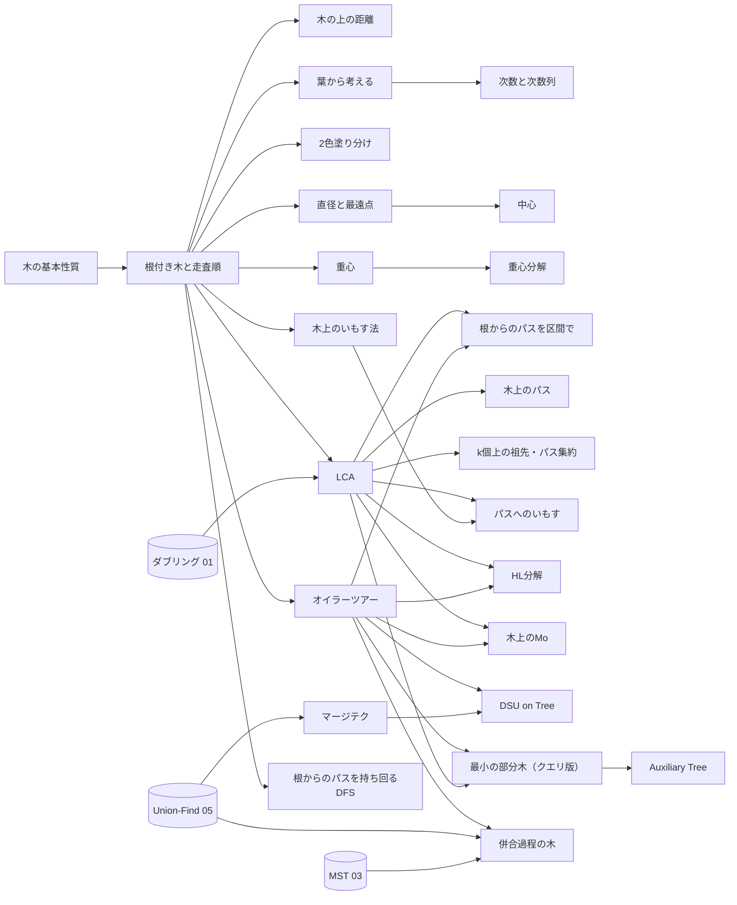

# 04 木（tree）調査レポート

担当：木の基本性質、直径・中心・重心、LCA と木上のパス、オイラーツアーと部分木クエリ、HL 分解、マージテク、重心分解、Auxiliary Tree、木の同型、その他の木の手法。木 DP・全方位木 DP そのものは 02 の担当として扱わない（境界は §7.4）。

- 調査日：2026-10-21
- 問題 ID・タイトル・difficulty は、すべて `python3 tools/ap.py` で確認した（2026-10-21 取得のキャッシュ）。atcoder.jp とそのサブドメイン（info.atcoder.jp を含む）のページは開いていない
- 問題の内容は、第三者の解説記事（ブログ・Qiita・Zenn・ライブラリの解説一覧・典型90問の GitHub リポジトリ）で確かめた。URL は §5 の表と topics.yaml に残した
- 項目の機械可読な一覧は [04-tree.topics.yaml](04-tree.topics.yaml)（34 項目、問題 103 件、重複を除いて 93 問）

---

## 1. 調べた資料

### 1.1 日本語の記事・スライド・ブログ

| 資料 | URL | 何の参考にしたか |
| --- | --- | --- |
| けんちょんの競プロ精進記録（drken）カテゴリ「木」「LCA」「Eulerツアー」「HL分解」「AuxiliaryTree」「マージテク」「木の重心分解」「木の重心」「木の直径」「木上の累積和・いもす法」「プリューファー(Prüfer)コード」「Union-Findのマージ過程を表す木を考える」「なもりグラフ」「完全二分木」「葉から考える」「クエリ(木上)」「Link-Cut木」「Cartesian木」ほか 31 カテゴリ | https://drken1215.hatenablog.com/archive/category/%E6%9C%A8 ほか | 手法と問題の対応づけ（約 420 件の分類から木に関係する ABC・ARC・AGC を抽出）。個別記事 57 件で各問題の解法を確認 |
| はまやんはまやんはまやん「競技プログラミングにおける重心分解問題まとめ」 | https://blog.hamayanhamayan.com/entry/2017/12/19/152143 | 重心分解の用途の整理（木上のクエリ用と、木全体の数え上げ用で実装が違う）。部分木の問題・パスの問題・ある点から距離ごとに広がる問題を、それぞれオイラーツアー・HL 分解・重心分解に対応させる見方 |
| はまやんはまやんはまやん「競技プログラミングにおけるLCA問題まとめ [auxiliary tree]」 | https://blog.hamayanhamayan.com/entry/2017/05/03/131624 | LCA の 3 方式、根付き木の情報と LCA を組み合わせる型、Auxiliary Tree の構築手順（行きがけ順にソートして隣どうしの LCA を足す） |
| はまやんはまやんはまやん（ABC 各問の解説、2019〜2022） | https://blog.hamayanhamayan.com/ （月別アーカイブ 2019-01〜2022-12 を巡回） | ABC 126〜239 の木の問題 17 件の解法の確認 |
| kmjp's blog（ABC の E〜Ex/G の解説、2019〜2026） | https://kmjp.hatenablog.jp/ （月別アーカイブを巡回） | ABC の E〜Ex/G の解説 491 件を取得し、「HL分解」「重心分解」「オイラーツアー」「LCA」「マージテク」「DSU on Tree」「Mo」「ハッシュ」「長鎖」「ダブリング」「プリューファー」「行列木」「undo」などの語で機械的に検索して、手法ごとの ABC での出現を調べた |
| Kazun の競プロ記録 | https://kazun-kyopro.hatenablog.com/entry/ABC/267/F など | ABC 221 F・222 F・235 E・239 F・240 E・267 F・273 E・314 F の解法の確認 |
| merom686's blog | https://merom686.hatenablog.com/ （2025-06〜2026-10 を巡回） | 2025〜2026 年の ABC（406 F・414 F・428 E・447 F・451 E・459 E・460 F・478 F など）の内容の確認。手元の知識が届かない新しい回の裏付けに使った |
| tatyam「高難易度木問題を解くテクニック集」（Speaker Deck、2022） | https://speakerdeck.com/tatyam_prime/gao-nan-yi-du-mu-wen-ti-wojie-kutekunitukuji | 直径・中心・重心・重心分解・LCA・オイラーツアー（部分木型／パス型、頂点属性／辺属性）・HL 分解の整理の仕方。直径の個数を中心で数える考え方、AGC 018 D と ABC 361 E 型の問題 |
| ngtkana「マージテクで、いわゆる auxiliary tree を構築する方法」 | https://ngtkana.hatenablog.com/entry/2024/03/13/202220 | ABC 340 G で Auxiliary Tree を使うことの裏付けと、LCA を使わない構築の別法 |
| Nyaan's Homepage「解説一覧」 | https://nyaannyaan.github.io/docs/problems/editorials/ | ABC の高難度問題と手法の対応（269 Ex：HLD と重いパス上の分割統治、311 Ex：重軽再帰 DP、340 G：Auxiliary Tree、351 G：Static top tree、376 G：01 on Tree） |
| E869120「レッドコーダーが教える、競プロ・AtCoder上達のガイドライン【中級編】【上級編】」（Qiita） | https://qiita.com/e869120/items/eb50fdaece12be418faa ／ https://qiita.com/e869120/items/acba3dd8649d913102b5 | 色ごとの通説。水色を目指す中級編では木は「木構造」の基本だけで、ダブリング（LCA を含む）はその先を目指す上級編の項目に入っている（LCA を青に置く判断の参考） |
| Qiita・Zenn の個人の解説記事（gotoki_no_joe、mattsunkun、omakasessan、Shizen_Tota、ZOI_dayo、hyouri、fjnkt98 など） | §5 の表の各 URL | ABC 263 B・266 F・270 C・309 E・345 F・348 E・362 F・368 D・369 G・397 E・398 E・399 C・401 F・428 E・451 E の解法の確認。Qiita はタグの RSS（例：https://qiita.com/tags/abc428/feed）で記事を探した |

### 1.2 ライブラリ・リポジトリ・ジャッジ

| 資料 | URL | 何の参考にしたか |
| --- | --- | --- |
| 競プロ典型 90 問の GitHub リポジトリ（E869120/kyopro_educational_90） | https://github.com/E869120/kyopro_educational_90 | 003（直径）・026（2 色塗り分け）・035（DFS 順と LCA で必要な辺の数）・039（辺の寄与）の解法コードと問題文テキスト |
| Luzhiled's Library（ei1333） | https://ei1333.github.io/library/ | 木のライブラリの項目一覧（重心分解、重心、根付き木への変換、DSU on Tree、ダブリング LCA、HL 分解、オフライン LCA、RMQ LCA、全方位木 DP、Static Top Tree、直径、木の同型判定、木上の Mo、Link-Cut Tree、Top Tree、Cartesian Tree、Dominator Tree、Block Cut Tree）。網羅性の確認に使った |
| Library Checker（yosupo06/library-checker-problems の tree カテゴリ） | https://github.com/yosupo06/library-checker-problems/tree/master/tree | 自作ライブラリの動作確認先の候補：lca、jump_on_tree、tree_diameter、vertex_add_subtree_sum、vertex_add_path_sum、vertex_set_path_composite、point_set_tree_path_composite_sum、frequency_table_of_tree_distance、vertex_add_range_contour_sum_on_tree、rooted_tree_isomorphism_classification、rooted_tree_topological_order_with_minimum_inversions、cartesian_tree、dynamic_tree_* |
| AC Library のドキュメント（手元 `~/lib/ac-library-master/document_ja/`、CC0） | （ローカル） | ACL には木専用の機能がないこと。dsu は union by size と経路圧縮で、merge は新しい代表元を返す（マージテクで併合先を決めるのに使える。経路圧縮があるので取り消しはできない）。fenwick_tree・segtree・lazy_segtree をオイラーツアーや HL 分解の列に載せる |

### 1.3 英語・中国語の資料

| 資料 | URL | 何の参考にしたか |
| --- | --- | --- |
| USACO Guide（Silver：Introduction to Tree Algorithms／Gold：Euler Tour Technique、LCA の Euler tour 版／Platinum：Binary Jumping、Small-To-Large Merging、Heavy-Light Decomposition、Centroid Decomposition、Virtual Tree、Kruskal Reconstruction Tree／Advanced：Link Cut Tree） | https://usaco.guide/silver/intro-tree など | 木の手法の難度の階段（どれを先に学ぶか）。各ページが参照する CPH の章（14 章 Tree algorithms、18.1 Finding Ancestors、18.2 Subtrees & Paths、18.3 LCA、18.4 Merging Data Structures）。USACO Guide は Codeforces のチュートリアル（Sack、HLD、DSU-tree など）も挙げているが、Codeforces は noai 指定のため開いておらず、資料として使っていない（Codeforces に該当記事がある、未読） |
| cp-algorithms（LCA の Euler tour＋セグ木版、Binary Lifting、Farach-Colton and Bender、Tarjan のオフライン LCA、Heavy-light decomposition、Centroid decomposition、Prüfer code、Kirchhoff、Second best MST、Tree painting） | https://cp-algorithms.com/graph/lca.html など | 計算量と正しさの事実確認（LCA ダブリング O(N log N)/O(log N)、Sparse Table で O(1)、Tarjan の O(n+m)、HLD の軽い辺は根からのパス上に log n 本以下・1 クエリ O(log² n)、重心分解の深さ O(log N)、プリューファー列で頂点が「次数−1」回現れること、Cayley の公式、次数指定の木の個数の多項係数） |
| CSES Problem Set（Tree Algorithms の 16 問、Advanced Graph Problems の Prüfer Code・Tree Traversals・Tree Isomorphism I/II） | https://cses.fi/problemset/ | 英語圏での木の典型の標準的な並び（Subordinates → Tree Diameter → Company Queries（祖先ジャンプ・LCA）→ Counting Paths（パスのいもす）→ Subtree/Path Queries → Distinct Colors（マージテク）→ Finding a Centroid → Fixed-Length Paths（重心分解）） |
| OI Wiki（树基础・树的直径・树的中心・树的重心・树哈希・AHU 算法・树上启发式合并・虚树・树分治・树链剖分（重链／长链）） | https://oi-wiki.org/graph/tree-basic/ など（CC BY-SA 4.0） | 中心の性質（高々 2 個で隣接、2 つの木を中心どうしでつなぐと直径最小）、負の辺で 2 回の DFS が使えないこと、木ハッシュの設計の注意、AHU の計算量、DSU on Tree の計算量の理由、虚树の構築法、点分治の計算量、长链剖分（軽い辺の切り替えは O(√n)、深さを添字にする DP の O(n) 合併、k 個上の祖先を O(1)） |

### 1.4 調べ方と限界

- AI の利用を断る指定：取得したすべてのページで `<meta name="robots">` と `X-Robots-Tag` に noai・noimageai がないことを機械的に確かめた（該当なし）。利用条件が分からない note.com の記事は使わなかった。Codeforces（codeforces.com）は noai 指定があるため、一度も開いていない。ほかの資料が Codeforces の記事や問題を挙げている箇所も、根拠にはしていない
- Web 検索はセッション全体の回数制限（ほかの担当と共有）にかかり、途中からほとんど使えなかった。代わりに、ブログのカテゴリ・月別アーカイブ・Qiita のタグ RSS を巡回して記事を探した。そのため、2025〜2026 年の E・F 問題の一部（§5.2）は裏付けが取れず「未確認」とした
- kmjp の解説の機械検索は、記事中で手法名を書いている場合にしか拾えない。手法名を書かずに使っている場合は漏れる

---

## 2. 分野の全体像

### 2.1 サブ分野の構造

木の手法は、次の 6 層に分けると前提関係が見通しやすい。下の層ほど基礎で、上の層は下の層をいくつも組み合わせる。

| 層 | 内容 | 主な項目（key） |
| --- | --- | --- |
| L1 木の基礎 | 定義と性質、根付き木の走査、そのまま使える小技 | tree-basics, tree-traversal, tree-bipartite, tree-distance, tree-imos, leaf-first, tree-degree |
| L2 木全体の形 | 木の「真ん中」と「端」、全体を数える視点、特殊な形 | tree-diameter, tree-center, tree-centroid, tree-edge-contribution, complete-binary-tree, namori-graph, tree-construction |
| L3 パス（祖先方向） | LCA を軸に 2 点間のパスを扱う | lca, binary-lifting-tree, tree-path, root-path-dfs |
| L4 木を列にする | DFS 順・HL 分解の番号で、部分木やパスを列の区間にしてデータ構造に載せる | euler-tour, euler-tour-path, hld, mo-on-tree |
| L5 まとめる・分ける | 部分木の情報を併合する、木を分割統治する、必要な頂点だけの木を作る | small-to-large, dsu-on-tree, centroid-decomposition, steiner-subtree, auxiliary-tree, long-path-decomposition, merge-process-tree |
| L6 発展 | ABC ではほぼ 2400 以上か、別解の位置づけ | tree-isomorphism, dynamic-tree, static-top-tree, tree-ratio-greedy, tree-counting |

### 2.2 前提関係（依存の鎖）

木の手法は「何を何に読み替えるか」の連鎖になっている。知識マップでは、次の鎖が太い幹になる。

文章で書くと、太い鎖は次の 6 本である。

1. **DFS の行きがけ順 → オイラーツアー（部分木＝区間）→ 部分木クエリ（BIT・セグ木）→ DSU on Tree・木上の Mo・Auxiliary Tree（DFS 順でソート）**
2. **ダブリング（01）→ LCA → 2 点間の距離・パス上の判定 → パスへのいもす・Auxiliary Tree・指定頂点を結ぶ部分木の大きさ**
3. **部分木サイズ → 重心 → 重心分解**、**部分木サイズ → 重い子 → HL 分解・DSU on Tree**
4. **2 回の最遠点探索 → 直径 → 各点の最遠点（離心数）→ 中心・半径 → 直径の個数**
5. **Union-Find の union by size（05）→ マージテク → DSU on Tree**、**クラスカル法（03）→ 併合過程の木 → その木の上で LCA・オイラーツアー**
6. **根からの累積値 S[v] → パスの値 = S[u]+S[v]−2S[lca]（頂点の値なら lca の分を足す）→ 辺の重みを子の部分木への区間加算にする（辺のオイラーツアー）→ 逆元のない演算やパス更新は HL 分解**

### 2.3 木の基本性質を「解くときの道具」として整理する

性質そのものより、「その性質で何が楽になるか」を表にした。tree-basics のページの中心になる材料である。

| 性質 | 解くときの使い方 | 例 |
| --- | --- | --- |
| 連結で辺が N−1 本 ⇔ 連結で閉路なし ⇔ 閉路なしで辺が N−1 本 ⇔ どの 2 点間も単純パスがちょうど 1 本 | 入力が木だと分かれば一般のグラフの道具（閉路検出、ダイクストラ）がいらない。全頂点の次数の和が 2(N−1) なので、各頂点で隣接頂点を全部見ても合計 O(N) | — |
| 2 点間のパスが一意 | 重み付きでも 1 回の DFS/BFS で 1 点からの距離が全部決まる。距離は「根からの累積」で表せる（→ LCA） | abc070_d |
| 辺を 1 本取り除くとちょうど 2 つの成分（大きさ s と N−s）に分かれる | その辺を通るペアは s(N−s) 個（辺の寄与）。「辺を取り除いた片側」は根付き木なら子の部分木（→ オイラーツアー） | typical90_am、abc406_f |
| 辺を 1 本足すとちょうど 1 つの閉路ができ、長さは元のパスの長さ + 1 | 閉路の長さ＝距離 + 1。木 + 1 辺はなもりグラフ | abc014_4、typical90_c、abc378_f |
| 森では 連結成分数 = 頂点数 − 辺数 | 成分数の総和を「頂点の寄与 − 辺の寄与」に分けられる。森として残せる辺は N −（成分数）本 | abc173_f、abc399_c |
| 葉は 2 個以上（N ≥ 2）。葉の数 = 2 + Σ(次数 − 2)（次数 3 以上の頂点について） | 次数だけで形が決まる部分がある。星の分解など | abc303_e |
| 各次数が 1 以上で和が 2N−2 なら、その次数列の木が必ず存在する（プリューファー列による） | 次数を自由に配ってよい最適化に帰着できる | abc359_f |
| 木は二部グラフ。2 点の距離の偶奇 = 深さの和の偶奇 | 距離の偶奇は LCA なしで深さだけで分かる。大きい方の色は N/2 個以上 | abc209_d、typical90_z |
| 根付き木では、根以外の頂点と「親への辺」が 1 対 1 | 辺の値を子の頂点に持たせると、辺のクエリが頂点のクエリになる（HLD・オイラーツアーでの定番） | abc294_g |
| DFS で入ってから出るまでに子孫を全部回る | 行きがけ順の番号で部分木が連続区間になる。祖先判定が in/out の比較になる | abc240_e、abc202_e |
| 親の番号が自分より小さい（p_i < i）入力 | 番号順がそのまま「親が先」の順。番号の逆順で子から親へ集約でき、DFS も再帰もいらない | abc309_e、abc263_b |
| 形の両極端：パス（深さ N、再帰が深い）と星（次数 N−1） | テストケースで必ず試す。各頂点で「次数の 2 乗」の処理をすると星で O(N²) | — |

### 2.4 混同されやすいもの

- **「オイラーツアー」の 4 つの意味**：(a) グラフの全辺を 1 回ずつ通る路（オイラー路、03 の担当）、(b) 行きがけ順の番号 in[v] と出る時刻 out[v]（部分木を区間にする版）、(c) DFS で頂点を訪れるたびに記録する長さ 2N−1 の列（LCA を区間最小に帰着する版）、(d) 入るときと出るときの両方を記録する長さ 2N の列（辺の ±、木上の Mo）。教材では用語を定義して使い分けを明記する必要がある
- **重心と中心**：重心は「取り除いたときの最大成分の頂点数」を最小にする点、中心は「最も遠い点までの距離」を最小にする点。どちらも 1 個か隣接する 2 個だが、一般に別の点
- **マージテク・DSU on Tree・Union-Find の union by size**：どれも「小さい方を大きい方へ」で log が付く理由は同じだが、マージテクは集合（map など）そのものを移す、DSU on Tree は配列 1 本で重い子の結果を残す、union by size は木の高さを抑える
- **Auxiliary Tree と最小シュタイナー木**：木の上で指定頂点を結ぶ最小の部分木は易しい（DFS や DFS 順の公式）。一般のグラフのシュタイナー木は NP 困難で bit DP（abc395_g、03・02 の担当）。Auxiliary Tree は木の上の最小部分木をさらに「枝分かれと指定頂点だけ」に圧縮したもの
- **HL 分解とオイラーツアー**：オイラーツアーは部分木が区間、HL 分解はパスが O(log N) 個の区間（HL 分解の番号付けでも部分木は区間になる）。和や XOR のように逆元があり点更新だけなら、パスもオイラーツアー＋LCA で足りる
- **LCA の求め方**：ダブリング、オイラーツアー＋区間最小（Sparse Table）、HL 分解、オフラインの Tarjan。前処理・1 回の時間・ついてくる機能（祖先ジャンプ、パスの区間化）が違う
- **木 DP・全方位木 DP・重心分解・辺の寄与**：「全ペアについての和」の問題はどれでも解けることがある。辺ごとに分解できるなら辺の寄与が最も簡単
- **直径の 2 回探索と全方位木 DP**：各頂点の最遠距離は、どちらでも求まる。前者は重みが非負のときだけ正しい
- **なもりグラフと Functional graph**：無向の N 頂点 N 辺の連結グラフと、各頂点から 1 本ずつ辺が出る有向グラフ（各成分がなもり）。後者は 03 の担当

### 2.5 ABC での出題の傾向（調べた範囲の観察）

裏付けの取れた木の問題を difficulty の帯で並べると、帯ごとに必要な道具がはっきり分かれる。

- **〜1199（基礎）**：根付き木の走査（親・深さ・部分木サイズ）、2 色塗り分け、部分木のいもす、直径の求め方、指定頂点を結ぶ部分木。例：abc213_d (710)、abc333_d (704)、abc209_d (686)、abc138_d (920)、abc309_e (957)、abc368_d (816)、abc428_e (1167)
- **1200〜1599（水）**：直径の性質（全頂点を回る最短）、辺の寄与、根の向きを決めるいもす、なもりグラフ、葉からの貪欲、集合のマージテク、次数の数え上げ。例：abc361_e (1213)、abc214_d (1341)、abc187_e (1358)、abc266_f (1525)、abc397_e (1484)、abc183_f (1586)、abc406_f (1470)
- **1600〜1999（青）**：LCA、オイラーツアー＋BIT、DFS の巻き戻し、直径の端点＋祖先ジャンプ、次数列から木を作る条件、木の構築。例：abc294_g (1702)、abc014_4 (1856)、abc202_e (1638)、abc165_f (1843)、abc267_f (1939)、abc359_f (1792)、abc239_f (1959)
- **2000〜2399（黄）**：木の上のマージテク、重心の性質、重心分解、中心を使う数え上げ、DSU on Tree、木上の Mo、長鎖分解の考え方、根からのパス上のデータ構造。例：abc350_g (2058)、abc359_g (2099)、abc362_f (2186)、abc291_h (2097)、abc221_f (2093)、abc454_g (2253)、abc477_g (2226)、abc369_g (2055)、abc218_g (2217)
- **2400〜（発展）**：HL 分解が必須の問題（abc269_h 3178）、Static Top Tree（abc351_g 2920）、Auxiliary Tree が想定解（abc340_g 2401）、01 on Tree（abc376_g 2858）、undo つき Union-Find の DFS（abc302_h 2407）
- 2026 年の ABC でも木の問題は E〜G に毎月のように出ている（abc451_e、abc459_e、abc447_f、abc478_f、abc454_g、abc477_g）。G では DSU on Tree（454 G）や木上の Mo（477 G）のような、これまで ABC ではほとんど見なかった手法が出始めている

---

## 3. 項目一覧

レベルは「知らないと解けない問題がまとまって現れ始める帯」。根拠は §5 の表と topics.yaml。ACL の列は、対応する ACL の機能（木専用の機能は ACL にない）。

| key | 項目名 | レベル | 根拠の問題（difficulty） | 前提 | ACL | ページ分割の案 |
| --- | --- | --- | --- | --- | --- | --- |
| tree-basics | 木の基本性質と表現 | 基礎 | abc263_b (136), abc399_c (321), abc303_e (1113), abc378_f (1436) | グラフの表現・DFS・BFS（03） | なし | 単独（短め）。§2.3 の表が中心 |
| tree-traversal | 根付き木と走査順 | 基礎 | abc213_d (710), abc270_c (625), abc309_e (957), abc146_d (1192), abc133_e (1505) | tree-basics, 再帰 | なし | 単独 |
| tree-bipartite | 木の 2 色塗り分けと距離の偶奇 | 基礎 | abc209_d (686), abc398_e (1238), abc126_d (1279), typical90_z | tree-traversal, 二部グラフ判定（03） | なし | 単独（短め）。tree-basics の節でもよい |
| tree-distance | 木の上の距離（1 点・2 点から／根からの累積） | 基礎 | abc070_d (1182), abc148_f (1457), abc201_e (1694) | tree-traversal | なし | 単独（短め） |
| tree-imos | 木の上の累積和・いもす法 | 基礎 | abc138_d (920), abc187_e (1358)。パス版は青 | tree-traversal, いもす法（01） | なし | 単独。パス版は LCA の後に読む節 |
| leaf-first | 葉から考える | 水 | abc459_e (1298), abc397_e (1484), abc345_f (2157) | tree-traversal, 交換論法（01） | なし | 単独 |
| tree-degree | 次数と次数列（プリューファー列） | 青 | abc359_f (1792), abc239_f (1959) | tree-basics, leaf-first | なし | 単独。数え上げは 07 へリンク |
| tree-edge-contribution | 辺で切って数える | 水 | abc214_d (1341), typical90_am, abc173_f (1892) | tree-traversal, 寄与（01）, Union-Find（05） | dsu | 単独 |
| complete-binary-tree | 完全二分木（ヒープ番号） | 水 | abc243_d (758), abc321_e (1627) | tree-basics, bit 演算（01） | なし | 単独（短め） |
| namori-graph | なもりグラフ | 水 | abc266_f (1525) | tree-basics, leaf-first, Union-Find | dsu | 単独（短め）。03 の Functional graph と相互リンク |
| tree-diameter | 木の直径と最遠点 | 水 | abc428_e (1167), abc361_e (1213), abc019_4 (1378)。応用は青 | tree-traversal, tree-distance | なし | 単独。中心を節に含める |
| tree-center | 木の中心と半径 | 黄 | abc221_f (2093) | tree-diameter | なし | tree-diameter の節 |
| tree-centroid | 木の重心 | 黄 | abc362_f (2186), abc291_h (2097)。易しい使い方は abc348_e (1347) | tree-traversal | なし | 単独 |
| lca | 最小共通祖先（LCA） | 青 | abc294_g (1702), abc014_4 (1856), abc152_f (1965) | tree-traversal, ダブリング（01）。オイラーツアー版の節は Sparse Table（05） | なし | 単独。求め方の比較を節に |
| tree-path | 木上のパスの扱い | 青 | abc152_f (1965), abc133_f (2330) | lca, tree-distance | なし | 単独 |
| binary-lifting-tree | 木のダブリング（祖先ジャンプ・パス集約） | 青 | abc267_f (1939) | lca, ダブリング | なし | lca の節 |
| root-path-dfs | 根からのパスを DFS で持ち回る | 青 | abc198_e (1161), abc273_e (1624), abc165_f (1843), abc218_g (2217) | tree-traversal | なし（ACL の dsu は経路圧縮があるため取り消せない） | 単独 |
| euler-tour | オイラーツアー（部分木を区間に） | 青 | abc406_f (1470), abc202_e (1638), abc337_g (2080) | tree-traversal, BIT・セグ木（05） | fenwick_tree, segtree, lazy_segtree | 単独 |
| euler-tour-path | 根からのパスを区間で扱う | 青 | abc294_g (1702) | euler-tour, lca | fenwick_tree | euler-tour の節 |
| small-to-large | マージテク | 水 | abc329_f (1207), abc183_f (1586)。木の応用は黄（abc350_g 2058, abc359_g 2099） | Union-Find, set/map（05） | dsu | 単独 |
| dsu-on-tree | DSU on Tree | 黄 | abc454_g (2253) | small-to-large, euler-tour | なし | small-to-large の節 |
| mo-on-tree | 木上の Mo | 黄 | abc477_g (2226) | euler-tour, lca, Mo（05） | なし | 05 の Mo のページの節 |
| hld | HL 分解 | 発展 | abc269_h (3178)。abc294_g (1702) は別解 | euler-tour, lca, セグ木 | segtree, lazy_segtree | 概要ページ（§7.2 で要判断） |
| centroid-decomposition | 重心分解 | 黄 | abc291_h (2097), abc359_g (2099)（解法の一つ） | tree-centroid, 分割統治（01） | なし | 単独 |
| steiner-subtree | 指定頂点を結ぶ最小の部分木 | 基礎 | abc368_d (816)。クエリ版は typical90_ai（★7、黄相当） | tree-traversal, euler-tour, lca | なし | 単独（短め、クエリ版の節は黄） |
| auxiliary-tree | Auxiliary Tree | 発展 | abc340_g (2401)。abc359_g (2099) は解法の一つ | lca, euler-tour, steiner-subtree, 木 DP（02） | なし | 概要ページ（§7.2 で要判断） |
| long-path-decomposition | 長鎖分解 | 黄 | abc369_g (2055) | tree-traversal, tree-diameter | なし | 単独（短め）。高度な用途は発展の囲み |
| merge-process-tree | 併合過程の木（クラスカル再構築木） | 発展 | agc002_d (2514)。abc183_f (1586) の別解 | Union-Find, MST（03）, euler-tour, lca | dsu | 概要ページ |
| tree-isomorphism | 木の同型判定と木のハッシュ | 発展 | ABC での出題を確認できず | tree-traversal, tree-center, ハッシュ（08） | なし | 概要ページ |
| dynamic-tree | 動的木（LCT・ETT・Top Tree） | 発展 | abc350_g (2058) の別解のみ | hld, 平衡二分木（05） | なし | 概要ページ |
| static-top-tree | Static Top Tree・動的木 DP | 発展 | abc351_g (2920), abc311_h (3605) | hld, 木 DP（02） | なし | 概要ページ |
| tree-ratio-greedy | 比で親に併合する貪欲（01 on Tree） | 発展 | abc376_g (2858) | Union-Find, 優先度付きキュー, 交換論法 | dsu | 概要ページ |
| tree-construction | 木の構築・復元 | 青 | abc239_f (1959), agc005_c (1976)。水に abc451_e (1215), abc478_f (1588) | tree-basics, tree-degree, tree-diameter | dsu | 単独 |
| tree-counting | ラベル付き木の数え上げ | 発展 | abc303_h (2501), abc253_h (2758) | tree-degree, 二項係数（07） | なし | 07 に置き、04 からリンク |

---

## 4. 項目ごとのメモ

各項目について、(1) 何ができてなぜ正しいか、(2) つまずき、(3) 図・動く図、(4) 確認問題、(5) 問題のサイン、(6) 似た手法との使い分け、の順に書く。

### 4.1 tree-basics 木の基本性質と表現（基礎）

1. 木の同値な定義（§2.3）と、そこから出る「使える事実」の一覧がこのページの中身になる。初歩の定義は短くし、§2.3 の表のように「性質 → 解くときの使い方 → 例題」の形にする。入力形式（辺のリスト／親の配列／親の番号が自分より小さい形式）と、根が指定されていなければ自分で好きに決めてよいことも書く
2. つまずき：根のない木で「親」を前提にしたコード、隣接リストで親に戻ってしまう（親を引数で渡す）、N = 1、辺の本数を M と取り違える、入力が森のこともある問題での見落とし
3. 図：辺を 1 本取り除く・1 本足すを切り替えて、2 成分と閉路が見える図
4. 確認問題：「K 個の成分からなる N 頂点の森の辺は何本か」「次数列 (3,1,1,1) と (2,2,2,2) はそれぞれ木の次数列になりうるか」「木に辺を 1 本足すと閉路はいくつできるか。その長さは」
5. サイン：「N 頂点 N−1 辺の連結グラフ」「どの 2 頂点間にもちょうど 1 つの経路」「p_i < i」
6. 使い分け：一般のグラフの手法（ダイクストラ、閉路検出、二部判定）がいらない場面の見極め

### 4.2 tree-traversal 根付き木と走査順（基礎）

1. 根を決めて DFS（または BFS）すると、親・深さ・部分木サイズ・行きがけ順・帰りがけ順が O(N) で求まる。帰りがけ順では子がすべて親より先に終わるので、子の結果を親へ集約できる（木 DP の土台）。BFS 順は深さの非減少順で、その逆順に処理すれば再帰なしで子 → 親の集約ができる。p_i < i の入力なら番号の逆順で同じことができる
2. つまずき：パス状の木（N = 2×10^5）で再帰が深くなる（手元の環境や言語によってはスタックが足りない。AtCoder の設定は 09 の担当で確認する）。再帰しない書き方（BFS 順の逆順、明示的なスタック）を知っておく。隣接リストの順で訪問順が変わる（213 D は小さい番号から訪れる指定）
3. 動く図：DFS のステップ送りで、スタックの中身・行きがけ番号・帰りがけ番号を同時に表示。BFS 順に切り替えられるとよい
4. 確認問題：「BFS 順の逆順で部分木サイズを求めてよいのはなぜか」「行きがけ順で連続する番号の区間は何を表すか」（→ euler-tour への導入）「p_i < i の入力で DFS がいらないのはなぜか」
5. サイン：「頂点 1 を根とする根付き木」「部分木の頂点数・和」「子孫」「訪問順を出力」
6. 使い分け：DFS と BFS のどちらでもよい場面が多い。深さ順に処理したいときは BFS、帰りがけ順の集約は DFS が自然

### 4.3 tree-bipartite 木の 2 色塗り分けと距離の偶奇（基礎）

1. 木は閉路がないので必ず 2 色に塗れる（深さの偶奇）。2 点の距離の偶奇は深さの和の偶奇に等しい。辺に重みがあるなら、重みの偶奇だけで色を決めればよい（126 D）。使い方は、距離の偶奇の判定（209 D）、多い方の色が N/2 個以上あることによる独立集合（typical90 026）、色の違う頂点の組の数 |A||B| から「二部グラフのまま足せる辺の数 |A||B| − (N−1)」（398 E）、二部グラフであることを使うフローやマッチング（437 G、03 との境界）
2. つまずき：偶奇だけ必要なときに LCA で距離を求めるのは過剰（209 D は LCA でも解けるが深さで足りる）
3. 図：深さの偶奇で色分けした木。2 点を選ぶと距離と色の組み合わせが出る
4. 確認問題：「木に辺を 1 本足して奇閉路ができるのはどんなときか」「同じ色の 2 点の距離は偶数か奇数か」
5. サイン：偶奇、2 人が同時に動いて出会う、市松、N/2 個以上の独立集合、二部グラフのまま辺を足すゲーム
6. 使い分け：一般のグラフの二部グラフ判定（03）では矛盾の検出が要るが、木では矛盾が起きない

### 4.4 tree-distance 木の上の距離（基礎）

1. 1 点からの距離は DFS/BFS 1 回（重み付きでも、パスが一意なので親の距離に辺の重みを足すだけ）。2 点からの距離を両方求めて比べると、追いかけっこや「どちらに近いか」が分かる（148 F）。根からの累積値 S[v] を使うと 2 点間の値が表せる：XOR なら S[u] xor S[v]（根から LCA までの部分が打ち消し合うので LCA がいらない。201 E、arc045_c）、和なら S[u]+S[v]−2S[lca] で LCA が必要（→ lca）
2. つまずき：BFS は重みなしのときだけ距離順になる（重み付きでも木なら DFS で距離は求まるが、BFS の「距離順に取り出す」性質は使えない）。全点対の距離が必要なとき N 回の探索は O(N²)
3. 図：2 点からの距離を色の濃淡で塗り、境目（パスの中点）を見せる
4. 確認問題：「木で 1 点からの距離を求めるのにダイクストラ法がいらないのはなぜか」「XOR では LCA がいらず、和では必要なのはなぜか」
5. サイン：「頂点 K を経由する」（070 D）、「2 人の追いかけっこ」、「パス上の XOR」
6. 使い分け：2 点間の距離のクエリが多いなら LCA（tree-path）。全頂点の最遠距離なら直径か全方位木 DP（02）。状態を増やした BFS（414 F）は 03 の「状態を頂点にする拡張」との境界

### 4.5 tree-imos 木の上の累積和・いもす法（基礎、パス版は青）

1. 「部分木に x を足す」クエリをすべて受けてから値を出力するなら、部分木の根に印を足して最後に根から下へ累積する（138 D）。辺の片側に足す形は、根を決めて「子の部分木に足す」か「全体に足して子の部分木から引く」に直す（187 E）。「根から下へ y 世代まで」は、残り世代数の最大値を下へ伝える（309 E）。パス u–v の頂点に x を足すなら、u と v に +x、lca と lca の親に −x を置いて、下から上へ累積する（辺に足すなら u と v に +x、lca に −2x）。パス版は LCA が前提なので青の節にする
2. つまずき：累積の向きを取り違える（部分木加算は上から下、パス加算は下から上）。頂点版と辺版で lca の扱いが違う。加算と取得が交互に来るオンラインの形なら、オイラーツアー＋BIT が必要
3. 動く図：印を置く段階 → 累積する段階のステップ送り。配列のいもす法と並べて見せる
4. 確認問題：「パス加算で lca に −x、lca の親にも −x を置くのはなぜか」「途中で値を聞かれる場合はどうするか」
5. サイン：「部分木の全頂点に加算するクエリがたくさん来て、最後に全頂点を出力」「たくさんのパスに沿って +1 し、各辺を通った回数」（222 E は N が小さいので素朴に数えても解ける）
6. 使い分け：オフラインなら いもす、オンラインならオイラーツアー＋BIT（部分木）、辺のオイラーツアー（根からのパス）、HL 分解（パス更新）

### 4.6 leaf-first 葉から考える（水）

1. 葉は辺が 1 本しかないので選択肢が少なく、葉から順に決めると貪欲が正しくなりやすい。交換論法で「葉の唯一の辺を、使えるなら今使っても悪くならない」を示せることが多い。葉を削っていく（次数 1 の頂点をキューで管理）か、DFS の帰りがけ順で葉から情報を上へ送る。例：パスへの分割（397 E）、部分木で余った個数を上へ送って二項係数を掛ける（459 E）、全域森の葉から使う辺を決める（345 F）、なもりグラフの閉路検出（葉を削り続けて残るのが閉路）、木の最大マッチング（葉と親を組む）
2. つまずき：根を葉と数えるかどうか、削った後に次数が 1 になった頂点の追加忘れ、2 本の途中のパスを合わせるときの条件の見落とし（397 E）
3. 動く図：次数 1 の頂点をキューに入れて削るステップ送り（キューと残りの次数を表示）
4. 確認問題：「木の最大マッチングで、葉をその親と組んでよいのはなぜか」「星グラフでは結果はどうなるか」
5. サイン：「木を K 頂点ずつのパスに分ける」「すべての辺を使う／覆う」「葉を消していく操作」
6. 使い分け：多くは木 DP（02）でも書けるが、葉からの貪欲の方が状態が少ない。貪欲が正しいことの説明（交換論法）を必ず書く

### 4.7 tree-degree 次数と次数列（青）

1. 次数だけで分かること（葉の数、星の中心、次数 3 以上の頂点の連結成分（378 F））と、「各次数が 1 以上で和が 2N−2 なら、その次数列の木が存在する」という事実。後者はプリューファー列で説明できる：最小番号の葉を消してその隣を記録する操作を N−2 回行うと長さ N−2 の列ができ、頂点 i はちょうど「次数 − 1」回現れる。逆に任意の列から木が 1 つ復元できる（全単射）。ここから、ラベル付き木は N^(N−2) 通り、次数が決まった木は (N−2)!/Π(d_i − 1)! 通り（数え上げは 07 の担当）
2. 使い方：次数を配る最適化に帰着（359 F：増分の小さい順に配る）、木を完成させる構築（239 F：次数の和、閉路の有無を確かめてから、次数の足りない成分どうしをつなぐ）、形の逆算（303 E）、中心を全探索して次数を並べる（385 E）
3. つまずき：存在条件の十分性（なぜ必ず作れるか）を説明しないと使えない。N = 2 のとき
4. 動く図：プリューファー列の生成と復元のステップ送り
5. 確認問題：「次数列 (1,1,1,3) と (2,2,2,2) は木になるか」「頂点 i が列に次数 − 1 回現れるのはなぜか」
6. サイン：「各頂点の次数を決める」「次数の和」「次数が ○ 以下の木」「全域木の個数」（→ 07）

### 4.8 tree-edge-contribution 辺で切って数える（水）

1. 「全ペア (u, v) についてのパスの量の和」を、各辺（や頂点）が何ペアのパスに含まれるかで数え直す（主客転倒）。辺で切った両側の大きさが s と N−s なら、その辺を通るペアは s(N−s) 個（typical90 039）。パス上の最大値の和は、辺を重みの小さい順に Union-Find で併合し、併合した瞬間に両側の大きさの積 × 重みを足す（214 D）。XOR の和はビットごと（201 E）。誘導される森の成分数の和は「頂点数 − 辺数」に分けて、各頂点・各辺を含む区間の数を足す（173 F）。期待値（149 F）や「その色を通らないパス」（163 F）にも同じ考え方が効く
2. つまずき：s は子側の部分木サイズで取る。s(N−s) は 32 ビットを超える。向き（子側か親側か）
3. 動く図：辺を 1 本ずつ切って左右の大きさと積を表示し、総和が積み上がるアニメ
4. 確認問題：「全ペアの距離の和を O(N) で求めよ」「パス上の最大値の和で、なぜ重みの小さい順に併合するのか」
5. サイン：「すべての i < j について f(i, j) の総和」「N ≤ 2×10^5 の全ペア」
6. 使い分け：全点からの距離の和（各点ごと）は全方位木 DP（02）。総和だけなら辺の寄与が簡単。色ごとの和はマージテク・Auxiliary Tree・重心分解（359 G）

### 4.9 complete-binary-tree 完全二分木（水）

1. 頂点 i の子が 2i と 2i+1、親が floor(i/2) の木。番号の 2 進表記の先頭の 1 の後ろが根からの道順になる（0 なら左、1 なら右）。深さは floor(log2 i) で、N が 10^18 でも 60 程度なので祖先を全部たどれる。L/R/U の移動は 2 進表記の末尾の付け外しで、直前の L/R と U は打ち消し合う（243 D、スタック）。距離 K の頂点の数は、自分の部分木で深さ K の数と、祖先に上がるたびに反対側の子の部分木で深さが合う数を足す（321 E）
2. つまずき：深さ d の子孫の番号の範囲 [i·2^d, i·2^d + 2^d − 1] を N で切ること、オーバーフロー、根の扱い
3. 図：番号と 2 進表記を並べた完全二分木
4. 確認問題：「2 頂点の LCA を番号だけで求めるには」（大きい方を 2 で割り続ける）
5. サイン：「頂点 i と floor(i/2) を結ぶ」「N ≤ 10^18」「L・R・U の移動」
6. 使い分け：一般の木の LCA・距離の手法を、番号の計算で置き換えられる特殊な場合

### 4.10 namori-graph なもりグラフ（水）

1. N 頂点 N 辺の連結グラフは「木 + 1 辺」で、閉路がちょうど 1 つあり、閉路上の各頂点から木がぶら下がる形になる。閉路は、次数 1 の頂点を削り続けて残った頂点（または Union-Find で閉路を作る辺）で見つかる。2 点間の単純パスが一意 ⇔ 同じ閉路上の頂点からぶら下がる木に属する（266 F）。最小全域木に辺を 1 本足すとできる閉路の最大の辺と比べる 235 E も同じ見方
2. つまずき：連結でない場合（各成分が高々 1 閉路）。有向の Functional graph（各頂点から 1 本）は 03 の担当で、ページは相互リンクにする
3. 図：閉路を横一列に並べ、各頂点の下に木をぶら下げる描き直し
4. 確認問題：「閉路上の 2 点間のパスが一意でないのはなぜか」
5. サイン：「N 頂点 N 辺」「木に辺を 1 本足す」「各頂点から 1 本ずつ辺が出る」（→ 03）

### 4.11 tree-diameter 木の直径と最遠点（水、応用は青）

1. 直径は最も遠い 2 点を結ぶパス。任意の点 s から最も遠い点 a を求め、a から最も遠い点 b を求めると a–b が直径（辺の重みが非負のとき）。直感：直径を横一列に置くと、残りの頂点はそこからぶら下がる枝で、枝の深さは直径の端までの残りの長さを超えない（超えたら直径を伸ばせてしまう）。だから、どの点から見ても最も遠い点は直径の端のどちらかになる。これより、各点の最遠距離（離心数）は max(d(v,a), d(v,b))。木 DP（各頂点で深い子 2 つの和）でも求まり、こちらは負の重みでも正しい
2. 使い方：全頂点を回る最短（戻らない）は「2 × 辺の総和 − 直径」（361 E）、辺を 1 本足した閉路の最大長（typical90 003）、各点の最遠点（428 E、番号の大きい方を優先する工夫が要る）、2 つの木をつないだ直径は max(d1, d2, ecc1(i) + 1 + ecc2(j))（401 F）、ちょうど距離 K の点（267 F：端点を根にして K 個上の祖先）、直径の個数（221 F：中心で分ける）、最遠距離の列から木を作る（agc005_c）、次数条件つきの最長パス（447 F：パスの最も浅い頂点で場合分けする直径の DP と同じ形）
3. つまずき：負の重みで 2 回探索が壊れる。最遠点が複数あるときの選び方。直径の頂点列の復元（親を記録）。BFS の「距離順」は重みなしのときだけ
4. 動く図：2 回の探索のステップ送り（1 回目の最遠点が端になる様子）と、直径を横一列にした描き直し
5. 確認問題：「1 回目の探索の最遠点が直径の端になるのはなぜか」「負の辺があると何が起きるか」「全頂点を回って戻るときと戻らないときの差は」
6. サイン：「最も遠い」「最長のパス」「全頂点を回る最短」「各頂点から最も遠い頂点」「2 つの木をつなぐ」
7. 使い分け：各点の最遠距離は直径の端点を使えば O(N)、全方位木 DP（02）でも求まる（重み付き頂点の 222 F は全方位木 DP の例）

### 4.12 tree-center 木の中心と半径（黄、tree-diameter の節）

1. 中心は「最も遠い点までの距離」が最小の頂点で、直径の中点にある。辺の重みがない場合、直径の長さ（辺の数）が偶数なら 1 頂点、奇数なら隣接する 2 頂点（辺の中点）で、半径 = ceil(直径 / 2)。重み付きなら中点が辺の途中に来ることがある。すべての直径は中心を通るので、中心から深さが半径の頂点だけが直径の端になれる → 直径の個数や直径を作る頂点の組を、中心で分けた枝ごとに数える（221 F）。2 つの木を 1 辺でつないで直径を最小にするには中心どうしを結ぶ
2. つまずき：重心との混同（§2.4）。中心が辺になる場合の扱い
3. 図：直径の中点に印をつけ、深さが半径の頂点を色で示す
4. 確認問題：「直径が 2 本あるとき、それらは必ず共通の点を持つか」

### 4.13 tree-centroid 木の重心（黄）

1. 重心は、取り除いたときに残る成分の最大の頂点数が最小の頂点。同値な言い方：どの成分も N/2 以下になる頂点。1 個か、隣接する 2 個。部分木サイズを求め、「子の部分木サイズの最大」と「N − 自分の部分木サイズ」がどちらも N/2 以下の頂点として求まる。使い方：全頂点への（重み付き）距離の和が最小になる点（348 E：根を隣へ動かしたときの増減を考え、重い側へ動けなくなった所）、ペアを作って距離の和を最大化（362 F：重心から見てどの枝も半分以下なので、別の枝の頂点どうしを組めば全ペアが重心を通る）、重心分解の要
2. つまずき：中心との混同、「親側の成分 N − sz[v]」の見落とし、重心が 2 個のとき
3. 動く図：頂点を選ぶと成分の大きさが出て、最大の成分の方へ動くと重心で止まる
4. 確認問題：「重心が 2 個あるとき、2 頂点はどうつながっているか」「全点への距離の和が重心で最小になるのはなぜか」
5. サイン：「全頂点への距離の和を最小に」「ペアの距離の和を最大に」「どれも半分以下に分ける」
6. 使い分け：距離の和の最小化は全方位木 DP（02）でも解ける

### 4.14 lca 最小共通祖先（青）

1. 根付き木で 2 頂点の共通の祖先のうち最も深いもの。2 点間のパスは「u から lca へ上る」と「lca から v へ下る」に分かれるので、パスの問題の多くが「祖先方向のパス」の問題に帰着する。距離は dep(u) + dep(v) − 2 dep(lca)（014 D）
2. 求め方（cp-algorithms で確認）：
   - ダブリング：各頂点の 2^k 個上の祖先の表を作る（前処理 O(N log N)、1 回 O(log N)）。深さをそろえてから、2^k 個上が違う限り両方を同時に上げ、最後に 1 つ上が LCA。祖先ジャンプやパス上の集約にそのまま使える
   - オイラーツアー（長さ 2N−1 の訪問列）＋区間最小：2 点が最初に現れる位置の間で最も浅い頂点が LCA。Sparse Table なら 1 回 O(1)（ACL には Sparse Table がないので 05 のページと連携）
   - HL 分解：前処理 O(N)、1 回 O(log N)。パスの区間化も同時にできる
   - オフライン（Tarjan）：Union-Find を使い、全クエリを O(N + Q α) 程度で
3. つまずき：深さをそろえる手順の抜け、u が v の祖先のとき、表の大きさ（log2 N + 1 段）、根の親の扱い
4. 動く図：ダブリング表と「2^k 跳び」のステップ送り、訪問列の区間最小
5. 確認問題：「深さをそろえた後、2^k 個上が等しいときに跳ばないのはなぜか」「u が v の祖先のとき、手順はどう終わるか」
6. サイン：「木の 2 頂点の距離をたくさん聞かれる」「パス u–v に関するクエリ（Q ≤ 2×10^5）」
7. 使い分け：§6.2 の表。1 回だけなら親をたどるだけ（木の高さが O(N) になりうることに注意）

### 4.15 tree-path 木上のパスの扱い（青）

1. LCA を使ってパスを扱う道具一式。距離、x がパス u–v 上にあるか（d(u,x) + d(x,v) = d(u,v)）、3 点 a, b, c が合流する点（lca(a,b)・lca(b,c)・lca(c,a) のうち最も深いもの）、2 本のパスが交わるか（一方の LCA が他方のパス上にあるか）、パス上の k 番目の頂点（u から lca までの長さと比べて、u 側か v 側から祖先ジャンプ）、どちらの端点に近いかの境目（298 Ex）、パスを辺の集合として扱う（152 F：M ≤ 20 のパスを辺のビット集合にして包除原理）、パス上の色ごとの集計（133 F：色を変えた距離 = 元の距離 − 色 X の辺の和 + 本数 × Y、オフラインの DFS で数える）。根を付け替えたときの LCA（3 つの LCA のうち最も深いもの）も節に入れる
2. つまずき：頂点の値か辺の値かで lca の分の扱いが違う。k 番目でどちらの端から上がるかの取り違え
3. 図：パスを 2 本の縦線に分解する図、3 点の合流点の図
4. 確認問題：「3 点を結ぶ最小の部分木の辺の数は」（3 つの距離の和の半分）「頂点の値のパスの和が S[u] + S[v] − 2S[lca] + val[lca] になるのはなぜか」
5. サイン：「u から v へのパス上の…」「パスに含まれる辺」「2 つのパスの共通部分」

### 4.16 binary-lifting-tree 木のダブリング（青、lca の節）

1. k 個上の祖先（level ancestor）は k を 2 進数に分けて跳ぶ。直径の端点を根にした木で K 個上の祖先を求めれば「ちょうど距離 K の頂点」が見つかる（267 F。オフラインなら DFS 中のスタックの K 個前でもよい）。表と一緒に「その区間の最大・最小・和」を持てばパス上の集約になる（最小全域木上のパス最大値：235 E の別解、cp-algorithms の Second best MST）。条件を満たす最も遠い祖先を、上の段から跳べるか試して求める（二分探索の代わり）
2. 発展：長鎖分解を併用すると k 個上の祖先が O(1)（OI Wiki）
3. 確認問題：「k = 13 のとき、どの段の表を使うか」

### 4.17 root-path-dfs 根からのパスを DFS で持ち回る（青）

1. DFS で頂点に入るときにデータ構造へ情報を足し、出るときに元に戻すと、常に「根から今の頂点までのパス」の情報だけを持てる。DFS のスタックがちょうど根からのパスだからである。戻すには、変更前の値と位置を記録しておく（変更ログ）。例：パス上の色の出現回数（198 E）、パス上の数列の LIS（165 F：LIS の配列は 1 か所しか変わらない）、パス上の中央値（218 G：BIT や 2 つの multiset）、パス上の Union-Find（302 Ex：経路圧縮なしの undo つき Union-Find）、パス上の色ごとの個数と和（133 F）。操作の履歴を木にする考え方（273 E：各版が親を指す木。オフラインなら版の木を DFS して巻き戻しで答える）もここに入れる
2. つまずき：戻し忘れ、戻す順（後に変えたものから）、経路圧縮つきの Union-Find は戻せない（ACL の dsu も不可）
3. 動く図：DFS のスタック・データ構造の中身・変更ログを並べたステップ送り
4. 確認問題：「巻き戻しが 1 回 O(1)（変更 1 回分）で済むのはなぜか」「経路圧縮すると戻せないのはなぜか」
5. サイン：「根から頂点 v までのパス上の…をすべての v について」「祖先の情報だけで決まる」「操作の取り消し・保存と読み込み」
6. 使い分け：永続データ構造（05）でも同じことができるが重い。部分木側の情報ならオイラーツアー

### 4.18 euler-tour オイラーツアー（青）

1. DFS の行きがけ順に番号 in[v] を付け、v の子孫を回り終えたときの番号 out[v] を記録すると、v の部分木 = 列の区間 [in[v], out[v])。DFS は v に入ってから子孫を全部回るまで v から出ないので、子孫の番号は連続する。これで部分木の和・最大・加算が BIT やセグ木の区間クエリになる（406 F：辺で分けた片側の和 = 子の部分木の和）。祖先判定は in[u] ≤ in[v] < out[u]。深さ d の頂点を in の順に並べれば「部分木の中で深さ d の頂点数」が二分探索で数えられる（202 E）。部分木の補集合は 2 つの区間（337 G）。葉を DFS 順に番号付けすると部分木の葉が連続する（240 E）
2. つまずき：out の定義（最後の子孫の番号か、その次か）、元の番号と in の番号の変換、辺の値は子の頂点に寄せる、「オイラーツアー」の 4 つの意味（§2.4）
3. 動く図：木と列を上下に並べ、頂点を選ぶと部分木が列の区間として光る（教材全体でも効果の大きい図）
4. 確認問題：「u が v の祖先 ⇔ in と out でどう書けるか」「部分木の補集合を区間で表すには」
5. サイン：「部分木の和・最大を、更新を挟みながら聞かれる」「部分木に加算」「v の子孫のうち…」「辺を取り除いたときの片側」
6. 使い分け：オフラインで最後に出力するだけならいもす。パスなら LCA・辺のオイラーツアー・HL 分解
7. ACL：fenwick_tree・segtree・lazy_segtree を DFS 順の列に載せる

### 4.19 euler-tour-path 根からのパスを区間で扱う（青、euler-tour の節）

1. 根から v までの距離 S[v] は、「辺 (親 p, 子 c) の重み w が c の部分木の全頂点の S に加わる」と見られる。すると辺の重みの変更は c の部分木（区間）への加算、S[v] は 1 点の取得になり、BIT で扱える。LCA と組めば任意の 2 点間の距離が更新つきで求まる（294 G）。入るときに +w・出るときに −w を置いた長さ 2N の列の累積和として説明する流儀もある（tatyam のスライドの「パス型」）。和や XOR のように逆元がある演算に限られる。逆元がない（最大値など）・パスへの一括更新がある場合は HL 分解
2. 確認問題：「辺の重みを変えたとき、S が変わる頂点はどれか」

### 4.20 small-to-large マージテク（水、木の応用は黄）

1. 2 つの集合（set・map・vector）を併合するとき、小さい方の要素を大きい方へ移す。ある要素が移ると、その要素が属する集合の大きさは 2 倍以上になるので、1 つの要素が移るのは高々 log2 N 回。全体で O(N log N)（set なら × log）。使い方：Union-Find の代表元に map を持たせる（183 F）、箱の中身を移す（329 F）、成分ごとの値のずれを持つ（314 F）、木 DP の状態を map にして部分木を併合する（359 G、340 G の別解）、森に辺を足すとき小さい方の木を DFS し直して根を付け替える（350 G）、グリッドの成分にクエリを持たせて併合する（394 G）
2. つまずき：中身ごとコピーせずに swap で入れ替える、大きい方を代表に残す、map の参照が併合で無効になる、ACL の dsu では merge の戻り値で新しい代表を知る
3. 図：2 つの集合の大きさをバーで示し、要素が移るたびに所属する集合が 2 倍以上になる様子
4. 確認問題：「1 つの要素が移る回数が log2 N 以下なのはなぜか」「大きい方を移すと最悪どうなるか」
5. サイン：「グループの併合と、グループ内の種類数・個数の問い合わせ」「部分木ごとに集合を持つ」
6. 使い分け：Union-Find（05）だけで済むのは代表元の情報が和などで合成できるとき。種類数や map が要るならマージテク。部分木ごとの集計で N が大きいなら DSU on Tree（454 G）

### 4.21 dsu-on-tree DSU on Tree（黄、small-to-large の節）

1. すべての部分木について「色の種類数・最頻値」などを、配列 1 本で求める。各頂点で、部分木が最大の子（重い子）の集計結果だけを残し、軽い子の部分木の頂点を数え直して足す。軽い子の集計は使い終わったら消す。ある頂点が数え直される回数は「根までのパス上の軽い辺の数 + 1」で、軽い辺は log2 N 本以下なので O(N log N)（OI Wiki）。map を使うマージテクより定数倍が軽い（454 G はこれでないと厳しい）
2. 確認問題：「重い子の結果を残し、軽い子は数え直す。なぜ逆ではいけないのか」

### 4.22 mo-on-tree 木上の Mo（黄、05 の Mo のページの節）

1. 入るときと出るときの両方を記録した長さ 2N の列を作ると、パス u–v の頂点は「区間の中にちょうど 1 回だけ現れる頂点」と（場合によって）LCA になる。これでパスのクエリが列の区間クエリになり、Mo のアルゴリズムが使える（477 G：パス上で頻度が A 以上 B 以下の値の種類数）。部分木のクエリなら普通のオイラーツアーの区間で Mo を使える
2. つまずき：区間に 2 回現れた頂点は除く（出入りで打ち消す）。LCA を別に足す場合と足さない場合（u が v の祖先か）

### 4.23 hld HL 分解（発展：§7.2 で要判断）

1. 各頂点で部分木が最大の子へ「重い辺」を引き、重い辺のつながり（重いパス）ごとに番号が連続するよう DFS で番号を振る（重い子を先に訪れる）。軽い辺を下ると部分木サイズが半分以下になるので、根からのパス上の軽い辺は log2 N 本以下。よって任意のパスは O(log N) 個の連続区間に分かれ、セグ木と組んで 1 回 O(log² N)。同じ番号付けで部分木も区間になる（オイラーツアーを兼ねる）。LCA も求まる
2. ABC での出現：必須なのは abc269_h（3178、HL 分解＋重いパス上の分割統治 FFT）や abc311_h（3605、重軽再帰 DP）だけで、abc294_g（1702）は別解、abc298_h（2792）は LCA とオイラーツアーで解かれている。2000〜2399 の帯で HL 分解が必須の ABC 問題は見つからなかった
3. つまずき：辺の値は子の頂点に置く、非可換な演算では u 側と v 側で向きを合わせる、重い子を先に訪れる
4. 使い分け：逆元があり点更新だけ → 辺のオイラーツアー＋LCA。パスへの一括更新や最大値の取得 → HL 分解＋（遅延）セグ木
5. ACL：segtree・lazy_segtree を HL 分解の番号の列に載せる。Library Checker の vertex_set_path_composite で動作確認できる

### 4.24 centroid-decomposition 重心分解（黄、出題は少ない）

1. 重心をとり、重心を通るパスをまとめて処理し、重心を消して残った各成分で再帰する。各成分の大きさは半分以下になるので再帰の深さは O(log N)、各段の処理の合計は O(N) で、全体 O(N log N)（cp-algorithms・OI Wiki）。用途は 2 種類（hamayan の整理）：木全体の数え上げ（距離 K のペア数、FFT と組めば距離の頻度表）と、木の上のクエリ（重心木を上にたどり、距離 d 以内の頂点の集計）。abc291_h は重心分解の木そのものを出力させる問題
2. つまずき：再帰のたびに部分木サイズを計算し直す、同じ子の成分の中のペアを二重に数えないよう引く、削除済みの印
3. 動く図：重心を取って消し、成分ごとに再帰するアニメと、できあがる重心木
4. 確認問題：「深さが log2 N 以下になるのはなぜか」「重心を通るペアだけを数えるとき、同じ成分の中のペアを除くには」
5. サイン：「距離がちょうど K の頂点の組の個数」「全ペアの量で、辺ごとに分けられないもの」
6. 使い分け：辺ごとに分けられるなら辺の寄与。色ごとの和はマージテクや Auxiliary Tree も候補（359 G は複数の解法がある）

### 4.25 steiner-subtree 指定頂点を結ぶ最小の部分木（基礎、クエリ版は黄）

1. 指定した K 頂点をすべて含む最小の連結な部分グラフは一意な部分木になる。1 回だけなら、指定頂点の 1 つを根にして「部分木に指定頂点を含む頂点」を残す（368 D、帰りがけで判定）か、指定されていない葉を削り続ける。クエリが多いなら、指定頂点を DFS 順に並べて、隣り合う 2 点（最後と最初も）の距離の和の半分が辺の数（typical90 035）。DFS 順に 1 周すると、最小の部分木の各辺をちょうど 2 回通るから
2. つまずき：巡回の最後 → 最初の距離を忘れる、K = 1。一般のグラフのシュタイナー木（abc395_g）は別物
3. 動く図：指定頂点を DFS 順にたどって 1 周する様子と、各辺を 2 回通ること
4. 確認問題：「なぜ DFS 順でなければいけないのか。ほかの順だとどうなるか」

### 4.26 auxiliary-tree Auxiliary Tree（発展：§7.2 で要判断）

1. 指定頂点の集合 S について、S と S の 2 点の LCA 全体（DFS 順で隣り合う 2 点の LCA で十分）を頂点とし、祖先関係を保って結んだ圧縮木。頂点数は 2|S| − 1 以下。DFS 順にソート → 隣り合う 2 点の LCA を追加 → 再ソート → 隣どうしの LCA と後ろの頂点を結ぶ、またはスタックで作る。色ごと・クエリごとに、関係する頂点数の合計が O(N) のとき、この小さな木で木 DP をすれば全体で O(N log N)
2. ABC での出現：abc340_g（2401）は Auxiliary Tree が想定の解法の一つ（Nyaan の解説一覧・ngtkana の記事。マージテクの解法もある）、abc359_g（2099）は複数の解法の一つ
3. 使い分け：マージテク（kmjp の 340 G）や、色の頻度で場合分けする平方分割（kmjp の 359 G）で代用できることも多い

### 4.27 long-path-decomposition 長鎖分解（黄、高度な用途は発展）

1. 各頂点で「最も深い葉に至る子」を選んでつなぐ分解（HL 分解の「部分木の大きさ」を「高さ」に置き換えたもの）。鎖の長さの和は N。根から最も遠い葉を順に選ぶ貪欲は、各葉の「自分の鎖の長さ」を大きい順に取るのと同じ値になる（369 G：分岐点で最大の葉以外は打ち切って長さを数える。DFS 順のセグ木で最遠点を更新する別解もある）
2. 発展の用途（概要だけ）：深さを添字にする木 DP の併合を全体 O(N) にする、k 個上の祖先を O(1)、根からの軽い辺の切り替えは O(√N) 回（OI Wiki）

### 4.28 merge-process-tree 併合過程の木（クラスカル再構築木、発展）

1. Union-Find で 2 つの成分を併合するたびに新しい頂点を作り、2 つの成分を表す頂点をその子にする（2N−1 頂点の木）。各頂点は「ある時点のグループ」を表し、その葉の集合は DFS 順で区間になるので、「時刻 t の時点で x と同じグループの…」が区間のクエリになる（183 F の別解。drken の解法 2）。辺を重みの順に併合すれば、u–v を結ぶパスの最大の辺の最小値（ボトルネック）が、この木での LCA の重みになる（agc002_d など）
2. ABC では別解の位置づけ（183 F はマージテク、394 G はクエリをマージテクで持たせる解法で解かれている）

### 4.29 tree-isomorphism 木の同型判定と木のハッシュ（発展）

1. 根付き木の同型は、葉から順に「子の部分木の名前の多重集合」に新しい名前を付ける（AHU。子の名前を整列して番号付けすれば O(N log N)、基数ソートなら O(N)）か、多重集合のハッシュで判定する。ハッシュは設計を誤ると衝突させられやすく、子のハッシュを多項式で混ぜるより、ランダムな関数で写してから和を取る形が安全とされる（OI Wiki）。根のない木は中心（1〜2 個）を根にして比べる
2. ABC での出現：§3 のとおり確認できなかった。CSES の Tree Isomorphism I/II、Library Checker の rooted_tree_isomorphism_classification で練習できる

### 4.30 dynamic-tree 動的木（発展）

1. Link-Cut Tree（辺の追加・削除のある森で、パスのクエリと根の付け替えを償却 O(log N)）、Euler Tour Tree（部分木のクエリ）、Top Tree（パスと部分木の両方）。ABC では abc350_g（森に辺を足しながら 2 点の共通の隣接点を答える）が LCT でも解けるが、想定はマージテクや次数による平方分割
2. Library Checker の dynamic_tree_vertex_add_path_sum などで動作確認できる

### 4.31 static-top-tree Static Top Tree と木 DP の動的更新（発展）

1. 頂点の値を書き換えるたびに木 DP の根の値を O(log N) 程度で更新する。HL 分解の重いパス上で DP をセグ木に載せる方法（重軽再帰 DP）と、木を「パスの圧縮」と「部分木の併合」の 2 種の操作で平衡に組み直す Static Top Tree がある。abc351_g（2920）、abc311_h（3605）

### 4.32 tree-ratio-greedy 比で親に併合する貪欲（01 on Tree、発展）

1. 「親を子より先に選ぶ」制約つきで、順番に依存する重み付きの和を最適化する。（確率の和）/（頂点数）のような比が最大の塊は、親の塊の直後に訪れてよい（交換論法）ので、Union-Find で親の塊へ併合していく（376 G）。Library Checker の rooted_tree_topological_order_with_minimum_inversions が同じ型

### 4.33 tree-construction 木の構築・復元（青）

1. 条件を満たす木を作る・元の木を復元する問題。距離の情報から（451 E：各頂点の最も近い頂点とは辺で結ばれるので、距離の短い順に閉路を作らない辺を選んで木を作り、全点から DFS して確かめる。agc005_c：最遠距離の最大値が直径になり、直径上の位置ごとに必要な個数がある）、次数の条件から（239 F）、訪問順から（478 F：各頂点の親になれる候補の数の積で数える。252 G：DFS 順から木の個数を区間 DP で）
2. つまずき：作った木が本当に条件を満たすかの検証を省く。存在しない場合の判定条件の抜け
3. サイン：「条件を満たす木を 1 つ出力」「距離の情報から木を復元できるか」「訪問順から元の木は何通りか」

### 4.34 tree-counting ラベル付き木の数え上げ（発展、07 の担当）

1. Cayley の公式（N^(N−2)）、次数が決まった木の数（多項係数）、行列木定理（全域木の数 = ラプラシアン行列の余因子）。abc303_h（プリューファー列と形式的冪級数）、abc253_h（行列木定理と部分集合 DP）。04 では tree-degree の節で「次数列とプリューファー列の対応」だけを扱い、数え上げは 07 のページへリンクする

---

## 5. 例題・練習問題の候補

### 5.1 項目ごとの候補

各項目 1〜6 問。「使う手法」は項目名。裏付けの URL はすべて第三者の解説記事・リポジトリで、atcoder.jp のページではない。

#### tree-basics：木の基本性質と表現（基礎）

| 問題ID | タイトル | difficulty | 役割 | 使う手法 | 何を問う問題か | 裏付けの URL |
| --- | --- | --- | --- | --- | --- | --- |
| abc263_b | B. Ancestor | 136 | 例題 | 木の基本性質と表現 | 親の番号を根までたどった回数（深さ）を数える | https://qiita.com/gotoki_no_joe/items/98225d578c885656a959 |
| abc399_c | C. Make it Forest | 321 | 練習 | 木の基本性質と表現 | 森として残せる辺は N −（連結成分数）本なので、それ以外を消す本数を数える | https://qiita.com/mattsunkun/items/c060dc9d1d22e298ed02 |
| abc303_e | E. A Gift From the Stars | 1113 | 例題 | 木の基本性質と表現 | 次数 3 以上の頂点は元の星の中心しかありえないことと頂点数の式から、星の大きさごとの個数を逆算する | https://drken1215.hatenablog.com/entry/2023/05/29/134700 |
| abc378_f | F. Add One Edge 2 | 1436 | 練習 | 木の基本性質と表現 | 辺を 1 本足してできる閉路の条件を次数で言い換え、次数 3 の頂点の連結成分ごとに接する次数 2 の頂点の組を数える | https://drken1215.hatenablog.com/entry/2024/11/04/002341 |

#### tree-traversal：根付き木と走査順（DFS・BFS・行きがけ／帰りがけ）（基礎）

| 問題ID | タイトル | difficulty | 役割 | 使う手法 | 何を問う問題か | 裏付けの URL |
| --- | --- | --- | --- | --- | --- | --- |
| abc213_d | D. Takahashi Tour | 710 | 例題 | 根付き木と走査順（DFS・BFS・行きがけ／帰りがけ） | 隣接頂点を番号の小さい順に回る DFS で、戻る動きも含めた訪問順を出力する | https://drken1215.hatenablog.com/entry/2021/08/11/025100 |
| abc270_c | C. Simple path | 625 | 例題 | 根付き木と走査順（DFS・BFS・行きがけ／帰りがけ） | 片方の端点から DFS して親を記録し、2 点間のパスを復元する | https://qiita.com/gotoki_no_joe/items/126eaba4f553c9ef13be |
| abc309_e | E. Family and Insurance | 957 | 練習 | 根付き木と走査順（DFS・BFS・行きがけ／帰りがけ） | 親の番号が自分より小さい入力なので、番号順に「あと何世代まで保険が及ぶか」の最大値を子へ伝える | https://qiita.com/ZOI_dayo/items/a55cc4342832efdc23ba |
| abc333_d | D. Erase Leaves | 704 | 練習 | 根付き木と走査順（DFS・BFS・行きがけ／帰りがけ） | 頂点 1 の子ごとの部分木サイズを求め、最大のものだけを残す | https://drken1215.hatenablog.com/entry/2024/11/02/192645 |
| abc146_d | D. Coloring Edges on Tree | 1192 | 練習 | 根付き木と走査順（DFS・BFS・行きがけ／帰りがけ） | 根から順に、親へ向かう辺の色だけを避けて子への辺に色を振ると最大次数色で塗れる | https://drken1215.hatenablog.com/entry/2020/04/26/172200 |
| abc133_e | E. Virus Tree 2 | 1505 | 練習 | 根付き木と走査順（DFS・BFS・行きがけ／帰りがけ） | DFS 順に色を決め、距離 2 以内で処理済みの頂点（親・祖父・先に処理した兄弟）の数だけ選択肢が減ることを掛け合わせる | https://kmjp.hatenablog.jp/entry/2019/07/07/1000 |

#### tree-bipartite：木の 2 色塗り分けと距離の偶奇（基礎）

| 問題ID | タイトル | difficulty | 役割 | 使う手法 | 何を問う問題か | 裏付けの URL |
| --- | --- | --- | --- | --- | --- | --- |
| abc209_d | D. Collision | 686 | 例題 | 木の 2 色塗り分けと距離の偶奇 | 2 点の距離の偶奇で出会う場所（町か道路）が決まり、偶奇は深さの和で分かる（LCA で距離を求めても解ける） | https://blog.hamayanhamayan.com/entry/2021/07/11/154020 |
| abc126_d | D. Even Relation | 1279 | 例題 | 木の 2 色塗り分けと距離の偶奇 | 辺の重みが偶数なら同じ色、奇数なら違う色という規則で DFS しながら塗る | https://drken1215.hatenablog.com/entry/2019/05/19/224500 |
| typical90_z | 026. Independent Set on a Tree（★4） | なし | 練習 | 木の 2 色塗り分けと距離の偶奇 | 2 色に塗ると多い方の色は N/2 個以上あり、同じ色どうしは隣接しないので独立集合になる | https://github.com/E869120/kyopro_educational_90/blob/main/sol/026.cpp |
| abc398_e | E. Tree Game | 1238 | 練習 | 木の 2 色塗り分けと距離の偶奇 | 色の違う頂点の組のうち辺のない組の数の偶奇で、先手と後手のどちらを選ぶかを決めるゲーム | https://qiita.com/gotoki_no_joe/items/5fbb19b3022933cc370b |
| abc437_g | G. Colorful Christmas Tree | 2806 | 練習 | 木の 2 色塗り分けと距離の偶奇 | 木が二部グラフであることを使い、各辺の消し方を左右の頂点の色の状態の割り当てとして最大流で求める | https://kmjp.hatenablog.jp/entry/2025/12/20/0930 |

#### tree-distance：木の上の距離（1 点・2 点から／根からの累積）（基礎）

| 問題ID | タイトル | difficulty | 役割 | 使う手法 | 何を問う問題か | 裏付けの URL |
| --- | --- | --- | --- | --- | --- | --- |
| abc070_d | D. Transit Tree Path | 1182 | 例題 | 木の上の距離（1 点・2 点から／根からの累積） | 経由点 K から全頂点への距離を 1 回の DFS で前計算し、各クエリは 2 つの距離の和で答える | https://drken1215.hatenablog.com/entry/2019/02/17/114200 |
| abc148_f | F. Playing Tag on Tree | 1457 | 例題 | 木の上の距離（1 点・2 点から／根からの累積） | 2 人それぞれからの距離を求め、逃げる側が先に着ける頂点のうち鬼から最も遠い所までの手数を求める | https://blog.hamayanhamayan.com/entry/2019/12/23/220247 |
| abc201_e | E. Xor Distances | 1694 | 練習 | 木の上の距離（1 点・2 点から／根からの累積） | 根からの XOR を前計算すると 2 点間の XOR はその XOR になる。全組の和はビットごとに 0 と 1 の個数の積で数える | https://blog.hamayanhamayan.com/entry/2021/05/15/235842 |
| arc045_c | C. エックスオア多橋君 | 2022 | 練習 | 木の上の距離（1 点・2 点から／根からの累積） | 根からの XOR が sum[a] と sum[b] なら 2 点間は sum[a] xor sum[b]。値ごとの個数で XOR が X のパスを数える | https://drken1215.hatenablog.com/entry/2019/03/10/195800 |
| abc414_f | F. Jump Traveling | 2357 | 練習 | 木の上の距離（1 点・2 点から／根からの累積） | ちょうど K 辺ずつ進む移動の最短回数を、距離の余りと来た方向を状態に持つ BFS で求める（03 の状態拡張との境界） | https://merom686.hatenablog.com/entry/2025/07/13/021033 |

#### tree-imos：木の上の累積和・いもす法（基礎）

| 問題ID | タイトル | difficulty | 役割 | 使う手法 | 何を問う問題か | 裏付けの URL |
| --- | --- | --- | --- | --- | --- | --- |
| abc138_d | D. Ki | 920 | 例題 | 木の上の累積和・いもす法 | 部分木への加算を根の頂点に印として足しておき、最後に根から下へ累積する | https://drken1215.hatenablog.com/entry/2020/05/18/174000 |
| abc187_e | E. Through Path | 1358 | 例題 | 木の上の累積和・いもす法 | 根を決め、辺の片側への加算を「子の部分木へ加算」か「全体へ加算して子の部分木から引く」に直して累積する | https://drken1215.hatenablog.com/entry/2021/01/03/162800 |
| abc222_e | E. Red and Blue Tree | 1491 | 練習 | 木の上の累積和・いもす法 | 決まった順に移動したときに各辺を通る回数を先に数え、赤と青の差がちょうど K になる塗り方を部分和 DP で数える | https://blog.hamayanhamayan.com/entry/2021/10/10/142820 |

#### leaf-first：葉から考える（葉の削除・葉から決める貪欲）（水）

| 問題ID | タイトル | difficulty | 役割 | 使う手法 | 何を問う問題か | 裏付けの URL |
| --- | --- | --- | --- | --- | --- | --- |
| abc459_e | E. Select from Subtrees | 1298 | 例題 | 葉から考える（葉の削除・葉から決める貪欲） | 部分木で余る個数を末端から集め、そのつど二項係数を掛けていく。足りなくなったら 0 | https://merom686.hatenablog.com/entry/2026/05/24/005253 |
| abc397_e | E. Path Decomposition of a Tree | 1484 | 例題 | 葉から考える（葉の削除・葉から決める貪欲） | 葉から未完成のパスの長さを親へ送り、K に達したら切り離す。2 本を合わせるときはちょうど K でなければ失敗 | https://qiita.com/Shizen_Tota/items/df1f142c879a61c21838 |
| abc345_f | F. Many Lamps | 2157 | 練習 | 葉から考える（葉の削除・葉から決める貪欲） | 全域森を作り、葉の辺から順に「この葉のランプを点けるためにその辺を使うか」を決めていく | https://qiita.com/gotoki_no_joe/items/f9770e81cc38a70b5300 |

#### tree-degree：次数と次数列（木を作れる条件・プリューファー列）（青）

| 問題ID | タイトル | difficulty | 役割 | 使う手法 | 何を問う問題か | 裏付けの URL |
| --- | --- | --- | --- | --- | --- | --- |
| abc385_e | E. Snowflake Tree | 1406 | 例題 | 次数と次数列（木を作れる条件・プリューファー列） | 中心にする頂点を全探索し、隣の頂点の次数を大きい順に並べて、作れる形の頂点数の最大を求める | https://drken1215.hatenablog.com/entry/2024/12/26/010927 |
| abc359_f | F. Tree Degree Optimization | 1792 | 例題 | 次数と次数列（木を作れる条件・プリューファー列） | 各次数が 1 以上で和が 2N-2 なら木が作れるので、増やしたときのコストの増分が小さい頂点へ順に次数を配る | https://drken1215.hatenablog.com/entry/2024/06/23/032101 |
| abc239_f | F. Construct Highway | 1959 | 練習 | 次数と次数列（木を作れる条件・プリューファー列） | 次数の和と閉路の有無を確かめたうえで、次数が不足している連結成分どうしをつないで木を完成させる | https://kazun-kyopro.hatenablog.com/entry/ABC/239/F |
| abc303_h | Ex. Constrained Tree Degree | 2501 | 練習 | 次数と次数列（木を作れる条件・プリューファー列） | 次数の候補が決まった木の数を、プリューファー列の多項係数と形式的冪級数で数える（07 との境界） | https://drken1215.hatenablog.com/entry/2023/05/28/010200 |

#### tree-edge-contribution：辺で切って数える（全ペアのパスの寄与）（水）

| 問題ID | タイトル | difficulty | 役割 | 使う手法 | 何を問う問題か | 裏付けの URL |
| --- | --- | --- | --- | --- | --- | --- |
| typical90_am | 039. Tree Distance（★5） | なし | 例題 | 辺で切って数える（全ペアのパスの寄与） | 辺で切った両側の頂点数を s と N-s とすると、その辺を通るペアは s(N-s) 個。全辺で足すと距離の総和 | https://github.com/E869120/kyopro_educational_90/blob/main/sol/039.cpp |
| abc214_d | D. Sum of Maximum Weights | 1341 | 例題 | 辺で切って数える（全ペアのパスの寄与） | 辺を重みの小さい順に Union-Find で併合し、併合した瞬間に両側の大きさの積と重みを掛けて足す | https://blog.hamayanhamayan.com/entry/2021/08/15/034729 |
| abc173_f | F. Intervals on Tree | 1892 | 練習 | 辺で切って数える（全ペアのパスの寄与） | 森の連結成分数 = 頂点数 − 辺数 に分け、各頂点・各辺を含む区間の個数を数えて足す | https://blog.hamayanhamayan.com/entry/2020/07/05/235609 |
| abc149_f | F. Surrounded Nodes | 2208 | 練習 | 辺で切って数える（全ペアのパスの寄与） | 各頂点について、周りの各方向にある頂点数から「白で、黒を含む方向が 2 つ以上」の確率を求めて足す（期待値の線形性） | https://kmjp.hatenablog.jp/entry/2019/12/30/0930 |
| abc163_f | F. path pass i | 2470 | 練習 | 辺で切って数える（全ペアのパスの寄与） | 色ごとに、その色の頂点を取り除いた連結成分の大きさから「その色を通らないパス」を数えて引く | https://kmjp.hatenablog.jp/entry/2020/04/20/0930 |

#### complete-binary-tree：完全二分木（ヒープ番号の木）（水）

| 問題ID | タイトル | difficulty | 役割 | 使う手法 | 何を問う問題か | 裏付けの URL |
| --- | --- | --- | --- | --- | --- | --- |
| abc243_d | D. Moves on Binary Tree | 758 | 例題 | 完全二分木（ヒープ番号の木） | L/R の直後の U は打ち消し合うのでスタックで消してから、残った移動を番号の計算で行う | https://drken1215.hatenablog.com/entry/2024/09/24/123142 |
| abc321_e | E. Complete Binary Tree | 1627 | 例題 | 完全二分木（ヒープ番号の木） | 自分の部分木で深さ K の頂点数に、祖先へ上がるたびに反対側の子の部分木で深さが合う頂点数を足す（N 以下に制限） | https://drken1215.hatenablog.com/entry/2023/09/24/231639 |
| abc264_h | Ex. Perfect Binary Tree | 2660 | 練習 | 完全二分木（ヒープ番号の木） | 完全二分木の高さは log N 程度しかないことを使い、頂点を加えるたびに祖先の DP だけを更新する（02 との境界） | https://kmjp.hatenablog.jp/entry/2022/08/13/0930 |

#### namori-graph：なもりグラフ（木に 1 本の辺を足したグラフ）（水）

| 問題ID | タイトル | difficulty | 役割 | 使う手法 | 何を問う問題か | 裏付けの URL |
| --- | --- | --- | --- | --- | --- | --- |
| abc266_f | F. Well-defined Path Queries on a Namori | 1525 | 例題 | なもりグラフ（木に 1 本の辺を足したグラフ） | 次数 1 の頂点を削り続けて閉路を求め、閉路の各頂点からぶら下がる木が同じなら 2 点間のパスは一意 | https://zenn.dev/fjnkt98/articles/98c9dfbd0702a4 |
| abc235_e | E. MST + 1 | 1304 | 練習 | なもりグラフ（木に 1 本の辺を足したグラフ） | 最小全域木に辺を 1 本足すとできる閉路の最大の辺と比べる。クエリの辺を混ぜたクラスカル法でまとめて判定できる | https://kazun-kyopro.hatenablog.com/entry/ABC/235/E |
| abc256_e | E. Takahashi's Anguish | 1224 | 練習 | なもりグラフ（木に 1 本の辺を足したグラフ） | 各頂点から 1 本ずつ辺が出るグラフは連結成分ごとに閉路がちょうど 1 つ。閉路の中で最小のコストを犠牲にする | https://drken1215.hatenablog.com/entry/2023/08/03/140800 |
| abc357_e | E. Reachability in Functional Graph | 1295 | 練習 | なもりグラフ（木に 1 本の辺を足したグラフ） | 閉路上の頂点は閉路の長さ、閉路に流れ込む頂点は「1 歩先の値 + 1」で到達可能数を求める | https://drken1215.hatenablog.com/entry/2024/06/09/231700 |

#### tree-diameter：木の直径と最遠点（水）

| 問題ID | タイトル | difficulty | 役割 | 使う手法 | 何を問う問題か | 裏付けの URL |
| --- | --- | --- | --- | --- | --- | --- |
| abc428_e | E. Farthest Vertex | 1167 | 例題 | 木の直径と最遠点 | 各頂点から最も遠い頂点は直径の端点のどちらか。番号の大きい方を優先するための工夫がいる | https://qiita.com/omakasessan/items/7856cb8120beeb205ff3 |
| abc361_e | E. Tree and Hamilton Path 2 | 1213 | 例題 | 木の直径と最遠点 | 全都市を回る最短距離は「辺の重みの総和の 2 倍 − 直径」 | https://drken1215.hatenablog.com/entry/2024/07/07/153129 |
| abc019_4 | D. 高橋くんと木の直径 | 1378 | 練習 | 木の直径と最遠点 | 距離を質問できる対話形式で、任意の点からの最遠点を探し、その点からもう一度最遠点を探す | https://drken1215.hatenablog.com/entry/2021/06/14/001500 |
| typical90_c | 003. Longest Circular Road（★4） | なし | 練習 | 木の直径と最遠点 | 辺を 1 本足してできる閉路の長さは「パスの長さ + 1」なので、直径 + 1 が答え | https://drken1215.hatenablog.com/entry/2021/06/12/181400 |
| abc447_f | F. Centipede Graph | 1480 | 練習 | 木の直径と最遠点 | 次数条件つきの最長パスを、パスの最も浅い頂点で場合分けして子の長さ上位 2 つから求める（直径の木 DP と同じ形） | https://merom686.hatenablog.com/entry/2026/03/01/013149 |
| abc401_f | F. Add One Edge 3 | 1666 | 練習 | 木の直径と最遠点 | 直径の両端からの距離で各頂点の離心数を求め、2 つの木をつないだ直径の全組の和をソートと累積和で数える | https://qiita.com/gotoki_no_joe/items/36c02a9cff7cf61b3106 |

#### tree-center：木の中心と半径（黄）

| 問題ID | タイトル | difficulty | 役割 | 使う手法 | 何を問う問題か | 裏付けの URL |
| --- | --- | --- | --- | --- | --- | --- |
| abc221_f | F. Diameter set | 2093 | 例題 | 木の中心と半径 | 直径の中心（頂点または辺）で木を分け、異なる枝から深さが半径の頂点を 2 つ以上選ぶ方法を数える | https://kazun-kyopro.hatenablog.com/entry/ABC/221/F |

#### tree-centroid：木の重心（黄）

| 問題ID | タイトル | difficulty | 役割 | 使う手法 | 何を問う問題か | 裏付けの URL |
| --- | --- | --- | --- | --- | --- | --- |
| abc348_e | E. Minimize Sum of Distances | 1347 | 例題 | 木の重心 | 根を隣へ動かしたときの増減を辺にかかる重みの和で考え、重い側へ動けなくなった所（重み付き重心）で最小 | https://qiita.com/gotoki_no_joe/items/6a3a10194d5a276281ca |
| abc362_f | F. Perfect Matching on a Tree | 2186 | 例題 | 木の重心 | 重心で分けると各枝は N/2 以下なので、枝ごとの頂点を並べて半分ずらして組めば全ペアが重心を通る | https://qiita.com/gotoki_no_joe/items/63344a24b906bc9a74c9 |
| agc018_d | D. Tree and Hamilton Path | 2757 | 練習 | 木の重心 | 重心で分けて交互に頂点をたどる構成で距離の和を最大化し、最後に短い辺を 1 本だけ損する | https://speakerdeck.com/tatyam_prime/gao-nan-yi-du-mu-wen-ti-wojie-kutekunitukuji |

#### lca：最小共通祖先（LCA）（青）

| 問題ID | タイトル | difficulty | 役割 | 使う手法 | 何を問う問題か | 裏付けの URL |
| --- | --- | --- | --- | --- | --- | --- |
| abc014_4 | D. 閉路 | 1856 | 例題 | 最小共通祖先（LCA） | 辺 (a, b) を足してできる閉路の長さは a-b の距離 + 1。距離を深さと LCA で求める | https://drken1215.hatenablog.com/entry/2021/06/19/175900 |
| abc294_g | G. Distance Queries on a Tree | 1702 | 例題 | 最小共通祖先（LCA） | 根からの距離の和の式に LCA を使い、辺の重みの変更は子の部分木への区間加算として BIT で扱う | https://kmjp.hatenablog.jp/entry/2023/04/18/0900 |
| typical90_ai | 035. Preserve Connectivity（★7） | なし | 練習 | 最小共通祖先（LCA） | 指定頂点を DFS 順に並べ、隣り合う 2 点（最後と最初も）の距離を LCA で求めて和の半分が必要な辺の数 | https://github.com/E869120/kyopro_educational_90/blob/main/sol/035-04.cpp |

#### tree-path：木上のパスの扱い（距離・パス上の判定・交差・中点）（青）

| 問題ID | タイトル | difficulty | 役割 | 使う手法 | 何を問う問題か | 裏付けの URL |
| --- | --- | --- | --- | --- | --- | --- |
| abc152_f | F. Tree and Constraints | 1965 | 例題 | 木上のパスの扱い（距離・パス上の判定・交差・中点） | M ≤ 20 本のパスをそれぞれ辺のビット集合にし、どれも白いパスがある塗り方を包除原理で引く | https://drken1215.hatenablog.com/entry/2020/01/26/164200 |
| abc133_f | F. Colorful Tree | 2330 | 練習 | 木上のパスの扱い（距離・パス上の判定・交差・中点） | 距離を根からの距離と LCA で表し、パス上の色 X の辺の本数と長さの和を引いて置き換える（オフラインの DFS で数える） | https://blog.hamayanhamayan.com/entry/2019/07/08/213009 |
| abc298_h | Ex. Sum of Min of Length | 2792 | 練習 | 木上のパスの扱い（距離・パス上の判定・交差・中点） | 2 点のどちらに近いかの境目をパス上の 1 点として求め、部分木の大きさと祖先の累積で距離の和を計算する | https://kmjp.hatenablog.jp/entry/2023/04/16/0930 |

#### binary-lifting-tree：木のダブリング（k 個上の祖先・パス上の集約）（青）

| 問題ID | タイトル | difficulty | 役割 | 使う手法 | 何を問う問題か | 裏付けの URL |
| --- | --- | --- | --- | --- | --- | --- |
| abc267_f | F. Exactly K Steps | 1939 | 例題 | 木のダブリング（k 個上の祖先・パス上の集約） | 最遠点は直径の端点なので、端点を根にした木で K 個上の祖先を求める（DFS 中のスタックでも求まる） | https://kazun-kyopro.hatenablog.com/entry/ABC/267/F |
| abc235_e | E. MST + 1 | 1304 | 練習 | 木のダブリング（k 個上の祖先・パス上の集約） | 最小全域木のパス上の最大の辺と比べればよい。オフラインのクラスカル法が簡単で、パス最大をダブリングで求めてもよい | https://drken1215.hatenablog.com/entry/2023/06/11/023548 |

#### root-path-dfs：根からのパスを DFS で持ち回る（巻き戻し・履歴の木）（青）

| 問題ID | タイトル | difficulty | 役割 | 使う手法 | 何を問う問題か | 裏付けの URL |
| --- | --- | --- | --- | --- | --- | --- |
| abc198_e | E. Unique Color | 1161 | 例題 | 根からのパスを DFS で持ち回る（巻き戻し・履歴の木） | 根から DFS しながら色の出現回数を足し、戻るときに引く。今の頂点の色が 1 回目なら良い頂点 | https://blog.hamayanhamayan.com/entry/2021/04/11/225651 |
| abc165_f | F. LIS on Tree | 1843 | 例題 | 根からのパスを DFS で持ち回る（巻き戻し・履歴の木） | LIS の配列の 1 か所の更新を記録しておき、DFS で頂点を出るときに元に戻す | https://kmjp.hatenablog.jp/entry/2020/05/02/0930 |
| abc273_e | E. Notebook | 1624 | 練習 | 根からのパスを DFS で持ち回る（巻き戻し・履歴の木） | 数列の履歴を木（各版が親を指す）として持ち、追加・削除・保存・読込をポインタの移動で処理する | https://kazun-kyopro.hatenablog.com/entry/ABC/273/E |
| abc218_g | G. Game on Tree 2 | 2217 | 練習 | 根からのパスを DFS で持ち回る（巻き戻し・履歴の木） | DFS で根からのパス上の値を BIT（または 2 つの multiset）に出し入れして葉での中央値を求め、ミニマックスで答える | https://kmjp.hatenablog.jp/entry/2021/09/12/0900 |
| abc302_h | Ex. Ball Collector | 2407 | 練習 | 根からのパスを DFS で持ち回る（巻き戻し・履歴の木） | パスの場合は Union-Find で解けるので、DFS で併合と取り消しをする（経路圧縮なしの undo つき Union-Find） | https://drken1215.hatenablog.com/entry/2023/06/10/032900 |

#### euler-tour：オイラーツアー（DFS 順で部分木を区間にする）（青）

| 問題ID | タイトル | difficulty | 役割 | 使う手法 | 何を問う問題か | 裏付けの URL |
| --- | --- | --- | --- | --- | --- | --- |
| abc240_e | E. Ranges on Tree | 1068 | 例題 | オイラーツアー（DFS 順で部分木を区間にする） | 葉に DFS 順で番号を振ると、各頂点の部分木の葉が連続した区間になる | https://kazun-kyopro.hatenablog.com/entry/ABC/240/E |
| abc406_f | F. Compare Tree Weights | 1470 | 例題 | オイラーツアー（DFS 順で部分木を区間にする） | 辺で分けた片側は子の部分木なので、部分木の和を DFS 順と BIT（セグ木）で更新しながら求める | https://merom686.hatenablog.com/entry/2025/05/18/151742 |
| abc202_e | E. Count Descendants | 1638 | 例題 | オイラーツアー（DFS 順で部分木を区間にする） | 深さ d の頂点を DFS 順の番号で並べ、部分木の区間に入る個数を二分探索（またはオフラインの BIT）で数える | https://blog.hamayanhamayan.com/entry/2021/05/22/225525 |
| abc239_e | E. Subtree K-th Max | 1084 | 練習 | オイラーツアー（DFS 順で部分木を区間にする） | 部分木の上位 K 個（K ≤ 20 なので子の結果を併合するだけでも、DFS 順の区間で求めてもよい） | https://blog.hamayanhamayan.com/entry/2022/02/20/123049 |
| abc337_g | G. Tree Inversion | 2080 | 練習 | オイラーツアー（DFS 順で部分木を区間にする） | DFS 順と BIT で部分木内の小さいラベルの数を数え、部分木の補集合（2 つの区間）へ加算する | https://kmjp.hatenablog.jp/entry/2024/01/20/1000 |

#### euler-tour-path：根からのパスを区間で扱う（辺の重みを部分木に配る）（青）

| 問題ID | タイトル | difficulty | 役割 | 使う手法 | 何を問う問題か | 裏付けの URL |
| --- | --- | --- | --- | --- | --- | --- |
| abc294_g | G. Distance Queries on a Tree | 1702 | 例題 | 根からのパスを区間で扱う（辺の重みを部分木に配る） | 根からの距離を DFS 順の列に持ち、辺の重みの変更を子の部分木への区間加算にする。距離は LCA との組み合わせ | https://kmjp.hatenablog.jp/entry/2023/04/18/0900 |

#### small-to-large：マージテク（小さい方を大きい方へ移す）（水）

| 問題ID | タイトル | difficulty | 役割 | 使う手法 | 何を問う問題か | 裏付けの URL |
| --- | --- | --- | --- | --- | --- | --- |
| abc329_f | F. Colored Ball | 1207 | 例題 | マージテク（小さい方を大きい方へ移す） | 箱の中の色の集合を移すとき、小さい方を大きい方へ入れてから入れ替える | https://drken1215.hatenablog.com/entry/2025/03/13/094339 |
| abc183_f | F. Confluence | 1586 | 例題 | マージテク（小さい方を大きい方へ移す） | Union-Find の代表元に「クラスごとの人数」の map を持たせ、併合では小さい方を大きい方へ足す | https://drken1215.hatenablog.com/entry/2020/12/20/192100 |
| abc314_f | F. A Certain Game | 1736 | 練習 | マージテク（小さい方を大きい方へ移す） | チームの併合のたびに期待値の差分を基準値とのずれとして持ち、小さい方のメンバーだけ書き換える | https://kazun-kyopro.hatenablog.com/entry/ABC/314/F |
| abc350_g | G. Mediator | 2058 | 練習 | マージテク（小さい方を大きい方へ移す） | 辺を足すとき小さい方の木を DFS し直して相手の頂点を根に付け替え、親の配列で共通の隣接点を判定する | https://drken1215.hatenablog.com/entry/2024/04/21/014200 |
| abc359_g | G. Sum of Tree Distance | 2099 | 練習 | マージテク（小さい方を大きい方へ移す） | 色ごとの「頂点数と深さの和」を map で持つ木 DP をマージテクで併合し、同色の組の距離の和を足す | https://drken1215.hatenablog.com/entry/2024/06/23/025552 |
| abc394_g | G. Dense Buildings | 2031 | 練習 | マージテク（小さい方を大きい方へ移す） | 高い建物から順に Union-Find でつなぎ、各成分に持たせたクエリの集合を小さい方から移して、つながった時点で答える | https://kmjp.hatenablog.jp/entry/2025/02/24/1000 |

#### dsu-on-tree：DSU on Tree（重い子の結果を残す部分木集計）（黄）

| 問題ID | タイトル | difficulty | 役割 | 使う手法 | 何を問う問題か | 裏付けの URL |
| --- | --- | --- | --- | --- | --- | --- |
| abc454_g | G. Mode in the Subtree | 2253 | 例題 | DSU on Tree（重い子の結果を残す部分木集計） | 部分木ごとの色の最頻値とその個数を、重い子の集計を残して軽い子を足し直す方法で配列 1 本で求める | https://kmjp.hatenablog.jp/entry/2026/04/19/0900 |

#### mo-on-tree：木上の Mo（黄）

| 問題ID | タイトル | difficulty | 役割 | 使う手法 | 何を問う問題か | 裏付けの URL |
| --- | --- | --- | --- | --- | --- | --- |
| abc477_g | G. Frequency Query on Tree | 2226 | 例題 | 木上の Mo | 入る時と出る時の両方を記録した列で、パス上の頂点を区間内に 1 回だけ現れる頂点（と LCA）として Mo で処理する | https://kmjp.hatenablog.jp/entry/2026/09/27/0930 |

#### hld：HL 分解（重軽分解）（発展）

| 問題ID | タイトル | difficulty | 役割 | 使う手法 | 何を問う問題か | 裏付けの URL |
| --- | --- | --- | --- | --- | --- | --- |
| abc294_g | G. Distance Queries on a Tree | 1702 | 練習 | HL 分解（重軽分解） | 辺の重み変更と距離のクエリを HL 分解と BIT で解く別解がある | https://kmjp.hatenablog.jp/entry/2023/04/18/0900 |
| abc269_h | Ex. Antichain | 3178 | 練習 | HL 分解（重軽分解） | 木の母関数を HL 分解し、重いパスの上で分割統治 FFT を行う | https://nyaannyaan.github.io/docs/problems/editorials/ |

#### centroid-decomposition：重心分解（黄）

| 問題ID | タイトル | difficulty | 役割 | 使う手法 | 何を問う問題か | 裏付けの URL |
| --- | --- | --- | --- | --- | --- | --- |
| abc291_h | Ex. Balanced Tree | 2097 | 例題 | 重心分解 | 重心で分解していき、各成分の重心を 1 つ前の重心の子にすると条件を満たす根付き木になる | https://kmjp.hatenablog.jp/entry/2023/02/26/0930 |
| abc359_g | G. Sum of Tree Distance | 2099 | 練習 | 重心分解 | 同色の頂点の組の距離の和。重心分解・マージテク・Auxiliary Tree など複数の解法がある | https://drken1215.hatenablog.com/entry/2024/06/23/025552 |
| keyence2019_e | E. Connecting Cities | 2623 | 練習 | 重心分解 | 完全グラフの最小全域木で、辺の候補を重心分解で O(N log N) 本に減らす | https://drken1215.hatenablog.com/entry/2019/01/15/081500 |

#### steiner-subtree：指定頂点を結ぶ最小の部分木（基礎）

| 問題ID | タイトル | difficulty | 役割 | 使う手法 | 何を問う問題か | 裏付けの URL |
| --- | --- | --- | --- | --- | --- | --- |
| abc368_d | D. Minimum Steiner Tree | 816 | 例題 | 指定頂点を結ぶ最小の部分木 | 指定頂点の 1 つを根にして DFS し、部分木に指定頂点を含む頂点だけを数える | https://qiita.com/mattsunkun/items/686d98f71383ec29eaf7 |
| typical90_ai | 035. Preserve Connectivity（★7） | なし | 例題 | 指定頂点を結ぶ最小の部分木 | 指定頂点を DFS 順に並べ、隣り合う 2 点（最後と最初も）の距離の和の半分が必要な辺の数 | https://github.com/E869120/kyopro_educational_90/blob/main/sol/035-04.cpp |
| abc395_g | G. Minimum Steiner Tree 2 | 2561 | 練習 | 指定頂点を結ぶ最小の部分木 | 一般のグラフのシュタイナー木は木の場合と違い、部分集合 DP とダイクストラ法を組み合わせる（03・02 との境界） | https://kmjp.hatenablog.jp/entry/2025/03/01/0900 |

#### auxiliary-tree：Auxiliary Tree（指定頂点の圧縮木）（発展）

| 問題ID | タイトル | difficulty | 役割 | 使う手法 | 何を問う問題か | 裏付けの URL |
| --- | --- | --- | --- | --- | --- | --- |
| abc340_g | G. Leaf Color | 2401 | 例題 | Auxiliary Tree（指定頂点の圧縮木） | 色ごとにその色の頂点の Auxiliary Tree を作って木 DP する（マージテクで木 DP する解法もある） | https://ngtkana.hatenablog.com/entry/2024/03/13/202220 |
| abc359_g | G. Sum of Tree Distance | 2099 | 練習 | Auxiliary Tree（指定頂点の圧縮木） | 色ごとに Auxiliary Tree を作り、辺の寄与で同色の組の距離の和を数える方法がある | https://drken1215.hatenablog.com/entry/2024/06/23/025552 |

#### long-path-decomposition：長鎖分解（最も深い子へつなぐ分解）（黄）

| 問題ID | タイトル | difficulty | 役割 | 使う手法 | 何を問う問題か | 裏付けの URL |
| --- | --- | --- | --- | --- | --- | --- |
| abc369_g | G. As far as possible | 2055 | 例題 | 長鎖分解（最も深い子へつなぐ分解） | 各葉について、分岐点で最大の葉以外が打ち切られた長さを求め、大きい順に足していく（DFS 順のセグ木でも解ける） | https://drken1215.hatenablog.com/entry/2024/09/03/035714 |

#### merge-process-tree：併合過程の木（クラスカル再構築木）（発展）

| 問題ID | タイトル | difficulty | 役割 | 使う手法 | 何を問う問題か | 裏付けの URL |
| --- | --- | --- | --- | --- | --- | --- |
| abc183_f | F. Confluence | 1586 | 練習 | 併合過程の木（クラスカル再構築木） | 併合過程を木にして DFS 順の区間で各時点のグループを表し、クラスごとの人数を累積和の差で求める別解 | https://drken1215.hatenablog.com/entry/2020/12/20/192100 |
| agc002_d | D. Stamp Rally | 2514 | 練習 | 併合過程の木（クラスカル再構築木） | 辺を番号順に併合する過程を使い、2 人が合わせて z 頂点訪れられる最小の番号を求める | https://drken1215.hatenablog.com/entry/2018/09/15/193722 |

#### tree-isomorphism：木の同型判定と木のハッシュ（発展）

ABC・典型90問などで裏付けの取れた問題はない（§4.29）。練習は CSES の Tree Isomorphism I/II、Library Checker の rooted_tree_isomorphism_classification。

#### dynamic-tree：動的木（Link-Cut Tree・Euler Tour Tree・Top Tree）（発展）

| 問題ID | タイトル | difficulty | 役割 | 使う手法 | 何を問う問題か | 裏付けの URL |
| --- | --- | --- | --- | --- | --- | --- |
| abc350_g | G. Mediator | 2058 | 練習 | 動的木（Link-Cut Tree・Euler Tour Tree・Top Tree） | 辺を追加しながら 2 頂点の共通の隣接頂点を答える。LCT で親を管理する解法もある | https://drken1215.hatenablog.com/archive/category/Link-Cut%E6%9C%A8 |

#### static-top-tree：Static Top Tree と木 DP の動的更新（発展）

| 問題ID | タイトル | difficulty | 役割 | 使う手法 | 何を問う問題か | 裏付けの URL |
| --- | --- | --- | --- | --- | --- | --- |
| abc351_g | G. Hash on Tree | 2920 | 例題 | Static Top Tree と木 DP の動的更新 | 頂点の値を変えるたびに木のハッシュ（木 DP の値）を答える。Static Top Tree で更新する | https://nyaannyaan.github.io/docs/problems/editorials/ |
| abc311_h | Ex. Many Illumination Plans | 3605 | 練習 | Static Top Tree と木 DP の動的更新 | 重い子と軽い子に分けて再帰する木 DP（重軽再帰 DP） | https://nyaannyaan.github.io/docs/problems/editorials/ |

#### tree-ratio-greedy：比で親に併合する貪欲（01 on Tree）（発展）

| 問題ID | タイトル | difficulty | 役割 | 使う手法 | 何を問う問題か | 裏付けの URL |
| --- | --- | --- | --- | --- | --- | --- |
| abc376_g | G. Treasure Hunting | 2858 | 例題 | 比で親に併合する貪欲（01 on Tree） | （確率の和）/（頂点数）が最大の塊は親の塊の直後に訪れてよいので、Union-Find で親へ併合していく | https://kmjp.hatenablog.jp/entry/2024/10/23/0930 |

#### tree-construction：木の構築・復元（条件を満たす木を作る）（青）

| 問題ID | タイトル | difficulty | 役割 | 使う手法 | 何を問う問題か | 裏付けの URL |
| --- | --- | --- | --- | --- | --- | --- |
| abc451_e | E. Tree Distance | 1215 | 例題 | 木の構築・復元（条件を満たす木を作る） | 各頂点に最も近い頂点とは辺で結ばれることから、距離の短い順に閉路を作らない辺を選んで木を作り、全点から DFS して確かめる | https://merom686.hatenablog.com/entry/2026/03/29/013723 |
| abc478_f | F. Min-First Search | 1588 | 例題 | 木の構築・復元（条件を満たす木を作る） | 訪問順から、各頂点の親になれる頂点は左にある自分より大きい値の手前までと分かり、その個数の積で数える | https://merom686.hatenablog.com/entry/2026/10/04/013441 |
| abc239_f | F. Construct Highway | 1959 | 練習 | 木の構築・復元（条件を満たす木を作る） | 与えられた辺と次数の条件を満たすように、次数の足りない成分どうしをつないで木を完成させる | https://kazun-kyopro.hatenablog.com/entry/ABC/239/F |
| agc005_c | C. Tree Restoring | 1976 | 練習 | 木の構築・復元（条件を満たす木を作る） | 最遠距離の最大値から直径を決め、直径上の位置ごとに必要な個数の条件を確かめる | https://drken1215.hatenablog.com/entry/2020/11/06/224900 |
| abc252_g | G. Pre-Order | 2153 | 練習 | 木の構築・復元（条件を満たす木を作る） | 決まった規則の DFS で与えられた順になる木の数を、区間 DP で数える（02 との境界） | https://kmjp.hatenablog.jp/entry/2022/05/22/0900 |

#### tree-counting：ラベル付き木の数え上げ（Cayley の公式・行列木定理）（発展）

| 問題ID | タイトル | difficulty | 役割 | 使う手法 | 何を問う問題か | 裏付けの URL |
| --- | --- | --- | --- | --- | --- | --- |
| abc303_h | Ex. Constrained Tree Degree | 2501 | 例題 | ラベル付き木の数え上げ（Cayley の公式・行列木定理） | 次数の候補の制約つきで木を数える。プリューファー列の多項係数を形式的冪級数でまとめる | https://drken1215.hatenablog.com/entry/2023/05/28/010200 |
| abc253_h | Ex. We Love Forest | 2758 | 練習 | ラベル付き木の数え上げ（Cayley の公式・行列木定理） | 頂点集合ごとの全域木の数を行列木定理で求め、森の数え上げを部分集合 DP で組み立てる | https://kmjp.hatenablog.jp/entry/2022/05/28/1030 |

### 5.2 未確認・除外した問題

裏付けが取れなかったもの（候補に入れていない）：

| 問題 ID | タイトル | difficulty | 状況 |
| --- | --- | --- | --- |
| abc220_e | Distance on Large Perfect Binary Tree | 1593 | 完全二分木で距離が D の頂点の組を数える問題と推測。裏付けの記事を見つけられなかった |
| abc290_f | Maximum Diameter | 2300 | 次数列ごとの直径を数える問題と推測。裏付けの記事を見つけられなかった |
| abc460_f | Farthest Pair Query | 1987 | merom686 の記事は「直径が関係しそう」と書くが未解決。手法は未確認 |
| abc460_g | Vertex Flip Query | 2838 | 内容未確認 |
| arc078_b | Fennec VS. Snuke | 1431 | 2 点からの距離を比べる典型と記憶しているが、裏付けの記事を取得していない |

木の問題に見えるが木の手法ではないもの（除外）：abc472_f Centroid of a Slice（凸多角形の重心、幾何）、abc463_g Random Walk Distance（数直線のランダムウォーク）、abc445_f Exactly K Steps 2（(min, +) の行列累乗）、abc437_f Manhattan Christmas Tree 2・abc233_h（幾何）、abc232_c・abc371_c（小さい一般グラフの同型、全探索）。

ほかの担当に置くべき木の問題（参考）：木 DP は dp_p、dp_v、abc259_f (1961)、abc207_f (2398)、abc223_g (2351)、abc416_f (2115)、abc329_g (2995)、abc293_h (2831)（02）。全方位木 DP は abc220_f (1304)、abc160_f (2048)、abc222_f (1934)（02）。木の上のゲームは abc148_f (1457)、abc218_g (2217)、abc246_g (2313)、abc398_g (3352)（07、ただし 148 F と 218 G は 04 の例題にもした）。一般のグラフのシュタイナー木 abc395_g (2561)（03・02）。

---

## 6. 横断ページへの材料

### 6.1 逆引き辞典（制約・言い回し → 疑う手法）

| 制約・言い回し | 疑う手法 | 項目 |
| --- | --- | --- |
| 「N 頂点 N−1 辺の連結グラフ」「どの 2 頂点間にも経路がちょうど 1 つ」 | 木として扱う（ダイクストラも閉路検出もいらない） | tree-basics |
| 「p_i < i」（親の番号が自分より小さい） | 番号の逆順で子から親へ集約（DFS 不要） | tree-traversal |
| 「部分木の全頂点に x を加算」を Q 回、最後に全頂点を出力 | 木上のいもす法 | tree-imos |
| 部分木の和・最大を、更新を挟みながら聞かれる | オイラーツアー＋BIT／セグ木 | euler-tour |
| 「辺を取り除いたときの片側の和」 | 子の部分木の和（オイラーツアー） | euler-tour |
| 「2 頂点の距離」を Q 回（Q ≤ 2×10^5） | LCA | lca |
| 辺の重みを変更しながら 2 点間の距離 | 辺のオイラーツアー＋BIT＋LCA（または HL 分解） | euler-tour-path, hld |
| パスへの一括加算とパス上の最大値 | HL 分解＋遅延セグ木 | hld |
| 「最も遠い頂点」「最長のパス」 | 直径（2 回の最遠点探索） | tree-diameter |
| 「全頂点を回る最短距離（戻らなくてよい）」 | 2 × 辺の総和 − 直径 | tree-diameter |
| 「ちょうど距離 K の頂点を 1 つ答える」 | 直径の端点＋K 個上の祖先 | binary-lifting-tree |
| 「辺を 1 本足してできる閉路の長さ」 | 距離 + 1（LCA） | lca, tree-basics |
| 「すべての i < j について f(i, j) の総和」 | 辺の寄与（s(N−s)） | tree-edge-contribution |
| 全ペアのパス上の最大値（最小値）の総和 | 辺を重み順に Union-Find で併合 | tree-edge-contribution |
| 距離がちょうど K の頂点の組の個数 | 重心分解（＋FFT） | centroid-decomposition |
| 同じ色の頂点の組の距離の和 | マージテク・Auxiliary Tree・重心分解 | small-to-large, auxiliary-tree |
| 色ごと・クエリごとに関係する頂点数の合計が O(N) | Auxiliary Tree | auxiliary-tree |
| 「指定した K 頂点を連結に保つ最小の辺数」 | DFS 順に並べた距離の和 / 2 | steiner-subtree |
| すべての部分木で色の種類数・最頻値 | DSU on Tree（またはマージテク） | dsu-on-tree |
| パス上の値の種類数・頻度のクエリ（オフライン可） | 木上の Mo | mo-on-tree |
| グループの併合と、グループ内の種類数の問い合わせ | マージテク | small-to-large |
| 根から各頂点までのパス上の LIS・中央値・種類数 | DFS で足して戻す（巻き戻し） | root-path-dfs |
| 「直前の状態に戻す」「保存した状態を読み込む」 | 履歴の木 | root-path-dfs |
| 「頂点 i と floor(i/2) を結ぶ」「N ≤ 10^18」 | 完全二分木の番号の計算 | complete-binary-tree |
| 「N 頂点 N 辺の連結グラフ」 | なもりグラフ（閉路＋ぶら下がる木） | namori-graph |
| 「各次数が 1 以上で和が 2N−2」「次数を決めて木を作る」 | 次数列と木の存在条件 | tree-degree |
| 全頂点への（重み付き）距離の和を最小にする頂点 | 重心（重み付き重心）／全方位木 DP | tree-centroid |
| ペアを作って距離の和を最大化 | 重心で分けて別の枝どうしを組む | tree-centroid |
| 距離の偶奇、2 人が同時に動いて出会う | 深さの偶奇（2 色塗り分け） | tree-bipartite |
| 2 人の追いかけっこ・どちらが先に着くか | 2 点からの距離を比べる | tree-distance |
| パス上の XOR | 根からの XOR の XOR（LCA 不要） | tree-distance |
| 木を K 頂点ずつのパスに分ける、葉を消していく | 葉から考える | leaf-first |
| 距離の情報・訪問順から木を復元／数える | 木の構築 | tree-construction |
| 森に辺を足しながら、木の形（親）を保つ | 小さい方の木を根付け直す（マージテク） | small-to-large |
| 頂点の値を更新するたびに木 DP の結果 | Static Top Tree（発展） | static-top-tree |

### 6.2 似た手法の使い分け

**部分木とパスのクエリ**

| やりたいこと | 演算の性質 | 手法 |
| --- | --- | --- |
| 部分木への加算をまとめて、最後に出力 | 何でも | 木上のいもす法（O(N)） |
| 部分木の取得・更新（オンライン） | セグ木に載るもの | オイラーツアー＋BIT／セグ木 |
| 根からのパスの和、2 点間の和（点更新） | 逆元あり（和・XOR） | 辺のオイラーツアー＋BIT＋LCA |
| パスの取得（更新なし） | 結合的 | LCA＋ダブリングで集約、または HL 分解 |
| パスへの一括更新・パスの取得 | 遅延セグ木に載るもの | HL 分解＋遅延セグ木 |
| パス上の種類数・頻度 | 合成できない | 木上の Mo（オフライン） |
| 部分木ごとの種類数・最頻値 | 合成できない | DSU on Tree／マージテク／オイラーツアー＋オフライン |
| 木の形が変わる（辺の追加・削除） | — | 動的木（発展）。追加だけならマージテク |

**LCA の求め方**

| 方式 | 前処理 | 1 回 | ついてくるもの | 向く場面 |
| --- | --- | --- | --- | --- |
| 親を直接たどる | O(N) | O(深さ) | — | 1 回だけ、木が浅い |
| ダブリング | O(N log N) | O(log N) | k 個上の祖先、パス上の集約 | 標準。最初に学ぶ |
| オイラーツアー＋Sparse Table | O(N log N) | O(1) | 部分木の区間 | クエリが非常に多い |
| HL 分解 | O(N) | O(log N) | パスの区間化 | パスのクエリも要る |
| Tarjan（オフライン） | — | 合計 O(N + Q α) | — | クエリが先に全部分かる |

**重心と中心**

| | 重心 | 中心 |
| --- | --- | --- |
| 何を最小にするか | 取り除いたときの最大成分の頂点数 | 最も遠い頂点までの距離 |
| 個数 | 1 個か、隣接する 2 個 | 1 個か、隣接する 2 個 |
| 求め方 | 部分木サイズ | 直径の中点 |
| 主な用途 | 全点への距離の和の最小化、分割統治、ペアの構成 | 直径の個数、2 つの木をつなぐ |

**全ペアに関する量の手法**

| 手法 | 向く量 | 例 |
| --- | --- | --- |
| 辺の寄与 | 辺ごとの和に分けられる量（距離の和、最大値の和） | typical90_am, abc214_d |
| 全方位木 DP（02） | 各頂点ごとの量（各点からの距離の和・最遠距離） | abc220_f, abc222_f |
| 重心分解 | 距離そのものに条件がある量（距離 = K の組） | abc291_h, keyence2019_e |
| マージテク／Auxiliary Tree | 色やグループごとの量 | abc359_g, abc340_g |

**マージテク・DSU on Tree・Union-Find**

| | 何を併合するか | 計算量 | 例 |
| --- | --- | --- | --- |
| Union-Find（union by size） | 木の形（代表元） | ほぼ O(1) | — |
| マージテク | 集合そのもの（set・map） | O(N log N)（× log） | abc183_f, abc350_g |
| DSU on Tree | 部分木の集計（配列 1 本） | O(N log N) | abc454_g |
| 併合過程の木 | 併合の履歴 | O(N α)＋木の手法 | abc183_f（別解） |

**直径の 2 回探索と全方位木 DP**：重みが非負で「各点の最遠距離」だけなら直径の端点が簡単。重みが負、または最遠以外の量（距離の和など）なら全方位木 DP（02）。

### 6.3 早見表（計算量）

| 処理 | 前処理 | 1 回あたり | 備考 |
| --- | --- | --- | --- |
| 1 点からの距離・親・深さ・部分木サイズ | — | O(N) | 重み付きでも DFS/BFS 1 回 |
| 直径（2 回の最遠点探索） | — | O(N) | 負の重みは木 DP |
| LCA（ダブリング） | O(N log N) | O(log N) | k 個上の祖先も O(log N) |
| LCA（オイラーツアー＋Sparse Table） | O(N log N) | O(1) | 列の長さ 2N−1 |
| LCA（HL 分解） | O(N) | O(log N) | |
| LCA（Tarjan、オフライン） | — | 合計 O(N + Q α(N)) | |
| 部分木の取得・更新（オイラーツアー＋BIT） | O(N) | O(log N) | |
| パスの和・点更新（辺のオイラーツアー＋BIT＋LCA） | O(N log N) | O(log N) | 逆元が必要 |
| パスの取得・更新（HL 分解＋セグ木） | O(N) | O(log² N) | 軽い辺は log2 N 本以下 |
| マージテク | — | 合計 O(N log N)（set なら O(N log² N)） | |
| DSU on Tree | — | 合計 O(N log N) | |
| 重心分解 | — | 合計 O(N log N) | 深さ O(log N) |
| Auxiliary Tree の構築 | LCA の前処理 | O(K log K)（＋LCA） | 頂点数 ≤ 2K−1 |
| 木上の Mo | O(N log N) | 列の長さ 2N の Mo と同じ | |
| プリューファー列の生成・復元 | — | O(N log N)（工夫で O(N)） | |
| 木の同型（AHU） | — | O(N log N)（基数ソートで O(N)） | |
| Link-Cut Tree | — | 償却 O(log N) | 発展 |

### 6.4 用語集に入れる語

木、森、根付き木、根、親、子、兄弟、祖先、子孫、部分木、葉、次数、深さ、高さ、パス、直径、離心数、中心、半径、重心、LCA（最小共通祖先）、ダブリング（binary lifting）、k 個上の祖先（level ancestor）、行きがけ順（pre-order）、帰りがけ順（post-order）、BFS 順、オイラーツアー（4 つの意味を併記）、in/out、重い子・軽い子・重い辺・重いパス、HL 分解、長鎖分解、重心分解、重心木、マージテク（small-to-large）、DSU on Tree（Sack）、Auxiliary Tree（Virtual Tree）、シュタイナー木、なもりグラフ、Functional graph（03）、プリューファー列、Cayley の公式、行列木定理、クラスカル再構築木（併合過程の木）、完全二分木、星（star）、毛虫（caterpillar、葉を除くとパスになる木）、二部グラフ、undo（巻き戻し）、Link-Cut Tree、Top Tree、Static Top Tree

---

## 7. 設計への提言

### 7.1 ページの分け方

- 34 項目のうち、単独ページ 21（基礎 6・水 6・青 6・黄 3）、ほかのページの節 5（tree-center → tree-diameter、binary-lifting-tree → lca、euler-tour-path → euler-tour、dsu-on-tree → small-to-large、mo-on-tree → 05 の Mo）、発展の概要ページ 8（hld、auxiliary-tree、merge-process-tree、tree-isomorphism、dynamic-tree、static-top-tree、tree-ratio-greedy、tree-counting）を提案する。tree-counting は 07 の数え上げのページに置き、04 からリンクするだけでもよい
- 木の章の並びは §2.1 の層の順（基礎 → 形 → パス → 列にする → まとめる・分ける → 発展）がよい。知識マップでは §2.2 の 6 本の鎖が幹になる
- tree-bipartite と tree-distance は短いので tree-basics の節にまとめてもよいが、逆引き辞典の行き先として独立している方が引きやすい（「偶奇」「追いかけっこ」「パスの XOR」）
- オイラーツアーは用語の意味が 4 つあるので、euler-tour のページの冒頭で定義し、lca（訪問列）・mo-on-tree（出入りの列）・03 のオイラー路から参照させる。用語集にも 4 つを併記する
- 「辺の値を子の頂点に寄せる」「根を自分で決める」「親を引数で渡す」は多くのページで使う小技なので、tree-basics に置いて各ページからリンクする

### 7.2 レベル割り当てで迷う点（設計で判断が必要）

1. **HL 分解：発展か黄か**。根拠（§4.23）では、ABC で HL 分解が必須なのは 2400 以上だけで、黄の帯には別解でしか現れない。規則どおりなら発展（概要ページ）になる。一方で、パスへの更新と取得を一度に扱える汎用の道具なので、自作ライブラリを作る予定の学習者には黄の最後に本格的なページを置く価値もある。おすすめは「発展の概要ページ。ただし euler-tour-path と tree-path のページから『逆元がない・パス更新があるときは HL 分解』と明記してリンクする」
2. **Auxiliary Tree：発展か黄か**。想定解として必須なのは abc340_g（2401）で、境界ちょうど。abc359_g（2099）では解法の一つ。構築の中身（DFS 順のソートと LCA）は steiner-subtree の黄の節と lca で学べるので、発展の概要ページで足りると考える
3. **オイラーツアー：水か青か**。部分木和の点更新だけの abc406_f（1470）は水だが、典型の abc202_e（1638）、パス版の abc294_g（1702）は青。青にして、水の学習者には tree-imos と abc406_f から入れるようにするのがよい

ほかに迷う点：
- **重心（黄）**：重心の性質が本質の問題は abc362_f（2186）と abc291_h（2097）で黄。ただし abc348_e（1347）の重み付き重心のように水で役立つ使い方もあり、ページの冒頭は易しく書く
- **直径（水）**：求め方は水（〜1378）だが、性質の応用は青（abc401_f 1666、abc267_f 1939）、中心での数え上げは黄（abc221_f 2093）。1 ページの中で節ごとにレベルを示すか、「応用」を別ページにするかを決める必要がある。ページは 1 つ（節で段階づけ）を提案する
- **重心分解（黄）**：該当は 1〜2 問で、出題は少ない。黄の中で後回しにしてよい
- **長鎖分解（黄）**：abc369_g の想定解の見方としては黄だが、手法名として必要というより「各葉の鎖の長さを並べる」発想が要る。短いページにして、O(1) の祖先ジャンプなどは発展の囲みに入れる
- **tree-imos のパス版**：LCA が前提なので青。ページ内でレベルを分けて示す

### 7.3 見落としやすい項目

- 親の番号が自分より小さい入力（番号順の処理で DFS が不要）
- 再帰の深さ（パス状の木）と、再帰しない走査（09 と連携）
- 距離の偶奇は深さだけで分かる（LCA 不要）
- 根からの XOR は LCA 不要、根からの和は LCA が必要
- 部分木の補集合は 2 区間（全方位の処理をオイラーツアーで）
- 葉を DFS 順に並べると部分木の葉が連続する（abc240_e）
- 根の付け替えと LCA、パスの交差判定、3 点の合流点
- 直径の負の重み、直径の頂点列の復元、最遠点の同順位の扱い（abc428_e）
- DFS の巻き戻しと「操作の履歴を木にする」（abc273_e）
- 木の構築・復元系（abc451_e、abc478_f、abc239_f、agc005_c）。ABC の E・F に毎年のように出る
- 完全二分木の番号の性質（abc243_d、abc321_e）
- なもりグラフ（03 の Functional graph と分担を明確に）

### 7.4 ほかの分野との境界

| 境界の項目 | 置き場所の意見 |
| --- | --- |
| 木 DP・全方位木 DP・二乗の木 DP（部分木の大きさで抑える計算量の議論） | 02。04 の tree-traversal は「親・深さ・部分木サイズ」までを扱い、一般の木 DP は 02 へリンクする |
| ダブリングの一般論 | 01。04 の lca と binary-lifting-tree は木への応用だけを書く |
| いもす法・累積和・寄与（主客転倒）の一般論 | 01。04 は木の上での形だけ |
| BIT・セグ木・遅延セグ木・Sparse Table・Mo・永続データ構造・平衡二分木 | 05。04 は「木を列にする」側だけを書き、データ構造は 05 へリンク。木上の Mo は 05 の Mo のページの節がよい |
| Union-Find（undo つきを含む） | 05。マージテク（集合を移す技法）は 04 が担当（README の分担どおり）。undo つき UF は 05、DFS で使う型は 04 の root-path-dfs |
| Functional graph（有向）、最小全域木、DFS 木・lowlink、Block Cut Tree、Dominator Tree、オイラー路 | 03。なもりグラフ（無向）は 04、Functional graph は 03 で相互リンク。クラスカル再構築木は 04 の発展（MST は 03） |
| 状態を増やした BFS（abc414_f） | 03 |
| プリューファー列による数え上げ、Cayley の公式、行列木定理 | 07。04 の tree-degree は「存在条件」と「列との対応」まで |
| 木の上のゲーム（abc148_f、abc218_g、abc246_g、abc398_e/g） | 07（ゲーム）。距離や二部性の部分は 04 から参照 |
| 木の上の期待値（abc149_f） | 07（期待値の線形性）。部分木の大きさの部分は 04 |
| 木のハッシュ | 08（ハッシュ）を前提に 04 の発展ページ |
| Cartesian Tree | 05（区間最小と木の対応）。04 からは用語のリンクだけ |
| 一般のグラフのシュタイナー木（abc395_g） | 03・02 |

### 7.5 執筆への注意

- 動く図の優先度：(1) オイラーツアー（木と列の対応）、(2) LCA のダブリング、(3) DFS の走査順、(4) 直径の 2 回探索、(5) マージテクの「2 倍になる」図、(6) 重心の移動と重心分解、(7) HL 分解の重いパス、(8) DFS の巻き戻し。(1)〜(4) は基礎〜青で使う頻度が高い
- 記法の統一：深さ dep、親 par、部分木サイズ sz、行きがけ番号 in・出る番号 out、根からの累積 S[v]、LCA を lca(u, v)、距離 d(u, v)。頂点番号は問題の 1-indexed と実装の 0-indexed の変換を各ページで明示する
- ACL には木の機能がないので、各ページの ACL の囲みは「どの ACL のデータ構造を、どの列に載せるか」を書く形になる（euler-tour、euler-tour-path、hld、small-to-large、namori-graph、tree-edge-contribution）。自作ライブラリの動作確認先として Library Checker の tree カテゴリ（§1.2）を横断ページに載せるとよい
- 「なぜ正しいか」の説明が要の項目：直径の 2 回探索、重心の性質、マージテクの log、HL 分解の軽い辺の数、重心分解の深さ、DFS 順と部分木の対応、プリューファー列の全単射。ここは証明の筋を図で示す
